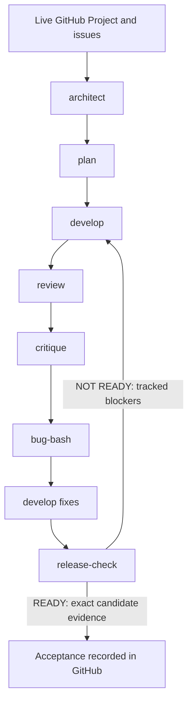

# CALIBER repository engineering framework

This framework supports **OpenAI Codex and Claude Code**. It defines shared engineering behavior;
the coding environment supplies model execution and tools. Begin with the mandatory
[engineering policy](engineering-policy.md) and [GitHub integration](github/project-integration.md).

## Command routing

A target is a live Project Release value, Delivery cycle value, or native milestone resolved by
the CLI. Use the actual name, including spaces. Unknown or ambiguous targets require resolution;
do not default to a particular release. Each command has exactly one canonical workflow.

| Command | Canonical workflow | Lead role |
| --- | --- | --- |
| [architect](commands/architect.md) | [Architecture](workflows/architecture.md) | [Architect](roles/architect.md) |
| [plan](commands/plan.md) | [Planning](workflows/planning.md) | [Planner](roles/planner.md) |
| [develop](commands/develop.md) | [Development](workflows/development.md) | [Developer](roles/developer.md) |
| [review](commands/review.md) | [Review](workflows/review.md) | [Reviewer](roles/reviewer.md) |
| [critique](commands/critique.md) | [Milestone critique](workflows/milestone-critique.md) | [Critic](roles/critic.md) |
| [bug-bash](commands/bug-bash.md) | [Bug bash](workflows/bug-bash.md) | [Bug basher](roles/bug-basher.md) |
| [release-check](commands/release-check.md) | [Release check](workflows/release-check.md) | [QA](roles/qa.md) |

Codex uses [AGENTS.md](../AGENTS.md) and repository instruction conventions, not newly registered
native slash commands. If the client does not accept `/develop <target>`, ask it to run the
`develop` command from this table for the target. Claude Code uses [CLAUDE.md](../CLAUDE.md) and
`.claude/commands/` prompt adapters. Both read these same command/workflow/role files. No separate
model prompts or alternative workflow implementations belong in tool adapters.

## Lifecycle and boundaries



Read live Project context at the start of **each** command, then inspect code. Architecture,
planning, review, critique and release-check do not implement product features. Bug bash may add
reproduction/regression tests through a PR. Development implements assigned eligible work and
continues through merge and verification subject to the policy and explicit assignment limits.
READY records a candidate decision; publication/deployment requires its own authorized task.

For development, aim for 3–4 agents only when available tools, dependencies and ownership permit.
One coordinator assigns disjoint tasks and worktrees, serializes shared contracts, reviews diffs
and integrates PRs. Sequential execution follows the same gates when subagents are unavailable.
Neither Markdown nor the CLI schedules agents, guarantees atomic claims, or runs a background loop.

## Local setup and verification

Use a checkout with Node.js 20 or newer, Git and authenticated `gh`; confirm the identity has repository and
Project read access. Writes require the corresponding issue/Project permissions; PR merge also
requires repository permission and protection gates. Reuse existing authentication and never
store tokens in these files. No model API key is required by this framework or ordinary CI.

From the repository root, use the integration CLI's supported interface:

```text
node .agents/bin/engineering.mjs schema
node .agents/bin/engineering.mjs context <command> <target>
node .agents/bin/engineering.mjs issue <target> --file <json> [--apply]
node .agents/bin/engineering.mjs transition <target> <issue-number> <phase> [--file <json>] [--apply]
```

Angle-bracket terms and square brackets are usage notation, not literal shell arguments. Quote
a target containing spaces. Mutations default to dry run; inspect the validated diff before
applying within the assigned authority. Use only the implemented payload contract; this Markdown
does not define JSON keys or extra CLI flags. If the CLI or its payload documentation is missing,
report that integration gap rather than claiming an operation ran.

Verify schema discovery and read-only context against the live Project, links and routing locally,
and mutation idempotency with the CLI's own tests before adopting unattended writes. Adapter files
are prompts; loading them does not prove the host can spawn agents. Existing
[CI](../.github/workflows/ci.yml), [local parity script](../scripts/ci-local.sh), component tests
and branch protections enforce deterministic gates. Discover applicable jobs afresh; do not infer
that Markdown itself installs a CI gate. See [CONTRIBUTING.md](../CONTRIBUTING.md) for environment setup and the detailed
[engineering contribution guide](../caliber/CONTRIBUTING.md) for CI-parity commands.

## Extending the framework

Change the canonical policy or workflow once, through a focused PR; update routes only if names
change. Keep detailed role standards in `roles/`, execution steps in `workflows/`, GitHub semantics
in `github/`, and tool adapters thin. Durable architecture/evidence may live in the repository;
roadmap, estimates, priorities, dependency execution state and decisions live in GitHub.
