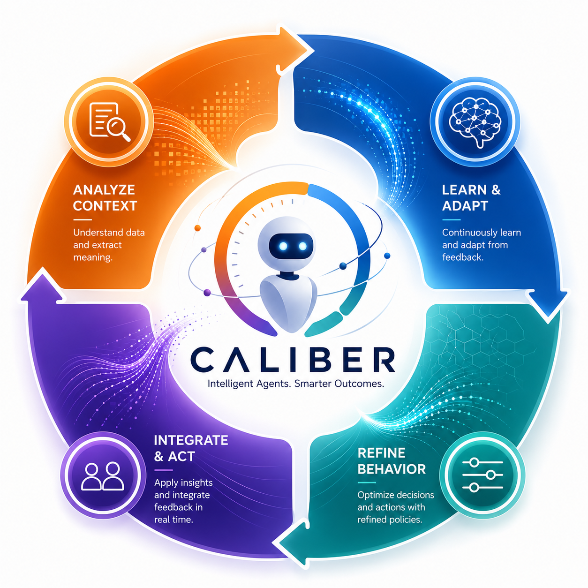
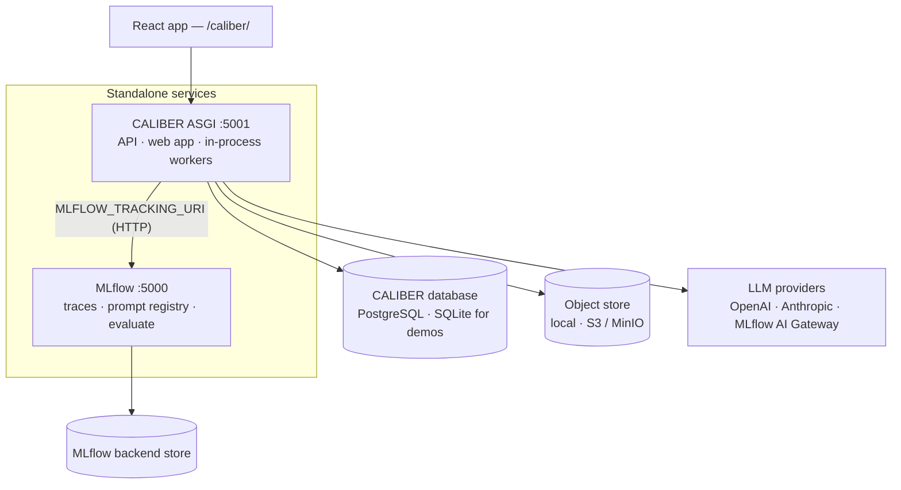

<div align="center">



# CALIBER Suite

### The MLflow-integrated control plane for trusted agentic workflows

**Author, evaluate, calibrate, release and observe AI-agent resources — prompts, skills, tools, workflows
and knowledge bases — with governance, an audit trail and a human in the loop, on infrastructure you
already run.**

[](https://github.com/rrahimi-uci/caliber-suite/actions/workflows/ci.yml)
[](./LICENSE)
[](./docs/start/alpha-scope.md)
[](./caliber/README.md)
[](https://mlflow.org)

**[Quickstart](#quickstart)** · **[First workflow](#your-first-workflow)** · **[Cookbooks](#cookbooks)** · **[Architecture](#architecture)** · **[Configuration](#configuration)** · **[Troubleshooting](#troubleshooting)** · **[Docs](#documentation)**

</div>

---

## What CALIBER is

CALIBER is a standalone ASGI service plus a React web app that sits next to an MLflow server and manages the
lifecycle of the things an AI agent is made of. For each of them it gives you the same loop:

> **author → test → calibrate → review → apply → see what is live → roll back**

with role-based access, an audit log of every governed action, and a person — not the model — deciding when a
change goes live. It reuses MLflow's Prompt Registry, tracing, artifact store and `genai.evaluate`, and talks to
MLflow only over HTTP (`MLFLOW_TRACKING_URI`). CALIBER runs as a **standalone** service; embedding it inside the
MLflow server process is not supported.

## What the Alpha (0.1.0a1) supports

This is an **alpha**. The table says what to rely on; [Alpha scope and limitations](docs/start/alpha-scope.md)
is the authoritative version.

| Tier | What is in it |
| --- | --- |
| **Core journey** (proven in CI on every change) | Prompts, test sets, evaluations, calibration, review and Apply, projects and roles, access tokens, the audit log, the release timeline, readiness |
| **Also in the alpha** | Skills, tools (for trusted authors), workflows (studio, queued runs, approvals), knowledge bases, the object-store console, judges, observability, the LLM gateway page, the Python SDK and `caliberctl` |
| **Preview, on by default** | **Aria**, the assistant (chat, plans and the helpers inside the prompt workspace) |
| **Preview, off by default** | MCP servers and OpenAPI integrations (`CALIBER_FEATURE_INTEGRATIONS`), the cookbook gallery (`CALIBER_FEATURE_COOKBOOKS`), release-candidate signoff and workspace releases (`CALIBER_FEATURE_RELEASE_CANDIDATES`) |
| **Not in the alpha** | Memory, and trace-to-refinement automation: nothing watches production traces, and verifying an item in a queue does not start a job |

## Quickstart

The shortest path runs the whole suite in containers. You need **Docker with Compose v2.20 or newer** and
**Git**. You do not need Python or Node on the host for this part. Budget about 10 GB of disk for the images and
several minutes for the first build.

You also need **an OpenAI API key**. CALIBER uses it for workflow agents, calibration, judges, evaluation and
Aria. An Anthropic key is optional (Aria and knowledge-base answers can use Claude); see
[Configuration](#configuration) for exactly what each key drives. No key? The stack still starts, but the
LLM, the evaluator and Aria are simulated and the app says so on every screen that shows their output.

**1. Clone and configure**

```bash
git clone https://github.com/rrahimi-uci/caliber-suite.git
cd caliber-suite
cp .env.example .env
```

Open `.env` and set `OPENAI_API_KEY=` (and, optionally, `ANTHROPIC_API_KEY=`). `.env` is git-ignored; it is the
one place your keys live.

**2. Start**

```bash
./start.sh        # or: make start
```

The first run builds the images, then waits for CALIBER's health check and prints the URLs. `./start.sh --help`
lists the options. It refuses to start, with the reason, if Docker or Compose is missing, the daemon is down, or a
port it needs is taken.

**3. Open it**

Open **http://127.0.0.1:5001/caliber/** and sign in as **`admin` / `admin`**. This first-boot account exists
only on a fresh database and is meant for a machine only you can reach: change the password under
**Administration** straight away.

**4. Verify that it is healthy**

```bash
curl -s http://127.0.0.1:5001/ajax-api/2.0/mlflow/caliber/readiness | python3 -m json.tool
```

You want `"ready": true`. With your key in `.env`, `"all_real": true` and `"all_ai_real": true` say that nothing
is simulated, and `ai_components` lists each AI-backed part (workflow agents, evaluation, workflow judge, Aria,
knowledge answers) as `real`, `simulated`, `unconfigured` or `off`. `./start.sh` prints the same summary under
the URLs when it finishes.

**5. Stop, restart, reset**

```bash
./stop.sh         # stops the containers; your data volumes are kept
./start.sh        # starts again with everything as you left it
make infra-reset  # DELETES the data volumes (Postgres, MinIO, ...): a clean slate
```

| Service | URL |
| --- | --- |
| CALIBER web app | http://127.0.0.1:5001/caliber/ |
| CALIBER API | http://127.0.0.1:5001/ajax-api/2.0/mlflow/caliber/ (OpenAPI document at `/openapi.json` on the same host) |
| MLflow | http://127.0.0.1:5000 (the next free port if 5000 is busy; `start.sh` says which) |
| LLM gateway (MLflow AI Gateway) | http://127.0.0.1:5002/api/2.0/endpoints/ |
| MinIO console | http://127.0.0.1:9001 (`minioadmin` / `minioadmin`) |

### Without Docker

You need Python 3.10–3.12. [Alpha install](docs/start/alpha-install.md) is the full guide (it installs from wheels
and is the path `scripts/verify-alpha-install.sh` checks end to end). From a checkout it is three terminals' worth
of commands; the order matters, because the server never creates its own tables:

```bash
cd caliber && make install && . .venv/bin/activate     # server, MLflow and the provider extras
export CALIBER_DATABASE_URL=sqlite:///$PWD/caliber.db
caliber-migrate                                         # creates the tables; run it before every first start and after upgrades

# terminal 2, same venv and the same caliber/ directory: MLflow on its own SQLite file
mlflow server --backend-store-uri sqlite:///$PWD/mlflow.db \
  --default-artifact-root $PWD/mlflow-artifacts --host 127.0.0.1 --port 5000

# terminal 1: CALIBER. Load .env first (the server does not read it itself), then:
set -a; . ../.env; set +a
export MLFLOW_TRACKING_URI=http://127.0.0.1:5000
export CALIBER_ADMIN_USERS=admin CALIBER_OPERATOR_USERS=admin CALIBER_APPROVER_USERS=admin
export CALIBER_PROMOTER_PROVIDER=mlflow CALIBER_ARTIFACT_STORE_PROVIDER=mlflow
export CALIBER_LLM_PROVIDER=auto CALIBER_EVAL_PROVIDER=auto CALIBER_LOG_SINK=stderr
export CALIBER_AUTH_SESSION_COOKIE_SECURE=false CALIBER_AUTH_BOOTSTRAP_ALLOW_INSECURE_DEFAULT=true
uvicorn caliber.server:create_app --factory --host 127.0.0.1 --port 5001
```

Then verify as in step 4 above. The `CALIBER_AUTH_…` lines create the `admin` / `admin` first-boot account for a
machine only you can reach; never carry them into a network-reachable deployment. Stop with Ctrl-C in each terminal.

## Your first workflow

The journey the Alpha stands behind is a prompt's whole life, and every step is a screen in the app and a call in
the Python SDK:

1. **Prompts → New prompt**: write a prompt (the *Describe it* start asks Aria to draft one; it needs your key).
2. **Test Sets**: add a handful of examples (or import a JSONL file).
3. **The prompt's Calibration stage**: run a calibration. You get a candidate version with evaluation evidence.
4. **Review → Apply**: read the diff and the evidence, then explicitly apply it to the live alias.
5. **Releases**: see what is live and which job, dataset version and evaluation put it there.
6. **Roll it back** from the same page, and read the **Audit Log**.

With a real key the evidence is a real measurement; without one it is canned and labelled as such.

**The same from Python** (the SDK is not on PyPI yet; install it from the checkout):

```bash
python3 -m venv .venv && . .venv/bin/activate
pip install -e sdk/caliber-sdk
curl -s -c jar -X POST http://127.0.0.1:5001/ajax-api/2.0/mlflow/caliber/auth/login \
  -H 'content-type: application/json' -d '{"user_id":"admin","password":"admin"}' >/dev/null
export CALIBER_BASE_URL=http://127.0.0.1:5001
export CALIBER_TOKEN=$(curl -s -b jar -X POST http://127.0.0.1:5001/ajax-api/2.0/mlflow/caliber/auth/tokens \
  -H 'content-type: application/json' -d '{"name":"first-run"}' | python3 -c 'import sys,json; print(json.load(sys.stdin)["data"]["token"])')
python -c 'from caliber_sdk import CaliberClient; print(CaliberClient().whoami())'
```

## Cookbooks

Twenty hands-on labs, each a complete user workflow with its own sample data, a runnable SDK script, a browser
test (where the feature has a UI) and a step-by-step README: [`docs-site/cookbooks/`](docs-site/cookbooks/README.md).
They are the best way to learn the platform, and they run against a disposable stack that does not touch the one
you started above.

One-time setup, from the repository root (Python 3.10–3.12, Node.js 20.19+, `curl` and `jq` are needed):

```bash
cd caliber && make install && cd ..                                   # creates caliber/.venv
caliber/.venv/bin/pip install -e sdk/caliber-sdk -e sdk/caliber-cli
```

Then run a lab (Lab 01, the prompt release loop, is a good first one):

```bash
scripts/cookbook-env.sh up lab01 --flags cookbooks                    # a disposable stack on free ports
source .tmp/cookbook-env/lab01/env.sh                                 # exports CALIBER_URL, CALIBER_API, ...
# then follow docs-site/cookbooks/01-prompt-regression-lab/README.md ("Run it through the API")
scripts/cookbook-env.sh down lab01                                    # stop it (state is kept)
```

Labs run **deterministically with simulated providers by default**, so their results reproduce exactly; add
`--real-llm` to `up` to run one on real models with the keys from your `.env`. Each lab README says what is real
and what is simulated.

| Labs | Teach | Flags besides `cookbooks` |
| --- | --- | --- |
| 01 Trustworthy Intake Classifier · 02 Precision Skills · 03 Policy-Safe Decision Tool | the prompt, skill and tool release loops | none |
| 04 Document-to-JSON · 06 Grounded Knowledge Assistant | object store pipelines · knowledge bases | none (`--s3`) |
| 05 Governed Tool Connectivity · 19 Governed OpenAPI Tool | MCP servers · OpenAPI integrations | `integrations` |
| 07 Support Triage · 08 Incident Response · 09 Self-Healing Workflows · 16 Observability & Triage | workflows, approvals, deploy gates, traces | none |
| 10 Trustworthy Evaluation · 11 Release Signoff Factory | judges and human review · release signoff | `release_candidates` for 11 |
| 12–15 Aria labs | Aria plans: evaluation harness, review queue, governance kit, recalibrate loop | `aria` (on by default) |
| 18 Projects, Roles, Tokens & Audit | team setup and access control | none |
| 20 Metered LLM Gateway | gateway discovery, model pricing, exact usage cost | none (`--real-llm`) |
| 21 Workspace Source-to-Release | revisions, change requests, release gate (API-first, no UI) | `release_candidates` |

(Lab 17 is a standalone SDK script, `sdk/caliber-sdk/examples/cookbooks/cookbook_17_financial_analysis.py`.)
To run every lab: `scripts/cookbook-run-all.sh`.

## Architecture



- **MLflow-integrated, not MLflow-embedded.** CALIBER and MLflow are separate processes with separate databases
  and separate migration owners; they meet only over HTTP.
- **One control-plane codebase.** Pollers, schedulers, calibration drains and the workflow, knowledge and
  assistant workers run inside the CALIBER process; there is no separate worker tier.
- **Explicit state.** Relational metadata lives in `CALIBER_DATABASE_URL`, prompt versions and traces in MLflow,
  file bytes in the object store. The server never creates its own tables: `caliber-migrate` does (the
  container runs it for you).

The layered view (six layers, the governed-asset anatomy, the per-asset guarantees) is in
[`ARCHITECTURE.md`](ARCHITECTURE.md).

### Repository layout

| Path | What it is |
| --- | --- |
| [`caliber/`](caliber/README.md) | the server package (`caliber-suite`): API, workers, migrations, and `caliber-ui/`, the React app |
| [`sdk/`](sdk/caliber-sdk/README.md) | `caliber-sdk` (typed Python client), `caliber-cli` (`caliberctl`), `caliber-plugin-sdk` |
| [`deploy/`](deploy/README.md) | the Docker stack: Compose files, images for CALIBER, MLflow and the gateway |
| [`scripts/`](scripts/) | launchers and verification: `cookbook-env.sh`, `cookbook-run-all.sh`, `verify-*.sh`, `ci-local.sh` |
| [`docs/`](docs/) | the documentation sources (start, build, use, operate, API, SDK, reports) |
| [`docs-site/`](docs-site/) | the generated documentation site and all cookbook labs (`docs-site/cookbooks/`) |
| `start.sh`, `stop.sh`, `test-all.sh`, `Makefile` | the commands in this README |

## Configuration

Everything is configured through environment variables, which the Docker stack takes from your `.env`
(`.env.example` documents each one). The ones you will touch first:

| Variable | What it does |
| --- | --- |
| `OPENAI_API_KEY` | **Drives the whole platform**: workflow agents, calibration, judges, evaluation and Aria |
| `ANTHROPIC_API_KEY` | Optional. Aria and knowledge-base answers use Claude when there is no OpenAI key. Workflow agents and calibration are OpenAI-only in this alpha, so Anthropic alone cannot run them |
| `CALIBER_LLM_PROVIDER` · `CALIBER_EVAL_PROVIDER` | `auto` (the container default): **real when a key is present**, simulated and reported when not. Or `openai` / `mlflow` to *require* real ones, `fake` to opt out |
| `CALIBER_ASSISTANT_ENGINE` | `auto` picks OpenAI, then Anthropic, by key; or force `openai`, `anthropic`, `ollama` |
| `CALIBER_ADMIN_USERS` · `CALIBER_OPERATOR_USERS` · `CALIBER_APPROVER_USERS` | which users may do what (compose defaults them to `admin`) |
| `CALIBER_FEATURE_ARIA` · `_INTEGRATIONS` · `_COOKBOOKS` · `_RELEASE_CANDIDATES` | the four preview areas: Aria is on by default, the rest off |
| `CALIBER_PORT` · `MLFLOW_PORT` · `MLFLOW_GATEWAY_PORT` | host ports |

After editing `.env`, run `./start.sh` again. Keys are read from the environment, never stored in the database
or returned by the API. Full reference: [Configuration and provider setup](docs/operate/configuration-and-provider-setup.md).

## Testing

| Command | What it runs |
| --- | --- |
| `make setup` then `make test` | backend (pytest) and web-app unit tests |
| `make lint` | ruff, mypy and the TypeScript check |
| `./test-all.sh` | backend, web-app unit tests and the Playwright end-to-end suite, with an Allure report (needs Java; `--no-allure` skips the report) |
| `scripts/ci-local.sh --list` | the CI jobs you can reproduce locally; `scripts/ci-local.sh <job>` runs one |
| `scripts/verify-alpha-install.sh --python python3.12` | installs from wheels in a scratch directory and checks it end to end |
| `scripts/verify-compose-stack.sh` | builds and boots the Docker stack in its own project and checks it |
| `scripts/cookbook-run-all.sh` | every cookbook lab, API and browser |

## Troubleshooting

| You see | Why | Fix |
| --- | --- | --- |
| `start.sh` says a port is in use | something else holds 5000/5001/5002/5432/9000/9001/8081/8082 | stop it, or set `MLFLOW_PORT`, `CALIBER_PORT`, `MLFLOW_GATEWAY_PORT` in `.env`. On macOS, AirPlay Receiver uses port 5000; `start.sh` moves MLflow to the next free port |
| `start.sh` fails before building | Docker, Compose v2.20+ or the daemon is missing | install or start Docker Desktop; the message names which |
| The first start takes many minutes | the images are being built | wait; `./start.sh` waits up to 10 minutes for CALIBER (`START_TIMEOUT`) |
| `admin` / `admin` is rejected | the database already had accounts, or a password was set | use the password you set, or `make infra-reset` for a fresh database |
| Login works but creating a project is refused | no role list names you | set `CALIBER_ADMIN_USERS` (compose defaults it to `admin`) and run `./start.sh` |
| `/readiness` shows `simulated` components or Aria says it needs a key | no API key reached the container | put `OPENAI_API_KEY` in `.env` (not only in your shell) and run `./start.sh` again |
| Evaluation answers `400 evaluation requires a real LLM provider` | the LLM is simulated | same fix: add the key |
| The Cookbooks, MCP or OpenAPI pages are missing or answer 404 | those preview areas are off by default | set the matching `CALIBER_FEATURE_*=true` in `.env` and run `./start.sh` |
| `Aria cannot answer yet: ... is not set` | no engine key | add `OPENAI_API_KEY` or `ANTHROPIC_API_KEY` to `.env` and restart |

More: [Health and readiness](docs/operate/health-and-readiness.md), [Local bring-up](docs/operate/local-bring-up.md)
and the [alpha install troubleshooting table](docs/start/alpha-install.md#if-something-is-wrong).

## Known Alpha limitations

Read these before relying on the alpha; the full list is in [Alpha scope](docs/start/alpha-scope.md#known-limitations).

- Nothing watches production traces and starts a refinement from a flagged one; calibration starts from a prompt
  and a test set that you create.
- With no key, the LLM and the evaluator are simulated (and labelled) — the offline default. Evaluations are
  refused on the simulated stack rather than faked.
- Apply has no two-person rule: one owner or editor can review and apply a candidate.
- Traces and MLflow data are not scoped to a project: anyone who can sign in can read them.
- Workspace release evaluations have no executor; the cookbook for that area demonstrates the boundary.
- Tools run in a process sandbox, not a container: register tools only from authors you trust.
- Knowledge bases need an S3-compatible store and, for real embeddings, the `knowledge-local` extra.
- No HA, SSO or MFA, and the packages are not on PyPI yet (install from a checkout or the release wheels).

## Documentation

| | |
| --- | --- |
| **Start here** | [Alpha scope](docs/start/alpha-scope.md) · [Alpha install](docs/start/alpha-install.md) · [5-minute quickstart](docs/start/five-minute-quickstart.md) · [Choose your path](docs/start/choose-your-path.md) |
| **Use it** | [Prompts](docs/use/prompts.md) · [Skills](docs/use/skills.md) · [Tools](docs/use/tools.md) · [Workflows](docs/use/workflows.md) · [Knowledge bases](docs/use/knowledge-bases.md) · [Aria](docs/use/aria-assistant.md) |
| **Integrate** | [SDK guide](docs/sdk/guide.md) · [REST API](docs/api/overview.md) · [CLI](docs/sdk/cli.md) |
| **Operate** | [Local bring-up](docs/operate/local-bring-up.md) · [Configuration](docs/operate/configuration-and-provider-setup.md) · [Health and readiness](docs/operate/health-and-readiness.md) · [Releasing](docs/operate/releasing.md) |
| **Understand** | [`ARCHITECTURE.md`](ARCHITECTURE.md) · [Alpha feature coverage matrix](docs/reports/alpha-feature-coverage-matrix.md) · [Release notes](docs/reports/release-0.1.0a1-notes.md) · [Changelog](caliber/CHANGELOG.md) |
| **Browse** | the [documentation site](docs-site/index.html) (also served in the app at `/caliber/docs/`) · published at [rrahimi-uci.github.io/caliber-suite](https://rrahimi-uci.github.io/caliber-suite/) |

## Design principles

Ten principles govern what CALIBER builds and what it refuses to build, ordered deliberately — purpose and trust
first, then capability and architecture, then operational quality, and finally technology choices and longevity.
When two pull against each other, the lower number wins.

| # | Principle | |
| --- | --- | --- |
| 1 | **Governed Agentic Workflows** | Governance, security, compliance, and policy enforcement at the core. |
| 2 | **Progressive Autonomy** | The path from human-led processes to fully autonomous agent-driven execution. |
| 3 | **Auditability & Observability** | Every workflow, decision, and agent action traceable, transparent, and explainable. |
| 4 | **Evaluation by Design** | Testing, verification, validation, benchmarking, calibration, and optimization from the start. |
| 5 | **Open & Extensible** | Enterprise systems, AI models, tools, and external agent platforms through open APIs and SDKs. |
| 6 | **Modular & Composable** | Loosely coupled components that are reusable, flexible, and easy to extend. |
| 7 | **Scalable & Reliable** | Enterprise-grade performance, resilience, and operational reliability. |
| 8 | **Open-Source First** | Proven open-source building blocks with strong community support. |
| 9 | **Developer & User Friendly** | A clear, productive experience for both developers and business users. |
| 10 | **Future Ready** | Evolving AI capabilities, orchestration patterns, and enterprise needs. |

[`ARCHITECTURE.md`](./ARCHITECTURE.md#design-principles) is the canonical statement, and maps each principle to
the mechanism that discharges it — including where a mechanism is partial and says so.

## Contributing

Issues and pull requests are welcome; [`CONTRIBUTING.md`](CONTRIBUTING.md) covers the dev setup, the checks CI
runs, generated docs, and the pull-request template. Report security issues as described in
[`SECURITY.md`](SECURITY.md), and please follow the [Code of Conduct](CODE_OF_CONDUCT.md).

## License

Apache-2.0. See [`LICENSE`](LICENSE).
