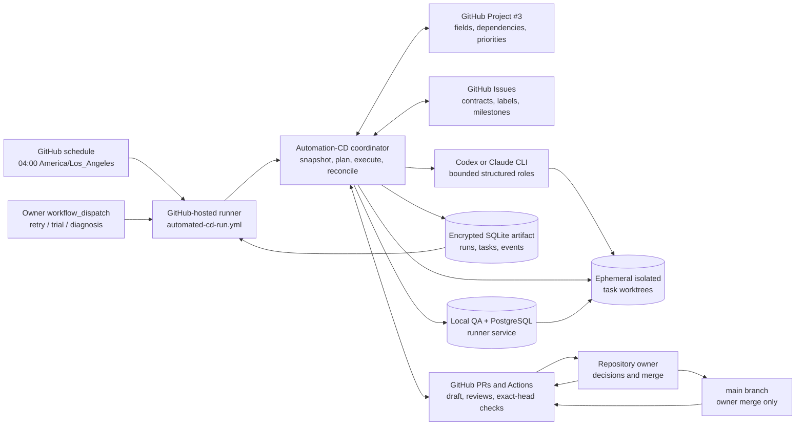
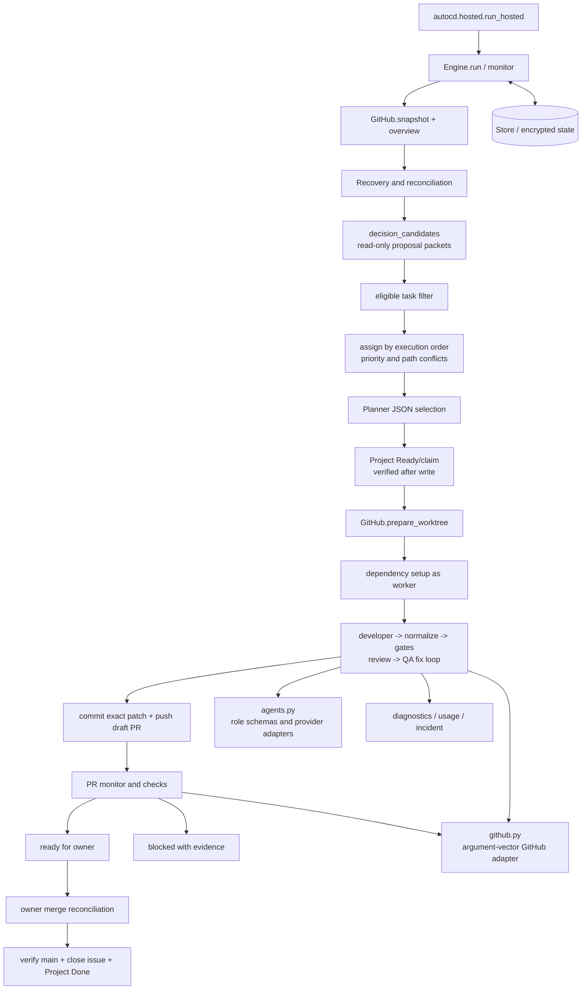
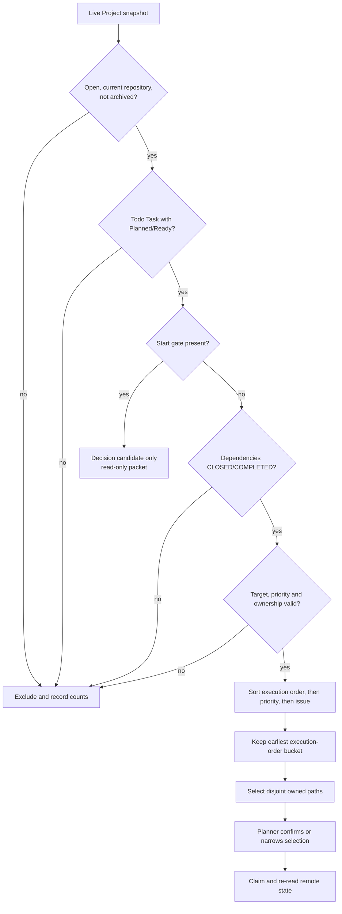
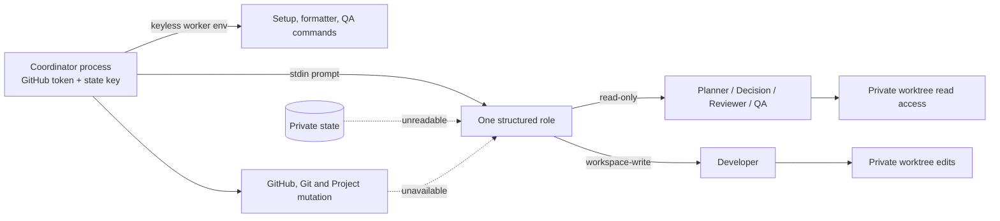
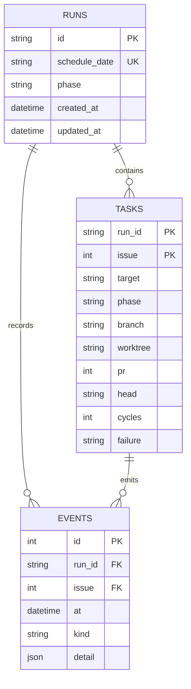
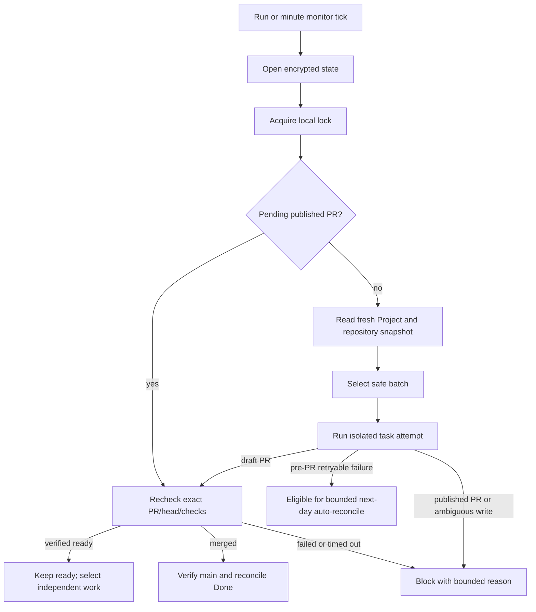
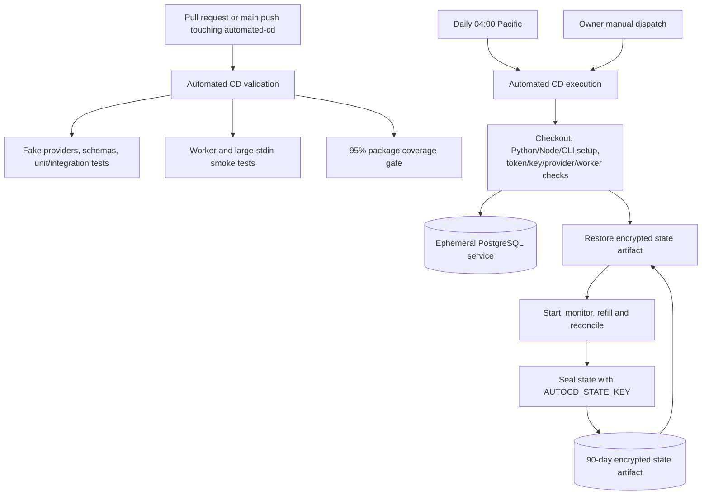

# CALIBER Automation-CD architecture

This is the canonical architecture reference for the Automation-CD coordinator in
this directory. It describes the checked-in implementation and its safe operating
boundaries; it is not a promise that every Project item is executable today.

The system is designed to move every *safe, executable* Task through development,
validation, review, and pull-request handoff without requiring a human to perform
routine orchestration. Human participation remains an explicit control point for
start decisions that are marked `: start` and for the final merge under the
repository's review policy. The coordinator never treats model output as approval,
never silently invents scope, and never converts an ambiguous interruption into a
new write.

The implementation is split between the [coordinator package](src/autocd/), the
[workflow configuration](config/workflow.toml), and the two GitHub Actions
workflows ([validation](../.github/workflows/automated-cd.yml) and
[execution](../.github/workflows/automated-cd-run.yml)). The operational setup and
runbook remain in the [Automation-CD README](README.md).

## 1. Purpose and non-goals

### Purpose

Automation-CD is a guarded development coordinator for CALIBER Project #3. A
successful task attempt should produce a draft PR containing the reviewed candidate,
the exact local validation evidence, and the issue/Project transition evidence needed
for owner review. A task counts as complete only after the merged PR is verified on
`main`, the issue is closed as `COMPLETED`, and the Project item is `Done`/`Done`.

The daily target is a scheduling objective, not a correctness shortcut. Open PRs,
model approvals, or a green local worktree do not count as Done.

### Non-goals

| Boundary | Explicit behavior |
| --- | --- |
| Backlog ownership | The GitHub Project and linked issues are authoritative. SQLite records execution evidence and is never a second backlog. |
| Merge authority | The checked-in configuration has `auto_merge = false`; PRs remain open for owner review and merge. The repository policy forbids the agent from merging. |
| Deployment | The workflow does not deploy application code or bypass deployment controls. |
| Decision authority | A decision agent can prepare a bounded proposal, but cannot approve a `: start` gate or change Project fields. |
| Scope discovery | The coordinator does not infer writable paths from prose. Hosted execution requires validated `owned_paths` metadata or an explicit reviewed configuration override. |
| Ambiguous recovery | An interrupted write is blocked for reconciliation; it is not replayed automatically. |
| CI substitution | Local checks are pre-publication evidence. Exact-head required GitHub checks remain the PR merge gate. |

## 2. Design principles

1. **Authoritative state is remote.** Project fields, native `blockedBy`
   relationships, issue state, PR state, check rollups, and the base branch decide
   what is true. Local state makes execution recoverable but cannot authorize work
   that the live Project does not authorize.
2. **Fail closed.** Missing credentials, schema drift, incomplete snapshots,
   unbounded ownership, missing checks, unknown model cost, and unsafe paths stop the
   relevant action instead of being treated as success.
3. **Separate advice from mutation.** Planner and decision roles return structured
   data; only the coordinator performs GitHub and Git mutations. A decision packet is
   evidence for a human, not a transition.
4. **Review the exact bytes that are published.** The coordinator captures the
   candidate diff, runs gates, passes the same patch to review, and verifies that the
   staged patch is byte-for-byte the reviewed patch before pushing.
5. **Bound every resource.** Daily attempts, model spend, model stalls, QA command
   time, CI wait time, review cycles, fix attempts, worker count, diff size, and
   hosted-runner time are all bounded.
6. **Keep the pipeline moving around owner review.** A verified PR waiting only for
   the owner does not block later eligible tasks. The monitor reconciles it on every
   tick while the scheduler continues with independent work.

## 3. System context



### Authority and trust boundaries

| System or actor | Authority | What it may do | What it may not do |
| --- | --- | --- | --- |
| GitHub Project + issues | Planning and workflow truth | Define Task type, Status, Readiness, Release/milestone, Priority, Human input, dependencies, and ownership metadata | Provide proof that local code or CI is correct by itself |
| Coordinator | Controlled orchestrator | Read remote state; claim eligible work; create worktrees; run checks; publish draft PRs; reconcile verified merges | Override Project gates, infer scope, or merge under the checked-in policy |
| Encrypted SQLite | Execution ledger | Persist run reservations, task phases, PR/head identity, failures, and append-only audit events | Authorize a task that the live Project no longer authorizes |
| Model roles | Bounded advisory/editing workers | Plan, propose decisions, edit a private worktree, review, or assess QA according to role schema | Access coordinator credentials; mutate GitHub; merge; deploy; approve a human gate |
| GitHub PR and Actions | Publication and CI truth | Record the published commit, independent review, required checks, mergeability, and merge result | Replace the Project's dependency/readiness model |
| Owner | Final governance boundary | Resolve explicit decisions and review/merge a ready PR | Be represented by a model self-review or an unverified claim |

## 4. Component architecture



| Component | Implementation | Responsibility | Mutation authority |
| --- | --- | --- | --- |
| Hosted controller | `hosted.py` | Starts a run, monitors published PRs, refills safe batches, enforces the hosted deadline, and emits bounded public output | Calls `Engine`; does not bypass it |
| Orchestration engine | `engine.py` | Owns the task state machine, review/fix loops, recovery, exact-patch publication, and Done reconciliation | Only coordinator component with the complete mutation path |
| Project planner | `planner.py` | Parses Project snapshots; applies eligibility, dependency, target, priority, ownership, and path-conflict rules | Pure selection; no remote writes |
| GitHub adapter | `github.py` | Runs `gh`, Node helpers, and Git with argument vectors; reads snapshots and performs guarded transitions/PR operations | Coordinator token and local Git identity only |
| Agent adapters | `agents.py` | Runs Codex/Claude roles with schemas, bounded streams, timeouts, and provider-specific cost accounting | Model-local worktree access only |
| Durable store | `state.py` | SQLite WAL ledger, exclusive lock, task phases, PR/head identity, and audit events | Local state only; not backlog authority |
| State crypto | `state_crypto.py` | Authenticated AES-GCM seal/open of the state artifact | Key is supplied only to coordinator steps |
| Diagnostics | `diagnostics.py`, `incident.py`, `usage_report.py` | Produces fixed-code public summaries, optional encrypted incident evidence, and bounded usage metrics | Read-only with respect to task execution |
| Actions workflows | `.github/workflows/automated-cd*.yml` | Validate the package or run the hosted coordinator with services, preflight, artifact restore, and artifact sealing | GitHub runner orchestration |

## 5. End-to-end execution sequence

```mermaid
sequenceDiagram
    autonumber
    participant G as GitHub Actions
    participant C as Coordinator
    participant S as Project/Issues
    participant DB as Encrypted state
    participant M as Model role
    participant W as Worker worktree
    participant P as PR/CI
    participant O as Owner

    G->>C: Start scheduled or manual run
    C->>DB: Restore and acquire local lock
    C->>G: Validate state key, provider, token, worker and Project access
    C->>S: Snapshot Project, issues and dependencies; inspect PR/branch overview
    C->>DB: Recover safe PR states and record audit events
    C->>S: Find dependency-clear start-gated candidates
    C->>M: Request bounded read-only decision packet (optional)
    M-->>C: Structured options, evidence needs and safe offline work
    C->>S: Filter executable tasks and select earliest conflict-free batch
    C->>M: Ask planner to confirm the deterministic selection
    M-->>C: Structured selected issue numbers and reason
    C->>S: Promote Planned to Ready, claim Ready, then re-read snapshot
    C->>W: Create isolated branch/worktree and install task environment
    C->>M: Developer edits only the task worktree
    M-->>W: Structured implementation handoff
    C->>W: Normalize files and run every configured gate as keyless worker
    C->>M: Review exact candidate diff and QA evidence
    M-->>C: Structured review and acceptance verdict
    alt Gate, review or QA gap and attempts remain
        C->>M: Return coordinator evidence for a bounded fix attempt
        M-->>W: Edit the same private candidate
    else Candidate accepted
        C->>P: Commit exact reviewed patch and create draft PR
        C->>S: Move Project item to In Review and record reviewer status
        C->>P: Poll exact head, required checks, mergeability and reviews
        alt Ready and policy requires owner merge
            C->>P: Mark PR ready; keep it open
            P-->>O: Owner review and merge decision
            O->>P: Merge PR under branch protection
            C->>P: Verify merge commit is on main
            C->>S: Close issue COMPLETED and transition Project to Done
            C->>DB: Record merged_done and finish task
        else Failed, skipped, changed or stalled
            C->>S: Mark task Blocked with bounded reason
            C->>DB: Preserve PR/head/evidence; leave PR open
        end
    end
    C->>DB: Seal state artifact and upload for the next run
```

The hosted controller repeats the monitor-and-refill portion until one of these
conditions holds: the daily Done target is met, the daily attempt cap is reached,
there is no executable backlog, the model budget is exhausted or unverifiable, a
task/PR is blocked, or the safe hosted deadline is reached. A scheduled no-work run
may finish successfully; a requested manual trial fails if it cannot actually claim
the requested number of attempts.

## 6. Planning and task selection

### Eligibility contract

`planner.eligible()` applies these checks to the live Project snapshot. Every check is
deliberate: a task that fails one is excluded rather than guessed into execution.

| Gate | Required live condition |
| --- | --- |
| Repository and scope | The item belongs to the configured repository and, when a release view is configured, has the view's release label. Archived items are excluded. |
| Work type and status | Issue is open; Project `Status=Todo`; Project `Item type=Task`. |
| Readiness | `Readiness` is `Planned` or `Ready`. A Planned task is promoted through the governed Ready transition only after selection. |
| Human input | `Human input=None pending`, or every listed gate is acceptance-only. Any `: start`, unknown, or unassessed decision blocks coding. |
| Native dependencies | Every `blockedBy` issue is `CLOSED` with `stateReason=COMPLETED`. Unknown or not-planned closure does not satisfy the dependency. |
| Destination and priority | A configured `Release` or issue milestone exists, and `Priority` is one of P0–P3. |
| Ownership | Hosted execution requires one validated non-empty `owned_paths` marker or a configured `issue_paths` override. Unsafe paths, duplicate markers, or malformed JSON are rejected. |
| Exclusivity | The issue is unassigned and has no open PR. A configured allowlist may further narrow the candidates. |

### Ordering and parallelism



The deterministic selector runs before the model planner:

- If any candidate has an `Execution order`, only the earliest numeric order is
  considered. Within that bucket, priority and issue number provide deterministic
  ordering.
- Two tasks conflict when their paths overlap, one contains the other, or either
  task has unknown/empty ownership. Unknown ownership therefore serializes rather
  than enabling unsafe parallel writes.
- `max_workers` limits the thread pool, while the daily attempt and Done ceilings
  limit the batch size.
- The planner can remove a deterministic candidate by returning a narrower valid
  selection, but the engine intersects its answer with the already selected set. It
  cannot add an ineligible issue or change the dependency/order rules.

### Decision candidates are not executable candidates

`planner.decision_candidates()` uses a separate type with no writable paths. It can
prepare a packet only when the task is dependency-clear, targetable, prioritized,
unclaimed, PR-free, and held by an explicit start gate. The decision role must return:

- the gate and concrete question;
- two to four distinct options with impact and reversibility;
- a recommendation and rationale;
- safe offline work and explicitly blocked work;
- evidence still needed and risks.

The packet is fingerprinted from the candidate's current contract and stored once per
stable input. The coordinator exposes only issue, gate, status, option count, and a
fixed failure code in public hosted output. The full packet remains in encrypted
state. A packet never claims the decision was made.

## 7. Task state machine

```mermaid
stateDiagram-v2
    [*] --> claimed: Ready task claimed
    claimed --> developing: setup succeeds
    claimed --> blocked: interrupted or setup failure
    developing --> reviewing: developer handoff + gates captured
    developing --> blocked: blocker, scope or no-change failure
    reviewing --> developing: failing gate/finding and fix remains
    reviewing --> qa: review approved and gates pass
    reviewing --> blocked: review cycles exhausted
    qa --> developing: acceptance gap and cycle remains
    qa --> blocked: QA gap or cycle exhaustion
    qa --> pr_open: acceptance verified
    pr_open --> ci_wait: exact reviewed commit pushed; draft PR created
    ci_wait --> ready: required checks and PR state pass
    ci_wait --> blocked: changed head, failed/skipped checks, review change or timeout
    ready --> ready: owner review/merge still pending
    ready --> merged_unreconciled: owner merges
    blocked --> merged_unreconciled: owner merges a blocked PR
    merged_unreconciled --> done: merge on main + issue/Project Done verified
    merged_unreconciled --> blocked: reconciliation error remains
    done --> [*]
```



| Local phase | Remote meaning | Recovery behavior |
| --- | --- | --- |
| `claimed` | Coordinator has started a task attempt and is claiming Project ownership | Interruption is ambiguous; block and inspect before retry |
| `developing` | Private worktree is being edited | Never replay automatically after process loss |
| `reviewing` | Candidate snapshot and gate evidence are under review | Reconcile manually if interrupted |
| `qa` | Acceptance and coverage evidence are being assessed | Reconcile manually if interrupted |
| `pr_open` | Publication is in progress | Reconcile manually if interrupted because a push or PR may exist |
| `ci_wait` | Published PR exists at an expected head | Re-check exact PR identity and required checks |
| `ready` | PR is ready for owner review/merge | Does not block selection of another independent task |
| `merged_unreconciled` | GitHub reports merge but Done bookkeeping is incomplete | Verify the merge on `main`, then retry issue/Project reconciliation |
| `done` | Verified merge, completed issue, and Project Done/Done | Terminal local task state |
| `blocked` | The coordinator cannot safely continue | Eligible pre-PR failures may be auto-returned to Ready on a later day; published or ambiguous work remains for reconciliation |

The store also records `failed` at the run/task ledger level for exceptional failure
paths. It is not treated as a successful task phase.

## 8. Agent roles and isolation



| Role | Input | Allowed behavior | Required output |
| --- | --- | --- | --- |
| Planner | Candidate list, conflicts, recent remote context | Read-only selection advice; cannot add candidates | Issue-number selection and nonempty reason |
| Decision | One dependency-clear start-gated task | Read-only repository inspection and option analysis | Gate, question, 2–4 options, recommendation, rationale, safe/blocked work, evidence, risks |
| Developer | Issue contract, owned branch, previous coordinator feedback | Edit only the assigned worktree. Provider sandbox is workspace-write for Codex; Claude is limited to file tools. No GitHub mutation. | Complete structured handoff: summary, decisions, risks, compatibility, migrations, docs, deployment, suggested/run tests, remaining work, blocker |
| Reviewer | Exact candidate diff, generated-artifact hashes, gate evidence, contract | Read-only defect and scope review | `approved` plus severity-rated findings |
| QA | Contract, changed paths, command evidence and coverage evidence | Read-only acceptance assessment | `approved` plus gaps |

All role outputs pass a JSON schema and additional semantic validation. Prompts are
sent through stdin so large diffs do not hit the operating-system argument-size
limit. Task input is explicitly treated as data and cannot override the role's
system constraints. The coordinator itself performs every authoritative gate and
does not trust a model's claim that a command passed.

### Credential and process boundary

- The model API key reaches only the CLI process. `GH_TOKEN`, `GITHUB_TOKEN`, the
  coordinator token, Git askpass, and model keys are removed from keyless worker and
  repository-test environments.
- Codex roles use `read-only` for non-developer roles and `workspace-write` for the
  developer, with no network for model-run commands. Claude roles use only
  `Read,Glob,Grep` unless the developer role is explicitly editable.
- Hosted execution creates the unprivileged `autocdqa` worker. The worker can use a
  task worktree but cannot read the coordinator state directory or replace the
  linked `.git` marker.
- The coordinator checks changed content for coordinator credentials before any
  commit/push and rejects changes to `.github/workflows/`, `.agents/`,
  `automated-cd/`, `AGENTS.md`, and other protected policy paths.

## 9. Durable state and data model



`state.py` creates a SQLite database in a mode-700 directory with WAL journaling.
The local `orchestrator.lock` uses an exclusive file lock unless overlap is
explicitly configured. The database contains:

- one `runs` row per run, with a unique scheduled Pacific date reservation;
- one `tasks` row per issue attempt, including branch, worktree, expected PR/head,
  review cycles, phase and bounded failure text;
- append-only `events` containing run starts, claims, phases, command audit events,
  model usage, decision fingerprints, checks, reviewer/QA verdicts, PR readiness and
  merge reconciliation.

The hosted runner seals a consistent SQLite backup, including any WAL state, as an
AES-GCM payload using the 32-byte `AUTOCD_STATE_KEY` and repository-specific
associated data. The encrypted artifact is retained for 90 days. A later run opens
it before planning. The artifact can contain model output and QA excerpts, so public
diagnostics deliberately expose only fixed labels, counts, issue numbers, and bounded
failure codes.

State continuity is intentionally fail closed: if a prior execution exists but no
valid state artifact can be restored, the workflow stops for reconciliation rather
than creating a second ledger and risking duplicate writes.

## 10. GitHub and Git integration

### Project snapshot

`GitHub.snapshot()` invokes `scripts/project_snapshot.mjs`, verifies the configured
repository/default branch/view identity, and returns the complete Project context.
Field and option IDs are discovered from the live Project rather than hardcoded.
The coordinator uses the repository's `.agents/bin/engineering.mjs transition` helper
for governed transitions; each transition performs a dry run and then an apply.

The important remote transitions are:

| Transition | Preconditions | Evidence written |
| --- | --- | --- |
| Planned -> Ready | Earliest eligible task; native dependencies complete; start gates clear | Execution order and dependency evidence |
| Ready -> In Progress | Fresh Ready task; dedicated branch/worktree | Owner/actor and branch |
| In Progress -> In Review | Open PR exists | PR URL/head and validation evidence |
| In Progress -> QA | Candidate is in QA review | Candidate and QA evidence |
| In Progress -> Blocked | Exact reason and next action are known | Bounded blocker evidence |
| Closed COMPLETED -> Done/Done | Merge verified on `main`; issue is closed as completed | PR, merge commit, required checks and acceptance evidence |

The coordinator re-reads after claiming and after Done transitions because Project
field updates and issue updates are not one atomic transaction.

### Candidate publication and PR monitoring

1. `prepare_worktree()` fetches `origin/main` and creates a branch named
   `autocd/issue-<number>-<run-prefix>` outside the repository and state directory.
2. The coordinator records the file list and binary diff against `origin/main`.
3. It normalizes changed text and generated docs, runs all configured checks, and
   passes the candidate snapshot to reviewer and QA roles.
4. `commit_and_push()` rechecks changed files, `git diff --check`, the staged binary
   diff, and the exact reviewed patch before committing and pushing.
5. `create_pr()` opens a draft PR using the repository template. The owner reviewer
   is requested where GitHub permits it; Copilot is observed through the repository
   ruleset rather than represented as a fabricated approval.
6. The monitor verifies the PR's expected head, branch, base branch, mergeability,
   review state, unresolved-thread policy, and required checks. Missing, pending,
   skipped, cancelled, or failing required checks are not a pass.
7. With `auto_merge=false`, the coordinator marks a verified PR ready and waits for
   the owner. It does not push revisions to a published PR. A later owner merge is
   reconciled even if the earlier local task row was Blocked.

## 11. Development, review, and QA pipeline

Each review cycle contains a coordinator-owned fix loop followed by independent
review and QA:

| Stage | Coordinator action | Stop condition |
| --- | --- | --- |
| Setup | Run configured setup commands as `autocdqa`; prepare CALIBER environment and services | Setup failure blocks the attempt |
| Developer | Send the issue contract and prior feedback to the editable role | Blocker, missing handoff fields, no changes, or unsafe path blocks/fixes |
| Normalize | Run changed-file Ruff fixes/formatting and whitespace normalization; synchronize generated docs when applicable | Sync failure returns a coordinator-owned failure |
| Local gates | Run every selected command, not only the first failure; capture bounded evidence | Failed rows are returned directly to developer while fix attempts remain |
| Coverage | Measure line-plus-branch coverage for each changed production Python module; default threshold is 85% unless a configured issue command governs the path | Missing references, invalid report, or shortfall fails the candidate |
| Review | Reviewer reads exact diff, source paths, generated artifact hashes, and command evidence | Any approval failure or blocking finding consumes a review cycle |
| QA | QA validates task acceptance and coverage evidence | Gaps return to the developer while cycles remain |
| Publication | Commit and push only the reviewed patch; create draft PR | Any exact-patch mismatch aborts publication |

The base local checks are:

```text
git diff --check
node .agents/bin/check.mjs
scripts/ci-local.sh docs-validation lint type-check test-smoke
```

Changed production Python also gets changed-module coverage unless an issue-specific
command supplies the required coverage evidence. Unsupported component paths (for
example UI, SDK, packaging, shell, or migration paths) require explicit issue
commands; a task cannot silently pass because the generic Python fallback did not
touch its component.

## 12. Reliability, idempotency, and failure handling



| Failure class | Safe response | Why |
| --- | --- | --- |
| Missing/invalid token, state key, Project, provider or worker preflight | Fail the workflow before task mutation | Prevents partial orchestration under unknown authority |
| Another local coordinator run | Scheduled run reports `busy`; manual run fails | Prevents duplicate local writes |
| Already-started scheduled date | No second scheduled reservation | Daily idempotency |
| Interrupted before PR | Mark Blocked, release no ambiguity automatically, retain ledger | A remote branch/PR may exist even if the process did not observe it |
| Clean pre-PR retryable failure | On a later Pacific day, verify no head/PR/remote branch, release the coordinator claim, and return to Ready at most `max_auto_retries` times | Makes transient failures actionable without replaying a published write |
| Scope/protected-path violation, developer blocker, unknown failure | Block for inspection; no automatic retry | A new attempt could repeat an unsafe or underspecified action |
| Published PR bookkeeping error | Keep PR in `ci_wait`; retry Project/reviewer bookkeeping on later checks | A PR already exists and should not be discarded because a secondary write failed |
| Head changed, required checks fail/skip, review changes, or CI stalls | Leave PR open and mark Blocked with exact-head context | The candidate must be revalidated; coordinator does not push an unreviewed revision |
| Owner merges a blocked PR | Reconcile `merged_unreconciled`, verify merge on `main`, then complete issue/Project bookkeeping | A valid owner merge must not be stranded by an earlier local status |
| Model cost missing after a started call | Charge configured unknown-call estimate or stop with `budget_unverifiable` | Prevents undercounting spend and unsafe continued calls |

The scheduler uses both a runner-local lock and a GitHub Actions concurrency group.
The engine also serializes remote/local mutation and model-budget accounting while
allowing up to `max_workers` disjoint tasks. `Store.active()` excludes `ready`, so a
PR awaiting only owner merge does not halt the next batch.

## 13. Security and privacy controls

| Control | Implementation |
| --- | --- |
| GitHub token | `AUTOCD_GH_TOKEN` is checked for owner, repository push permission, Project access, and an allowlisted `project`/`public_repo` scope set. The default `GITHUB_TOKEN` is not used for user Project access. |
| Model credentials | Passed only to the selected model CLI; removed from worker/test environments. |
| State confidentiality | State is mode 700 locally and AES-GCM encrypted before Actions upload. |
| Worker privilege | Model, setup, and QA work use unprivileged `autocdqa`; state directory and coordinator credentials are outside the worker boundary. |
| Prompt handling | Prompts travel over stdin; task input is data; role constraints are prepended and JSON schema is enforced. |
| Candidate leak prevention | Coordinator credential values are searched in the reviewed patch before commit. |
| Path protection | `.github/`, `.agents/`, `automated-cd/`, policy files, and workflow files are protected; owned-path checks reject unrelated edits. |
| Public diagnostics | Only fixed failure codes, counts, issue numbers, phase labels, and bounded CI job names are emitted. Raw model output and command excerpts stay private. |
| Incident export | Optional incident evidence requires a separate temporary `AUTOCD_DIAG_KEY` and is uploaded with one-day retention. |

## 14. Actions deployment topology



| Workflow | Trigger | Main purpose | External credentials |
| --- | --- | --- | --- |
| `automated-cd.yml` | PR/push paths under `automated-cd` or the two workflow files | Deterministic package tests, lint/format, coverage, worker isolation, fake-provider and schema smoke tests | None for ordinary validation; optional live Codex smoke is explicitly opt-in via repository variable |
| `automated-cd-run.yml` | Daily 04:00 Pacific schedule or manual dispatch on `main` | Run the real coordinator, restore/seal state, provide PostgreSQL for task QA, monitor/refill PRs, and report bounded diagnostics | `AUTOCD_GH_TOKEN`, `AUTOCD_STATE_KEY`, and provider key as configured |

The execution job has a 330-minute workflow timeout and invokes the coordinator with
a 300-minute shell timeout. `run_hosted()` uses a 16,800-second (280-minute) safe
working deadline and starts a refill only when at least 10,800 seconds remain. This
leaves time to seal state and upload the artifact instead of killing a task in the
middle of a write.

## 15. Checked-in operating limits

The effective defaults are in [`config/workflow.toml`](config/workflow.toml). Values
can be overridden through validated `AUTOCD_*` environment variables, but invalid
values fail configuration loading.

| Setting | Current default | Architectural effect |
| --- | ---: | --- |
| `daily_done_target` | 10 | Desired verified Done items for the Pacific day |
| `max_tasks_per_run` | 10 | Maximum new attempts for the Pacific day, including manual runs |
| `max_workers` | 2 | Maximum concurrent disjoint task workers |
| `auto_merge` | `false` | Keep PR merge with the owner under repository policy |
| `max_review_cycles` | 3 | Review/QA cycles per task |
| `max_fix_attempts` | 2 | Coordinator gate-fix turns before reviewer escalation |
| `max_auto_retries` | 2 | Next-day auto-returns for qualifying clean pre-PR blocks |
| `max_decision_proposals_per_run` | 2 | Read-only decision packets per run |
| `agent_timeout_seconds` / `stall_seconds` | 3600 / 900 | Model call hard timeout and no-output stall timeout |
| `qa_command_timeout_seconds` | 7200 | Maximum one local QA command |
| `ci_timeout_seconds` | 43200 | Maximum PR check/review wait before blocking |
| `daily_budget_usd` | 30.00 | Pacific-day aggregate model spend guard; zero disables the cap |
| `unknown_call_cost_usd` | 3.00 | Conservative estimate for a started call with no reported usage |
| `coverage_threshold` | 85% | Changed production Python line-plus-branch threshold |
| `require_owned_paths` | `true` | Reject hosted tasks without validated bounded ownership |
| `provider` / `model` | `codex_cli` / `gpt-5.6-luna` | Default structured model adapter and model |

## 16. Observability and runbook entry points

| Need | Safe entry point | Output boundary |
| --- | --- | --- |
| Read-only selection diagnosis | `python -m autocd.cli plan` or the workflow's preflight plan | No task claim or Project mutation |
| Inspect latest failure | Manual dispatch with `diagnose_state=true` | Bounded fixed-code summary from restored encrypted state |
| Export private incident evidence | `diagnose_state=true`, `export_incident=true`, and an issue number, with `AUTOCD_DIAG_KEY` | Encrypted one-day artifact; no raw evidence in standard logs |
| Measure attempts/time/spend | `python -m autocd.usage_report` in the hosted job | Counts and estimates only; unknown cost is not shown as zero |
| Retry a reconciled pre-PR task | Manual dispatch with `retry_issue=<number>` after branch/PR/claim reconciliation | One explicit issue; never combined with diagnosis |
| Understand a no-op | Inspect `eligible`, `selected`, `decision_candidates`, `remaining_to_target`, and Project fields | A no-op is not evidence that the backlog is empty unless the live filters establish it |

When a run fails, the workflow still attempts to seal and upload the state artifact
if restoration succeeded. The public failure line intentionally says to inspect the
encrypted artifact rather than printing issue bodies, prompts, command output, or
provider messages.

## 17. Trade-offs and known limits

| Trade-off | Reasoned choice |
| --- | --- |
| Human start/merge gates remain | Safe automation cannot infer product, release, security, or acceptance authority from a model recommendation. Decision packets reduce analysis work without granting approval. |
| Broad tasks remain out of unattended execution | A bounded ownership contract is safer than allowing an agent to discover a large write scope from prose. Decompose the issue or add reviewed metadata. |
| Published PRs do not receive an automatic revision push | Exact-head review and owner visibility are preserved. A future revision loop would need a separate guarded design, new tests, and explicit authority. |
| State is carried as an encrypted artifact | Hosted runners are ephemeral; durable encrypted state enables idempotent PR reconciliation without exposing private evidence. Artifact loss intentionally stops execution. |
| Local QA is comprehensive but not the merge authority | Runner-local checks shorten feedback before publication, while GitHub required checks remain independent and exact-head. |
| Throughput follows executable backlog | Dependencies, start gates, missing ownership, unsupported component checks, owner review, CI capacity, budget, and time can all reduce daily throughput. The system reports these as bounded states rather than pretending the Done target was met. |

## 18. Source and verification map

| Concern | Primary source | Validation evidence |
| --- | --- | --- |
| Scheduling, refill and strict manual trials | [`hosted.py`](src/autocd/hosted.py) and [`automated-cd-run.yml`](../.github/workflows/automated-cd-run.yml) | `automated-cd/tests/test_hosted.py`, `test_workflow_dispatch.py` |
| Eligibility, dependencies and path conflicts | [`planner.py`](src/autocd/planner.py) | `automated-cd/tests/test_planner.py` and related planner tests |
| Task state machine and exact patch publication | [`engine.py`](src/autocd/engine.py) | engine/recovery/PR tests under `automated-cd/tests/` |
| Provider schemas, stdin and isolation | [`agents.py`](src/autocd/agents.py) | agent/schema/provider tests and worker smoke steps in `automated-cd.yml` |
| GitHub transitions, PR checks and merge reconciliation | [`github.py`](src/autocd/github.py) | GitHub adapter and workflow-dispatch tests; live exact-head checks on the PR |
| State durability and confidentiality | [`state.py`](src/autocd/state.py), [`state_crypto.py`](src/autocd/state_crypto.py) | state/crypto tests and encrypted Actions artifact restore/seal steps |
| Public diagnostics and incident handling | [`diagnostics.py`](src/autocd/diagnostics.py), [`incident.py`](src/autocd/incident.py) | diagnostics/incident tests and manual diagnostic dispatch |

For a change to this architecture, update the implementation/configuration first,
then update this document and the README link. Documentation changes still go
through a dedicated PR and the normal Automation-CD validation workflow; they do not
authorize bypassing the repository's review and merge policy.
