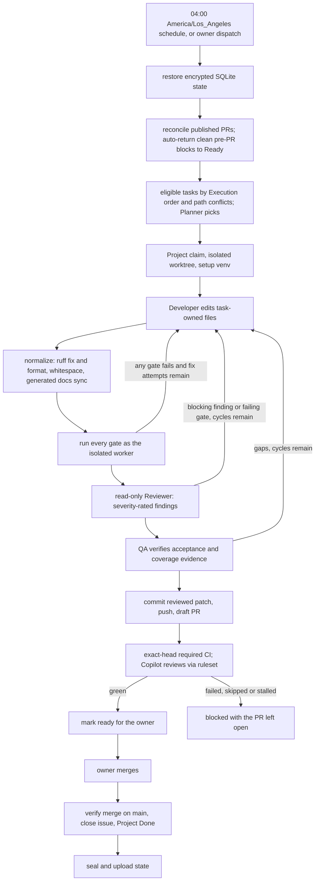

# Architecture and failure semantics

The coordinator runs CALIBER's daily automated development pipeline: it takes
executable Project tasks and delivers each one as a CI-green pull request for the
owner to review and merge. It is a small state machine around the canonical
`.agents` framework. The Project and linked issues are the authoritative
backlog; the encrypted SQLite state only records execution evidence and never
becomes a second backlog. It never merges a PR, deploys or bypasses branch
protection.

## Daily process

The hosted job refills: after a task finishes or blocks, it plans again until
the daily Done target, the backlog, the daily attempt cap, the model budget or
the runner time limit is reached. A PR waiting only for the owner's merge does
not hold up new tasks.

## Development loop

Model roles run through the Codex CLI by default (`gpt-5.6-luna`, `xhigh`
reasoning). Codex sandboxes every command the model runs: read-only for the
planner, reviewer and QA, workspace-write for the developer, and no network for
any of them. That lets the developer run focused tests, ruff and mypy before it
hands off. The API key is passed only to the Codex process as `CODEX_API_KEY`.
Before anything is committed, the coordinator rejects a candidate that contains
any coordinator credential, so a key read inside the sandbox cannot leave through
a pushed commit. The coordinator still runs every check itself, as the isolated
`autocdqa` worker with a keyless environment, and hands the results back. With
the Claude Code provider, the developer has no shell, and that loop is its only
feedback.

- **Normalize.** Before any check, the coordinator applies mechanical formatting
  to the changed files: `ruff check --fix` and `ruff format` on changed Python,
  plus trailing-whitespace and final-newline cleanup. It then synchronizes
  generated docs. Review sees the normalized candidate.
- **Gates.** Every gate runs, even after one fails:
  - the affected-component check;
  - `git diff --check`;
  - the `.agents` checks;
  - `scripts/ci-local.sh docs-validation lint type-check test-smoke`;
  - any issue-specific commands;
  - at least `coverage_threshold` (85%) line-plus-branch coverage of each changed
    production module (missing lines and branches reported), measured
    by the backend tests that import it.

  Output is captured as one chronological stream. For `ci-local`, the evidence
  keeps the summary plus the end of each failing job's own output.
- **Fix loop.** When a gate fails, its rows go straight back to the developer,
  up to `max_fix_attempts` times (default 2), without a reviewer call.
- **Review cycle.** Only a passing candidate, or one still failing after its fix
  attempts, reaches the reviewer. Reviewer findings carry P0–P3 severity and a
  `blocking` flag. P0–P2 always block; a P3 marked non-blocking goes into the PR
  body for the owner. Blocking findings and failing rows go back to the developer
  together. There are at most `max_review_cycles` cycles (default 3).
- **QA** verifies the acceptance and coverage evidence, then the coordinator
  commits exactly the reviewed patch under an explicit git identity.

## Delivery and completion

- **Draft PR.** The coordinator opens a draft PR using the repository template.
  It requests the owner as reviewer (GitHub refuses author self-requests). It
  never requests Copilot: the `copilot_code_review` ruleset reviews drafts
  automatically.
- **Ready for the owner.** With `auto_merge = false`, the PR is marked ready
  once exact-head required checks pass and it is mergeable. Unresolved Copilot
  threads do not keep it in draft; the owner reads them before merging.
- **Blocked PRs.** Failed or skipped required checks, requested changes, or CI
  silent past `ci_timeout_seconds` block the task, with the PR left open. The
  coordinator does not push follow-up commits to a published PR.
- **Done.** After the owner merges, the coordinator verifies the merge commit on
  `main`, closes the issue as completed, and moves the Project item to Done.
  Only these verified merges count toward `daily_done_target`.

## Recovery

Task phases are `claimed`, `developing`, `reviewing`, `qa`, `pr_open`,
`ci_wait`, `ready`, `merged_unreconciled`, `done` and `blocked`. Every
transition writes an event. `ci_wait`, `ready` and `merged_unreconciled` are
safely rechecked after process loss. Earlier phases may have unobserved remote
writes, so an interruption there blocks the task.

A blocked attempt that published nothing (no pushed head, no PR, branch absent
remotely) can be returned to Ready on a later Pacific day by the scheduled run
itself. It also has to meet these conditions:

- it is still Blocked in Project, with no foreign assignee and no open PR;
- its failure code says a fresh attempt could succeed;
- it has been auto-returned fewer than `max_auto_retries` times (default 2).

The coordinator then releases its own claim and applies the helper's Ready
transition with verification evidence. Developer blockers, scope or
protected-path violations, interruptions and unclassified failures still need a
human. The owner can always reconcile by hand and dispatch `retry_issue`.

## Controls

- **Budget.** A Pacific-day aggregate model spend guard (`daily_budget_usd`); Codex spend is computed from token usage and `[model.prices]`.
  It is checked before every call (Claude Code calls are also capped at what
  remains; Codex has no per-call cap). A started call with no
  reported cost stops further calls that day (`budget_unverifiable`).
- **Isolation.** Model roles and every QA command run as the unprivileged
  `autocdqa` user, in a per-task worktree, without coordinator credentials. The
  coordinator's state directory is unreadable to the worker. Prompts travel on
  stdin.
- **Scope.** The developer may change only the issue's owned paths. Coordinator
  and policy paths (`.github/workflows/`, `.agents/`, `automated-cd/`,
  `scripts/ci-local.sh`) are off limits to tasks.
- **Observability.** A failed run prints a bounded public diagnostic. It shows a
  fixed failure code and a per-turn `trail`: fix attempt, failing gate label,
  coordinator-owned reason, failed `ci-local` jobs, and review/QA counts by
  severity. Command output, findings and file paths stay in the encrypted
  state. `diagnose_state` and the temporary incident export read them without
  running tasks.

## Publication safeguards

- After `gh pr create`, nothing blocks the task except CI, review or a timeout.
  Project and reviewer bookkeeping is retried idempotently.
- An owner merge reaches Done even after an owner push or a blocked state.
- `pr_check_error` and "no checks reported" are bounded by `ci_timeout_seconds`.
- Refill batches start only with a worst-case task's time left before the
  280-minute deadline.

## Known limits and next steps

- **Developer tooling.** Letting the developer run checks itself would need a
  second, keyless worker user to execute them. Until then, the fix loop is the
  only way it gets check feedback.
- **Published PRs.** There is no revision loop for a PR whose CI fails after
  publication. That still needs a human or a future guarded revision loop.
- **Throughput.** Throughput is bounded by the executable backlog. Native
  `blockedBy` dependencies decide what can start; Planned tasks are promoted
  automatically once their dependencies close.
