# Architecture and failure semantics

The coordinator is a small state machine around the canonical `.agents`
framework. The existing GitHub adapter supplies a paginated, validated
Project snapshot. The Project and linked issues remain authoritative; the
SQLite database records execution evidence and never becomes a second backlog.

```mermaid
flowchart LR
  GitHub[GitHub Actions 04:00 Pacific or dispatch] --> Restore[restore SQLite artifact]
  Restore --> Lock[runner lock]
  Lock --> Snapshot[Project snapshot and repository overview]
  Snapshot --> Plan[eligibility, path conflicts, Planner]
  Plan --> Claim[isolated worktree and Project claim]
  Claim --> Dev[Developer]
  Dev --> Local[local tests and CI parity]
  Local --> Review[read-only Reviewer with evidence]
  Review -->|findings| Dev
  Review --> QA[standard and issue-specific commands, QA]
  QA -->|gaps| Dev
  QA --> PR[draft PR and Copilot request]
  PR --> Checks[exact-head CI, review and thread checks]
  Checks -->|clean and current base| Merge[guarded GitHub merge]
  Merge --> Done[verify main, close issue, Project Done]
  Done --> Save[save SQLite artifact]
```

Task phases are `claimed`, `developing`, `reviewing`, `qa`, `pr_open`,
`ci_wait`, `ready`, `merged_unreconciled`, `done`, and `blocked`. Every transition
writes an event. `ci_wait`, `ready` and `merged_unreconciled` are checked again
after process loss; other phases may have
unobserved file, branch or remote writes and therefore require reconciliation.
Read-only Project snapshots and checks may be retried by the operator. The
scheduled date has a unique SQLite constraint, preventing two successful
scheduled dispatch runs for one local day on one restored state database. A failed
planning read releases that reservation for the next run. GitHub Actions
concurrency serializes runs; the SQLite lock is runner-local. State artifacts
persist PR reconciliation across hosted runners, while interrupted pre-PR
worktrees cannot be replayed safely and are blocked for inspection.

Eligibility requires an open Task, Todo/Ready, resolved start decisions,
completed native blockers, no existing owner or open closing PR, and a
resolvable release or milestone target. The Planner can choose only from the
deterministically eligible, nonconflicting set. Standard checks and full backend
coverage run for changed production Python files; issue-specific commands add
to that gate. UI, SDK, shell, and configuration changes without explicit
issue checks fail closed. The coordinator
claims through `.agents/bin/engineering.mjs transition` dry run and apply,
then rereads the Project. Unknown owned paths serialize execution. The
coordinator's thread lock serializes shared GitHub mutations even when model
work runs concurrently.

The Claude Code CLI is the implemented provider. `model` and `reasoning`
are configurable; the default Sonnet alias uses the runner's current Sonnet.
Pin Sonnet 5.5's official model identifier when that model becomes
available and the account can use it. The CLI exposes a per-invocation budget; it does not expose
stable temperature or output-token limits, so non-default values for those
settings fail configuration validation. This prevents a false claim of
enforced controls. Provider expansion must add a tested adapter rather than
silently ignoring controls.

The implementation deliberately does not auto-fix failing CI on an already
published PR. It marks the task blocked in Project with the exact failed or
skipped checks, requested changes, or CI timeout, and leaves the PR open for
the developer to address in the same branch. A subsequent version can add a
guarded PR revision loop with explicit head and review invalidation checks.
The daily ten-Task target is measured from verified merged/Done issues. Selection
reads Project `Execution order`, accepts only executable Todo Tasks whose native
`blockedBy` dependencies are CLOSED/COMPLETED, promotes Planned work through the
governed Ready transition, and then claims the earliest executable order bucket.
Protected-path rules, a ten-attempt daily cap, path ownership and current-base
checks still constrain throughput. No release or production action is part of
this workflow.
