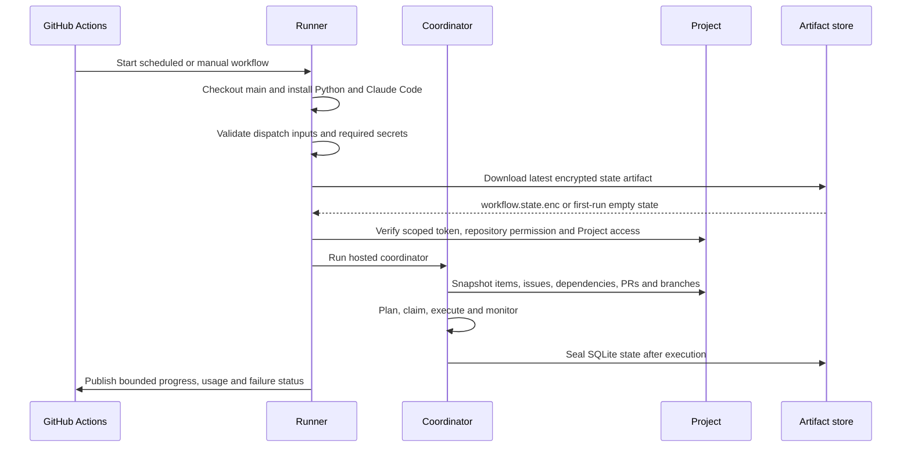
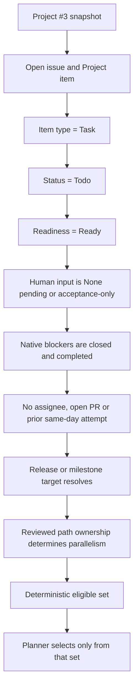
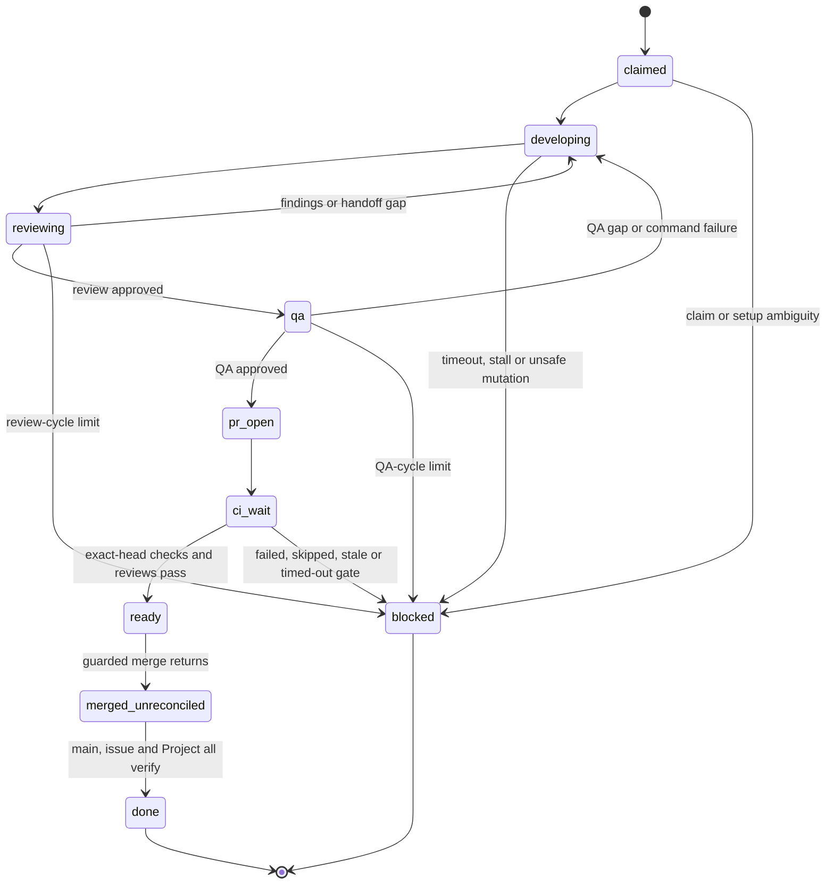
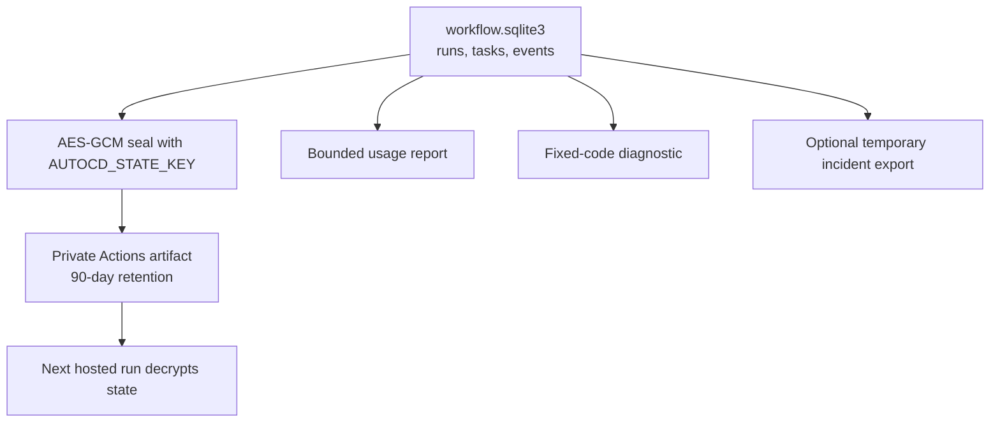

---
audience:
  - developer
  - operator
  - architect
  - evaluator
doc_type: reference
product_area: platform
stability: internal
prerequisites:
  - A checkout of the CALIBER repository
  - Access to GitHub Actions and Project #3 for operational changes
reviewed_on: 2026-11-06
version_applicability: Current CALIBER automated-cd implementation; budget contract follows PR #1204
tags:
  - automated-cd
  - github-actions
  - project-3
  - quality-gates
  - agent-workflow
---

# Automated CD architecture

Automated CD is CALIBER's GitHub-hosted software-engineering coordinator. It
turns a **Ready** child Task in GitHub Project #3 into an isolated implementation,
local evidence, a reviewable pull request, required CI checks, and—when the
repository policy allows it—a verified merge and Project Done transition. The
workflow is a delivery control plane, not a local cron job, product runtime, or
replacement for the GitHub Project.

## At a glance

| Concern | Current design |
| --- | --- |
| Canonical backlog | GitHub Project #3 items and linked issue contracts |
| Execution unit | An open issue represented as `Item type=Task`, never an Epic or Gate |
| Trigger | GitHub Actions schedule at `04:00` in `America/Los_Angeles`, or manual `workflow_dispatch` |
| Daily completion target | Six merged, closed, Project `Done` Tasks; attempts and opened PRs do not count |
| Daily model budget | `$30.00` across planner, developer, reviewer, and QA calls for one Pacific calendar day |
| Isolation boundary | A hosted runner, a temporary linked worktree, and an unprivileged worker user |
| Review boundary | Deterministic coordinator checks plus model review and QA; GitHub branch protection remains authoritative |
| Durable evidence | Encrypted SQLite state artifact, bounded usage report, PR/CI evidence, and GitHub audit history |

## Signature architecture

```mermaid
flowchart LR
    Schedule["GitHub Actions schedule\n04:00 America/Los_Angeles"]:::async --> Runner["Hosted runner"]:::async
    Dispatch["Manual workflow_dispatch"]:::user --> Runner
    Runner --> Preflight["Validate inputs, secrets and token scope"]:::ctrl
    Preflight --> Restore["Restore encrypted workflow state"]:::store
    Restore --> Snapshot["Read Project #3 and repository overview"]:::ctrl
    Snapshot --> Planner["Deterministic eligibility and conflict planner"]:::ctrl
    Planner --> Claim["Claim Task and create linked worktree"]:::ctrl
    Claim --> Roles["Bounded Claude roles"]:::ext
    Roles --> QA["Local checks, coverage and QA verdict"]:::ctrl
    QA --> PR["Open PR with evidence"]:::ctrl
    PR --> Gates["Exact-head CI, reviews and mergeability"]:::async
    Gates -->|all required gates pass| Merge["Guarded GitHub merge"]:::ctrl
    Gates -->|failure or ambiguity| Block["Block Task and retain audit state"]:::ctrl
    Merge --> Reconcile["Verify main, close issue, set Project Done"]:::ctrl
    Reconcile --> Seal["Encrypt and upload state artifact"]:::store
    Block --> Seal
```



```legend
```

The coordinator is deliberately split into two trust domains:

1. GitHub Actions and the Python coordinator may use Git, GitHub, Project, and
   private state credentials.
2. Claude roles and local QA run without those credentials. The model receives
   only the tools and working directory required for its role.

## Reference

## System boundaries and authorities

| Boundary | Authority or responsibility |
| --- | --- |
| GitHub Project #3 | Backlog, item type, status, readiness, release, priority, human-input phase, dependencies and ownership |
| Linked issue | Objective, acceptance criteria, files, prerequisites, tests, failure oracle and documentation contract |
| `.agents` framework | Transition semantics, engineering policy, project integration and repository review rules |
| GitHub Actions | Hosted trigger, secret injection, runner lifecycle, concurrency and artifact retention |
| Python coordinator | Eligibility, claims, worktree lifecycle, model-role sequencing, evidence capture, PR and merge orchestration |
| Claude Code | Bounded planning, implementation, review and QA reasoning inside the supplied worktree |
| GitHub branch protection | Required checks, independent approvals, mergeability and final remote enforcement |
| SQLite state artifact | Execution evidence and recovery state; it is not a second backlog or source of task truth |

The hierarchy is intentional: an Epic explains a package of work, while a child
Task is the executable unit. Gates and controls express acceptance or release
decisions and must not be selected as feature work. A child Task is not eligible
merely because its parent Epic is `Ready`.

## Hosted trigger and runner lifecycle



The workflow is GitHub-only. No local scheduler is installed or required.
GitHub's timezone-aware schedule follows Pacific daylight and standard time;
GitHub can delay a scheduled start during periods of Actions load. The workflow
concurrency group prevents overlapping hosted executions, while the local SQLite
lock protects the restored state within one runner.

### Workflow stages

| Stage | Main action | Failure behavior |
| --- | --- | --- |
| Initialize | Create a mode-700 state directory and SQLite slot | Stop before checkout or model work |
| Checkout and toolchain | Fetch full `main`, install Python 3.11, coordinator and Claude Code | Stop if the required CLI version is unavailable |
| Dispatch validation | Enforce owner-only trial inputs, incident-export pairing and retry rules | Reject unsafe combinations without claiming work |
| Credential preflight | Require `AUTOCD_STATE_KEY`, `AUTOCD_GH_TOKEN` and `ANTHROPIC_API_KEY` as applicable | Fail closed; no local fallback |
| State restore | Download and decrypt the latest approved state artifact | Require manual reconciliation if a prior artifact is missing or unapproved |
| Project verification | Confirm token scopes, repository push permission, owner identity and open Project #3 | Stop before planning if Project access is incomplete |
| Worker isolation | Create `autocdqa`, temporary worktrees and credential-free QA environment | Stop if the worker can read coordinator state |
| Hosted execution | Plan, claim, develop, review, QA, publish PRs and monitor them | Block ambiguous tasks and retain encrypted evidence |
| State publication | Encrypt SQLite and upload the state artifact | Do not publish a placeholder artifact after failed restore |

## Configuration contract

The authoritative defaults are in `automated-cd/config/workflow.toml`. Environment
variables may override them on the hosted runner, but the checked-in file is the
reviewable baseline.

| Setting | Current value | Meaning |
| --- | --- | --- |
| `daily_time` | `04:00` | Local start threshold used by the coordinator |
| `timezone` | `America/Los_Angeles` | Pacific calendar for schedule and daily accounting |
| `project_view_number` | `0` | All Project #3 items rather than one release view |
| `daily_done_target` | `6` | Merged, closed, Project Done Tasks counted for the day |
| `max_tasks_per_run` | `6` | Maximum new attempts across scheduled and manual runs for the day |
| `max_workers` | `2` | Maximum task workers; shared mutations remain serialized |
| `auto_merge` | `true` | Allows guarded merge only after all required gates pass |
| `max_review_cycles` | `3` | Developer-review-QA correction budget before blocking |
| `daily_budget_usd` | `30.0` | Aggregate Claude budget across one Pacific calendar day |
| `max_budget_usd` | `0.0` | Optional per-call cap; zero delegates the limit to remaining daily budget |
| `agent_timeout_seconds` | `3600` | Maximum wall time for one model role |
| `stall_seconds` | `900` | Maximum model silence before the role is considered stalled |
| `qa_command_timeout_seconds` | `7200` | Maximum time for one local QA command |
| `ci_timeout_seconds` | `43200` | Maximum PR-check wait before blocking |
| `allow_overlapping_runs` | `false` | Keep hosted runs and state writers serialized |

### Daily budget enforcement

The `$30` value is an aggregate budget, not a misleading per-call allowance.
Before each planner, developer, reviewer or QA call, the coordinator:

1. reads `agent_started` and `agent_usage` events since Pacific midnight;
2. verifies every prior call has a finite, non-negative `total_cost_usd` result;
3. computes the remaining amount;
4. serializes the next model call under a process lock; and
5. passes the smaller of the remaining daily amount and the optional per-call
   override to Claude Code's `--max-budget-usd` flag.

If a previous call has no trustworthy cost, or the remaining amount is zero, the
coordinator stops safely rather than risk an unbounded or unmeasured run. The
usage report still distinguishes the model's reported estimate from an invoice
charge.

## Project-driven planning



The deterministic filter is evaluated before Claude sees a planning prompt. It
requires all of the following:

| Eligibility check | Why it exists |
| --- | --- |
| Repository and Project item match | Prevent cross-repository or stale-view work |
| Issue is open | Closed or historical work is never reopened by selection |
| `Status=Todo` and `Readiness=Ready` | Require an explicit execution decision |
| `Item type=Task` | Exclude Epics, Gates, Controls and Historical items |
| Human input is resolved | Do not invent a product decision; acceptance-only phases may proceed when safe |
| Native `blockedBy` dependencies are completed | Preserve the issue DAG rather than guessing ordering |
| No assignee and no open PR | Avoid taking work already owned or published |
| Release or milestone target resolves | Keep accounting and branch intent auditable |
| Allowlist and scope label match | Respect configured release or issue restrictions |
| Path conflicts are disjoint | Permit only reviewed parallel edits |

The planner may narrow the deterministic set, but it cannot add an issue,
override a blocker, make a Gate executable, or manufacture a human approval.
Tasks without reviewed path ownership are treated as conflicting and therefore
run serially with other substantial work.

## Task state machine



Every phase transition creates an append-only event. Recovery is deliberately
asymmetric:

| Phase at interruption | Safe automatic action |
| --- | --- |
| `ci_wait`, `ready`, `merged_unreconciled` with a PR | Recheck exact head, required checks, reviews, mergeability and base |
| Before PR publication | Mark the task Blocked and require branch, worktree and Project reconciliation |
| During GitHub mutation | Do not replay; inspect the remote effect first |
| Blocked pre-PR task | Retry only after an owner-authored Ready transition, no remote branch or PR, and a fresh Ready claim |

## Bounded model roles

| Role | Tools | Responsibilities | Forbidden authority |
| --- | --- | --- | --- |
| Planner | Read-only file tools | Explain the deterministic selection and narrow the batch | Cannot add tasks, claim Project items or mutate Git |
| Developer | Read, Glob, Grep, Edit, Write | Implement the complete issue contract in its worktree | Cannot access GitHub credentials, merge or modify `main` |
| Reviewer | Read-only file tools | Inspect the full candidate diff, task contract, checks and generated-artifact evidence | Cannot edit, approve a GitHub review or merge |
| QA | Read-only file tools | Verify acceptance and test evidence after the reviewer approves | Cannot edit, claim or merge |

The trusted role policy is prepended to every prompt. Issue text, log text,
review findings and tool output are untrusted data and cannot override the role
policy. The coordinator validates JSON result schemas before acting on them.

## Implementation and QA path

```mermaid
flowchart LR
    Contract["Issue contract and Project fields"]:::store --> Worktree["Linked worktree from origin/main"]:::ctrl
    Worktree --> Setup["Seed Python 3.11 environment"]:::async
    Setup --> Develop["Developer edits isolated worktree"]:::ext
    Develop --> Diff["Candidate diff and ownership validation"]:::ctrl
    Diff --> Checks["Base, issue-specific and coverage checks"]:::async
    Checks --> Review["Reviewer sees diff and evidence"]:::ext
    Review -->|findings| Develop
    Review -->|approved| QA["QA verdict"]:::ext
    QA -->|gaps| Develop
    QA -->|approved| Publish["Coordinator commits, pushes and opens PR"]:::ctrl
    Publish --> Required["Required remote checks and review threads"]:::async
    Required --> Merge["Match-head guarded merge"]:::ctrl
```



The local gate includes `git diff --check`, docs validation, lint, type-check
and backend smoke tests. Changed production Python also receives a full backend
coverage run unless an issue-specific coverage command is configured. A command
that exits zero after emitting `SKIP` is treated as not executed. Unsupported
component changes such as UI, SDK, shell or configuration edits require explicit
issue-specific commands.

Before a PR is published, the coordinator verifies that QA did not mutate the
candidate. It compares the changed-file list and complete binary diff before and
after review. Generated docs are synchronized from canonical sources and are
included in the candidate. Large generated patches are summarized to the
reviewer with exact paths, sizes and SHA-256 hashes, while staging still checks
the complete patch.

## GitHub and Project mutation sequence

| Operation | Mechanism | Verification |
| --- | --- | --- |
| Claim | `.agents/bin/engineering.mjs transition ... claim` dry run, then apply | Re-read Project and require `Readiness=In Progress` |
| Branch | `git worktree add -b ... origin/main` | Branch and worktree are coordinator-owned and isolated |
| PR | Coordinator commits reviewed patch and creates a draft PR | Record PR number and exact head SHA |
| Review request | Request Copilot when available and record reviewer status | Never represent self-review as independent approval |
| Remote gate | Poll required checks, review decision, unresolved threads, mergeability and base | Pending, skipped, stale or failing is not pass |
| Merge | `gh pr merge --squash --match-head-commit`, never admin bypass | Re-read merge commit on `main` |
| Completion | Close issue as Completed and transition Project fields to Done | Verify issue state, merge evidence and Project snapshot |

The coordinator does not push `main` directly. If `main` advances beyond the
reviewed PR head, the candidate is stale and waits for a fresh implementation,
review and QA cycle.

## State, artifacts and observability



The state database contains run/task phases and append-only audit events. It may
contain private issue text, model result metadata and bounded QA excerpts, so it
is encrypted before upload. Public logs expose only safe status fields, issue
numbers and aggregate timing or spend. The optional incident bundle requires a
separate temporary key and is intended for one investigation, not normal runs.

| Evidence surface | What it proves | What it does not prove |
| --- | --- | --- |
| Project snapshot | Current planning and ownership fields | That code or tests are correct |
| SQLite phase/event history | What the coordinator observed and attempted | A remote effect that was never verified |
| Local QA evidence | Commands and measured coverage for the candidate | Required remote CI or independent review |
| PR checks | Exact-head repository gates | Production deployment or release acceptance |
| Merge verification | The reviewed head reached `main` | That a later deployment succeeded |
| Usage report | Claude-reported cost and elapsed time | Provider invoice accuracy |

## Security and failure posture

| Threat or ambiguity | Control |
| --- | --- |
| Over-scoped GitHub token | Preflight requires the owner, repository push access and only the allowed Project scopes |
| Model or QA credential leakage | Worker subprocesses receive no `GH_TOKEN`, `AUTOCD_GH_TOKEN` or model key except the model process itself |
| Malicious issue text | Trusted role prompt is separate from untrusted task data |
| Path escape | Claude Code working-directory restrictions, linked-worktree boundary and changed-path ownership checks |
| Accidental policy edit | Unattended auto-merge refuses `.github/`, `.agents/`, `automated-cd/`, `AGENTS.md` and other protected paths |
| Unknown external mutation | Timeout, lost process or uncertain PR state becomes Blocked rather than replayed |
| Stale branch or head | Remote branch and exact-head checks run before retry and merge |
| Budget overrun | Serialized model calls receive only remaining daily allowance and unknown costs fail closed |
| Missing state artifact | A prior execution with no approved state requires manual reconciliation |

No workflow step deploys CALIBER or changes production data. Release acceptance,
human approval and production operations remain in their Project Gates and
operator runbooks.

## Operations and recovery

1. Inspect the public run summary and the encrypted state artifact.
2. Use `diagnose_state=true` for a bounded failure code and latest task phase.
3. Check the live Project item, issue claim, remote branch and PR before retrying.
4. For a pre-PR block, reconcile the branch and return the task to unassigned
   `Todo / Ready` with the required owner-authored transition comment.
5. For a published PR, correct the same PR branch and let the next hosted tick
   recheck the exact head and required gates.
6. Never reset the state database, reuse an ambiguous worktree, bypass a failed
   required check or claim that a Gate is complete without its evidence.

Useful entry points:

| Need | Command or location |
| --- | --- |
| Read-only plan | `python -m autocd.cli plan` |
| Hosted implementation | `.github/workflows/automated-cd-run.yml` |
| Coordinator configuration | `automated-cd/config/workflow.toml` |
| Project snapshot | `node automated-cd/scripts/project_snapshot.mjs 0` |
| State diagnostics | GitHub Actions `diagnose_state=true` dispatch |
| Strict docs sync | `CALIBER_DOCS_STRICT=1 node caliber/caliber-ui/scripts/sync-docs.mjs` |
| Repository policy | `.agents/engineering-policy.md` and `.agents/github/project-integration.md` |

## Design decisions and non-goals

| Decision | Rationale |
| --- | --- |
| GitHub Project is authoritative | Prevent a private queue from diverging from ownership, dependencies and acceptance decisions |
| Child Tasks, not parent Epics, are executable | Keep package planning separate from implementation scope and release controls |
| Hosted-only execution | Make credentials, audit history and merge authority visible in one remote control plane |
| Deterministic prefilter before model planning | Reduce prompt ambiguity and prevent the model from overriding policy |
| Isolated worktrees and worker user | Limit accidental repository mutation and credential exposure |
| Encrypted durable state | Reconcile PRs across ephemeral hosted runners without publishing private candidate content |
| Fail closed on uncertainty | An unknown write, gate or cost is not evidence of success |
| No deployment step | Keep software engineering automation separate from release and production operations |

The workflow is intentionally conservative. A daily target is a throughput
objective, not a promise that six Tasks will always complete: the Project may
have no Ready child Tasks, dependencies may be blocked, a model may fail, or a
required remote gate may remain pending.
