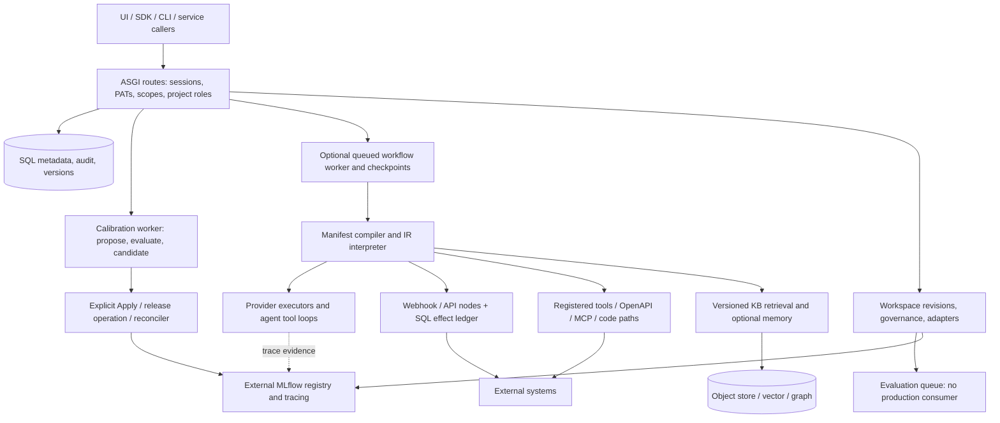
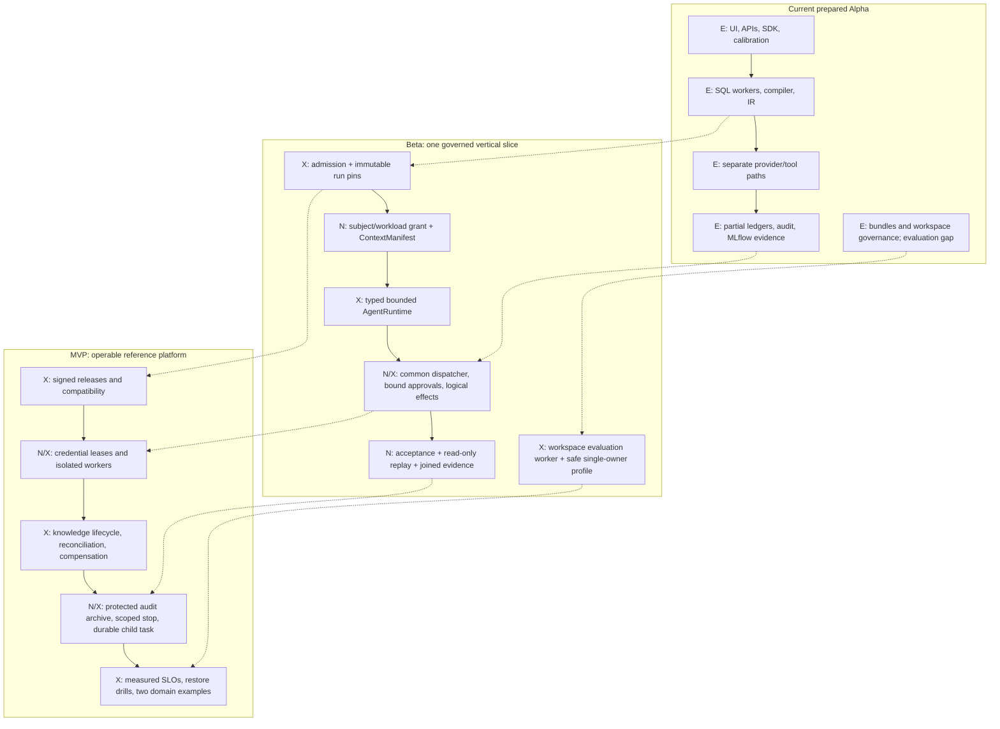
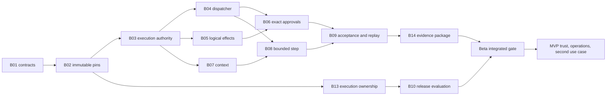

# CALIBER Reference Architecture Gap Analysis

> **Scope reconciliation, 2026-10-26:** [map-gap.md](../map-gap.md) and the
> [single-tenant execution plan](planning/BETA_MVP_EXECUTION_PLAN.md) supersede this historical analysis's
> scope/calendar and ambiguous task pseudocode. G01–G22 in the execution plan refer to map-gap.md, not this
> document's older G01–G12. Reuse implemented D1 work; all other retained enterprise packages remain required.

## 1. Executive Summary

**Decision:** evolve CALIBER into a **single-tenant, single-region reference platform for governed agent workflows**, using its existing calibration, workflow, registry, approval, and release components. Do not rebuild it as a collection of new microservices. The most important investment is a consistent execution contract connecting those components.

This is an engineering assessment and **proposed** roadmap, not a declaration that Beta or MVP exists. “Alpha” below means the prepared `0.1.0a1` implementation at CALIBER commit `b4c9249d4fbb2fcdf8c61030fb97f9b4872e829b`. At review time, GitHub lists only `caliber-v0.0.1`; the prepared Alpha tag/assets remain unpublished. The book reference is `building-enterprise-general-intelligence` commit `098d022dc7ba6f27eb4e65ee49bf1f92d9bc779a`.

CALIBER has real, reusable implementation:

- A standalone ASGI application, React UI, Python SDK and CLI; SQL metadata, migrations, object storage, and a separate MLflow service.
- A functioning prompt → test set → calibration → candidate → explicit Apply → rollback journey, including provider-operation reconciliation. Default model/evaluator results are simulated; that journey is not evidence of model quality.
- A typed workflow compiler/interpreter, bounded parallelism, queued runs, lease recovery, wait/approval checkpoints, and an effect ledger for specific HTTP node paths. Queue, checkpoint, and runtime-approval capabilities require configuration.
- Session/PAT authentication, project roles, resource visibility, audit records, MCP policy checks, egress controls, evaluation evidence, and deployment bundles.
- Workspace revisions, approval provenance, environment locks, and real resource adapters. These do **not** constitute a complete release pipeline: workspace evaluation records have no production executor. [C01], [C02], [C03], [C04], [C05], [C06], [C07], [C08], [C09], [C10]

The book's principle—**“The model proposes. The system decides. The evidence proves.”**—is **partly realized**, most convincingly in the calibration/release path. It is not an invariant across the whole execution platform:

1. Model-selected tool calls can execute inside the agent loop; there is no common typed proposal boundary for every protected effect.
2. Project RBAC and MCP policy are useful but do not establish subject-plus-workload, purpose-bound, resource-specific delegated authority throughout a run.
3. Runtime approvals are node/checkpoint based; they lack the complete effect hash, expiry, resource precondition, and commit-time policy contract required by the book.
4. The workflow effect ledger is not used by every tool backend. Durable replay of a completed HTTP effect is different from universal logical-effect idempotency, reconciliation, and verified business completion.
5. Context, audit, release, and evaluation evidence are not joined into one immutable run-to-outcome proof. Trace read APIs are authenticated but not project scoped.
6. Deployment ownership, hostile-code isolation, recovery drills, and a measured operating envelope remain release work. [C03], [C04], [C05], [C06], [C11], [C12], [C13], [C14]

### Release recommendation and size

Estimates are **incremental engineering person-weeks**, including implementation, migrations, tests, review, documentation, and integration; they are planning ranges, not measured delivery velocity. Section 11 gives the assumptions and arithmetic.

| Stage | Outcome | Base effort | With 25% uncertainty reserve | Exit evidence |
| --- | --- | ---: | ---: | --- |
| Alpha baseline | Existing calibration product and reusable platform components | Sunk effort; not estimated retrospectively | Not applicable | Current source, focused tests, and exact-main CI; no published `0.1.0a1` asset claim |
| Beta | One safe, inspectable request-to-effect-to-replay path; one tenant, trusted connectors, no arbitrary code | 37–61 | 46.25–76.25 | All Beta scenarios in section 13, including failure injection, pass through public APIs |
| MVP, after Beta | An operable reference platform with release evidence, stronger identity/isolation, recovery and a second use case | 42–70 | 52.5–87.5 | Independent deployment/restore exercise and all MVP scenarios pass |
| Total remaining through MVP | Minimal reference implementation, not the entire book | **79–131** | **98.75–163.75** | Both milestone definitions of done |
| Book-complete increment (decided 2026-10-24) | M17–M27: the breadth deferred in section 11, the book contracts no package covered, and autonomy levels | 76–136 | 95–170 | [EGI delivery plan](CALIBER_EGI_DELIVERY_PLAN.md) traceability tables complete |

At the repository's documented **1.5 developer capacity**, reserved effort alone implies roughly **66–110 team-weeks through MVP**, before additional non-overlapping external delays. A five-person team operating at 75% effective delivery capacity gives a capacity-only calculation of roughly **27–44 weeks**, before imposing the fixed five-week milestone cadence below. These are capacity calculations, not promised dates; the dependency graph prevents arbitrary parallelization. This expanded EGI scope does not fit automatically inside the existing six-month roadmap. [C24]

**Five-person delivery plan:** the [nine-milestone execution plan](CALIBER_FIVE_PERSON_DELIVERY_PLAN.md) allocates every B/M package to concrete delivery gates, using **five weeks per milestone: four for implementation/integration and one for QA and fixes**. The resulting calendar is **Beta at week 25 and MVP at week 45** at the base midpoint; at the upper estimate the MVP increment needs a fifth milestone (an MVP gate near week 50), because Beta headroom cannot fund MVP work before the Beta decision. It retains the effort ranges above, includes availability and uncertainty separately, and makes Beta an explicit stop-or-fund-MVP decision. The capacity-only ranges are sizing context; the fixed milestone calendar is the current delivery baseline.

**Decision, 2026-10-24:** the repository owner made the EGI program the MVP (replacing the roadmap's narrower `caliber-v1.0.0`), set the team at **three people**, and made CALIBER the reference implementation of the whole book, including the breadth this report deferred. The [three-person EGI delivery plan](CALIBER_EGI_DELIVERY_PLAN.md) controls from that date: **Beta at week 29, core platform proof at week 60, book-complete MVP at week 122** at the midpoint, about 148 weeks at the upper estimate. Sections below that describe the deferred breadth as out of scope are superseded by that plan's packages M17–M27.

### How much does Alpha cover?

There is no defensible measured percentage of “the whole book implemented.” Its chapters mix required invariants, optional patterns, and large-scale deployment recommendations. Counting pages, endpoints, tests, or feature names would give a misleading answer.

For a reproducible **foundation index only**, section 5 defines 24 equally weighted capability groups: **3 validated foundations, 18 partial, 1 scaffolded, 2 missing**. Assigning 1, 0.5, 0.25 and 0 points respectively gives `(3 + 18 × 0.5 + 1 × 0.25) / 24 = 51.0%`. Thus **about half of the component foundations are present under this deliberately simple rubric**. Giving partial items 0.25–0.75 instead produces 32.3–69.8%, showing the uncertainty. This is **not** 51% production readiness, 51% of effort completed, or certification of half the book. A single failed authority/effect boundary blocks release regardless of this index.

## 2. Scope and Methodology

### Evidence baseline

| Input | Snapshot and treatment |
| --- | --- |
| CALIBER | Clean assessment worktree branched from remote `main`, `b4c9249d4fbb2fcdf8c61030fb97f9b4872e829b`; primary checkout's unrelated changes preserved |
| Book | Canonical `source/parts/00-front-matter.md` through `09-appendices.md`, registered diagram sources, and executable examples; target commit `098d022dc7ba6f27eb4e65ee49bf1f92d9bc779a` |
| Book checkout | Local `dacedba44fa995a70ed1f0a02ae2f339a063a69e` is one commit behind; inspected diff to the target changes packaging paths/checksums, not the canonical architecture sources used here |
| Published CALIBER release | Live `gh release list` shows `caliber-v0.0.1`; prepared package version is `0.1.0a1` |
| Existing CI evidence | [CI run 39517749515](https://github.com/rrahimi-uci/caliber-suite/actions/runs/39517749515) completed successfully for the exact baseline above; workflow job conditions still matter |
| Review date | 2026-10-20 Pacific; evidence is point-in-time and must be refreshed after behavioral changes |

Review approach:

1. Inventory production modules, public routes, persistence/migrations, UI, SDKs, deployment files, tests, cookbooks, documentation and paper sources.
2. Use architecture documents as navigation, then trace implementations: launch → worker → interpreter → tool dispatch; approval → resume; alias mutation → observation; workspace evaluation → consumer; knowledge visibility → retrieval; authentication → resource access; evaluation → evidence → release.
3. Inspect the book's ownership planes and control contracts, with focused reading of Chapters 2–8, 12–15, 18–28 and the unified architecture diagram. Use the remaining pattern chapters to identify optional design choices, not mandatory services.
4. Run focused existing regression tests against the pinned worktree and inspect exact-main CI. Separate unit/fixture evidence from live-provider, process-kill, production, security, and empirical quality evidence.
5. Map gaps to release gates, reusable components, implementation slices and estimates. “Missing” means no integrated mechanism was found in the surveyed implementation; it is not a claim that a keyword search mathematically proves absence.

**Limits:** this is a repository-wide architectural review with deep tracing of critical paths, not a line-by-line proof of every file, a penetration test, or a production load test. No live customer system or paid model was used. The book's examples are reference contracts, not a production platform to copy wholesale. The paper explicitly leaves quantitative evaluation unrun; its proposed experiments are not product validation. [C25], [B01], [B03]

Status vocabulary throughout:

| Status | Meaning |
| --- | --- |
| **V — implemented and validated foundation** | Concrete reachable behavior and relevant executed tests/CI evidence; only the bounded behavior stated in the row is credited |
| **P — partial** | Working pieces exist, but the book's end-to-end invariant, supported configuration, or integration proof is incomplete |
| **S — scaffolded** | Contracts/state transitions/routes exist but an essential production execution link is absent |
| **M — missing** | No integrated implementation of the named capability was found |

“Preview/off by default” is a separate support designation, not a synonym for scaffolded. Code can work behind a flag while remaining outside the supported Alpha contract. Conversely, a core UI page is not proof that all of its backend controls are complete.

## 3. Current CALIBER Alpha Architecture

### Components and ownership

| Component | Actual role | Current boundary |
| --- | --- | --- |
| React SPA, REST routes, Python SDK/CLI | Author resources, calibrate, inspect runs/evidence, apply and roll back; SDK has synchronous/asynchronous clients and project/workspace scope helpers | Public surface is broader than the supported Alpha journey; capability flags must be observed [C01], [C23] |
| Standalone ASGI control plane | Authentication, resource APIs, SQL services, background-loop lifecycle | MLflow is a separate HTTP service; embedded MLflow mounting is not the supported topology [C01] |
| SQLAlchemy metadata and migrations | Projects, jobs, versions, queues, checkpoints, approvals, audit, effects, releases and lineage | SQLite demo support does not prove concurrent operational behavior; reference deployment should use PostgreSQL [C02] |
| Refinement/calibration orchestration | Candidate generation, evaluation/regression gate, candidate-ready state; explicit Apply owns promotion | Stale refinement jobs fail under the janitor; this is not transparent workflow-style recovery [C07] |
| Workflow compiler and runtime | Manifest → typed IR → interpreter; generated SDK Python is an export artifact, not the in-server execution engine | Several executor/dispatch paths, not one universal policy/effect gateway [C03] |
| Workflow-run worker | SQL queue claiming, leases/heartbeats, bounded waits, runtime approval checkpoints, recovery | Queue, runtime approval and checkpoint flags default false; generic recovery can restart from the beginning [C04] |
| Tool paths | Registered functions, OpenAPI HTTP tools, MCP, direct webhook/API nodes, external-app and sandboxed code paths | Different policy, retry, approval and effect semantics across paths [C03], [C06], [C13] |
| Knowledge and memory | Versioned KB ingestion/retrieval, lexical/dense/graph modes, citations; optional mem0 and workflow conversation stores | KB-level visibility is present; no complete source-policy/context release contract; long-term memory is outside Alpha support [C15], [C16] |
| MLflow and evaluation | Prompt registry, tracing, datasets/scorers, comparisons, scorecards, evidence digests | Real quality requires configured providers; gateway routing is opt-in; trace visibility is broader than project boundaries [C08], [C11], [C17] |
| Workspace/source/release services | Git/import revisions, managed snapshots, governance, release operations and adapters | B10.2 now executes release-local pinned candidate/dataset/judge plans through the owner-only worker; first-class evidence rows, expired-attempt recovery and downstream governed apply remain [C09], [C10] |
| Storage and operations | CALIBER object store separate from MLflow artifacts; health/readiness, worker health, incidents, metrics, event transports | Supplied Compose is a development starting point, not evidence of a hardened or recovered deployment [C14], [C18] |



This diagram shows reachable components, not an assertion that every edge is supported by default. In particular, the ledger box does not cover the separate tools box.

### Development autonomy exists, with a narrower scope than enterprise autonomy

Aria includes manual/automatic authoring modes, `agent_review`, and `full_autonomy`. The synchronous toolset exposes mutations only in permitted authoring modes and never exposes gated approve/publish/deploy tools. A separate service path can review a tested draft and publish under configured distinct author/reviewer/release identities. Review records bind candidate hash/version and expiry, and publishing rechecks that binding. This is meaningful development automation, behind the Aria preview flag. [C19]

It is **not** a platform-wide autonomy grant: it does not uniformly bound arbitrary business resources, downstream credentials, runtime write effects, or child-agent authority. Independent service identities also do not establish statistical independence of two model judgments. Beta should reuse the authoring controls while introducing explicit runtime permission envelopes; MVP should express autonomy as permitted actions and budgets by risk tier, not a Boolean “fully autonomous” switch.

## 4. Target Architecture from Building Enterprise General Intelligence

Chapter 4 defines **seven ownership planes**, including the two cross-cutting planes. External systems of record are outside the platform trust boundary; they are not an eighth internal plane. The unified diagram regroups the same responsibilities into global definitions, regional runtime, external systems, and offline improvement. [B02], [B09]

| Book plane | Minimum obligation for CALIBER | What can wait |
| --- | --- | --- |
| Experience and channels | Authenticated request, readable approval evidence, progress, cancel and intervention | Many channels and enterprise portal integration |
| Agent applications | Versioned instruction/skill bundle; typed bounded step result; no self-granted authority | Framework marketplace and unrestricted agent generation |
| Runtime and workflow | Authoritative state, immutable run pins, deadlines, waits, recovery, acceptance | Multi-region workflows and broad dynamic planning |
| Knowledge, context and memory | Authorized pinned sources, provenance, explicit context composition, safe retention | Full ontology, automated policy extraction, all Hub views, general long-term memory |
| Gateways and integration | Mandatory eligible model/tool access; exact action authorization; effect identity and verified receipt | A2A federation and many connector families |
| Security and governance | Subject/actor separation, narrow grants, approval binding, protected secrets, isolation and auditable decisions | SCIM and enterprise-wide organizational administration |
| Evaluation and operations | Decision/effect evidence, trajectory tests, release gates, incident controls, recovery and measured capacity | Global fleet optimization and advanced routing economics |

### Required contracts and invariants

- **AgentStepRequest/Result:** the platform supplies identity, versions, eligible tools, context, budgets and output schema. The adapter returns a typed disposition such as proposed action, needs input, completed or failed. Workflow state and effect commit remain outside the model/SDK. [B01]
- **RunManifest/ReleaseManifest:** immutable behavior/dependency pins with one writer. A new release changes assignment of new runs; it does not rewrite old history. Record provider revisions honestly when a provider offers no immutable model snapshot. [B02], [B08]
- **ContextManifest/KnowledgeRelease:** authorization before content retrieval, pinned source revisions, ordered segments with trust labels, hashes, policy decisions and omissions. Normative knowledge must be approved and deterministic at enforcement boundaries; semantic retrieval alone is not policy. [B02]
- **CapabilityEnvelope/PolicyDecision:** intersect subject, workload, workspace, purpose, resource, time and environment constraints; explicit deny wins. Recheck authorization at the effect boundary and on resume. [B06]
- **ApprovalRequest/Decision:** exact proposal and target version, evidence hash, policy revision, expiry, distinct eligible approver, supersession and fresh commit checks. An approval is neither a receipt nor a generic reusable consent token. [B04]
- **EffectRecord/Receipt:** persistent logical intent, stable key, resource precondition, execution attempt, explicit Unknown/Partial states, downstream verification and reconciliation. Compensation is a new authorized effect. [B06]
- **AcceptanceDecision:** deterministic domain criteria decide completion from evidence, not a fluent final answer or successful HTTP response. [B04]
- **Evidence and learning:** causal traces and audit are separate but joinable; evaluations pin inputs, versions and denominators; improvements return through a release gate. [B07]

These are logical contracts. The book does not require CALIBER to deploy a separate service for every named box. A modular application with PostgreSQL and a deliberately isolated execution boundary is a credible first implementation if the invariants are enforced.

## 5. Capability Mapping

The status applies to the **bounded Alpha capability described**, not full equivalence to the book. Capability IDs use `CAP`; bracketed `C` references identify source groups in section 17. P0 blocks the reference vertical slice or shared sensitive use; P1 is required for the reference MVP; P2 is explicitly deferred breadth. Complexity: S = localized; M = several modules/contracts; L = persistence plus multiple execution paths; XL = cross-cutting security/distributed-state work. Effort is assigned once in sections 8–11, not summed across overlapping capability rows.

| ID | Book requirement | Alpha evidence and status | Gap / required change | Dependencies | Priority / complexity / milestone |
| --- | --- | --- | --- | --- | --- |
| CAP01 | Authenticated experience and control APIs, Ch. 4/7/14 | **V:** usable UI/REST/SDK core journey; capability flags [C01], [C23] | Extend proposal/effect/intervention views and typed SDK contracts; validate accessibility | CAP06–CAP09, CAP17 | P1 / M / Beta → MVP |
| CAP02 | Typed plans, compile-time validation, Ch. 12 | **V:** manifest/IR compiler, schema validation, deterministic export [C03] | Add eligibility/effect-contract checks; compilation must not imply authorization | CAP06, CAP08 | P0 / M / Beta |
| CAP03 | Bounded provider-neutral AgentRuntime, Ch. 3/10 | **P:** executor protocol, fake/OpenAI/Anthropic/Agents SDK paths; tool loops [C03] | Typed proposal disposition; common context/authority/deadline interface; adapter conformance | CAP06, CAP11, CAP20 | P0 / L / Beta |
| CAP04 | Durable authoritative workflow, Ch. 15 | **P:** queue, leases, checkpoints, timers, cancellation and resume [C04] | Full recorded-observation replay, stable logical activity identity, ownership fencing and typed recovery | CAP09, CAP15 | P0 / XL / Beta → MVP |
| CAP05 | Authentic subject and workload, Ch. 21 | **P:** sessions, scoped/project-bound PATs, project roles and visibility [C05] | Preserve initiating subject separately from executing workload; short-lived execution grants | CAP15 | P0 / L / Beta → MVP |
| CAP06 | Contextual authorization and downscoping, Ch. 21 | **P:** project authorization and MCP classification; `authorize` rejects unmodeled resource/environment/release contexts [C05], [C06] | Deterministic policy decision records; purpose/resource/time restrictions; revocation at dispatch | CAP05, CAP15 | P0 / XL / Beta |
| CAP07 | Exact, expiring approval, Ch. 14 | **P:** role/quorum/SoD on workflow nodes; stronger content-bound draft/release decisions [C04], [C10], [C19] | Bind runtime effect, evidence, target version and policy; expiry/supersession; atomic consume | CAP06, CAP09 | P0 / L / Beta |
| CAP08 | Mandatory Tool Gateway, Ch. 2/22 | **P:** tool registry, MCP policies, OpenAPI executor, egress [C03], [C06], [C13] | One protected dispatch path across backends, including agent-selected calls; connector contracts | CAP06, CAP09 | P0 / XL / Beta |
| CAP09 | Verified, safely retryable effects, Ch. 22 | **P:** SQL ledger for webhook/API nodes; separate prompt-release reconciliation [C03], [C07] | Persist logical proposals before approval, intent conflict checks, verified receipts, Unknown reconciliation | CAP08, CAP15 | P0 / XL / Beta → MVP |
| CAP10 | Governed knowledge, Ch. 5 | **P:** KB versions, source metadata, hybrid/graph retrieval and citations [C15] | Released source set, source ACL/purpose/freshness, approval and revocation; a small hand-authored rule bundle | CAP05, CAP06, CAP15 | P0 / L / Beta → MVP |
| CAP11 | Immutable context per model step, Ch. 6 | **M:** prompts/history/retrieval exist; no integrated ContextManifest pipeline found [C03], [C15], [C16] | Ordered source references, trust tiers, token allocation, redaction/authorization evidence, hash per call | CAP06, CAP10, CAP15 | P0 / L / Beta |
| CAP12 | Governed long-term memory, Ch. 6 | **P:** mem0 wrapper and workflow session history; outside Alpha support [C16] | Explicit consent/policy, TTL, provenance, corrections and deletion propagation | CAP06, CAP11, CAP17 | P2 / L / Later; keep disabled in reference scope |
| CAP13 | Reproducible evaluation evidence, Ch. 25 | **V:** deterministic gate and evidence digests, sampling, denominators, slices [C08] | Expand to trajectories, authority/effects and acceptance; validate model quality separately | CAP09, CAP17 | P0 / M / Beta → MVP |
| CAP14 | Governed offline improvement, Ch. 25 | **P:** calibration candidate/gate/explicit apply; draft review paths [C07], [C19] | Feedback triage and dataset promotion with independent acceptance; no unreviewed live changes | CAP13, CAP16 | P1 / M / MVP |
| CAP15 | Behavior/dependency versioning, Ch. 8/27 | **P:** prompt/skill versions, sealed workflow bundles, workspace revisions and runtime lineage [C09], [C20] | Mandatory complete run pins; policy/context/model adapter identity; signed origin and compatibility checks | CAP10 | P0 / L / Beta → MVP |
| CAP16 | Executed workspace release evaluation, Ch. 25–27 | **B10.2:** owner-only worker resolves and executes the release's immutable candidate/dataset/judge pins; evidence rows and recovery remain [C09] | Add first-class evidence rows, expired-attempt recovery and governed apply; keep real adapters and governance | CAP13, CAP15 | P0 / L / Beta |
| CAP17 | Audit and joined proof of outcome, Ch. 24 | **P:** transactional redacted SQL audit, run events, evaluation evidence [C08], [C12] | Joined immutable evidence package, acceptance record, retention and tamper detection | CAP06–CAP11, CAP15 | P0 / L / Beta → MVP |
| CAP18 | Causal observability and incident control, Ch. 24/27 | **P:** MLflow spans, trace IDs, metrics, queue health, incidents [C11], [C18] | Project-authorized reads, decision/effect links, alerts and scoped stop controls | CAP05, CAP17 | P0 / L / Beta → MVP |
| CAP19 | Code/credential/data containment, Ch. 20/23 | **P:** process sandbox, egress/DNS controls, encrypted secret store [C13], [C14] | Hardened profile; no hostile code in Beta; OS/container boundary and credential isolation in MVP | CAP06, CAP08 | P0 / XL / Beta → MVP |
| CAP20 | Model eligibility, budgets and retry ownership, Ch. 4/28 | **P:** providers, opt-in MLflow gateway, breakers, preview token budget, service quotas [C03], [C17], [C21] | Pre-call reservations, shared deadline/spend, release-pinned model eligibility and one retry owner | CAP06, CAP15 | P0 / L / Beta → MVP |
| CAP21 | Durable delegated tasks, Ch. 18 | **P:** subworkflows, handoffs, loops/parallel joins; Aria plans [C03], [C19] | Narrow child authority, shared budget, durable ownership and cancellation; bounded internal child task only | CAP04, CAP06, CAP20 | P1 / L / MVP |
| CAP22 | Local control over A2A federation, Ch. 19 | **M:** no integrated A2A gateway/adoption contract found; MCP is tool access [C06] | Signed task/artifact adoption and remote trust negotiation only when a use case demands it | CAP21, CAP17 | P2 / XL / Later |
| CAP23 | Releasable and recoverable deployment, Ch. 27 | **P:** wheel/install checks, Compose, migrations and runbooks [C14], [C22] | One-active-owner enforcement, hardened deployment, restore/upgrade drills, measured envelope | CAP04, CAP09, CAP17 | P0 / L / Beta → MVP |
| CAP24 | Developer platform and extensibility, Ch. 7–9 | **P:** SDK/CLI, examples/cookbooks, optimizer plugin SDK and allowlisting [C23] | Versioned gateway/adapter conformance and reproducible golden-path package | CAP03, CAP08, CAP15 | P1 / M / Beta → MVP |

## 6. Detailed Gap Analysis

### G01 — The execution boundary is fragmented

**Observed:** `_execute_model_tool_call` validates tool availability and returns a gated marker for `requires_approval`, then invokes a callable inside a trace span. An explicit `IRTool` node follows another path. `_perform_guarded_effect` is called at the direct webhook/API-request branches; ordinary `IRTool` and model-selected tool dispatch do not call it. OpenAPI has its own retry/egress machinery. This establishes a coverage gap, not proof that every backend lacks all safeguards. [C03], [C06], [C13]

**Why it matters:** a control is only an end-to-end invariant if changing the route, tool backend or agent adapter cannot bypass it. An effectful registered tool cannot inherit the HTTP node ledger guarantee merely because it runs in the same workflow.

**Change:** introduce a platform `ToolInvocationRequest` and dispatcher. All protected writes return a typed proposal to the workflow; read-only calls also pass authorization and evidence capture. Classify every callable conservatively. Refuse unsupported effect contracts in the reference profile. Reuse the current resolver, schema validators, MCP policy and egress transport. Do not require a remote gateway service in Beta. **B03–B06, B08; P0/XL.**

### G02 — Identity stops short of delegated execution authority

**Observed:** `CaliberIdentity` carries user/scopes/project and credential provenance. `resource_access.authorize` enforces project rules but explicitly raises `NotImplementedError` for non-null resource/environment/release context. Separate workspace services enforce some environment/release rules; the stub does not mean those services do nothing. Workflow worker MCP preflight uses a synthetic identity based on workflow owner/project. That is not the book's initiating subject plus acting workload tuple. [C04], [C05], [C10]

**Change:** admission captures the subject and workload; a versioned `ExecutionAuthority` restricts workspace, purpose, resource IDs, operations, environment, expiry, delegation depth and budgets. Start with deterministic in-process policy evaluation, persisted decisions and deny precedence. Recheck membership/revocation on resume and immediately before effects. Never use an owner identity as a substitute for caller authorization. Add credential broker integration in MVP; keep reusable secrets inside trusted connectors. **B02–B04, M01; P0/XL.**

### G03 — Runtime approval is weaker than authoring/release approval

**Observed:** runtime approval records identify run/node and policy; `ApprovalPolicy` enforces required role, distinct quorum and default initiator exclusion. Only `timeout_behavior=block` is supported. Checkpoints preserve inputs, which is useful. However the decision does not bind the complete book tuple of logical effect, canonical arguments, expected downstream version, evidence digest, policy revision and expiry. `_approval_policy_snapshot` reads the workflow version, not a complete effect proposal. Assistant agent-review records already bind hash/version/expiry and workspace decisions bind release evidence. These guarantees are mode-specific: manual `approve_draft` sets approved status without requiring a passing test report, and `_validate_review_binding` accepts the manual path when no agent review report exists. Core calibration Apply is also a single authorized operator action, not a two-person approval. [C04], [C07], [C10], [C19]

**Change:** extend runtime approvals with immutable proposals and explicit expected versions; reject changed intent, revoked authority, expired decisions and changed policy before commit. Add supersession and an operator-visible reason. Concurrency tests must prove one decision cannot be consumed for a different effect. Reuse provenance/quorum helpers without conflating a model review with human approval. **B05–B06, M06; P0/L.**

### G04 — Effect deduplication is not yet a complete business-effect protocol

**Observed:** `SqlEffectLedger` keys `(run, node, canonical payload, occurrence)`, records in-progress/completed/failed, returns prior completed results, and surfaces indeterminate claims. Operators can resolve skip/retry. Its own contract assumes restart reproduces the same multiset of effects. A regenerated model output or changed read can create a new payload/key. `_resilient_callable` may retry exceptions/timeouts and cannot kill an already-running thread. The HTTP guard treats broad connection exceptions as definitive failures; a connector contract must establish whether a request was actually sent. [C03], [C04], [C13]

**Change:** persist the accepted proposal and a logical effect ID before dispatch; compare intent hash on reuse; carry the same key to capable downstreams; record target/version and verify the business predicate. Unknown blocks dependent writes. A connector-specific reconciler, not a blind generic retry, decides whether the effect occurred. Preserve current rows and historical keys during migration. Default unsupported write connectors to refusal. **B04–B05, B09, M03; P0/XL.**

**Diagnostic corroboration:** two in-memory helper probes against this baseline observed (a) two identical allowed model-tool invocations producing two synthetic writes and (b) a callable configured with `max_retries=1`, which mutates an in-memory list then raises `TimeoutError`, running twice. These are helper-level observations with no external side effects, not a public-path exploit or a claim that every default configuration retries writes.

**Additional admission issue:** `enqueue_workflow_run` returns an existing `(workflow_id, source, idempotency_key)` match before comparing the new request body. Add an intent digest and return a conflict for reuse with different input/release coordinates. Run-admission idempotency and effect idempotency are separate obligations. [C04]

### G05 — Context has useful inputs but no complete manifest

**Observed:** KB query authorizes the KB/version before loading candidates and supports dense/hybrid/graph retrieval and citations. It does not establish fine-grained source ACL/purpose checks merely by checking the KB. Runtime prompt, history and retrieval assembly is distributed across modules. Session memory stores conversation by workflow/node/session; mem0 is a scoped wrapper, not a complete governed-memory lifecycle. [C15], [C16]

**Change:** assemble immutable, ordered context segments with source revision/hash, kind/trust tier, authorization decision, freshness and budget allocation. Record omissions and redactions. Attach the manifest digest to each model request and revise it when a read-tool observation enters the loop. Beta may use one homogeneous-ACL knowledge release with a signed-off source inventory and a small manually authored deterministic rule set; mixed source permissions must be rejected until supported. Cross-run inferred memory stays disabled. **B07–B08, M04; P0/L.**

### G06 — “Completed” needs a domain acceptance owner

**Observed:** runtime completion, guardrail checks and evaluation scores exist. `tool_required_before_claim` excludes gated/error calls, which is a useful safeguard. Calling a grounding tool still does not prove a claim or a downstream business state. No general integrated `AcceptanceDecision` requiring verified effect receipts was found. [C03], [C08]

**Change:** a deterministic acceptance module evaluates versioned predicates over authoritative state, verified receipts and cited evidence. The model can say “done”; the platform cannot report accepted until predicates pass. Keep execution status and business acceptance separate. For Beta, implement a small domain-specific acceptance interface, not a universal rules language. **B09, B14; P0/M.**

### G07 — Release foundations exist, but the evaluation bridge is unfinished

**Observed:** workflow deployment bundles embed prompt/skill content and lock external dependencies; integrity is SHA-256 sealing, not proof of publisher identity. Runtime lineage binds workspace release/revision/environment and policy/config digests, but is optional for ordinary runs; model alias validation recognizes only a narrow set of mutable-name patterns. Real workspace adapters are registered in `server.py`. Nevertheless `claim_workspace_release_evaluation` and `complete_workspace_release_evaluation` have no production call sites; the public evaluation action queues work. Workflow release adapters refuse configured deploy gates rather than silently bypassing them. [C09], [C10], [C20]

**Change:** execute evaluation plans against pinned assets, persist actual gate evidence and move release state only from verified results. Require complete lineage for the reference profile. Require the same test/evidence obligations for manual and automated reference releases. Reconcile the two release paths explicitly: retain the simpler Alpha Apply journey, but reference deployments must use a governed release assignment with enforced gates. Do not represent record-only candidate signoff as deployment. **B02, B10, M02; P0/L.**

### G08 — Evaluation gates are path specific

**Observed:** calibration regression gates and configured workflow deploy gates enforce thresholds. Generic `gate_verdicts.py` explicitly provides advisory verdicts; merely recording a failed verdict does not block every alias rotation. `eval/evidence.py` records useful digests, resolved identity, sampling, denominators and slices. This is a strong base, not a universal release gate. [C07], [C08]

**Change:** define a release acceptance policy that names required suites, their exact versions, datasets, failure semantics, freshness and waiver authority. Add trajectory properties—no unauthorized effect, correct Unknown handling, accepted outcome with receipts—alongside answer quality. Synthetic tests prove control flow; separately approve a real-provider quality protocol and thresholds before claiming utility. **B10, B16, M09–M10; P0/M.**

### G09 — Observability and audit need different protections

**Observed:** `audit.record` writes redacted SQL rows in the caller's transaction; MLflow tracing records runtime detail. Observability trace listing/detail/metrics require a signed-in user but do not bind requests to an authorized project/experiment set. SQL audit and hashes do not by themselves provide tamper resistance against privileged database modification. [C11], [C12]

**Change:** authorize trace lists and detail reads before fetching payloads, including alternate IDs and exports. Separate debug telemetry retention from audit retention. Join run → context → proposal → decision → approval → effect → receipt → acceptance → evaluation with immutable IDs. Beta exports an integrity-verifiable evidence bundle; MVP adds independently protected append-only/WORM storage and access controls. **B11, B14, M05; P0/L.**

### G10 — Security mechanisms need a supported deployment boundary

**Observed:** the tool sandbox uses a separate restricted process and resource/deadline limits. It is not an OS security boundary for hostile code. Registered module allowlisting is permissive when unset. Egress controls and encrypted secret storage are meaningful protections; they do not confer workload identity or universal egress mediation. CSRF and API rate limiting are opt-in. [C13], [C14]

**Change:** Beta supports trusted, reviewed connectors only, refuses arbitrary code/external-app paths in the reference profile, requires safe auth/CSRF/origin/egress configuration and bounds input/output sizes. MVP adds an isolated execution profile with no host mounts or ambient secrets, explicit network mediation, resource limits and executable-image provenance. A container alone is not a declaration of safe hostile-code execution. **B12, M01, M07; P0/XL.**

### G11 — Recovery and operations need proof beyond queue recovery

**Observed:** workflow workers recover leases and have heartbeat maintenance; refinement jobs have different stale-failure semantics. Background services start in ASGI lifespan. Database/NATS/Redis live-event fanout is not automatically a transactional business outbox/inbox. Webhook deduplication/dead-letter handling and prompt release reconciliation already address parts of this problem. [C01], [C04], [C07], [C18], [C21]

**Change:** define one supported ownership topology first: a single active execution owner with a fenced database lease; other processes may be API-only. Explicitly cover all lifecycle loops, not just workflow claiming. Persist transition/outbox atomically and deduplicate ingress for the reference scenario. Document resumable versus operator-retry stages. MVP proves upgrades, backups, restore, stopped/stale owners, and unknown-effect reconciliation before redrive. **B13, B16, M08, M11–M12; P0/L.**

### G12 — Extensibility and collaboration should follow the safety boundary

**Observed:** subworkflows, handoffs and parallel joins are functional graph constructs; Aria plans are authoring automation. MCP supports governed tool integration. The plugin SDK is an explicitly experimental optimizer contract, distribution-allowlisted and excluded from automatic enablement. These are not A2A federation, signed task ownership or a generic runtime-plugin ABI. [C03], [C06], [C19], [C23]

**Change:** Beta ships one documented adapter/connector conformance suite and a complete cookbook. MVP adds one durable internal child task with narrowed authority, shared budget, cancellation and typed result adoption. Keep cross-organization A2A and an open plugin marketplace out of scope until there is a concrete consumer. **B15, M13–M14; P1/L; federation Later.**

## 7. Minimal CALIBER Reference Architecture

### Product boundary

**Beta:** one tenant with at least two workspaces for isolation tests; one region; PostgreSQL; a separate MLflow service; one object store; one active execution owner; trusted connectors; one supported real-provider adapter plus an offline scripted adapter. Ship one realistic synthetic evidence-review workflow that requests a missing document in a test system of record. It must never make a real credit decision.

**MVP:** the same logical architecture, with hardened release/identity/evidence/isolation operations, one internal child task, and a second domain example. Multiple regions, SaaS tenancy, arbitrary code from unknown authors, unbounded agents, auto-generated compliance rules, A2A federation, and automatic cross-run memory remain out of scope. *Superseded 2026-10-24: the book-complete MVP adds them as packages M17–M26 in the [EGI delivery plan](CALIBER_EGI_DELIVERY_PLAN.md); arbitrary code from unknown authors and unbounded agents stay out of scope, as the book itself requires.*

### Record ownership

| Record / decision | Single authoritative owner | Storage / enforcement |
| --- | --- | --- |
| Release assignment and immutable definition bundle | Existing workspace release services, extended | SQL metadata + immutable artifact bytes; validate signatures in MVP |
| Run manifest, state version, activity history, child tasks | Workflow-run service/worker | PostgreSQL; optimistic updates and owner fencing |
| Context manifest and approved source inventory | New context module over existing knowledge/storage | Content-addressed references; authorized assembly |
| Execution grant and policy decision | New policy module over existing identity/resource access | Versioned deterministic policy; immutable decisions and revocation lookup |
| Approval request/decision | Extended runtime approval service | Immutable proposal/evidence; expiring decision, expected version and quorum |
| Invocation/effect/receipt | Unified dispatcher and extended effect ledger | Durable logical intent; connector verification and reconciliation |
| Domain truth | External system of record | Read-after-write/version/idempotency contract; never agent summary |
| Business acceptance | New deterministic acceptance module | Versioned predicates and evidence references |
| Evaluation and release eligibility | Existing eval/orchestrator plus workspace evaluation worker | Exact bundle/dataset/suite pins; fail-closed gates |
| Audit/evidence package | Existing audit plus new exporter/archive adapter | Transactional events, immutable package; separately protected archive in MVP |

### Request-to-outcome boundary

```mermaid
flowchart LR
  R["Authenticated request"] --> AD["Admission: subject, actor, pins, budget"]
  AD --> W["Durable workflow owns state"]
  W --> CT["Authorized ContextManifest"]
  CT --> AR["Bounded AgentRuntime"]
  AR --> P["Typed proposal: no write authority"]
  P --> V["Schema and domain validation"]
  V --> PD["Current policy and narrow grant"]
  PD --> AP["Exact approval when required"]
  AP --> EF["Logical effect + precondition + dispatch"]
  EF --> SYS["System of record"]
  SYS --> VR["Verified receipt or Unknown"]
  VR --> AC["Deterministic acceptance"]
  AC --> W
  VR -.-> EV["Joined evidence and audit"]
  PD -.-> EV
  CT -.-> EV
  AC -.-> EV
  EV --> RP["Read-only replay / evaluation"]
  RP --> REL["Reviewed release candidate"]
  REL -. "new-run assignment only" .-> AD
```



Policy and approval are checked again at commit; arrows do not mean an earlier check remains valid forever. Unknown effects halt dependent mutations. Replay has no production write credentials. A deployment rollback changes future run assignment and never erases a committed external effect.

## 8. Beta Scope and Engineering Plan

**Goal:** demonstrate the complete book principle on one supported vertical slice, including restart and denial cases. Reuse the modular application, SQL store, compiler, worker, approvals, ledgers, registry and eval infrastructure. Introduce modules/contracts before independently deployed services.

The following are **work packages, not single large tickets**. Each numbered deliverable becomes one or more 1–2 developer-day issues, consistent with the repository's task convention. Backend families in B04 require separate issues per backend; tests/migration/UI changes also split when they exceed two days. Package estimates include integration and failure-path work across those child issues. Named roles are proposed ownership, not assigned people.

| Package | Concrete implementation slices | Components / owner | Depends on | Acceptance and required tests | PW |
| --- | --- | --- | --- | --- | ---: |
| B01 | 1. Freeze reference profile and effect classes. 2. Define versioned proposal/receipt/decision schemas. 3. Record ownership ADR. 4. Add compatibility fixtures and unsupported-path errors. | schemas, docs, API; lead | None | Unknown schema versions rejected; every selected boundary has an owner and a fixture | 1–2 |
| B02 | 1. Add immutable run-manifest storage. 2. Resolve release/tool/prompt/skill/KB/model-adapter pins at admission. 3. Add input intent digest to run idempotency. 4. Require lineage in reference mode. | run_launch, bundles, models/migrations; backend | B01 | Same key/same intent returns same run; changed intent conflicts; alias change cannot mutate admitted pins | 2–3 |
| B03 | 1. Capture subject and workload separately. 2. Define scoped execution grant. 3. Implement versioned deterministic policy decisions. 4. Check membership/revocation at dispatch/resume. 5. Persist deny evidence. | auth, resource_access, worker, policy; security/backend | B01–B02 | Forged owner identity, foreign resource, expired grant and broadened child scope denied before provider call | 3–5 |
| B04 | 1. Define dispatcher interface. 2. Adapt direct HTTP nodes. 3. Adapt registered trusted tools. 4. Adapt OpenAPI. 5. Adapt allowed MCP calls. 6. Route model-selected calls through it. 7. Refuse unsupported writes/export paths. | runtime, tools, MCP/OpenAPI; backend | B03; coordinates with B05 | A route/backend matrix proves no protected effect bypasses policy/ledger; read-only facade tests pass | 3–5 |
| B05 | 1. Add logical proposal/effect IDs and intent conflict constraint. 2. Persist intent before approval. 3. Forward stable downstream key/precondition. 4. Record verified receipt. 5. Implement one connector's Unknown reconciliation. 6. Migrate old ledger without rewriting history. | effect_ledger, connector, SQL; backend | B01–B03; integrated with B04 | Kill/drop-response tests at each dispatch boundary yield one logical effect; changed intent conflicts; Unknown blocks dependents | 3–5 |
| B06 | 1. Bind approval to proposal/evidence/policy/resource version. 2. Add expiry and supersession. 3. Recheck at commit. 4. Make consumption concurrency-safe. 5. Show exact diff/denial in UI. | approval_policy, routes, UI; backend/full stack | B03, B05 | Mutation, expiry, revocation, duplicate decision and same-person quorum fail; valid distinct quorum resumes exact intent | 2–4 |
| B07 | 1. Define approved KB/source inventory. 2. Enforce source authorization before loading. 3. Add ordered ContextManifest and trust tiers. 4. Record allocation/omissions/redaction. 5. Pin one manual domain-rule bundle. | knowledge, context, storage; backend | B02–B03 | Unauthorized bytes never reach retrieval/model spy; changed source hash refused; missing/unknown rule fails closed | 3–5 |
| B08 | 1. Add AgentStepRequest/Result adapter. 2. Return typed protected-action proposals. 3. Enforce turn/call/deadline caps. 4. Reserve bounded model budget. 5. Publish scripted/provider adapter conformance. | runtime, llm, context; backend | B03–B04, B07 | Invalid disposition/schema rejected; budget/deadline stops dispatch; model cannot mint grants or report an effect as committed | 2–3 |
| B09 | 1. Define accepted-outcome predicates. 2. Persist acceptance decision. 3. Record model/read observations. 4. Add side-effect-free replay mode. 5. Distinguish historical replay from counterfactual rerun. | runtime, run_state, evidence, eval; backend | B02, B05, B07–B08 | Success text without receipt fails; historical replay does not call live providers/tools and reproduces decisions | 3–5 |
| B10 | 1. Implement workspace evaluation queue consumer. 2. Execute pinned evaluation plan. 3. Persist actual gate digests. 4. Complete/recover leases. 5. Connect governed release eligibility, including manual paths. 6. Explain gated adapter refusal. | workspace_release_service, eval, worker; backend | B02, B13 | Public create/evaluate/review/apply chain reaches real workflow/prompt adapter; stale/failed evidence cannot authorize release | 2–4 |
| B11 | 1. Map trace/experiment ownership. 2. Enforce project authorization for list/detail/metrics/exports. 3. Propagate run/decision/effect IDs. 4. Redact governed payloads. | observability routes, tracing, UI; security/full stack | B02–B03 | Cross-project ID/enumeration/feedback tests; authorized incident view retains causal links | 2–3 |
| B12 | 1. Add explicit reference deployment config. 2. Require auth/CSRF/origin/egress rules. 3. Restrict trusted connector/module set. 4. Refuse arbitrary-code/external-app paths. 5. Bound inputs and secret exposure. | config, server, sandbox, deploy; platform | B01, B04 | Unsafe startup rejected; forged headers, CSRF, SSRF/DNS rebinding, forbidden module and leaked-secret cases pass | 2–3 |
| B13 | 1. Inventory every background loop. 2. Add fenced execution-owner lease. 3. Enforce API-only secondary mode. 4. Persist selected transition/outbox atomically. 5. Deduplicate scenario ingress. 6. Document stage-specific recovery. | server, workers, events, migrations; platform | B01–B02 | Second owner refused; stale owner fenced; duplicate/out-of-order event and crash-before-publish recover without double transition | 2–3 |
| B14 | 1. Define evidence-package schema. 2. Join context/proposal/decision/approval/receipt/acceptance. 3. Export immutable hashes and verifier. 4. Apply access/redaction/retention. | audit, eval evidence, storage, SDK; backend | B05–B09, B11 | Missing link or altered bytes makes verification fail; authorized export reconstructs one run | 2–3 |
| B15 | 1. Add synthetic document-request system of record. 2. Package complete cookbook and fixture bundle. 3. Add SDK/CLI proposal and replay APIs. 4. Write operator intervention guide. 5. Update architecture/Alpha support matrix. | cookbooks, SDK/CLI, UI, docs; full stack | B06–B10, B12, B14 | Fresh install completes scenario through documented UI/SDK; synthetic and real-provider modes visibly distinguished | 2–3 |
| B16 | 1. Add public-path failure matrix. 2. Add process-kill integration harness. 3. Test unauthorized/context injection cases. 4. Exercise migration/restore smoke. 5. Run browser journey. 6. Produce signed-off Beta evidence report. | tests, CI, deployment, docs; QE/platform | All Beta packages | Every Beta scenario in section 13 passes; no unexplained skipped gate; review the complete evidence chain | 3–5 |

**B04/B12 boundary:** B04 task 7 refuses unsupported effect paths at the dispatcher; B12 task 4 refuses code execution and plugin loading at compile, promotion and load time.

**Beta scope controls:** no new broker is required merely to add durable execution; PostgreSQL can provide the bounded queue/outbox. No generalized ABAC language is required; a typed deterministic evaluator is sufficient. No automatic rule extraction is required; reviewed rules with source references are sufficient. A failed or unsupported write contract must be rejected, not silently routed around the new dispatcher.

**Documentation and examples:** B15 owns installation/profile instructions, feature detection, API/SDK contracts, migration notes, architecture diagram, cookbook, evidence export/replay guide and supported/unsupported behavior. B16 owns the reproducible acceptance report. Update generated docs through the established generator when canonical docs change; update paper/video claims only after their described behavior lands.

**Primary risks:** cross-path dispatch integration, legacy run migration, implicit owner-based authority, false “definitive” transport failures, and underestimated policy/approval concurrency. B04/B05 need early prototypes against a disposable downstream fixture; B02 must specify legacy-run behavior before migrations are written.

## 9. MVP Scope and Engineering Plan

**Goal:** make Beta's reference path usable and operable by another team, then demonstrate portability with one additional domain. Preserve the one-tenant/one-region boundary; MVP does not mean global enterprise feature completeness.

| Package | Concrete implementation slices | Components / owner | Depends on | Acceptance and required tests | PW |
| --- | --- | --- | --- | --- | ---: |
| M01 | 1. Add workload identity verification. 2. Integrate a credential broker/lease adapter. 3. Bind audience/resource/expiry. 4. Revoke on cancel/policy change. 5. Test secret rotation and unavailable broker. | auth, secrets, dispatcher; security/platform | B03–B04, B12 | Expired/wrong-audience/cross-workspace grants cannot reach connectors; no reusable credentials in model or sandbox | 3–5 |
| M02 | 1. Sign behavior bundles. 2. Verify publisher and compatibility at admission. 3. Promote identical digest through environments. 4. Add small canary cohort. 5. Roll back new-run assignment. 6. Quarantine affected in-flight runs. | release, bundles, lineage; backend/platform | B02, B10, B14 | Tampered/unsigned bundle denied; old run pins retained; bad canary stops assignment; rollback does not replay effects | 3–5 |
| M03 | 1. Add second real connector contract. 2. Model Partial/InterventionRequired. 3. Implement provider-specific reconciliation. 4. Add separately authorized compensation. 5. Add controlled redrive with evidence. | effect ledger, connectors, operations UI; backend | B05–B06, B09 | Lost receipt, partial mutation, failed compensation and duplicate redrive preserve history and correctness | 3–5 |
| M04 | 1. Add knowledge approval/activation/revocation lifecycle. 2. Enforce mixed-source ACLs and freshness. 3. Track source-to-context lineage. 4. Propagate deletion/tombstones with retention exceptions. 5. Test affected-run handling. | knowledge, context, storage; backend/security | B07, B14 | Revoked or stale knowledge cannot silently authorize a new effect; deletion cannot resurrect via cached/derived data | 3–5 |
| M05 | 1. Add append-only audit export. 2. Configure independently protected archive. 3. Verify integrity/checkpoint chain. 4. Enforce audit-reader roles. 5. Implement retention/legal-hold policy and deletion evidence. | audit, storage, operations; platform/security | B11, B14 | Tampering detected; archive outage behavior explicit; retained receipts remain verifiable after restore | 2–4 |
| M06 | 1. Enforce `expires_at` in the janitor and enable the `escalate` and `auto_reject` timeout behaviors (today only `block` is accepted); add the escalation queue. 2. Claim/reassign with expected versions. 3. Require override reason/evidence. 4. Add scope-aware emergency stop. 5. Test operator accessibility and concurrent actions. | approvals, incident/run APIs, UI; full stack | B06, B11, B13 | No auto-approve on timeout; stale operator action conflicts; stop denies new risky work while reconciliation remains possible | 2–4 |
| M07 | 1. Add isolated worker execution profile. 2. Remove ambient secrets/host mounts. 3. Enforce proxy-only egress and resource limits. 4. Pin/verify executable images. 5. Test breakout/exfiltration controls and cleanup. | sandbox, deploy, dispatcher; platform/security | B12, M01 | Conformance includes timeout survivors, filesystem/process/network denial and secret canaries; trusted-author limit remains explicit where assurance is insufficient | 4–6 |
| M08 | 1. Reserve tokens/spend/concurrency across parent and child tasks. 2. Unify retry deadline ownership. 3. Add connector bulkheads. 4. Bound queue age/size. 5. Provide fair scheduling and overload errors. | scheduler, llm, service quotas; backend/platform | B08, B13 | Duplicate reservations, provider throttling and retry storms stay within global limits; budgets survive restart | 3–5 |
| M09 | 1. Add trajectory suites and critical slices. 2. Version judges and thresholds. 3. Test drift under prompt/model/adapter changes. 4. Define waiver expiry and independent approval. 5. Publish real-provider pilot protocol/results. | eval, release, datasets; QE/domain | B09–B10, B16 | Failed critical invariant cannot be offset by a higher mean score; missing/invalid evidence fails release closed | 2–4 |
| M10 | 1. Add reviewed feedback intake. 2. Promote approved examples into versioned datasets. 3. Generate bounded candidate changes. 4. Compare on held-out data. 5. Require governed release for application. | review, calibration, eval, release; backend/domain | M02, M09 | Feedback poisoning cannot directly change production behavior; failed candidate stays inactive; source/evaluator lineage retained | 2–3 |
| M11 | 1. Produce supported hardened deployment artifact. 2. Pin dependencies/images. 3. Automate upgrade preflight/migration backup. 4. Test restore across SQL/object/MLflow state. 5. Verify rollback compatibility. | deploy, packaging, migrations; platform | B12–B13, M02, M05 | Operator outside implementer team installs/upgrades/restores with preserved pins, approvals and unknown effects | 3–5 |
| M12 | 1. Define workload and data-size envelope. 2. Load-test latency/queue/cost limits. 3. Set measured alerts and SLOs. 4. Drill owner loss/provider outage/storage outage. 5. Record achieved RPO/RTO. | observability, CI/integration, runbooks; QE/platform | M03, M08, M11 | Published limits supported by retained runs; overload controlled; restore and reconciliation meet agreed pilot targets | 3–5 |
| M13 | 1. Persist one internal child-task contract. 2. Intersect child grants. 3. Reserve parent budgets. 4. Propagate cancel/deadline. 5. Join typed result with adoption checks. | workflow subgraphs, authority, evidence; backend | B04, B09, M08 | Child cannot widen scope or duplicate effect after reassignment; parent cancellation and partial child failure tested | 3–5 |
| M14 | 1a. Version the runtime/connector conformance suite for the Beta contracts (D7). 1b. Extend it to the second connector and child task once M03/M13 exist (D9). 2. Publish SDK models and compatibility tests. 3. Add adapter upgrade fixtures. 4. Document extension trust model and failure semantics. | SDK/plugin contracts, compiler/runtime; backend/QE | M01–M03, M13 | Alternate adapter passes identical safety scenarios; provider-native objects do not leak into durable/public contracts | 2–3 |
| M15 | 1. Add second use case (e.g. governed support-ticket update). 2. Prove reuse with an architecture test: the second use case reaches effects only through the B04/B05/B06/B09 entry points. 3. Document domain acceptance predicates. 4. Run independent user/operator pilot. 5. Update diagrams, docs, paper and video to measured behavior. | cookbooks, UI, docs/publication; full stack/domain | M03–M06, M09, M14 | Second example needs a domain connector/rules, not another execution engine; users can inspect and resolve failures | 2–3 |
| M16 | 1. Run complete safety and migration matrix. 2. Perform targeted independent security review. 3. Close material findings. 4. Rebuild install artifacts. 5. Record MVP release decision and limitations. | CI, tests, release evidence; QE/lead | All MVP packages | Section 15 checklist satisfied with exact artifacts/SHAs; no simulated results presented as empirical utility | 2–3 |

**MVP risks:** credential infrastructure and security review availability; downstreams without idempotency/version APIs; audit retention versus deletion; native dependency and database compatibility; insufficient pilot sample sizes. Where a connector cannot prove an effect, retain InterventionRequired rather than broadening success semantics.

## 10. Alpha → Beta → MVP Architecture Evolution

Legend: **E** = reuse existing component; **X** = significantly extend; **N** = introduce. Each milestone builds on the previous one; the arrows between milestones are engineering evolution, not runtime calls.



### Reuse / extend / replace decisions

| Existing investment | Decision | Reason |
| --- | --- | --- |
| ASGI/React/SDK/CLI, SQL and MLflow integration | Reuse | Already supports the core developer journey; replacement adds integration risk |
| Manifest/compiler/IR and workflow worker | Extend | Preserve graph language; move policy/effect decisions behind explicit contracts |
| Runtime tool bindings and provider executors | Refactor incrementally behind dispatcher/adapter interfaces | Current path diversity is the control gap; avoid a whole-runtime rewrite |
| SQL effect ledger and prompt release reconciler | Extend and normalize evidence, preserve domain-specific provider logic | Existing replay/ambiguity handling is useful; ordinary tool coverage is incomplete |
| Draft/workspace approvals | Reuse provenance, hash/expiry patterns | Stronger patterns already exist and should inform runtime approvals |
| KB versions/retrieval/object store | Extend with approved source and context contracts | No need to replace the retrieval engine to add governance |
| Workspace release evaluation queue | Extend the B10.2 executor with evidence, recovery and apply | Existing queue/lease/state APIs now feed the owner-only pinned-plan worker; downstream proof and recovery are still incomplete |
| Generic advisory gate | Keep for exploratory work; require enforced reference-release gates | Do not silently change Alpha semantics or mislabel advisory results |
| Process sandbox | Retain for trusted development; add isolated execution profile | A new security boundary is necessary for broader code execution |
| Optional memory/A2A/global cells | Defer | They are not required to demonstrate the minimum architecture |

## 11. Prioritized Engineering Backlog

For the five-person staffing scenario, use the [detailed D1–D9 milestone plan](CALIBER_FIVE_PERSON_DELIVERY_PLAN.md) for weekly capacity, package allocations, sequencing, demos and exit decisions. The waves below remain the architectural dependency grouping; they are not additional work or a second staffing commitment.

### Execution waves

| Wave | Packages | Deliverable / gate |
| --- | --- | --- |
| 0 — scope and risk closure | B01; start B11/B12 | Approved product boundary, threat model and trace-access fix; no unsupported deployment claim |
| 1 — authority and pins | B02–B03, B07, B13 | Admitted run carries immutable identity/version/context coordinates; only one owner executes |
| 2 — protected action | B04–B06, B08 | One real protected connector call passes proposal → policy → approval → effect with failure tests |
| 3 — proof and Beta release | B09–B10, B14–B16 | Acceptance, replay, release evaluation and complete cookbook evidence |
| 4 — MVP trust and release | M01–M02, M04–M07 | Stronger credentials, provenance, audit, operator and isolation boundary |
| 5 — operational completeness | M03, M08–M14 | Recovery, scale limits, safe learning, durable child task and adapter portability |
| 6 — usable reference platform | M15–M16 | Second use case, independent operator pilot and release decision |

This order is not permission to postpone a discovered security defect until its nominal wave. B11 trace isolation and B12 deployment refusal should begin early; integration gates remain blocked until all dependencies pass.

### Estimation model

- One person-week is five focused engineering days. Base package estimates include design, implementation, tests, migrations, review, docs and integration. No separate testing estimate is silently omitted.
- Lower bounds assume experienced maintainers, reusable existing tests, one fixed scenario and cooperative downstream APIs. Upper bounds allow cross-path refactoring, schema migration, unfamiliar components and additional failure cases. They are **not** P50/P90 estimates from a calibrated model.
- The 25% reserve covers discovery and cross-package rework. It is not additional feature scope. Re-estimate after B01 and the B04/B05 prototype using actual velocity.
- Estimates exclude procuring identity/security infrastructure, waiting for independent reviewers, legal/compliance certification, external system procurement and vendor charges. Those can extend calendar time.
- One supported connector in Beta, a second in MVP; one real-provider adapter plus scripted conformance. No multi-region, SaaS multi-tenancy, enterprise SSO rollout or generalized rule-extraction platform is hidden in the totals.
- Package child issues should carry exact APIs/files, acceptance criteria, verification commands and dependencies. Split each into 1–2 day tickets; the package is not a single “implement governance” issue. B04, for example, has separate migration, dispatcher, each-backend wiring, denial/retry, SDK and public-journey tickets.

| Capacity assumption / calendar | Beta | MVP incremental | Total remaining |
| --- | ---: | ---: | ---: |
| Existing 1.5 delivery FTE | 31–51 weeks | 35–59 weeks | 66–110 weeks |
| Five-person capacity-only calculation at 75% effective delivery, reserve included | 13–21 weeks | 14–24 weeks | 27–44 weeks |
| Current five-person delivery calendar: nine milestones, each four implementation/integration weeks plus one QA week | **25 weeks** | **20 weeks** | **45 weeks** |
| Three-person delivery calendar (controlling from 2026-10-24; MVP = M01–M27) | **29 weeks** | **93 weeks** | **122 weeks** |

Capacity-only ranges include the 25% uncertainty reserve and are rounded upward from effort/capacity. The fixed delivery calendar schedules QA explicitly and supersedes those ranges as the current planning baseline; it does not increase the package effort estimates. The larger-team calculation assumes roughly two backend engineers, one platform/security engineer, one full-stack engineer and one test/reliability engineer, with domain-owner time available separately. Security expertise cannot be replaced by adding general-purpose developers. More people will not remove the B02 → B03 → B04/B05 → B06/B09 critical path.

**Roadmap compatibility:** [the existing roadmap](roadmap.md) owns a narrower controlled-pilot/single-tenant release sequence and uses historical issue references. This report proposes an expanded reference-architecture program with local IDs B01–M16; it does not claim those issues exist, re-date them, or supersede the PRD by implication. After scope approval, reconcile and recreate the backlog with live issue IDs. Do not label an old narrow milestone “EGI MVP” without meeting this report's gates. *Resolved 2026-10-24: the EGI program is the MVP, the backlog is recreated as live issues in GitHub Project #3, and the roadmap's monthly milestones are retired.*

### Explicitly deferred backlog

| Item | Trigger for reconsideration | Indicative additional effort, not in totals |
| --- | --- | ---: |
| Cross-organization A2A gateway and artifact adoption | A named partner use case and trust agreement | 6–12 PW |
| Governed cross-run memory | Demonstrated utility beyond approved knowledge/context, plus deletion owner | 4–8 PW |
| Automated compliance extraction / full Knowledge Hub views | Domain evidence shows manual reviewed rules are inadequate | 12–24+ PW; separate domain program |
| Multi-region active execution / residency cells | Measured availability/residency requirement | 12–24+ PW |
| SaaS multi-tenancy and organizational administration | Product decision to host mutually untrusted tenants | 10–20+ PW |
| Broad framework/connector marketplace | At least two independently adopted conformance implementations | Size per integration after contract stabilization |

These are low-confidence order-of-magnitude allowances, not commitments. They are excluded specifically because the minimum coherent architecture does not need them. *Superseded 2026-10-24: every row is now in MVP scope as packages M17–M22 of the [EGI delivery plan](CALIBER_EGI_DELIVERY_PLAN.md), with the triggers above replaced by the owner's decision that CALIBER is the book's reference implementation.*

## 12. Dependencies and Risks



| Risk | Consequence | Mitigation / evidence owner |
| --- | --- | --- |
| Model reruns change effect arguments after restart | Fresh ledger key repeats business action | Persist proposal before dispatch; replay observations; B05/B09 |
| Approval or role changes while a run waits | Stale consent authorizes a new state | Commit-time checks, expiry and supersession; B03/B06 |
| Legacy direct tool/export path remains reachable | New controls appear universal but are bypassable | Enumerated route/backend conformance matrix; refuse unsupported reference paths; B04 |
| Missing trace ownership for historical data | Cross-workspace disclosure or accidental loss of access | Explicit migration/quarantine policy; deny ambiguous ownership to ordinary users; B11 |
| Downstream lacks stable idempotency or query API | Cannot prove whether a timeout committed | Connector capability declaration, Unknown and intervention; B05/M03 |
| Multiple ASGI processes start background loops | Duplicate scheduling/reconciliation or stale writes | Whole-loop ownership inventory and fencing; B13 |
| Stateful migrations invalidate old runs | Lost lineage/approval/effect identity | Versioned readers, immutable old records and migration fixtures; B02/M11 |
| Book breadth overwhelms delivery capacity | A nominal Beta becomes an unbounded platform project | Fixed supported profile, one connector/use case, explicit Later list; lead |
| Provider aliases drift despite a recorded model name | “Replay” silently calls different behavior | Distinguish response replay from re-execution; record provider revision availability; B02/B09 |
| Hashes mistaken for authenticated provenance | Recomputed hashes conceal privileged tampering | Signed releases and independently protected audit archive; M02/M05 |
| Single operator or model reviewer treated as independent approval | Governance claim exceeds actual separation | Named risk tier, distinct authorized human where required, service identities labeled; B06/M06 |
| Sample tests mistaken for empirical effectiveness | Platform release claims lack domain support | Separate deterministic safety suite and real-provider pilot; M09/M16 |

## 13. End-to-End Validation Strategy

### Canonical Beta scenario

Use synthetic case `MORT-2026-000184`, the anchor case of the book's Harborlight Mortgage companion code (Appendix H; earlier drafts called it `CASE-184`), in a disposable system of record, two users with distinct roles, and two workspaces. A user requests an evidence review. The platform admits a pinned run and retrieves only authorized documents. A scripted model proposes `request_missing_document(case_id, document_type)` with the expected case version. Policy checks the caller, workload, purpose, target and budget. A second authorized user approves the exact proposal. The connector sends the stable logical key and expected version, records a downstream request ID, then verifies the changed case. Acceptance checks the request exists and is attached to the correct case. The evidence bundle joins every record. Offline replay uses captured observations and produces no outbound mutation.

The same path can use a configured real model in an explicitly separate pilot. A fixed scripted model keeps ordinary control tests deterministic; it cannot establish real-world reasoning quality.

### Scenario matrix

Every scenario uses public admission/control APIs plus the actual worker/dispatcher, a PostgreSQL integration profile and a disposable deterministic downstream service. Unit tests supplement these scenarios; they do not replace them. `effects` below means the downstream business mutation count, measured independently of CALIBER logs.

| ID / gate | Injection or action | Required outcome and evidence |
| --- | --- | --- |
| V01 / Beta | Authorized request, proposal, distinct approval and successful connector | Exactly one effect; correct target/version; verified receipt; accepted state; all evidence IDs linked; UI and SDK agree |
| V02 / Beta | Unauthorized workspace/resource, forged owner header, or caller asks for more authority | Denied before tool/provider dispatch; zero effects; redacted denial decision; no trace/data disclosure |
| V03 / Beta | Retrieved document contains instructions to change destination or disclose secrets | Text remains data; unapproved tool/resource rejected; zero unauthorized effects; context labels and policy decision retained |
| V04 / Beta | Edit arguments, destination, evidence or expected version after approval; expire approval | Old decision unusable; new proposal/approval required; no effect under stale consent |
| V05 / Beta | Remove role or revoke grant/policy while waiting; resume old run | Current authorization denies/supersedes as specified; immutable historical decision remains inspectable |
| V06 / Beta | Repeat admission key with same input, then with different input/release | Same intent returns same run; changed intent conflicts; no second effect; request digest retained |
| V07 / Beta | Kill worker before send, after downstream commit, and before receipt persistence | Stable proposal/effect identity; Unknown when ambiguous; query-based reconciliation; exactly one verified effect before dependent continuation |
| V08 / Beta | Timeout while a tool thread/process is still running; retry from node and worker layers | No uncontrolled second mutation; one retry owner; orphan handling documented; budget bounded; Unknown retains evidence |
| V09 / Beta | Duplicate/out-of-order callback; lose connection after transaction but before publication | Inbox deduplicates; state version prevents regression; outbox eventually publishes; one logical transition |
| V10 / Beta | Change prompt, skill, KB, model route, tool or policy after admission | In-flight pins unchanged; explicit revoked-policy semantics enforced; new run uses new release; no silent history edit |
| V11 / Beta | Model says “complete”; downstream returns HTTP 200 but target state is wrong | Execution may finish, but acceptance fails; no accepted outcome without verified domain predicate |
| V12 / Beta | Replay historical run while production connector credentials/network are unavailable | Reconstruct decisions/evidence from captured inputs and receipts; zero live effects; changed-version fork labeled counterfactual |
| V13 / Beta | Evaluate workspace release via API; evaluator crash; stale evidence; configured deploy gate | Queue is consumed/recovered; actual evidence controls release; stale/failing result blocks apply; no seeded approval shortcut |
| V14 / Beta | Fresh install under reference profile, second active owner, unsafe config | Install succeeds; unsafe profile/second owner fails closed; all selected loops respect ownership; health explains refusal |
| V15 / MVP | External mutation partly succeeds; compensation fails or itself times out | Partial/Unknown recorded; dependent work blocked; separately authorized compensation with its own receipt; no history deletion |
| V16 / MVP | Expired credential lease, wrong audience, revoked secret, broker outage | No secret leakage; protected invocation denied; bounded recovery; decision/lease references auditable |
| V17 / MVP | Sandbox code attempts host file, metadata endpoint, inherited secret or runaway process | Denied/contained by OS and egress boundary; resource cleanup proven; no host mutation or secret exfiltration |
| V18 / MVP | Bad model/prompt/tool/adapter release passes syntax but fails critical trajectory slice | Release blocked; critical security/acceptance/trajectory controls are non-waivable; only enumerated noncritical quality thresholds permit scoped expiring human waivers |
| V19 / MVP | Canary fails; roll back while old and new runs are active | New assignment reverts by digest; old histories remain; affected runs pause/re-evaluate by policy; no repeated effects |
| V20 / MVP | Restore SQL/object/MLflow state after owner/storage loss | Restore verifier (`db/restore_verify.py`, M11) compares pins, approvals, receipts and Unknown effects before and after; pins and receipts consistent; unknown effects reconciled before redrive; achieved RPO/RTO and missing-evidence behavior recorded |
| V21 / MVP | Child task widens scope, exhausts shared budget, or outlives canceled parent | Scope intersection enforced; no newly authorized child effect after cancellation; already-in-flight unknown effects remain reconcilable; parent budget and typed join preserved through restart |
| V22 / MVP | Delete/revoke knowledge source; old summary/cache attempts reuse | Tombstone and lineage policy applied; no unauthorized resurrection; historical evidence retained only under explicit retention rules |
| V23 / MVP | Tamper with audit archive/export or deny archive access | Integrity verifier detects alteration; access denied by role; archive outage policy does not silently lose required proof |
| V24 / MVP | Load, provider throttling, full queue, approval backlog, incident stop | Measured latency/cost/queue limits; bounded admission/retries; scoped stop prevents new risky work while recovery remains available |
| V25 / MVP | Promote a use case with no GovernanceRecord, one past its review date, and one whose gate returns `waiver-required` with an expired, a self-approved and a valid waiver | Missing record and overdue review block release; only the valid, unexpired, independently approved waiver satisfies the gate and its usage count increments; governance report totals equal inventory and waiver table counts |
| V26 / MVP | Cheapest model route ineligible for the run's data class; provider outage forces fallback; a route not in the pinned list is healthier; a handoff is proposed but never acknowledged | Every call has a RoutingDecision with exclusions and fallback chain; selection never leaves the pinned eligible list; ownership is unchanged until an accepted OwnershipTransfer with a subset envelope |
| V27 / MVP | Emit events from every producer; submit an invalid plan; certify an incompatible pack; lose notification acknowledgement; replay signed channel ingress | Versioned envelopes and plan/pack validation hold; durable notification attempts use stable key (one external delivery only with a proven idempotent sink), no evidence payload; signed ingress freshness/replay and admission checks hold |
| V28-identity / MVP | One configured organization: OIDC/SCIM; same-organization cross-project denial; two isolated installation storage/backup/export boundaries; deprovision an active user | Sessions, PATs, memberships, grants, leases and pending approval authority revoked within 60 s; no foreign project/installation payload or identifiers |
| V28-shared-tenancy / excluded operating mode | Shared-customer routing, universal tenant query/key isolation and cross-tenant quotas | Explicitly outside this release; not a passing or skipped required test; no shared-tenancy certification |
| V29 / MVP | Run two regional cells; write to a run from a non-home cell; read a resident artifact from the other region; kill one cell with in-flight and Unknown effects | Non-home writes fenced; residency denials audited; recovery follows stop admission → fence → restore → reconcile Unknown → verify signals/ownership → advance placement → resume by ascending risk class; resident data never leaves its region; achieved RPO/RTO recorded |
| V30 / MVP | Extract a rule from a policy document and try to enforce it before approval; approve it by its author; tamper with the candidate digest; activate a newer release that supersedes it | Claims without a literal span fail `grounding`; author approval fails `independent-approval`; tampering fails `release-integrity`; nothing enforces before a distinct human approves; superseded rule stops enforcing at activation |
| V31 / MVP | Propose memory writes from untrusted content, with a secret, and outside the purpose allowlist; delete memory cited by caches/derived context, including one under legal hold | Invalid writes rejected/audited; deleted memory cannot reappear in active retrieval or derived context; legal hold retains only a protected archive copy, not active eligibility |
| V32 / MVP | Delegate to a remote A2A peer asking for broader scope; repeat the delegation; cancel the parent while the peer works; return an artifact with a bad hash, wrong tenant or unsigned producer; send a task from an unregistered peer | Scope beyond the parent/peer intersection refused before any outbound call; no duplicate remote task; post-cancel results rejected; invalid artifacts never adopted; unregistered inbound peer refused |
| V33 / MVP | Admit an uncertified adapter, a digest differing from the certified one, and a revoked entry while runs use it; run identical safety scenarios on two certified adapters from different authors | Uncertified and mismatched digests refused at admission; revocation blocks new pins and pauses in-flight users with a recorded reason; both certified adapters pass the same safety scenarios |
| V34 / MVP | Run `MORT-2026-000184` C01–C03 scenarios on CALIBER; remove a test referenced by the traceability file; run AP-01–AP-16 reproductions | The four book scenarios pass through CALIBER's public API; traceability check fails on the missing test; every anti-pattern correction holds |
| V35 / MVP | Set a use case to `L3_agent_review` and let the agent approver attempt an apply; request promotion to L4 with no measured period; run a chain whose editor and reviewer are the same agent principal; at L4, let an agent-approved reversible apply fail its acceptance predicate | Agent approval refused with `autonomy_level_exceeded` and routed to a human approver; promotion refused until the period and trajectory gate pass; same-principal chain refused before dispatch; the use case is demoted one level automatically, the demotion and its evidence are recorded, and every decision names its principal, type and pins |

### Required test layers and artifacts

- **Unit/property tests:** canonicalization, intent identity, grants as subsets, decision validity, state transition legality, receipt verification, deterministic acceptance and budget arithmetic.
- **Database/concurrency tests:** PostgreSQL transaction races, unique keys, expected versions, lease fencing, outbox/inbox and migration parity. SQLite tests alone are insufficient for these claims.
- **Adapter contracts:** each supported model/tool path passes the same deny/timeout/receipt/replay contract. Unsupported combinations fail visibly.
- **Integration/process tests:** kill actual worker processes at fault-injection barriers and observe the independent downstream counter/state.
- **Browser/SDK journeys:** author, inspect exact approval, resolve Unknown, export evidence and replay. Test users must hold distinct roles/workspaces.
- **Security tests:** trust-boundary injection, object/trace authorization, CSRF, SSRF/rebinding, secret canaries, sandbox resources and revocation.
- **Release/deployment tests:** built-wheel install, schema upgrades, bundle integrity, provider compatibility, restore and old-run compatibility.
- **Empirical pilot:** predeclared dataset, domain acceptance criteria, baseline, slices, quality/cost/latency, human review workload and uncertainty. Retain negative results; do not substitute fake scores.

Each validation run emits exact commit, dependency lock/container digests, database/provider versions, config fingerprint, scenario IDs, fixture hashes, commands, results, skip reasons and evidence-package digests. No claim of bit-identical fresh LLM output is required: deterministic replay consumes recorded observations, while fresh inference is a separately labeled experiment.

## 14. Definition of Done for Beta

- [ ] B01–B16 complete for the explicit reference profile, with no unresolved P0 gap.
- [ ] V01–V14 pass through public APIs and the actual worker; process-failure tests inspect independent downstream state.
- [ ] Every supported protected effect crosses the same authorization/approval/effect contract; unsupported bypass paths are refused.
- [ ] Identity and source/trace visibility are enforced before payload access; stale authority and approvals cannot commit.
- [ ] One accepted run has complete manifest, context, proposal, policy, approval, receipt, acceptance and evaluation linkage.
- [ ] Read-only historical replay produces no live effect; model/version changes are recorded and never silently substituted.
- [ ] Workspace evaluation is executed, with actual evidence controlling release eligibility.
- [ ] Supported install/profile and single-owner behavior are tested; a second active owner is fenced/refused.
- [ ] SDK/UI cookbook works from a clean install; simulated versus real-provider evidence is explicit.
- [ ] Applicable lint/type/unit/integration/browser/build/security/docs/migration gates pass; changed behavioral code has measured coverage above 95% under repository instructions, alongside meaningful assertions.
- [ ] Release decision names limitations and artifacts; no production/hostile-code/multi-region claim exceeds the tested profile.

## 15. Definition of Done for MVP

- [ ] All Beta gates still pass; M01–M16 and V15–V24 pass for the supported profile.
- [ ] Signed behavior releases, current authority, credential leases, exact approvals and verified effects remain connected end-to-end.
- [ ] Real provider/connector behavior has been exercised in a controlled pilot; deterministic fixtures remain the ordinary CI path.
- [ ] Protected audit storage, retention and knowledge revocation/deletion behavior have independent verification evidence.
- [ ] Isolation assurance and supported code-author trust level are documented and tested; unsupported hostile-code cases remain refused.
- [ ] Independent operator completes install, upgrade, backup, restore and incident intervention without unpublished implementation knowledge.
- [ ] Achieved workload limits, latency, queue capacity, cost, RPO/RTO and alert behavior are published with retained measurements.
- [ ] At least two realistic domain examples reuse the same execution contracts; one proves bounded internal delegation.
- [ ] Critical safety regressions block release regardless of mean quality score; independent review findings are resolved.
- [ ] API/SDK compatibility, old-run migrations and rollback behavior are tested against built release artifacts.
- [ ] Documentation, generated site, paper claims, examples, diagrams and overview-video accurately distinguish implemented, validated, preview and deferred behavior.
- [ ] The release decision is made on exact artifacts and evidence, not checklist completion or a capability percentage alone.
- [ ] Book-complete (added 2026-10-24): M17–M27 and V25–V35 pass, and every row of the [EGI delivery plan's book traceability tables](CALIBER_EGI_DELIVERY_PLAN.md#book-traceability) has a delivered package and a passing test.

## 16. Recommended Next Steps

1. **Approve the reference boundary and staffing assumption.** Use the [five-person D1–D9 plan](CALIBER_FIVE_PERSON_DELIVERY_PLAN.md) to name owners and fund the first checkpoint. Decide whether the expanded EGI program replaces or follows the narrower existing MVP. Keep release labels separate until that decision is explicit. *Done 2026-10-24: it replaces it, with three people; see the [EGI delivery plan](CALIBER_EGI_DELIVERY_PLAN.md).*
2. **Start B01 and early B11/B12 work.** Freeze the synthetic document-request scenario, control contracts, allowed connector set and deployment threat model; address trace isolation before shared sensitive use.
3. **Prototype B04/B05 before committing dates.** Route one protected action through persisted proposal, exact approval, stable downstream key and reconciliation. Kill the worker after downstream commit. This is the highest-value architecture test.
4. **Implement immutable pins and execution authority.** Avoid building more agent features on top of owner-derived identity and optional lineage.
5. **Finish the workspace evaluation bridge.** Reuse the existing state machine/adapters; validate the public release journey without manually seeded gate results.
6. **Create focused issues from B01–M16.** Keep 1–2 day child tickets, dependencies, exact commands and acceptance fixtures. Re-estimate after the first completed vertical slice; do not transplant stale issue numbers.
7. **Use this report as the acceptance map.** Update statuses only when source, public-path tests and retained evidence agree. The assessment PR itself implements none of the proposed platform changes.

## 17. Evidence / Code References

### Validation performed for this assessment

The exact-baseline CI run listed in section 2 was checked live. Fresh focused tests and report validation are recorded below; they do not claim a new full production, provider, security or performance certification.

| Check | Result and scope |
| --- | --- |
| Focused control/state regression suite | **479 passed**, 242.33 seconds; 13 modules below; Python 3.12.10, existing development environment with `PYTHONPATH` explicitly pointing at this worktree |
| Evaluation evidence plus CI docs contracts | **152 passed**, 51.48 seconds; 11 modules below |
| Strict docs generation | Passed; generated copies match tracked source (`git diff --exit-code` on the three generated-doc paths returned zero) |
| Report structure and references | Passed: 17 ordered sections, all relative file/directory links exist, balanced fences/table columns, 24 capability states, 32 work-package ranges, 24 validation scenarios; estimate totals and foundation-index counts checked |
| Mermaid diagrams | All **4** blocks parsed successfully using Mermaid 11.12.0 under jsdom 26.1.0 in a temporary tooling directory; parsing is not visual layout certification |
| Helper-level diagnostics | Synthetic model-tool repeated invocation and retry-after-mutation probes confirmed the limited observations described in G04; no network effects |
| Whitespace / diff review | `git diff --check` passed; report-only repository change, complete prose/table/reference self-review |
| Behavioral coverage | Not newly measured: this PR changes no production code. Focused suites used `--no-cov`; their test counts are not a coverage percentage. Future implementation must meet the greater-than-95% affected-code instruction even though current backend configuration has a 90% global floor |
| Not freshly exercised locally | Entire backend/SDK/UI suite, live providers, full PostgreSQL service integration, process-fault campaigns, independent security review, production load and restore drills; exact-main CI is separate evidence, not a substitute for these future release gates |

Commands below were executed from the assessment worktree. `ASSESSMENT_PYTHON` denotes the existing Python 3.12.10 development interpreter at `/Users/rezarahimi/Documents/GitHub/personal/caliber-suite/caliber/.venv/bin/python`; `PYTHONPATH` was the assessment worktree's `caliber/src`. Equivalent clean-environment reproduction should install the repository's documented development extras first.

```bash
PYTHONPATH="$PWD/caliber/src" "$ASSESSMENT_PYTHON" -m pytest \
  caliber/tests/test_effect_ledger.py \
  caliber/tests/test_routes_system_effects.py \
  caliber/tests/test_approval_policy.py \
  caliber/tests/test_workflow_run_worker.py \
  caliber/tests/test_workflow_run_launch.py \
  caliber/tests/test_workflow_deployment_bundles.py \
  caliber/tests/test_workspace_runtime_lineage.py \
  caliber/tests/test_workspace_release_governance.py \
  caliber/tests/test_mcp_policy.py \
  caliber/tests/test_resource_access.py \
  caliber/tests/test_auth_sessions.py \
  caliber/tests/test_assistant_reviewer.py \
  caliber/tests/test_runtime_bounds.py --no-cov -q

PYTHONPATH="$PWD/caliber/src" "$ASSESSMENT_PYTHON" -m pytest \
  caliber/tests/test_eval_evidence_bundle.py \
  caliber/tests/test_deploy_gate_evidence.py \
  caliber/tests/test_deploy_gate_executor.py \
  caliber/tests/test_docs_generation_contract.py \
  caliber/tests/test_docs_mermaid_contract.py \
  caliber/tests/test_sdk_docs_contract.py \
  caliber/tests/test_cookbook_doc_contract.py \
  caliber/tests/test_cookbook_steps_contract.py \
  caliber/tests/test_design_principles_contract.py \
  caliber/tests/test_ci_published_site_gate_contract.py \
  caliber/tests/test_docs_executable_spec_contract.py --no-cov -q

CALIBER_DOCS_PYTHON="$ASSESSMENT_PYTHON" CALIBER_DOCS_STRICT=1 \
  node caliber/caliber-ui/scripts/sync-docs.mjs
git diff --exit-code -- docs-site caliber/caliber-ui/public/docs caliber/src/caliber/ui/docs
git diff --check
```

The report itself is a root-level Markdown artifact, outside the generated site manifest and the docs contract test's default Mermaid scan. Its links, arithmetic and diagrams were therefore checked separately, rather than claiming the existing docs tests covered it. No runtime behavior, generated site content, package dependency, deployment configuration or schema was changed by this assessment.


### CALIBER source ledger

Paths below are relative to this report and resolve in the same repository. Symbol names identify the behavior inspected; the baseline SHA in section 2 fixes their meaning. File introductions can contain historical comments: this assessment follows reachable functions and call sites rather than treating those comments as current capability claims.

| Ref | Source and inspected behavior | Supporting tests / related evidence |
| --- | --- | --- |
| C01 | [server.py](../caliber/src/caliber/server.py): `create_app`, `_build_lifespan`, provider construction, adapter registry; [features.py](../caliber/src/caliber/features.py); [config.py](../caliber/src/caliber/config.py) | [Alpha scope](start/alpha-scope.md), [alpha install contract](../caliber/tests/test_alpha_install_contract.py), UI [App](../caliber/caliber-ui/src/App.tsx) |
| C02 | [models.py](../caliber/src/caliber/db/models.py), [migrations](../caliber/src/caliber/db/migrations/versions), [db/session.py](../caliber/src/caliber/db/session.py) | CI PostgreSQL migration parity; table definitions for run/approval/effect/workspace lineage |
| C03 | [compiler.py](../caliber/src/caliber/workflows/compiler.py): `compile_workflow`, `build_ir`; [runtime.py](../caliber/src/caliber/workflows/runtime.py): `_execute_model_tool_call`, `_resilient_callable`, `_perform_guarded_effect`, `execute`, `_run_node`; [ir.py](../caliber/src/caliber/workflows/ir.py) | [runtime tests](../caliber/tests/test_workflow_runtime.py), [bounds](../caliber/tests/test_runtime_bounds.py), [effect ledger tests](../caliber/tests/test_effect_ledger.py) |
| C04 | [run_launch.py](../caliber/src/caliber/workflows/run_launch.py): `enqueue_workflow_run`; [worker](../caliber/src/caliber/orchestrator/workflow_run_worker.py): recovery, manifest/preflight, ledger injection, approval/checkpoints; [approval_policy.py](../caliber/src/caliber/workflows/approval_policy.py); [run routes](../caliber/src/caliber/routes/workflow_runs.py) | [worker tests](../caliber/tests/test_workflow_run_worker.py), [launch tests](../caliber/tests/test_workflow_run_launch.py), [approval tests](../caliber/tests/test_approval_policy.py) |
| C05 | [auth.py](../caliber/src/caliber/auth.py): `CaliberIdentity`, `resolve_identity`; [sessions.py](../caliber/src/caliber/sessions.py); [resource_access.py](../caliber/src/caliber/resource_access.py): `authorize`; [scoping.py](../caliber/src/caliber/db/scoping.py) | [auth sessions](../caliber/tests/test_auth_sessions.py), [resource access](../caliber/tests/test_resource_access.py), [route inventory](../caliber/tests/test_route_scope_inventory.py) |
| C06 | [mcp_policy.py](../caliber/src/caliber/mcp_policy.py): `effective_tool_policy`, `validate_tool_access`, `deployment_blockers`; [mcp_gateway.py](../caliber/src/caliber/mcp_gateway.py) | [MCP policy tests](../caliber/tests/test_mcp_policy.py); policy is explicit classification plus invocation checks, not general ABAC |
| C07 | [apply.py](../caliber/src/caliber/apply.py), [release_operations.py](../caliber/src/caliber/release_operations.py), [release_reconciler.py](../caliber/src/caliber/orchestrator/release_reconciler.py), [worker.py](../caliber/src/caliber/orchestrator/worker.py), [janitor.py](../caliber/src/caliber/orchestrator/janitor.py) | [release operations tests](../caliber/tests/test_release_operations.py), [release reconciler tests](../caliber/tests/test_release_reconciler.py); core Alpha browser journey in CI |
| C08 | [eval/gate.py](../caliber/src/caliber/eval/gate.py): `apply_gate`; [eval/evidence.py](../caliber/src/caliber/eval/evidence.py); [gate_verdicts.py](../caliber/src/caliber/gate_verdicts.py); [deploy_gate.py](../caliber/src/caliber/workflows/deploy_gate.py); [promoter.py](../caliber/src/caliber/workflows/promoter.py): `evaluate_deploy_gates` | [evaluation evidence](../caliber/tests/test_eval_evidence_bundle.py), [deploy gate evidence](../caliber/tests/test_deploy_gate_evidence.py), [deploy gate executor](../caliber/tests/test_deploy_gate_executor.py) |
| C09 | [workspace release service](../caliber/src/caliber/workspace_release_service.py): create/claim/complete evaluation; [release routes](../caliber/src/caliber/routes/workspace_releases.py): `_evaluate_sync`; [runtime lineage](../caliber/src/caliber/workspace_runtime_lineage.py); [import worker](../caliber/src/caliber/workspace_import_worker.py) | [lineage tests](../caliber/tests/test_workspace_runtime_lineage.py), [release foundation tests](../caliber/tests/test_workspace_release_foundation.py); production caller search for evaluation claim/complete found definitions only |
| C10 | [release governance](../caliber/src/caliber/workspace_release_governance.py), [release operations](../caliber/src/caliber/workspace_release_operations.py), [adapters](../caliber/src/caliber/workspace_release_adapters.py), [workflow adapter](../caliber/src/caliber/workspace_release_workflow_adapter.py), [prompt adapter](../caliber/src/caliber/workspace_release_prompt_adapter.py) | [governance tests](../caliber/tests/test_workspace_release_governance.py), [operation tests](../caliber/tests/test_workspace_release_operations.py), [workflow adapter tests](../caliber/tests/test_workspace_release_workflow_adapter.py) |
| C11 | [observability routes](../caliber/src/caliber/routes/observability.py): `list_traces`, `get_trace`, `get_metrics`, `post_feedback`; [trace.py](../caliber/src/caliber/observability/trace.py); [MLflow tracing](../caliber/src/caliber/observability/mlflow_tracing.py) | [runtime trace tests](../caliber/tests/test_runtime_run_tracing.py); Alpha scope explicitly documents shared trace visibility |
| C12 | [audit.py](../caliber/src/caliber/audit.py): `record`; [redaction.py](../caliber/src/caliber/redaction.py); [audit routes](../caliber/src/caliber/routes/audit.py); [run events](../caliber/src/caliber/workflows/run_events.py) | Transaction coupling and redactor wiring are source evidence; no independent WORM certification claimed |
| C13 | [tool sandbox service](../caliber/src/caliber/tool_sandbox/service.py), [runner](../caliber/src/caliber/tool_sandbox/_runner.py), [tools.py](../caliber/src/caliber/workflows/tools.py): module allowlist; [OpenAPI executor](../caliber/src/caliber/integrations/openapi/executor.py); [egress.py](../caliber/src/caliber/egress.py) | [sandbox tests](../caliber/tests/test_tool_sandbox_runner.py), [egress rebinding](../caliber/tests/test_egress_rebinding.py), [OpenAPI egress](../caliber/tests/test_openapi_executor_egress.py) |
| C14 | [secret_store.py](../caliber/src/caliber/secret_store.py), [config.py](../caliber/src/caliber/config.py), [Compose](../deploy/compose.yaml), [deployment README](../deploy/README.md) | Reference deployment must separately prove credentials, safe defaults, isolation and recovery |
| C15 | [knowledge/service.py](../caliber/src/caliber/knowledge/service.py): `query`, `_require_visible_version`, `_require_visible_knowledge_base`, activation and retrieval; [schemas](../caliber/src/caliber/knowledge/schemas.py), [worker](../caliber/src/caliber/knowledge/worker.py) | [knowledge routes](../caliber/tests/test_routes_knowledge_bases.py), [knowledge stack journey](../caliber/tests/test_knowledge_stack_journey.py), [calibration](../caliber/tests/test_knowledge_calibration.py) |
| C16 | [memory/service.py](../caliber/src/caliber/memory/service.py), [memory routes](../caliber/src/caliber/routes/memory.py), [session_memory.py](../caliber/src/caliber/workflows/session_memory.py) | [memory tests](../caliber/tests/test_memory_service.py), Alpha scope excludes supported long-term memory |
| C17 | [llm/provider.py](../caliber/src/caliber/llm/provider.py), [circuit breaker](../caliber/src/caliber/llm/circuit_breaker.py), [gateway routes](../caliber/src/caliber/routes/gateway.py), [MLflow gateway deployment](../deploy/mlflow-gateway) | Provider selection and opt-in gateway forwarding are separate from comprehensive eligibility/budget enforcement |
| C18 | [readiness](../caliber/src/caliber/observability/readiness.py), [worker inventory](../caliber/src/caliber/observability/worker_inventory.py), [incidents](../caliber/src/caliber/observability/incidents.py), [database event bus](../caliber/src/caliber/events/database_bus.py), [webhooks](../caliber/src/caliber/events/webhooks.py) | Inspect transport/lifecycle semantics; event fanout is not assumed to be an atomic business outbox |
| C19 | [assistant/service.py](../caliber/src/caliber/assistant/service.py): `_autonomy_configuration_error`, `_review_draft`, `_validate_review_binding`, `_publish_draft_as`, `approve_draft`; [agent_tools.py](../caliber/src/caliber/assistant/agent_tools.py): `_tier_allowed`; [plan worker](../caliber/src/caliber/assistant/plan_worker.py) | [reviewer tests](../caliber/tests/test_assistant_reviewer.py), [approval tests](../caliber/tests/test_assistant_approval.py); authoring autonomy is not runtime effect authority |
| C20 | [deployment_bundle.py](../caliber/src/caliber/workflows/deployment_bundle.py): sealing, verification and dependency snapshots; [skill_versions.py](../caliber/src/caliber/skill_versions.py); [workspace revisions](../caliber/src/caliber/workspace_revisions.py) | [bundle tests](../caliber/tests/test_workflow_deployment_bundles.py), [workspace manifest tests](../caliber/tests/test_workspace_manifest.py) |
| C21 | [sandbox.py](../caliber/src/caliber/workflows/sandbox.py): `TokenBudget`; [services routes](../caliber/src/caliber/routes/services.py), [rate_limit.py](../caliber/src/caliber/rate_limit.py); [scheduler](../caliber/src/caliber/orchestrator/scheduler.py) | These are bounded local/service controls, not a persisted hierarchical run/child spend reservation |
| C22 | [CI workflow](../.github/workflows/ci.yml), [wheel boot script](../scripts/verify-wheel-boot.sh), [Alpha install script](../scripts/verify-alpha-install.sh), [backup guide](operate/backup-and-recovery.md) | Exact-main CI run linked above; future operational drills must retain their own evidence |
| C23 | [SDK](../sdk/caliber-sdk), [CLI](../sdk/caliber-cli), [plugin SDK](../sdk/caliber-plugin-sdk/README.md), [extension registry](../caliber/src/caliber/extensibility/registry.py), [cookbooks](../docs-site/cookbooks) | SDK/plugin tests, cookbook contracts and browser journeys exist; not all rerun in this assessment |
| C24 | [current roadmap](roadmap.md), [PRD](prd.md), [historical MVP review](reports/mvp-v1-architecture-and-backlog-review.md) | Planning context only; historical issue/implementation claims are not credited without current source |
| C25 | [paper limitations](../paper/sections/12-limitations.tex), [paper conclusion](../paper/sections/14-conclusion.tex), [paper architecture](../paper/sections/05-architecture.tex) | Quantitative evaluation remains explicitly unrun; structural checks do not prove domain performance |

### Book source ledger

These links pin the target repository commit, so they remain usable from a CALIBER clone or PR without a sibling checkout. Chapter titles/sections identify the requirements; the book's external citations are not independently re-certified by this assessment.

| Ref | Canonical source | Requirements used |
| --- | --- | --- |
| B01 | [Part I: Chapters 1–3][B01] | Six action gates; framework boundary; AgentStepRequest/Result; bounded reasoning and explicit ownership |
| B02 | [Part II: Chapters 4–6][B02] | Seven planes; RunManifest; global/cell distinction; KnowledgeRelease; ContextManifest; governed memory |
| B03 | [Part III: Chapters 7–9][B03] | Paved road, adapter conformance, Skill manifests, compatible domain capability packages |
| B04 | [Part IV: Chapters 10–17][B04] | Bounded patterns, plan compilation, deterministic acceptance, proposal-bound approval, durable state, antipatterns |
| B05 | [Part V: Chapters 18–19][B05] | Durable child tasks, authority intersection, MCP versus A2A and local adoption control |
| B06 | [Part VI: Chapters 20–23][B06] | Trust boundaries, subject/actor/purpose, grants, effect receipts/Unknown/reconciliation, isolation and stop controls |
| B07 | [Part VII: Chapters 24–25][B07] | Causal trace versus audit, replay/fork, evaluation evidence and governed improvement |
| B08 | [Part VIII: Chapters 26–28][B08] | Risk-tier governance, signed behavior release, in-flight compatibility, operations and budgets |
| B09 | [Unified enterprise architecture diagram source][B09] | Consolidated global definitions, regional execution, external systems and offline improvement; typed proposal/receipt edges |
| B10 | [Executable examples and scope][B10] | Scripted offline model harness, cumulative synthetic mortgage case, standalone contract examples; not a complete production platform |

[C01]: caliber/src/caliber/server.py
[C02]: caliber/src/caliber/db/models.py
[C03]: caliber/src/caliber/workflows/runtime.py
[C04]: caliber/src/caliber/orchestrator/workflow_run_worker.py
[C05]: caliber/src/caliber/resource_access.py
[C06]: caliber/src/caliber/mcp_policy.py
[C07]: caliber/src/caliber/release_operations.py
[C08]: caliber/src/caliber/eval/evidence.py
[C09]: caliber/src/caliber/workspace_release_service.py
[C10]: caliber/src/caliber/workspace_release_governance.py
[C11]: caliber/src/caliber/routes/observability.py
[C12]: caliber/src/caliber/audit.py
[C13]: caliber/src/caliber/integrations/openapi/executor.py
[C14]: caliber/src/caliber/config.py
[C15]: caliber/src/caliber/knowledge/service.py
[C16]: caliber/src/caliber/memory/service.py
[C17]: caliber/src/caliber/routes/gateway.py
[C18]: caliber/src/caliber/observability/readiness.py
[C19]: caliber/src/caliber/assistant/service.py
[C20]: caliber/src/caliber/workflows/deployment_bundle.py
[C21]: caliber/src/caliber/workflows/sandbox.py
[C22]: .github/workflows/ci.yml
[C23]: sdk/caliber-sdk
[C24]: docs/roadmap.md
[C25]: paper/sections/12-limitations.tex
[B01]: https://github.com/rrahimi-uci/building-enterprise-general-intelligence/blob/098d022dc7ba6f27eb4e65ee49bf1f92d9bc779a/source/parts/01-part-i.md
[B02]: https://github.com/rrahimi-uci/building-enterprise-general-intelligence/blob/098d022dc7ba6f27eb4e65ee49bf1f92d9bc779a/source/parts/02-part-ii.md
[B03]: https://github.com/rrahimi-uci/building-enterprise-general-intelligence/blob/098d022dc7ba6f27eb4e65ee49bf1f92d9bc779a/source/parts/03-part-iii.md
[B04]: https://github.com/rrahimi-uci/building-enterprise-general-intelligence/blob/098d022dc7ba6f27eb4e65ee49bf1f92d9bc779a/source/parts/04-part-iv.md
[B05]: https://github.com/rrahimi-uci/building-enterprise-general-intelligence/blob/098d022dc7ba6f27eb4e65ee49bf1f92d9bc779a/source/parts/05-part-v.md
[B06]: https://github.com/rrahimi-uci/building-enterprise-general-intelligence/blob/098d022dc7ba6f27eb4e65ee49bf1f92d9bc779a/source/parts/06-part-vi.md
[B07]: https://github.com/rrahimi-uci/building-enterprise-general-intelligence/blob/098d022dc7ba6f27eb4e65ee49bf1f92d9bc779a/source/parts/07-part-vii.md
[B08]: https://github.com/rrahimi-uci/building-enterprise-general-intelligence/blob/098d022dc7ba6f27eb4e65ee49bf1f92d9bc779a/source/parts/08-part-viii.md
[B09]: https://github.com/rrahimi-uci/building-enterprise-general-intelligence/blob/098d022dc7ba6f27eb4e65ee49bf1f92d9bc779a/assets/diagrams/src/unified-enterprise-architecture.tikz.tex
[B10]: https://github.com/rrahimi-uci/building-enterprise-general-intelligence/blob/098d022dc7ba6f27eb4e65ee49bf1f92d9bc779a/examples/README.md
