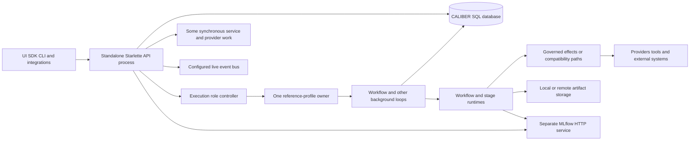
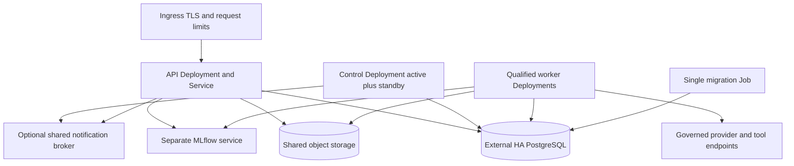

# CALIBER scalability architecture: assessment and proposal

**Status:** engineering review proposal; no runtime or deployment changes implemented by this document.

**Review baseline:** `1b4322a2938c459db9af0976472637272ae35e8c`, reviewed 2026-11-05.

**Companion:** [phased implementation plan](../planning/scalability-plan.md).

## 1. Conclusion and scope

CALIBER has useful distributed-systems foundations already: PostgreSQL-backed queues, atomic initial claims, a database-time execution-owner lease, fencing for governed effects, durable run events, and reconciliation of ambiguous effects. The reference profile runs background loops under **one execution owner**, with other processes acting as standbys. This provides a failover mechanism; it does not distribute background throughput among replicas or prove that every worker survives a takeover safely.

The immediate work is to finish ownership and recovery semantics, make API replicas consistent, and separate process roles. Keep the modular Python application and PostgreSQL queues. Introduce independently scalable workflow workers only after their entire mutation path is fenced. Qualify other worker families individually. Kubernetes should package and supervise those roles, not supply application ownership or make unsafe retries safe.

The scope is the current product model: one configured organization per installation, with multiple projects and users. Shared-customer hosting, multi-region active-active execution, a new workflow engine, and a Kafka/Celery migration are outside the essential proposal. The [live Project](https://github.com/users/rrahimi-uci/projects/3) remains the authority for priority, release assignment, decisions and progress. This requested design and its companion plan are review inputs, not a second execution tracker.

### Evidence and limitations

The review followed mounted routes through services, transactions, worker selection, runtime callbacks, external effects, settlement and startup/shutdown. It compared source with tests, deployment scripts, [ADR 0002](adr/0002-execution-ownership.md), the [reference-profile guide](../operate/reference-profile.md), and the [recovery runbook](../operate/recovery-runbook.md). Source behavior takes precedence over a design description or a closed issue.

The following focused command ran from `caliber/` at the baseline:

```sh
.venv/bin/python -m pytest tests/test_execution_owner.py tests/test_execution_role.py tests/test_worker_atomic_claim.py tests/test_event_outbox.py tests/test_readiness_execution_role.py --no-cov -q
```

Result: **104 passed, 48 skipped**. `CALIBER_TEST_POSTGRES_URL` was unavailable; the skipped PostgreSQL concurrency, row-lock and database-clock cases are unexecuted evidence. No coverage was measured by this command. An isolated SQLite probe also confirmed that `finish_import_job` commits other pending writes before raising on a failed ownership update. It did not establish PostgreSQL race behavior. The other race findings below are source-supported interleavings, not newly reproduced cluster failures. No Kubernetes deployment, load test, provider trial, failover benchmark or production observation was performed.

## 2. Current effective architecture



This diagram describes the reference ownership arrangement, not separate deployed services. In the development profile, enabled loops start without that global lease. The queue, checkpoint and approval defaults differ from the supplied Compose overrides. Always record the complete effective configuration when evaluating a deployment.

### API requests and startup

[`server.py::create_app` and `_build_lifespan`](../../caliber/src/caliber/server.py) construct services, routes, the event bus and workers in one application. [`deploy/caliber/entrypoint.sh`](../../deploy/caliber/entrypoint.sh) runs Alembic then launches Uvicorn. This is a standalone ASGI service using MLflow over HTTP; older embedded-MLflow comments are not the deployment entry point.

Authentication sessions and personal-token state are in SQL, with request-local lookup caching ([`auth.py`](../../caliber/src/caliber/auth.py)). Replicas need matching signing/CSRF secrets and configuration, not sticky sessions to preserve authentication. This does not make every route stateless:

| Effective request path | Observed behavior | Scaling implication |
| --- | --- | --- |
| [`routes/workflow_runs.py`](../../caliber/src/caliber/routes/workflow_runs.py), `create_workflow_run`, `trigger_workflow_event` → [`run_launch.py::enqueue_workflow_run`](../../caliber/src/caliber/workflows/run_launch.py) | Queued mode persists the run and event before returning. Unique `(workflow_id, source, idempotency_key)` arbitrates duplicate keyed admission. Compatibility execution paths also exist. | Retain durable admission; a nullable key does not deduplicate unkeyed submissions. Do not assume all requests use the queue. |
| [`routes/assistant.py::send_message`](../../caliber/src/caliber/routes/assistant.py) → assistant service | Async route invokes synchronous service/engine work inline. | Provider latency can occupy the API event loop. More API pods do not provide bounded background work or recovery. |
| `routes/assistant.py::update_assistant_config`, `_rebuild_engine` | Updates `app.state._assistant_overrides` and the process's engine/flags. | Replicas can disagree about domains, intents and models; restart discards overrides. |
| [`routes/system_effects.py`](../../caliber/src/caliber/routes/system_effects.py), reconciliation/attestation | Requires the receiving process's execution-owner lease; a secondary refuses with `not_execution_owner`. | An ordinary load balancer can send a valid operation to the wrong replica. |
| [`routes/tools.py::test_run_tool`](../../caliber/src/caliber/routes/tools.py) | Uses a thread-pool offload. Other routes also have explicit offloads. | Blocking is route-specific; do not describe the entire API as blocking or already asynchronous. |

[`db/session.py`](../../caliber/src/caliber/db/session.py) uses synchronous SQLAlchemy sessions and `expire_on_commit=False`. It enables connection pre-ping, but does not expose an explicit PostgreSQL pool budget per role. Per-pod connection multiplication and long-lived ORM snapshots need attention. Replacing the ORM with an async stack is not a prerequisite; bounded whole-operation offloads with correctly scoped sessions are a smaller intermediate change.

### Ownership and workflow execution

[`execution_role.py`](../../caliber/src/caliber/execution_role.py) gives each process an incarnation identifier and renews one lease through a dedicated executor. Its local deadline is shorter than the lease TTL. [`ownership.py`](../../caliber/src/caliber/ownership.py) uses PostgreSQL database time, conditional acquisition, an incrementing fencing token and a row-locked `assert_fenced`. Renewal/release require the captured owner and token. These are implemented protections, not missing features.

`server.py::_build_lifespan` starts the enabled loops together for the owner. It binds lease providers to the workflow worker, effect reconciler and workspace release evaluator. Other loops do not thereby acquire equivalent transaction-level fencing. Cancelling an await or losing leadership does not terminate a synchronous provider call already running in a thread.

The workflow path is:

1. Route authorization and validation → persisted admission and run event.
2. [`WorkflowRunWorker._claim_next_run`](../../caliber/src/caliber/orchestrator/workflow_run_worker.py) conditionally changes one queued run to running with claimant/lease fields. Only one contender wins that transition.
3. `_execute_run` loads the pinned workflow and execution inputs, binds the legacy ledger and governed contexts, and calls [`workflows/runtime.py::execute`](../../caliber/src/caliber/workflows/runtime.py).
4. Runtime invokes node callbacks, tools/providers and effect gates; callbacks persist progress, events and summaries. Approval/checkpoint paths can park the run when configured.
5. For governed effects, [`effects/dispatcher.py::_claim_dispatch`](../../caliber/src/caliber/effects/dispatcher.py) fences ownership, revalidates approval and records dispatch state before transport. [`effects/records.py`](../../caliber/src/caliber/effects/records.py) uses version/state predicates; [`effects/reconcile.py`](../../caliber/src/caliber/effects/reconcile.py) fences settlement and queries ambiguous outcomes instead of blindly resending.
6. Worker completion/failure and artifact publication update SQL and external storage. These operations do not all enforce the run's current acquisition identity.

The production worker-bound workflow-node context currently admits only backend `http`, for exact project-scoped URLs with configured authoritative receipt verifiers; without configured endpoints it admits none ([`effects/governed_context.py::effect_context`](../../caliber/src/caliber/effects/governed_context.py)). Separately governed agent-step paths and dispatcher adapters exercised with injected test contexts have different integration boundaries. Adapter support for registered tools/OpenAPI does not establish their production workflow-node wiring. [`profile.py::REFERENCE_CONNECTORS`](../../caliber/src/caliber/profile.py) explicitly records accepted risks including `write_not_exactly_once` and `key_retention_unconfirmed`.

Expired-run recovery requeues work; it does not snapshot arbitrary in-flight computation. `_resume_checkpoint` loads a checkpoint only when the run summary explicitly names a valid checkpoint in its lineage. Without a selected resume checkpoint, execution may restart at the plan entry; an explicitly selected but invalid checkpoint fails closed with `resume_checkpoint_unavailable`. Wait, approval and effect-reconciliation checkpoints provide specific continuation boundaries, not general instruction-level restart. Progress events/step summaries alone are not proof that previous node effects will be skipped. This distinction makes safe effect identity and refusal of ambiguous replay essential even with one active worker.

### Scheduling and background worker inventory

These are distinct implementations, not one uniform distributed queue abstraction.

| Family and effective source | Present protection | Remaining limit / recovery behavior |
| --- | --- | --- |
| Workflow: [`orchestrator/workflow_run_worker.py`](../../caliber/src/caliber/orchestrator/workflow_run_worker.py) | Conditional initial claim; claimant-guarded heartbeat; checkpoints and effect reconciliation paths | Recovery and several lifecycle writes lack complete acquisition fencing; details G02–G04 below. |
| Refinement: [`orchestrator/worker.py`](../../caliber/src/caliber/orchestrator/worker.py), [`eval_stage.py`](../../caliber/src/caliber/orchestrator/eval_stage.py), [`janitor.py`](../../caliber/src/caliber/orchestrator/janitor.py) | Conditional queued-to-running claim; stage heartbeat; stale-job janitor | No attempt token on the initial claim. A long evaluation can return after janitor failure and write `candidate_ready`. |
| Knowledge: [`knowledge/worker.py`](../../caliber/src/caliber/knowledge/worker.py), [`knowledge/service.py::execute_run`](../../caliber/src/caliber/knowledge/service.py) | Atomic initial claim, heartbeat and expired-lease sweep | Recovery does not atomically revalidate the observed lease; service completion/artifact activation is not fenced to the supplied worker. |
| Aria: [`assistant/executor.py::poll_waiting_plans`](../../caliber/src/caliber/assistant/executor.py) | Persisted plan and step state | Polling/resuming has no exclusive step attempt. A crash after finishing a waiting step but before executing successors can leave no discoverable continuation. |
| Workspace import: [`workspace_import_worker.py`](../../caliber/src/caliber/workspace_import_worker.py), [`workspace_imports.py::finish_import_job`](../../caliber/src/caliber/workspace_imports.py) | Owner/status/expiry predicates; heartbeat | Finish commits before checking whether the owner update matched; materialized revision/pins can commit on ownership loss. |
| Workspace release evaluation: [`orchestrator/workspace_release_evaluator.py`](../../caliber/src/caliber/orchestrator/workspace_release_evaluator.py), [`workspace_release_service.py`](../../caliber/src/caliber/workspace_release_service.py) | Fenced service claims/attempts and terminal settlement | Poller selects only queued rows although the service supports expired-running reclaim. No periodic job-lease renewal during the synchronous evaluation call. |
| Calibration: [`orchestrator/calibration_drain.py`](../../caliber/src/caliber/orchestrator/calibration_drain.py) | Atomic claims, immutable inputs, revision checks and rollback on failed settlement | Interrupted work remains ambiguous for operator resolution. This is intentional conservative behavior, not automatic replay. |
| Scheduler: [`orchestrator/scheduler.py::_tick`](../../caliber/src/caliber/orchestrator/scheduler.py) | Durable enqueue identity deduplicates the same minute | Examines the current minute, without persisted catch-up cursor. Local-time minute keys conflate the repeated DST hour. |
| Prompt-release reconciliation: [`orchestrator/release_reconciler.py`](../../caliber/src/caliber/orchestrator/release_reconciler.py), [`release_operations.py`](../../caliber/src/caliber/release_operations.py) | Persisted release intent and observation/reconciliation | No per-operation claim on settlement; retain owner-only operation until concurrency is validated. |
| Governed-effect reconciliation: [`orchestrator/effect_reconciler.py`](../../caliber/src/caliber/orchestrator/effect_reconciler.py), [`effects/reconcile.py`](../../caliber/src/caliber/effects/reconcile.py) | Execution-owner fencing, versioned settlement, authoritative lookup | Global owner limits throughput; settlement-to-park wake-up has a recovery gap. |
| Webhook dispatch: [`events/webhooks.py`](../../caliber/src/caliber/events/webhooks.py) | Persisted accepted events/dead letters and retry machinery alongside live subscriptions | Must prove every producer-to-acceptance handoff and lease boundary before claiming durable end-to-end delivery or adding dispatchers. |
| Outbox: [`events/outbox.py`](../../caliber/src/caliber/events/outbox.py) | Transactional records, conditional publisher claims, retry/backoff | `server.py` installs no consumers. Rows can be marked delivered and pruned without downstream delivery. This is also documented in the reference-profile guide. |

### State and event distribution

| State | Current owner/storage | What adding replicas changes |
| --- | --- | --- |
| Projects, runs, approvals, attempts, sessions, event history | CALIBER SQL database, [`db/models.py`](../../caliber/src/caliber/db/models.py) | Shared records do not imply that every mutation uses correct concurrency predicates. PostgreSQL is required for reference ownership semantics; SQLite is not the production multi-pod foundation. |
| Run budget | [`budget/step_reservation.py`](../../caliber/src/caliber/budget/step_reservation.py) | Row-locked per-run accounting and idempotent step reservations exist. They do not supply deployment-wide provider concurrency/RPM/TPM limits. |
| Rate limits | Generic [`rate_limit.py`](../../caliber/src/caliber/rate_limit.py) uses in-process buckets; [`routes/services.py::_enforce_service_rate_limit`](../../caliber/src/caliber/routes/services.py) uses SQL | Generic limits multiply with replicas. The persisted service limiter is an important exception. |
| Assistant overrides and runtime instances | Process memory | Configuration diverges and local caches need versioned invalidation. |
| Files and artifacts | [`storage/service.py`](../../caliber/src/caliber/storage/service.py), local/S3 backends and persisted project-specific storage choices | Shared remote defaults do not migrate existing project-local references. SQL/object writes are not atomic together. |
| MLflow tracking/artifacts | Separate MLflow service, its backing database and object storage | Scaling CALIBER does not scale MLflow; account for its independent limits and recovery. |
| Live notifications | In-process, database polling, Redis Pub/Sub or core NATS implementations under [`events/`](../../caliber/src/caliber/events/) | Remote fanout helps replicas see events. These buses are not automatically durable work queues. Bounded local queues can drop messages. |
| SSE | [`routes/events_stream.py`](../../caliber/src/caliber/routes/events_stream.py) | No event ID/reconnect cursor or persisted replay contract. It subscribes after authentication without project filtering in the stream handler; audit each payload and authorization boundary before expanding replay. |

[`events/inbox.py::process_once`](../../caliber/src/caliber/events/inbox.py) already reserves an event, applies a database transition and records processing in one transaction. Reuse that primitive for database-only consumers. In contrast, `outbox.claim_unprocessed` is expressly an unlocked read; it is not a distributed claim. Neither makes an external HTTP call transactional with SQL.

Storage also has two materially different paths. `StorageService.register_project_file` uses content identity and protects published references. `_write_and_record` overwrites run-artifact objects. [`storage/s3.py`](../../caliber/src/caliber/storage/s3.py) implements the non-overwrite path using an existence check followed by a put, not an atomic conditional create. [`storage/local.py`](../../caliber/src/caliber/storage/local.py) atomically replaces a local file, but that file is not thereby shared across nodes.

## 3. Specific gaps and their evidence

The identifiers below map to the implementation phases. “Verified” means the named source implements the behavior; the possible concurrent ordering is an analysis unless a reproduction is explicitly recorded.

| ID | Finding, concrete failure boundary and evidence | Required disposition |
| --- | --- | --- |
| G01 | Global owner starts all reference background loops; development starts them without leasing. `server.py::_build_lifespan`, `execution_role.py`. | Explicit roles and safe profile validation. Do not enable parallel workers by disabling the global lease. |
| G02 | Workflow callbacks and `_mark_completed`/`_mark_failed` lack captured-claim predicates. `_execute_run` initially checks running status only. Heartbeat ignores a zero-row renewal. A returns after B takes over and can publish stale progress/completion. [Baseline callbacks](https://github.com/rrahimi-uci/caliber-suite/blob/1b4322a2938c459db9af0976472637272ae35e8c/caliber/src/caliber/orchestrator/workflow_run_worker.py#L2064-L2127). | Fence every authoritative mutation and artifact pointer; cancel on lost renewal. |
| G03 | Workflow recovery selects expired rows then updates IDs with only a running predicate; it can revoke a renewed/new claim. Manual/event resume and timer maintenance read waiting state then assign later, allowing resume/claim or expiry/resume races. [Recovery](https://github.com/rrahimi-uci/caliber-suite/blob/1b4322a2938c459db9af0976472637272ae35e8c/caliber/src/caliber/orchestrator/workflow_run_worker.py#L747-L799), [resume helper](https://github.com/rrahimi-uci/caliber-suite/blob/1b4322a2938c459db9af0976472637272ae35e8c/caliber/src/caliber/routes/workflow_runs.py#L2996-L3023). | Conditional database-time recovery; versioned waiting/checkpoint transitions; events only for rows actually changed. |
| G04 | Effect settlement commits, then calls `wake_parked_runs`. Worker can park afterward, or process can die between settlement and wake. Terminal proposals leave the reconciliation candidate set. [Settlement caller](https://github.com/rrahimi-uci/caliber-suite/blob/1b4322a2938c459db9af0976472637272ae35e8c/caliber/src/caliber/effects/reconcile.py#L449-L451), worker `_mark_waiting_effect`. | Durable wake delivery or idempotent parked-run sweep plus a post-park check. |
| G05 | Runtime output-bucket writes and worker artifact puts bypass run fencing. The development ledger's failed-to-in-progress retry and completion lack claim/version guards. Dispatcher commits before remote transport; a paused former owner can still send afterward. `runtime.py::_write_output_bucket_node`, worker `_persist_run_artifacts`, [`effect_ledger.py`](../../caliber/src/caliber/workflows/effect_ledger.py), dispatcher `_claim_dispatch`/transport. | Inventory every effect; route, refuse or explicitly classify it. Preserve stable logical keys and connector risk disclosures; no universal exactly-once claim. |
| G06 | Refinement, knowledge and Aria lack complete exclusive attempt/continuation semantics. Import finish commits before validating ownership. Release-evaluation reclaim is not reached by polling and its job heartbeat stops during evaluation. See worker inventory and [import commit order](https://github.com/rrahimi-uci/caliber-suite/blob/1b4322a2938c459db9af0976472637272ae35e8c/caliber/src/caliber/workspace_imports.py#L307-L334). | Repair failover correctness now; enable concurrency only per qualified family. |
| G07 | Scheduler current-minute scan skips missed slots; DST key ambiguity. | Persist schedule occurrence identity/cursor; decide misfire policy before implementation. |
| G08 | Inline API work, local configuration/limits, and owner-bound operator routes prevent a consistent replica pool. | Durable commands for long work; shared versioned settings and limits; owner-independent admission. |
| G09 | Outbox consumers are unwired; live bus/SSE are not replayable delivery. | Register durable consumers, enforce processing identity and scoped replay, retain lossy live notifications as an optimization. |
| G10 | Local storage references and mutable run object keys allow missing/overwritten artifacts; remote put and SQL commit can diverge. | Shared storage migration, immutable attempt objects, fenced publication and orphan collection. |
| G11 | Container startup migrates on every replica. Schema readiness requires exact current migration state. `/health` checks SQL; readiness includes queue/global dependencies. Compose is not a Kubernetes deployment. | One migration Job; compatible schema window or maintenance rollout; independent liveness and role readiness; deployment/failure qualification. |
| G12 | No demonstrated operating envelope or full multi-process failure/load evidence. Polling, the global fencing row, database pools, provider limits and MLflow can become bottlenecks. | Approved targets, bounded admission/concurrency, metrics and benchmark evidence before autoscaling or performance claims. |

Existing tests provide valuable but narrower evidence: `test_execution_owner.py` includes PostgreSQL fencing races; `test_effect_records.py` and `test_effect_reconcile.py` exercise concurrent governed transitions; `test_worker_atomic_claim.py` establishes initial-claim exclusion, not complete worker ownership. The V07 restart scenario reconstructs runtime resume, and V13 release-evaluation scenarios call the service reclaim primitive directly. Neither substitutes for a replacement worker discovering and finishing the work through its normal poll loop.

## 4. Target architecture

All behavior in this section is **proposed**, unless explicitly identified as retained behavior.

### 4.1 Service boundaries and incremental topology

Use one versioned image and shared domain code with explicit process roles. Names below describe proposed roles, not existing environment variables or deploy commands.

| Role | Responsibilities | Initial scaling rule |
| --- | --- | --- |
| API | Authenticate/authorize, validate, commit commands/admission, read/query, stream authorized updates | Multiple replicas after G08/G10/G11 gates. No owner loops or unbounded execution in requests. |
| Control | Schedule occurrences, recover expired work, sweep parked runs, reconcile effects/releases, run maintenance families qualified for owner failover | One active controller plus standby through the retained database lease. Disable families lacking failover safety, even if normally singleton. Split responsibilities only when measured contention requires it. |
| Workflow worker | Claim eligible runs, renew attempt, execute, checkpoint, settle or park under captured authority | Independent bounded replicas only after P2/P3. Initially one running workflow per execution slot; no distributed fan-out of one workflow. |
| Other worker families | Refinement, knowledge, Aria continuations, import and release evaluation | Keep under the control owner until each passes the same claim/renew/settle/recover qualification. Heavy families may later use separate resource classes. |
| Event delivery | Persisted outbox/inbox processing and webhook delivery | Initially control-owned; later competing consumers with consumer-specific deduplication and fenced attempts. |

Do not make every domain a network microservice. Separate lifecycle and resource budgets first. API replicas retain notification infrastructure but no execution-owner loops. Worker deployments should not mount public API routes merely to obtain a health endpoint. During the P1 bridge, control retains a private authenticated operational route surface for owner-bound reconciliation/attestation; P3 replaces this with durable commands. The current `background_tasks_enabled` switch is a useful seam, not a finished production role contract.

### 4.2 Authority, leases and work distribution

Use PostgreSQL as the initial scheduling and ownership authority. Extend existing domain tables where possible, with a shared claim protocol and immutable attempt history; avoid copying all authoritative payloads into a second generic task database.

| Proposed data contract | Purpose / constraints |
| --- | --- |
| Work identity: family, project, durable work ID, immutable input/version references | Defines what is executed; retries retain identity and pins. Never place plaintext credentials or transient request objects in a queue. |
| Claim: process-incarnation owner, monotonically increasing acquisition epoch, database-time expiry | Every acquisition, including reacquisition by the same process, creates a new epoch. Owner alone is insufficient. |
| Attempt history: work ID + epoch, start/end, outcome/reason, bounded error metadata | Preserve provenance and account for interrupted/unknown work. Reuse existing release-attempt concepts rather than discard them. |
| Eligibility: status, available-at, priority, cancellation/version state | Indexed bounded scans; backoff and fair project selection. Waiting/unknown work is not runnable merely because a lease expires. |
| Authority reference: domain/scope, work ID, epoch, installation history generation | Disambiguates the retained control-owner token from per-run tokens. Also supports safe restore without comparing unrelated token integers. |

Claim a bounded batch of eligible rows in a short transaction with `FOR UPDATE SKIP LOCKED` plus a conditional update/returning predicate. Use database time for claim, expiry, renewal and recovery. PostgreSQL documents `SKIP LOCKED` as suitable for queue-like consumers, with an inconsistent view unsuitable for general-purpose queries ([SELECT documentation](https://www.postgresql.org/docs/16/sql-select.html)). Preserve deterministic priority ordering, bounded weighted fairness and aging; a busy project must not starve another indefinitely.

Every authoritative mutation must validate the appropriate **captured** authority in the same transaction as the write. Execution writes verify the epoch, current status and unexpired claim; relevant cancellation/version checks join that predicate. Events are appended only for successful transitions. A stale session cannot refresh authority implicitly and continue as the new owner. Different operations require different authority:

| Operation | Required authority and transition guard |
| --- | --- |
| Executing node progress, checkpoint creation, artifact publication, worker terminal state | Captured live run acquisition plus expected lifecycle version; P2 additionally retains existing global fencing for governed effects. |
| Approval/rejection, operator cancellation, manual/event resume | Current actor/policy authorization plus expected decision, waiting/checkpoint or lifecycle version. No expired execution lease is required: parked work deliberately releases it. A resulting execution receives a new claim. |
| Timer wake and parked-run sweep | Current controller authority plus conditional waiting/dependency version; never overwrite an already running claim. |
| Effect lookup, stuck-dispatch expiry and reconciled settlement | Explicit effect-reconciliation authority and proposal/attempt version. Arbitrate with dispatch settlement; lookup does not authorize another send. |
| Expired execution takeover | Conditional expiry/status/epoch check and a new acquisition; no authority to replay unknown external effects. |

Renew through an independent bounded connection path. Reject unsafe heartbeat/TTL combinations at startup; choose deadlines from measured database latency and tolerated pauses. Failed renewal triggers local cancellation and stops new dispatch. Conditional settlement remains necessary because threads and external calls cannot be forcibly undone. Keep network calls outside database locks. The existing global fence row can serialize transactions and contend with renewal; do not hold it across provider work.

**Authority migration is an explicit dependency.** Governed effects currently use the global execution-owner lease. Simply allowing workflow workers to claim runs, changing the lease name, or giving every worker the current controller token would break the protection model. P2 adds run-acquisition checks while retaining existing global effect fencing; P3 migrates the effect-authority format. Persist authority domain and epoch on dispatch attempts; teach dispatcher, reconciler, approvals, budgets and recovery their operation-specific rules. Keep old global-owner mode until all readers and writers support the new contract. Missing/unknown authority versions fail closed.

Distinguish expired-owner takeover from reconciliation under live ownership. Current `effects/reconcile.py::_take_over` and `effects/records.py::expire_in_flight` can classify a stuck dispatch as unknown under a still-current lease. Preserve bounded stuck-dispatch expiry and authoritative lookup while its run owner remains healthy, with version arbitration against late settlement. The reconciler must neither impersonate the live worker nor wait indefinitely for run-owner expiry before resolving a parked run. None of these reconciliation transitions grants permission to resend.

### 4.3 Admission, idempotency and external effects

For durable asynchronous operations, return acceptance only after the transaction commits; expose an operation/run ID for polling. Support a stable idempotency key scoped to the operation and project, plus a canonical request fingerprint. Repeating the same key/body returns the original identity; a different body with that key returns a conflict. Extend existing workflow enqueue identity rather than replacing it. Preserve existing synchronous APIs through explicit compatibility contracts; changing all successful responses to `202` would be a breaking change.

Move owner-bound reconciliation/attestation to authenticated durable operator commands accepted by any API replica, with authorization rechecked at execution. Record actor, scope and immutable policy/input references. Before that migration, explicitly restrict those routes to the single operational owner endpoint; do not randomly load-balance them or silently proxy without an authorization design.

Execution is at-least-once at the work-attempt level. The target guarantees at most one accepted authoritative database transition for a given version and rejects stale completion. It cannot promise exactly-once arbitrary external effects:

- Keep a logical effect key stable across retries, failover and reconciliation. An acquisition epoch is execution authority, not a new business-effect identity.
- Require a connector capability contract for idempotency scope/retention, receipt verification, timeouts and outcome lookup. Do not infer deduplication from the presence of an HTTP header.
- A call whose outcome is unknown remains unknown and conservatively reserved; query an authoritative receipt or require operator resolution. Never resend solely because the local lease expired.
- Prevent new dispatch after local ownership loss and fence settlement, while acknowledging the pause-between-claim-and-send window. A remote fencing/idempotency contract is required to prevent late remote mutation itself.
- Route or refuse all workflow output/tool writes explicitly. For compatibility ledger retries, add an acquisition CAS and token-guarded completion, or keep the path unsupported in the scalable profile.

### 4.4 Scheduling, cancellation and recovery

Persist `(schedule_id, schedule_revision, scheduled_at_utc)` with a uniqueness constraint. Derive the workflow enqueue idempotency key from this immutable occurrence identity and persist its run association; retaining the current local-minute enqueue key would still collapse distinct DST occurrences. Commit occurrence creation, enqueue and schedule cursor advancement together. Enumerate due occurrences from the durable cursor, in bounded batches. Retain one active scheduler initially; uniqueness protects repeated ticks and takeover.

Product/operations must select missed-slot behavior: skip with an audit record, bounded catch-up, or coalesce to the latest occurrence. Define maximum lateness, maximum backlog, schedule edits, time-zone/DST semantics and pause/resume. Use UTC instants as occurrence identity while retaining the configured zone for interpretation. Do not assume every missing minute should execute after a long outage.

Cancellation and resume are versioned state transitions. Persist cancellation intent; prevent new attempts/effects after it becomes authoritative, retain accounting for unknown in-flight calls, and reject stale terminal callbacks. Resume updates checkpoint input and waiting-state version atomically. Competing resume or timer-expiry requests return the established outcome/conflict instead of overwriting a new claim.

| Failure | Proposed recovery and safety boundary |
| --- | --- |
| API dies before/after commit | Before commit: no accepted work. After commit: keyed retry returns the existing operation. Unkeyed retries retain documented duplicate risk. |
| Worker dies or pauses beyond lease | Replacement conditionally claims expired eligible work with a new epoch; old callbacks/checkpoints/publication are rejected. Resume only at a supported durable boundary. |
| Database unavailable | Stop claims/renewal and new effects before local authority deadline. Do not pretend a failed readiness probe proves the old process stopped. |
| Remote call succeeds but local result is lost | Retain unknown state/reservation; receipt reconciliation, then idempotent continuation. No blind replay. |
| Settlement precedes park, or crash follows settlement | Durable wake consumer plus an idempotent parked-run sweep/post-park recheck. Terminal dependency state remains discoverable. |
| Object uploaded but SQL commit fails | Object remains unpublished; retry uses immutable identity and checksum. Delayed orphan collection never deletes an active attempt's or published object's evidence. |
| Broker unavailable / client disconnect | SQL remains authoritative. Outbox retries; SSE reconnect uses authorized replay or explicit resnapshot. Live fanout loss cannot lose a work item. |
| Poison work or repeated deterministic failure | Bounded attempts/backoff; durable terminal/quarantined state, actionable reason and explicit operator retry. Do not retry indefinitely. |
| Database failover or point-in-time restore | Re-establish authority against the new primary. Restore requires a new installation history generation, old-worker shutdown/credential isolation, and external-effect reconciliation before dispatch resumes; rolled-back fencing counters alone cannot protect external reality. |

### 4.5 Shared state, storage and delivery

Persist assistant settings as versioned scoped configuration with audit history. Resolve a committed version on execution; invalidate caches by version or bounded refresh. Separate process-local connection caches from authoritative settings. Use consistent secret references across replicas and workload identity where available; do not copy credentials into job payloads.

Keep existing per-run budget reservations. Add typed deployment/project/connector capacity buckets through [#789](https://github.com/rrahimi-uci/caliber-suite/issues/789), including conservative accounting for unknown calls. Coordinate retry ownership with its prerequisite [#783](https://github.com/rrahimi-uci/caliber-suite/issues/783). Generic rate limits require shared enforcement or an explicitly per-replica diagnostic scope; do not weaken existing SQL service limits. Backpressure must cap queued work, input size and concurrent providers as well as CPU. Reject overload predictably with retry guidance before committing work the installation cannot retain.

Require shared object storage for authoritative artifacts in the multi-pod profile. Inventory and migrate existing per-project local paths, knowledge artifacts and evidence references; a new default is insufficient. Publish immutable attempt/content-addressed objects, then conditionally commit their SQL reference under authority. Validate checksums and storage reachability. Use conditional object creation where supported; never rely on check-then-put for exclusion. A local directory remains acceptable for disposable scratch, with explicit bounds and cleanup. MLflow artifact storage needs its own shared configuration and capacity plan.

Wire the existing outbox to named durable consumers. Use the existing transactional inbox for database-only handling, and persistent delivery attempts for external webhooks. A delivered marker must represent the documented handoff/acknowledgement, not an empty callback list. Before activating durable consumers, require database-time leases and captured acquisition identity on publisher settle/release operations, including same-instance stop/restart: an old handoff thread must not settle a newer claim under the reused owner ID. Preserve event IDs and per-run ordering; consumers tolerate duplicates and out-of-order arrival without manufacturing a global total order.

For SSE, authorize project/run visibility on both subscription and replay. Add event IDs/cursors, retention limits, bounded pages and an explicit expired-cursor resnapshot response. Audit existing event payloads before exposing history. Broker messages are wake-up hints; persisted run events and operation state remain the recovery source.

### 4.6 Observability and capacity

Extend the existing [`observability/`](../../caliber/src/caliber/observability/) facilities rather than create a parallel telemetry stack. Structured logs/traces should correlate request, project, work, attempt, effect, authority domain and epoch, without secrets or provider payloads by default. Keep high-cardinality identifiers in logs/traces, not metric labels.

Required metrics include eligible queue depth/oldest age by family, active leases, claim/renew latency and failures, stale-write rejections, recovery counts, parked duration, unknown-effect age, scheduler lag/missed slots, outbox age/retries, rejected admission, provider concurrency, database pool wait/saturation, event-loop lag, API latency/errors and worker resource use. Alerts distinguish unavailable control, unavailable capacity, dependency failure and unresolved effects. Lease loss is not itself proof of data corruption; unexpected stale accepted writes are correctness failures.

Approve targets before measuring through [#847](https://github.com/rrahimi-uci/caliber-suite/issues/847): runs/hour, concurrent runs, workflow shape, payload/knowledge sizes, provider delay/error mix, latency/error/cost bounds, RPO/RTO and detection time. This document supplies no invented production SLO. Report both offered and accepted load and queue growth; a faster rejection response is not higher throughput.

### 4.7 Kubernetes deployment and scaling



Introduce manifests under a proposed `deploy/kubernetes/` directory only during implementation. The current [`deploy/caliber/`](../../deploy/caliber/) and [`deploy/mlflow/`](../../deploy/mlflow/) Compose examples do not establish Kubernetes support.

The first qualified topology should use multiple API replicas, two control instances with one active lease owner, and a small fixed workflow-worker pool. Disable independent replication of unqualified families. Use externally operated HA PostgreSQL and durable object storage; embedding a single PostgreSQL pod would just move the availability bottleneck. Isolate MLflow capacity and sandbox/tool execution from public API resources.

Deployment requirements:

1. Run one versioned migration Job before compatible application rollout. Add an explicit entry-point mode that does not run migrations in every pod. Backups and migration locking precede schema changes.
2. Introduce a reader/writer schema compatibility contract before claiming rolling upgrades. [`db/migrate.py::SchemaStatus`](../../caliber/src/caliber/db/migrate.py) currently treats only exact current state as ready. Until compatibility is implemented, use a documented maintenance rollout instead of promising old and new pods can overlap.
3. Add dependency-free `/livez` and role-specific `/readyz`; keep existing diagnostics compatible. [`routes/health.py`](../../caliber/src/caliber/routes/health.py) checks the database, and [`observability/readiness.py`](../../caliber/src/caliber/observability/readiness.py) aggregates dependencies. Do not use database health as liveness. API readiness should reflect the ability to accept/read safely; queue backlog alone should trigger backpressure/alerts, not remove every API endpoint. Worker/control readiness must distinguish a healthy standby from an active owner. Kubernetes readiness removes traffic, whereas liveness can restart the container ([probe semantics](https://kubernetes.io/docs/concepts/workloads/pods/probes/)).
4. Set resource requests/limits, bounded thread pools and explicit SQL pool sizes per role. Total pools across maximum replicas, MLflow, migrations and operations must fit the database connection budget. Reserve capacity for renewals and recovery.
5. On termination, stop admission/claims, drain within a bounded grace period, persist recoverable progress, and release only authority whose work is stopped. Use disruption budgets/topology spread for availability, but correctness must survive involuntary node loss and a paused old process. In-memory cancellation is not a fence.
6. Mount only temporary scratch volumes in workers unless a specific supported shared filesystem contract is approved. Use non-root containers, read-only roots where feasible, separate service accounts, least-privilege secret/object access, NetworkPolicies and controlled egress. Preserve reference-profile connector and sandbox restrictions.
7. Begin with fixed replicas and validated budgets. Add HPA only after capacity tests: API demand/latency and resource signals; worker eligible queue age plus available provider/database capacity. HPA can consume custom/external metrics ([HPA documentation](https://kubernetes.io/docs/concepts/workloads/autoscaling/horizontal-pod-autoscale/)); it does not decide ownership. Cap replicas and use stabilization/draining on scale-down. Never scale the controller's active count with backlog.

### 4.8 Tradeoffs and decisions still required

| Choice | Recommendation and cost | Decision owner / unresolved input |
| --- | --- | --- |
| SQL queues versus external task broker | Retain SQL authority: fewer moving parts and transactional admission. Polling, indexes/vacuum and primary write capacity need measurement. Add notification hints before replacing the queue. | Engineering; revisit only with measured bottlenecks. |
| Single controller versus per-domain leaders | Retain one active controller initially, with short transactions and bounded scans. Availability improves before control-plane throughput. | Engineering after P5 measurements. |
| Supported effects | Preserve explicit connector risk/refusal contracts. Unsupported arbitrary writes cannot receive exactly-once guarantees. | Product/security/connector owners must approve capability-specific residual risks. |
| Recovery and replay | Resume only proven durable boundaries; leave ambiguous external work blocked. | Product/operations decide intervention policy and recovery targets. |
| Schedule misfires and time zones | Persist UTC occurrences; do not silently select backfill policy. | Product owner chooses per-schedule default, lateness and DST behavior. |
| Capacity and cost | Numeric envelope must be approved before acceptance measurement; no fixed pod count is a capacity promise. | Domain and operations owners, #847. |
| Infrastructure and upgrades | Select managed/external database/object storage, identity and backup ownership; maintenance upgrades until compatibility is proven. | Operations/security; infrastructure availability and budget. |
| Regional cells/sharding | Later optimization only; preserve the existing [regional-cell decision task #896](https://github.com/rrahimi-uci/caliber-suite/issues/896). | Architecture/product after the single-region envelope is measured. |

The [implementation plan](../planning/scalability-plan.md) turns G01–G12 into dependency-ordered work and explicit acceptance evidence. This proposal does not certify the current repository as safe for unrestricted horizontal execution.
