# Caliber as the Platform for Progressively Autonomous Enterprises

**Status.** Research and architecture report. Date: 2026-10-31. Repository state: `main` at `82f41d1b85d`. This is not a decision record. Every recommendation is a proposal; decisions belong to the program owner (section 22.5) and, once taken, would be recorded as ADRs (section 23.7).

## How to read this report

The report is long because it has to be checkable. The evidence tags and the reading paths below let each audience take only what it needs.

| If you are... | Read | Why |
|---|---|---|
| A product leader or the program owner | Sections 1, 2, 3, 4, 18, 20, 21, 22 and 23 | The answer, the positioning, what Beta may claim, the staged path, the decisions you must take |
| An architect | Sections 5, 8 to 17, then Appendices A and B | The current architecture, the proposed role, autonomy, evidence and governance designs, the gap analysis and the changes they require |
| An engineering team | Sections 5, 15, 16, 17, 18, 21 and 23 | What is wired and what is only written, which seams to land before schemas freeze, the work items |
| A sceptical reviewer | Section 1.2, section 5.4, section 22 and Appendix A | The strongest objections, the claims-versus-code drift, the kill criteria |

**The 10-minute path.** Section 1 in full. Then section 3.3 (the positioning statement), section 3.5 (the claim Beta can defend), section 9.4 (the six Autonomy Modes), section 21 (Now, Next, Later) and section 22.5 (the owner's decisions).

**The 1-hour path.** Sections 1 and 2. Section 3 and section 4.1. Section 5.4 (wired versus written) and 5.11 (scorecard). Sections 8.1, 8.2, 9.1 to 9.4 and 10.6. The "position in one page" at the start of section 12. Section 13.1. Section 16.2 (the gap table). Sections 18.2 and 18.5. Section 20.1. Section 21. Sections 22.1 and 22.2.

### Evidence tags

Every material claim carries a tag that says how it was established. A claim without a tag is argument, not evidence.

| Tag | Meaning |
|---|---|
| `[repo]` | The file was opened and the claim read at the cited `path:line` on `main` at `82f41d1b85d`. Paths are relative to the repository root; `caliber/src/caliber/` is abbreviated `src/` where the context is clear. |
| `[gh]` | A GitHub issue or pull request was read; state is as of 2026-10-31. |
| `[S]` | An external source was opened and read. |
| `[W]` | The claim rests on a search result only (a snippet or secondary coverage). Treat it as directional. |
| `[M]` | Memory: prior knowledge of a standard, product or regulation that was not re-verified. |
| `[J]` | Judgement: an inference or design choice of this report, not a claim about the world. |

Evidence files are stored beside this report in `docs/autonomous-enterprise-evidence/`. Section references use the E-keys below, for example "E-gov 2.4".

| E-key | File | Subject |
|---|---|---|
| E-roles | `roles.md` | Inventory and assessment of every concept of "role" in the repository |
| E-gov | `governance-execution.md` | Governance and execution half: runtime, agent step, effect ledger, policy, approvals, ownership, security |
| E-road | `roadmap-specs.md` | The program's plans, ADRs, milestones, issues and claims versus code |
| E-eval | `evaluation-learning.md` | Evaluation, learning, observability, state and the refinement loop |
| E-av | `nvidia-av.md` | NVIDIA and the automotive autonomy stack as a reference pattern |
| E-auto | `agent-autonomy.md` | Autonomy frameworks for agents and the enterprise agent-platform landscape |

### Vocabulary

The report uses one vocabulary throughout. It is defined in full in the design basis before section 8 and in Appendix C.

- **Responsibility**: a named duty declared in a Work definition as a sealed slot. It names no occupant.
- **Principal**: a `human`, `agent`, `service` or `group`. Agent Principals are versioned; the version is the set of behaviour pins.
- **Assignment** (with a **capacity**: perform, assist, shadow, verify, oversee, resolve, approve): the link from a Responsibility to a Principal.
- **Operating Envelope**: the bounds inside which a delegation holds (data classes, systems, effect classes, value, volume, time, required checks).
- **Autonomy Grant**: the unit of delegated authority: a Responsibility, an Operating Envelope, a Principal version, a duty allocation, an accountable owner, an evidence basis and an expiry.
- **Autonomy Mode (M0 to M5)**: the label derived from a grant. It is never configured and never shown without its envelope. The report says "mode" where the charter and ADR 0004 say "level".
- **Autonomy Profile**: the vector of modes across the Responsibilities of one use case. It replaces a single level per use case.
- **Duties**: Perform, Verify, Oversee, Recover. A mode is a statement about who holds each.

### Contents

1. [Executive summary](#1-executive-summary)
2. [Autonomous Enterprise thesis](#2-autonomous-enterprise-thesis)
3. [Caliber's proposed platform positioning](#3-calibers-proposed-platform-positioning)
4. [The NVIDIA platform analogy and its limitations](#4-the-nvidia-platform-analogy-and-its-limitations)
5. [Current Caliber architecture assessment](#5-current-caliber-architecture-assessment)
6. [Existing role-model assessment](#6-existing-role-model-assessment)
7. [Missing or problematic roles](#7-missing-or-problematic-roles)
8. [Proposed role architecture](#8-proposed-role-architecture)
9. [Proposed autonomy-level framework](#9-proposed-autonomy-level-framework)
10. [Role x autonomy-mode matrix](#10-role-x-autonomy-mode-matrix)
11. [The human-agent responsibility-transition model](#11-the-human-agent-responsibility-transition-model)
12. [Proposed Caliber platform stack](#12-proposed-caliber-platform-stack)
13. [Evaluation-driven autonomy model](#13-evaluation-driven-autonomy-model)
14. [Governance, safety, approval and escalation model](#14-governance-safety-approval-and-escalation-model)
15. [Current versus target architecture](#15-current-versus-target-architecture)
16. [Detailed capability gap analysis](#16-detailed-capability-gap-analysis)
17. [Architectural changes required](#17-architectural-changes-required)
18. [Beta/MVP implications](#18-betamvp-implications)
19. [Long-term architecture](#19-long-term-architecture)
20. [Evolution path](#20-evolution-path)
21. [Prioritized recommendations: Now, Next, Later](#21-prioritized-recommendations-now-next-later)
22. [Risks, tradeoffs, assumptions and unresolved questions](#22-risks-tradeoffs-assumptions-and-unresolved-questions)
23. [Recommended roadmap implications](#23-recommended-roadmap-implications)

Appendices

- [Appendix A. Independent red-team review of the vision](#appendix-a-independent-red-team-review-of-the-vision)
- [Appendix B. Where the concept design could be wrong, and open questions for the owner](#appendix-b-where-the-concept-design-could-be-wrong-and-open-questions-for-the-owner)
- [Appendix C. Glossary](#appendix-c-glossary)
- [Appendix D. Evidence base and methodology](#appendix-d-evidence-base-and-methodology)

---

## 1. Executive summary

### 1.1 The question and the answer

The charter asks: can Caliber become the common platform on which enterprises progressively move from human-operated workflows to safely governed autonomous operations, and what must it become architecturally, technically and operationally?

**The answer is a conditional yes, for a narrower thing than the question assumes.** Caliber can become the authority-and-evidence layer on which an enterprise moves a bounded Responsibility from a human Principal to an agent Principal by changing an Autonomy Grant, not by rebuilding the workflow. The grant carries an Operating Envelope, an accountable owner, evidence that expires when behaviour changes, and authority that can be withdrawn faster than it was given. Caliber cannot, on present evidence, become a common platform in the NVIDIA sense (many enterprises, one external standard, shared certification, fleet learning). It is not today a platform for progressive autonomy at all: the autonomy half of the vision has no code. What exists is a rigorous authority-to-effect spine that is largely built and not yet wired into the production path, plus a strong release-time evaluation stack (section 5).

**Confidence.** High that the description of today's repository is correct: the findings were verified by opening the code on `main` at `82f41d1b85d` (section 5, E-gov, E-eval, E-road). Medium that the proposed architecture (sections 8 to 17) is the right shape: it follows from the evidence and survived an adversarial review, but it is untested on any workload and its numeric defaults are illustrative [J]. Low on the market outcome: no buyer has validated the positioning, and the only available estimates of success are subjective (below).

**Conditions.** The conditional yes holds only if:

1. The governed path is wired in production, so documented claims match code (section 18.2, B1 and B2).
2. The unit of authority is the grant over an envelope, fixed before ADR 0004's scalar level is persisted (sections 9.9 and 18.3).
3. One external operator runs one real bounded workflow with real effects, and an independent reviewer examines the control spine (section 20.1).
4. Shadow evidence accumulates from Beta, scoped to the behaviour configuration and expiring, so promotion evidence is not circular (sections 11.4 and 13).
5. Some Responsibilities are never delegable and the accountable owner is a recorded natural person by default (sections 8.7 and 10.6).
6. Caliber integrates with identity providers, policy engines and workflow systems rather than competing with them (sections 3.3 and 3.8).

**Reconciling the vision, the designers and the red team.** The *vision* (the charter) holds that Caliber is the platform for progressively autonomous enterprises, built on a model of Work, Roles, Assignment, Capabilities, Autonomy, Evaluation and Governance. The *designers* confirmed its shape and corrected its parts: the unit is a Responsibility inside an Operating Envelope, not a role; the level is derived from four duties (Perform, Verify, Oversee, Recover), not configured; evidence widens an exposure cap and never replaces it. The *red team* concluded "not as framed; plausibly as something narrower and more defensible", and called the headline the unproven half: the control spine has code and differentiation, the autonomy ladder has neither code nor demonstrated demand (Appendix A). All three describe one object, a delegation with an envelope, an accountable owner, an evidence reference, an expiry and revocation triggers. They differ on timing (section 3.2). This report adopts the narrow claim and keeps the wide design reachable: **claim the control spine, shape the data model so the autonomy ladder stays reachable, and let a pilot rather than a metaphor decide whether a ladder exists.** It costs little, because the designers' "Now" list and the red team's "cheap before schemas freeze" list are nearly the same (section 18.2).

The red team's probabilities are **a subjective, external view**: structured guesses with no base rate, held with low confidence by their author (Appendix A, 6.3), and not re-estimated here (section 20.1). Read them as priors for the experiments in section 22.3, not as forecasts.

| Claim | Window | Red team's probability |
|---|---|---|
| Caliber becomes the common platform across many enterprises, in the NVIDIA sense | 24 months | about 3 percent |
| One external production use case with real effects runs on the exact-intent approval and effect ledger | 24 months | about 25 percent; about 40 percent if a pilot is signed by month 6 |
| An evidence-gated promotion beyond ADR 0004's L2-equivalent operates in a real external use case | 24 months | about 12 percent |
| A major vendor ships a bundled evidence-conditioned authority feature overlapping the join | 24 months | about 55 percent |
| The vision proves useful as an internal architecture discipline even if the market claim fails | 24 months | about 70 percent |

Practical reading: do not promise the strong claim, treat the pilot as the largest lever, and keep the design discipline whatever the market does.

### 1.2 The ten findings that matter most

**1. The authority-to-effect spine is strong and differentiated, and the governed path is not wired in production.** It comprises pinned admission, run-bound grants rechecked at every use, intent-hash-bound approval, a seven-state effect ledger with lease and fencing, a reconciler that refuses to re-send blindly, and a contract in which a model's output cannot claim an effect happened (section 5.3). But `RuntimePlan.governed_agent_steps` and `governed_effects` are declared (`caliber/src/caliber/workflows/runtime.py:2531,2537`) and never assigned outside tests; the reference profile says "nothing in production builds one yet" (`docs/operate/reference-profile.md:2559`); the decision route answers `409 approval_bound_not_wired` (`caliber/src/caliber/routes/workflow_runs.py:1866`); only the `document_request` backend is reachable by an agent step (`caliber/src/caliber/effects/step_proposal.py:81`) [repo]. The exact-intent chain runs in scenario tests, not yet end to end in a queued production run (section 5.4).

**2. There is no Principal type and no autonomy code; autonomy is configured, not earned.** `principal_type` has no occurrence in `caliber/src`, the UI or the SDK [repo]. ADR 0004's levels, promotion and demotion are design only, scheduled for D10, and the ADR says the platform "behaves as L1 everywhere" until then (`docs/architecture/adr/0004-autonomy-levels.md:101`) [repo]. The only live autonomy is three unconnected dials (Aria's session mode, Aria's plan dial, per-tool `requires_approval`), each set by a user or editor with no evidence behind it (section 5.7).

**3. Roles are permission tiers on user-id strings, not Responsibilities.** "Role" has about eleven meanings and three overlapping vocabularies in the repository [E-roles 0]. The occupant of a duty is the node type inside the sealed workflow version, and a run's workload identity is that version's digest (`caliber/src/caliber/policy/principal.py:104`) [repo]. Moving a duty from person to agent mints a new version, workload and grants: the rebuild the vision wants to avoid (sections 6 and 8.5).

**4. Three capabilities are Architecturally Conflicting, not merely missing.** Of the 25 capabilities in the charter's list, 2 are Supported, 16 Partially Supported, 4 Missing and 3 Architecturally Conflicting (section 16.1). The three are roles and responsibilities (the occupant is sealed in the manifest), humans and agents (`create_grant` caps run authority at a human's role, `caliber/src/caliber/policy/grants.py:173-195`, so an agent cannot hold authority of its own) and enterprise scalability at scale (one execution owner claims one run per tick, `caliber/src/caliber/orchestrator/workflow_run_worker.py:590`) [repo]. ADR 0004's scalar level is also a design conflict, but the cheapest to reverse because nothing persists it yet (section 16.3).

**5. Evaluation evidence is strong at release time and absent at runtime.** Pinned datasets, a fail-closed gate and digest-bound evidence are real strengths. Nothing scores production traces, computes a track record per Principal or version, or lets measured behaviour change what an actor may do (section 5.6). Gates are heterogeneous (the direct prompt-alias route reads `gate_state` from the request body, `caliber/src/caliber/routes/prompts.py:2035`) and provider defaults are `fake` (`caliber/src/caliber/config.py:204,516`) [repo].

**6. The NVIDIA analogy is strong engineering vocabulary and weak strategy.** As a pattern library (independent monitor, event data recorder, governed update, operational design domain, safety case, minimal-risk condition, scoped suspension) it transfers. As a market model it breaks: no certifier, no common external standard, no fleet (shared tenancy was excluded on 2026-10-26), and vendors that own identity and the org graph are moving toward the same join (section 4.1). The recommended replacement model is *executable delegation of authority with a flight recorder* (section 4.5).

**7. The recommended unit of autonomy is the Autonomy Grant, and the label is derived.** A grant binds a Responsibility to a Principal version inside an Operating Envelope, with an accountable owner and scoped, expiring evidence. The Autonomy Mode (M0 Human-only, M1 Shadow, M2 Assisted, M3 Approval-gated, M4 Sampled, M5 Exception-supervised) is derived from who holds the four duties, and is refused rather than mislabelled when verifiability, independence or fallback conditions are unmet (sections 9.3 and 9.4). A use case has a profile of modes, never a number; ADR 0004's L0 to L5 survive as preset names (section 9.9). Assignment is policy data outside the sealed bundle, with authority rechecked at every use (section 8.5).

**8. Evidence-earned autonomy has hard limits, and the design builds them in.** Zero failures in 200 decisions bounds the failure rate only to about 1.5 percent at 95 percent confidence; 3,000 are needed for 0.1 percent, and both assume independent decisions [J; section 20.4]. 1,000 clean decisions at 25 a week take 40 weeks. Work with no deterministic oracle is capped at M3 by default. Promotion evidence in ADR 0004 is circular (at the lower level no agent review decisions exist), which shadow records fix. Human approvals are weak ground truth: users accepted about 93 percent of manual permission prompts in one public dataset [S, E-auto]. Structural caps and exposure budgets therefore carry the safety weight; evidence widens exposure and never removes the cap (sections 9.8, 13.1, 20.4).

**9. Some responsibility stays human, and accountability is a recorded person.** Hard human floors (payments above a threshold, filings, risk acceptance, regulated decisions) are policy data that evidence cannot lift (section 10.6). The accountable owner is a natural person or the named incumbent of an office, never an agent or a bare group, and whoever gains from more autonomy never approves it (section 8.7). This is a default floor with legal grounding, not a technical invariant, and the owner decides it (section 22.5).

**10. The program is the cautionary tale, and the strategy has a fork.** The repository holds about 204 thousand lines of Python in 495 files, 890 commits since 2026-06-26 (253 since 2026-10-24) and 104 Markdown files in `docs/` [repo], written, reviewed and merged largely by agents. The D2 acceptance report states "No human or external review" and records one agent review finding 3 high and 4 medium defects in a single change, fixed or tracked (`docs/reports/egi/D2-acceptance.md:9,103`) [repo]. The spine meant to earn customer trust has not itself earned external trust. The competitive analysis says "own the wedge, don't chase breadth" while the delivery plan a day later scoped the whole book (sections 5.10 and 23.3).

### 1.3 The recommended positioning

> Caliber is a self-hosted authority-and-evidence layer for AI agents that act in enterprise systems of record. For each bounded responsibility it lets an enterprise decide how much to delegate to an agent, enforces that decision at the point of effect (approval of the exact action, at-most-once execution, recovery when the outcome is unknown), and proves afterwards what happened under whose authority. Delegation can be narrowed or withdrawn faster than it was granted. The enterprise owns the decision and the accountability; Caliber supplies the enforcement and the evidence. (section 3.3)

The claim Beta can defend is narrower: an agent-proposed action is approvable by exact intent, executable at most once, recoverable when ambiguous and provable afterwards, with a recorded human decision on every effect (section 3.5). Caliber should not claim to be autonomous, certified, compliant, tamper-proof, exactly-once, or a source of independent agent reviewers (section 3.7).

### 1.4 The vision model mapped to Caliber

The vision's chain, in the report's vocabulary, is Work, Responsibilities, Assignment, Grant, Mode, Evidence, Governance. Each node shows its present state on `main` and the target.

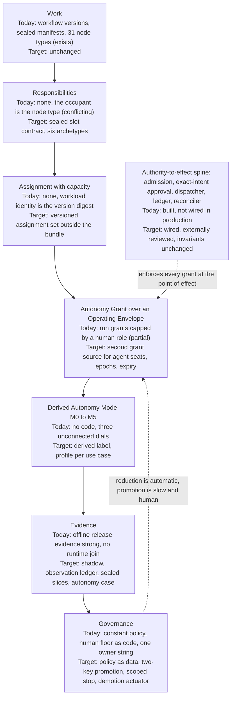

### 1.5 What exists, what is missing, what to do

| Link or layer | What exists | What is missing | What to do | See |
|---|---|---|---|---|
| Authority-to-effect spine | Pinned admission, exact-intent approval, ledger, lease, reconciler, untrusted-model contract | Producer for governed contexts, bound decision route, one backend only, external review | Wire it, refuse ungated gates (B1, B2), review externally | 5.4, 18.2 |
| Responsibility and Assignment | Instance-level assignees; project membership rows | A Responsibility object; assignment outside the sealed manifest | Decide the seam now (one ADR, one nullable pin); build at the second use case | 8.5, 23.2 |
| Principals | `Subject`, `Workload`, `ServicePrincipal` | Type, performer, pins digest; versioned agent Principals | Optional record fields before the evidence schema freezes; registry later | 8.2, 18.2 |
| Grants and envelope | Run grants; typed decisions; `revoke_grant` with no caller | Envelope, epoch, expiry, ceiling function, agent grant source | Policy as data; human-seat grants first; actuator later | 9.5, 17.5 |
| Mode and Profile | ADR 0004 text; Aria's dials | Any code; a profile; derivation rules | Amend the ADR before M24 persists the scalar | 9.3, 9.9 |
| Evidence | Digest-bound release evidence; on-demand judge alignment | Online evaluation, track record, sealed slices, shadow, outcome join | Shadow record and open kinds now; ledger next | 5.6, 13 |
| Governance | Break-glass; distinct Apply approver in the reference profile | Owner record, two-key promotion, principal stop, escalation, demotion | Lite governance record early; principal scope in M06 | 14, 21 |
| Program and claims | ADRs, strict schemas, honest limits | External review, one merge-authority statement, claims policy | Claims ADR; book the reviewer and a pilot | 5.10, 22 |

### 1.6 Now, Next, Later

Ranked in section 21, sequenced in sections 20 and 23.

- **Now** (foundations that cost a `v2`, a migration or a rebuild if deferred, and wiring so claims match code): the positioning and claims policy; wiring the governed path and refusing an ungated human gate; the seams before the evidence schema freezes (principal type and credential kind, performer and pins digest, one assignment pin, open evidence kinds); amending ADR 0004 and issues #790, #798 and #868 so the scalar is never persisted; booking the independent reviewer, pilot operator and Evaluator (#608); 90-day falsifying experiments and an external review of the spine; fencing Aria's autonomy modes; pull-based breadth (N1 to N10).
- **Next** (production adoption by one customer): a lite governance record, policy as data, approval timers and a scoped stop with a principal scope, an observation ledger and outcome join, shadow comparison, sealed slices and judge qualification, grants for human-held seats at the second use case, a protected audit archive (X1 to X9).
- **Later** (increasingly autonomous operation): versioned agent Principals, a graded demotion actuator, M4 with independence classes, evidence-bounded exposure, judge-assisted autonomy shipped disabled (L1 to L6).

### 1.7 Beta implications

Beta should prove the control spine and leave the ladder reachable. The truthful autonomy sentence is that an agent can at most propose a protected action, a person decides every effect on its exact intent, the decision records the decider's type and credential, and Aria's `auto_all`, `agent_review` and `full_autonomy` modes sit outside the governed path (section 18.5). It is false today for any deployment that omits three configuration flags, which is why B2 matters. Beta must not build level enforcement, agent provisioning, assignment tables, promotion engines, scorecards or reviewer telemetry (section 18.4). The window for the seams closes when the evidence schema is registered (#818) and Beta is tagged (#613) [gh].

### 1.8 Decisions needed from the owner

Section 22.5 lists twelve questions with defaults. The eight with most consequence:

1. **Accountable owner**: always a natural person? Default: yes as a floor; configurable to a named office with a deputy; never an agent.
2. **Profile instead of level**: replace the single level with derived modes and presets? Default: yes, accepting a harder sales story.
3. **Qualitative work**: ship judge-assisted autonomy in the first release? Default: ship disabled.
4. **Independent Evaluator**: who, in a three-person program? Default: no one at tier 3 and above, so cap those at M3.
5. **Pilot partner**: who? #608 is open with no recorded booking [gh].
6. **Aria**: fence its autonomy modes in the reference profile? Default: yes.
7. **Merge authority**: the plans say only the owner merges, while the repository's `CLAUDE.md` and the D2 report describe agent self-merge. Default: one statement; security-critical paths need a named human until a re-review passes.
8. **MVP definition**: pilot-complete or book-complete? Default: pilot-complete, with book traceability demoted from gate to report.

### 1.9 What this report does not establish

Nothing was run: "unwired" findings rest on code reading, and tests, coverage and CI were not re-run. No buyer, pilot operator or external reviewer was interviewed. External product claims are mostly search summaries or memory. Legal statements rest on secondary sources and are not legal advice. Appendix D lists what was and was not verified.

---

## 2. Autonomous Enterprise thesis

### 2.1 What the thesis says

The charter states the thesis as a chain: Work, Roles, Human/Agent Assignment, Capabilities, Autonomy, Evaluation, Governance. An organisation decides which responsibilities stay human-operated, which are AI-assisted, which are delegated to agents, and how each moves toward more autonomy as evidence and trust accumulate. Caliber is "not a single autonomous agent or a fixed workflow; it is the platform on which progressively autonomous enterprise systems are built" (the research charter; its question is quoted in section 1.1).

Read plainly, the thesis makes four testable claims: **granularity** (within one workflow, different duties sit at different degrees of autonomy); **movement without rebuilding** (a duty moves between person and agent without redesigning the workflow); **earned, not configured** (movement toward autonomy follows evidence, and movement away follows deterioration or risk, faster); and **a common platform** (one platform supplies runtime, safety architecture, validation and governance, and enterprises build on top). The evidence supports the first three as design goals, conditional on the changes in sections 8 to 17. It does not support the fourth in its strong form (section 4).

### 2.2 Definitions

**Autonomy is a delegated, bounded, evidenced, revocable permission.** It is not a capability and not a property of an agent. A capable agent may be allowed little, and an allowed agent may be only moderately capable. The distinction between what an agent is allowed to do and what it can do is the conceptual spine of the recent autonomy literature: Zheng et al. separate an Allowed Autonomy Level from an Autonomous Capability Level, and Feng, McDonald and Zhang call autonomy "a deliberate design decision" separate from capability [S, E-auto 2]. The report adopts the split: the Autonomy Grant is the permission; measured capability is evidence about it (section 9.3).

*Delegated* means that someone with the right to do so grants it, and that the grant names an accountable owner. *Bounded* means that it holds inside an Operating Envelope (data classes, systems, effect classes, value, volume, cumulative exposure, time, required checks). *Evidenced* means that the grant cites evidence scoped to a specific behaviour configuration and expiring when that configuration changes. *Revocable* means that it can be narrowed or withdrawn at a defined scope, automatically on pre-agreed triggers, faster than it was granted.

**The Responsibility is the unit.** A Responsibility is a named duty declared in a Work definition as a sealed slot: purpose, input and output contract, decision rights, effect-class ceiling, independence constraints, verifiability class and fallback. It names no occupant. Autonomy attaches to a Responsibility inside an envelope, which matches SAE J3016's "feature in an operational design domain" [M], delegation-of-authority matrices, ITIL standard changes and FDA predetermined change plans [M], and is the only unit that can express the charter's own example (section 10.3).

**Why the subject is work, not agents.** An agent is one possible occupant of a seat, and agents change faster than the work they do: each revision of a model, prompt or tool is a different behaviour configuration. A promotion given to "the agent" would have to be re-earned on every change or silently outlive the behaviour it was earned on. Attaching authority to the Responsibility, and evidence to the behaviour configuration that produced it, lets the enterprise change occupants without losing the record, and puts the subject where the enterprise already governs: who may do what, up to what limit, under whose authority.

**Autonomy is read per duty.** A label decomposes into four duties: Perform (who produces the work), Verify (who checks each instance before it takes effect), Oversee (who watches the aggregate afterwards and can tighten) and Recover (who handles the exception). Autonomy Modes M0 to M5 are named patterns of that allocation, derived and never configured (section 9.4); a use case has an Autonomy Profile, a vector of modes, not one number.

### 2.3 Conditions under which the thesis holds

The thesis is a conditional claim. Each condition below has a design response and a place where it can fail.

| Condition | Why it is required | Where it is handled | Where it can fail |
|---|---|---|---|
| The enforcement point is outside the model | A model's claim about itself cannot be the control | The effect gate and the untrusted-proposer contract (sections 5.3 and 12.3) | If any effect path bypasses the dispatcher, a grant is only as strong as the weakest unrouted path (section 16.2, row 8) |
| The Operating Envelope is enforceable | Without a bound there is nothing to delegate | Envelope on every grant; no enforceable envelope means no more than M3 (section 9.6) | Open-ended semantic domains are hard to bound |
| The outcome is verifiable, or the exposure is small | Evidence needs a ground truth | Verifiability classes V1 to V3; exposure sized from evidence (sections 9.7 and 9.8) | Qualitative work has no oracle and stays at M3 by default |
| The verifier is independent of the performer | Correlated errors defeat checking | Independence classes I0 to I4 by tier (section 8.6) | Two agents on one model satisfy a naive "distinct" check |
| A human is reachable when the agent cannot proceed | Stopping mid-transaction is often unsafe | Minimal-risk fallback and reachability precondition (sections 9.4 and 13.13) | Human capacity is finite and staffing is the customer's |
| Evidence can accumulate at useful volume | Statistics bound risk slowly | Wall-clock arithmetic and exposure budgets (section 20.4) | Low-volume, high-severity work never earns anything |
| There is an accountable natural person | Liability lands on the deployer | Accountable Owner with deputy; acceptance recorded (section 8.7) | Accountability without real review is a moral crumple zone |

### 2.4 What the thesis is not

- **Not a single autonomous agent.** Caliber is not an agent and does not run one as the product. Agents are untrusted proposers behind a contract (section 3.3).
- **Not a fixed workflow.** The workflow is a stable container; the occupancy and authority of its seats change without a rebuild (section 8.5).
- **Not a maturity badge.** A bare level is lossy, invites marketing, and under EU AI Act Article 14 may attach obligations nobody intended because oversight measures are tied to the level of autonomy [S, E-auto]. A mode is shown only beside its envelope (section 9.3).
- **Not a ladder every responsibility should climb.** Some duties stay human by policy whatever the agent's skill, and the human lane stays live so that demotion is a switch, not a rebuild (sections 10.6 and 4.3).
- **Not certification, compliance, or a replacement for identity, workflow or model-risk systems.** No certifier stands behind Caliber; evidence packs are for the customer's auditors, and Caliber integrates with the other systems (sections 3.3 and 3.7).

### 2.5 The strongest objections and how the report answers them

The red team's review (Appendix A) attacked the thesis from several directions. Its six sharpest challenges, plus three of its sub-arguments, and the report's response:

| Objection | Appendix A section | Answer | Where |
|---|---|---|---|
| The headline is the unproven half: nearly all engineering effort serves the control spine, while the value claim rests on an autonomy ladder with no code, no pilot and no demonstrated demand | 0, challenge 1 | Agreed. Claim the spine now; keep the ladder reachable by seams; let a pilot decide. The first evidence-based promotion cannot happen before about mid-2028 on the plan's own dates | 3.2, 20.1, 20.3 |
| "Level" is the wrong control variable and "role" the wrong enforcement unit; the real variables are Responsibility, effect class, envelope and evidence with a named owner | 0, challenge 2 | Agreed. The grant over an envelope is the unit; the mode is derived; roles stay as permission tiers for humans | 8, 9.3, 9.9 |
| Evidence can bound risk but cannot justify autonomy for the work that matters: 200 clean decisions bound failure to about 1.5 percent, promotion evidence is circular, human approvals are weak ground truth | 0, challenge 3 | Agreed in substance. Structural caps and exposure budgets carry the safety weight; shadow records break the circularity; qualitative work stays at M3 and judge-assisted autonomy ships disabled | 9.7, 9.8, 11.4, 13.6 |
| The NVIDIA analogy is useful vocabulary and misleading strategy | 0, challenge 4 | Agreed. Keep the pattern library; replace the market model with "executable delegation of authority with a flight recorder" | 4.1, 4.5 |
| The differentiated core is narrower than the program, and the program scopes breadth against its own advice | 0, challenge 5 | Agreed. Exact-intent approval, the ledger and the untrusted-model contract are differentiated; identity, registries and evaluation harnesses are not; breadth becomes pull-based | 3.8, 23.3 |
| The program is the cautionary tale: agent-written and agent-reviewed, no external review | 0, challenge 6 | Agreed. An external review of the spine, a measured escaped-defect rate and one merge-authority statement are Now items | 5.10, 21.1 |
| Autonomy is not a destination every responsibility should climb | 2(a) | Hard human floors are first-class policy data; "humans remain" is a floor, not a failure | 10.6 |
| Human-in-the-loop may be the steady state for consequential actions | 2(a) | M3 is a supported resting state, made honest by timers, sampling and reviewer-quality design; not a rung to abandon | 9.4, 14 |
| Identity vendors will bundle the evidence-to-authority join (about 55 percent in 24 months, red team) | 2(h), 6.1 | The defensible parts are evidence integrity and portability, not the idea; integrate identity rather than compete | 3.8 |

Two objections the report cannot answer by argument: whether any buyer wants evidence-gated promotion before a compliance export (experiment E3), and whether agent-only review of the control spine can carry customer trust (an external reviewer; section 22.3).

### 2.6 The refined thesis

The report recommends replacing the charter's thesis with a narrower, testable one, stated precisely:

> **A bounded Responsibility in an enterprise workflow can be moved from a human performer to an agent performer by changing an Autonomy Grant, not by rebuilding the workflow, provided that (1) the platform enforces the grant at the point of effect, outside the model; (2) the grant holds inside an Operating Envelope and structural ceilings that evidence can widen but never remove; (3) the evidence behind it is scoped to a behaviour configuration, produced independently of the builder, and expires on change; (4) authority can be reduced faster than it was given; and (5) an accountable human is a recorded fact. Where no enforceable envelope, no verifiable outcome or no reachable human exists, the Responsibility stays at M3 or below. The autonomy of an enterprise is a profile across its Responsibilities, never a property of an application or an organisation.**

The charter's "autonomous enterprise" is accordingly read as an enterprise in which a growing share of bounded Responsibilities is held at M4 or M5 inside envelopes, under governance, with human floors intact. It is a direction, not a finish line, and section 20 gives it observable proof points rather than a date.

**The narrower Beta claim.** For the next twelve months only the first clause has code and evidence, so the claim Caliber makes is the minimal thesis of section 3.5:

> Caliber is a self-hosted control plane that sits between an agent and a system of record for one class of protected action. It makes an agent-proposed action approvable by exact intent, executable at most once, recoverable when the outcome is ambiguous, and provable afterwards through an exportable evidence record. In the Beta reference profile every effect needs a recorded human decision, and authority is rechecked at every use. Caliber does not certify agents, does not assign autonomy levels, and makes no claim that evidence replaces human judgment for irreversible actions.

The expanded thesis is adopted only when five proof points hold: one external operator has run a real bounded workflow with real effects; shadow data exist for one Responsibility; a second use case has exercised the assignment and grant seams; an independent party has reviewed the control spine; and buyers rank delegation with evidence in their top two drivers. If the first two are false at twelve months, the report recommends retreating to the narrow thesis and dropping the ladder (sections 3.6 and 22.2).

---

## 3. Caliber's proposed platform positioning

### 3.1 Two theses with opposite evidence profiles

| | Thesis A: authority-to-effect control spine | Thesis B: progressive autonomy ladder |
|---|---|---|
| Claim | An agent-proposed action is approvable by exact intent, executes at most once, is recoverable when ambiguous, and is provable afterwards | Enterprises move responsibilities from humans to agents on an evidence-earned ladder, with Caliber as the common platform |
| In code | Real and tested, not yet wired into the production path [E-gov, repo] | Zero lines: no principal type, governance record, shadow, promotion or demotion [repo] |
| Differentiation | Exact-intent approval, fenced ledger, untrusted-model contract are uncommon (Appendix A, section A.2(h)) | The idea is commodity (five public level taxonomies); the evidence-to-authority join is white space with unproven demand and bundling risk [E-auto] |
| Buyer visibility | Low: CISOs ask about identity, registry, compliance first | Medium in rhetoric; "autonomy of roles" is the worst word for works councils |
| Time to evidence | Beta (D5) | Levels enforced at D10 (2028-03-24, uncommitted); first evidence-based promotion later [E-road] |

### 3.2 Three positions, and where they actually disagree

The charter's broad platform, the narrow core of the red-team review (Appendix A: effect gate, evidence recorder, untrusted-model contracts, delegation grants as policy model) and the Responsibility Grant architecture of sections 8 to 11 disagree less than they appear once **claim, architecture and build** are separated.

| Question | Charter | Red-team review | Sections 8 to 11 | Recommendation |
|---|---|---|---|---|
| What do we claim at Beta and for 12 months? | Platform for progressively autonomous enterprises | Authority-and-evidence layer; no levels | Claim only what the minimal Beta thesis supports | **Narrow.** Only Thesis A has code and evidence |
| Unit of authority | Role | Delegation grant over an envelope; role is a label | Autonomy Grant on a responsibility seat | **The grant.** Both camps describe one object: envelope, Accountable Owner, evidence reference, expiry, revocation triggers |
| Responsibility and Assignment layer now? | Yes | Only after collapsing three role vocabularies and at least eleven approval mechanisms | Yes: slot sealed, assignment set outside the digest | **Decide the seam now, build the layer at the second use case (D8).** One ADR and one nullable pin; no `responsibility_step` node yet |
| Levels | Customer-visible ladder | Never a control or a claim; derived label with envelope | Derived modes, presets, profile vector | **Derived, internal, shown with the envelope, never aggregated.** L0 to L5 survive only as preset names |
| Owner a natural person | Yes | Default policy; person or body | Platform floor; named incumbent of an office | **Default floor in the reference profile; configurable to an office with deputy; never an agent.** Owner decision (22.5) |
| Qualitative work, no oracle | Should progress | Say it is out of scope | V1 to V3 classes; V2 can ship disabled | **Ship V2 disabled**; state the boundary as a non-goal |
| Where safety weight sits | Evidence | Envelope; statistics secondary | Evidence widens exposure, never removes the cap | **Structural cap and exposure budget carry it.** 200 clean decisions bound failure to about 1.5 percent at best |
| Breadth (regions, A2A, Hub, catalog) | Book-complete | Drop until a pilot pulls | Silent | **Pull-based** (23.3); `docs/competitive-analysis.md` section 11 already says "own the wedge, don't chase breadth" |

In one line: **claim Thesis A, shape the data model so Thesis B stays reachable, and let a pilot rather than a metaphor decide whether a ladder exists.** It costs little, because the Now list of the design (17.9) and the red-team review's "cheap before schemas freeze" list are nearly the same (18.2).

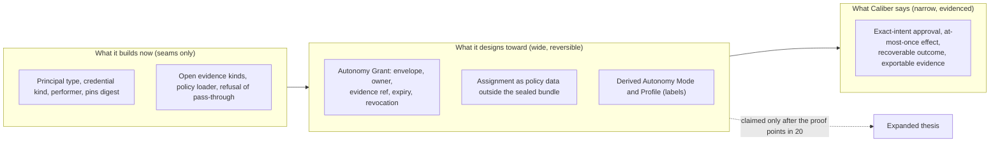

### 3.3 Recommended positioning statement

> **Caliber is a self-hosted authority-and-evidence layer for AI agents that act in enterprise systems of record. For each bounded responsibility it lets an enterprise decide how much to delegate to an agent, enforces that decision at the point of effect (approval of the exact action, at-most-once execution, recovery when the outcome is unknown), and proves afterwards what happened under whose authority. Delegation can be narrowed or withdrawn faster than it was granted. The enterprise owns the decision and the accountability; Caliber supplies the enforcement and the evidence.**

**For whom (hypotheses; no buyer has validated them, see E3).** Regulated, sovereign or air-gapped enterprises that self-host, standardise on MLflow, and have one bounded workflow with a real downstream effect and a named Accountable Owner. Personas: the platform or AI engineering team (builds responsibilities and connectors), the accountable or risk owner (decides delegation, accepts residual risk), the CISO or auditor (reads evidence, never operates). `docs/competitive-analysis.md` section 11 targets the same segment.

**Is:** an effect gate, an evidence recorder, a policy-and-grant model for delegation, and an open, self-hosted, MLflow-integrated lifecycle store that keeps evidence of record in its own database.

| Is not | Why | Integrate with instead |
|---|---|---|
| An agent framework or workflow-engine replacement | Out of scope in `map-gap.md` sections 2 and 16 | Any agent as an untrusted proposer behind the step contract |
| An identity provider or agent registry | Commodity and a lost fight: Entra Agent ID and Agent 365, Google, AgentCore, ServiceNow, Workday [W] (Appendix A, section A.2(b)) | Entra or Okta via OIDC and SCIM (M17); registry as a sync source for sponsor and status |
| A certifier | No third party stands behind it; NVIDIA's inspection lab "does not itself certify" [E-av] | Evidence packs auditors verify offline |
| A model-risk validator | SR 11-7 style validation needs an independent institutional function | Inventory, evidence, challenger comparisons as inputs |
| A level issuer | A bare level is lossy, marketing-prone and an Article 14 trigger [E-auto] | Show a mode only beside its envelope |
| A marketplace or shared SaaS | No certifier or liability allocation; shared tenancy excluded 2026-10-26 | Per-customer installations |

### 3.4 Platform contract versus what the enterprise builds

| Layer | Caliber guarantees | Caliber does not guarantee | Enterprise owns |
|---|---|---|---|
| Admission | Runs pinned to resolved versions, immutable; unpinned runs refused | That the pinned behaviour is good | Models, prompts, tools, knowledge |
| Untrusted proposer | No field with which a model can claim an effect; class and connector bound to platform truth; refusals never echo model text | Resistance to every injection | Adversarial suites, red-team cadence |
| Approval | Exact-intent approval bound to intent, evidence, policy digest, resource version, expiry; single consumption; recheck at commit | That a human read what they approved | Staffing, SLAs, review quality |
| Effect | At-most-one local claim, fenced owner, verified receipt, no blind re-drive, dependants parked on `unknown` | Universal exactly-once; downstream idempotency | Connectors, downstream contracts, compensation |
| Authority | Grants rechecked at every use and at commit | Standing agent authority across runs (does not exist) | Envelope contents, tier, loss appetite, who may delegate |
| Evidence | Recomputable digests, package, server-free verifier (B14) | Tamper-proof logging today; proof of origin before signing | Retention, legal hold, disclosure |
| Autonomy | Mechanisms: shadow, scoped stop, expiry, human-lane fallback (staged, 20) | That any agent is independent, correct or safe at any mode | Accountable Owner, residual-risk acceptance, regulatory class |

### 3.5 The minimal viable thesis defensible at Beta

> **Caliber is a self-hosted control plane that sits between an agent and a system of record for one class of protected action. It makes an agent-proposed action approvable by exact intent, executable at most once, recoverable when the outcome is ambiguous, and provable afterwards through an exportable evidence record. In the Beta reference profile every effect needs a recorded human decision, and authority is rechecked at every use. Caliber does not certify agents, does not assign autonomy levels, and makes no claim that evidence replaces human judgment for irreversible actions.**

I changed one sentence of the red-team review's proposed Beta thesis (Appendix A, section A.3.4), which also said "any grant can be revoked by one scoped action". On main nothing calls `revoke_grant` and the scoped stop is M06.4 (#776, D6) with scopes project, workflow, connector. What is true at Beta is narrower: authority is re-derived from current membership at every use and at commit, and cancelling a run or removing a member stops further effects. State that, or pull a minimal stop forward (23.2, P5).

| Sentence | Evidence D5 must show | Status on main | Issue |
|---|---|---|---|
| Approvable by exact intent end to end in the production path | Producer builds the governed step; bound decision route consumes through the dispatcher | Route returns 409; producer unbuilt; consumption moves in PR #1042 | #735, #1042, NR1, #768 |
| Executable at most once | PostgreSQL race scenarios | Dispatcher, ledger, race scenario exist; V01, V11, V12 missing | #857, #735 |
| Recoverable when ambiguous | Owner takeover (V14), reconciler on the owner loop | Reconciler on main via #1052; #997 still open (state lag) | #997, #881 |
| Provable afterwards | Package and server-free verifier | Schema, assembler, export, verifier all open | #818, #826, #833, #840, #845 |
| Every effect has a recorded human decision | Ungated human node refused by the profile | Pass-through not refused | NR2 |
| Authority rechecked at every use | V05 revocation while waiting | Built and covered [E-gov] | n/a |
| No certification, no levels | Beta scope doc with non-claims | Not yet written | #764, #877 |

### 3.6 The expanded thesis, for later

> **Caliber is the platform on which an enterprise moves a bounded responsibility from a human performer to an agent performer by changing a grant, not by rebuilding the workflow, with evidence that expires on change and authority that can be removed faster than it was given. The accountable human is a recorded fact, not a convention.**

Adopt it only when all hold (section 20): one external operator has run a real bounded workflow with real effects; shadow data exist for one responsibility; a second use case has exercised the assignment and grant seams; an independent party has reviewed the control spine; buyers rank delegation with evidence in their top two drivers. If the first two are false at 12 months, retreat to the narrow thesis (22.2).

### 3.7 Claims Caliber must not make

| Claim to avoid | Why | Substitute |
|---|---|---|
| "Autonomous enterprise", "L3 or L4 agent" | Label inflation; SAE levels are descriptive yet "L2+" is a marketing term; Article 14 ties oversight to autonomy [E-av, E-auto] | "Bounded delegation with human decision on each effect"; always name the envelope |
| "Certified", "homologated", "ASIL-like" | No certifier; NVIDIA certifies platform process and leaves the vehicle-level case to the integrator [E-av] | "Produces evidence your auditors can verify" |
| "Compliant with EU AI Act, SR 11-7, ISO 42001" | Duties fall on providers and deployers; SR 26-2 reportedly excludes agentic AI [W, E-auto] | "Supports Article 12 style records and Article 14 style override and stop" |
| "Tamper-proof audit trail" | `caliber_audit_log` is append-only by convention; WORM is M05 (D6) [E-gov] | "Control records are database-immutable; archive protection arrives with M05" |
| "Exactly-once execution" | The plan says at-most-one local claim; downstream idempotency not universal | "At most one local claim, no blind re-send, ambiguous outcomes park" |
| "Independent agent reviewers" | Two agent ids with one model satisfy a distinct-string check (8.6) | State the independence class achieved (I0 to I4) |
| "Evidence proves the agent is safe" | 200 clean decisions bound failure to about 1.5 percent; evidence is version-scoped and expires | "Evidence bounds observed failure rate for this configuration and window" |
| "Platform-wide governed autonomy" | Already a non-claim in `map-gap.md`; MCP, OpenAPI, model-selected calls unrouted (#750, #759, #768) | Scope claims to the governed path and the supported connector |
| "Liability is shared with Caliber" or "enterprise multi-tenant" | The deployer carries liability (Moffatt v Air Canada, California AB 316 [W]); tenancy is `local` [repo] | "The Accountable Owner is recorded"; "one organisation per installation" |

### 3.8 Moat and differentiation

The red-team review opened Microsoft's Entra Agent ID key-concepts page (updated 2026-08-13) and AWS AgentCore docs. Agent 365 GA (2026-05-01), ServiceNow shutdown claims, AgentCore Policy and Evaluations GA dates and "no earned-autonomy product found" rest on search summaries or one trade-press source. UiPath, Camunda, Temporal, LangSmith, Braintrust, Salesforce and Workday rows rest on the evidence reports and memory [W].

| Capability | Bin | Competitors that offer or approach it | Durability, my read |
|---|---|---|---|
| Exact-intent approval, commit-time recheck of approver and run authority | **Differentiated** (partly unwired) | AgentCore Policy and Cedar gate each tool call, not intent with expected resource version; BPMN and Action Center approve tasks | 18 to 30 months (Appendix A, section A.2(h)); finish and wire it |
| Fenced effect ledger, no blind re-drive, park on `unknown` | **Differentiated** | Temporal: durable execution and retries without approval, receipt or unknown-outcome semantics | Durable unless Temporal adds agent primitives |
| Untrusted-model contract | **Differentiated by discipline** | Few store it in a closed schema | Copyable in months; execution quality is the moat |
| Run and context manifests with trust tiers | Differentiated now, table stakes in about 12 months | AgentCore Optimization versions config bundles | Short |
| Evidence-to-authority join with expiry and demotion | **White space, demand unproven** | CSA Agentic Trust Framework specifies it; Microsoft and ServiceNow own registry, revocation, org graph | Most valuable and most contestable; red team: 55 percent chance of a bundled competitor feature in 24 months (low confidence) |
| Self-hosted, open, MLflow-integrated store with local evidence of record | **Differentiated for a segment** | Hyperscalers are managed; Langfuse, Phoenix, MLflow open | Durable for sovereign buyers; upstream MLflow is the repo's own top risk (`docs/competitive-analysis.md` section 10) |
| Agent identity, registry, sponsor, revocation | **Commodity** | Entra, Google, AWS, ServiceNow, Workday | Integrate |
| Offline evals, judges, datasets, tracing | **Commodity** | MLflow, Braintrust, LangSmith, Langfuse, Phoenix, AgentCore Evaluations | Commodity now |
| Online evaluation on production traces; escalation and task queues | **Table stakes, Caliber behind** | AgentCore, LangSmith, Langfuse; Camunda, UiPath | Caliber lags (G-E4); `escalate` is refused today |
| Autonomy level label; A2A; certified packs (M22) | **Commodity** or **not a position** | Five public taxonomies; Google A2A; no certifier | Do not lead with them |

Two observations drive the recommendation. The strongest differentiators are the least visible to the people who sign, so the evidence export and buyer-readable views (register, decision explorer, expiry list) deserve more weight than their engineering size suggests. And the white-space cell is the most exposed to bundling, so the defensible parts are evidence integrity and portability (open format, server-free verifier, local evidence of record), not the idea of earning authority.

## 4. The NVIDIA platform analogy and its limitations

### 4.1 Verdict

The analogy is **strong engineering vocabulary and weak strategy**. As a pattern library (independent monitor beside a learned proposer, event data recorder, governed software update, operating design domain, safety case, minimal-risk condition, scoped suspension) it transfers, and Caliber has built parts of it. As a market model (one platform, many OEMs, shared certification, fleet flywheel) it does not, because the conditions that make NVIDIA's platform a platform are missing.

| NVIDIA platform condition [E-av] | Holds for Caliber? | Evidence |
|---|---|---|
| Large shared technical cost paid once for many customers | **Partly.** Runtime, ledger, evaluation, evidence are shared cost, but a platform team can replicate parts; the repo rates its moat "Moderate. Individual capabilities are copyable" | `docs/competitive-analysis.md` section 9 |
| A common external standard all customers face (UNECE R155 to R157, NCAP, TUV) | **No.** No type approval for enterprise agents; SR 26-2 reportedly excludes agentic AI; NIST agent work is voluntary [W, E-auto] | Judged one customer auditor at a time |
| Vendor stays out of the downstream product | **Partly.** Aria is a first-party copilot holding decision chairs; its `auto_all` and `full_autonomy` are more permissive than the Beta refusal profile | `docs/architecture/protected-effect-paths.md:28,74` [repo] |

Two structural breaks reinforce this. There is no fleet: shared tenancy is excluded, so every customer's evidence is n=1 and nothing is learned across customers. And the vendor of the tooling that produced the evidence the customer relied on is exposed to "you told us this agent earned L4", which is why a numeric level never belongs in a customer-facing claim (3.7).

### 4.2 Full mapping table

Ratings: **Holds** (transfers with little change); **Holds with caveats** (structure transfers, an AV property that makes it work is absent); **Breaks** (the AV property does not exist, or the mapping misleads). Rows 1 to 14 are the charter's; rows 15 to 31 are omitted AV concepts.

| # | AV concept to Caliber | Rating | Reason | Design consequence |
|---|---|---|---|---|
| 1 | Reference platform to Caliber platform | Holds with caveats | NVIDIA warrants platform process and holds third-party certificates; Caliber has neither | Warrant only process, isolation, ledger integrity, evaluation tooling; no certification words |
| 2 | Automaker to enterprise | Holds with caveats | Automaker is manufacturer, approval applicant and warranty bearer for identical units; an enterprise is builder, operator and employer at n=1 | Record builder, owner and supervisor separately on the grant |
| 3 | Vehicle to application or workflow | **Breaks as stated** | J3016 levels a *feature in an ODD*, not the vehicle; a workflow composes responsibilities with different envelopes | Vehicle is the deployment; feature is a responsibility in an envelope; never a workflow-level level |
| 4 | Driver to human worker | Holds with caveats | One licensed person versus an organisation; at L3 plus the driver becomes a fallback-ready user, then a passenger; vigilance decays on 99 percent correct output | Human capacity is a safety component: supervision plan, SLA under the approval TTL, reviewer quality |
| 5 | Driving system to agent system | Holds with caveats | The ADS has a defined task, declared ODD, independent monitors; an agent has an open task | Agent maps to the driving model; system = agent plus step contract, policy gate, monitor, ledger |
| 6 | Runtime/OS to control plane | **Holds** (best row) | DriveOS gives freedom from interference and health monitoring; the control plane makes the *envelope* deterministic, not the model | Keep investing in fencing, admission, effect gate; isolation is M07 (D7), until then "containment, not a sandbox" |
| 7 | Sensors to enterprise data | Holds with caveats; adversarial case breaks | Sensors have calibrated noise; enterprise data is stale, contradictory and can carry instructions | Context is untrusted data; authority comes from the control plane (context manifest with trust tiers) |
| 8 | Vehicle controls to tools and actions | Holds with caveats | Actuators are few, bounded, and stopping is nearly always safe; tools are many and often irreversible | Bounded actuation transfers; "just stop" does not; refuse to start if no safe state is reachable |
| 9 | Safety architecture to governance and guardrails | Holds with caveats | Halos is engineering assurance with a separately certified checker; guardrails are mostly policy and probabilistic checks | Independent checker, separately owned and released; record independence class achieved |
| 10 | Simulation to evaluation | Holds with caveats; partly breaks | AV simulation has physics and ground truth; business work has neither; LLM scenarios share model blind spots | Replay (B09.4), shadow, canary, adjudication; weaker fidelity claims; evidence accrues in wall-clock time (20.4) |
| 11 | Autonomy levels to enterprise levels | Holds with caveats | The transferable part is the three-duty decomposition per feature per ODD; SAE says levels are not a ranking or a regulatory class | Derived mode from four duties (Perform, Verify, Oversee, Recover); ADR levels become presets |
| 12 | Driver intervention to oversight | Holds with caveats | AV intervention is real-time and binary; enterprise oversight is asynchronous | Offer M3 or sampled M4 and M5; never "human watches" as a resting state |
| 13 | Safety fallback to escalation | Holds (concept) | The minimal-risk condition fits, but a mid-transaction stop is often unsafe | Safe state per responsibility, testable; no reachable human means the action does not start |
| 14 | Software improvement to continuous improvement | Holds with caveats | Regulators approve the update *process* (R156); AV fleet learning needs OEM-owned data | Every prompt, model, tool or policy change is a release re-entering the evidence gate (change classes C0 to C3) |
| 15 | Operational design domain | Holds with caveats | The real unit of autonomy; an enterprise ODD is open-ended and semantic | Operating Envelope on every grant; no enforceable envelope means no more than M3 |
| 16 | Minimal-risk condition | Holds with caveats | See row 13 | Safe-state record per effect class; fallback reachability is a gate and a leading indicator |
| 17 | DDT split: execute, detect and respond, fallback | Holds | Cleanly assigns duties | Four duties; Oversee added because Verify checks each instance while Oversee watches the aggregate |
| 18 | Safety case (UL 4600) | Holds with caveats | Claims, argument, evidence; an AV case can be externally assessed, here it is internal | Autonomy case per grant, versioned and expiring; structure from Caliber, content and risk acceptance from the customer |
| 19 | SOTIF unknown-unsafe | **Holds** | Honest framing for plausible-but-wrong LLM behaviour | Bounded failure rate with interval, scope and expiry; never "proves safe" |
| 20 | Scenario libraries | Holds with caveats | Versioned, tied to ODD; no simulator to run them in | Sealed held-out slices per responsibility; every incident or override becomes a permanent scenario |
| 21 | Event data recorder | **Holds** | Tamper-resistant record around an event; effect ledger and evidence package | Finish B14; add type, performer, pins digest to every record; stop calling the audit log tamper-proof |
| 22 | Fleet learning | **Breaks** | Needs an OEM that owns fleet data; shared tenancy excluded, customers own data | Within-tenant learning only; cross-tenant absent or explicit, contractual, technically enforced |
| 23 | Homologation and type approval | **Breaks** | A regulator approves type and management systems; no enterprise equivalent | Evidence packs for internal risk, audit and regulators; never "certified" |
| 24 | Safety driver | Holds | The defined lower tier Cruise kept alive during suspension | M3 is the safety-driver tier; keep it live for every responsibility so demotion is a switch |
| 25 | Driver monitoring | Holds with caveats | Valuable, but monitoring reviewers is performance-monitoring data (BetrVG s.87(1) no. 6 [W]) | Reviewer-quality telemetry aggregated and purpose-limited, designed with labour review before building |
| 26 | Teleoperation | Holds with caveats | Waymo's remote agents advise, the vehicle stays in control; staffing is now regulated scrutiny | Expert-on-call exception desk giving advice not control; disclose intervention rates |
| 27 | OTA governance (R156 SUMS) | **Holds** | Regulator approves the process, maker approves each update under it | Governed release of prompts, models, tools, policy (M02, D6); a promotion is itself a governed release |
| 28 | Disengagement reporting | Holds with caution | Gameable, context-free | One input normalised by slice and difficulty; never the promotion criterion |
| 29 | Permit suspension (Cruise 2023) | Holds with caveats | External, fast, scoped, reversible on conditions; here the "regulator" is the Accountable Owner | Scoped immediate suspension with explicit reinstatement; unreported incident is a trigger |
| 30 | Redundancy and freedom from interference | Holds with caveats | Agent independence is weaker: shared lineage, context, injection | Independence classes I0 to I4, measured by seeded faults and joint-miss rate |
| 31 | Insurance and liability by control state | **Breaks** (not mappable today) | AV liability follows control within the ODD; enterprise agent liability is unsettled and falls on the deployer [W] | Accountability matrix by mode and envelope as a record; insurance and legal allocation stay with the customer |

### 4.3 Where the analogy genuinely helps

1. **Runtime and OS.** Fenced lease, immutable manifests, DB-trigger immutability and the effect gate play the freedom-from-interference role. NVIDIA's pitch that the platform does not change as the automaker moves up levels, only evidence and software do, is the property the grant model should deliver.
2. **Safe stop.** The minimal-risk condition asks what the reachable safe state is per responsibility, and what if no human is reachable.
3. **Staged rollout with defined lower tiers.** Shadow, propose-and-approve, supervised commit, exception supervision, then small envelope expansion, with the lower tier kept live (Cruise).
4. **Safety case.** A claim, argument and evidence record per grant, with owner and expiry, answers who accepted this residual risk on what evidence.
5. **Simulation and validation, discounted.** Replay, shadow comparison and sealed suites substitute for simulation; evidence is slower and weaker than AV's.

### 4.4 Where it fails

No certifier: nobody confers legitimacy, so evidence must be legible to auditors and never called "certified". Adversarial inputs: roads do not write to the driver, documents do, so authority comes from the control plane only. Irreversibility: a car can brake, a payment cannot be undone, so reversibility is a taxonomy (verified, declared, none) and irreversible and export stay human-decided by default. No ground-truth simulator: evidence is slower and weaker, and exposure budgets replace statistical proof. Multi-party workflows and liability: evidence and accountability cross the tenant boundary and the customer is maker, operator and employer, so remote output is an untrusted proposal and warranties are narrow. Platform economics: owners of identity and the org graph can add the join, so compete on evidence integrity and portability. "Human must remain": AV has no equivalent, so hard human floors become data (10.6) with a regulated-decision overlay.

### 4.5 A stronger replacement mental model

> **Caliber is executable delegation of authority with a flight recorder. It is the enterprise's signing-authority matrix, enforced at the point of effect, where what is granted, expires and is revoked is a grant over an envelope (not an agent, and not a role), and where every effect leaves a record an outsider can verify offline.**

Why it is stronger [J]: it describes what exists (exact-intent approval is a signing limit with dual control; the ledger is the flight recorder); it uses vocabulary auditors, CFOs and works councils already read (delegation of authority, ITIL standard change, FDA predetermined change plan); it makes "humans remain" a first-class floor rather than a failure to climb; and it imports no platform-economics claim the market cannot support. In automotive terms Caliber is closer to Halos, the event data recorder and R156 (the safety layer) than to DRIVE (the stack). Keep the analogy as a pattern library, and keep a paragraph titled "Where NVIDIA's strategic position cannot be copied".

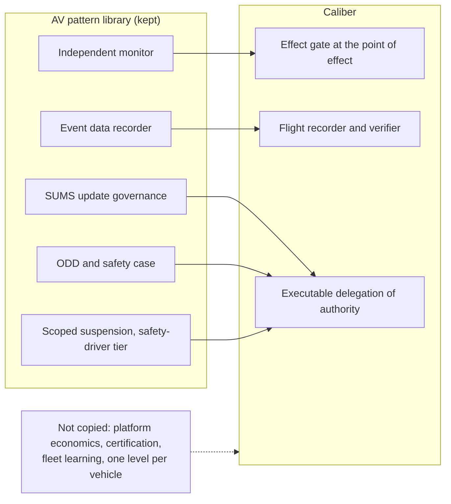

## 5. Current Caliber architecture assessment

This section assesses Caliber as it is on `main` at `82f41d1b85d`, against the question the report asks: what in the present architecture can carry progressive autonomy, and what cannot. It draws on E-gov, E-eval and E-road, and on a re-verification of the load-bearing claims against the repository (section 5.12 says exactly which). Where a statement rests on reading code rather than running it, it says so.

### 5.1 What Caliber is: program, thesis, staging and maturity

**The product.** Caliber is an MLflow-integrated ASGI control plane plus a React application. Its root architecture document calls it "one control plane for the lifecycle of AI-agent resources" (`ARCHITECTURE.md`, title block) [repo]. The unit of value is the *governed asset*, one of nine families (prompts, tools, skills, MCP servers, workflows, knowledge bases, test sets, judges and agent configurations), each with its own gate mode, live target and rollback mechanism (`caliber/src/caliber/artifact_capabilities.py`) [repo]. Relational metadata in PostgreSQL is the source of truth for the control plane; MLflow owns prompt versions and traces; an S3-compatible store owns file bytes. The canonical chain is Signal, Evidence, Candidate, Measurement, Decision, Release, Trace, and the refinement loop that instantiates it is human-gated: a person must click Apply [E-eval 5]. Alpha `0.1.0a1` was published as a prerelease on 2026-10-23 and is a prompt-refinement journey with simulated providers by default [gh, repo].

**The thesis as the repository states it.** The architecture document's principle 2, "Progressive Autonomy", reads "Support the path from human-led processes to fully autonomous agent-driven execution" (`ARCHITECTURE.md:44`; `README.md:347`) [repo]. The gap analysis frames the product as "a governance and lifecycle control plane, not another all-in-one agent framework" and adopts the book principle "The model proposes. The system decides. The evidence proves." [E-road 1.1]. Accepted ADR 0004 gives the autonomy design: levels L0 to L5 per use case, the owner always human (`docs/architecture/adr/0004-autonomy-levels.md`) [repo].

**The program.** On 2026-10-24, a day after the alpha, the owner replaced the narrow single-tenant prompt-refinement MVP with the EGI program: Caliber becomes the reference implementation of the owner's book *Building Enterprise General Intelligence* (`docs/CALIBER_EGI_DELIVERY_PLAN.md`, decisions 1 to 4) [E-road 0, 1.1]. The manifest holds 291 tasks in 58 epics under 15 milestone controls (D1 to D15), with 35 validation scenarios (V01 to V35), three full-time people and a 122-week midpoint estimate (211 base person-weeks plus 25 percent) [repo: `docs/planning/beta-mvp-execution.json`; E-road 1.2]. Calendar dates are "uncommitted; reforecast" until staffing issue #608 closes [repo, gh].

| Stage | Milestones | Tasks | Closed | Gate | Plan date |
|---|---|---:|---:|---|---|
| Beta | D2 to D5 | 125 | 80 | #613 | 2027-05-21 |
| Core proof | D6 to D9 | 93 | 0 | #617 | 2027-12-24 |
| Full retained MVP | D10 to D15 | 73 | 0 | #623 | D10 2028-03-24, D15 2029-03-02 |

Counts are from the manifest joined to GitHub on 2026-10-31 and may be off by one or two for merged-but-not-closed issues (#997 is open although its pull request #1052 is on `main`) [gh, E-road 2.3]. All 80 Beta closures happened between 2026-10-26 and 2026-10-31. The plan itself says the natural stopping points are D5 (Beta) and D9 (core proof) and that neither may be advertised as the MVP.

**Boundaries decided by the owner.** Shared-customer hosting is excluded as of 2026-10-26: one organisation per installation, many projects and users; the validation scenario V28-shared-tenancy is "explicitly excluded, not a passing or skipped test" [E-road 1.3]. This is the root of two findings later in this section (no tenant isolation to speak of, and no fleet).

**Maturity in one paragraph.** The alpha audit found seven P0 blockers days before release, including cross-project mutation of live prompts and canned evaluation scores persisted as evidence; they were fixed [E-road 6.1]. D2 closed with "PASS for engineering acceptance, with the scope exceptions listed below" (`docs/reports/egi/D2-acceptance.md:7`) [repo]. D3 to D5 are open, and Beta (#613) is not reached. The repository is young and very large: 890 commits since the first on 2026-06-26, 253 of them since 2026-10-24, about 204 thousand lines of Python in 495 files under `caliber/src`, 568 Python files under `caliber/tests`, 104 Markdown files in `docs/` [repo]. Execution is agent-driven and fast; the constraints are human review, external reviewers and real-provider evidence (section 5.10).

### 5.2 The architecture as implemented

Caliber is two planes with no shared authority model, and a third plane that does not exist.

1. **The asset-lifecycle plane** (prompts, skills, workflows, knowledge bases, evaluation, release, rollback) is human-operated and mature. Authority is the four platform scopes (`viewer`, `operator`, `approver`, `admin`, `src/auth.py:94-97`, assigned by environment-variable lists) and four project roles (`owner`, `editor`, `reviewer`, `viewer`, `src/resource_access.py:20-24`, rows in `caliber_project_members`) [E-roles 1.1].
2. **The run-authority plane** (admission, run manifest, run grant, governed step, proposal, approval, dispatcher, ledger, reconciler) is the differentiated spine. It was built in D2 and D3 and is largely not wired into the production path (section 5.4).
3. **An autonomy plane** (Principal types, Responsibilities, grants, modes, promotion, demotion) has no code (section 5.7).

The runtime beneath both is a typed workflow interpreter with 31 node types (`src/workflows/ir.py:23`), including `parallel`, `for_each`, `loop`, `error_boundary`, `subworkflow`, `wait_for_event`, `human_approval`, `agent` with handoffs, `router`, `guardrail`, `webhook` and `api_request` [repo]. Runs move through explicit states (`queued`, `running`, `waiting_approval`, `waiting_effect`, `waiting_event`, `completed`, `failed`, `cancelled`, `expired`), park and resume through persisted checkpoints, and are claimed by an atomic `UPDATE ... WHERE status = 'queued'` [E-gov 2.2]. Thirteen background loops run only on the process that holds a single execution-owner lease, with a database-time expiry and a monotonic fencing token (`src/ownership.py:78,166`; `src/observability/worker_inventory.py`) [repo].

The following diagram shows the authority-to-effect spine and what is wired. Dashed edges are links that exist as code or contract and have no production producer today.

```mermaid
flowchart LR
  ADM["Admission<br/>pins into one sealed manifest,<br/>run grant capped by a human role"]
  CTX["Context manifest<br/>trust tiers, source authorization"]
  STEP["Agent step as untrusted proposer<br/>at most one proposed action,<br/>no field to claim an effect"]
  PROP["Effect proposal<br/>intent hash, seven-state ledger"]
  APR["Approval request<br/>bound to exact intent,<br/>policy digest, resource version, expiry"]
  DEC["Human decision<br/>scope plus project role"]
  DSP["Dispatcher<br/>lease and fencing token,<br/>approval consumed once"]
  TRN["Pinned connector transport"]
  RCP["Receipt verified by reading<br/>the downstream back"]
  UNK["Outcome unknown<br/>no blind redrive,<br/>dependants parked"]
  REC["Reconciler on the owner loop<br/>asks the downstream"]
  EVD["Audit log and evidence package<br/>package is planned"]

  ADM --> CTX --> STEP
  STEP -. "no production producer" .-> PROP
  PROP -.-> APR
  APR -. "decision route answers 409" .-> DEC
  DEC --> DSP
  DSP --> TRN --> RCP
  TRN --> UNK --> REC
  REC --> RCP
  RCP --> EVD
  ADM -. "grant rechecked at every use and at commit" .-> DSP
```

Read with section 5.4: the left end (admission, context) is wired; the middle (step, proposal, approval, decision) is built and tested in scenario harnesses and not producible by a production run; the right end (dispatch, receipt, reconcile) is built, and the reconciler loop runs on the owner, but nothing in production creates a dispatched proposal for it to reconcile.

### 5.3 What is genuinely strong and differentiated

These are verified strengths, ranked by how directly they serve earned and revocable autonomy. The durability of each against competitors is assessed in section 3.8.

1. **A model's output is an untrusted proposal at the contract level.** `AgentStepResult` (`src/contracts/agent_step.py:337`) carries at most one `ProposedAction` (`:119`) and has no field with which a model can claim that an effect happened, was approved or produced a receipt. The model's `effect_class` and `connector_version` are claims, bound to the platform's own values by `ProposedAction.bound_to` (`:190`) and refused as a `ClaimMismatch` (`:89`). Refusals never echo model text. `run_agent_step` validates the request before an adapter is touched and treats everything returned or raised as untrusted [repo, E-gov 2.3]. Many platforms trust tool-call output.
2. **Exact-intent approval with a commit-time recheck.** An approval is bound to an intent hash (`intent-v1`, `src/effects/records.py:68`), the evidence hash, the policy digest and the expected resource version, expires, can be superseded and is consumed once. `approval_valid_at_commit` (`src/workflows/approval_policy.py:336`) rechecks the approver's current authority independently of the run subject, then `identity_for_run` re-decides the run's grant, so a revoked grant, a removed member or an expired approval blocks dispatch even with a valid approval [E-gov 2.6]. Scenarios V04 (stale approval) and V05 (revocation while waiting) cover it (`caliber/tests/egi_scenarios/`) [repo, not re-run].
3. **A durable effect ledger with a no-blind-redrive rule.** Seven states with compare-and-set versions (`STATES`, `src/effects/records.py:98`: proposed, approved, dispatched, committed, failed, unknown, reconciled); `committed` only with a receipt verified by reading the downstream back; a transport that fails to settle ends `unknown` under the same lease and is never retried; and `effect_gate` (`src/effects/reconcile.py:696`) parks a run in `waiting_effect` rather than letting it proceed on an effect nobody can vouch for [repo, E-gov 2.4]. This is uncommon and operationally mature.
4. **An execution-owner lease with a fencing token.** Database-time expiry, a token raised on every new acquisition and row-locked assertion on PostgreSQL (`src/ownership.py:78,166,264`); the owner-takeover scenario V14 kills the owner process and has the secondary take over [repo].
5. **Typed, replayable policy decisions and immutable control records.** `decide` (`src/policy/decisions.py:248`) records every allow and deny with an input hash and treats an unrecorded allow as a deny. Run manifests, policy decisions and effect-intent columns are protected by database triggers (`src/db/immutable.py`). Control-record schemas are closed (`additionalProperties: false`) with a readers-before-writers evolution rule (ADR 0003) [repo, E-gov 2.5].
6. **Fail-closed defaults, applied consistently.** An unknown tool is classed `irreversible_write` (`src/effects/inventory.py:41`); an unpinned run is refused; a connector is admitted by implementation identity, capability digest and configuration digest, never by name (`src/profile.py:99`); the reference profile refuses unsafe settings at startup (`src/profile.py:282`); trace payload redaction is fail-closed against an allow-list of span attributes [repo]. A 132-row inventory of protected-effect paths classifies every code path that can change an external system (`docs/architecture/protected-effect-paths.md:5`) [repo].
7. **A context manifest with trust tiers.** Context segments carry a trust tier (`instruction` versus `data`; retrieved text is always data), source, digest and authorization decision id, and are read back and re-validated (`src/context/manifest.py`) [E-eval 6.2].
8. **Governance of the platform's own change path.** A distinct Apply approver in the reference profile, workspace release decisions bound to recomputed gate evidence, and break-glass authorisation with a one-hour cap [E-gov 2.5]. This is more developed than most agent platforms' deployment controls.
9. **Release-time evaluation discipline.** Digest-bound, recomputable evidence; stamping of simulated providers so that a simulation cannot later be read as a measurement; fail-closed gate thresholds (section 5.6) [E-eval 2].

These are the properties that make evidence trustworthy enough to base authority on. It is easier to bolt a promotion policy onto this spine than to retrofit a spine under a promotion policy. Two cautions follow. First, differentiation is partly design discipline that competitors can copy: the untrusted-model contract is copyable in months, and the repository's own competitive analysis rates its moat "Moderate. Individual capabilities are copyable" (`docs/competitive-analysis.md`, section 9) [repo]. Second, none of this has been reviewed by a human or third party (section 5.10).

### 5.4 What is written but not wired

The documentation is candid about this: `docs/operate/reference-profile.md` states in its "Governed agent steps" section that "nothing in production builds one yet" (`:2559`), and the sections "Not enforced yet" list the rest [repo]. The table below makes the chain explicit. "Code" means the code exists on `main` and is tested; "Production wiring" means a production path reaches it.

| Link in the authority-to-outcome chain | Code | Production wiring | Evidence |
|---|---|---|---|
| Admission pins, sealed manifest, run grant | yes | yes when `admission_enabled` is on: default `false` (`config.py:720`), always on under the reference profile (`docs/operate/reference-profile.md:581`) | `src/workflows/admission.py:171` |
| Typed policy decision per run | yes | yes (admission and resume) | `src/policy/decisions.py:248` |
| Context manifest and source authorization | yes | yes for admitted runs | `src/context/manifest.py` [E-eval 6.1] |
| Effect proposal for an HTTP node in a manifest-backed plan | yes | **no**: `governed_effects` is never assigned; the interpreter raises "requires a governed effect context for manifest HTTP execution" | `src/workflows/runtime.py:2531,5392-5399` |
| Effect proposal for a protected registered tool | yes; classified by registry identity since #741 (`src/workflows/promoter.py:1356`) | **no**: a protected class raises without `governed_effects`; a `refuse` class is refused; a `read` class runs inline | `src/workflows/runtime.py:5494-5534` |
| Governed agent step | yes | **no**: `governed_agent_steps` is never assigned; the worker holds only a `getattr` guard | `src/workflows/runtime.py:2537`; `src/orchestrator/workflow_run_worker.py:232`; `docs/operate/reference-profile.md:2559` |
| Approval request bound to intent | yes | only inside a governed step, which is unwired | `src/workflows/approval_requests.py` |
| Decision on a bound approval request | the commit validator yes | **no**: the route answers `409 approval_bound_not_wired`; PR #1042 is open [gh] | `src/routes/workflow_runs.py:1866`; `src/workflows/approval_policy.py:336` |
| Dispatch with lease and approval | yes | only through scenarios and the unwired producers | `src/effects/dispatcher.py:849`; `src/workflows/runtime.py:5465` |
| Receipt, reconciler, operator action | yes | the reconciler loop runs on the owner (#1052 is on `main`); nothing in production creates a dispatched proposal for it | `src/observability/worker_inventory.py:172` |
| Legacy effect ledger (at-most-once for webhook and API) | yes | yes for plans without a workflow version; refused for manifest-backed plans | `src/workflows/runtime.py:5321,5392-5399` |
| Human approval node | yes | only when three flags are on, all default `false`: queue (`config.py:623`), runtime approvals (`:631`), checkpointing (`:638`). The reference profile does not require any of them | `src/workflows/runtime.py:8049-8062`; `src/profile.py:282` |
| Escalation, scoped stop, autonomy level, promotion, demotion | no | no | greps in section 5.7 |
| Run budgets and step limits | contract only (`StepLimits`) | no; central enforcement is in-flight work (B08.3) | E-gov 2.3 |

Five readings follow.

**The exact-intent chain can complete in a scenario harness and cannot yet complete for an agent-proposed action in a queued production run.** The three missing links are a producer that builds the governed contexts, a decision route that consumes bound approvals, and a path that dispatches an approved agent proposal. No production code constructs `GovernedStepContext` or `GovernedEffectContext`; a search for their construction in `caliber/src` finds none (the only assignment sites are tests). No task in the 291-task manifest names the symbols that would do so (`GovernedStepContext`, `governed_agent_steps`, `governed_effects`, `build_plan`, `runtime_approvals_enabled`); a search of the manifest found none, which may hide inside a broader task such as #735 or B16 [repo, E-road]. The report treats this as a candidate orphan to be confirmed before a duplicate task is filed (section 18.2, B1).

**Where the governed path is absent, production fails closed, which is safe and also a regression.** By reading `runtime.py:5392-5399` and `:5530-5534`, queued runs on manifest-backed plans containing `webhook` or `api_request` nodes, or protected registered tools, are refused rather than run ungoverned; a test comment says "the worker binds no governed effect context yet" [E-gov 2.4]. This was not confirmed by executing a run.

**The production agent path is the ungoverned loop.** A model-selected tool executes directly when its binding does not set `requires_approval`; a tool that does is simply not executed. In that loop "requires approval" means "refuse", not "ask" [E-gov 2.3]. Only one backend, `document_request`, is reachable by a governed agent step (`src/effects/step_proposal.py:81`), and a governed step that stops without proposing is refused, so governed steps cannot yet be used for ordinary agent work (answer, summarise, route).

**A human gate that was drawn can run ungated.** On preview, evaluation and synchronous runs, and on queued runs without the three flags, a `human_approval` node returns `ok` with the detail "approval required (pass-through in MVP)" (`src/workflows/runtime.py:8062`). The reference profile's refusal list (`src/profile.py:282`) does not require the flags. A workflow author who drew a human gate gets one only in a deployment that flipped three settings. The repository's own docstrings condemn "a control that silently does nothing" (`src/workflows/approval_policy.py:236`); this is that failure, and section 18.2 (B2) proposes the refusal.

**Authority is borrowed from a human, and revocation is per run.** `create_grant` caps every grant at "the role of the person it is issued for" (`src/policy/grants.py:173-195`), and a `ServicePrincipal` is pre-bound with fixed action and resource sets and holds no role (`src/policy/principal.py:242`). `revoke_grant` (`src/policy/grants.py:417`) has no caller outside its module [repo]. Revocation of a run's authority is real and immediate at the next use or commit; revocation of an actor's standing authority across runs does not exist because the actor has no standing identity.

### 5.5 Plan versus code: documentation ahead of implementation

Caliber's documents are unusually candid about what is not built, and a few present-tense statements still run ahead of the code. The list matters because an enterprise reader, an auditor or a model summarising the repository will read an ADR as capability. Each row was checked against the code.

| # | Statement | Where | What the code shows | Verdict |
|---|---|---|---|---|
| 1 | "The vocabulary applies from D2 so earlier packages use it" (ADR 0004, Status) | `docs/architecture/adr/0004-autonomy-levels.md:3-7` | No D2 or D3 code or schema uses a level or a Principal type; `principal_type` has no occurrence in `caliber/src`, the UI or the SDK | Not backed |
| 2 | The approval UX contract computes `requested_by_type` "from the account's `principal_type`" | `docs/architecture/approval-ux-contract.md:33,52` | The source field does not exist; the approval panel (#743, D3) precedes Principal types (#663, D10) | Dependency inverted inside the plan |
| 3 | ADR 0001's class table: `reversible_write` needs a policy decision, a persisted proposal and a receipt, with no approval; only `irreversible_write` needs an exact-intent approval | `docs/architecture/adr/0001-reference-profile.md` | `dispatch` raises `proposal_not_approved` for a blank approval id for every class (`src/effects/dispatcher.py:877`); registry tools classed `read` run inline with no recorded decision | Overstated; class-differentiated approval is not implemented |
| 4 | ADR 0001 names a refusal `unsupported_in_reference_profile` | ADR 0001 | The dispatcher refuses with `UnsupportedEffectPath` and its own codes (`src/effects/dispatcher.py:127,452,475`); the reference-profile document says the refusal arrives with B04.7 (#774, open) | Present tense for pending work |
| 5 | ADR 0002 places `acceptance/` and `evidence/` packages in the tree | `docs/architecture/adr/0002-execution-ownership.md:32-33` | Neither directory exists under `caliber/src/caliber/` (only an unrelated `orchestrator/evidence.py`) | Target, not current |
| 6 | ADR 0002 lists about 40 protected paths as "routed through the dispatcher" | ADR 0002 table | By guard, the 132-row inventory counts none 98, approval 20, egress 11, ledger 3; no production caller reaches the dispatcher for an agent proposal (section 5.4) | Target ownership, not current behaviour |
| 7 | "Path from human-led processes to fully autonomous agent-driven execution" (principle 2) | `ARCHITECTURE.md:44`; `README.md:347` | The mapped mechanism is "the two human decisions in the refinement loop, and Aria's permissioned tool loop" (`ARCHITECTURE.md:63`) | The principle promises more than any mechanism delivers |
| 8 | `timeout_behavior: escalate` and guardrail `escalate` | manifests, guardrail docs | `escalate` is rejected at manifest validation (`src/workflows/approval_policy.py:86,236-244`); a guardrail with `on_failure="escalate"` is treated as `block` (`src/workflows/runtime.py:8011`) | A control that does nothing |
| 9 | "Only the owner merges PRs" | `docs/planning/BETA_MVP_EXECUTION_PLAN.md:125`; `docs/CALIBER_FIVE_PERSON_DELIVERY_PLAN.md:6` | The repository's `CLAUDE.md` authorises agent self-merge once gates pass, and the D2 report says the pull requests "were merged by the implementing agent under the standing instruction to merge after full validation, which replaces the 'owner merges' wording" (`docs/reports/egi/D2-acceptance.md:9`) | Contradiction in the repository's own governance documents |
| 10 | 280 tasks (`EXECUTION_CONTRACT_CORRECTIONS`) | corrections document | The manifest holds 291 | Scope grew by 11 in days |
| 11 | Line-pinned references | `docs/architecture/protected-effect-paths.md:28` cites `config.py:601` for the runtime-approvals flag | The flag is at `src/config.py:631` | Line pins rot; the D2 report names "line-pinned inventories" as a recurring defect class |

Two structural observations. First, the pattern is *target stated as present*, not concealment: the operate documents ("Not enforced yet") are accurate, and the ADRs describe the owner of an eventual state. The risk is to a reader who stops at the ADR. Second, several superseded documents remain discoverable in the main tree (`docs/prd.md`, `docs/roadmap.md`, the five-person delivery plan, the two-week alpha plan, the first gap analysis with a different numbering from `map-gap.md`), and some still say things the code has overtaken (for instance, "no code enforces one active CALIBER process", which the lease now does) [E-road 6.1, 6.2]. Precedence rules help; a newcomer still meets at least three overlapping plans.

### 5.6 Evaluation and learning: release-time strength, no runtime feedback

**What exists and is strong.** An `EvalProvider` seam (`src/eval/provider.py`) with a `FakeEvalProvider` and an `MLflowEvalProvider`; deterministic scorers and custom LLM judges; versioned, append-only datasets; and an evidence record (`src/eval/evidence.py`) that separates the dataset digest from the content digest, records per-scorer denominators and slice tags, and is recomputable without a provider. `apply_gate` (`src/eval/gate.py:51`) is a pure function: overall score at least the aggregate minimum (default 0.85) and no per-dimension regression beyond the maximum (default 0.02), with non-finite scores failing closed [E-eval 2]. Both `llm_provider` and `eval_provider` default to `fake` (`src/config.py:204,516`), and `describe_provider()` stamps `{provider, simulated}` into stored results so that a simulation cannot be mistaken later for a measurement [repo, E-eval 2.1]. The workflow deploy gate fails closed on unknown threshold keys, requires a graded executor for production by default, and is the nearest existing template for "required evidence depends on the class of target" [E-eval 2.3].

**Gates are heterogeneous and partly advisory.** The per-family capability table declares eight distinct `gate_mode` values across nine families (`src/artifact_capabilities.py:77-172`) [repo]:

| Family | Gate mode | Note |
|---|---|---|
| Prompt | `enforced_refinement_advisory_direct` | Enforced on the refinement path; the direct alias route reads `gate_state` and `gate_score` from the request body and records them without enforcement (`src/routes/prompts.py:2035-2042`) |
| Workflow | `enforced_deployment_gate` | Replay of the manifest over a bounded sample; the strongest gate |
| Skill | `enforced_refinement_only` | Only the refinement path |
| MCP server | `workflow_preflight` | A preflight, not an evaluation |
| Knowledge base, tool | `none` | No gate |
| Test set, judge, agent configuration | `evidence_asset`, `scoring_asset`, `not_applicable` | Not gated objects |

The workspace release path is the newest and most rigorous (digest-bound plan, owner-only fenced evaluator, distinct quality and release decisions, break-glass with a cap), but it sits behind a feature flag and an evaluator flag that both default off, and its evidence table has a closed five-kind CHECK constraint (`src/db/models.py:3808-3812`) [repo, E-eval 2.3]. The consequence for autonomy: evaluation today cannot be a uniform authority input, because there is no single authorization policy that every promotion path consumes.

**What is absent.** There is no runtime feedback from outcomes to authority:

- *No online evaluation.* No scorer runs on production traces; no poller reads assessments back. The refinement loop starts at a prompt and a test set, not at a flagged trace, so the "Observe" half of Build, Observe, Evaluate, Validate, Approve, Increase, Monitor is absent [E-eval 5].
- *No track record.* `eval/scorecard.py` scores one dataset run; it is not longitudinal. Prometheus counters labelled `agent_id` count refinement-pipeline events for a managed application, not outcomes of an acting Principal, and are process-local. `CaliberAssistantReview` (`src/db/models.py:5081`), an append-only log of agent review decisions with model, confidence and candidate hash, is the closest seed of a track record, and nothing joins it to later outcomes [E-eval 4].
- *Platform-global service-level signals.* The one ratio signal is `workflow_success_rate`, defined as the fraction of terminal runs that completed (`src/observability/slo.py:54,64`) across all runs with no workflow, version or Principal filter; incidents are keyed by objective. "Run completed" is not "task correct". Incident events are published to the event bus and no internal subscriber demotes anything [E-eval 3].
- *No shadow, canary or drift monitoring.* A workflow deployment holds one version per alias; the only drift concept is pin drift. Deterministic replay and counterfactual forks (B09.4, B09.5) are planned, not built.
- *No acceptance predicate.* "Effect committed" is provable; "outcome was correct and accepted" is not. ADR 0002's `AcceptanceDecision` does not exist.
- *Unqualified judges and no held-out slices.* Judge definitions are mutable rows without a version column; alignment (Cohen's kappa against human labels) is measured on demand and no gate requires a floor. The refinement loop optimises against the same dataset the gate scores, with no sealed split, so a candidate that overfits passes [E-eval 9.3].

The refinement loop itself is a human-gated candidate generator with a machine quality filter: a passing candidate becomes `candidate_ready` and is never auto-applied; Apply needs an operator and a project release role, and the two-person rule applies only in the reference profile [E-eval 5]. That is the correct posture for early autonomy and a necessary precondition for earned autonomy, because every decision already yields a durable evidence row. But nothing lets a high-performing loop ever stop needing the click, and nothing correlates degradation in production with the job, optimizer or threshold that produced it.

### 5.7 Autonomy as it exists

**Three disjoint dials, none evidence-gated.**

| Mechanism | Scope | Who can raise it | Evidence |
|---|---|---|---|
| Aria `AssistantApprovalMode`: `manual`, `auto_safe`, `auto_all`, `agent_review`, `full_autonomy` (`src/assistant/models.py:42`) | One authoring session; one deployment-wide reviewer identity and release identity from environment settings | The session user, gated by the operator scope and deployment readiness | None; a self-reported reviewer confidence compared with a threshold (default 0.8, `src/config.py:1298`) |
| Aria plan `autonomy`: `ask_each`, `approve_plan`, `auto_guarded` (`src/assistant/plans.py:298`; the UI constant `AUTONOMY_LEVELS` is this three-value dial, not ADR 0004's ladder) | One plan | Any member holding `resource.execute` while the plan is a draft (`src/routes/aria_plans.py:150-185`), audited | None |
| Per-tool `requires_approval` and `side_effect_level`, MCP `tool_policies`, node `required_role` | One tool or node, independent of caller | Whoever edits the tool or manifest | None |

Aria is the only place in the repository where a non-human holds a decision chair. `agent_review` and `full_autonomy` require a reviewer identity that is distinct from the author and listed as an approver, and, for `full_autonomy`, a third release identity listed as an operator (`src/assistant/service.py:5529`). The agent is a human-shaped account holding a scope: no type, no behaviour pins, no effect ceiling. Independence is identity-only; nothing checks that the reviewer's model or prompt differs from the author's [E-eval 7.1]. The design has real virtues (an isolated reviewer turn with no author history, decisions bound to a candidate hash, fail-closed on invalid output, an append-only record) and a `gated` tier of capabilities that always pause for a human.

**Aria is more permissive than the Beta refusal profile.** The path inventory records that in the `auto_all` and `full_autonomy` modes an agent can invoke write and external-action OpenAPI tools, run workflows, run draft source in the sandbox and publish drafts (`docs/architecture/protected-effect-paths.md:28`; EP-034 at `:74`, EP-081 at `:121`) [repo]. A code comment in the same module describes `auto_all` as no longer bypassing the approval boundary (`src/assistant/models.py:38-39`), and EP-034 notes that its path refuses tools with `requires_approval`, so the exact reach of each mode is documented inconsistently; this report did not execute either mode. The risk E-gov names is not the exact reach but the optics: if Aria's user-controlled dials are the only autonomy a customer sees at Beta, they become the de facto model (section 18.5).

**ADR 0004 is design only.** It is accepted, sets a scalar L0 to L5 per use case bounded by effect class and risk tier, makes humans promote and the system demote, and keeps the owner human. By its own consequences section, "until M27 (D10) the platform behaves as L1 everywhere, with Aria's own mode as the only exception" (`0004-autonomy-levels.md:101`) [repo]. Searches over `caliber/src`, the UI and the SDK for `principal_type`, `max_autonomy_level` and `GovernanceRecord` return no file; `kill_switch` returns none; the occurrences of "quarantine" concern experiment ownership and of "demote" concern project membership, not autonomy [repo]. The stop levers that exist are run `cancel`, per-run `revoke_grant` (no external caller), PAT revocation, tool and MCP policy edits and disabling a deployment alias; none is scoped to "everything an agent holds in use case X". There is no V35 autonomy scenario among the V-numbered scenario files that exist.

**What follows.** Autonomy in Caliber today is a configuration, set by the person at the keyboard, with no unit that carries a track record (there is no Principal to attach one to; the closest row, `CaliberAgentConfig`, is a refinement target keyed by a unique experiment id with an unread `collaboration_mode` field and is the wrong unit) [E-eval 9.2].

### 5.8 Scalability and tenancy

**Execution.** One process holds the execution-owner lease and runs all thirteen background loops. The workflow-run worker's `_tick` recovers expired leases, expires timed-out waits, resumes due waits, claims at most one run and executes it synchronously (`src/orchestrator/workflow_run_worker.py:590-601`); the only concurrency settings are intra-run thread pools (`workflow_foreach_max_workers` default 1, `workflow_parallel_branch_max_workers` default 8, `src/config.py:1664,1670`) [repo]. A loop mid-transition when the lease is lost finishes that transition, so an old owner's last transition can overlap a new owner's first by up to the shutdown grace (ADR 0002). Row-lock guarantees are PostgreSQL-only; SQLite is development only. Throughput has not been measured: the "one run per tick" conclusion is from reading `_tick`, and the plan schedules the measured envelope (M12, #558) in D9. Two derived loads scale with autonomous volume: an `unknown` outcome blocks its dependants until a connector proves the outcome, and for connectors without lookup by key a human must resolve it with the downstream's owner; and the evidence and demotion loops would run in the same owner process. The design is safe first and sized for a pilot, not for a fleet.

**Tenancy.** `tenant_id` defaults to `local` (`src/db/models.py:2118`) and is a required field of the run-manifest and proposal contracts, so the contracts are tenant-aware even though enforcement is not. Isolation is strong for one organisation with many projects: three-tier row scoping (`project`, `user`, `public`), project RBAC on routes, project-bound PATs and a mechanically derived resource inventory with a ratchet test (E-gov 2.11). The `public` tier means "visible to everyone", which is incompatible with tenant isolation unless redefined. Because shared tenancy is excluded by owner decision, every customer's evidence is a sample of one and nothing is learned across customers; managed single-tenant stamps sit inside the exclusion only if they are dedicated installations run by someone else (section 22.5, question 9).

### 5.9 Security posture

**Verified strengths.** Egress policy resolves and pins the vetted address, follows no redirects and denies by category (`src/egress.py:221,288`); the reference profile refuses eleven classes of unsafe setting at startup (SQLite, CSRF off, the development authentication fallback, an insecure bootstrap, trusted-header mode without a proxy secret, a disabled egress policy, insecure MCP over HTTP, self-approval, a disabled distinct Apply approver, memory inference and fault barriers; `src/profile.py:282`); trusted-header mode requires a proxy secret; control records are database-immutable; trace payload redaction is fail-closed against an allow-list; errors and refusals are payload-free; stored secrets never leave the platform; connector admission is by implementation identity; sandboxed registered tools are on by default [repo, E-gov 2.12].

**Gaps.**

- Of the 132 protected-effect paths, 98 have no guard on the production path today, 20 have approval, 11 egress and 3 the ledger; 40 are marked to be routed through the dispatcher, 26 to be refused and 66 are exempt (`docs/architecture/protected-effect-paths.md:5`). MCP, OpenAPI tools, file and bucket writes and knowledge builds remain on their old guards [repo].
- Model-provider calls bypass `caliber.egress` by a recorded scope decision; audit redaction of personal data is three patterns (email, US phone, US social security number) plus operator extras (`src/redaction.py`); MCP stdio is "containment, not a sandbox" by its own docstring (`src/mcp_policy.py:3`); the standalone tool-sandbox server runs source with no authentication or scope check (`protected-effect-paths.md`, findings) [repo].
- `caliber_audit_log` is "append-only by convention: there's no UPDATE or DELETE path in the application code" (`src/db/models.py:751-761`), with no trigger, hash chain or write-once archive, while control records are trigger-immutable. "Tamper-proof audit" is not a claim Caliber can make; protected archive is M05 in D6 [repo].
- For custom registry tools the effect class is what the tool's own row declares, with a floor only for reserved built-in names (#641), so reversibility is declared, not verified [E-gov 2.4].
- The independent Beta boundary security review (#851) is open; the spine has been reviewed by agents only (section 5.10) [gh].
- Not verified: whether the identity-resolution fix (#940) fully closed the cross-project trace-alias finding recorded in `map-gap.md`, and whether every trace read route is project-scoped [E-eval 6.1].

### 5.10 Maturity and execution risk

The central execution risk is that the control spine, which must earn customer trust, has itself earned none from outside.

- **Agent-merged code with no external review.** The D2 acceptance report states "No human or external review": each child pull request was reviewed by a fresh agent against the diff, merged by the implementing agent, and "no human or third-party reviewed the code" (`docs/reports/egi/D2-acceptance.md:9,103`). The last such review, of #975, found 3 high and 4 medium defects in context assembly; each was fixed or, where the fix needed a new read path, tracked in #976. That shows agent review works as a filter; it does not show an escaped-defect rate, which is unmeasured. Follow-ups after closure (#641, #973, #979, #1048) and one failed push-CI run on `main` that needed three fixes (#979, #981, #982) suggest that integration-level defects surface later [E-road 2.4, 6.1].
- **Merge authority stated three ways** (section 5.5, row 9). A program that asks its customers to separate builder, verifier and approver does not apply that separation to its own spine, and does not measure what it would take to.
- **Review capacity is the constraint, not coding speed.** Beta stands at 80 of 125 tasks after about six days against a plan that allots 29 calendar weeks; merged pull requests per day fell 22, 27, 28, 20, 13, 9 over 2026-10-26 to 31, the signature of a dependency-bound integration phase [E-road 0, 6.1]. The plan's estimates are person-weeks of human staffing and do not model human review, external lead time or evidence windows (section 23.5).
- **External dependencies are unbooked.** Issue #608 (named staffing, an independent security reviewer, a domain owner, a pilot operator, an independent adapter author, a provider budget) is open with no recorded booking; the plan says "unavailability blocks the gate, it does not pass it" [gh, E-road 6.1]. The Beta gate (#613) requires bounded real-provider evidence, an independent security review (#851) and a restore smoke (#886), none of which has occurred [gh].
- **Strategy fork.** `docs/competitive-analysis.md` recommends "own the wedge, don't chase breadth", names MLflow absorbing the loop as the largest threat, and was reviewed on 2026-10-23. The delivery plan of the next day adds A2A federation, governed memory, a Knowledge Hub, regions and a certified catalog. The two documents are live together with no reconciliation (section 3.2) [E-road 4.2, T11].
- **Scope instability and documentation sprawl.** 280 tasks became 291 in days; eleven tasks (#947 to #997) were discovered during D2 and D3; `docs/` holds 104 Markdown files and about 361 thousand words, with superseded plans in the main tree (section 5.5) [repo].
- **Reported quality gates.** The D2 report quotes 99.43 percent of added lines covered, 95.73 percent line and 88.56 percent branch coverage overall and 10,727 backend tests passing; only 12 of the Beta validation scenarios exist as test files, with V01, V11 and V12 remaining [E-road 6.1]. These figures are quoted, not re-run.

The net judgement is that Caliber is a strong, unusually well documented design discipline over a young execution layer, and that its own claims are generally careful about "not implemented" while a few present-tense ADR statements and stale superseded documents leak the other way [E-road 6.3].

### 5.11 Summary scorecard

Ratings are for fitness to carry progressive autonomy, not for general quality. **Basis**: `code` means the claim was verified by opening the cited code; `report` means it rests on an evidence report whose claim was not re-opened; `doc` means documentation only. Ratings are judgements [J].

| Dimension | Rating | Basis | One-line reason |
|---|---|---|---|
| Authority-to-effect design | Strong | code | Exact-intent approval, ledger, lease and untrusted-model contract (section 5.3) |
| Production wiring of that design | Weak | code | No producer for governed contexts; decision route 409; one backend (section 5.4) |
| Effect-path coverage | Weak | code, doc | 98 of 132 paths have no production guard; MCP, OpenAPI and file paths unrouted |
| Principals and identity | Absent for agents | code | No Principal type; authority borrowed from a human role |
| Roles as Responsibilities | Absent, conflicting | code | Roles are permission tiers; occupant sealed in the manifest |
| Policy as governed data | Weak | code | A module constant; risk 5 is a person; raising autonomy is a code change |
| Autonomy mechanism (levels, promotion, demotion) | Absent | code | Design only; three unconnected dials |
| Offline evaluation and release evidence | Strong | code, report | Digest-bound, fail-closed, simulation stamped |
| Gate uniformity | Weak | code | Eight gate modes; direct prompt alias route advisory |
| Online evaluation, track record, shadow, drift | Absent | report | Nothing scores production or attributes outcomes |
| Provenance observability | Strong | report | Run and context manifests, causal span attributes |
| Behavioural telemetry per Principal | Absent | code | SLO and incidents are platform-global |
| Audit integrity | Partial | code | Control records immutable; audit log mutable by convention; no package |
| Security posture | Partial | code, report | Strong egress and fail-closed defaults; large unguarded surface; no external review |
| Scalability | Weak at scale, unmeasured | code | One owner, one run per tick |
| Tenancy | Single tenant by decision | code | `local` everywhere; no fleet by design |
| Delivery assurance | Weak | doc | Agent-reviewed, agent-merged, no external review, unbooked externals |
| Documentation honesty | Mostly strong, drifting | doc | Candid operate docs; target-as-present ADR statements; stale plans |

### 5.12 What is verified and what is not

**Re-opened for this section** (path and line cited above): the governed-context fields, their guards and the absence of any production constructor; the `409` constant; `AGENT_STEP_BACKENDS`; the three default-false flags and the reference profile's refusal list; the pass-through branch; the policy constant; the dispatcher's single validator and approval requirement; `create_grant`, `ServicePrincipal` and the absence of any `revoke_grant` caller; the lease and fencing; the one-claim `_tick`; the `fake` defaults; the direct prompt-alias route; the gate-mode table; the audit-log docstring; the inventory counts and the thirteen-loop inventory; the absence of `acceptance/` and `evidence/`; the quoted D2 report passages; and the state of issues and pull requests named in the text as of 2026-10-31 (#608, #613, #735, #851 and #997 open; #1042 open and reporting a merge conflict with `main`; #1052 on `main`) [repo, gh].

**Relied on from evidence reports without re-opening:** the internals of the refinement loop, the workspace release path, the Aria reviewer, the run and context manifests, the resource-scoping inventory, the competitive claims in `docs/competitive-analysis.md`, and every statement about the book *Building Enterprise General Intelligence*, which is not in the repository.

**Not verified at all:** runtime behaviour (nothing was run, including the fail-closed behaviour of queued runs, scenario outcomes, test results, coverage and CI state); measured throughput; whether any deployment configuration under `deploy/` flips the three approval flags; the completeness of the 132-row inventory against current code; the count of "eleven approval mechanisms" [E-roles]; and the absence of `request_changes` from the approval route [E-road 4.2].

**Two counts differ across the sources.** The evidence reports and a few later sections speak of fourteen loops and six gate modes; the repository itself lists thirteen loops (`src/observability/worker_inventory.py`, ADR 0002) and eight distinct `gate_mode` values (`src/artifact_capabilities.py`). This section uses the repository's counts. Neither difference changes a conclusion.

---


## 6. Existing role-model assessment

**Answer in brief.** Caliber's roles are permission bundles keyed to user-id strings. They are not responsibilities, they are closed and defined in code, and nothing in the repository assigns a role in a workflow to a human or an agent. They are sound for what they were built to do, which is human role-based access control over an asset lifecycle and release governance. They are not sufficient for progressive autonomy, and moving a duty from a person to an agent is a rebuild, not a reassignment (6.3.7).

### 6.1 Scope and method

The subject is every use of the word "role" in the repository at `82f41d1b85d`. Paths are relative to the repository root, and `src/` abbreviates `caliber/src/caliber/`. The inventory is [E-roles]. Every row that carries weight, and every number cited below, was re-opened or recounted against the code for this report. Where the recount differs from the evidence file, the text says so. Nothing was executed (Appendix D).

| Fact | Verified value | Anchor |
| --- | --- | --- |
| Platform scopes | 4: `caliber.viewer`, `caliber.operator`, `caliber.approver`, `caliber.admin` | `src/auth.py:94-97` |
| Project roles | 4: `owner`, `editor`, `reviewer`, `viewer` | `src/resource_access.py:20-24` |
| Registered project actions | 32 | `src/resource_access.py:55` (`PROJECT_ACTIONS`) |
| Actions per project role | `owner` 31, `editor` 19, `reviewer` 9, `viewer` 1 (`read`) | counted from the dictionary |
| Scope gates in routes | 239 `require_scopes` calls in `src/routes/`: 175 name only `operator`, 47 only `admin`, 12 accept either, 2 only `approver`, 3 pass a variable. One `require_all_scopes` (operator and approver) at `src/routes/projects.py:502` | counted from the syntax tree, so multi-line calls are included |
| Project-role gates in routes | 67 `require_project_access` calls | same method |
| Calls naming `viewer` as a gate | 0 | same method |
| Tables with an `owner` column | 18 | `src/db/models.py` |
| Scope assignment | Three comma-separated environment lists; the config comment anticipates "a DB-backed assignment table" | `src/config.py:1708-1730` |

The route counts agree with the evidence file's single-line grep (about 190 operator, about 60 admin) within a few calls. The approver scope has two literal route gates, both in `src/routes/workflow_deployments.py` (lines 319 and 380), plus the conjunction at `projects.py:502`. A further `require_scopes` call there chooses admin or operator at run time (line 170).

### 6.2 Inventory

The repository uses "role" for at least eleven different things. They fall into eight groups. Groups A to E exist in code, F exists only in documents, G is the delivery team, and H is incidental.

#### 6.2.1 Authorization roles

| ID | Name and where defined | Represents | Who can hold it | What attaches |
| --- | --- | --- | --- | --- |
| A1 | `caliber.viewer`, `src/auth.py:94`; granted implicitly by `scopes_for_user`, `auth.py:272-290` | Floor scope of every authenticated user | Any authenticated user id | Reads. No route gate names it |
| A2 | `caliber.operator`, `auth.py:95`; list `CALIBER_OPERATOR_USERS`, `config.py:1724` | General write permission: feedback, agent registration, mutations, runs, apply | A user id on the list; implied by admin | 187 route gates (175 sole, 12 shared). The dominant mutation gate |
| A3 | `caliber.approver`, `auth.py:96`; `config.py:1716`. Implies only viewer, not operator (`_SCOPE_IMPLIES`, `auth.py:111-116`) | Scope for approval decisions | A user id on the list | Default `required_role` of an approval node; Aria gated-step approval (`assistant/executor.py:161,582`); promotion routes (`workflow_deployments.py:319,380`). Operator plus approver is the precondition for project `owner` and for quality sign-off |
| A4 | `caliber.admin`, `auth.py:97`; `config.py:1708`. Implies every lower scope | Platform administration; not an implicit project member | A user id on the list | 59 route gates (47 sole, 12 shared); legacy waivers and sign-off (`routes/releases.py:443,514`); break-glass (`workspace_release_governance.py:822-866`) |
| A5 | `owner` project role, `resource_access.py:20`; column `CaliberProjectMember.role`, `db/models.py:4391`. The primary owner, `CaliberProject.owner` (`db/models.py:2704`), counts as owner without a row | Project permission bundle: 31 of 32 actions, all but quality sign-off | A user id with an active membership row | Narrowed to `editor` unless the holder also has operator and approver scopes (`OWNER_ROLE_REQUIRED_SCOPES`, `resource_access.py:220`; `project_role`, `:255`). Sole holder of `release.approve`, `change_request.accept`, `release.rollback`, `release.reconcile`, member management |
| A6 | `editor`, `resource_access.py:21`. Product label "Developer", used only in comments (`resource_access.py:54-61`) | Author runtime assets, publish, execute, request and apply releases, review change requests: 19 of 32 actions | A user id | Cannot sign quality or finally approve |
| A7 | `reviewer`, `resource_access.py:22`. Product label "QA" | Evidence authoring, execute, approve promotions, comment: 9 of 32 actions. Sole holder of `release.quality_signoff` | A user id | Quality sign-off needs the exact role (`workspace_release_governance.py:133-146`, `expected_role=ROLE_REVIEWER` at `:546`) and both operator and approver scopes (`_REQUIRED_QA_SCOPES`, `:66`). An owner cannot sign quality |
| A8 | `viewer`, `resource_access.py:23` | Read only: 1 of 32 | A user id | Nothing else |
| A9 | Visibility tier `project`, `user`, `public`, `src/db/scoping.py:3-10` | Row-level audience, keyed on the row's `owner` string | A resource row | An access dimension orthogonal to A1 to A8, not a role |
| A10 | Personal access token, `db/models.py:1529`; intersected with the owner's scopes in `auth.py::current_scopes` | Automation credential: a ceiling over its owner's scopes, optionally bound to one project | Owned by a user id; cannot exceed it | The only automation credential that reaches ordinary role checks, and it is the human's identity narrowed |
| A11 | Session, `db/models.py:1500` | Interactive credential | A password account | Break-glass demands `credential_kind == "session"` |

The product labels Developer, QA and Admin are not in code. `resource_access.py:54-61` says the labels "haven't been renamed onto these strings anywhere in code yet". Their authoritative mapping lived in `docs/workspace-plan.md`, deleted in PR #435 (recoverable with `git show cc4c320ec66:docs/workspace-plan.md`). It is still cited by 70 Python files (105 references, 49 files under `src/`) and two Markdown files.

#### 6.2.2 Decision-chain responsibilities

These are the only places where the platform names a duty rather than a permission. All are tied to one workflow family or one record type.

| ID | Name and where defined | Represents | Who can hold it | What attaches |
| --- | --- | --- | --- | --- |
| B1 | Change-request reviewer assignment, `CaliberWorkspaceChangeRequestReviewer`, `db/models.py:3270`; eligibility `workspace_change_request_service.py:254-263` | A per-request technical review assignment. The one persisted assignment of a person to a duty, apart from rework tasks | An owner or editor who also holds operator or admin | Self-review forbidden; `actor_role` and `actor_scopes` snapshotted on each review row (`db/models.py:3395-3396`). The project role named `reviewer` is not eligible |
| B2 | Change originator set, `workspace_release_governance._originators`, `:176` | Provenance set: revision creator, release requester, request creator, head changer | User ids | Decision makers must not be in it (`_require_distinct_actor`, `:194`) |
| B3 | Quality sign-off, `record_workspace_release_decision(kind="quality")`; `CaliberWorkspaceReleaseDecision`, `db/models.py:3832` | Human quality gate bound to a gate-evidence digest | `reviewer` with operator and approver scopes, distinct from originators | Role and scope snapshots stored on the row (`:3861-3862`) |
| B4 | Release approval, same function, `expected_role=ROLE_OWNER` (`:583`) | Production-only final approval | `owner` with live operator and approver scopes, distinct from originators | Requires a fresh passing quality decision with identical digests |
| B5 | Release apply actor, `PROJECT_ACTIONS["release.apply"]` | Executor of the promotion | `owner` or `editor` | Approver and applier may coincide, by documented design |
| B6 | Break-glass authorizer, `create_workspace_break_glass_apply`, `workspace_release_governance.py:822` | Exceptional production authority | `caliber.admin` on an interactive session; production only; expiry within one hour (`_MAX_BREAK_GLASS_TTL`, `:65`); distinct from originators | Deliberately absent from `PROJECT_ACTIONS` ("no ordinary role grant", `resource_access.py:177-183`). The only exception-handling authority in the product, and it adds power |
| B7 | External provider reviewer, `SourceControlReview.actor_kind`, `src/workspace_source_control.py:257-273,555` | A Git-provider approval mapped to an eligible member | `actor_kind == "human"` only | The only code that encodes "must be a person" |
| B8 | Rework-task assignee, `CaliberReworkTask.assigned_to`, `db/models.py:368`; `routes/rework_tasks.py:230,276,358` | Owner of a rejected job or release | A user id; non-admin updates require being the assignee; reassignment requires the project owner | The only enforced assignment of an exception to a person |
| B9 | Legacy release-candidate signer and waiver grantor, `CaliberReleaseSignoff`, `db/models.py:643`; `routes/releases.py:443,514` | Older go or no-go on release candidates | `caliber.admin`; no project role | A second, differently gated sign-off system |
| B10 | Prompt and job Apply and quality review, `CaliberQualityReview`, `db/models.py:391`; `routes/quality_reviews.py`; `routes/jobs.py:538` | Human no-go veto; `go` is advisory | Operator scope; project role holding `release.evaluate` (review) or `release.apply` (Apply) | Two-person rule on Apply exists since B06.3 (#747): off by default, always on in the reference profile (`src/profile.py:153-165`). `quality_reviews.py:30` states that it has no separation-of-duties check |

Recount note: [E-roles] reported that Apply has no second approver, quoting `docs/build/auth-and-project-scoping.md` ("What the alpha does not enforce"). That page is stale for the reference profile. The rule is conditional on `CALIBER_APPLY_REQUIRE_DISTINCT_APPROVER` (default false, `src/config.py:1453`) or the profile.

#### 6.2.3 Workflow-runtime and queue roles

| ID | Name and where defined | Represents | Who can hold it | What attaches |
| --- | --- | --- | --- | --- |
| C1 | `HumanApprovalNode.required_role`, `approval_count`, `timeout_behavior`, `src/workflows/manifest.py:849-888`; IR `workflows/ir.py:356`; `ApprovalPolicy`, `workflows/approval_policy.py` | Per-node approval gate. `required_role` holds a scope name, validated against `VALID_ROLES` (`approval_policy.py:90`); quorum of distinct approvers; self-approval refused by default | A user id with the scope and, at commit, a project role in {owner, reviewer} (`approval_policy.py:508-540`) | Policy snapshot and digest frozen onto the request. No assignee, group or agent option; `escalate` and `auto_reject` refused at validation (`:232-244`) |
| C2 | Run subject, `Subject`, `src/policy/principal.py:115` | Who started the run | A user id, or a synthetic id for a service principal | The distinct-actor rule compares the approver to `run.created_by` |
| C3 | Run workload, `Workload`, `principal.py:197`; id is `wl_` plus the full digest (`:104-105`) | The pinned workflow version | A workflow version | The nearest thing to an agent identity. It identifies a whole workflow, not a step |
| C4 | `ServicePrincipal`, `principal.py:242`; subjects `service_principal:cron:<workflow_id>` and `service_token:<token_id>` | Server-created, workload-bound non-human ingress | The scheduler or a validated service token | `scopes=frozenset()` (`:305`); explicit allowed actions and resources. Not a project member; holds no role. `create_grant` takes a separate branch for it (`policy/grants.py:197-274`) |
| C5 | Run grant, `CaliberRunGrant`, `policy/grants.py:173` | Per-run authority: actions from `PROJECT_ACTIONS`, resources, expiry | Bound to subject and workload | Capped at the subject's current role. Admission issues only `resource.execute` and `context.read` (`workflows/admission.py:104-106`). Revoked by `revoke_grant` (`grants.py:417`), which no code outside its module calls |
| C6 | Review queue `reviewers` and item `assigned_to`, `db/models.py:1000,1028`; `IRReviewQueueEnqueue.assigned_to`, `workflows/ir.py:275` | Intended reviewer pool and assignee | Free-form user id strings | Not enforced. `submit_item` (`routes/review_queues.py:593`) checks operator scope and, for a project queue, the `feedback.submit` action; `reviewers` is written and never read for authorization |
| C7 | `AgentNode` / `IRAgent`, `manifest.py:795`, `ir.py:157` | An LLM step | A workflow node | Fields: `name`, `model`, `instructions`, `tools`, `skills`, `handoffs`. No role, owner or assignee field |
| C8 | Guardrail `on_failure="escalate"`, `manifest.py:829` | Declared escalation | None | Behaves exactly as `block`; no target exists. It contradicts the approval policy's own rule against "a control that does nothing" |

#### 6.2.4 Aria autonomy constructs

| ID | Name and where defined | Represents | Who can hold it | What attaches |
| --- | --- | --- | --- | --- |
| D1 | `AssistantApprovalMode`, `src/assistant/models.py:42`: `manual`, `auto_safe`, `auto_all`, `agent_review`, `full_autonomy` | Per-turn autonomy policy for assistant drafts | Chosen by the requesting operator (`body.approval_mode`, `routes/assistant.py:190`) | Readiness depends on deployment configuration only (`routes/assistant.py:636-661`) |
| D2 | Aria reviewer agent, `reviewer_user` and `reviewer_kind="agent"`; `CaliberAssistantReview`, `db/models.py:5081-5101`; `assistant/service.py:5529-5551` | An isolated, no-tools model call that approves or rejects a draft bound to a candidate hash | A configured user id that carries the approver scope and differs from the author | The only agent-held approval in the platform. Confidence below 0.8 turns an approval into a rejection (`config.py:1298`) |
| D3 | Aria release principal, `config.py:1290`; `service.py:5543-5551` | Third identity that publishes after agent review | A configured user id with operator scope, distinct from author and reviewer | None beyond the check |
| D4 | Plan `autonomy` dial `ask_each` / `approve_plan` / `auto_guarded`, `CaliberAriaPlan.autonomy`, `db/models.py:1062`; capability tiers `read` / `safe` / `mutate` / `gated`, `assistant/capabilities.py:33-38`; `gate_decision`, `executor.py:141` | Per-plan, per-step-tier autonomy | Edited on a draft plan by any member holding `resource.execute` (`routes/aria_plans.py:143-185`) | `gated` always asks a human. The service method `set_autonomy` (`assistant/plans.py:298`) audits the change and checks no ownership |
| D5 | Plan owner and gated-step approver, `CaliberAriaPlan.owner`; `_enforce_sod`, `executor.py:582` | The human on whose behalf a plan runs; an approver must hold the approver scope and differ from the owner | A user id | Capabilities declare `required_scopes`, checked against the plan owner (`executor.py:797`) |
| D6 | Registered tool risk class, `src/effects/inventory.py:35`: `read`, `reversible_write`, `export`, `irreversible_write`; `effects/registered_tools.py` | Effect class, resolved from the registry row, never from the manifest or the model | A tool row | Decides whether a call runs inline or becomes an approvable proposal. Tied to no role |

#### 6.2.5 Process, execution and evaluation constructs

| ID | Name and where defined | Represents | Who can hold it | What attaches |
| --- | --- | --- | --- | --- |
| E1 | Execution role `owner` / `secondary`, `src/execution_role.py:62-64`; lease and fencing in `ownership.py` | A process role: which replica runs background loops (ADR 0002) | A process incarnation holding a fenced lease | Nothing to do with people or authorization |
| E2 | Experiment owner, `CaliberExperimentOwner`, `db/models.py:2492` | Who owns an MLflow experiment | A project or a user | Trace visibility |
| E3 | `owner` column on 18 tables | Creator and visibility key of an asset, not an accountability assignment | A user id string | Drives `apply_visibility_filter` |
| E4 | Judge, `CaliberJudge`, `db/models.py:878`; `eval/judge_scorer.py` | An LLM scorer authored under `resource.write.evidence` | A definition, not a principal | No identity or version pin. Agreement and Cohen's kappa on demand (`eval/alignment.py:33`), consumed by no gate. "Certified" is a cookbook procedure with no stored state |
| E5 | Machine gates, `eval/gate.py:51`; `DeployGate`, `manifest.py:1073` | Deterministic pass or no-go | Code | Quality sign-off requires a matching gate digest |
| E6 | System poller and background loops, `assistant/executor.py`, `orchestrator/*` | System actors that resume work | A process | Not modelled as a principal |

#### 6.2.6 Planned-only roles

| ID | Name | Where | Status |
| --- | --- | --- | --- |
| F1 | `principal_type` (`human`, `agent`) with behaviour pins | ADR 0004 (`0004:37-41`); EGI package M27; `docs/architecture/approval-ux-contract.md:33,38` (`requested_by_type`) | Accepted design, scheduled for D10. Absent from `src/`, the UI and the SDK; the only repository hit is a test that checks the contract's field names |
| F2 | Autonomy levels L0 to L5 over `editor`, `reviewer`, `approver`, `owner` | `docs/architecture/adr/0004-autonomy-levels.md:52-64`; `map-gap.md:276,300` | Design only. `map-gap.md:300`: "not a claim that L0-L5 are presently enforced" |
| F3 | Risk owner, GovernanceRecord owners, ExceptionWaiver | Package M24 | Planned (D10) |
| F4 | Escalation queue, claim and reassign, scoped stop, override with reason | Package M06 | Planned (D6) |
| F5 | Audit-reader roles | Package M05 | Planned (D6) |
| F6 | OwnershipTransfer with acknowledgement | Package M23 | Planned (D10) |
| F7 | SCIM groups and OIDC identity | Package M17 | Planned (D11) |
| F8 | A2A peer and federated task adoption | Package M19 | Planned (D14) |
| F9 | Job functions Developer, QA, release manager, stakeholder | Deleted `docs/workspace-plan.md` section 2.1 | Historical; cited by source docstrings |
| F10 | PRD personas: AI or application developer, authorized operator, platform operator, engineering or product lead | `docs/prd.md:63-68` | Product personas, not enforced roles. "Operator" collides with `caliber.operator` |

#### 6.2.7 Delivery-team roles and 6.2.8 incidental uses

The delivery plans use A to E (technical lead and backend, backend and runtime, platform and security, full stack and SDK, test and reliability; `docs/CALIBER_FIVE_PERSON_DELIVERY_PLAN.md:68-72`) and P1 to P3 for the current three-person mapping (`docs/CALIBER_EGI_DELIVERY_PLAN.md:107`; `map-gap.md:486`). These are hats of the program. The label survives only as a `Role` field on GitHub issues: none of the 291 tasks in `docs/planning/beta-mvp-execution.json` has a role key. D1 to D15 are milestones, not roles. A domain owner, an independent pilot operator and a security reviewer are external dependencies of the program (`CALIBER_FIVE_PERSON_DELIVERY_PLAN.md`, "Team responsibilities").

Incidental uses carry no governance meaning: the LLM message role (`CaliberAssistantMessage.role`, `db/models.py:5017`), the dataset-example file role (`CaliberEvalDatasetFile.role`, `:4132`), the `{{role_statement}}` prompt-template field, the PostgreSQL runtime role in `docs/operate/reference-profile.md`, and knowledge-graph entity roles. A search for "role" returns these beside the real ones.

### 6.3 Analysis against the charter

#### 6.3.1 Are roles responsibilities or identities?

Neither. They are permission tiers keyed to identities. Every decision function takes a `CaliberIdentity` (user id, scopes, active project, credential kind; `src/auth.py:322`). The responsibility "QA signs off quality" has no object. It is re-derived at each call site as four conditions: the action key in `PROJECT_ACTIONS`, an expected role literal, a required scope set, and a distinct-actor check (`workspace_release_governance.py:133-146`).

Authority is a two-axis AND-chain. A platform scope comes from an environment list and a project role from a database row. `owner` is further capped by the holder's live scopes. So "approver" in the charter's sense is not one thing. It is the scope `caliber.approver` and a project role in {owner, reviewer} (`approval_policy.py:508-540`). ADR 0004's four chair roles are a third vocabulary overlapping the other two; `map-gap.md:276` says so.

The removed workspace plan chose this deliberately: a role "earns its existence only when it gates a decision that a different human must make", and job functions are not permission roles [E-roles §2.1]. That is a defensible access-control position. It is also the opposite of the charter's premise for every role that is not a distinct-decision gate. The two objects that do model a duty, B1 and B8, are per-instance and per-user-id. Nothing generalizes them.

#### 6.3.2 Predefined or extensible?

Closed and defined in code. Scopes are four constants; `VALID_ROLES` repeats the same list for manifest validation, so adding a scope takes two edits plus every `_SCOPE_IMPLIES` entry. Project roles are a frozenset and `PROJECT_ACTIONS` is a closed registry in which an unknown action is denied. The policy marker `POLICY_VERSION` (`resource_access.py:210`) is a hand-bumped string. Run policy is the constant `REFERENCE_POLICY_V1` with a risk ceiling of 4 (`src/policy/decisions.py:184`). Scopes are assigned in the environment and roles in `caliber_project_members`.

An enterprise cannot define "Claims Triage Agent" or "Validator", cannot attach actions to it and cannot bind a use case to a set of occupants without a code change. For a platform whose proposition is that enterprises build their own applications on it, this is the largest structural limit of the model.

#### 6.3.3 Can a human or an agent occupy the same role today?

Mechanically yes, for a user id. Semantically no.

| Assumption of a human | Where |
| --- | --- |
| Identity is a password account or a token owned by one; scopes are assigned by user id in an environment list | `db/models.py:1471`; `auth.py:272-290` |
| Approval and decision records carry a string id only (`requested_by`, `decided_by`) | `src/contracts/schemas/approval_request.v1.json` and `approval_decision.v1.json` |
| "Distinct" means a different string: `ActorProvenance.is_same_actor` compares `user_id` only | `actor_provenance.py:77-83`; `map-gap.md:138` |
| `owner` and quality sign-off need operator and approver scope lists, so an agent would be written into the same environment lists as the humans | `resource_access.py:220`; `workspace_release_governance.py:66` |
| Break-glass needs an interactive session; token and service credentials are refused | `workspace_release_governance.py:863` |
| External Git reviews count only for `actor_kind == "human"` | `workspace_source_control.py:555` |
| The approval UX contract derives `requested_by_type` from a `principal_type` that does not exist | `approval-ux-contract.md:38` |

What would break if an agent held a role today:

1. **Authentication.** No non-human credential resolves into a `CaliberIdentity` with scopes. `ServicePrincipal.to_identity()` returns empty scopes, and `create_grant` takes a claim-binding branch for it. Moving a duty from a human to an agent therefore changes which authorization model applies, from role and membership to a fixed claim binding. That is a model change, not a change of occupant.
2. **Provenance.** Audit rows cannot say whether a decision was human or agent (`CaliberAuditLog.actor` is a string, `db/models.py:776`). ADR 0004 invariant 7 cannot be implemented until a type exists.
3. **Independence.** ADR 0004 invariant 2 needs an agent reviewer to differ from the agent editor in a behaviour pin. Run-manifest pins are per run, not per role or node, and an `AgentNode` has only a `name`. There is nothing to compare.
4. **Quorum.** `approval_count` counts distinct strings; five agent identities satisfy a quorum of five.
5. **Initiator.** The separation check compares the approver to the run's initiator. For a scheduled run that initiator is `service_principal:cron:<workflow_id>`, so every human approver differs, and a scheduled agent chain records no accountable human.

What already works, and should not be understated: Aria's reviewer and release identities are persisted with `reviewer_kind="agent"`, a candidate hash, an expiry and distinctness from the author and from each other. The proposal, approval and receipt chain for protected effects binds on intent hash, evidence hash, policy digest, expected version and expiry, and its checks do not depend on the kind of principal.

#### 6.3.4 How capabilities, tools, permissions and policies attach

Authority attaches to six anchors, and none is a role in a workflow.

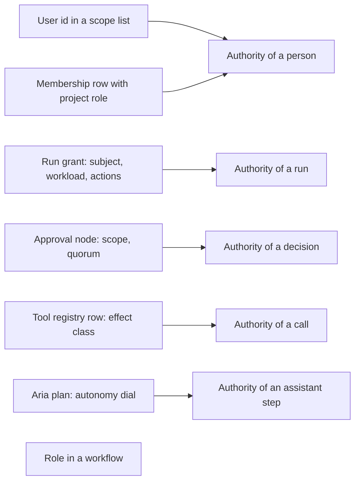

| Thing | Attaches to | Evidence |
| --- | --- | --- |
| Scopes | A user id; narrowed by a token | `auth.py` |
| Project role and actions | A (project, user id) membership row; actions map to roles | `db/models.py:4376`; `resource_access.py:55` |
| Tools available to an agent | The agent node (`tools`, `skills`), not any role or principal | `manifest.py:795` |
| Tool risk | The tool registry row, never the manifest or the model | `effects/registered_tools.py` |
| Run authority | A run grant: subject, workload, actions, resources, expiry, policy version | `policy/grants.py` |
| Policy | The version pinned at admission; one constant with a risk ceiling | `policy/decisions.py:184` |
| Aria capabilities | The capability registry: key, tier, `required_scopes`, checked against the plan owner | `assistant/capabilities.py`; `executor.py:797` |
| Approval | The approval node (scope, quorum, timeout), snapshotted onto the request | `approval_policy.py` |
| Autonomy | The plan, or the chat turn; planned: the use case | `db/models.py:1062`; `assistant/models.py:42` |

The run grant carries only `resource.execute` and `context.read` for the whole run. An agent step cannot receive less authority than the run, and two steps of one workflow cannot differ. Finer control comes from effect-class routing, which is a property of the tool and not of who is acting.

#### 6.3.5 Is there first-class assignment or role-scoped autonomy?

No assignment. The nearest objects are B1, B8, the review-queue lists (C6, unenforced), `ReviewQueueEnqueueNode.assigned_to` and project membership. Each maps a person string to a concrete instance or to a project. None maps a role in a workflow definition to an occupant, none accepts an agent as occupant, and none expresses "role X in use case Y". The approval node has no assignee at all.

No role-scoped autonomy. Autonomy exists at three other granularities: the Aria plan, the chat turn and the capability tier, where `gated` is a hard floor. ADR 0004 proposes one level per use case and "behaves as L1 everywhere" until M27 (`0004:101`).

No evidence-gated change of occupant. Nothing records "this duty is held by principal P under mode M on evidence E". The closest record is the release decision row, which snapshots role and scopes: who decided, but not under what regime of authority.

#### 6.3.6 Overlaps and incorrectly scoped roles

| Term | Problem | Evidence |
| --- | --- | --- |
| `required_role` | A scope, not a role, as its own error text says ("is not a CALIBER scope"). At commit the same approval also needs a project role in {owner, reviewer}. Two checks under one label | `manifest.py:866-880`; `approval_policy.py:508-540` |
| `reviewer`, four meanings | Project role (QA); per-request technical assignment, for which the project role `reviewer` is ineligible; review-queue list, unenforced; Aria reviewer agent, which holds the approver scope and no project role | A7, B1, C6, D2 |
| `owner`, eight meanings | Project role; primary project owner; `owner` column on 18 tables; review-queue owner (`db/models.py:1001`); Aria plan owner (`:1066`); experiment owner; execution-owner lease; "package owner" in plans. None is an accountable owner in the governance sense: no record, no acknowledgement | A5, E1 to E3, D5 |
| `operator` | A scope that grants almost every mutation (187 gates), a PRD persona, an Aria release identity and the colloquial platform operator. It is a general write permission, not a duty of running agents | A2, F10, D3 |
| Approval, at least eleven mechanisms | Workflow runtime approval; promotion approval; Aria gated step; Aria draft agent review; change-request review; quality sign-off; release approval; break-glass; legacy sign-off with waivers; refinement Apply; external provider review. Each has its own actor rule | B1 to B10, C1, D2 |
| `admin` | Implies every scope but is not a project member, so an admin cannot approve in a project without membership, yet can use break-glass. Deliberate, but the highest platform role has no day-to-day accountability path | A4; `resource_access.py::project_role` docstring |
| Dangling design source | Role semantics are justified in a deleted plan and now live in long docstrings and ADR 0004 | 6.2.1 |

Recount note on approval: the evidence file's list holds eleven. Counting every routed human decision surface finds more: the Aria plan approval (`routes/aria_plans.py:192`), the verification queue (`routes/verification.py`, whose docstring states that self-verification cannot be prevented) and review-queue item submission (`routes/review_queues.py:593`). This report therefore says "at least eleven" and does not rely on the exact figure.

#### 6.3.7 Design constraints: why human-to-agent movement is a rebuild

Thirteen constraints [E-roles §3], each with a repository anchor.

| # | Constraint | Anchor |
| --- | --- | --- |
| 1 | A workflow step names no role. `AgentNode` has a `name`; the approval node has a scope; the queue node a free-text assignee. Swapping an occupant means changing node type | `manifest.py:754,795,866` |
| 2 | Human and agent decisions are different node types in different tables (`caliber_runtime_approval_requests` versus `caliber_assistant_reviews`) | `db/models.py:5081`; approval UX contract |
| 3 | The authorization model forks on principal kind: roles and membership for users, claim binding for service principals | `policy/grants.py:197-274`; `principal.py:305` |
| 4 | Authority is an AND of a config-file scope and a database role, with different owners and audit trails | `resource_access.py:220` |
| 5 | Distinctness is string equality with no type | `actor_provenance.py:77-83`; `approval_policy.py:266` |
| 6 | Pins are per run, not per node or role; independence has nothing to compare | `src/contracts/schemas/run_manifest.v1.json` |
| 7 | Grants are run-wide and action-coarse | `workflows/admission.py:104-106` |
| 8 | Autonomy is stored in three unrelated places and written by the actor it constrains | `db/models.py:1062`; `assistant/models.py:42`; `routes/assistant.py:636` |
| 9 | No assignment history: a membership role is overwritten in place with an audit row | `routes/projects.py:685,777` |
| 10 | Role literals are hard-coded at call sites | `workspace_release_governance.py:546,583`; `workspace_change_request_service.py:258` |
| 11 | Escalation and timeout do not exist as concepts; `escalate` is refused or aliased to `block` | `approval_policy.py:232-244`; `manifest.py:829` |
| 12 | Three safe defaults fight tuning: the `gated` tier, the human owner and the non-member admin are code constants, not policy | `executor.py:141`; `resource_access.py` |
| 13 | Dangling references to a deleted plan raise the cost of any redefinition | 6.2.1 |

Constraints 1, 3, 5 and 6 are structural. The others are removable without a model change.

#### 6.3.8 Verdict: are the existing roles sufficient?

No.

They are sufficient for human access control over the asset lifecycle. The strengths are real: a closed action registry that denies unknown actions, an AND-chain of scope and role, snapshots of role and scope on release decisions, and distinct-actor rules that block self-approval and break-glass without a session. None of that should be rewritten.

They are insufficient for the charter in four ways. First, there is no responsibility object and no assignment, so a duty cannot be held by a changeable occupant. Second, there is no principal type, so the platform cannot say whether a human or an agent decided. Third, eight of the nine governance functions the charter asks about are missing or implicit (Section 7). Fourth, autonomy is self-assigned: the party that benefits from more autonomy sets it. The remedy is not a larger enum. It is four layers with different jobs (Section 8).

## 7. Missing or problematic roles

Section 6 inventoried what exists. This section lists what the charter's model needs and the repository lacks, then names the existing roles and terms that mislead, with a disposition for each. It closes with the charter's six questions answered as the repository stands today. The proposed architecture is in Section 8 and is not repeated here.

### 7.1 Missing roles

Ten functions are missing in the sense that no object, field or rule names them. Where a function is partly served by an unrelated mechanism, the table says which.

| Missing role | The question it answers | Who answers today, and on what evidence | Verdict |
| --- | --- | --- | --- |
| Supervisor (overseer of agents) | Who watches an agent-held duty in aggregate and may restrict it? | Nobody is assigned. By implication the run initiator can cancel a run (`resource.execute`), the Aria plan owner answers interactions (`assistant/executor.py:582`) and approvers act at gated steps. There is no watch subscription and no intervention SLA. Package M06 (approval timers, overrides, scoped stop) is planned | Missing |
| Evaluator or validator, as a held duty | Who produces and attests evidence independently of the builder? | Any holder of `resource.write.evidence` (owner, editor, reviewer) authors judges and suites; any holder of `resource.execute` runs an evaluation. The author may evaluate the artifact. Separation exists only at release sign-off (B3), which is human by design. A judge has no identity or version pin and no stored qualification (`db/models.py:878`; `eval/alignment.py:33`) | Partial: the capability exists, the role and its independence do not |
| Exception or escalation owner | Who owns the exception queue, its routing and its SLA? | A rework-task assignee for two failure classes (B8); `release.reconcile` (owner) and the reconciler for uncertain release state; break-glass admin. Agent-step failures, budget breaches and approval timeouts have no owner. `escalate` is refused by `approval_policy.py:232-244` and aliased to `block` for guardrails (`manifest.py:829`) | Partial |
| Autonomy authority | Who decides that an agent may do more? | Nobody. The plan creator edits the plan's dial while it is a draft (`routes/aria_plans.py:143-185`), the requester picks `approval_mode` per turn, and the deployer decides whether reviewer and release identities exist (`config.py:1283,1290`). ADR 0004 invariant 5 (a human owner decision recorded as a governed release) is not built | Missing, and self-service today |
| Autonomy revoker or incident lead | Who reduces or revokes autonomy, and leads reinstatement? | Indirect levers only: edit the environment, edit a draft plan, cancel a run, demote or remove a member (which narrows grants at once), revoke a session or token. `revoke_grant` (`policy/grants.py:417`) has no caller outside its module. Break-glass (B6) is the only incident-time role and it grants more power. No scoped stop; no automatic demotion | Missing as a role and as a mechanism |
| Accountable owner, as a record | Which named person answers for a use case's outcomes? | `CaliberProject.owner` (`db/models.py:2704`) is an identity that doubles as a permission and a visibility key. Decision records carry `decided_by`, `requested_by`, `created_by` strings. For autonomous Aria publishing the author is the requester of record and the reviewer and release identities are configuration strings. GovernanceRecord (M24) is planned | Partial and implicit |
| Risk owner | Who sets the loss tolerance and accepts residual risk? | Nobody. Policy is the module constant `REFERENCE_POLICY_V1` (`policy/decisions.py:184`); risk tiers and risk owners are planned in M24 | Missing |
| Auditor | Who has independent, read-only access to evidence and may flag but not act? | The viewer scope reads; platform inventory routes serve admins (`routes/platform_admin_inventory.py`); audit-reader roles are planned in M05. The audit log is append-only by convention, not by trigger | Missing as a distinct role |
| Policy author | Who writes ceilings, floors and templates, and must not author the workflows they govern? | Policy is code, so the author is whoever commits. An approval policy is authored by whoever edits the workflow (`resource.write.runtime`), so the author of the control is the author of the controlled | Missing |
| Agent sponsor | Who is accountable for an agent identity's lifecycle, pins and access? | Aria's reviewer is a configured user id with no registry entry, sponsor or retirement. `ServicePrincipal` is created by the server and bound to a workload. A token has an owner, which is the closest analogue | Missing |

Section 8 names nine governance roles. It folds the risk owner into the Autonomy Authority, and the glossary (Appendix C) records the places where the two names still diverge.

Two roles the charter's example uses are present only for humans. The Reviewer exists as the project role `reviewer` and as an agent in Aria, but through unrelated mechanisms (A7, D2). The Operator exists as two processes, the dispatcher and the reconciler, and as a scope that means "may write" (A2); no object represents the duty of running and monitoring workflows.

### 7.2 Problematic existing roles and terms

Disposition vocabulary: **keep** (no change), **rename** (same thing, honest name), **split** (one name, several jobs), **retire** (remove or fold into another mechanism). The proposal in Section 8 keeps the permission layer as it is, so most dispositions change meaning and documentation rather than code.

| Role or term | Problem | Disposition | What it becomes |
| --- | --- | --- | --- |
| `caliber.viewer` | Implicit floor; no route gates on it | Keep | Layer 3 permission, unchanged |
| `caliber.operator` | A general write scope named like a duty; 187 gates | Rename in prose; keep the identifier | The permission stays. "Operator" in the sense of a duty is a responsibility archetype (8.2) |
| `caliber.approver` | A scope that is half of every approval and reads as a duty | Split | The permission stays. The decision right moves to the responsibility that holds it, and the agent-held case to a grant (8.4) |
| `caliber.admin` | Implies everything, is not a project member, and stands in for auditor and policy author | Keep, and add the missing roles so it is not used as a stand-in | Layer 3 permission; Auditor and Policy Author become separate functions |
| Project role `owner` | Eight meanings; owner as permission, accountability and visibility key | Split | The permission role stays; Accountable Owner becomes a record; the `owner` column is described as a creator and visibility key |
| Project roles `editor`, `viewer`; labels "Developer", "QA", "Admin" | Labels cited in code comments are not implemented | Keep the roles; retire the unimplemented labels or implement them once | Layer 3 permission; Builder archetype is the duty |
| `reviewer` | Four meanings; the project role is ineligible for the change-request assignment that carries its name | Split | Project role kept; change-request assignment named "technical reviewer"; Aria's reviewer is the Reviewer archetype held by an agent; queue list enforced or retired |
| `HumanApprovalNode.required_role` | Holds a scope; a second hidden check on project role | Rename to `required_scope`, add a slot reference, add no new semantics | Responsibility slot reference (8.5, 17) |
| Review queue `reviewers`, `assigned_to` | Written, never read for authorization | Retire, or enforce; do not extend | Assignment of a duty to a group, through the intervention task (11.10) |
| Guardrail `on_failure="escalate"` | Behaves as `block`; contradicts the policy's own rule against a control that does nothing | Retire the value until escalation exists | Escalation targets arrive with M06 timers (14.3) |
| Aria `approval_mode` and plan `autonomy` | Self-assigned, stored in three places, written by the actor they constrain | Retire as authority inputs; keep as UI affordances | Derived from grants (9.9) |
| ADR 0004 levels L0 to L5 and chair roles | A scalar per use case; chairs mix a scope and a project role | Rename and split | Profile presets over modes; chairs become archetypes (9.9) |
| `ServicePrincipal` | An ingress identity with no role; easily mistaken for an agent identity | Keep, with the name's meaning fixed | Principal type `service`; the new `agent` principal is a performer identity (8.2) |
| Legacy release sign-off and waivers (B9) | A second, differently gated sign-off system | Retire or collapse | Workspace release decisions |
| Break-glass (B6) | Grants more power and is the only incident-time role | Keep | Paired with a reducing role, the Autonomy Incident Lead |
| Rework assignee (B8) | The right pattern at the wrong scope: one failure class, one instance | Keep and generalize | Exception Owner and Resolver, over an intervention task |
| Judge (E4) | Not a role; no identity or version | Keep the construct; version and qualify it | Evidence component, not a principal (13.5) |
| Program hats A to E, P1 to P3, "D-roles" | Read as product roles; D1 to D15 are milestones | Rename in documents | "Program hats" and "milestones" |

Three patterns recur in the table. First, a name that is accurate for one mechanism has spread to others (`reviewer`, `owner`, `operator`); the remedy is to say which mechanism is meant, not to invent a new word for all of them. Second, several constructs look like governance and enforce nothing (`escalate`, the queue `reviewers` list, the deleted plan's job-function labels), and the repository's own approval policy calls such controls the defect to avoid. Third, the cheapest corrective step is to stop adding call sites: every new `expected_role=` literal or `required_role` meaning raises the cost of the later change (constraints 10 and 1 in 6.3.7). Renaming identifiers is not urgent. Adding no further semantics to the old names is.

### 7.3 The charter's questions, answered as the repository stands today

**Who supervises autonomous agents?** Nobody is named. A run's initiator can cancel or resume it, the plan owner answers Aria interactions, and approvers act at gated steps. These are incidental powers of people who happen to be near the work. There is no supervision object, no intervention SLA and no coverage rule. M06 plans timers and overrides but defines no supervision task.

**Who evaluates their performance?** A capability exists without a role. Anyone with `resource.write.evidence` can author judges and test sets, anyone with `resource.execute` can run an evaluation, and the machine gate and the `reviewer` quality sign-off cover releases. The author can evaluate their own artifact. Judges are mutable rows with no version, and agreement statistics are consumed by no gate [E-eval §2]. The refinement loop scores candidates against the dataset that gates them, with no held-out split [E-eval §9.3].

**Who handles exceptions?** Two failure classes have an owner: a rejected job or release goes to a rework assignee, and uncertain release state goes to a project owner or the reconciler. Break-glass handles the production emergency. Agent-step failures, budget breaches, approval timeouts and envelope exits have no handler, and escalation is not implemented: `timeout_behavior` accepts only `block`.

**Who approves autonomy increases?** Nobody. The plan creator and the chat requester set the dial or the mode, and the deployer decides whether reviewer and release identities exist. ADR 0004 requires a human owner decision recorded as a governed release, and that is design only. Today an increase is a self-service edit with an audit row.

**Who reduces or revokes autonomy?** Several people can narrow authority by accident of other powers: the deployer edits configuration, a plan editor changes a draft, a project owner demotes a member, a user cancels a run. There is no scoped stop, no automatic demotion and no named holder of the power. The grant-revocation function has no caller.

**Who remains accountable?** The answer is implied rather than recorded. The project's primary owner is the nearest candidate, but that field is an identity and a visibility key, not an acknowledgement. Release records name `decided_by` and `requested_by`; run records name `created_by`. For autonomous Aria publishing the author is the requester of record. No record says that a named person accepted responsibility for a use case's outcomes at a given level of autonomy. GovernanceRecord (M24) would supply one and is planned for D10.

| Question | Answer today | Strongest evidence for it |
| --- | --- | --- |
| Who supervises? | No named holder | Incidental cancel and approve powers only |
| Who evaluates? | Anyone with evidence-write; no independence | `resource.write.evidence` held by owner, editor and reviewer |
| Who handles exceptions? | Two failure classes only | Rework assignee; `escalate` unimplemented |
| Who approves increases? | Nobody; self-service | Plan dial and chat mode set by the requester |
| Who reduces or revokes? | Nobody by role | `revoke_grant` has no caller |
| Who is accountable? | Implied by project owner | No acknowledgement record |

Of the six, none has a complete answer, two have a partial one (evaluation, exceptions), and one is implicit (accountability). The three that concern the control of autonomy itself (approving increases, reducing, supervising) have no answer. That is the central finding of this section: the repository can say who may do work, but not who answers for an agent doing it.

### 7.4 What follows

The gaps in 7.1 are not an argument for ten new permission roles. They are an argument for separating three things that the current model fuses: the duty the work needs, the authority a principal holds, and the governance functions that decide who may hold what. Section 8 proposes four layers that do this and shows how the existing permission roles fit beneath them unchanged.

## 8. Proposed role architecture

### 8.0 Design basis: what the charter's hypothesis survives, and the working vocabulary

This block is the design basis for sections 8 to 11 and fixes the vocabulary used from section 8 onward. The external research [E-auto §2.7, E-av §3] converges on three claims: the unit of autonomy is a responsibility inside an Operating Envelope; the level is derived from who executes, monitors and handles fallback; autonomy is a permission earned from evidence, not a capability. Each was tested against the repo and the evidence.

| Claim | Verdict | What the test showed |
| --- | --- | --- |
| Unit = (responsibility, envelope) | Confirmed, with one correction | Matches SAE J3016's feature-in-an-ODD [M], DoA matrices, FDA predetermined change plans and ITIL standard changes [M], and is the only unit that expresses the vision's own example. Correction: chains, not seats, produce outcomes, so a per-seat track record is false precision [E-eval §9.3]. The grant attaches to the seat; evidence and demotion must also work at chain scope |
| Level derived from execute / monitor / fallback | Confirmed, but three duties are not enough | SAE's duties merge two human jobs: checking each instance before effect, and watching the aggregate afterwards. A fourth duty is added (9.1). The derivation also needs verifiability and independence, or it labels an unverifiable agent "autonomous" |
| Autonomy is a permission earned from evidence (Zheng et al., Allowed vs Capable) [S] | Confirmed for widening; false as a complete rule | Zero failures in n trials bounds the failure rate only near 3/n at 95% confidence [J, rule of three]. Evidence widens an exposure cap, it does not replace it; some seats are never climbable (10.6); policy pre-authorization of a narrow standard class is a legitimate third source [M, ITIL] |

**Working vocabulary.** This is the one canonical vocabulary table of the report. Later sections use these terms with these meanings; where another section restates a scale it refers back here.

| Term | Definition in this design | Note |
| --- | --- | --- |
| Responsibility | A named duty declared in a Work definition as a sealed **slot**: purpose, input/output contract, decision rights, required evidence kinds, effect-class ceiling, independence constraints, verifiability class, fallback. Names no occupant. | Extended with verifiability class, fallback, human-floor flag. |
| Principal | `human`, `agent`, `service` or `group`. Agent principals are **versioned**: the version is the behaviour pins (the behaviour configuration digest, BCD). | Version, sponsor and model-family pin added. |
| Assignment | Responsibility to principal(s) with a **capacity**: `perform`, `assist`, `shadow`, `verify`, `oversee`, `resolve`, `approve`. | The charter called this field "mode". It is named capacity so that "mode" can mean the derived label. |
| Operating Envelope | The bounds inside which a grant holds: data classes, systems, effect classes, value, volume, cumulative exposure, time, conditions, required checks, sampling policy, minimal-risk action. | As in the charter. |
| Autonomy Grant | (responsibility, envelope, principal version, duty allocation, supervision requirement, evidence basis, Accountable Owner, expiry). | Adds the duty allocation and the capability/permission pair. |
| Duty | Perform, Verify, Oversee, Recover. | Four duties, not SAE's three. |
| Autonomy Mode | The derived label of a grant: **M0 Human-only, M1 Shadow, M2 Assisted, M3 Approval-gated, M4 Sampled, M5 Exception-supervised** (9.4). Where the charter and ADR 0004 say "level". | "Mode" replaces "level" so the labels can be shown beside ADR 0004's L0-L5 without implying one ladder, and to signal duty allocation rather than rank. |
| Autonomy Profile | The vector of modes across a use case's responsibilities. Replaces the scalar per use case. | New. |
| Profile preset | ADR 0004's L0-L5, kept as named bundles that expand into per-responsibility target grants (9.9). | Never stored as authority. |
| Supervision requirement | The human oversight a grant needs: who Oversees, how often, with which sample floor. At M5 a longer Oversee cadence (alert-driven plus periodic governance) is a variant of the requirement, not a further mode. | Field on the grant. |
| Approval basis | How an exact-intent approval decision is minted: `exact` (a human per effect), `batch`, `standing`, `grant`, `agent` (14.5). A standing or batch basis is M3 with a different basis, not a new mode. | Field on the decision record. |
| Seat | One filled assignment of a responsibility ("who is in the seat"). | Used lightly; ADR 0004 says "chair". |

**Scales and identifiers.** Each scale has one home; other sections refer to it.

| Scale or identifier | Values | Defined in |
| --- | --- | --- |
| Risk tier | T1 (lowest consequence) to T4 (highest) | 9.5 |
| Effect class | `read` < `reversible_write` < `export` < `irreversible_write`; strictest mapped class wins | 9.5 |
| Verifiability class | V1 computable (full oracle), V2 partly computable plus a qualified judge, V3 human judgement only | 9.7, 13.6.3 |
| Independence class | I0 same principal (forbidden), I1 distinct identities, I2 distinct pins, I3 context isolation, I4 deterministic check plus human sampling | 8.6, 14.2.2 |
| Evidence grade | G0 offline suites, G1 shadow window, G2 live at M3, G3 audited error bound, G4 G3 plus pass^k and survived changes | 13.6.4 |
| Change class | C0 no behavioural impact, C1 pre-authorised, C2 material, C3 structural | 13.5.2 |
| Failure severity | FS1 (worst) to FS4 | 13.10 |
| Platform contract invariants | PC1 to PC8 | 12.3 |
| Plan identifiers | D1 to D15 milestones; packages B01 to B16 (Beta) and M01 to M27 (MVP), written with two digits so they are never confused with M0 to M5 modes; V01 to V35 validation scenarios (two digits, so never V1 to V3 classes); EP-nnn protected effect paths; G-E1 to G-E20 evaluation gaps | `docs/planning/`, [E-road], [E-eval §10] |
| Proposal identifiers | NR1 to NR13 no-regret items (18.2); ENT1 to ENT12 entities (17.2); RT1 to RT13 runtime changes (17.4); EV1 to EV9 evaluation changes (17.6); A1 to A9 proposed ADRs (17.7); P1 to P8 pull-earlier items (23.2); NE-A to NE-H new epics (23.4); NOW-n, NEXT-n, LATER-n recommendations (21); E1 to E10 90-day experiments (22.3) | as listed |
| Appendix sections | A.n (red-team review), B.n (open design questions) | Appendices A and B |

### 8.1 Do the existing roles suffice?

No, and not for want of more enum values. The role evidence [E-roles §1] found eleven meanings of "role" and three overlapping vocabularies (platform scopes, `src/auth.py:94-97`; project roles, `src/resource_access.py:20-24`; ADR 0004's chain roles), none of them a responsibility. Four facts drive the design:

1. **A role is a permission bundle on a user-id string.** There is no role-in-workflow and no assignee on an approval node: `HumanApprovalNode.required_role` is validated against platform scopes (`src/workflows/manifest.py:866`, `src/workflows/approval_policy.py:90`). Moving a duty from a person to an agent is a node-type change, hence a new sealed version.
2. **Authority is borrowed from a human.** `create_grant` caps a grant at "the role of the person it is issued for" (`src/policy/grants.py:173-195`); an agent acts on a starter's authority or a pre-bound `ServicePrincipal` that holds no role.
3. **Eight of the nine governance roles below are missing or implicit** [E-roles §2.7]. Autonomy is self-assigned today: any member who can execute may edit a plan's dial (`src/routes/aria_plans.py:150-185` [E-roles §2.7]).
4. **Policy encodes a human floor as a constant:** `risk_ceiling=4`, with risk 5, "a person, never a run", for every approval and acceptance (`src/policy/decisions.py:146-184`). The instinct is right (10.6) but it is code, not governed data.

On the charter's question: roles should represent responsibilities for **assignment and accountability**, not for **permission**. An agent's authority should be a revocable, evidenced grant, not a project role (8.4). The need is four role layers, not a bigger enum.

### 8.2 The four role layers

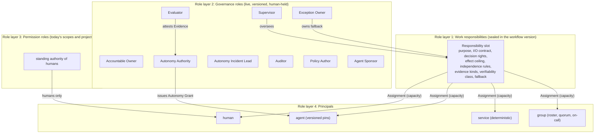

**Role layer 1, work responsibilities.** What the work needs done. Six platform-defined archetypes cover the charter's example and ADR 0004's chain (propose, review, approve, apply, verify) plus the one the ADR omits, the person who resolves what the agent cannot.

| Archetype | Meaning | Charter / ADR name | Today |
| --- | --- | --- | --- |
| Builder | Produces a reusable work product (asset, plan, code, prompt, workflow) | Developer, `editor` | `editor` project role; a workflow's author also authors its approval policy and guardrails [E-roles §2.6] |
| Operator | Executes recurring or transactional steps and applies approved intent | Operator, apply | Dispatcher and reconciler as processes (`src/effects/dispatcher.py`); `caliber.operator` is a general write scope |
| Reviewer | Peer or technical check of an instance before it moves on | Editor/Reviewer, `reviewer` | Four meanings (project role, CR assignment, queue `reviewers` list that is never read for authorization because `submit_item` checks only operator scope and `feedback.submit`, Aria agent) |
| Validator | Independent acceptance against criteria the performer cannot satisfy by text alone | Validator, verify | Machine gate and human `reviewer` sign-off; acceptance predicate is plan only (B09) |
| Approver | Holds the decision right to authorize an effect | Approver, `approver` | Scope plus project role at commit; at least eleven separate mechanisms [E-roles §2.6] |
| Resolver | Handles an instance the performer or envelope cannot (exception, dispute, ambiguity) | none | Rework-task assignee for two failure classes |

**Role layer 2, governance roles.** Who governs autonomy rather than who does the work. Each is a function held by a human or, for most, a group.

| Governance role | Responsibility | Occupants | Today |
| --- | --- | --- | --- |
| Accountable Owner | One point of accountability for a use case's outcomes at every mode; accepts residual risk; may demote at will | Natural person (named incumbent of an office) | `CaliberProject.owner` (identity, not a duty record); GovernanceRecord is M24, planned |
| Autonomy Authority | Decides grants, increases and ceilings within enterprise policy (the "risk owner") | Person or committee | None; self-service |
| Evaluator | Produces and attests evidence independently of the builder: suites, judge qualification, sample audits, shadow comparison | Human team plus services it owns | Any holder of `resource.write.evidence`, including the builder [E-roles §2.7] |
| Supervisor | Oversees an agent-held seat's aggregate behaviour; reviews samples and metrics; may restrict or pause within scope | Person or on-call group | None |
| Exception Owner | Owns the exception queue: routing, SLA, staffing, drills | Person or group | Rework assignee only; `escalate` rejected or aliased to `block` (`approval_policy.py:232` [E-gov §2.9]) |
| Autonomy Incident Lead | Suspends, contracts or revokes at scope (grant, principal version, connector, use case); leads reinstatement review | Person or on-call group | None; break-glass grants *more* power |
| Auditor | Read-only independent access to evidence; may flag, never act | Person or team independent of the use case | Planned audit-reader roles (M05) |
| Policy Author | Authors ceilings, templates, floors, tier tables; must not author the workflows governed | Person or group | Policy is a module constant (`REFERENCE_POLICY_V1`) |
| Agent Sponsor | Accountable for an agent principal's lifecycle: pins, credentials, access review, deprovisioning (Entra's sponsor pattern [W]) | Person | None; Aria's reviewer is a config string |

**Role layer 3, permission roles.** Scopes and project roles stay as they are: a human's standing authority, the thing `PROJECT_ACTIONS` maps. ADR 0004 is right that "the permission model does not change with the level" (`docs/architecture/adr/0004-autonomy-levels.md:33-35`); this design keeps that and adds only that an agent holds *no* permission role.

**Role layer 4, principals.** Four types.

| Principal | Identity source | May hold capacities | Accountable? | Revocation |
| --- | --- | --- | --- | --- |
| human | IdP / session | any, subject to eligibility and standing permission | Yes | Membership or eligibility removed |
| agent | Sponsor-registered, immutable pin set (model route, model family, prompt/skill digest, adapter version, tool-set digest) | perform, assist, shadow, verify, resolve; **never** governance roles, never `approve` above grant | No; sponsor and owner are | Grant suspended or revoked; principal version retired |
| service | Server-created, deterministic, no discretion (scheduler, dispatcher, reconciler, rule-based validators) | Operator and Validator capacities for deterministic functions | No | Binding removed |
| group | Roster, quorum, on-call or committee rule over humans | oversee, resolve, verify, approve, governance functions | A named lead is accountable of record | Roster change recorded |

`service` is not the agent: Caliber's `ServicePrincipal` is an ingress identity ("who started this", `src/policy/principal.py:242`; ADR 0004 says it is not "a promotion to an autonomous owner, reviewer or approver", `0004:43-50`). The new `agent` principal is a performer identity ("who did this step"). A run therefore records an **initiator** and a **performer per step**, resolving the "two identities in one run" finding in the governance evidence [E-gov §2.3]. [J]

### 8.3 Predefined versus extensible

**Predefined (a platform release changes it):** the four role layers and four principal types; the six archetypes and nine governance roles with their default independence and effect constraints; the four duties, six modes and the derivation; the platform floors of 10.6; the effect-class vocabulary (`src/effects/inventory.py:35`); the intersection rule and "tighten-only at instance level". **Extensible (a governed change in the customer's own record):** responsibility definitions ("Document Clerk", "Supplier Risk Analyst"), each specializing one archetype; which governance roles collapse onto one person, within 8.9; envelopes, sampling policies, evidence thresholds and ramp schedules inside the floors; tier tables (tighten freely, loosen only by two-key); evidence kinds as an open registry rather than today's closed five-value CHECK [E-eval §10, G-E18]; group rosters. The archetype carries the semantics the platform enforces (a Validator is never the Performer's principal; an Approver's decision is exact-intent-bound); the enterprise definition carries the domain. This is the BPMN lane pattern, a role resolved to an occupant at runtime [M], plus an enforceable independence property BPMN lacks. [J]

### 8.4 How capabilities, tools, permissions and policies attach, and reach a principal

Today authority attaches to six unrelated anchors (user, membership, grant, node, tool row, plan; [E-roles §2.4]) and none to a role-in-a-workflow. The design attaches everything to the slot; a principal receives it only through an intersection at admission.

| Thing | Attaches to | Reaches the principal as |
| --- | --- | --- |
| Capabilities (actions the seat may take) | Slot contract: actions from the `PROJECT_ACTIONS` vocabulary plus effect classes | A **step grant**: slot actions, intersected with the human's standing authority or the agent's Autonomy Grant envelope, capped by policy |
| Tools and connectors | Slot lists permitted classes by *registry identity*, never by name; the agent definition's tools must be a subset | Checked at assignment and per call; the dispatcher already classifies by registry identity (`src/effects/step_proposal.py` [E-gov §2.4]) |
| Data and context | Envelope data classes | Context authorization and the context manifest (`src/context/*` [E-gov §2.5]) |
| Permission roles | The human's membership | Standing authority for humans only; an agent receives none |
| Policies | Versioned policy data at enterprise, use-case and slot scope | Pinned as `policy_version` in the run manifest; every refusal a recorded `PolicyDecision` |
| Budgets, exposure | Envelope and use-case aggregate | Enforced outside the agent (B08.4/M08; AgentCore Payments limits are the external analogue [S]) |

Two consequences conflict with main. `create_grant` needs a second grant source: for agent-held seats the Autonomy Grant, not a human subject. `approval_valid_at_commit` requires scope plus project role [E-gov §2.5] and must accept grant-based authority for an agent decider while still re-deciding the run's grant at commit. Both are additive branches beside the human path, not loosenings of it.

### 8.5 Where the assignment lives, given that workload identity is the manifest digest

The finding: a run's workload id is `wl_` plus the full digest of the sealed workflow version (`src/policy/principal.py:104`); grants bind to the workload, and policy decisions and approvals bind to the grant. If the occupant of a duty is encoded in the manifest (an `agent` node versus a `human_approval` node, `required_role` a scope string), swapping occupant mints a new version, workload and grants, so autonomy movement becomes "release a new workflow", the rebuild the vision wants to avoid. The governance evidence reached the same recommendation [E-gov §9, rec. 1]: "role-holder binding as policy data referenced by, not embedded in, the sealed bundle."

**Proposal.** Three objects with different lifecycles.

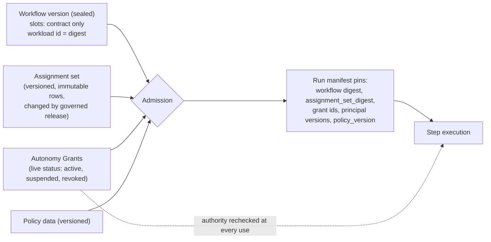

1. **The slot is sealed with the workflow version** and carries an occupant-neutral *step contract*: input, output and proposed-action schemas are identical whether a person or an agent fills the seat. Caliber's `AgentStepRequest/Result` contract (`src/contracts/agent_step.py`) already treats the agent as an untrusted proposer; the human realization (an approval request or review item) must consume and emit the same shapes. A new `responsibility_step` node resolves its performer at admission. Today's inline `AgentNode` becomes an implicit slot plus an implicit principal version "inline at digest" with no standing grant, so legacy workflows run unchanged. [J]
2. **The assignment set is policy-class data**: append-only versioned rows (responsibility, principal and version, capacity, effective window, assigned-by, supersedes), changed by a governed release. Admission reads the current set, computes `assignment_set_digest` and pins it in the run manifest with grant ids and principal versions. Replay and audit survive because assignment versions are immutable; a swap needs no new sealed version.
3. **Authority is rechecked, not pinned.** The manifest pins *identity* (who held the seat, for attribution and replay); the authority check re-reads the grant's live status at every use and at commit. This reuses existing behaviour: grants are row-locked and re-decided against current membership at every use, and `revoke_grant` narrows authority at once (`src/policy/grants.py:417`; [E-gov §2.5]). Revocation reaches in-flight runs at their next dispatch, which a sealed pin alone could not do.

**What still needs a new sealed version:** a change to the slot contract (schema, effect ceiling, independence rules). That is correct: the contract is what the evidence was earned against, so the grant records `contract_digest` and a contract change invalidates it. A change of occupant, mode or envelope does not.

Rejected: *occupant in the manifest* (preserves replay purity, defeats the goal); *occupant as a project-membership row* (per-project, no history, no evidence link, and it reproduces the scope-plus-role AND-chain that makes "agent as approver" an env-file edit, [E-roles §3, constraint 4]). Cost of the accepted design: one node type, a compile step that realizes either occupant, an admission step that resolves and pins, and additive optional fields, which ADR 0003's readers-before-writers rule permits while schemas are `v1` (`run_manifest.v1.json:35` for the pins object). Doing it before the Beta evidence package freezes is cheap; afterwards it costs a `v2` [E-road §5.4].

### 8.6 Independence and separation of duties

Today "distinct" means a different user-id string, implemented four times [E-gov §2.5]. That is too weak for agents (two agent ids with the same model and prompt pass) and wrongly shaped (an approval's `requested_by` is the run initiator, so an action an agent proposed is attributed to the human who started the run [E-gov §2.3]). Caliber's own gap analysis names "single operator or model reviewer treated as independent approval" as a risk [E-roles §4]. The design replaces the boolean with **independence classes**, declared per pair of seats and chosen by tier.

| Class | Requirement | Enforced by | What it does not prove |
| --- | --- | --- | --- |
| I0 | Same principal in two seats of one chain | Forbidden (ADR 0004 invariant 1, `0004:71-72`) | n/a |
| I1 | Distinct identities only | Identity comparison | Nothing: five agent ids satisfy a quorum of five |
| I2 | Distinct pins: model *family* or prompt/skill lineage differs, and different sponsors | Pin comparison at assignment; family from a registry | Shared training data, correlated blind spots |
| I3 | I2 plus context isolation: the verifier sees raw sources and the output, not the performer's rationale or history | Configuration check; Aria's reviewer already runs "an isolated turn with no author history" [E-eval §7.1] | Collusion through shared data |
| I4 | A deterministic check the performer's author did not write sits in the chain, plus human sampling | Chain composition check (`0004:73-76`) | Errors outside the check's coverage |

Classes I1 to I3 are cumulative; I4 is a chain-composition requirement added on top of I3. Defaults [J, illustrative]: the verifier of an agent performer is at least I2 at M3 and I3 at M4 and M5, and I4 is mandatory for any seat whose mode removes the per-instance human check (M4, M5). Section 14.2.2 restates the minimum class per mode for the ceiling function. The plan already says "different model pins alone do not prove independence" [E-road §4.3]; I4 enforces that sentence.

Agent versus human:

- The **builder or optimizer** of an agent cannot verify its instances at T3 and above, cannot be its Evaluator, and cannot decide its grant. The refinement loop shows the failure: it optimizes against the same dataset the gate scores, with no held-out split [E-eval §9.3]. The party that optimizes cannot certify [M, SR 11-7/SOX].
- A **human verifier** is subject to reviewer-quality telemetry (time to decide, approve-all runs, seeded known-bad items). Approval fatigue is measured: users accept 93% of manual prompts in Anthropic's data [S], so "human approved" is weak evidence unless audited independently.
- **Agent members of a group** never count toward a human quorum; an all-agent committee is I1 whatever its size.
- An agent **never sits in the chain of its own promotion** (verifier, approver, or attestor of evidence about itself).

### 8.7 Group occupants and accountability: is the owner always a human?

**Position: accountability is always a natural person; decisions may be held by groups.** The Accountable Owner of a use case is a named human, or the named incumbent of an office, never an agent and never a group.

1. Liability regimes assign the outcome to the enterprise and, inside it, to a person or role: a tribunal held an airline to its chatbot's statements [W, Moffatt v Air Canada, 2024]; California AB 316 blocks an "the AI did it" defence [W]; Microsoft Entra gives every agent identity a human sponsor reassigned when the sponsor leaves [W]; RACI allows exactly one Accountable per outcome [M].
2. Accountability without control is DeepMind's "moral crumple zone" [S]. So the owner holds the unconditional right to demote or suspend, receives the evidence digest behind every grant, and signs an explicit acceptance when one is issued. Acceptance is recorded, not presumed.
3. This is a policy floor with legal grounding, not a technical invariant [E-roles §6]. The design therefore separates what ADR 0004 fuses under "owner": the person **accountable** for outcomes and the function that **decides autonomy** (the Autonomy Authority, which may be a committee). ADR 0004 and #868 have the owner approving promotion, which makes the party rewarded by more autonomy its approver [E-road §4.2, T6].

A group is a roster plus a rule (any-of, quorum, on-call, committee). Every group action still records the *individual* who acted; a committee records each vote and the chair. A group may hold `oversee`, `resolve`, `verify`, `approve` and any governance role except Accountable Owner and Agent Sponsor. If the Accountable Owner's office is vacant (deprovisioned through SCIM, M17), the use case's grants enter a grace window, then auto-suspend to the human-lane fallback: autonomy without an accountable human is not a permitted state. This turns Entra's sponsor reassignment [W] into a fail-safe.

### 8.8 The charter's questions, answered

| Question | Answer | Occupants | Enforcing primitive | Today |
| --- | --- | --- | --- | --- |
| **Who supervises autonomous agents?** | The **Supervisor** named on each grant's `supervision_requirement`: reviews samples and metrics, may restrict or pause within scope. Monitors and agent watchdogs may feed it but may only escalate or tighten | Person or on-call group | Grant field; supervision tasks (InterventionTask, which M06 consumes but no task defines, [E-road §3]) | Missing |
| **Who evaluates them?** | The **Evaluator**, independent of builder and optimizer: owns suites, qualifies judges, runs shadow comparison and sample audits, attests evidence | Human team plus services it owns | Evidence `produced_by` plus independence check against the sponsor | Capability yes (`eval/`), role and independence no |
| **Who handles exceptions?** | The **Exception Owner** owns queue and SLA; **Resolvers** handle instances. At M5 the agent's Recover duty handles in-envelope exceptions; out-of-envelope go to humans. No reachable resolver: the action is not started | Person or group; agent only in-envelope | Exception queue, timers (M06) | Two failure classes; `escalate` unimplemented |
| **Who approves autonomy increases?** | The **Autonomy Authority** decides after the **Evaluator** attests, with the **Accountable Owner's** recorded acceptance; two human keys at T3 and above. Never the builder, never an agent | Person or committee | Promotion as a governed release of the grant (M02 pattern) | Missing; self-service |
| **Who can reduce or revoke?** | Asymmetric: *any one of* the platform (automatic, pre-approved thresholds), the Supervisor (within scope), the Autonomy Incident Lead (scope-wide, across use cases for a principal version or connector), the Authority, or the Owner. Reinstatement takes the multi-key path. An agent cannot delay or veto its own demotion | Person, group, automation | Demotion actuator; scoped stop (M06.4 #776 scopes only project, workflow, connector, [E-road §5.1]) | Missing |
| **Who remains accountable?** | The **Accountable Owner** for outcomes at every mode; the Authority for the grant decision; the Sponsor for conformance to pins; the Evaluator for evidence integrity; the enterprise in law | Natural persons | GovernanceRecord (M24) with the acceptance record | Implicit via `CaliberProject.owner` |

### 8.9 Conflict matrix: which functions may share a person

A three-person team (the EGI program's own staffing) cannot separate nine functions. The rule is therefore not "all distinct" but "these pairs must differ, these may collapse, scaled by tier".

| Pair | Rule | Reason |
| --- | --- | --- |
| Builder/optimizer and Evaluator of the same agent | Must differ, all tiers | Optimizing party cannot certify; Goodhart on the gate [M] |
| Builder and Autonomy Authority for that grant | Must differ | Beneficiary conflict |
| Evaluator and Autonomy Authority | May coincide at T1 and T2 if both are independent of the builder; differ at T3 and T4 | SR 11-7 separates validation from the approving body [M] |
| Accountable Owner and Autonomy Authority | May coincide at T1 and T2; differ at T3 and T4 | Domain owner benefits from automation (T6) |
| Policy Author and author of a workflow governed by that policy | Must differ | Author-of-control equals author-of-controlled [E-roles §2.7] |
| Auditor and any operational role in the audited use case | Must differ | Independence |
| Verifier and Performer (any principal types) | Distinct principals, plus the independence class by tier | ADR invariant 1 and 2 |
| Supervisor and Exception Owner | May coincide | Same on-call surface |
| Autonomy Incident Lead | Unrestricted for suspension; reinstatement needs a different key-holder than the one who suspended at T3 and above | Emergency stop must never be blocked |

## 9. Proposed autonomy-level framework

### 9.1 What a label has to encode: four duties

SAE J3016 classifies a *feature* engaged in an *operational design domain* by who performs the driving task, who monitors, and who performs the fallback [M; the SAE pages were not retrievable, corroborated by [W] ANSI and CleanTechnica summaries]. The levels allocate duties; they do not rank intelligence, and the boundaries (who monitors, who falls back) are where the safety argument changes. That decomposition is the useful import. Enterprise work needs a fourth duty.

| Duty | Question | Note |
| --- | --- | --- |
| **Perform** | Who produces the work product or takes the action? | SAE "execute" |
| **Verify** | Who checks *each instance* before it takes effect? | The approval gate; SAE folds it into "monitor" |
| **Oversee** | Who watches the *aggregate* afterwards (samples, drift, escalation rate) and can tighten? | Separating it is what lets Caliber say "the human no longer sees every instance but still owns the pattern" |
| **Recover** | Who handles the exception or reaches the minimal-risk condition? | SAE "fallback"; the line is whether a human must be reachable |

Without the Verify/Oversee split the charter's ladder repeats itself: "agent-executed" and "human-supervised" are one allocation (agent performs, human verifies each instance) unless "supervised" means continuous watching, which the AV evidence says not to offer as a resting state (9.3).

### 9.2 Candidate models compared

Criteria: mixed autonomy across the seats of one workflow; a bounded domain as part of the claim; capability separated from permission; linked to evidence for promotion and demotion. Cross-cutting: enforceability at admission, approval and dispatch; legibility to auditors; fit for work with no oracle; adoption cost.

| Model | Mixed per seat | Envelope | Capability vs permission | Evidence-linked | Assessment |
| --- | --- | --- | --- | --- | --- |
| Charter six-step ladder | No | No | No | No | Mixes who executes with how oversight is exercised; omits shadow; two steps collide; "autonomous" ambiguous. A vocabulary, not a control |
| ADR 0004 L0-L5 | No: scalar per use case, fixed chair order | Partial (effect and tier ceilings) | No | Partial | Best existing artifact, strong invariants and enforceable at B06/B04; cannot express "human editor, agent reviewer", per-slice trust or the charter's own example [E-road §4.2, T1]; circular promotion evidence (T3); capped at L2 without a predicate |
| SAE three-duty decomposition | Yes | Yes (ODD) | Yes | No | The right *derivation*, not a grant |
| Feng et al. user-role levels [S] | Per agent | No | Explicit | Certificates proposed, unbuilt | Best vocabulary for the *human's stance*; flags the L4 rubber-stamp risk |
| CSA ATF [S] and Zheng AAL vs ACL [S] | Per agent | No | Zheng yes | ATF five gates, thin demotion | Confirms the shape; ATF thresholds ignore reversibility and population |
| Delegation-of-authority matrix | Yes (role by action by limit) | Yes | Implicit | No | The form auditors already read; a *view*, static unless fed by evidence |
| SR 11-7-style tiering [M; superseded and agent-excluded in 2026 per W] | Per model | No | Partial | Validate before use, monitor after | Sets evidence burden and approvers by materiality; an *input*, not a unit |
| **Responsibility envelope grant, derived mode (recommended)** | Yes | Yes | Yes: ACL measured, AAL granted | Native | Selected |

**Recommendation: one model, the Responsibility Grant, absorbing the others as components.** The grant is the source of truth. The SAE duty allocation is its *derivation function*. SR 11-7 and ISO 26262 style tiering, which grade by consequence rather than autonomy [M], set the *evidence burden and ceilings*. The DoA matrix is the *rendered view* generated from grants (section 10). Feng's vocabulary names the human's stance in the UI. ADR 0004's L0-L5 survive as **profile presets** (9.9). The agent-autonomy evidence calls the unclaimed ground "evidence tied to authority, per responsibility, with automatic expiry and demotion", and notes it may be unclaimed because buyers do not yet ask, evaluation cannot yet supply the evidence, or incumbents holding org data can add it later [J]; defensibility rests on the evidence store and the join.

### 9.3 The grant and the derived mode

```
AutonomyGrant {
  responsibility, contract_digest, envelope (versioned), principal + version,
  duty_allocation { perform, verify, oversee, recover },
  capability (ACL: measured, with intervals),  permission (AAL: the derived mode),
  supervision_requirement, evidence_basis (scoped, expiring),
  accountable_owner, approvals (evaluator, authority, owner),
  status, probation_until, review_due, expires_at, supersedes
}
```

Derivation, as testable rules:

1. Perform held by a human puts the grant in the **human-performed family**. No agent: **M0**. A blind, effect-free agent sidecar: **M1**. Visible agent advice or drafts, or an agent checking a human's work (so "human editor, agent reviewer" is expressible): **M2**.
2. Perform held by an agent or service puts it in the **agent-performed family**, split by Verify and Recover. A human verifies every instance before effect: **M3**. An independent agent plus deterministic checks verify, a human verifies flagged instances and a sample, and a human handles every exception: **M4**. As M4, plus the agent handles in-envelope exceptions and a human sees only out-of-envelope exceptions and the audit floor: **M5**.
3. The derivation **refuses** rather than mislabels: a grant implying M4 or M5 whose verifiability class, independence class or minimal-risk reachability is unmet cannot be issued. An allocation outside the six patterns displays as the nearest *more conservative* mode with an annotation.
4. The effective mode of a suspended or lapsed grant is that of its fallback, shown as such.
5. A workflow's autonomy is a **profile**, a vector of modes, never a number. An "L3 application" badge is the marketing hazard the research warns about [J; E-auto §8.1]; EU AI Act Art. 14 ties oversight measures to the level of autonomy [S], so a single badge could trigger obligations nobody intended.

One deliberate omission: **no "human continuously watches" mode** as a resting state. It is the L2 vigilance regime that driver-monitoring systems exist to police [M]; the AV evidence favours propose-and-approve or exception-driven operation with measured reviewer quality [E-av §5.2]. Live supervision exists only as the *probation* of a newly issued grant, the safety-driver analogue; Cruise kept the safety-driver tier operational while driverless was suspended [S].

### 9.4 The six modes

Table 9.4a: who does what.

| Mode | Perform | Verify each instance | Oversee | Recover | The human | The agent |
| --- | --- | --- | --- | --- | --- | --- |
| **M0 Human-only** | Human | Human | Human | Human | Everything | Nothing assigned |
| **M1 Shadow** | Human live; agent in a blind sidecar | Human | Human | Human | Normal job; the Evaluator compares sealed agent output later | Produces a candidate, invisible to the performer, no effect |
| **M2 Assisted** | Human | Human (agent may also check, advisory) | Human | Human | Owns and submits every intent | Drafts, suggests, flags |
| **M3 Approval-gated** | Agent | Human, every instance, against the exact intent | Human | Human | Approves, edits or rejects each | Performs; proposes through the effect ledger |
| **M4 Sampled** | Agent | Independent agent plus deterministic checks; human on flagged instances and a stratified sample | Human, active on a cadence | Human (all exceptions) | Resolves escalations; audits a sample; cannot lower the floor | Performs and verifies in separate seats |
| **M5 Exception-supervised** | Agent | As M4; human only on exceptions and the audit floor | Human, alert-driven plus periodic governance | Agent in-envelope, human outside | Handles out-of-envelope exceptions; audits the floor; governs | Everything in-envelope, including compensating within declared actions |

Table 9.4b: entry, retention, ceiling, fallback, enforcement.

| Mode | Evidence to enter | Evidence to stay | Default effect ceiling | Minimal-risk fallback | Caliber enforces | Caliber records |
| --- | --- | --- | --- | --- | --- | --- |
| M0 | none | none | Human's RBAC authority | n/a | Existing role and scope checks | Actor |
| M1 | Data-use authorization; contract suite; sidecar budget | Cost; privacy | `read` and pure computation | Stop the sidecar | No write tool reachable; output sealed; own budget | Shadow comparisons |
| M2 | Shadow utility and safety (agreement, edit distance, injection suite) | Edit and acceptance rates; blind trials against anchoring | Internal drafts; no proposals | Hide suggestions | Agent cannot submit | Suggestion provenance |
| M3 | Stratified shadow comparison; acceptance predicate; policy, adversarial and consistency suites. Light ceremony: a human gates every effect | Reject and edit rates; escapes (which also grade the human verifier); budgets | Any class may be *proposed* up to the slot ceiling; effect only after exact-intent human approval (`src/effects/dispatcher.py:758,878`) | Re-route to the human lane | Distinct principals; approval binding; effect gate; step limits | Approvals with principal type and pins |
| M4 | Agent-verifier shadow versus the human verdicts collected at M3; miss rate on rejects and seeded known-bad items; I3 and I4; judge qualification; reviewer quality healthy; **exposure sized to evidence** (9.8) | Audited-sample miss-rate upper bound; escalation rate in band; drift quiet | `read`, `reversible_write` with caps; `export`/`irreversible_write` stay M3 unless a pre-authorized standard class | Suspend: all to the M3 queue, look-back of the suspect window | Grant checked at commit; agent decider cites the grant; platform draws the sample; deterministic envelope test | Sample audits; grant-cited approvals |
| M5 | M4 evidence over a longer window; minimal-risk drill; envelope-exit test with seeded out-of-envelope cases; fallback lane proven reachable | M4 plus renewal at `review_due`; incident-free; repeated drills | Per tier (9.5, 10.6) | Hold, compensate, freeze or hand to a named human within SLA; if no human lane is reachable the grant contracts to M3 | M4 plus fail-closed outside the envelope and the reachability precondition | Exception log; owner review |

Ceilings are platform defaults [J, illustrative]; a Policy Author may tighten freely and loosen only by two-key approval.

### 9.5 Ceilings: effect class, risk tier, verifiability

Three independent ceilings apply; the effective cap is the **minimum**. They are inputs to the grant, never user-selectable "levels". Section 13.6 restates this grid as the structural cap of the full five-cap ceiling function and adds the evidence grade, supervision and budget caps; the two tables are identical by construction.

Maximum mode by effect class and risk tier, assuming a deterministic oracle (verifiability V1). Tiers follow the plan's T1-T4 ([E-road §4.2]; #798 maps T1 to the highest ceiling, which I did not open). Effect classes in strictness order `read < reversible_write < export < irreversible_write`, where the strictest mapped class wins (`src/effects/inventory.py:35,166`). [J, illustrative defaults]

| Effect class | T1 (lowest consequence) | T2 | T3 | T4 (highest) |
| --- | --- | --- | --- | --- |
| `read` | M5 | M5 | M5 | M4 |
| `reversible_write` | M5 | M5 with caps | M4 | M3 |
| `export` | M4 (standard classes) | M3 | M3 | M3 |
| `irreversible_write` | M4 (pre-authorized standard classes), else M3 | M3 | M3 | M3 |

Caps from the other two ceilings: **verifiability** V1 (deterministic oracle) as above; V2 (partial oracle plus calibrated judge) caps at M4 and only for `read` and `reversible_write`; V3 (no oracle) caps at M3 (section 9.7). **Domain flag** "regulated decision" (EU AI Act Annex III domains such as employment or credit [S for Art. 14, M for the Annex list]; adverse-action style legal decisions) caps the decision responsibility at M3 and at M2 where the regulation requires the human to *make* the decision, with automation-bias controls. The plan's own text agrees that "a task with irreversible real-world consequences may remain human-approved permanently" (`map-gap.md:300`). Note the mapping to ADR 0004: its L4 permits agent approval of `read` and `reversible_write` and keeps `irreversible_write` and `export` human; its L5 lifts that. My table keeps irreversible and export at M3 except for pre-authorized standard classes in T1, which is the ITIL standard-change idea [M] rather than a blanket L5.

### 9.6 Granularity: where grants, ceilings and defaults live

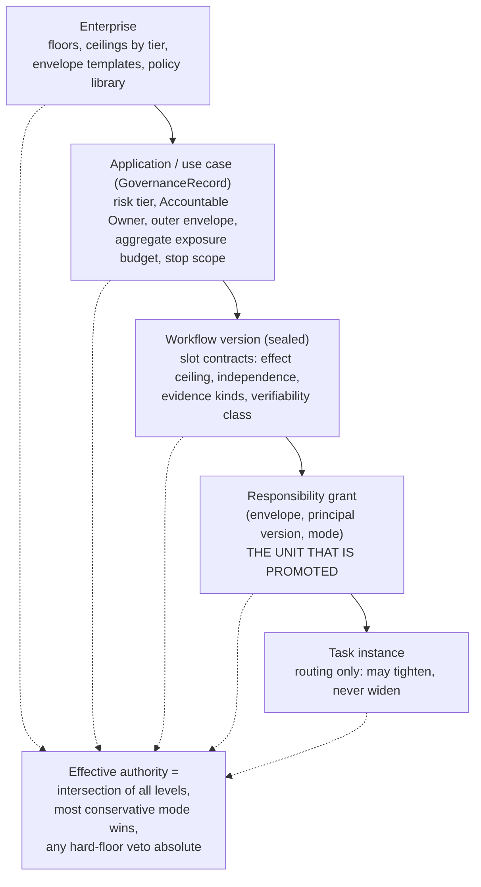

| Level | Holds a grant? | Holds a ceiling? | Holds defaults? | What it holds |
| --- | --- | --- | --- | --- |
| Enterprise | No | Yes: platform and enterprise floors, tier-to-ceiling tables, regulated-domain caps | Yes: envelope templates, sampling floors, evidence burden by tier | Policy library; Policy Author; changes via governed release |
| Application / use case | No (a use case has a *profile*, not a level) | Yes: risk tier sets max mode by effect class; outer envelope; **cumulative exposure budget** across all responsibilities | Yes: default supervision cadence, fallback group | GovernanceRecord (M24); Accountable Owner; stop scope |
| Workflow | No | Yes: slot effect ceiling, independence class, verifiability class, human-floor flag | Yes: required evidence kinds per target mode | The sealed contract; changing it invalidates grants |
| **Responsibility (seat)** | **Yes: one or more grants, each with a disjoint envelope** | Inherits | Inherits | Mode, envelope, evidence, expiry. "M4 for creating document requests but M3 for amendments" is two grants, not one level [E-road §4.2, T5] |
| Task / instance | No | No | No | Routing: instance attributes (value, flags, novelty) select the grant whose envelope contains it, default the human lane; may escalate, sample or refuse, never widen |

**Intersection rule.** For instance *i* of responsibility *r* held by principal version *p* at time *t*, the effective envelope is the set-intersection of enterprise policy, use-case outer envelope, slot contract, the grant's envelope, connector and tool admission (pinned by digest, `src/profile.py`), the run grant of the initiating subject where one exists, and instance flags: data classes and time windows intersect, value and volume caps take the minimum. The effective mode is the **minimum** (most conservative) of the grant's mode and the three ceilings of 9.5. An expired element degrades to the next lower mode; a hard-floor veto is absolute. Defaults flow *down* only as starting values for new grants and never confer authority: a seat with an agent assigned and no grant runs only as M1 or M2. Aggregate budgets are consumed by every responsibility in the use case, which keeps a chain of individually in-envelope agents from composing into out-of-envelope exposure. Today the only implementation of "authority is an intersection" is the grant chain (subject, workload, project role, `src/policy/grants.py`) plus the dispatcher's effect-class floor; the plan lists five inputs and, per [E-road §4.2, T2], no task computes the intersection end to end.

### 9.7 Work without a deterministic oracle

ADR 0004 says a use case that cannot express an acceptance predicate "cannot go above L2" (`0004:106-108`) and requires a deterministic check "no model output can satisfy by text alone" (`0004:73-76`). That blocks the circular case, an LLM judge approving LLM output. It is also *more* conservative than the book it cites, whose acceptance engine evaluates executable invariants first and uses calibrated judges only for what cannot be computed [E-road §4.2, T4]. Applied literally it keeps drafting, summarization, triage and research at "agent performs, human approves each" forever and narrows "autonomous enterprise" to machine-checkable domains.

The design replaces the binary cap with a **verifiability class on the slot** and a graded ceiling.

| Class | Meaning | Example | Max mode | Conditions above M3 |
| --- | --- | --- | --- | --- |
| V1 | Each output's correctness is computable from authoritative observation | Required documents equal checklist minus received; probes green after a runbook step | Per 9.5 | Deterministic predicate in the chain |
| V2 | Necessary conditions are computable (rules, schema, citations present, forbidden content absent); the rest is judged | Supplier-risk summary: claims cite approved sources, no prohibited criteria; quality judged | M4, `read`/`reversible_write` only | Qualified judge (alignment floor, versioned, held-out human labels); stratified human sample at a tier floor; lagging outcome signal; I4 |
| V3 | Only a human can judge | Tone of a sensitive customer letter | M3 | None: stays at M3 |

Three rules. (1) **Contract-first decomposition** [S, DeepMind]: split a seat until the pieces are V1 or V2, as 10.4 splits "determine required documents" (V1) from "word the borrower message" (V3). (2) **Human-consumed output** verifies itself when the consumer can detect an error; ask that, not whether an oracle exists. (3) **Lagging oracles** (reversal, complaint, rework) justify staying at M4 on reversible effects, not entering M5. The relaxation is a real risk (Appendix B, section B.1, item 9): the safeguard replacing the absolute cap is human sampling the agent cannot influence, which presupposes humans who actually audit.

### 9.8 Exception-supervised operation: sampling, escalation and exposure

At M4 and M5 the human stops seeing every instance, so five mechanisms must exist or the mode is a fiction.

1. **A routing policy per instance:** auto-pass, escalate or sample. Escalate on a failed deterministic check, envelope exit, performer-verifier disagreement, an out-of-distribution signal, value above threshold, or the agent's own stop request. Agent-initiated stops rise with task complexity and exceed human interrupts [S, Anthropic], but verbal confidence is poorly calibrated [M], so use trajectory-level signals and sample disagreement, calibrated on held-out data. Monitor the escalation rate in *both* directions: a collapse to zero is as suspicious as a spike.
2. **Sampling the agent cannot influence:** the platform draws a stratified, risk-weighted sample (post-commit for reversible effects), unpredictable to the agent, seeded with known-bad items so human and agent verifiers are graded. The rate has a **floor no actor inside the use case can lower**, because without a sample there is no evidence to stay. Auto mode's measured false-negative rate of 6.6% to 17% on real overeager actions (n=52) and 93% prompt approval [S] show why "a classifier replaces approvals" needs a quantified residual risk.
3. **Reviewer-quality telemetry** (the driver-monitoring analogue [M]): time to decide, approve-all runs, seeded-item misses. Breach demotes the *human verification regime*, not the agent. This monitors individuals; German co-determination (BetrVG s.87(1) no. 6) may require works-council involvement [W; extension to agents is inference].
4. **Circuit breakers:** consecutive-deny and total-deny counters that stop the agent and escalate (three consecutive or 20 total in Anthropic's auto mode [S]).
5. **Evidence-bounded exposure.** Evidence cannot justify irreversible-effect autonomy by sample size: 200 clean decisions bound the failure rate to about 1.5% at 95% confidence, 300 to about 1% (rule of three [J]; [E-road §4.2, T3]). So the envelope is *sized from the evidence*: take the one-sided upper bound *p_ub* on the miss rate (Clopper-Pearson), the severity *s* of a miss, and the loss appetite *A* per window set by the Risk Owner; the volume cap *V* satisfies p_ub * s * V <= A. Worked example [J, illustrative]: 300 clean audited verifications give p_ub of about 1%; if a miss costs at most 2,000 and the appetite is 500 per week, the cap is 25 instances per week. More evidence earns a larger cap, an incident shrinks it. Promotion becomes exposure budgeting, the SRE error-budget idea [M], and answers the low-frequency high-severity case where evidence is inherently insufficient [E-auto §5.3].

### 9.9 Reconciling with ADR 0004: extend, and replace its core data model

**Verdict.** ADR 0004 is a sound first cut at *oversight autonomy per use case* and right on the hard parts: distinct principals, effect-class ceiling, automatic asymmetric demotion, a human owner, a deterministic check in the chain. Keep those. Replace the single scalar per use case and the fixed chair order, which cannot express the charter's own example [E-road §4.2, T1], and the circular promotion evidence. The L-names become **profile presets**: bundles expanding into per-responsibility target grants, never stored as authority.

ADR levels as profiles of modes (approximate; the ADR has no sampling or exception-handling distinction):

| ADR level | Editor / Performer | Reviewer | Approver | Note |
| --- | --- | --- | --- | --- |
| L0 manual | M0 | M0 | M0 | |
| L1 assisted | M2 | M0 | M0 | Plus M1 shadow, absent from the ADR |
| L2 agent editor | M3 | M0 | M0 | |
| L3 agent review | M3 | M3 | M0 | An approver at M3 collapses into M2 |
| L4 bounded agent approval | M4 | M4 | M4 for `read`/`reversible_write`, else M0 | Sampling unspecified |
| L5 governed autonomy | M5 | M5 | M5 within tier | |

Amendments:

| ADR element | Disposition | Amendment |
| --- | --- | --- |
| Status: "vocabulary applies from D2" | Correct | Not backed in code (`approval-ux-contract.md:38` reads `requested_by_type` from a `principal_type` that does not exist; [E-road §6.2]); pull the *seams* forward (11.13) |
| Decision: autonomy is the set of roles an agent may hold per use case; the levels table (`0004:33-35,57-64`) | **Replace** | Autonomy is a set of Autonomy Grants per responsibility; the use case has a profile; levels become presets |
| Principals | Extend | Add `service`, `group`; versioned agents with sponsor and model-family pin; keep `ServicePrincipal` as ingress identity |
| Invariants 1 and 2 (distinct principals; independence and a deterministic check) | Keep, generalize | Independence classes by tier (8.6); the absolute predicate cap becomes verifiability classes V1-V3 (9.7) |
| Invariant 3 (effect-class ceiling, fall back to a human) | Keep, extend | Grid of class by tier by verifiability by principal type; fallback retained (`approval-ux-contract.md:83`) |
| Invariant 4 (tier bounds level) | Keep | Tier bounds the *profile*; lowering the maximum demotes affected grants |
| Invariant 5 (promotion as a governed release over a period "at the current level") | **Amend** | Evidence from the lower mode's by-products and the shadow sidecar (11.4); three keys (Evaluator attests, Authority decides, Owner accepts); evidence-bounded exposure instead of fixed 30 days and 200 decisions (#868); ceremony scaled by tier |
| Invariant 6 (automatic demotion) | **Extend** | Leading indicators, graded contraction, scope keys beyond the use case, automatic suspension on scope change, unreported-incident trigger, cooldown |
| Invariant 7 (principals shown) | Extend | Per duty: performer, verifier, sampler |
| `owner` human at every level | Keep as Accountable Owner; **split** | Autonomy Authority, Supervisor, Exception Owner, Evaluator, Incident Lead separated; beneficiary conflict removed (8.9) |
| Aria mapping | Keep | Aria's dials (`AssistantApprovalMode`, `src/assistant/models.py:42`; plan `ask_each`/`approve_plan`/`auto_guarded`; the `gated` tier, `src/assistant/executor.py:141-148`) become *derived* from grants (M27.3c); `gated` is a platform floor |
| New invariants | **Add** | No self-governance or self-modification inside a grant; assignment outside the sealed bundle with authority rechecked at use; fallback reachability precondition at M4 and above; envelope exit falls back |

These twelve amendments are carried by the proposed ADRs of 17.7: the levels table, profile and Aria rows by A3, principals by A1, the effect-class ceiling and tier rows by A4, promotion evidence by A5, demotion by A6, independence, per-duty display and the owner split by A9, and the new invariants by A2, A3 and A6; the status row is a documentation fix. Plan knock-ons (issue numbers from [E-road], titles not re-opened): #663 principal (version, sponsor, family, `service`, `group`); #790 and M24 (owner split, floors, profile instead of `autonomy_level`); #798 (tier ceiling as a grid); #849 (acceptance predicate becomes a verifiability class); #856 (dispatcher chain check becomes a grant check); #868, #872 (promotion, demotion); #876 (evidence per duty); #880 (UI as a DoA-style view). M27's 4-6 person-weeks does not appear to include evidence production, the largest unknown [E-road §5.3].

## 10. Role x autonomy-mode matrix

### 10.1 Four things the matrix shows

1. **Autonomy risk sits where the effect escapes.** An upstream seat can run at M5 when the downstream gates are independent and its own ceiling is internal (drafts, proposals, read). The same agent in the seat that commits an irreversible effect is capped at M3. The matrix makes the escape point visible.
2. **The Validator is the anchor of the chain.** At least one seat per chain is a deterministic service or a human. A judge-based validator is never the sole validator above M2.
3. **An Approver at M3 collapses into M2.** An agent that "performs the approval" while a human decides each instance is advice, not delegation.
4. **An Operator at M5 is usually a service.** Applying an exact-intent-approved effect through the dispatcher is deterministic; the agentic operator work (monitoring, exception triage) is where the autonomy risk is.

### 10.2 Which modes each archetype may reach

Legend: allowed by default (yes), allowed with named conditions (cond), degenerate or not allowed (no).

| Archetype | M0 | M1 | M2 | M3 | M4 | M5 | Conditions |
| --- | --- | --- | --- | --- | --- | --- | --- |
| Builder | yes | yes | yes | yes | cond | cond | M4/M5 only when output lands in a non-production store downstream of independent gates; builder never certifies own work |
| Operator | yes | yes | yes | yes | yes | yes | At M5 usually a `service` principal acting on exact-intent-approved effects; agentic operator work follows the ceilings of 9.5 |
| Reviewer | yes | yes | yes | yes | cond | cond | Verifier independence I3 or higher, deterministic check in chain (I4); M5 only at tier T1-T2 |
| Validator | yes | yes | yes | cond | cond | cond | Above M2 only where validation is a deterministic service; a qualified judge may assist, never stand alone |
| Approver | yes | yes | yes | no (is M2) | cond | cond | M4: `read`/`reversible_write`, tier T1-T3, I3+; M5: pre-authorized standard classes at T1 only; platform floors apply |
| Resolver | yes | yes | yes | yes | cond | no | By construction the Resolver takes what the envelope excludes; M4 only for routine exception classes with human sampling |

### 10.3 The charter's example, tested

Charter configuration: Developer autonomous agent; Editor/Reviewer agent plus human oversight; Validator human plus AI assistance; Approver human; Operator autonomous agent. Applied to Caliber's own asset-change path (change request, review, quality sign-off, release approval, apply), the one governance chain that exists end to end [E-roles §1.2].

| Seat | Mode | Occupant | Supervision | Evidence (enter / stay) | Ceiling | Critique |
| --- | --- | --- | --- | --- | --- | --- |
| Developer (Builder) | M5, conditional | Versioned agent with a named sponsor | Supervisor samples change requests; Evaluator owns a sealed held-out suite | Shadow versus human changes; contract and adversarial suites / downstream gate acceptance and escape rate | `read`, `reversible_write` to draft store and change requests; no production effect | Safe only because every effect is downstream-gated. If its output skips Reviewer or Validator the mode collapses to the next seat's ceiling |
| Editor/Reviewer | M4 | Agent reviewer, I3 isolated from the Developer, different family; human on flagged and sampled | Sample floor; disagreement dashboard | Agent-verifier shadow versus human reviewers at M3; seeded defects / audited-sample miss bound | Verifies; cannot approve or apply | "Agent plus human oversight" is M4 only once the sample floor and escalation rule are written down; otherwise M5 with false assurance |
| Validator | M2 | Human, with automated checks and a qualified judge advising | Quality lead | Judge qualification / blind trials | Quality sign-off; digest-bound evidence | Correct: the anchor stays human or deterministic. The deterministic gate (`src/eval/gate.py`) does the computable part |
| Approver | M0 | Person or committee | Owner's delegate | none | Release approval requires a fresh passing quality decision with identical digests [E-roles §1.2, B3, B4] | A floor, not a stage: platform-change approval keeps risk 5 (`src/policy/decisions.py:146-184`) |
| Operator | M5 for apply; M4 for agentic triage | `service` (dispatcher, reconciler) for apply; agent for monitoring and triage in envelope | Supervisor; Exception Owner | Exact-intent binding, receipt read-back, reconciliation / sample audit | `reversible_write` with receipt verification; `unknown` parks dependants | The deterministic part is built (receipts, reconciler, effect gate). The charter's "autonomous agent" for the *agentic* part needs an envelope and a recovery drill |

### 10.4 Worked example 1: mortgage document request (the Caliber reference scenario)

A case file shows missing documents; a request is proposed against `cases/<id>/document-requests` through the `document-request` connector, approved by exact intent, dispatched by a fenced owner, reconciled if unknown (`docs/operate/reference-profile.md:1115-1125`; [E-gov §2.3]). Traits: regulated, fair-lending sensitive, with rule-bound limits on what may be requested [J]; borrower-visible effect. Today (Beta reality): only the proposal step exists for this scenario, the producers are unwired in production, and approvals are human-only [E-gov §3]. A classification note matters: the repo's own example classes the request `irreversible_write` (`docs/operate/reference-profile.md:1120`) while the approval wireframe shows "Reversible write" (`docs/architecture/approval-ux-contract.md:103`). The enterprise must settle it, because it moves the Approver's ceiling from M4 to M3 (9.5). Here internal drafting is reversible and borrower-visible submission irreversible.

| Responsibility (archetype, verifiability) | Target seat and mode | Supervision | Evidence gate to enter | Ceiling and envelope | Fallback (MRC) |
| --- | --- | --- | --- | --- | --- |
| Requirements analyst (Operator, V1) | Agent, M3 then M5 | Underwriting ops lead samples weekly | Shadow versus clerks' historical determinations by loan program; checklist oracle | `read` plus draft intent; conventional loans, known catalog, underwriting stage | Clerk queue |
| Message drafter (Operator, V2 templated, V3 free text) | Agent: M4 for template slot-filling, M3 for free text | Compliance reviewer samples | Deterministic template conformance; prohibited-content rules; tone judged | Draft only; sending happens at dispatch | Clerk drafts |
| Case reviewer (Reviewer, V2) | Agent, M4, I3 (isolated from the drafter, different family) | Human sample at tier floor; flagged to humans | Agent-verifier shadow versus human reviews at M3; seeded errors (wrong program, duplicate, already received) | Verify only | Human review queue |
| Acceptance validator (Validator, V1) | `service`, M5: requested equals required minus received; case state permits; no prohibited request | Rule set owned by the Policy Author, not the builder | Rule-test coverage, mutation testing | Can block, cannot approve | Block and escalate |
| Approver | Human M0 for non-standard requests; M4 for a pre-authorized standard class ("latest pay statement, conventional loan, underwriting stage, at most two per case") | Owner's delegate, weekly | Audited verifications sizing a weekly cap (9.8) | Borrower notification classed irreversible: M3 unless the enterprise accepts pre-authorization with a volume cap | Human approval queue |
| Dispatcher (Operator, `service`) | `service`, M5 | Reconciler operator | Receipt read-back; no-blind-redrive test | Exact intent only; fenced owner | `unknown` parks dependants; a human asks the downstream |
| Exception resolver (Resolver) | Human M2: agent summarizes and suggests | Servicing manager as Exception Owner | none | Disputes, ambiguous documents, `unknown` effects | Named human within SLA |

Profile: (M5, M4, M4, M5 service, M0 to M4 for one class, M5 service, M2). The adjacent **floor** sits outside this workflow: the credit decision and any adverse action stay human by policy floor and regulation (10.6). ADR 0004 would give the whole use case one level, putting the Approver and the analyst on one preset.

### 10.5 Worked example 2: IT incident management

An alert becomes an incident; the system triages, diagnoses, remediates, validates recovery and communicates. Traits: a strong deterministic oracle (health probes), reversible idempotent runbook actions, time pressure, very uneven blast radius. "Incident Commander" below is an ITSM *work* seat, unrelated to the governance Autonomy Incident Lead.

| Responsibility (archetype, verifiability) | Target seat and mode | Supervision | Evidence gate to enter | Ceiling and envelope | Fallback (MRC) |
| --- | --- | --- | --- | --- | --- |
| Triage classifier (Operator, V2) | Agent, M4 | SRE lead samples; category-drift monitor | Shadow versus on-call triage over a stratified set; later resolution category as lagging oracle | Internal ticket fields (reversible) | On-call triages |
| Diagnostician (Operator, V2, read-only) | Agent, M4 | 10 percent sample [J] | Diagnosis agreement and time-to-cause in shadow | `read` only | Stop and page |
| Remediator (Operator) | **Standard-change catalog** (stateless restart, scale-out within N, cache purge): M5 in envelope. Non-standard: M3, on-call approves the exact action. Destructive (data deletion, credential rotation, stateful failover): two-person human, M0 | Catalog owner; the Authority approved the catalog once (ITIL standard change [M]) | Per class: audited successes with `p_ub`, rollback rate, blast-radius sizing | Service tier at most 3, change-freeze windows, at most 3 actions per hour per service, aggregate exposure budget | Roll back, freeze automation for the service, page |
| Change approver (CAB analogue) | Human M0 for normal and emergency change; none per instance for pre-authorized standard changes (decided at grant time) | CAB or on-call | n/a | n/a | Human |
| Recovery validator (Validator, V1) | `service`, M5: probes and synthetic transactions green for a window | Policy Author owns thresholds | Probe coverage; flap tests | Can reopen; cannot close alone when probes are ambiguous | Human decides |
| Communicator (Operator, V1 templated, V3 free text) | Internal templated updates M5; customer-facing M3; regulatory or breach notices human floor | Comms lead samples | Template conformance; prohibited content | Internal versus external `export` | Human sends |
| Incident commander (Resolver) | Sev3-4 agent-led M4 with sample; Sev1-2 human M2 with AI assist | Duty manager as Exception Owner | Shadow on historical Sev3-4 | Escalate on any envelope exit | Human takes command |

The judged seats (triage, diagnosis) stop at M4 by the V2 rule; this flow reaches M5 on the remediator, recovery validator and templated communicator because a V1 oracle, reversible idempotent actions and pre-authorized classes let evidence accumulate quickly. It still carries an exposure budget: blast radius differs by an order of magnitude between a stateless restart and a stateful failover, and a remediation storm is a composition failure no single grant sees; the aggregate budget and the rate cap catch it.

### 10.6 What must never be autonomous (hard human floors)

A **platform floor** cannot be changed by any enterprise. A **policy floor** is a default the enterprise may move only by two-key approval and never below the stated minimum.

| Floor | Why | Class | Who may change it |
| --- | --- | --- | --- |
| Being Accountable Owner or Agent Sponsor | Accountability is personal and legal; a moral crumple zone needs a person with real control [S] | Platform | Nobody |
| Deciding an autonomy increase; attesting evidence about an agent; accepting a grant's accountability | A beneficiary or the agent assessing itself; SR 11-7 and SOX separate these [M] | Platform | Nobody |
| Editing own envelope, sampling rate, thresholds, eval sets, judges or the criteria it is judged by | Self-governance; Goodhart on the gate (no held-out split in the refinement loop, [E-eval §9.3]) | Platform | Nobody |
| Changing own pins (prompt, tools, model) inside a grant | Evidence is version-scoped; certificates invalidate on change [S, Feng] | Platform | Nobody: a change is a new principal version |
| Blocking, delaying or disabling a stop, suspend or demotion | The stop must not depend on the agent (EU AI Act Art. 14(4)(e) [S]; ATF kill switch [S]) | Platform | Nobody |
| Verifying or approving with the same principal (I0) | Separation of duties | Platform | Nobody |
| Break-glass and emergency override of controls | Grants *more* power; today admin scope, interactive session, one-hour cap (`src/workspace_release_governance.py` [E-roles §1.2, B6]) | Platform | Human with session |
| Waiving a critical gate; accepting residual risk | Risk acceptance is accountability | Platform | Risk Owner and Authority |
| Appointing or removing governance-role occupants | An agent must not shape its own oversight | Platform | Humans, governed change |
| Deciding whether an incident occurred; disclosure to regulators and customers | Disclosure failures, not only the crash, turned Cruise's incident into a permit suspension [S] | Platform | Nobody |
| Authoring or loosening floors, ceilings, tier tables | Author of control is not the controlled | Platform for agents; policy for humans | Policy Author, two-key |
| Decisions with legal effect on individuals where law requires human decision or oversight | EU AI Act Art. 14 [S], domain law [M] | Policy (regulated-decision flag) | Enterprise with compliance sign-off; never below M3 without a legal determination |
| `irreversible_write` and `export` without per-instance human verification | Rule of three; no minimal-risk condition exists | Policy (default) | Two-key; pre-authorized standard classes at T1 only |
| Payments, contracts, filings above the enterprise delegation limit | Existing DoA | Policy | DoA owner |

Platform floors map to constants that already exist: risk 5 "a person, never a run" for every approval and acceptance (`src/policy/decisions.py:146-184`), the `gated` tier "always a human decision" (`src/assistant/executor.py:141-148`), and break-glass. They should become data with a **non-overridable** flag. One conflict to resolve: `_ACTION_RISK` uses one "approve" vocabulary for approving *platform change* (`release.approve`, `change_request.accept`, `release.quality_signoff`: stays a floor) and for approving an *effect proposal* (the exact-intent approval the dispatcher consumes, which this design lets an agent decide under a grant). The policy must separate the two.

## 11. The human-agent responsibility-transition model

### 11.1 Principles

1. A transition changes an **assignment and a grant**, never the workflow (8.5).
2. **Shadow is a sidecar**, available for any duty the agent does not yet hold, not only the first mode.
3. Evidence is **scaled to exposure**: cheap to enter M3 (a human gates every effect), expensive to enter M4 and M5.
4. **The system demotes, humans promote.** Demotion is automatic, immediate and graded; promotion is slow, evidenced and multi-key.
5. The **human lane stays alive**: every seat has a fallback realization of the same step contract, with measured capacity and drills (the Cruise safety-driver lesson [S]).
6. Every transition is a recorded, hash-chained, rollback-able release (ADR 0004 invariant 5 and M02).

### 11.2 States

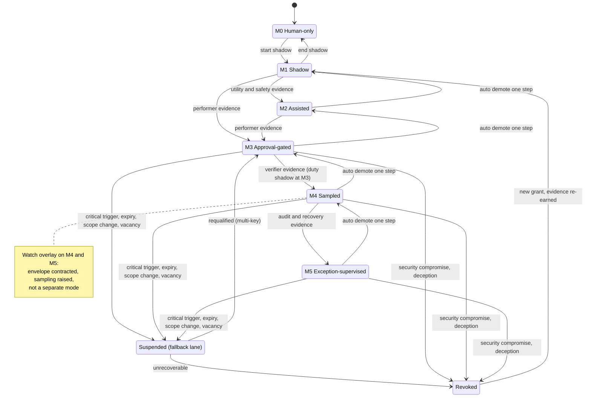

The states are the six modes plus **Suspended** (new work under the grant stops; the seat runs in its fallback lane) and **Revoked** (terminal for that grant; the principal version is unassigned). **Watch** is an overlay on M4 or M5, not a state: a leading-indicator breach automatically contracts the envelope and raises sampling before any mode changes. Promotion proceeds one mode at a time, except that M1 or M2 may go straight to M3; M0 to M3 is not allowed because shadow evidence is the entry gate to M3. A single seat may hold several grants in different states (one per disjoint envelope slice); instance routing picks the grant whose envelope contains the instance and defaults to the human lane.

### 11.3 Shadow mode, designed explicitly

ADR 0004 has no shadow and the plan's manifest returns zero hits for "shadow", yet the book lists shadow as a release stage ("what would the candidate do on representative traffic without effects", [E-road §4.2, T3]). Design:

- **Two forms.** *Seat shadow* (M1): the agent performs the seat blind while a human performs it live. *Duty shadow*: at any mode the agent runs a duty it does not hold, such as an agent verifier shadowing the human verifier during M3, or an agent approver shadowing the human approver during M4.
- **Mechanics.** A shadow run is an admitted run flagged `shadow`, issued only what admission already issues (`resource.execute`, `context.read`; `src/workflows/admission.py:104-106` [E-roles §1.3, C5]) and reaching only `read`-class tools through the inventory floor. It creates no proposal, approval request or ledger row. Its output is sealed, **blinded** from the live performer and unsealed after the human commits. It has its own budget, rate limit and context authorization, and the data-use purpose is recorded because shadow processing is still processing.
- **Comparison.** A `ShadowComparison` joins shadow output to the human outcome on the ledger's instance key (run, node, occurrence). Agreement classes: identical, equivalent, differs better, differs worse, differs unknown. Disagreements and a random slice are **adjudicated** by a third reviewer because the human baseline is noisy [E-auto §5.1]. Later outcomes (reversal, complaint, rework) are joined as lagging labels.
- **Limits.** Shadow cannot see the consequences of the agent's own actions (AV shadow mode shares this limit [M]), so closed-loop evidence comes from M3, where effects occur under human gating, and from counterfactual replay (B09.5, planned). Blinding addresses anchoring, stratification addresses selection bias. Low-volume seats may never gather enough evidence for M4, which is the correct outcome.

### 11.4 Is promotion evidence circular? Validation

The circularity in ADR 0004: promotion needs "a measured period at the current level", but at L2 the agent holds no reviewer chair, so no agent review decisions exist to measure [E-road §4.2, T3]. Resolution: the evidence for mode *k+1* is generated by duties humans still perform at mode *k*, run in shadow by the agent, with the human decision as label.

| Transition | Evidence needed | Where it comes from | Exists at the current mode? | Ground truth |
| --- | --- | --- | --- | --- |
| M0 to M1 | None beyond data-use authorization and budget | n/a | n/a | n/a |
| M1 to M2 or M3 (agent as performer) | Agent performer quality, safety, consistency | Seat shadow at M1 | Yes: produced by the sidecar itself | Human outcomes, adjudication, later outcome joins |
| M2 to M3 | The above plus edit and acceptance by-products | M2 interactions | Yes | Human edits |
| M3 to M4 (agent as verifier) | Agent-verifier quality: sensitivity to bad outputs, miss rate, false-accept bound | **Duty shadow of the agent verifier during M3**: a human verdict exists on *every* instance, the densest label stream in the whole ladder; plus seeded known-bad items and effect outcomes | Yes: M3 produces human verdicts on every instance | Human verification verdicts, seeded items, outcomes |
| M4 to M5 (agent as recoverer) | Audited miss-rate over a long window; in-envelope exception handling quality; MRC drill; envelope-exit detection | M4 sample audits and every escalated exception, which a human resolves and thereby labels | Yes | Audit findings, human resolutions, drills |

Remaining circularity risks, named: human labels biased by AI exposure (blind them); the audit sample being the *only* evidence for staying in M4 and M5 (hence an uninfluenceable floor); correlated performer-verifier errors (seeded known-bad items, outcome joins, I4); label noise (adjudication); evidence expiry when pins change (11.6).

### 11.5 Entry gates, deciders and ceremony

"Attest" is the Evaluator, "decide" the Autonomy Authority, "accept" the Accountable Owner. At T1-T2 one human key (decide) plus the attestation; at T3 and above two distinct human keys plus acceptance. Mechanical gates (independence, V-class, fallback reachability, tier ceiling) are checked by the platform and refuse the grant when unmet; no human can override them.

| Transition | Entry gate | Attest / decide / accept | Ceremony |
| --- | --- | --- | --- |
| M0 to M1 | Data-use authorization; contract suite; sidecar budget | Supervisor decides | Light |
| M1 to M2 | Shadow utility and safety | Supervisor decides | Light |
| M1 or M2 to M3 | Stratified shadow performer evidence; acceptance predicate; policy, adversarial and consistency suites (pass^k on replays: a 95% per-run agent has pass^10 near 60% [W; arithmetic M]) | Evaluator, Authority, Owner | Light to medium |
| M3 to M4 | Agent-verifier evidence; miss-rate bound; I3 and I4; judge qualification; reviewer quality; exposure cap from `p_ub`; fallback reachable | Same; two keys at T3+ | Heavy |
| M4 to M5 | Longer M4 window; minimal-risk drill; envelope-exit test; fallback-lane drill | Same; committee at T4 | Heaviest |
| Widening an envelope | A *new slice* starts at M1 or M3 whatever the old slice's mode; a pre-approved ramp inside an approved ceiling may widen automatically, never the mode | As the target mode | Per target |
| Renewal at `review_due` | Fresh window; scope unchanged or declared evidence-preserving | Evaluator, Authority | Light to medium |

A *pre-approved change class* (the FDA predetermined-change-plan idea [M]) lets a grant declare which changes preserve evidence, such as a knowledge-base refresh inside approved sources; anything undeclared is a scope change.

### 11.6 Demotion triggers and the graded response

Demotion is an exposure budget that drains, not a cliff. This section fixes the mode-level semantics; the full trigger catalogue, severity classes, stop scopes and response ladder are in 13.10 to 13.14, and the two use the same response steps and the same idempotence rule.

| Indicator | Type | Response |
| --- | --- | --- |
| Audited-sample miss-rate upper bound nearing threshold; verifier-versus-human disagreement rising | Leading | Alert, Watch |
| Escalation rate spike, or collapse toward zero; calibration error; out-of-distribution rate; envelope-exit attempts | Leading | Watch, Supervisor review |
| Consecutive or total denials (three or 20 [S, auto mode]) | Leading | Pause and escalate |
| Reviewer-quality floor breached (human verifier) | Leading | Demote the human verification regime; raise sampling |
| Pin or scope drift: model route, prompt or tool digest, connector digest, knowledge-base version, `policy_version` | Leading | Suspend pending revalidation |
| Fallback readiness degraded; evidence stale; review date near; supervisor or owner vacancy; budget burn | Leading | Contract, then suspend after grace |
| Confirmed injection or exfiltration | Leading | Suspend |
| Acceptance failure after agent verification; rollback or reversal of an agent-committed effect | Lagging | Demote one mode |
| Attributed incident; audit finding; complaint or rework spike | Lagging | Demote or suspend by severity |
| Unreported or undisclosed incident | Lagging | Suspend (Cruise [S]) |
| Security compromise or evidence of deception | Lagging | Revoke |

Response ladder: **step 0** alert the Supervisor; **step 1 Watch** (sampling doubled, volume cap halved, automatically); **step 2** demote one mode (13.11 splits it into **demote** one mode and **shadow**, M1, according to severity); **step 3** suspend (fallback lane); **step 4** revoke. Scope is the narrowest implicated: the grant, then sibling grants sharing the principal version, then every use case sharing a flagged principal version or connector. Demotion is **idempotent**: one per newly qualifying event set, tracked by a watermark (ADR/#872 idea, [E-road §3]). **Attribution:** a failure that escapes both performer and verifier implicates every agent-held seat with a declared catch duty for that failure class; the default demotes all of them one step until counterfactual replay attributes it, since per-seat track records are false precision when chains produce outcomes [E-eval §9.3]. **Reinstatement** needs fresh evidence gathered *after* the fix, a root-cause analysis, a minimum window and the multi-key path.

The raw material exists but no actuator does: incidents are published on the event bus and "no internal subscriber demotes anything", SLO signals are platform-global, and `CaliberIncident` is keyed by objective string only [E-eval §3].

### 11.7 In-flight work on demotion

| Work state | Disposition | Why it is safe |
| --- | --- | --- |
| Not started | Routing finds the grant inactive and sends the instance to the fallback lane | Routing is evaluated per instance |
| Agent step running, no proposal yet | Finish; the result is treated as a proposal needing human verification (in-flight work is capped at M3) | No effect has occurred |
| `waiting_approval` on an approval an agent decided under the old grant, not yet dispatched | Commit-time recheck re-decides authority; the approval is invalid; the request **falls back to a human approver rather than failing** (ADR invariant 3, `approval-ux-contract.md:83`) | Authority is rechecked at use (8.5) |
| `waiting_approval` awaiting a human | Unchanged; priority raised | Independent of the grant |
| `dispatched` or `unknown` | The reconciler continues independent of the grant; no blind redrive; the effect gate parks dependants | "Never demote by forgetting in-flight writes" (`map-gap.md:302`) |
| `committed` under the grant in the suspect window | **Look-back** InterventionTasks: a human verifies each instance since the earliest implicated time; reversible effects are compensated where the verdict is bad | Bounds undetected harm |

Each demotion records instances rerouted, look-back tasks opened and effects handed to the reconciler. The fallback lane must have capacity for the volume: the minimal-risk condition is reachable only if humans are, which is why fallback readiness is both a promotion gate and a leading indicator.

### 11.8 Not rebuilding the workflow

Five properties together: the sealed slot contract is occupant-neutral; the assignment set is versioned data outside the digest; every seat has a human realization of the same step contract from day one; authority is rechecked at use; and the lower modes stay operational. **Acceptance test**, as a validation scenario in the style of V35: one workflow digest, one seat, driven through M0, M1, M3, M4, an automatic demotion to M3 and a suspension to the human lane, with the workflow digest and the sealed contract unchanged throughout and every transition replayable from records. What *does* force a rebuild is a contract change, by design.

### 11.9 The audit record

Each transition writes one `AutonomyTransition` plus the ledger entries it causes, in one transaction with the grant update, hash-chained to the previous transition for the grant and signed under the M02 mechanism. Contents: grant, from and to mode, kind (promote, expand, contract, demote, suspend, resume, revoke, expire, renew), trigger (manual or automatic) and the incident or metric references, the evidence window digest and scope, the three keys (who attested, decided, accepted, each with principal type), policy version, in-flight disposition counts, and the previous and next state hashes. Promotion records are *releases*: they carry the digest, the approvers and a rollback to the prior grant, like any release in the platform (ADR 0004 invariant 5). ADR 0004 invariant 7 extends per duty: every instance shows performer, verifier, sampler and sampled-by with type and pins.

### 11.10 Minimum data model

Phase: **Now** = a seam to land during Beta so nothing needs a `v2`; **Next** = production adoption; **Later** = autonomous operation.

| Entity | Key fields | Maps to or extends | Phase |
| --- | --- | --- | --- |
| Responsibility (slot) | use_case, archetype, io_contract_digest, decision_rights, effect_ceiling, independence rules, evidence kinds per mode, verifiability class, human_floor, fallback, `contract_digest` | Replaces node-type-as-role in the IR; sealed with the workflow version | Now (decision), Next |
| Principal, PrincipalVersion | type (human, agent, service, group), sponsor, status; agent version = pins (model route and family, prompt/skill digest, adapter version, tool-set digest) | M27.1 (#663); distinct from `ServicePrincipal` | Now (type and version on records) |
| Assignment | responsibility, principal and version, capacity, effective window, assigned_by, supersedes, set version | New; policy-class data | Next |
| OperatingEnvelope | versioned data classes, systems, effect classes, value and volume caps, exposure budget, conditions, required checks, sampling policy and floor, minimal-risk action, connector digests, `policy_version` | New; policy as data | Next |
| AutonomyGrant | responsibility, `contract_digest`, envelope version, principal version, duty allocation, derived mode, ACL and AAL, supervision, evidence basis, Accountable Owner, three approvals, status, probation, `review_due`, `expires_at` | GovernanceRecord (M24) holds the profile | Next |
| EvidenceRecord | kind (open registry), scope (responsibility, principal version, contract digest, envelope slice, policy version), window, n, metrics with intervals, protocol, `produced_by`, digest, `valid_until` | Generalizes `CaliberWorkspaceReleaseEvidence` and its closed five-kind CHECK | Now (open kind), Next |
| ObservationRecord | instance key (run, node, occurrence), grant, mode at time, performer and verifier with pins, routing decision, refs to proposal, approval, effect, acceptance, override | The missing join key [E-eval §10, G-E3]; `CaliberAssistantReview` is a seed | Next |
| ShadowComparison | instance key, seat or duty, outcome refs, agreement class, adjudication | New; written at the approval boundary | Now |
| InterventionTask | grant, instance, kind (exception, sample audit, look-back, supervision review), assignee group, due, resolution | M06 consumes the contract but no task defines it [E-road §3] | Next |
| AutonomyTransition | as 11.9 | M27.4a/b; hash-chained | Later |
| HumanLaneReadiness, ThresholdSet | group, capacity per window, last drill; thresholds and watermarks per grant | New; GovernanceRecord (ADR invariant 6) | Next, Later |

Additive under ADR 0003's readers-before-writers rule while schemas are `v1`: `requested_by_type`, `decided_by_type`, `principal_version`, `grant_id` on `approval_request` and `approval_decision`, and type and version on audit rows [E-gov §9, rec. 2]. Today those records carry only string ids.

### 11.11 Sequence: a promotion, M3 to M4

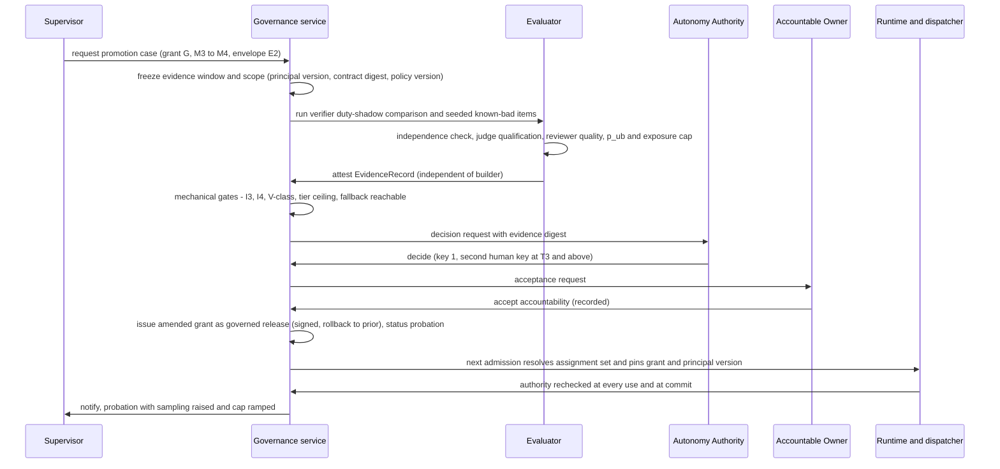

### 11.12 Sequence: an automatic demotion

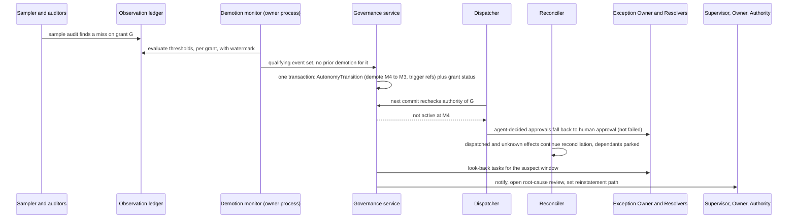

### 11.13 What to land when

**Now** (cheap seams, no new features): principal type and version, `decided_by_type` and `grant_id` as optional fields on approval and audit records; decide the slot-and-assignment indirection *before* more approval or `required_role` semantics ship; an open evidence-kind registry; a shadow-decision record at the approval boundary; policy as a versioned record behind a loader; one distinct-principal function over principals instead of four string comparisons; refuse a reference profile in which a drawn `human_approval` can pass through [E-gov §9, rec. 3]. **Next:** assignment set; grants for human-held seats first; GovernanceRecord with the owner split; InterventionTask; observation ledger; principal-version-scoped stop; human-lane readiness. **Later:** M3-to-M5 promotions, the demotion actuator, evidence-bounded exposure automation.

### 11.14 Where each Caliber component maps, and where it conflicts

| Component | Maps to | Conflicts |
| --- | --- | --- |
| Effect ledger (proposal, approval, receipt, reconciler) | The instance key (run, node, occurrence) is the observation join key; reconciliation and the effect gate carry in-flight work through demotion | One effect per step; rows carry no principal type or pins; the dispatcher requires an approval id for every effect class (`src/effects/dispatcher.py:758,878`; ADR 0001's class table overstates), so M4 and M5 need a **grant-cited decision** the dispatcher accepts as authorization |
| Dispatcher | The chokepoint for grant recheck at commit; its effect-class floor is the ceiling mechanism | `approver_scopes` is supplied by the caller and the producers are unwired in production [E-gov §2.6, 3] |
| Approval requests and decisions | Add `decided_by_type`, `grant_id`, `principal_version`; fallback to a human on ceiling already specified | Bound-request decisions answer `409 approval_bound_not_wired` [E-gov §2.6]; schemas closed; `requested_by` is the run initiator |
| Run manifests | Pin `assignment_set_digest`, principal versions, grant ids | Pins are workload-wide, not per seat; responsibility is embedded as node type |
| Run grants | Recheck at every use; revocation narrows at once | Capped by a human role; admission issues only `resource.execute` and `context.read`, run-wide |
| Policy decisions | Recorded allow/deny with replay hash: grant decisions can be recorded the same way | Policy is a module constant; one "approve" vocabulary; keyed by action, not (class, tier, principal type) |
| Evaluation gates | `GateDecision`, digest-bound evidence and the class-keyed requirement in `deployment_environments` become the template for mode-keyed evidence | Eight `gate_mode` values (`src/artifact_capabilities.py`), advisory routes, no held-out split, unversioned judges, no online evaluation [E-eval §2.3] |
| Release governance | Promotion as a governed release; decisions snapshot role and scopes; break-glass TTL | The released object is a grant, not a bundle; expected-role literals are hard-coded; the two-person apply rule applies only in the reference profile |
| Aria dials | The first agent-held seats (reviewer and release identities); `gated` is a floor | User-selectable, deployment-wide reviewer identity, three overlapping dials, self-reported reviewer confidence |
| SLO and incidents | Demotion trigger source | Platform-global signals; incidents keyed by objective string only |
| Execution-owner lease | The demotion monitor runs as an owner-only loop | One process, one run per tick: demotion throughput is bounded [E-gov §2.14] |

## 12. Proposed Caliber platform stack

### 12.0 Conventions and the position in one page

**Conventions.** Evidence tags, E-keys and the vocabulary (Responsibility, Principal, Assignment, Operating Envelope, Autonomy Grant, Autonomy Mode M0 to M5, Autonomy Profile, profile presets) are those of the reading guide and of 8.0; the scales (tiers, effect classes, V, I, G, C classes) are defined once in the table at the end of 8.0. In this section "layer" means a layer of the platform stack of 12.1, not one of the four role layers of 8.2. The ceiling function works on modes.

**Phases.** *Now* is a foundation decision or seam that costs a schema `v2`, a migration or a rebuild if deferred, plus finishing wiring so that documented claims match code. *Next* is what production adoption by one real customer needs. *Later* is what autonomous operation (M4 and M5 held by agents) needs. Nothing in *Now* is a feature the red-team review (Appendix A) would call premature; where the full design of sections 8 to 11 exceeds this, I say so and put it in the "do not build yet" list (section 17.9). The Now, Next and Later assignments of sections 12.6, 14.13, 17.9, 18.2, 21 and 23 are one scheme: *Now* means a decision or seam, *Next* means the build, *Later* means autonomous operation.

**Size scale** [J]. S is about three agent-days or less plus human review (roughly a week of elapsed time or less), M about a week of focused work (one to three weeks elapsed), L several weeks (three to eight weeks elapsed), for one engineer. The program's own estimates are in person-weeks, and [E-road §2.4] shows the actual execution rate is far higher than the calendar assumes, so treat sizes as relative. Sections 17, 18 and 21 use this one scale.

#### Position in one page

1. **Caliber is two planes joined by one spine.** The asset-lifecycle plane (prompts, skills, workflows, knowledge bases, evaluation, release, rollback; `ARCHITECTURE.md:80-175`) is human-operated and mature. The run-authority plane (admission, manifest, grant, governed step, proposal, approval, dispatcher, ledger) is the differentiated spine and is largely built but not wired in production (`docs/operate/reference-profile.md:2559`, `src/routes/workflow_runs.py:1866`). The autonomy vision is a third plane that has no code.
2. **The platform contract is the authority-to-effect spine plus a thin autonomy control plane on top of it**, not a role engine. Eight invariants define it (section 12.3). Everything else is replaceable or customer-owned.
3. **The cheapest, highest-value structural move is to put occupancy and authority outside the sealed manifest** (assignment set as versioned data, grant rechecked at use) and to make policy data. Both are additive: a new `responsibility_step` node beside the legacy ones, a second grant source beside the human one, and a policy loader behind an existing default argument (`src/policy/decisions.py:258`).
4. **Never add a second authorization path to the dispatcher.** The dispatcher accepts exactly one validator, `approval_valid_at_commit` (`src/effects/dispatcher.py:879-880`) and requires an approval id for every class (`:877`). Grant-based and standing authority must therefore be *minted as exact-intent decision records* with an `approval_basis`, and checked inside that one function.
5. **Evidence comes from shadow and from the observation ledger, not from time spent at a level.** That removes the circularity in ADR 0004 invariant 5 and is cheap to start at the approval boundary during Beta.
6. **Build order follows the red-team bet** (Appendix A, section A.3.3): finish and externally review the spine (the product), land contract seams (the option on autonomy), and defer every engine that needs volume, a pilot or an attribution method. M4 and M5 held by agents are *Later* on purpose.

### 12.1 The stack

The stack is read bottom-up. Each layer states its status today. Colour is redundant with the text tag in every node: `[E]` exists, `[P]` partially exists, `[N]` new.

```mermaid
flowchart TB
  classDef exists fill:#dff3e4,stroke:#2f7d4a,color:#111
  classDef partial fill:#fff3cd,stroke:#a67c00,color:#111
  classDef new fill:#fde2e2,stroke:#b03a3a,color:#111
  classDef cust fill:#e8e8f8,stroke:#555599,color:#111

  L12["12 Customer-built verticals [customer]<br/>domain responsibilities, envelopes, vertical safety case<br/>reference vertical: mortgage document request"]:::cust
  L11["11 SDK, CLI, plugin SDK, HTTP API, MCP [E]"]:::exists
  L10["10 Human work surfaces [P]<br/>approval panel, rework, review queues<br/>NEW: supervisor console, grant register, promotion queue"]:::partial
  L9["9 Observability, audit, evidence export [P]<br/>manifests, spans, SLO, audit log<br/>NEW: hash-chained transitions, evidence package"]:::partial
  L8["8 Autonomy control plane [N]<br/>grants and epochs, ceiling function,<br/>promotion workflow, demotion actuator, stops"]:::new
  L7["7 Evaluation, evidence, shadow plane [P]<br/>offline eval, digest-bound evidence<br/>NEW: shadow sidecar, observation ledger, outcome join"]:::partial
  L6["6 Effect ledger and dispatcher [E, wiring partial]<br/>proposal, exact-intent approval, receipt, reconciler"]:::exists
  L5["5 Agent execution boundary [P]<br/>untrusted-proposer contract, adapters<br/>NEW: performer attribution, independent checker seat"]:::partial
  L4["4 Runtime and workflow interpreter [E]<br/>admission, run manifest, park and resume<br/>NEW: responsibility_step node"]:::exists
  L3["3 Policy, grants, envelopes [P]<br/>recorded decisions, run grants<br/>NEW: policy as data, envelope, autonomy grant"]:::partial
  L2["2 Responsibility and assignment registry [N]<br/>sealed slot contract, versioned assignment set"]:::new
  L1["1 Identity and principals [P]<br/>sessions, PATs, service principals<br/>NEW: principal registry with type, version, sponsor"]:::partial
  L0["0 Infrastructure and execution substrate [E]<br/>PostgreSQL, MLflow, object store, event transport,<br/>execution-owner lease with fencing token"]:::exists

  L12 --> L11 --> L10 --> L9 --> L8 --> L7 --> L6 --> L5 --> L4 --> L3 --> L2 --> L1 --> L0
```

The existing `ARCHITECTURE.md` stack (surfaces, lifecycle modes, asset families, governance, kernel, infrastructure) describes the asset-lifecycle plane and remains correct for it. The stack above is organised by *who may cause an effect and on what evidence*, which the asset stack does not model. The two meet at layers 3, 7 and 9 (policy, evidence, audit).

### 12.2 Layer table

| # | Layer | What it holds | Status | Evidence today and what is new | Contract or replaceable | Phase |
|---|---|---|---|---|---|---|
| 0 | Infrastructure and execution substrate | PostgreSQL 16 with pgvector, MLflow, S3-compatible store, event transport, tool sandbox, single execution-owner lease and fencing | Exists | Lease and fencing token in `src/ownership.py:78,166`; owner-only loops (ADR 0002); `profile.py` refuses unsafe settings. Sandbox is containment, not an OS boundary [E-gov]. | **Replaceable** (database, object store, MLflow, queue). **Contract**: the fenced-lease semantics ADR 0002 defines, because dispatch correctness depends on them. | Now: keep. Later: throughput (section 16, row 23) |
| 1 | Identity and principals | Sessions, PATs, `Subject`, `ServicePrincipal`; new principal registry with `type`, `version` (the behaviour configuration digest, BCD), `sponsor` | Partial | `Subject` and `ServicePrincipal` at `src/policy/principal.py:115,242`; scopes in env lists (`src/config.py:1708-1730` [E-roles]); `grep principal_type src` finds nothing [repo]. | **Replaceable**: the identity provider (Entra, Okta, OIDC, SCIM) is integrated, not rebuilt. **Contract**: the principal record shape (type, version pins, sponsor) that every decision row carries. | Now: type and pins on records. Next: registry |
| 2 | Responsibility and assignment registry | Slot contract sealed with the workflow version; assignment set as versioned, append-only data with capacity | New | Nothing; closest are the CR reviewer and rework assignees (instance-level) [E-roles §1.2, B1, B8]. | **Contract** (differentiated: nobody ships it [E-auto §6]). | Now: decide the indirection. Next: build |
| 3 | Policy, grants, envelopes | Recorded `PolicyDecision`, run grants, new policy sets as data, envelope, autonomy grant, platform floors | Partial | `decide()` records every allow and deny (`src/policy/decisions.py:255-262`); policy is the constant `REFERENCE_POLICY_V1` (`:184`); grants capped by a human's role (`src/policy/grants.py:173-195`). | **Contract**: the recorded decision, the intersection rule, floors as non-overridable data. **Replaceable**: the evaluation engine behind `Policy` (Cedar-class engines are commodity [E-auto]). | Now: loader and floors. Next: envelope, grants |
| 4 | Runtime and workflow interpreter | Typed IR and 31 node types, run states, park and resume, admission, run manifest and pins | Exists | `src/workflows/manifest.py` node classes (`AgentNode:795`, `HumanApprovalNode:849`); admission pins everything into one immutable manifest. New: `responsibility_step`, assignment resolution at admission. | **Contract**: admission and the sealed manifest. **Replaceable in principle**: the interpreter (the repo chose SQL-owned durable execution over Temporal; `map-gap.md` section 13 [E-road]). Not planned. | Next: node. No other new node types |
| 5 | Agent execution boundary | `AgentStepRequest` and `AgentStepResult` (no field with which a model can claim an effect), adapters, governed step proposal | Partial | `src/contracts/agent_step.py`, `src/workflows/agent_step.py`, `src/effects/step_proposal.py`; only backend `document_request` (`step_proposal.py:81`); no production producer (`reference-profile.md:2559`). New: performer attribution, independent checker seat. | **Contract**: the untrusted-proposer contract. **Replaceable**: model providers, agent frameworks, adapters. | Now: wire and attribute |
| 6 | Effect ledger and dispatcher | Seven-state proposal, exact-intent approval, lease-fenced dispatch, verified receipt, reconciler, effect gate | Exists, wiring partial | `src/effects/dispatcher.py`, `reconcile.py`, `records.py`; bound-approval decision route answers 409 (`src/routes/workflow_runs.py:1866`; PR #1042 open). | **Contract** (the most differentiated layer [E-gov, E-road]). **Replaceable**: connector implementations behind digest-pinned admission (`src/profile.py:99`). | Now: finish wiring |
| 7 | Evaluation, evidence, shadow plane | Offline evaluation, digest-bound evidence, gates; new shadow sidecar, observation ledger, outcome join, judge qualification | Partial | `src/eval/gate.py:51`, `eval/evidence.py`; closed five-kind evidence CHECK (`src/db/models.py:3808-3812`); no online evaluation [E-eval]. | **Contract**: evidence record and observation ledger schemas, open kind registry, BCD scoping. **Replaceable**: scorers, judges, optimizers, MLflow evaluate. | Now: schemas. Next: shadow, ledger |
| 8 | Autonomy control plane | Grants with epochs, ceiling function, two-key promotion, demotion actuator, scoped stops, enterprise freeze, autonomy case | New | Nothing. `revoke_grant` (`src/policy/grants.py:417`) has no caller outside its module [repo]. | **Contract** (the evidence-to-authority join is the white space [E-auto]). | Now: vocabulary. Next: human-seat grants, freeze. Later: actuator |
| 9 | Observability, audit, evidence export | Manifests, spans, SLO, incidents, audit log; new hash-chained transitions, evidence package with server-free verifier | Partial | Audit log "append-only by convention" (`src/db/models.py:751-761`); SLO is global (`src/observability/slo.py:22`); incidents keyed by objective (`db/models.py:1665-1690`). | **Contract**: the evidence package and verifier (what an auditor receives). **Replaceable**: tracing backend, dashboards. | Next |
| 10 | Human work surfaces | Approval panel, rework tasks, review queues; new intervention tasks, supervisor console, grant register, expiry list | Partial | Approval UX contract (`docs/architecture/approval-ux-contract.md`); queue `reviewers` list is never read for authorization [E-roles §1.3, C6]. | **Replaceable**: ITSM, chat or ticket tools may host the work, via the intervention-task API. **Contract**: the work-item API and the principal-and-type shown per decision. | Now: approval panel names principal and type. Next: console |
| 11 | SDK, CLI, APIs | `sdk/caliber-sdk`, `sdk/caliber-cli`, `sdk/caliber-plugin-sdk`, HTTP API, MCP gateway | Exists | Strict versioned contracts (ADR 0003). | **Replaceable** surfaces; **contract**: the versioned schemas. | Follows each layer |
| 12 | Customer-built verticals | Domain responsibilities, envelopes, scenario libraries, the vertical safety case | Customer | Reference vertical: mortgage document request (`reference-profile.md:1115-1125`, 10.4). | **Customer-owned.** | Reference vertical only |

### 12.3 The platform contract

A layer is *platform contract* when two things hold: the platform's safety and evidence claims depend on its invariants, and an enterprise that replaced it would void those claims. By that test the contract is eight invariants. Each is already half-built, which is the point of choosing them.

| # | Invariant | Where it lives or must live | State today |
|---|---|---|---|
| PC1 | Model output is an untrusted proposal; class and connector are claims bound to platform truth | Layers 5-6 | Built (`contracts/agent_step.py`, `ClaimMismatch`) [E-gov] |
| PC2 | Every effect has exactly one exact-intent decision record bound to intent hash, policy digest, resource version, expiry, consumed once | Layers 3, 6 | Built for human decisions; unwired; no `basis` field |
| PC3 | Authority is rechecked at use and at commit and is linearised with dispatch | Layers 3, 6, 8 | Built for run grants (`workflows/run_identity.py:86`); no grant epoch |
| PC4 | Effects are ledgered, receipts verified by query, `unknown` parks dependants, no blind redrive | Layer 6 | Built |
| PC5 | Every decision names its performer and decider with type and pins | Layers 1, 5, 9 | Absent (`decided_by` is a string) |
| PC6 | Assignment, grant, envelope and policy are versioned data with immutable history | Layers 2, 3, 8 | Absent (scopes in env, policy a constant) |
| PC7 | Evidence is scoped to a BCD and expires; change classes C0-C3 decide carry-over | Layers 7, 8 | Absent |
| PC8 | Reduction is automatic, scoped and immediate; promotion is slow, evidenced and human | Layer 8 | Absent (ADR 0004 invariants 5 and 6 are design only) |

Replaceable by design: infrastructure, identity provider, model and agent framework, scorers and judges, tracing backend, UI and ITSM, connector implementations, the policy engine's language. Customer-owned: the envelope, the loss tolerance, the Accountable Owner, the vertical safety case, supervision staffing, regulatory conformity.

### 12.4 What the red-team review changes in the stack

The red-team review's bet is Model B (an independent effect gate and evidence recorder) as the product with Model A (delegation grants) as the policy model (Appendix A, section A.3.3). In stack terms: **layers 3 (decision record only), 4, 5, 6 and 9 (export) are the Beta product**; layers 1, 2, 7 and 8 enter Beta only as *seams* (type and pin fields, an open evidence registry, a shadow-decision record, a stop-scope vocabulary, a grant-epoch column). Layer 8 as an actuator is *Later*. This matters for sequencing: the stack diagram is the target, not a statement that all thirteen layers are Beta work.

### 12.5 The NVIDIA analogy, applied to the stack

The analogy is sound as engineering vocabulary and misleading as strategy (Appendix A, section A.2(b)). The mapping below keeps the first and states the second.

| NVIDIA AV layer [S unless noted] | Caliber layer | Fit | Note |
|---|---|---|---|
| Compute (DRIVE AGX Thor) | 0 | Breaks | Caliber has no silicon and no shared technical cost of that kind; its moat is software and is "copyable" by its own analysis (`docs/competitive-analysis.md` section 9 [E-eval]). |
| Reference vehicle (Hyperion), one architecture across levels with progression by software | Reference profile (ADR 0001) plus the reference vertical | Holds with caveats | The ADR 0001 reference profile is the closest thing; the claim "one platform across modes, progression by grant change" is the transferable idea. |
| OS and middleware (DriveOS, Halos OS: freedom from interference, health monitoring) | 4 and 6 | Holds (best fit [E-av]) | The control plane can make the *envelope* deterministic, not the model. |
| Driving model (Alpamayo, open) | 5 (customer or vendor models) | Holds | Model layer is replaceable; NVIDIA gives it away and keeps the base [E-av]. |
| Halos "algorithmic safety": model paired with independent safety checks and policy evaluation of proposed actions | 3 floors and ceiling, 5 checker seat | Holds with caveats | Caliber's independent monitor is deterministic guards plus a deterministic validator service first; an LLM checker cannot reach I4 by itself (14.7). |
| Halos SAFE: requirements to scenarios, KPIs and evidence; scenario libraries | 7 and 9 | Holds with caveats | No simulator and no ground truth for enterprise work; replay, shadow and canary substitute and accumulate evidence slower [E-av §4]. |
| Three computers and data flywheel | 7 and refinement loop | Partly breaks | No fleet: shared tenancy is excluded by owner decision (`docs/CALIBER_EGI_DELIVERY_PLAN.md` [E-road]), so every customer's evidence is n=1. |
| Event data recorder, DSSAD | 6 (effect ledger) | Holds | Strong borrow; Cruise shows evidence availability drove severity [S]. |
| UN R156 software update management (regulator approves the update *process*) | 8 (promotion as governed release of a grant and BCD) | Holds | A grant change is a release with digest, approvers and rollback. |
| Type approval, TÜV and ANAB inspection lab | none | No analogue | No regulator will certify Caliber. It must emit evidence others audit and never say "certified" ([E-av §5.2]; the M22 catalog "certification" is a conceptual hazard). |
| Automaker as manufacturer, applicant and liability bearer of a fleet | Enterprise | Holds with caveats | An enterprise is also operator and employer, usually with one deployment [E-av]. |

**Reference platform versus customer vertical.** The platform provides layers 0 to 9 and the reference UI and SDK; the customer builds layer 12 and owns what is inside it. The line is the *Operating Envelope*: the platform enforces whatever envelope it is given; the customer decides what the envelope is.

**Where the platform ends and the enterprise's accountability begins.** NVIDIA certifies platform process and hardware conformance and leaves the vehicle safety case to the automaker; its Halos page does not claim UL 4600 or SOTIF [S, E-av]. Caliber should claim the same narrow thing.

| The platform can warrant | The enterprise owns |
|---|---|
| Enforcement: no effect without an exact-intent decision record; caps and floors applied as configured; fencing and no blind redrive | What the envelope contains; loss tolerance; which responsibilities are never delegated |
| Integrity: immutable control records, hash-chained transitions, a recomputable evidence package | The Accountable Owner, the sponsor, the Autonomy Authority, and acceptance of residual risk |
| Evidence tooling: shadow, observation ledger, scorecards with intervals, expiry and invalidation on change | The vertical safety case and the validity of its human labels |
| Fast scoped reduction and a freeze that does not stop the reconciler | Staffing and drilling the human lane; disclosure decisions to regulators and customers |
| Version-scoped evidence and honest "no evidence" states | Regulatory conformity (EU AI Act, sector rules); the platform does not confer it |

Must-not-claim list for the platform (consistent with 14.9): that a derived mode is a regulatory classification; that evidence proves safety; that independent agents are independent persons; that Caliber is certified or confers compliance; that cross-tenant learning happens.

**Where NVIDIA's strategic position cannot be copied.** No certifier, no fleet, no silicon, no common external standard, and a first-party copilot (Aria) that holds decision chairs and blurs vendor neutrality; Aria's `auto_all` and `full_autonomy` modes are also more permissive than the Beta refusal profile (`docs/architecture/protected-effect-paths.md` findings [E-road §3.1]). The platform argument should be stated as "AV safety-engineering patterns that transfer", not "NVIDIA for enterprises".

### 12.6 Layer-by-layer build-out by phase

| Layer | Now | Next | Later |
|---|---|---|---|
| 1 Identity | `principal_type`, `principal_id`, `pins_digest` as optional record fields; BCD defined | Principal registry; sponsor; scopes from env to DB | Group principals with rosters |
| 2 Registry | Decide slot and assignment indirection; stop adding `required_role` semantics | Slot contract; versioned assignment set; `responsibility_step` | Per-slice assignments |
| 3 Policy | Loader with one seed record equal to `policy-v1`; floors flagged; split "approve" vocabulary | Ceiling grid, tiers, envelope | Two-key policy releases |
| 5-6 Boundary and ledger | Wire producer, decision route, dispatch; performer vs initiator; refuse unwired pass-through | Grant-cited and standing decision minting | Agent decider under grant |
| 7 Evidence | Open evidence kinds; observation and outcome contracts; shadow-decision record | Shadow comparison at scale; judge qualification; sealed slices | Online evaluation; exposure sizing |
| 8 Control plane | Stop-scope vocabulary; grant-epoch field; enterprise freeze flag design | Human-seat grants; two-key promotion; freeze | Demotion actuator; M4 and M5 promotions |
| 9-10 Audit and surfaces | Approval panel shows principal and type | Register, supervisor console, expiry list, evidence package | Hash-chain, signatures |

## 13. Evaluation-driven autonomy model

### 13.1 Premise: what evidence can and cannot do

Four limits shape everything below. Each is stated with its source because the design is a response to them.

1. **Rare, severe failures are statistically invisible at enterprise volumes.** Zero failures in n trials bounds the true failure rate at about 3/n with 95% confidence (rule of three [M]). Computed exactly for one-sided Clopper-Pearson: 0 of 200 gives 1.49%; 0 of 1,000 gives 0.30%; 0 of 3,000 gives 0.10%; 0 of 30,000 gives 0.01% [J, my arithmetic]. ADR 0004's fixed 200 decisions (#868) [E-road] therefore supports reversible, low-tier work and nothing stronger.
2. **Pre-deployment scores overstate real behaviour.** pass^k collapses with repetition (tau-bench: pass^8 under 25% for GPT-4o-class agents in retail [W]); automatic grading can overestimate against holistic review (METR [W]); frontier models verbalise evaluation awareness and may behave differently when they suspect a test (OpenAI/Apollo [W]); Anthropic's own auto-mode classifier missed 17% of real overeager actions in a sample of 52 [S].
3. **Evidence expires when anything it depended on changes.** Model, prompt, tool, data or policy change invalidates prior evidence; Feng et al. propose certificates that expire on change [S].
4. **"A human approved it" is weak evidence.** Users accepted 93% of manual permission prompts in Anthropic's coding context [S]. Approval counts must be audited independently before they count as ground truth.

**Design consequence (the central rule).** Evidence sets a *ceiling* and scales *exposure*; it never removes the structural cap that effect class, risk tier, reversibility and blast radius impose. Statistics are one input to a min(), not a licence. This is also why the evaluation evidence holds that "risk-tier ceilings and deterministic acceptance predicates carry the real safety weight, not the statistics" [E-eval §9.3].

### 13.2 The lifecycle made concrete

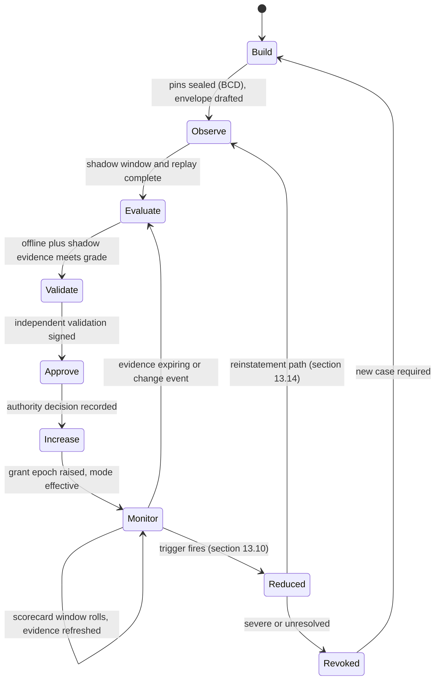

| Stage | Question it answers | Caliber today | To build | Artifact produced | Who acts |
|---|---|---|---|---|---|
| **Build** | What exactly is the candidate and what may it touch? | Run manifest pins, bundle digests, admission [E-gov §2.5]. Grants are run-wide and action-coarse [E-roles §3.7]. | BCD definition; Responsibility and Envelope records; per-responsibility pins. | Sealed BCD, Envelope v1, Responsibility spec including acceptance predicate and safe state. | Builder. |
| **Observe** | What does it do on live inputs with no authority? | Nothing: no online evaluation, no shadow, no canary [E-eval §3]. Replay of recorded runs does not exist (B09 plan). | Shadow mode: the agent proposes beside the human decision, effect suppressed, both recorded in the observation ledger. | `decision_observation` rows with `shadow=true`. | Platform, supervised by the responsibility owner. |
| **Evaluate** | How good is it, with intervals, per slice? | Offline pinned datasets, digest-bound evidence ([repo] `caliber/src/caliber/eval/gate.py:10-15`; `eval/evidence.py` [E-eval §2.2]). | Slice-aware scorecard, pass^k trials, audit sampling, sealed held-out and adversarial suites, judge qualification. | Evidence items (section 13.6). | Independent evaluator (not the builder). |
| **Validate** | Would an independent party sign that the claims hold? | `CaliberQualityReview` is advisory-go [E-eval §2.3]; workspace release has role-specific decisions bound to gate digests [E-gov §2.5]. | Independent validation record against the autonomy case, with challenge log (SR 11-7 "effective challenge" shape [M]). | Signed validation report. | Evaluator or validation function, independent of builder and owner. |
| **Approve** | Who accepts the residual risk? | Release decisions (owner), break-glass. No autonomy approval exists; the Aria dial is self-service [E-roles §2.7]. | Two-key decision: Autonomy Authority plus Accountable Owner (section 14.1). | Autonomy decision record with digest. | Autonomy Authority and Accountable Owner. |
| **Increase** | Make the grant effective, atomically. | Nothing. ADR 0004 says "a governed release (M02)" ([repo] ADR 0004:81). | New grant epoch; dispatcher/approval boundary reads it. | Grant version N+1, `autonomy.changed` event. | Platform. |
| **Monitor** | Is it still within what was claimed? | Platform-wide SLO and incident machinery ([repo] `observability/slo.py:22`: "not per-workflow or per-agent SLOs"). | Per-grant scorecard, assumption monitors, expiry clocks, demotion actuator. | Scorecard windows, alerts, triggers. | Platform; supervisor and evaluator review. |

Two design choices deserve emphasis.

**Observe must precede any live authority, and it must be shadow, not "run at the current level".** ADR 0004 requires "a measured period at the current level" before promotion (line 81 [repo]). Walk the L2-to-L3 case: at L2 the agent is editor only and humans review, so there are no agent review decisions to measure. The evidence source is circular [E-road §4.2, T3]. The fix is cheap and uses the existing approval boundary: record what the agent *would* have decided beside the human's decision. The book itself treats shadow as a release stage [E-road §4.2, T3], `08-part-viii.md` ch. 27). Shadow is mode M1, always available at the cost of model calls, and it is the evidence source for every first promotion.

**Evaluate is not one number.** The deliverable of this stage is a scorecard with an interval per slice and a grade (section 13.6.4), not a pass/fail against 0.85. The existing gate is a sound primitive (`apply_gate`: overall at least `min_aggregate_score` 0.85 and no per-dimension delta below `-max_regression_delta` 0.02, fail-closed on non-finite scores [repo] `eval/gate.py:51-103`) but it answers "may this release proceed", not "how much authority has this earned".

### 13.3 Evidence dimensions

Each dimension below states what is measured, how, where the data comes from today versus what must be built, the minimum sample or statistical rule, and the anti-gaming safeguard. "Today" cites what exists; most dimensions have raw material and no aggregator.

#### 13.3.1 Correctness

| Aspect | Design |
|---|---|
| Measured | Decision correctness against ground truth: acceptance-predicate pass rate (deterministic), audited-sample error rate (human ground truth), and for reviewer roles, catch rate on seeded faults. Correctness of a *decision* (approve/reject/route) is separated from quality of *text*. |
| How | Three independent sources, in order of trust: (1) deterministic acceptance predicates over receipts (B09, plan); (2) blind second-reviewer audit of a random sample of passes and fails; (3) calibrated judges only where no oracle exists, with the judge qualified first. |
| Today | `eval/scorecard.py` per-row scorers; judges via `mlflow.genai.make_judge`; kappa on demand ([repo] `eval/alignment.py:33`, `cohen_kappa`). `workflow_success_rate` means "run completed", not "correct" ([repo] `observability/slo.py:22`). No acceptance code [E-gov §2.13]. `CaliberAssistantReview` logs each agent review decision with `candidate_hash`, `confidence`, `model` ([repo] `caliber/src/caliber/db/models.py:5081-5110`) but nothing joins it to later outcomes. |
| Build | Acceptance predicate contract (Now, contract only); `decision_observation` plus `outcome_event` join; audit-sample workflow; seeded-fault stream. |
| Minimum rule | One-sided 95% Clopper-Pearson upper bound on error rate, per critical slice, at or below the tier's loss-tolerance rate (section 13.6.4). Counts clustered decisions with a design effect: 10 decisions per case at intra-class correlation 0.2 gives deff = 1 + (10-1)(0.2) = 2.8, so effective n is the raw count divided by 2.8 [J, standard survey formula]. |
| Anti-gaming | Sealed held-out slice never used by the optimiser (the refinement loop currently scores candidates against the same `eval_dataset_id` that gates them, no held-out concept [E-eval §9.3]; audit sample drawn by the evaluator's RNG, not the agent's author; judge cannot be of the agent's model family. |

#### 13.3.2 Reliability and consistency

| Aspect | Design |
|---|---|
| Measured | Repeatability of the decision on the same input (pass^k), and stability across paraphrase, ordering and retrieval variation. Completion rate, error rate, retry rate. |
| How | k independent re-runs per case on a consistency suite; for live traffic, shadow re-execution on a random fraction. Report pass^k = fraction of cases with all k runs correct, not mean pass^1. Under independence pass^k equals p^k, so p = 0.95 gives pass^10 of 0.60 and p = 0.99 gives 0.90 [J arithmetic; formula M]. |
| Today | `CaliberWorkflowRun` rows have status, version, alias, timing, so completion statistics per version are computable but not computed [E-eval §4]. No repeat-run variance scorer exists [E-eval §2.1]. |
| Build | Consistency suite runner; per-version run aggregates. |
| Minimum rule | k at least 5 on at least 50 cases per critical slice for mode M4 and above; pass^k lower confidence bound reported with the case count. For M5 require pass^k at the tier's rate, not just mean correctness. |
| Anti-gaming | Temperature and seed are part of the BCD; running at lower temperature in evaluation than in production invalidates the evidence (BCD mismatch). |

#### 13.3.3 Policy compliance

| Aspect | Design |
|---|---|
| Measured | Denied-by-policy proposals per 1,000, envelope-exit attempts, effect-class claim mismatches (`ClaimMismatch`), near-misses where a deterministic guard or approver rejected an action the agent proposed. |
| How | Count policy decisions by reason code per grant. A deny is *not* a failure of the system; it is the system working. It is a failure of the agent's competence, tracked as a leading indicator. |
| Today | Typed, immutable `PolicyDecision` with `input_hash` and fixed reason-code order ([repo] `caliber/src/caliber/policy/decisions.py:18,275`). Class and connector claims are bound to platform truth [E-gov §2.3], `contracts/agent_step.py`). Nothing aggregates denials per agent. |
| Build | Per-grant policy-denial series from `policy_decision` joined to `grant_id`/principal; add `principal_id` and `pins_digest` as optional fields (Now). |
| Minimum rule | Compliance is a *zero-tolerance* class for the FS1 category (unauthorised effect committed) and a rate with SPRT monitoring for denials (section 13.4). |
| Anti-gaming | The agent never supplies its own compliance record; the denial counter lives in the platform's decision rows. |

#### 13.3.4 Security

| Aspect | Design |
|---|---|
| Measured | Resistance to prompt injection, exfiltration and tool misuse under an adversarial suite; absence of authority escalation; egress and secret handling. |
| How | A maintained adversarial scenario library (injection in retrieved text, tool output, user input; confused-deputy cases), owned by the security function, not the builder; periodic red-team campaigns; runtime injection probes. Auto-mode style measurement: false-negative rate on a labelled overeager/exfiltration set with explicit residual risk (Anthropic reports 5.7% on synthetic exfiltration and 17% on real overeager actions for the full pipeline [S]). |
| Today | Context manifest labels retrieved text as `data` tier and forbids promoting it to an instruction ([repo] ADR 0003 `context_manifest` rules, `docs/architecture/adr/0003-control-record-schemas.md:86-128`); egress pinning; fail-closed trace redaction [E-gov §2.12]. `workflows/guardrails.py` checks are configured, not measured [E-eval §2.1]. No adversarial suite results are stored as evidence. |
| Build | Adversarial suite as a dataset role; results stored as evidence items; independent owner. |
| Minimum rule | Zero successful authority-escalation cases in the suite at M4 and above, and a documented residual risk (miss rate with interval) for any classifier relied on. Autonomy expands attack surface (Feng [S]) so the security grade is a *prerequisite*, not a trade against correctness. |
| Anti-gaming | Suite is versioned and a rotating portion is sealed from the builder; every real injection attempt observed in production is added permanently. |

#### 13.3.5 Operational stability

| Aspect | Design |
|---|---|
| Measured | Unknown-effect rate, reconciler backlog age, stuck runs, retries, lease-takeover impact, SLO burn scoped to the grant. |
| How | Count proposals ending `unknown` or `abandoned` per 1,000 dispatches, time to resolve, and runs parked `waiting_effect`. |
| Today | Seven-state effect machine with `unknown`/`reconciled`, owner-only reconciler, `effect_gate` ([repo] `caliber/src/caliber/effects/reconcile.py:1-19,696`; `effects/records.py:98`). SLO burn is global: `collect_signals` has no workflow, version or principal filter ([repo] `observability/slo.py:171`). Incidents are unique per `objective` string ([repo] `db/models.py:1665-1687`). |
| Build | Scope keys (grant, responsibility, connector) on signals and incidents. |
| Minimum rule | Unknown-effect rate with Clopper-Pearson upper bound; a hard cap on unresolved unknowns older than a bound (they block dependants permanently, so they scale with autonomous volume [E-gov §2.4]. |
| Anti-gaming | Operators cannot "assert" an outcome to clear an unknown; the existing `reconcile` action only asks the downstream [E-gov §2.4], `effects/operator_action.py`). |

#### 13.3.6 Performance

| Aspect | Design |
|---|---|
| Measured | Latency, cost, tokens, and (for supervision) human decision time per decision. |
| How | Percentiles per slice from the observation ledger. Performance is a *constraint*, not a promotion criterion: it can block a grant (cost per decision above value) but never justify more authority. |
| Today | Cost attribution table (`DEFAULT_MODEL_PRICING`) and run timing [E-eval §6.1]. Durable budgets are B08.4/M08 (plan). |
| Build | Cost and latency on `decision_observation`; budget burn series. |
| Minimum rule | p95 latency and cost within the envelope's declared limits over the window; a missing budget means the grant cannot exceed M3. |
| Anti-gaming | Latency measured by the platform, not reported by the adapter. |

#### 13.3.7 Traceability

| Aspect | Design |
|---|---|
| Measured | Fraction of decisions whose full chain can be reconstructed: run, context manifest, proposal, policy decision, approval, receipt, acceptance, observation. |
| How | Evidence-package completeness check run by a verifier, not by the writer. |
| Today | Strong provenance: immutable run manifest, context manifest, policy decisions, proposals (DB-trigger frozen) [E-gov §2.4, 2.5]. Missing: trace-to-chain read-back (B11.3b), evidence package and verifier (B14), the principal type on every decision [E-eval §6.1]. Audit log is "append-only by convention" [E-gov §2.12]. |
| Build | B14 evidence package including principals, type and pins (ADR 0004 invariant 7 [repo] line 88). |
| Minimum rule | 100% chain completeness on sampled decisions for M4 and above; any gap is itself a trigger (it blocks audit, so it blocks autonomy). |
| Anti-gaming | Verifier is server-free and recomputes digests [E-eval §2.2]: evidence digest is recomputable without a provider). |

#### 13.3.8 Exception handling

| Aspect | Design |
|---|---|
| Measured | Whether the agent stops, escalates and hands off correctly: escalation precision and recall, time-to-human, correct refusal rate, recovery success (the safe state was reached). |
| How | Exception suites with known-should-escalate cases; live: of escalations raised, fraction humans judged necessary (precision); of human-found misses, fraction the agent should have escalated (recall). Agent-initiated stops matter: on complex tasks Claude asks for clarification more than twice as often as on simple ones [S]. |
| Today | Rework tasks, approval expiry, incident open/silence, effect parking [E-eval §7.5]. Escalation is absent: `escalate` and `auto_reject` timeout behaviours are rejected at validation ([repo] `workflows/approval_policy.py:84,232-244`) and guardrail `escalate` behaves as `block` [E-gov §2.9]. |
| Build | Escalation records with outcome (M06 timers/InterventionTask, plan); exception suite. |
| Minimum rule | Escalation recall (misses found by audit) with an upper bound on the miss rate; time-to-human within SLA at the 95th percentile. A responsibility with no reachable human fallback cannot go above M3 (section 14.3). |
| Anti-gaming | An agent that escalates everything is cheap to certify and useless; track precision and automation rate together. |

#### 13.3.9 Risk tolerance

| Aspect | Design |
|---|---|
| Measured | Not agent behaviour: the *organisation's* declared tolerance. Loss tolerance per period, maximum acceptable failure rate per effect class, blast-radius limits, regulated-decision flags, "human must remain" flags. |
| How | Declared by the risk owner on the responsibility, versioned, and used as the input that turns evidence into a ceiling. Exposure distribution (what fraction of decisions are irreversible) is measured from the ledger. |
| Today | Effect class is inventory-resolved and fail-closed [E-gov §2.4]; risk 5 is "a person, never a run" as a code constant ([repo] `policy/decisions.py:184`, `risk_ceiling=4`). No tier, no loss tolerance. |
| Build | M24 GovernanceRecord fields: tier, loss tolerance, blast-radius limits, overlay flags, as versioned policy data. |
| Minimum rule | A grant cannot be approved without a declared tolerance; missing tolerance defaults to the most restrictive tier. |
| Anti-gaming | The beneficiary of automation may not be the sole setter of tolerance (section 14.1). |

### 13.4 Statistical rules in one place

| Rule | Use | Specification |
|---|---|---|
| **Upper confidence bound on failure rate** | Promotion evidence per slice | One-sided 95% Clopper-Pearson. Table below. Report with n and failures, never the point estimate alone. |
| **Rule of three** | Planning | Failure-free n needed for bound p is about 3/p: p = 2% needs 149; 1% needs 299; 0.3% needs 998; 0.1% needs 2,995; 0.01% needs 29,956 [J arithmetic]. |
| **Minimum duration** | Seasonality and drift | A promotion window must cover at least one business cycle of the use case and at least 14 days, independent of count. Fixed 30 days (ADR 0004 #868 [E-road]) is replaced by max(cycle, 14 days) *and* count; count alone can be met in hours at high volume, time alone proves nothing at low volume. |
| **Design effect** | Clustered decisions | Divide raw n by 1 + (m-1)ρ for cluster size m and intra-cluster correlation ρ. Default ρ = 0.2 until measured. |
| **Stratification** | Every metric | By effect class, risk tier, slice tag (customer segment, input difficulty, language), and Autonomy Mode. The ceiling is set by the *weakest critical slice*. A slice with no evidence has no authority above M1 (shadow), because entry to M3 needs shadow evidence (11.4); there is no borrowing across slices for critical ones. |
| **Severity weighting** | Failures | FS1 to FS4 classes (section 13.10) are bounded separately. FS1 requires zero in the window and a bound; FS3/FS4 are rates. |
| **Non-inferiority to humans** | Shadow comparison | Agent-human agreement must be at least the lower confidence bound of human-human agreement minus margin δ (set by tier). Humans are noisy and may be the wrong baseline ([J; E-auto §5.1], shadow-mode pitfall), so the comparison uses a blind adjudicated subset. |
| **Sequential monitoring** | Demotion | SPRT or CUSUM on the failure stream, not fixed windows. Worked example: acceptable p0 = 1%, unacceptable p1 = 5%, alpha = beta = 0.05. A failure adds ln(5) = 1.609, a success subtracts 0.0412, the alarm boundary is ln(19) = 2.944. Two failures within about 39 successes of each other reach the boundary (one failure takes about 39 successes to wash out in a CUSUM that resets at zero) [J, my arithmetic]. |
| **Anytime validity** | Repeated peeking | Use SPRT or e-process style monitors rather than repeatedly testing a fixed-sample bound; repeated looks at a fixed bound inflate error [M]. |

One-sided 95% upper bounds (Clopper-Pearson, computed):

| n | failures | upper bound |
|---:|---:|---:|
| 50 | 0 | 5.82% |
| 100 | 0 | 2.95% |
| 200 | 0 | 1.49% |
| 200 | 1 | 2.35% |
| 200 | 2 | 3.11% |
| 300 | 0 | 0.99% |
| 1,000 | 0 | 0.30% |
| 1,000 | 3 | 0.77% |
| 3,000 | 0 | 0.10% |
| 10,000 | 0 | 0.03% |

**Honest caveat.** These bounds assume independent, identically distributed decisions. Production traffic is neither. Treat every bound as an *indicative lower limit on uncertainty*, state it with the design effect, and rely on the structural cap and exposure limits for the cases statistics cannot reach.

### 13.5 Evidence validity, freshness and anti-gaming

#### 13.5.1 Threats and safeguards

| Threat | Safeguard | Status in Caliber |
|---|---|---|
| **Eval awareness / sandbagging** | Seeded live cases indistinguishable from production (canaries) alongside announced test suites; compare performance on canaries vs on announced evals; treat divergence as an invalid-evidence finding. Pre-deployment evidence is an upper bound on test behaviour, not production behaviour [W]. | Absent. |
| **Contamination** | Sealed held-out slices with private provenance; rotate; never feed sealed rows to optimisers, prompts, few-shot or retrieval. | Absent; refinement scores against the gating dataset [E-eval §9.3]. |
| **Goodhart / optimiser overfit** | Separate the party that optimises from the party that certifies; sealed slice; outcome metrics (reversals, rework) alongside offline scores. | Partly: loop is human-gated at Apply [E-eval §5]. |
| **Judge calibration and drift** | Judges are versioned (they are mutable unversioned rows today, [E-eval §2.2]; qualification gate: kappa floor against a held-out human-labelled set, re-run on a schedule and on judge change; a judge cannot gate a release if unqualified. | Kappa exists on demand ([repo] `eval/alignment.py:33`), consumed by no gate [E-eval §2.1]. |
| **Self-reported confidence** | Never an authority input. Aria's reviewer converts approve to reject below `reviewer_min_confidence` 0.8 using the model's own number ([repo] `assistant/service.py:5626`, `config.py:1298`). Use calibrated checker scores (measured ECE on held-out data) only as *routing* input. | Self-reported today. |
| **Stale evidence** | Every evidence item has `valid_from`, `valid_until` and a `scope_digest` (BCD plus slice). Expiry is a first-class event that reduces authority (section 13.10). | Absent. |
| **Same-family evaluator** | Independent evaluator function; judge and subject from different providers where possible; record the independence level achieved (section 14.2). | Aria reviewer is identity-distinct only [E-eval §7.1]. |
| **Adversarial and held-out libraries** | Versioned scenario libraries owned by the evaluator role; every incident, override and near-miss becomes a permanent scenario (Halos SAFE and NCAP analogue [S, E-av]). | Absent. |
| **Shadow against human decisions** | Primary Observe mechanism (section 13.2). Shadow cannot see the consequences of its own actions, so it supports the correctness and agreement claims only, not closed-loop outcomes [M, E-av]. | Absent. |
| **Gate state trust** | The direct prompt alias route takes `gate_state` from the request body and does not enforce it ([repo] `caliber/src/caliber/routes/prompts.py:2028-2042,2160-2172`: "advisory in v1"). Autonomy evidence must be server-computed. | Open defect for evidence use. |

#### 13.5.2 Change classes and evidence carry-over

The grant binds a BCD. A change to any pinned component is a change event with a class declared in the envelope's change plan (FDA predetermined change control plan analogue [M]).

| Change class | Examples | Evidence effect | Grant effect |
|---|---|---|---|
| **C0 no behavioural impact** | Logging, dashboards, docs | Unchanged. | None. |
| **C1 pre-authorised within change plan** | Prompt wording edit passing a named regression suite; KB refresh within approved sources; connector patch version with identical capability digest | Carried over at reduced weight; regression suite re-run and sealed-slice spot check required before the new BCD takes effect. | Mode unchanged if re-run passes; otherwise falls to M3 for the affected slice. |
| **C2 material** | Model route change, new tool, policy version change, new slice outside the envelope | Prior live evidence invalidated for the affected scope; offline evidence may be reused as prior only. | Grant drops to M1/M3 as the case requires for the affected scope, automatically: M3 where a human decision on every effect keeps the work flowing, M1 where the changed behaviour (a new model route or tool) is not yet trusted to propose; re-earn through shadow. |
| **C3 structural** | New effect class, new connector, envelope widening | New autonomy case. | Treated as a new grant. |

Automatic invalidation on C2 is deliberate: it is the only reliable defence against silent model drift [E-auto §5.3] item 3).

### 13.6 The ceiling function

#### 13.6.1 Definition

The allowed Autonomy Mode for a grant is the minimum of independent caps, evaluated per slice (effect class by slice tag) and recomputed on every evidence, policy or capacity change.

```
ceiling(grant, slice) = min(
    C_structural(effect_class, risk_tier, reversibility_verified, blast_radius, overlays),
    C_verification(verification_class),
    C_evidence(evidence_grade(slice, BCD)),
    C_supervision(capacity, coverage, independence_level),
    C_budget(remaining_exposure_budget)
)
```

The grant's effective mode is `min(requested_mode, ceiling)` per effect class, with modes ordered M0 < M1 < ... < M5 for this purpose and the most conservative mode winning, as in 9.6. The derived Autonomy Mode label (9.3) is read from it. Nothing in the function can *raise* a mode: only a human-approved grant change does that. The function can only lower, and it does so automatically. Section 17.5 states the same function as policy data.

#### 13.6.2 Structural cap (policy data, versioned)

This grid is the same as the one in 9.5, which carries the effect-class and tier reasoning, and it is the seed of the policy record in 17.5. Ceilings are policy data, not code constants (today the policy is a module constant, [repo] `policy/decisions.py:184`). Numbers below are starting positions [J] to be calibrated in the reference pilot; ship them as a versioned policy record with its own governed release.

| Effect class (verified reversibility) | T1 | T2 | T3 | T4 |
|---|:-:|:-:|:-:|:-:|
| `read` | M5 | M5 | M5 | M4 |
| `reversible_write` with verified compensation | M5 | M5 with caps | M4 | M3 |
| `reversible_write`, compensation declared but unverified | treated as `irreversible_write` | | | |
| `irreversible_write` | M4 for pre-authorised standard classes, else M3 | M3 (standing or batch approval basis allowed) | M3 (per-effect decision) | M3 (per-effect decision) |
| `export` | M4 for pre-authorised standard classes, else M3 | M3 (standing or batch approval basis allowed) | M3 (per-effect decision) | M3 (per-effect decision) |

T1 is lowest risk, T4 highest (consistent with ADR 0004's T1-to-L5 ... T4-to-L2 direction, [E-road §4.2, T5]. Modifiers:

- **Blast radius** class BR3 (customer-facing, financial, population) lowers the cap by one mode; BR4 (systemic or regulated) caps it at M3.
- **Overlays** *regulated decision* (for example EU AI Act Annex III domains [W]) and *human must remain* cap at M3, and at M2 where the regulation requires the human to make the decision (9.5), regardless of evidence; this is a first-class flag, not a tier.
- **Reversibility must be verified, not declared.** Today a custom registry tool's class is whatever its row declares [E-gov §2.4]. Compensation counts only if a connector has a proven compensating operation with a receipt path; "can be undone" in prose is not enough.

#### 13.6.3 Verification cap

The verification cap uses the verifiability classes V1 to V3 declared on the Responsibility slot (9.7), so the structural grid and this cap are one rule seen from two sides.

| Verifiability class | What the evidence can rely on | Max mode, reversible / irreversible |
|---|---|---|
| V1 full oracle | A deterministic predicate over authoritative observation, plus receipt verification | The structural grid of 13.6.2: at most M5 on reversible work; at most M4 on irreversible work, and only for pre-authorised standard classes |
| V2 partial oracle | A deterministic predicate covers the necessary conditions; a qualified judge covers the rest | M4 on `read` and `reversible_write` only / M3 |
| V3 human judgement only | No machine-checkable acceptance and no qualified judge | M3 / M3 |

An optional policy-data switch, **default off**, lets judge-only reversible work (a qualified judge with at least 10% blind human audit and no deterministic predicate) reach M4. It is the V2 relaxation of 9.7 and Appendix B, section B.1, item 9. Because judge qualification is not enforced anywhere in Caliber yet, it ships disabled and is a Later item (14.13, item 20).

This differs from ADR 0004's blanket rule that a use case without an acceptance predicate cannot exceed L2 ([repo] ADR 0004:107-108). I keep the cap for irreversible effects and keep the relaxation for reversible, low-blast-radius work behind the switch, because otherwise drafting, triage and summarisation stay at ADR 0004's L2 (M3) by design [E-road §4.2, T4]. This is a product-boundary decision for the owner, flagged in section 14.12.

#### 13.6.4 Evidence grade and what it buys

Evidence grades are cumulative and are not a second ladder: each grade only says which modes the evidence can support, and the ceiling function (13.6.1) still takes the minimum with every other cap. The statistical bound required is a function of the tier's loss tolerance, not a global constant.

| Grade | Evidence required | Mode it can support |
|---|---|---|
| **G0** | Offline suites pass on the exact BCD; schema and policy tests; adversarial suite clean | M1 (shadow only) |
| **G1** | Shadow window: at least 100 decisions per critical slice; agreement non-inferior to human baseline; zero FS1/FS2 disagreements | M3 for T1 to T3 (per-effect human decision; T4 needs G2) |
| **G2** | Live at M3: human overturn rate upper bound at or below x%; reviewer-quality telemetry shows real review | M3 with a standing or batch approval basis |
| **G3** | Audited error-rate upper bound at or below tier rate p_T with n at least 3/p_T (effective n after design effect); zero FS1/FS2 in window; independent validation signed; judge qualified | M4, and M5 where the grid allows |
| **G4** | G3 plus pass^k at tier rate, two independent evaluation methods, adversarial suite refreshed within 90 days, at least two change events survived, drift stable | M5 with a longer Oversee cadence |

Reference tier rates [J, placeholders]: p_T1 = 2% (n at least 149), p_T2 = 1% (299), p_T3 = 0.3% (998), p_T4 = 0.1% (2,995). For M5 on an irreversible class require p/10 (30,000 for 0.01%), which most enterprise responsibilities will never reach by volume. That is by design: if volume cannot supply the evidence, exposure limits must.

#### 13.6.5 Risk-budgeted envelope: evidence scales exposure continuously

Instead of waiting for a step function, tie the envelope's volume or amount limit to the evidence:

```
max_exposure_per_period  =  L_tol / p_upper
```

where `L_tol` is the loss the risk owner tolerates per period (in money, records or customers) and `p_upper` is the current upper bound on the severe-failure rate. Example [J]: tolerated loss 5,000 units per day at 200 units per failed decision. With 0 of 200 failures (p_upper 1.49%), allowed volume is about 1,678 decisions per day; at 0 of 1,000 (0.30%), 8,333; at 0 of 3,000 (0.10%), 25,000. More evidence widens the envelope smoothly; one failure widens p_upper and narrows it again at once. This is the "autonomy budget" idea (spending limits enforced outside the agent [S, E-auto §5.1], AgentCore Payments [S]) given a statistical anchor. It is Later priority; the field (`exposure_limit` on the Envelope) is a Now schema decision.

#### 13.6.6 Comparison with ADR 0004

| ADR 0004 element | Limitation | This design |
|---|---|---|
| Static tier to level map (T1 to L5 ... T4 to L2, #798 [E-road §4.2, T5]) | Ignores effect class except at L4, ignores blast radius and verification | Two-dimensional structural cap plus verification, blast and overlay modifiers; policy data |
| Fixed 30 days and 200 decisions (#868 [E-road §4.2, T5]) | 200 clean decisions bounds failure only to 1.49%; count is not tied to tier; duration is arbitrary | Duration = max(business cycle, 14 days); n derived from tier rate with design effect; per-slice |
| "No tripped demotion metric" counts as evidence | Absence of alarms is not measurement | Positive evidence required (audit sample, shadow, predicates) |
| Owner approves promotion (line 81) | Beneficiary approves own increase | Independent recommendation, authority decision, owner acceptance |
| Level on the GovernanceRecord, no second store (line 104) | Single scalar cannot express per-class differences | Keep one store; hold a per-effect-class ceiling map on the grant, derive the Autonomy Mode label |
| Demotion one step on a tripped metric (line 84) | Lagging metrics only; no scope; no leading indicators | Section 13.10 |

I agree with the ADR on three things and keep them: humans promote and the system demotes; independence needs a deterministic check beyond model-pin differences (line 73); and a use case that cannot express an acceptance predicate is capped.

### 13.7 The autonomy case: claims, arguments, evidence

#### 13.7.1 Why a case and not a scorecard

A scorecard is a point-in-time view. A case is the standing argument that explains *why* the numbers justify the authority, lists what must stay true, and says what would defeat it. UL 4600 uses goals, argument and evidence and does not set acceptance thresholds, leaving those to the integrator [S, E-av]; NVIDIA itself certifies the platform process and leaves the vehicle-level case to the automaker. The same split applies here (section 14.9): Caliber supplies the structure and tooling; the customer owns the case content and the risk acceptance.

#### 13.7.2 Data model

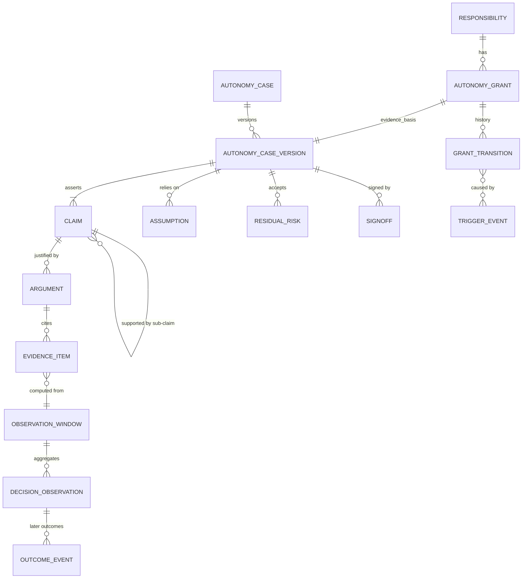

| Entity | Key fields | Notes |
|---|---|---|
| `autonomy_case` | `case_id`, `responsibility_id`, `scope_digest` (BCD plus envelope digest), `tenant_id`, `created_by` | One per (responsibility, BCD lineage). |
| `autonomy_case_version` | `version`, `prev_digest`, `case_digest`, `schema_version`, `status` (draft, validated, approved, superseded, invalidated), `valid_from`, `valid_until`, `tier`, `ceiling_map`, `change_plan` | Immutable once approved. Digest excludes itself (same rule as `context_manifest`, [repo] ADR 0003). |
| `claim` | `claim_id`, `statement`, `claim_type` (top, sub, safety, performance, oversight, security), `quantified_target` (for example `severe_failure_rate_upper95 <= 0.003`), `slice` | Top claim: "Principal class P may perform responsibility R inside envelope E at mode m with residual risk at most rho." |
| `argument` | `argument_id`, `claim_id`, `strategy` (statistical bound, deterministic predicate, independence, containment, human audit), `rationale` | A short human-written justification; this is the part auditors read. |
| `evidence_item` | `evidence_id`, `kind` (open registry), `ref`, `ref_sha256`, `window_id`, `slice`, `n`, `failures`, `interval`, `method`, `evaluator_principal`, `independence_level`, `valid_from`, `valid_until`, `scope_digest` | Pointer plus digest to existing artifacts. Kinds: `offline_eval_run`, `shadow_comparison`, `live_outcome_window`, `audit_sample`, `adversarial_suite`, `consistency_trials`, `replay_result`, `incident_summary`, `reviewer_quality_report`, `judge_qualification`, `independent_validation`, `change_record`. |
| `assumption` | `assumption_id`, `statement`, `monitor` (metric and threshold), `status` (holding, at_risk, violated) | Example: "input mix stays within envelope slices", "judge kappa at least 0.7". A violated assumption is a trigger. |
| `residual_risk` | `risk_id`, `description`, `bound`, `accepted_by`, `review_by` | What remains after all controls, accepted in writing (SOTIF framing [S, E-av]). |
| `signoff` | `signoff_id`, `role` (builder, evaluator, risk_owner, autonomy_authority, accountable_owner), `principal`, `decision`, `signed_at`, `signature` | Distinct principals per role. |
| `decision_observation` | `observation_id`, `grant_id`, `grant_epoch`, `responsibility_id`, `assignment_id`, `principal_id`, `principal_type`, `pins_digest`, `mode_applied`, `approval_basis`, `run_id`, `step`, `proposal_id`, `effect_class`, `slice_keys`, `input_digest`, `shadow`, `latency_ms`, `cost`, `policy_decision_ids`, `exception_kind`, `created_at` | Immutable base. |
| `outcome_event` | `observation_id`, `kind` (accepted, rejected_by_acceptance, overridden, reworked, reversed, incident, audit_error, audit_clean), `severity`, `source_ref`, `recorded_at` | Append-only; later outcomes attach to the same decision (the missing "decision-to-outcome join", [E-eval §6.1]. |
| `grant_transition` | `from_state`, `to_state`, `kind` (promotion, reduction, suspension, revocation, reinstatement, expiry), `evidence_digest`, `decided_by`, `trigger_ids`, `epoch` | Like a release record with digest and rollback anchor (ADR 0004 invariant 5 [repo] line 81). |

All records follow ADR 0003 conventions: strict `additionalProperties: false`, `schema_version`, RFC 3339 timestamps, digests as `sha256:<hex>`, payloads referenced not inlined, additive optional fields with readers before writers ([repo] `docs/architecture/adr/0003-control-record-schemas.md:25-52`). The evidence kind is an **open registry**, not a CHECK constraint: `CaliberWorkspaceReleaseEvidence.kind` is a closed list of five ([repo] `db/models.py:3808-3812`) and extending it needs a migration each time. Do not extend that table for autonomy; create a new one.

#### 13.7.3 Versioning, signing and retention

- **Versioning.** A case version is immutable once approved. Any change to BCD, envelope, ceiling map, claim target or accepted residual risk is a new version with `prev_digest`, forming a hash chain. The grant references a specific version, so "what authority was in force at time t, justified by what" is answerable from records alone.
- **Signing.** Beta: digest in the record plus an audit row per signoff (the audit log is append-only by convention, not by trigger [E-gov §2.12]. Next: include case, evidence index and transitions in the B14 evidence package so a server-free verifier can recompute digests. Later: asymmetric signatures per role via the M02 signed-bundle machinery (plan). I do not recommend building signature infrastructure for Beta.
- **Retention.** Keep case versions, evidence index and transitions for the life of the grant plus the longest applicable regulatory period (EU AI Act deployer log retention of at least six months and provider documentation of ten years are from memory [M] and must be checked against the customer's regime). Raw payloads follow the customer's data policy and are replaced by tombstones with digests; the digests keep the chain verifiable. A **legal hold** flag freezes observation ledger rows for an incident's window (section 13.14).

#### 13.7.4 What to reuse

| Existing Caliber object | Reuse in the case | Gap |
|---|---|---|
| `eval/evidence.py` digest-bound evidence blocks and `workspace-release-gate-evidence/v2` [E-eval §2.2] | `offline_eval_run` evidence item | Add `valid_until` and `scope_digest` as optional fields. |
| `GateDecision` (`passed`, `reasons`, `thresholds`) ([repo] `eval/gate.py:51`) | Decision primitive inside an evidence item | Extend with critical slices (M09.1b). |
| `run_manifest` and `context_manifest` | BCD source; per-decision provenance | Pins are per run, not per role/node [E-roles §3.6]. |
| `proposal`, `receipt` (`verified_by=query`) | Outcome evidence for effect correctness | None; a receipt is the strongest outcome evidence available. |
| `policy_decision` with `input_hash` | Policy-compliance series; replayable | Needs `principal_id`, `grant_id`. |
| `approval_request`/`approval_decision` | Human decision ground truth for shadow comparison | Closed v1 schemas carry only `requested_by`/`decided_by` strings ([repo] ADR 0003 tables). |
| `CaliberAssistantReview` | Template for a decision-log row with pins and `candidate_hash` ([repo] `db/models.py:5081`) | Not joined to outcomes. |
| `CaliberWorkspaceReleaseDecision` and break-glass | Pattern for role-specific decisions bound to evidence digests, with role and scope snapshots [E-roles §1.2, B3] | Release-specific; copy the shape. |
| `CaliberIncident` | Trigger source | Keyed by `objective` only ([repo] `db/models.py:1665-1687`); needs scope keys. |
| `CaliberAuditLog` | Event of record | Actor is a string. |

### 13.8 The scorecard

A scorecard is a derived view over the observation ledger for one grant and one window, never a stored source of truth. For each dimension it shows the metric, n, interval, threshold from the grant's `demotion_policy`, the slice breakdown, status (green, amber, red, no-evidence), the evidence expiry date, the current ceiling and the binding cap (which of the five caps is the minimum). "No evidence" is a status, not green. Showing the *binding cap* is the single most useful field: it tells an owner what to do next (gather evidence, add a predicate, hire a supervisor, or accept that policy forbids more).

### 13.9 Reduction, revocation and reinstatement: principles

1. **Down is faster than up.** Promotion needs a case and two keys; reduction needs one event. Humans promote; the system and any accountable supervisor can reduce (ADR 0004 invariant 6 [repo] line 84; the Entra/ATF analogues [S]).
2. **Reduce authority, not machinery.** Stopping an agent's authority must not stop the execution owner, the reconciler or the evidence verifier. The platform's fencing and reconciliation exist precisely to settle in-flight effects safely ([repo] `effects/reconcile.py:1-19`).
3. **Reduction is scoped.** A stop that can only be total will not be used early.
4. **Evidence expiry reduces authority.** No special case: an expired case is a tripped trigger.
5. **Never reduce by forgetting.** In-flight proposals, unknown effects and their pinned policy history stay intact (map-gap.md section 7: "Never 'demote' by forgetting in-flight writes", [repo] `map-gap.md:302`).

### 13.10 Triggers

| # | Trigger | Class | Source (exists?) | Detection rule | Default response |
|---|---|---|---|---|---|
| 1 | Acceptance failure after agent approval | Lagging | Planned B09; ADR 0004 metric | Any FS1; SPRT for FS2/FS3 | FS1 suspend; FS2 to M3 |
| 2 | Rollback or compensation of an agent-approved effect | Lagging | `CaliberRollbackCheckpoint`, effects (rollback manual) | Count by grant | Per severity |
| 3 | Incident on the responsibility | Lagging | `CaliberIncident` (no scope key) | Incident severity map | FS1 to FS4 mapping below |
| 4 | Audit-sample error | Lagging | Not built | Upper bound crosses tier rate | One mode down |
| 5 | Reviewer or approver disagreement (shadow or sampled) | Leading | Not built | Agreement drops below non-inferiority bound; CUSUM | Raise sampling, then one mode down |
| 6 | Human override or rework rate | Leading | `CaliberReworkTask`, `CaliberQualityReview` exist; no principal link | Rate over baseline; CUSUM | Tighten envelope |
| 7 | Drift: input mix, output distribution, calibration | Leading | Not built (M09.3 planned, release-time only) | PSI or KS per slice; calibration ECE | Tighten, then re-evaluate |
| 8 | Near-miss: deterministic guard or approver blocks an agent proposal | Leading | `policy_decision` denials exist | Denial rate SPRT; repeated denials circuit breaker (auto mode uses 3 consecutive or 20 total [S]) | Stop and escalate to human; demote on pattern |
| 9 | Policy violation attempt (envelope exit, claim mismatch) | Leading | `ClaimMismatch`, denials | Any FS1 class; rate for others | Per severity |
| 10 | Budget burn (cost, tokens, exposure) | Leading | Durable budgets B08.4/M08 planned | Burn rate against period budget | Tighten, then require approval |
| 11 | Evidence expiry or expiring | Leading | Not built | `valid_until` less than now; early warning at 30 days | Warn; at expiry fall to M3 |
| 12 | Change event (C2/C3) | Leading | Pin diff against BCD | Automatic | Fall to M1/M3 for the scope, per change class (13.5.2) |
| 13 | Unknown-effect rate or reconciler backlog age | Leading | Exists (state machine); no aggregation per grant | Rate bound; age cap | Suspend new dispatch in the connector scope |
| 14 | Supervision failure: queue age, abandoned approvals, no coverage, unanswered escalations | Leading | Approval expiry exists; no timers [E-gov §2.9] | Capacity thresholds (section 14.2) | One mode down (cannot supervise what you cannot staff) |
| 15 | Reviewer-quality alarm (rubber-stamping) | Leading | Not built | Decision latency near zero, approve rate near 100%, seeded-fault miss | Treat as supervision failure |
| 16 | Accountable Owner departed or sponsor lapsed | Leading | None | Directory or attestation lapse | Orphan timer, then M3 |
| 17 | Unreported incident or disclosure failure | Governance | None | Incident found by audit that was never filed | Suspend; Cruise lesson |
| 18 | External signal (customer complaint, regulator, security advisory, model deprecation notice) | External | None | Manual entry | Human-initiated |

**Severity classes.** FS1: unauthorised or harmful effect committed, irreversible wrong effect, critical policy breach, or unreported incident. FS2: wrong effect committed but recoverable, or repeated FS3. FS3: acceptance failure caught before effect, sustained drift or disagreement. FS4: within-tolerance anomalies.

**Automatic versus human-initiated.**

| Action | Automatic | Human-initiated |
|---|---|---|
| Watch, raise sampling, tighten envelope | Yes | Yes |
| One mode down | Yes (FS3, FS2 on SPRT alarm) | Yes |
| To M3 or M1 for scope | Yes (FS2, C2 change, expiry) | Yes |
| Suspend | Yes for FS1 only | Yes (any supervisor for own scope, "andon cord") |
| Revoke | No (needs authority) | Autonomy Authority |
| Raise or reinstate | Never | Authority, with case |

Flapping control: one reduction per newly qualifying event set, tracked by incident watermark (same idempotence rule as the planned #872, [E-road §3] demotion row), plus a cool-down so a noisy monitor cannot walk a grant to M1 in an hour. **Adversarial demotion** is a real risk: an attacker who can inject failures can degrade availability. Mitigation: demotion is the safe direction, but rate-limit automatic reductions, require human confirmation to *extend* a suspension past a bound, and keep human override.

### 13.11 Scopes and graduated responses

| Stop scope | Mechanism today | Needed |
|---|---|---|
| Per run | `revoke_grant` exists, called by nothing outside its module ([repo] `caliber/src/caliber/policy/grants.py:417`; grep shows no other caller); run cancel | Keep. |
| Per principal | Disable account, revoke PAT | Principal-level suspend that fans out to grants and leases. |
| Per responsibility | None | `responsibility.suspended` flag read at dispatch. |
| Per envelope slice | None | Slice-scoped ceiling override. |
| Per connector | Admission removal, planned stop scope (#776 [E-road §5.1]) | Connector stop that blocks new dispatch only. |
| Per use case | None | Use-case stop (M06). |
| Enterprise | None ("kill switch" greps nothing, [E-gov §2.7] | `autonomy_freeze`: every grant effectively M3 or below (the human-lane fallback) until lifted by the Autonomy Authority. |

Graduated ladder (each step is reversible, logged and scoped):

1. **Watch**: alert, increase audit sampling.
2. **Tighten envelope**: lower exposure limit, drop an effect class or slice.
3. **Demote**: affected slices drop one mode; from M4 a slice reaches M3, where agent approvals are voided and re-requested from a human (ADR 0004 invariant 3: fall back, do not fail [repo] line 77).
4. **Shadow**: M1; the agent keeps running beside humans, which keeps evidence flowing for reinstatement (Cruise kept safety-driver testing available while driverless was suspended [S]).
5. **Suspend**: grant inactive, assignment held, leased credentials revoked.
6. **Revoke**: grant terminated, case invalid, new case required.

### 13.12 In-flight work and unknown-effect semantics

The autonomy gate must be linearisable with dispatch. The dispatcher already validates the exact approval and the captured execution-owner lease inside one transaction with row locks ([repo] `caliber/src/caliber/effects/dispatcher.py:729-758,849-878`). Add the grant row (with `epoch` and `status`) to that lock set. After a reduction commits, no dispatch starts under the old epoch.

| State at reduction time | Treatment |
|---|---|
| `proposed`, awaiting an agent approval | Void the agent approval; re-route to a human approver. |
| `approved` by an agent, not yet dispatched | Re-check against the current epoch and mode. If the reduction only tightens the envelope (Watch or tighten) and the effect is still inside it, allow. Any mode change, suspension or revocation: supersede and re-request a human approval, as in 11.7. |
| `dispatched` or `unknown` | Never undone by a reduction. Continue under the reconciler: lookup by original logical key, no blind redrive, `effect_gate` parks dependants (`waiting_effect`) ([repo] `effects/reconcile.py:696`). |
| `committed` during the suspect period | Look-back review from the last known-good watermark: create review tasks per decision; corrections are *new authorised effects* (compensation is a new effect, [repo] gap analysis section 4). |
| Runs `waiting_approval` | Stay parked; approvals now route to the human fallback. |

The stop acts on authority (what may be dispatched next), never on the owner process, reconciler or verifier. This is the difference between a safe stop and an outage that creates unknown effects.

### 13.13 Minimal-risk condition

Define per responsibility and effect class a **safe state**: hold (park the item in a named queue), roll back (issue a compensating proposal), freeze (block the target resource), or hand to a named human. SAE defines the minimal risk condition as the state reached after fallback [S, E-av]. In enterprise work "just stop" can be unsafe mid-transaction, so the safe state must be explicit and testable. Rule: **if the safe state cannot be reached (no staffed human, dependency down, no compensating operation), the action does not start.** This feeds C_supervision (section 14.2).

### 13.14 Reinstatement and post-incident review

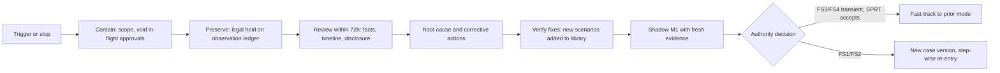

- **Post-incident review.** Evidence-focused and blameless. Output: timeline from the ledger, the binding cap that failed, corrective actions, new permanent scenarios, threshold re-calibration (was the monitor too slow or too noisy?), and a disclosure decision by the Accountable Owner.
- **Reinstatement.** Always begins in shadow (M1). FS3/FS4 triggered by a leading indicator, once the cause is cleared and the SPRT accepts the null over a fresh window, may fast-track to the prior mode with an Autonomy Authority decision. FS1/FS2 require a new case version with the incident-derived scenarios, independent re-evaluation and step-wise re-entry (M1, then M3, then the prior mode). The reinstatement authority is not the owner alone.
- **Cruise-2023 lessons applied** (DMV suspended driverless deployment and testing permits on 24 Oct 2023 effective immediately, while the permit for testing with a safety driver was unaffected, reinstatement required steps to the DMV's satisfaction [S]; disclosure failures drove severity, and the remote-assistance centre reportedly received only a low-resolution three-second clip [W]):

| Lesson | Design response |
|---|---|
| Fast | Suspend is immediate and linearisable with dispatch (section 13.12). |
| Scoped | Reduction at responsibility/slice/connector scope; lower modes stay operational. |
| Reversible only on conditions | Reinstatement through shadow and a case version; no timer-based reinstatement. |
| Disclosure | "Unreported incident" is a trigger (row 17); disclosure decision is a recorded owner act; evidence package export is a one-call operation. |
| Evidence availability | Legal hold on the ledger; the decision record carries the full context manifest digest and the human approver's view (`evidence_hash`). |

## 14. Governance, safety, approval and escalation model

### 14.1 Decision rights

Roles used below are functions, not people; one person may hold several only where the conflict matrix (14.2) allows. **Accountable Owner**: named human who answers for the responsibility's outcomes. **Autonomy Authority**: the risk-owner function (a person or committee) that decides grants; distinct from the owner. **Evaluator**: independent of builder and owner. **Supervisor**: staffs the human side at run time. R = does the work, A = answerable (exactly one per row), C = consulted, I = informed, X = must not participate.

| Decision | Builder | Accountable Owner | Autonomy Authority | Evaluator | Supervisor | Auditor | Platform |
|---|:-:|:-:|:-:|:-:|:-:|:-:|:-:|
| Build or change agent (new BCD) | R | A | I | C | I | I | records change class |
| Define responsibility, envelope, safe state | C | A | C | C | C | I | validates schema |
| Declare tier, loss tolerance, overlays | X | C | A | C | I | I | stores as policy data |
| Assign a principal | C | A | I | I | C | I | checks SoD, independence |
| Maintain scenario libraries, run evaluation | X | I | I | A/R | I | I | stores evidence |
| Validate the case | X | I | C | A/R | I | I | locks case version |
| **Promote** (raise a mode or widen the envelope) | X | accepts residual risk (co-sign) | A (decides) | recommends | C | I | applies new epoch |
| **Demote** (automatic) | X | I | I | I | I | I | A/R (rule-bound) |
| **Demote or suspend** (human) | X | R | R | R | R (own scope) | X | applies at once |
| **Waive** a requirement | X | R (requests) | A | C | I | I | time-boxes, logs |
| **Stop**, scoped | X | R | R | I | R | I | enforces |
| **Stop**, enterprise freeze | X | I | A/R | I | R | I | enforces |
| Reinstate | X | R | A | R (re-evaluates) | C | I | applies |
| Change ceiling policy table | X | C | A | C | I | I | releases as governed policy |
| Audit and export | X | C | C | I | I | A/R | produces package |

Rules that make the table bite:

- **Builder is excluded from every decision about its own agent's authority.** The party that optimises cannot certify [J, M; E-auto §9, item 6].
- **Promotion takes three recorded acts and two human keys.** The Evaluator attests and recommends; the Autonomy Authority decides; the Accountable Owner co-signs acceptance of residual risk. At T3 and above the decision itself needs a second human key (11.5). The beneficiary of more autonomy is never the sole approver (the ADR 0004 weakness, 8.7 and 9.9).
- **Ceremony scales with tier.** T1/T2 reversible work can use a *pre-approved promotion class*: if the case meets criteria the authority agreed in advance (ITIL standard change, FDA PCCP analogues [M]), the authority's act is a one-click recorded acknowledgement. Caliber may recommend ("eligible") automatically; it never promotes without a human decision record.
- **Waivers** expire (default 30 days), name the waived requirement and compensating control, and cannot waive FS1-class gates or critical slices (#827 non-waivable critical gates [E-road]).
- **Any supervisor may stop their own scope without approval** (andon cord); only the authority reinstates.

### 14.2 Separation of duties, independence and human capacity

#### 14.2.1 Conflict matrix

| Same principal may not hold... | Because |
|---|---|
| Builder and Evaluator of one grant | Self-certification |
| Accountable Owner and Autonomy Authority for the same grant | Beneficiary approves own increase |
| Proposer and approver of one effect | ADR 0004 invariant 1 [repo] line 71 |
| Evaluator and Supervisor of the same decision stream | Evaluator would grade the evidence it produces |
| Approver and release-applier on a protected effect where the tier requires dual control | SOX-style segregation [M] |

Today the platform has four independent distinct-actor checks that compare user-id strings and cannot express any of this between agents ([repo] `workflows/approval_policy.py:266` `assert_distinct_actor`; `actor_provenance.py`, `workspace_release_governance.py`, Aria checks per [E-gov §2.5]. Consolidate to one function over principals (Now) so independence has a single home.

#### 14.2.2 Agent-agent independence

Two agents with different model names are not independent. They share training-data lineage, usually the same prompt template, the same retrieved context and the same tool outputs; their errors are correlated, and an injected instruction in shared context fools both. ADR 0004 already says model-pin difference is required but not sufficient and demands a deterministic check ([repo] line 73; "Different model pins alone do not prove independence" per [E-road §4.3]. Aria's reviewer is isolated by identity, with no author history and no mutation tools [E-eval §7.1] but nothing detects same-family review.

Independence is therefore an **achieved class, recorded on the decision, and measured**. The classes are those of 8.6 (I0 same principal, forbidden; I1 distinct identities; I2 distinct pins; I3 context isolation; I4 a deterministic check plus human sampling in the chain). The ceiling function (13.6.1) reads the achieved class as an input to `C_supervision`; the minimum class each mode needs is:

| Class | Minimum required for |
|---|---|
| I1 | A human verifier at M3. No agent verifier counts above I1 on identity alone |
| I2 | An agent verifier at M3, and any standing or batch approval basis that an agent helped to screen |
| I3 | The agent verifier at M4 and M5 |
| I4 | Chain composition at M4 and M5 in every tier. For irreversible classes at M5, and for any mode above M3 at T4, a human or external party owns the sample |

Where this table and the defaults of 8.6 differ, the stricter applies.

**Measure it, do not assert it.** Seed known-bad proposals into the review stream (fault injection) and compute the checker's catch rate; compute the joint-miss rate (how often proposer and checker are wrong on the same item) on the audited sample. If the joint-miss rate approaches the proposer's miss rate, the checker adds nothing, whatever its model name. A checker whose seeded-fault catch rate falls below a threshold cannot be counted toward the grant. Seeded faults for humans raise a labour-relations question (works-council co-determination over performance monitoring in Germany, BetrVG s.87(1) no. 6 [W], extension to agents unverified); run them as an announced programme (staff know canaries exist, not which) with purpose-limited, aggregated reporting.

#### 14.2.3 Human capacity

The human side is a finite resource and a safety component (Waymo's remote-assistance staffing became a regulatory topic [W]). A grant at M3 or above requires a **supervision plan**:

| Element | Content |
|---|---|
| Named supervisor group and deputies | Roles, not people; resolved at run time by Assignment |
| Coverage | Hours, time zones; after-hours rule |
| SLA | Time-to-acknowledge and time-to-decide, strictly shorter than approval TTL (default 24 h: `approval_ttl_seconds` = 86400, [repo] `caliber/src/caliber/config.py:1467-1468`) |
| Capacity | Expected arrivals times service time against staffed capacity; utilisation above about 0.7 is a warning, above 1 a trigger (Little's law [M]) |
| Quality | Review-time distribution, approve rate, overturn rate on audit, seeded-fault catch rate |

Capacity feeds `C_supervision`: if queue age breaches the SLA, abandonment (expired approvals) exceeds a bound, or coverage lapses, the ceiling for responsibilities that depend on that group falls. After hours with no coverage, effects needing a human park, they do not proceed. Automation bias is a measured risk, not a footnote: Feng et al. warn that at L4 approvals become rubber stamps and agents may exploit disengagement [S]; 93% blind acceptance in a coding context [S]; DeepMind's "moral crumple zone" where humans absorb liability without real control [S]. Reviewer-quality telemetry is the driver-monitoring analogue [S, E-av].

### 14.3 Escalation

| Trigger | Target | Ack / decide timeout | If nobody answers |
|---|---|---|---|
| Agent uncertainty or checker disagreement | Supervisor group | 15 min / 4 h (examples [J]) | Item parks (MRC); capacity trigger fires |
| Policy denial (repeated) | Supervisor, then owner | After 3 consecutive or 20 total denials, the agent stops and escalates (auto-mode pattern [S]) | Stop; demote on pattern |
| Envelope exit | Responsibility owner | 1 h / 1 business day | Item parks; no action outside envelope |
| Unknown effect | Operator on the connector (reconcile), then downstream owner | Per SLA | Dependants stay `waiting_effect` (already the behaviour [repo] `effects/reconcile.py:696`) |
| Evidence expiring (30 days) | Evaluator and owner | Weekly | Falls to M3 at expiry |
| Incident FS1/FS2 | Incident commander and authority | Immediate | Platform auto-suspends (FS1) |

**Timeout behaviour.** Today only `block` is honoured; `escalate` and `auto_reject` are rejected at manifest validation because nothing implements them ([repo] `workflows/approval_policy.py:84-85,232-244`). That refusal is correct and should stay until timers exist (M06). The vocabulary to implement later is: `block` (park), `expire` (void and notify), `escalate` (next target, timers), `safe_stop` (execute the safe state). **There is no `auto_approve`, ever.** The terminal rule: an unanswered escalation chain ends in the safe state *and* counts against the grant (trigger 14), because supervision that does not answer is a failed control. The ADR's L3 text ("human approver within SLA via M06 timers", [repo] ADR 0004:62) depends on infrastructure that does not exist yet [E-gov §2.9]; until then an agent decider (M4) cannot honestly be granted.

### 14.4 Exception taxonomy

| Exception | Detection (today) | Immediate behaviour | Safe state | Handler | Counts toward autonomy metrics |
|---|---|---|---|---|---|
| **Agent failure** (error, timeout, invalid output) | Step contract validation; refusal never echoes model text [E-gov §2.3]; retries and error boundary | Fail step; retry per policy; no effect proposed | Park item | Operator, then owner | Reliability (13.3.2) |
| **Uncertainty** (low checker score, sample disagreement) | Self-reported confidence only ([repo] `assistant/service.py:5626`); no calibrated signal | Route to a human decision (M3) for this item | Hold | Supervisor | Exception handling (precision/recall) |
| **Policy denial** | Typed `PolicyDecision` ([repo] `policy/decisions.py`) | Action refused; reason code recorded | None needed | Supervisor if repeated | Policy compliance |
| **Unknown effect** | `unknown`/`abandoned`, reconciler ([repo] `effects/reconcile.py:1-19`) | No redrive; dependants parked | `waiting_effect` | Reconciler, operator `reconcile` | Operational stability |
| **Evidence expiry** | None | Warn at 30 days; at expiry fall to M3 for the scope | M3 | Evaluator, owner | Governance |
| **Environment change** (model deprecation, connector or policy change, input drift) | Pin drift check `verify_run_pins` for runs [E-eval §3]; no drift monitor | C2 change class: fall to M1/M3 for the scope | Shadow | Evaluator | Drift, stability |
| **Envelope exit** | Not detected as such (exposure/limits are planned B08.4) | Refuse; escalate | Hold | Owner | Policy compliance |
| **Supervision failure** | Approval expiry only | One mode down for dependent grants | M3 | Authority | Supervision |
| **Security signal** (injection suspected) | Trace redaction, egress; no detection | Quarantine run; stop connector scope if confirmed | Freeze | Security, incident commander | Security |

### 14.5 Approval models beyond per-effect exact intent

**Compatibility invariant.** Every effect still reaches `dispatch` with an `approval_request`/`approval_decision` pair bound to the exact `intent_hash`, `evidence_hash`, `policy_digest`, expected resource version and expiry, consumed once, rechecked at commit. Today the dispatcher refuses any proposal without an approved approval ([repo] `effects/dispatcher.py:758,878` `proposal_not_approved`), and the commit gate rechecks everything that can change ([repo] `workflows/approval_policy.py:393`). The new models change **who or what produces the decision and on what basis**, never whether an exact-intent decision record exists. This costs a row per effect and buys uniform consumption, audit and revocation semantics.

| Model | What is approved | Decision record | How it stays exact-intent | Risks and prerequisites | Mode (and basis) |
|---|---|---|---|---|---|
| **Per-effect exact intent** (baseline) | One proposal | `decided_by` human, `basis: exact` | Native | Approval fatigue (93% [S]) | M3 (exact basis) |
| **Batch** | An enumerated set of proposals: list of exact `intent_hash` values, shown together | One decision per member, `basis: bundle(bundle_id)`; bundle record holds the ordered list and a digest | Each member is exact; the bundle cannot approve anything not listed, and a member whose intent changes is excluded | Reviewer skims large bundles: cap bundle size, require per-item risk sort, audit sample | M3 (batch basis) |
| **Policy pre-approval within envelope** (standing approval) | A *class*: a template with deterministic constraints (connector, effect class, resource pattern, amount limit, window), approved once by a human | At runtime the dispatcher mints a derived decision by `principal=policy:<standing_id>` after verifying the concrete intent satisfies the template predicates; `basis: standing(standing_id)` | Minted per proposal, bound to that proposal's exact `intent_hash`, short expiry, single consumption; standing approval itself has expiry and epoch | Predicates must be deterministic, never model-evaluated; class too broad equals blanket consent; revocation by epoch | M3 (standing basis) to M4 |
| **Sampled post-hoc review** | Nothing new: effects proceed under a standing approval or agent approval; a random sample of committed effects is reviewed afterwards | Review verdict is an `outcome_event` (`audit_clean` or `audit_error`) linked to the proposal | The effect had an exact-intent decision at dispatch; review is evidence, not authority | Only for effects with verified compensation; sample rate rises on drift; sample drawn by evaluator RNG | M4 |
| **Confidence-gated** | Routing, not authority: a calibrated score decides between the human route and an automated route | Route recorded in `basis`; whichever route decides produces the exact decision | Score never substitutes for a decision record | Self-reported LLM confidence is poorly calibrated [M]; the repo uses it today ([repo] `assistant/service.py:5626`). Use a held-out-calibrated checker score, publish the automation rate versus false-accept curve, state residual risk (auto mode: 17% miss on 52 real overeager actions [S]) | M4 to M5 |
| **Agent approver** (ADR 0004 L3/L4 chair) | One proposal | `decided_by_type: agent`, with pins | Same as human; independence level checked before the decision is accepted | Independence (14.2.2); effect-class ceiling | M4 to M5 |
| **Quorum** | One proposal | `approval_count` distinct approvers | Native [E-gov §2.5] | Quorum of agents counts strings, not independence | any |
| **Notify-and-veto** (not recommended) | Proceed unless vetoed in a window | n/a | Violates the one-decision-per-effect invariant | Only for reversible, low blast radius; silence is consent | excluded |

Schema consequence (Now): add optional `approval_basis`, `decided_by_type`, `principal_id`, `pins_digest`, `grant_id`, `grant_epoch` to `approval_request`/`approval_decision` and `proposal`. ADR 0003 permits optional additions with readers upgraded first and records that tagged-release schemas need the reader-first sequence ([repo] `docs/architecture/adr/0003-control-record-schemas.md:25-52`). The approval UX contract already expects `requested_by_type` as a computed view field from a `principal_type` that does not exist in code ([repo] `docs/architecture/approval-ux-contract.md:33,38`); this fills that gap.

### 14.6 Accountability

| Situation | Accountable | Mechanism |
|---|---|---|
| Agent errs inside its envelope at a mode the Autonomy Authority approved | Accountable Owner (residual risk accepted in the case); Autonomy Authority for the decision to grant | Case signoffs; grant transition record |
| Agent errs because the builder changed BCD without a change record | Builder organisation; owner for allowing the change | Change record and C-class rule |
| Agent errs outside the envelope because a guard failed | Platform owner (control failure), owner for the envelope | Incident review |
| Human supervisor rubber-stamps | Supervisor group lead, owner for the supervision plan | Reviewer-quality telemetry |
| Evaluator's evidence was wrong | Evaluation function | Independent validation; audit |

Design rules:

1. **An agent can be Responsible, never Accountable.** RACI: exactly one Accountable per outcome [M]. Every grant names an accountable individual and a deputy.
2. **Sponsor pattern.** Microsoft Entra Agent ID gives each agent a human sponsor accountable for lifecycle and access, auto-reassigned to the sponsor's manager on departure, with access packages that expire if the sponsor does not renew [W]. Adopt: grant `valid_until` requires owner re-attestation; a lapsed or departed owner starts an orphan timer after which the grant falls to M3 (trigger 16).
3. **Group accountability.** A group (committee, team) may be the *Autonomy Authority* and may hold a responsibility. A group is never the answerable party: the case records the committee's vote with named members and names one accountable individual.
4. **Transitive accountability.** DeepMind's delegation paper frames transfer of authority as transfer of accountability and proposes "liability firebreaks" where a delegatee accepts liability or halts and asks for fresh authority [S, first half read]. In Caliber a firebreak is the envelope exit rule: out of envelope means stop and ask.
5. **Do not create a moral crumple zone.** Accountability requires real control: context, time and capacity (14.2.3). If the supervision plan cannot staff the SLA, the grant falls; the human is not left holding liability for decisions they cannot review.
6. **Legal exposure is the customer's.** Moffatt v Air Canada held the company liable for its chatbot [W]; California AB 316 bars an "AI did it" defence from 1 Jan 2026 [W]; EU Product Liability Directive 2024/2853 covers software with transposition due 9 Dec 2026 [W]. Not legal advice; none verified at source. The platform's job is to make the Accountable Owner a recorded fact.

### 14.7 Safety architecture

NVIDIA's Halos pairs the learned driving model with independent safety checks and policy evaluation of proposed actions [S, E-av]; separate certification of the checker is the recommendation of [E-av §5], not something NVIDIA's page states [J]. The enterprise analogue: a learned proposer inside a deterministic, independently owned envelope.

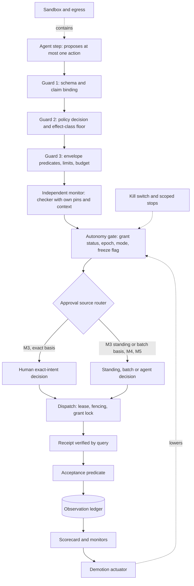

| Layer | Function | Design requirement |
|---|---|---|
| Deterministic guards | Stop what is impossible regardless of model output | Class and connector are claims bound to platform truth; unknown tool is `irreversible_write` [E-gov §2.3, 2.4]; limits and budgets enforced outside the agent |
| Independent monitor | Judge the *proposal*, not the output text | Different owner, release path and pins than the agent; deterministic where possible; separately qualified and re-certified; cannot be reconfigured by the agent's builder (freedom from interference) |
| Sandbox | Contain execution | Tool sandbox is not an OS security boundary [E-gov §2.12]; gap analysis G10); isolation is M07 (plan) |
| Kill switch | Remove authority fast | Scoped stops and enterprise freeze (13.11); does not stop reconciler |
| Ledger | Reconstruct | Event data recorder analogue ([S, E-av]); B14 package |

The monitor is the one genuinely new component. Aria's reviewer is an LLM call, not a classical monitor; today it is identity-distinct only (I1), it could reach I3 with pins that differ from the performer's and verified context isolation, and it can never be the I4 deterministic check.

### 14.8 Existing controls mapped to autonomy-safety functions

| Control (repo evidence) | Autonomy-safety function | What is missing |
|---|---|---|
| **Effect ledger**: seven-state proposals, frozen intent columns ([repo] `effects/records.py:98`; ADR 0003 proposal) | Event data recorder; outcome ground truth; in-flight settlement | Not wired for queued production runs (`governed_effects` never built, [E-gov §3]; no principal on the record |
| **Dispatcher**: approval and lease validated in one transaction ([repo] `effects/dispatcher.py:729-878`) | The chokepoint where an autonomy gate can be linearisable | Grant, epoch and freeze not in the lock set; class-differentiated approval not implemented [E-gov §2.4] |
| **Grants**: run-bound, exact, rechecked on use [E-gov §2.5]; `policy/grants.py`) | Revocation of a run's authority is immediate | `revoke_grant` has no caller outside its module ([repo] `policy/grants.py:417`); grants are run-wide, derived from a human role; no standing authority for an agent |
| **Approvals**: exact-intent binding and commit-time recheck ([repo] `workflows/approval_policy.py:393`) | Human decision with recheck of what can change | Bound decision route answers 409 `approval_bound_not_wired` [E-gov §2.6]; no escalation or timers; string actors |
| **Reconciler** and `effect_gate` ([repo] `effects/reconcile.py:696`) | Unknown-effect handling; the safe core of any stop | Operator load scales with volume; no lookup for generic HTTP [E-gov §2.4] |
| **Lease fencing** [E-gov §2.14]; `ownership.py`) | Stale owner cannot dispatch | Not per-transition; single process caps throughput |
| **Release gates**: `apply_gate`, deploy gate, workspace release evidence ([repo] `eval/gate.py:51`) | Release-time evidence; fail-closed thresholds | Fragmented across families; client-supplied `gate_state` ([repo] `routes/prompts.py:2035`); no live evaluation |
| **Redaction**: fail-closed trace redaction, allow-listed span attributes [E-gov §2.12] | Safe evidence retention and disclosure | Regex PII only; no per-purpose redaction for human-approver telemetry |
| **Run and context manifests**; DB immutability triggers [E-gov §2.5] | BCD source; provenance | Pins per run, not per role |
| **Policy decisions** with `input_hash` ([repo] `policy/decisions.py:18`) | Compliance series; replayable | Policy is a constant, no per-use-case data ([repo] line 184) |
| **SLO and incidents** ([repo] `observability/slo.py:22`; `db/models.py:1665`) | Trigger source | Global, per-objective keys |
| **Aria reviewer** [E-eval §7.1] | Only live agent-held chair | Self-reported confidence; no independence check; user-chosen mode |
| **Break-glass** with 1 h cap [E-roles §1.2, B6] | Exceptional access with expiry | Grants more power, not less; model for a time-boxed override |

### 14.9 Regulatory mapping: what Caliber can and must not claim

Caliber is a platform. Obligations in the instruments below fall on providers and deployers of AI systems and on regulated institutions. NVIDIA's own public position is the model: it certifies platform process and hardware conformance and leaves vehicle-level safety cases to the automaker, and it does not mention UL 4600 or SOTIF on the Halos page [S, E-av]. Claim the same narrow thing.

| Instrument | What Caliber can credibly claim | What it must not claim |
|---|---|---|
| **EU AI Act Art. 14** (oversight proportionate to autonomy; ability to understand, interpret, override, and stop to a safe state) [S, article summary] | Mechanisms for deployer oversight: exact-intent approvals, override, scoped stop to a safe state, supervision capacity records, reviewer-quality telemetry | That using Caliber makes a deployment compliant. Art. 14 duties are design-and-deployment obligations; competence and authority of overseers are the deployer's (Art. 26 [M]) |
| **Art. 12** (automatic event logging) [M] | A joinable, digest-verifiable decision record with principal, type and pins once B14 lands | Tamper-proof logging today: the audit log is append-only by convention [E-gov §2.12]; WORM is M05 (plan) |
| **Art. 9 / 72** (risk management, post-market monitoring) [M] | Scorecard, triggers, incident register as inputs to the deployer's process | A risk management system |
| **NIST AI RMF** (Govern, Map, Measure, Manage) and AI 600-1 [M]; NIST/CAISI agent identity and authorisation work, voluntary [W] | Maps well: Govern = decision rights; Measure = scorecard; Manage = triggers and stops | Conformance or certification; NIST has no autonomy taxonomy [M] |
| **ISO/IEC 42001** (certifiable AI management system) [M] | Evidence feeds an organisation's management system: roles, competence, monitoring, change control | That Caliber is 42001 certified or confers it |
| **SR 11-7** (inventory, independent validation, effective challenge, ongoing monitoring) [M]; SR 26-2 superseded it on 17 Apr 2026 and, per secondary sources, excludes generative and agentic AI [S partial, W] | Autonomy register is an inventory; case plus independent validation record matches the shape; challenger comparison is possible | That Caliber performs validation. SR 11-7 requires an independent validation *function* at the institution; practical effective challenge for agents depends on trajectory traceability [W] |
| **SOX segregation of duties** [M] | Enforced conflict matrix, distinct principals, recorded role snapshots on decisions | ICFR control effectiveness; that agent principals count as independent persons |
| **Product / platform certification** (TUV-style) | Nothing | Any use of "certified", "homologated", "ASIL-like" implying third-party recognition [E-av §5.2] |

Further must-not-claims: that the derived Autonomy Mode is a regulatory classification; that evidence "proves" safety (SOTIF residual risk is bounded, not zero [S, E-av]); that independent agents are independent persons; cross-tenant learning without explicit contract. EU timing is itself unsettled: the Digital Omnibus provisional agreement of 7 May 2026 moves Annex III high-risk obligations to 2 Dec 2027 but formal adoption was not confirmed [W].

### 14.10 What the enterprise sees

| Persona | Question | Views and records |
|---|---|---|
| **Autonomy Authority** | What authority exists, is it earned, what is about to lapse, what should I approve? | **Autonomy register**: every grant with mode per effect class, binding cap, case version, evidence expiry, owner, last transition. **Promotion queue**: cases with recommendation and residual risk. **Expiry calendar**. **Stops and freeze panel** |
| **Supervisor** | What needs me now, can I cope, is the agent behaving? | **Supervision console**: pending approvals and escalations by age against SLA, coverage roster, abandonment; per-item context; **agent behaviour feed** (denials, near-misses, drift flags); **stop control** for own scope |
| **Auditor** | What happened, who or what decided, under which authority, can I verify offline? | **Decision explorer**: per decision, principals, types, pins, mode, approval basis, grant epoch, receipt, outcome; **grant history** with digests; **evidence package export** (B14) with server-free verifier; override and waiver log |
| **Accountable Owner** | Am I exposed, what did I accept, what is degrading? | **Owner dashboard**: scorecard per responsibility with intervals and assumptions at risk; accepted residual risks and review dates; incidents; re-attestation prompts |
| **Evaluator** | Is the evidence valid and fresh? | Scenario library coverage, judge qualification status, seeded-fault results, sealed slice usage |

Minimum views for Beta are the register (one table), the decision explorer (the approval panel extended to name principal and type) and an expiry list. The rest are Next.

### 14.11 Minimal events and APIs

Events use the existing CloudEvents-subset envelope with `tenantid`, `correlationid`, `causationid`, `dataref`/`datahash` and `schemaversion` ([repo] ADR 0003 `event_envelope`); payload by reference.

| Event | Emitted when | Key payload fields |
|---|---|---|
| `autonomy.changed` | Any mode or envelope change on a grant | `grant_id`, `epoch_from/to`, `mode_before/after` per effect class, `kind`, `case_version`, `trigger_ids`, `decided_by` |
| `grant.proposed`, `grant.approved` | Promotion workflow steps | `grant_id`, `case_version`, signoffs |
| `grant.suspended`, `grant.revoked`, `grant.reinstated` | Stop or reinstatement | `grant_id`, `scope`, `reason`, `incident_id` |
| `autonomy.freeze.activated`, `.lifted` | Enterprise freeze | `scope`, `activated_by` |
| `evidence.expiring`, `evidence.expired`, `evidence.invalidated` | 30 days before expiry, at expiry, on C2 change | `evidence_id`, `grant_id`, `valid_until`, `change_class` |
| `trigger.fired` | Any trigger in 13.10 | `trigger`, `severity`, `slice`, `statistic`, `threshold`, `response` |
| `drift.detected` | Drift monitor | `slice`, `metric`, `value` |
| `supervision.capacity_breached` | Queue age or coverage breach | `group`, `metric`, `grant_ids` |
| `independence.violated` | Seeded-fault catch or joint-miss below bound | `checker`, `level_required`, `level_achieved` |
| `owner.orphaned` | Owner lapse | `grant_id`, `timer` |
| `review.sample_due`, `review.finding` | Post-hoc sampling | `proposal_id`, `verdict` |

Minimal API surface (all under the existing prefix `/ajax-api/2.0/mlflow/caliber`, per [repo] approval-ux-contract.md:9):

| Call | Purpose |
|---|---|
| `GET /autonomy/grants`, `GET /autonomy/grants/{id}` | Register; detail with ceiling map and binding cap |
| `GET /autonomy/grants/{id}/scorecard?window=` | Derived scorecard with intervals |
| `GET /autonomy/cases/{id}/versions/{v}` | Case with claims, evidence index, signoffs |
| `POST /autonomy/grants/{id}/promotions` | Submit a promotion for decision (never auto-approved) |
| `POST /autonomy/stops` | Scoped stop or reduction (`scope`, `kind`, `reason`); returns affected in-flight inventory |
| `POST /autonomy/freeze` | Enterprise freeze (authority only) |
| `GET /autonomy/evidence/expiring?within=` | Expiry list |
| `GET /decisions/{id}/principals` | Principals, types, pins, mode, basis for audit |
| `GET /autonomy/export` | Evidence package for a grant and window |

### 14.12 Where this design could be wrong, and what is over-engineered for Beta

1. **The evidence-to-authority join may be unsatisfiable where ground truth is missing.** Drafting, triage and analysis lack a deterministic oracle; the verification cap holds them at M3 by construction (M4 only where the optional judge-assisted relaxation of 13.6.3 is enabled). If the owner wants the platform to claim "autonomous enterprise" for such work, this design says honestly that it cannot, and that is a product boundary to state, not hide [E-road §4.2, T4].
2. **Six modes may be too many for the ceiling tables.** Most enterprises may need three (propose, act with sampling, act with exceptions: M3, M4, M5) [J; E-auto §9, item 9]. Keep six in the data model only if the cost of collapsing later is higher than the cost of carrying them; the ceiling table can be authored with three effective values while M0 to M2 remain the shadow and assist modes.
3. **Attribution.** In a chain (editor agent, reviewer agent, approver) outcomes belong to the chain; per-role metrics give false precision without counterfactual replay (B09.5) [E-eval §9.3]. Use chain-level outcome metrics for evidence, and role-level metrics only where there is decision-level ground truth (shadow comparison, seeded faults).
4. **The statistics assume independence that traffic does not have.** Treat bounds as indicative; rely on caps and exposure limits. The numeric tier rates and grade thresholds are placeholders to calibrate in a pilot.
5. **Seeded faults and canaries can look like deception.** Announced programmes, aggregate reporting, no individual performance use. Labour-law applicability is unverified [W].
6. **Independence needs staff.** A three-person program (the EGI plan) cannot staff independent evaluator, authority and owner functions [E-road §5.3]. The design records the *achieved* independence level rather than pretending; the program itself merges agent-reviewed changes with later integration defects found (#641, #973, [E-road §6.1], a live anecdote on agent-review reliability.
7. **Automatic demotion is attackable** (failure injection) and can cause availability loss; mitigated by rate limits and human override, not eliminated.
8. **Standing approvals can erode exact intent** if predicates are broad or model-evaluated. Only deterministic predicates may mint a derived decision.
9. **Evidence of record must live in Caliber's database**, not only MLflow (orphan-run and coupling risks, [E-eval §9.2.6].
10. **Single execution-owner process** hosts monitors and the actuator; fine for Beta, a throughput ceiling later [E-gov §2.14].

**Over-engineered for Beta** (one reference use case, three people): the full claims-argument graph (use one claim, six evidence links, three assumptions, two signoffs); continuous exposure formula; SPRT everywhere (one rule: FS1/FS2 incident, plus expiry); signatures; separate monitor service; committee authority; six stop scopes (use responsibility and enterprise); notify-and-veto; cross-tenant anything.

### 14.13 Ranking: Now, Next, Later

Now means a no-regret contract or schema decision that is cheap today and costs a `v2` or a migration later.

| # | Element | Priority | Rationale |
|---|---|---|---|
| 1 | Optional `principal_id`, `principal_type`, `pins_digest`, `grant_id`, `grant_epoch`, `approval_basis`, `decided_by_type` on proposal, approval request/decision, audit | **Now** | ADR 0003 allows additive optional fields; schemas still `v1`; retrofit costs `v2` and dual readers [E-road §5.2] |
| 2 | Define the BCD and bind evidence and grants to it | **Now** | Prevents evidence outliving behaviour |
| 3 | Open evidence-kind registry (not a CHECK list); decide the pattern before B10.3 and M27.5a | **Now** | Closed five-kind CHECK exists ([repo] `db/models.py:3808`) |
| 4 | `decision_observation` and `outcome_event` contracts, populated at first for human decisions and shadow | **Now** (contract), Next (populate) | The missing join; nothing else can be earned without it |
| 5 | Stop-scope vocabulary including principal and responsibility, and a single dispatch-time read hook | **Now** (vocabulary), Next (actuator) | M06.4 scopes are project, workflow, connector only |
| 6 | Server-computed gate state on the direct prompt alias | **Now** (small fix) | Client-supplied `gate_state` ([repo] `routes/prompts.py:2035`) |
| 7 | Consolidate distinct-actor checks behind a principal-based function | **Now** | One home for independence |
| 8 | Ceiling policy as versioned data (one record), not a constant | **Now** | `REFERENCE_POLICY_V1` is a constant ([repo] `policy/decisions.py:184`) |
| 9 | Shadow decision recording beside human approvals | **Now** (contract and one-scenario recording), Next (population at scale) | Fixes the circular promotion evidence; same scheme as 17.9 item 7 and NR9 |
| 10 | Scorecard as a SQL view; per-grant scope keys on SLO and incident | Next | Raw rows exist |
| 11 | Sealed held-out and adversarial dataset roles; judge qualification gate | Next | Gate-gaming and judge trust |
| 12 | Demotion actuator with epoch check at dispatch | Later (the epoch field and lock-set read are Now, 17.9 item 8) | After 1, 4 and 5 |
| 13 | Supervision plan, capacity metrics, escalation timers (M06) | Next | L3+ is not honest without it |
| 14 | Autonomy case v1 (minimal) and two-key promotion | Next | With M24/M27 |
| 15 | Standing approvals and batch approvals | Next | After exact-intent path is wired end to end |
| 16 | Independence levels and seeded-fault measurement | Next / Later | Needs agent chairs first |
| 17 | Enterprise freeze | Next | Cheap and valuable; one flag |
| 18 | Continuous exposure formula, SPRT/e-process monitors, calibrated confidence routing, honeypots | Later | Need volume and a pilot |
| 19 | Signatures per role, external audit of the process, regulatory pack exports | Later | After B14/M05 |
| 20 | Relaxing the acceptance-predicate cap for audited reversible work | Later (owner decision), shipped disabled | Product boundary |

### 14.14 What I could not verify

- I did not run any code or tests; repo claims are from reading. Claims tagged [E-...] rest on the evidence reports and were not re-opened for this section.
- All external claims inherit the verification limits of the evidence reports: Anthropic figures [S] are from posts those reports opened; Entra Agent ID, Agent 365, ATF thresholds, METR, Apollo, EU Omnibus status and the liability items are [W]; EU AI Act Articles 12, 26, 72, NIST AI RMF, ISO 42001, SR 11-7, SOX, RACI, ITIL and FDA PCCP are [M]. SR 26-2's exclusion of agentic AI is from secondary sources.
- The numeric tier rates, grade sizes, change-class carry-over weights and SLA examples are my design placeholders [J], not derived from data.
- I did not check whether #868, #872, #798 or M06.4 changed since the evidence reports, or whether PR #1042 landed.
- Whether labour-law constraints (works councils) apply to human approver telemetry or seeded faults for agents is unverified.

### 14.15 Open questions for the owner

1. **Does the grant bind a BCD or a principal id?** I recommend the BCD with stable principal ids. ADR 0004's "agent principal with immutable pins" could be read either way.
2. **Who is the Autonomy Authority in a three-person organisation?** If the owner holds every function, the design records a low independence level; is that acceptable for the Beta claim?
3. **Product boundary for qualitative work.** Keep ADR 0004's cap (M3) where no oracle exists, or admit audit-sampled evidence for reversible, low-blast work?
4. **Responsibility-level or chain-level grants?** Evidence argues for chain-level outcome evidence and responsibility-level decision evidence. Does the transition model of 11 assume otherwise?
5. **Where does the enterprise freeze live,** as policy data under the Autonomy Authority, or as an operator action under the existing admin scope?

## 15. Current versus target architecture

### 15.1 Current architecture (main)

Two planes exist and do not share an authority model. The lifecycle plane is operated by humans through scopes and project roles; the run-authority plane is the EGI spine, strong in design and not wired end to end in production. Dashed edges are links that exist as code or contract and have no production producer today.

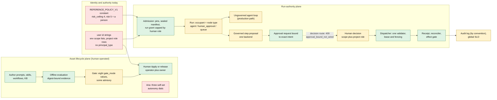

What the diagram makes visible: the occupant of a duty is chosen by node type inside the sealed bundle; authority for a run comes from a human's role at admission; policy is code; the decision path for an agent-proposed action cannot complete in production; there is no path from outcomes back to authority.

### 15.2 Target architecture

The target adds three things and rewires two. It adds the responsibility and assignment registry, the grant and ceiling machinery, and the observation ledger with shadow. It rewires admission (resolve and pin assignment) and the commit check (accept a grant-derived decision). Everything on the effect side of the dispatcher keeps its invariants.

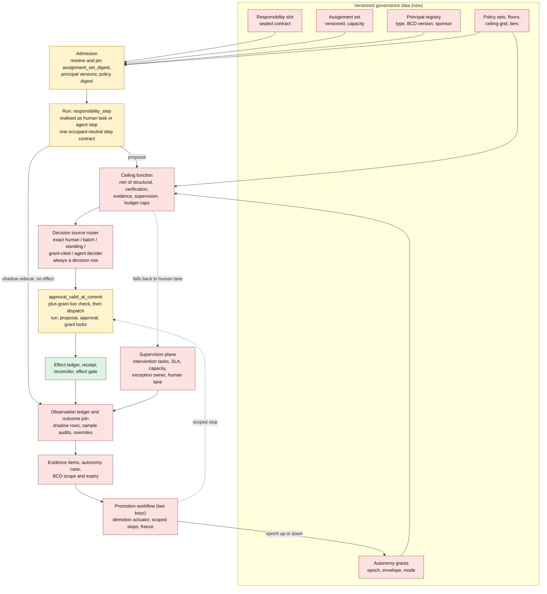

### 15.3 Table of deltas

"Additive" means the change is a new optional field, node, table or branch beside the existing path and keeps ADR 0003's readers-before-writers rule (`docs/architecture/adr/0003-control-record-schemas.md:25-52`). "Behavioural" means an existing behaviour changes for some deployments.

| # | Dimension | Current (evidence) | Target | Nature | Size | Phase |
|---|---|---|---|---|---|---|
| 1 | Sealed manifest and responsibility | The occupant is the node type: `AgentNode` (`src/workflows/manifest.py:795`) versus `HumanApprovalNode` with `required_role` validated against platform scopes (`:849`, `src/workflows/approval_policy.py:90`). Workload id is the digest of the workflow version (`src/policy/principal.py:104`), so a changed occupant is a new workload and new grants. | The slot contract is sealed with the version; the occupant is not. A new `responsibility_step` node realises either occupant through one step contract. A change to the contract is a new version; a change of occupant, mode or envelope is not. | Additive node; legacy nodes keep running ("inline at digest" implicit principal) | L | Now: decide. Next: build |
| 2 | Identity inside a run | One subject and one workload per run; knowledge and MCP calls inside a run use the workflow owner's viewer identity, a second notion [E-gov §2.1]; governed approvals set `requested_by` to the run initiator [E-gov §2.3]. | Initiator and performer-per-step recorded separately; in-run calls use the step's grant. | Additive fields (Now); identity unification is behavioural (Next) | M | Now / Next |
| 3 | Authority derivation | `create_grant` caps authority at the current role of the human subject (`src/policy/grants.py:173-195`); service principals are pre-bound with empty scopes (`principal.py:242`); an agent borrows the starter's authority. | Second grant source: an Autonomy Grant for agent-held seats; effective authority is the minimum of grant envelope, policy ceiling and floors. The human path is untouched. | Additive branch | M | Next |
| 4 | Principal typing | None: `grep principal_type src` is empty [repo]; `decided_by` and `requested_by` are strings (`src/contracts/schemas/approval_decision.v1.json:22`, `approval_request.v1.json:41`). | `human`, `agent`, `service`, `group`; agent version is the BCD; sponsor named; type and pins on every decision and audit row. `ServicePrincipal` stays as the ingress identity. | Additive | M | Now (fields) / Next (registry) |
| 5 | Policy as data | `REFERENCE_POLICY_V1` constant, `risk_ceiling=4`, risk 5 "a person, never a run" for every approval (`src/policy/decisions.py:146-184`); `decide(policy=REFERENCE_POLICY_V1)` default (`:258`). | Versioned policy sets behind a loader; seed record equal to `policy-v1`; floors carry a non-overridable flag; ceiling grid by tier, class and verifiability; two-key change. The "approve" vocabulary is split into platform-change approval (a floor) and effect authorization. | Additive loader; vocabulary split is behavioural | M | Now (loader) / Next (grid) |
| 6 | Approval path | Single trusted validator `approval_valid_at_commit` (`src/effects/dispatcher.py:879-880`); approval id required for every class (`:877`); bound-decision route answers 409 (`src/routes/workflow_runs.py:1866`); `human_approval` is a pass-through unless three flags are on (`src/workflows/runtime.py:8062`, `src/config.py:631`); `timeout_behavior` is `block` only (`approval_policy.py:86`). | Same validator, extended: every effect still has one exact-intent decision row, now with `approval_basis` (exact, batch, standing, grant, agent decider) and `decided_by_type`; fall back to a human when the ceiling forbids the decider; escalation timers; reference profile refuses an ungated drawn gate. | Additive; refusing pass-through is behavioural | L | Now (wire, refuse) / Next (bases) |
| 7 | Evidence plane | Offline digest-bound evidence (`src/eval/evidence.py`, `gate.py:51`); closed five-kind CHECK (`src/db/models.py:3808-3812`); no online evaluation, no outcome join, mutable unversioned judges [E-eval]. | Open evidence-kind registry; observation ledger and outcome join keyed by the proposal logical key (`db/models.py:2258`); shadow rows; BCD-scoped, expiring evidence; sealed held-out slices; judge qualification record. | Additive new tables | L | Now (schemas) / Next |
| 8 | Supervision and exception plane | Rework tasks, approval expiry, incident open and silence, effect parking; escalation rejected at validation (`approval_policy.py:232-244`); guardrail `escalate` equals `block` (`runtime.py:8011`). | Intervention tasks, supervision plan (coverage, SLA, capacity), exception owner, per-slot safe state, human-lane readiness; reviewer-quality telemetry only after a privacy review. | Additive | L | Next |
| 9 | Assignment registry | Instance-level assignees (CR reviewer, rework) and project membership rows; queue `reviewers` never read for authorization [E-roles §1.3, C6]. | Versioned assignment set per use case with capacity and effective window, changed by a governed release, pinned at admission. | Additive | M | Next |
| 10 | Autonomy representation | Three disjoint dials: Aria `AssistantApprovalMode` (`src/assistant/models.py:42`), plan `autonomy`, per-tool `requires_approval`; ADR 0004 scalar per use case is design only (`0004:54`). | Autonomy Profile derived from grants; L0-L5 as presets; Aria's dials derived from grants and `gated` kept as a floor. | Behavioural for Aria | M | Now (amend ADR) / Next |
| 11 | Stop and revoke | Run cancel, PAT revoke, `revoke_grant` with no external caller (`src/policy/grants.py:417`); planned stop scopes are project, workflow, connector (#776 [E-road]). | Stop-scope vocabulary adds principal version, responsibility and enterprise freeze; grant epoch read in the dispatcher lock set. | Additive | M | Now (vocabulary) / Next |
| 12 | Distinct actor and independence | Four string comparisons: `approval_policy.py:266`, `actor_provenance.py`, `workspace_release_governance.py`, Aria checks [E-gov §2.5]. | One function over principals with independence classes I0-I4 by tier; messages preserved by adapters. | Refactor, then additive | M | Now |
| 13 | Risk fields on records | `risk_class` is the effect class only (`approval_request.v1.json:37`). | Optional tier, verified reversibility, value and volume on the proposal. | Additive | S | Now |
| 14 | Platform scope assignment | Comma-separated env lists (`src/config.py:1708-1730` [E-roles]); revoking an agent's approver scope is a redeploy. | DB-backed assignments with expiry and audit; call sites unchanged. | Behavioural (operations) | M | Next |
| 15 | Audit and export | Audit log append-only by convention (`db/models.py:751-761`); control records trigger-immutable; `acceptance/` and `evidence/` named in ADR 0002 do not exist (`0002:32-33`). | Evidence package with server-free verifier; hash-chained autonomy transitions. | Additive | L | Next / Later |
| 16 | Gate fragmentation | Eight `gate_mode` values across the artifact families (`src/artifact_capabilities.py`), some advisory; the direct prompt alias route trusts `gate_state` from the request body (`src/routes/prompts.py:2035`). | One authorization policy consumed by every promotion path; gate state computed server-side. | Behavioural for clients | M | Now (small fix) / Next |

### 15.4 What does not change

Keeping these fixed is what makes the target additive and what the red-team review's "do not rebuild the spine" argument asks for: exact-intent binding and single consumption; the seven-state ledger and no-blind-redrive rule; the lease and fencing token; strict closed schemas with readers-before-writers versioning; the four effect classes and fail-closed classification; the reference profile as the one supported shape; single tenant `local` on every new record (ADR 0001, ADR 0003); digest-pinned connector admission; the permission vocabulary for humans (scopes and `PROJECT_ACTIONS`). A new action key needs a risk entry because a test forces `_ACTION_RISK` to cover every `PROJECT_ACTIONS` key (`src/policy/decisions.py:146`); that is intended friction.

### 15.5 Compatibility rules for stored data

Runs admitted without a manifest (`manifest_legacy`) keep their labelled legacy behaviour. A run admitted before assignment existed resolves every legacy node to an implicit principal "inline at digest" with no standing grant, so it keeps today's behaviour (the initiator's authority and human approvals) and never gains authority from the new path. New optional fields are written only after every reader of that kind has shipped (the rule at ADR 0003:25-52); the alpha tag `0.1.0a1` exists and Beta is untagged, so the window for additive-only changes is open now and narrows once an evidence export is retained.

## 16. Detailed capability gap analysis

### 16.1 Method and reading guide

All 25 capabilities in the charter's list are classified. The four classes are Supported, Partially Supported, Missing, and Architecturally Conflicting. I use *Architecturally Conflicting* only where closing the gap requires changing an existing abstraction rather than adding beside it, and I say whether the change can still be made additively (it usually can, because the repo's schemas are `v1` and the conflicting abstractions are seams with defaults). Where one capability has a Supported half and a conflicting half I give the more severe class and note the other. Priorities follow the scheme of 12.0: *Now* is a no-regret seam, a small fix, or finishing wired work; *Next* is production adoption; *Later* is autonomous operation.

Tally: 2 Supported, 16 Partially Supported, 4 Missing, 3 Architecturally Conflicting.

### 16.2 The table

**Table A: capabilities 1 to 12**

| # | Capability | Existing capability (repo evidence) | Class | Gap | Why it matters | Proposed capability | Rationale | Fix type | Priority |
|---|---|---|---|---|---|---|---|---|---|
| 1 | Roles and responsibilities | Four scopes (`src/auth.py:94-97`), four project roles (`src/resource_access.py:20-24`), closed `PROJECT_ACTIONS`; eleven meanings of "role" [E-roles]; `required_role` is a scope name (`src/workflows/approval_policy.py:90`). RBAC itself is Supported. | **Architecturally Conflicting** (as responsibility) | No responsibility object; the occupant is the node type, inside the sealed bundle. | Moving a duty from person to agent mints a new workflow version, workload and grants (`src/policy/principal.py:104`). | Responsibility slot (sealed contract), six archetypes, nine governance roles as data; permission roles stay for humans only. | Assignment and accountability need an object that permissions cannot be. | Architectural | Now (decide; add no more `required_role` semantics), Next (build) |
| 2 | Humans and agents | `Subject`, `ServicePrincipal` (`principal.py:115,242`); Aria reviewer is a config user id [E-roles §1.4, D2]; no `principal_type` anywhere in `src` [repo]; `create_grant` caps authority at a human's role (`grants.py:173-195`). | **Architecturally Conflicting** (authority derivation); principal typing Missing | An agent cannot hold authority of its own, only borrow or be pre-bound; audit cannot tell human from agent. | Evidence and revocation need an entity to attach to [E-eval §4]. | Principal registry (human, agent, service, group; version = BCD; sponsor); second grant source; performer per step. | Closes the "two authorization models" fork [E-roles §2.3]. | Architectural | Now (type and pins on records), Next (registry, grant source) |
| 3 | Human-agent collaboration | Aria modes (`src/assistant/models.py:42`), review queues, runtime approvals, rework tasks, CR reviewers. | Partially Supported | No capacity concept (assist, shadow, verify, oversee); human and agent decisions live in different tables and node types. | The most common first deployment is "human performs, agent checks"; ADR 0004 cannot express it [E-road §4.2, T1]. | Assignment with capacity; one occupant-neutral step contract; shadow sidecar. | Collaboration becomes an assignment change, not a redesign. | Architectural, product | Now (shadow-decision record, step-contract decision), Next |
| 4 | Agent execution | Step contract and result (`src/contracts/agent_step.py`), four provider adapters, `step_proposal.py`; `AGENT_STEP_BACKENDS = {"document_request"}` (`:81`); no production producer (`reference-profile.md:2559`); step limits in flight (B08.3). | Partially Supported | Contract and adapters exist; production uses the ungoverned loop; governed path serves one scenario and cannot return plain output [E-gov §2.3]. | "The model proposes, the system decides" is not yet true of agent-chosen calls (#750, #759, #768 open [E-road]). | Wire the producer at admission; central step limits; non-effect output channel; performer attribution. | This is the Beta thesis; autonomy builds on it. | Implementation, roadmap | Now |
| 5 | Workflow orchestration | 31 node types (`NodeType` in `src/workflows/ir.py`), run states, park and resume, subworkflows, effect gate (`src/workflows/manifest.py`, `run_state.py`) [E-gov §2.2]. | Supported | Governed steps refuse handoffs, inline targets and parallel branches [E-gov §2.2]; no `responsibility_step`. | Autonomy cannot compose with rich orchestration until the governed path does. | Add `responsibility_step`; extend governed path only as pilots demand; no other new node types. | Avoid a twelfth special case. | Implementation | Next |
| 6 | Autonomy levels | ADR 0004 scalar L0-L5 per use case (`0004:54`), design only; three disjoint dials in code [E-gov §2.7]. | Missing (code); the scalar design conflicts with the vision | A scalar cannot express a profile; Aria dials are self-assigned (`src/routes/aria_plans.py:150-185` [E-roles]). | The cheapest reversal available: nothing depends on the scalar yet (Appendix A, section A.2(g)). | Autonomy Profile of derived modes M0-M5; L0-L5 as presets; amend ADR 0004 before M24 persists the scalar. | Fix the abstraction while it is only text. | Architectural (ADR), product | Now (amend), Later (enforce) |
| 7 | Capabilities | Tool registry, 132-row inventory, digest-pinned connector admission (`src/profile.py:99`) [E-gov §2.4]. | Partially Supported | Capability attaches to node, tool and starter, not to a responsibility; capability (measured) and permission (granted) are not separated. | The grant must be a function of a measured capability, or "earned" has no meaning. | Slot lists permitted effect classes and connectors by registry identity; evidence records measured capability beside granted permission. | Matches the allowed-versus-capable split [S: Zheng]. | Architectural | Next |
| 8 | Tool access | MCP, OpenAPI, file and bucket paths still on old guards (EP-007, 008, 030-037) [E-gov §2.4]; custom tool class is author-declared [E-gov §2.4]; model calls bypass egress. | Partially Supported | Not all paths route through the dispatcher; reversibility is declared, not verified. | A grant is only as strong as the weakest unrouted path. | Finish routing (in flight); count reversibility only with a proven compensating operation. | Do not issue any grant on a path that does not pass the dispatcher. | Implementation, roadmap | Now (finish), Next (verified reversibility) |
| 9 | Permissions | Project RBAC, PAT ceilings, owner capped by scopes (`resource_access.py`); scopes assigned by env list (`src/config.py:1708-1730`). | Partially Supported | Granting or revoking a scope is a redeploy with no record; humans only. | An agent's authority must be revocable at runtime with a record. | DB-backed scope assignments with audit and expiry; an agent's authority is a grant, never a scope. | Keeps the permission model unchanged (ADR 0004:34). | Implementation | Next |
| 10 | Policies and governance | Recorded typed decisions (`src/policy/decisions.py:255-262`); constant policy with risk 5 = person (`:146-184`); injectable `policy` argument (`:258`); GovernanceRecord is M24, planned. | Partially Supported | Policy is code; one "approve" vocabulary covers platform-change approval and effect authorization. | Autonomy above M3 is inexpressible without a code change and a `policy_version` bump. | Versioned policy sets behind a loader (seed equals `policy-v1`); floors as non-overridable data; ceiling grid; split the approve vocabulary. | The seam already exists, so this is additive. | Architectural (small) | Now (loader, floors), Next (grid, tiers) |
| 11 | Evaluation | Strong offline: digest-bound evidence, fail-closed gate (`src/eval/gate.py:51`, `evidence.py`); default provider is `fake`; no online evaluation; judges mutable [E-eval]. | Partially Supported | No live scoring, no per-principal track record, no sealed slices, no judge qualification gate. | Offline scores overstate real behaviour [W]; evidence of autonomy needs live outcomes. | Observation ledger, sampled online evaluation, versioned judges with a qualification record, sealed held-out and adversarial slices. | Evidence integrity is the defensible part (Appendix A, section A.2(h)). | Product, implementation | Now (schemas), Next |
| 12 | Validation | None: no acceptance code; `workflow_success_rate` means run completed (`src/observability/slo.py:22`); `acceptance/` and `evidence/` named in ADR 0002 do not exist (`0002:32-33`). | Missing | No acceptance predicate independent of model text. | Without a deterministic check the chain cannot exceed M3 (ADR 0004:107-108). | Acceptance-predicate contract and a verifiability class V1-V3 on the slot; a deterministic validator seat held by a `service` principal. | The predicate carries the trust claim, not the role. | Architectural (contract), implementation | Now (contract), Next (B09) |

**Table B: capabilities 13 to 25**

| # | Capability | Existing capability (repo evidence) | Class | Gap | Why it matters | Proposed capability | Rationale | Fix type | Priority |
|---|---|---|---|---|---|---|---|---|---|
| 13 | Human approval | Exact-intent chain with commit-time recheck (`approval_policy.py:336,393`); bound-decision route answers 409 (`workflow_runs.py:1866`); `human_approval` passes through by default (`workflows/runtime.py:8062`); only `decided_by` strings. | Partially Supported | Decision path unwired; unsafe default; no type or basis on records. | A drawn gate that does nothing is the failure class the repo condemns (`approval_policy.py:240-244`). | Wire the bound decision (PR #1042 is open); refuse pass-through in the reference profile; add `decided_by_type` and `approval_basis`; batch and standing as minting variants. | One decision row per effect keeps audit uniform. | Implementation, contract | Now |
| 14 | Exception handling | Error boundary, retries, effect parking on `unknown`, reconciler, rework tasks [E-gov §2.9]. | Partially Supported | No exception taxonomy per responsibility, no declared safe state, no exception owner or queue. | At M4 and M5 exceptions are the human's whole job; "just stop" is unsafe mid-transaction [S, E-av]. | Intervention tasks, safe state declared on the slot, exception queue with owner. | If the safe state is unreachable the action must not start. | Product, architectural | Next |
| 15 | Escalation | Missing: `SUPPORTED_TIMEOUT_BEHAVIORS = {"block"}` (`approval_policy.py:86`); `escalate` rejected (`:240-244`); guardrail `escalate` runs as `block` (`runtime.py:8011`). | Missing | No target, SLA, timer, reassignment. | ADR 0004 L3 depends on M06 timers that do not exist; M3 is not honest without them. | M06 timers; behaviours `expire`, `escalate`, `safe_stop` added only when implemented; never `auto_approve`. | Keep the refusal until the mechanism exists. | Product, roadmap | Next |
| 16 | Observability | Spans, run and context manifests, causal span attributes (B11.3a) [E-eval §6.1]; SLO global (`slo.py:22`); incidents unique per objective (`db/models.py:1665-1690`). | Partially Supported | Signals not scoped by grant, responsibility or connector; no per-principal series. | Demotion triggers must be targetable. | Scope keys on signals and incidents; scorecard as a view over the observation ledger. | Raw rows exist; aggregation is the gap. | Implementation | Next |
| 17 | Auditability | `audit.record` in the caller's transaction (`src/audit.py:54`); control records trigger-immutable; audit log append-only by convention (`db/models.py:751-761`); evidence package is B14, planned. | Partially Supported | No tamper evidence; no principal type; no export verifier. | The evidence package is what auditors receive. | Evidence package with principals and pins; hash-chained autonomy transitions; protected archive (M05). | Claim only what is true: "tamper-proof logging" is not true today. | Implementation | Next (package), Later (chain, signatures) |
| 18 | Security | Egress pinning, fail-closed redaction, context manifest trust tiers, connector admission [E-gov §2.12]; model calls bypass egress; MCP stdio is containment; regex PII; no external review (#851 open). | Partially Supported | No adversarial evidence; autonomy expands attack surface [S: Feng]. | A defect in the spine is the trust-root failure (Appendix A, section A.4, failure 3). | External review of the governed path before any grant; adversarial suite stored as evidence. | The spine is written and reviewed by agents (D2 report) [E-road]. | Implementation, roadmap | Now (external review), Next (suite) |
| 19 | Runtime execution | Lease with fencing, run states, park and resume, effect gate, kill-the-owner scenario V14 [E-gov §2.14]. | Supported | None for the current model. | Dispatch correctness depends on it. | Keep; the demotion actuator is one more owner-only loop. | Do not touch the spine. | none | n/a |
| 20 | State and memory | KB versions, approved context sources, context manifest with trust tiers (`src/context/manifest.py`); memory default off, partitions ungoverned (map-gap G15) [E-eval §6.2]; no replay. | Partially Supported | Memory can silently change behaviour; no historical replay for cheap evidence. | A BCD that omits memory state lets evidence outlive behaviour. | BCD includes KB and memory versions; no grant-bearing responsibility with memory enabled until M20; replay (B09). | Evidence validity depends on pinned state. | Roadmap | Next (replay), Later (memory) |
| 21 | Multi-agent coordination | In-run handoffs only; all share the run's subject and workload; governed path refuses handoffs [E-gov §2.10]. | Partially Supported | No per-agent identity, no delegation attenuation, no chain attribution. | Chains, not seats, produce outcomes; per-seat demotion is false precision [E-eval §9.3]. | Performer per step; chain-level evidence; child grants must be a subset of the parent (M13). | Do not build a delegation trust model now. | Architectural | Later |
| 22 | Multi-tenancy | Project isolation strong; `tenant_id` defaults to `local` (`db/models.py:2118`); shared tenancy excluded by owner decision [E-gov §2.11]. | Partially Supported (single tenant by decision) | `public` visibility is incompatible with tenant isolation. | Fixes the product as per-customer self-hosted. | Keep `tenant_id` required on every new record so contracts stay tenant-aware; no retrofit work. | Matches the explicit exclusion; the cost is no fleet. | Roadmap (exclusion) | Later, or never |
| 23 | Enterprise scalability | One execution owner runs 13 owner-only loops (`src/observability/worker_inventory.py`); `_tick` claims one run and executes it synchronously (`src/orchestrator/workflow_run_worker.py:590-601`). | **Architecturally Conflicting** at scale | Throughput and failover cannot scale horizontally without re-fencing every loop; this is from reading `_tick`, not from a measurement. | A fleet of agents multiplies run volume; supervision capacity is the other ceiling. | Measure the envelope (M12) first; superseding ADR for per-run claim and fencing only if a pilot needs it; keep the actuator light. | A reversal with a large cost (Appendix A, section A.2(g)); do not pay it speculatively. | Architectural | Now (measure), Later (redesign) |
| 24 | Continuous improvement | Human-gated refinement loop; no Observe stage and no negative feedback; gate scores the same dataset the optimizer uses [E-eval §5, 9.3]; client-supplied `gate_state` (`routes/prompts.py:2035`). | Partially Supported | No outcome join, no sealed slice, evidence not re-scoped on change. | "Continuous improvement" and "evidence must be re-earned on every change" collide unless change classes exist. | Outcome join into the loop; sealed slices; server-computed gate state; BCD change classes C0-C3. | Makes improvement and evidence compatible. | Product, implementation | Now (gate state), Next |
| 25 | Autonomy promotion and demotion | None: `revoke_grant` is never called outside its module (`grants.py:417`) [repo]; incidents publish events no subscriber acts on [E-eval §3]; no GovernanceRecord. | Missing | No grant, no epoch, no two-key promotion, no actuator, no scoped stop. | The vision's central mechanism. | L8: grants with epochs, promotion as a governed release, demotion actuator, scoped stops, enterprise freeze. | Down is faster than up; humans promote, the system demotes. | Architectural | Now (vocabulary, epoch field), Next (human-seat grants, freeze), Later (actuator) |

### 16.3 Reconciliation with the evidence reports

I agree with the facts in the evidence reports in every case I re-opened. Disagreements are about labels.

| Topic | Positions in the evidence reports | Ruling and reason |
|---|---|---|
| Humans and agents | E-gov: Missing. E-roles: "mechanically yes for a user id, semantically no". E-road: absent in code. | **Architecturally Conflicting** for authority derivation, Missing for typing. Reason: `create_grant` binds authority to a human role (`grants.py:173-195`), so an agent cannot be an authority source without a second source. |
| Policies and governance | E-gov: Partially Supported in the ledger, but lists the hard-coded ceiling among five conflicts [E-gov §6]. | **Partially Supported.** Downgrading the conflict: `decide(policy=REFERENCE_POLICY_V1)` already takes the policy as a parameter (`decisions.py:258`), so a loader is additive. The *content* (risk 5 = person) is a floor to keep as data, not a conflict. |
| Roles and responsibilities, sealed manifest | E-gov: Architecturally Conflicting. E-roles: roles are permission tiers. | **Agree**, with a scope note: the conflict binds only legacy inline nodes; a new node type coexists, so no migration of stored manifests is needed. |
| Enterprise scalability | E-gov: Partially Supported. | **Architecturally Conflicting at scale**, Partially Supported at pilot scale. Unmeasured. |
| Autonomy levels | E-gov: Missing. E-road T1: scalar conflicts with the vision. E-eval: Missing in code, designed in ADR 0004. | **Missing in code; design conflict in the ADR**, fixed by amendment because nothing persists the scalar yet. |
| Evaluation and validation | E-eval: evaluation Partial (strong), validation Missing. | **Agree.** |
| ADR 0001 class table | E-gov: the ADR overstates; dispatcher needs an approval for every class. | **Verified**: `dispatch` refuses a blank approval id for every class (`dispatcher.py:877`); ADR 0001 says `reversible_write` needs only a decision, proposal and receipt. Amend the ADR text or implement the differentiated path; I recommend amending now and using `approval_basis` to carry class-appropriate bases later. |
| Guardrail `escalate` equals `block` | E-gov and E-roles. | **Verified** at `runtime.py:8011`. |
| Production behaviour of unwired paths | E-gov: queued runs with `webhook` or `api_request` nodes fail closed, from reading code and a test comment. | **Not verified by me.** I confirmed the 409 constant and the default-off flag, not the end-to-end run behaviour. |
| "At least eleven approval mechanisms" | E-roles. | **Not re-counted by me.** I verified the four distinct-actor implementations only partly (`approval_policy.py:266`). |
| `request_changes` absent from the route | E-road. | Not re-verified. |

### 16.4 What Caliber cannot reasonably support

Stating these plainly is part of not forcing the vision onto the architecture.

1. **Autonomy for work with no verifiable outcome beyond M3.** Drafting, triage, summarisation and judgement-heavy work have no deterministic oracle. ADR 0004 caps them at L2; the design allows a graded V2 (judge-assisted, M4 only for reads and reversible writes, ship disabled). Anything beyond that would rest on LLM judges the platform cannot yet qualify. This is a product boundary and should be a stated non-goal [E-road §4.2, T4].
2. **A common platform in the NVIDIA sense.** There is no certifier, no fleet by design (shared tenancy is excluded), no common external standard, and competing vendors own identity and the org graph. Probability of the strong claim in 24 months is about 3 percent in the red team's estimate [J] (Appendix A, section A.6.1).
3. **Statistical proof of safety for irreversible effects.** 200 clean decisions bound the failure rate near 1.5 percent; 3,000 are needed for 0.1 percent [J arithmetic]. Most enterprise responsibilities will never see that volume. Exposure caps, not statistics, must carry irreversible and export effects.
4. **Per-seat promotion and demotion without counterfactual replay.** A chain produces the outcome. Until replay (B09.5) exists, evidence and demotion work at envelope or chain scope, and per-seat metrics are used only where there is decision-level ground truth (shadow comparison, seeded faults).
5. **Fleet learning across customers.** One tenant per installation means every customer's evidence is n=1; cross-tenant learning would need a contractual and technical design that is explicitly out of scope.
6. **Horizontal autonomous throughput on the current execution model.** One execution owner and one run per tick cap it. Supportable at pilot volume only, until M12 shows otherwise and an ADR supersedes ADR 0002.
7. **Third-party certification.** No regulator or body will certify Caliber; it can emit evidence for the customer's own risk, audit and validation functions.
8. **Human accountability replaced by a platform record.** The platform can make the Accountable Owner a recorded fact. It cannot make the owner's review real; a record without capacity is a moral crumple zone [S; see 8.7].

### 16.5 What I could not verify in this section

I ran no code or tests. I confirmed these by opening the cited lines: the policy constant and default argument, the grant creation and absence of `revoke_grant` callers, the single-validator rule in the dispatcher, the approval-id requirement, the timeout restriction, the 409 constant, the pass-through string and its default-off flag, the single-claim `_tick`, the closed evidence CHECK, the global SLO docstring, and the client-supplied `gate_state`. The remaining existing-capability claims rest on the evidence reports named in each row.

## 17. Architectural changes required

### 17.1 Rules that govern every change below

1. **Additive first.** Every new field is optional, every new node and table sits beside an existing one, and every strict schema keeps `additionalProperties: false` (ADR 0003). Readers ship before writers; writers are flag-gated and default off until every reader of that kind has shipped (`docs/architecture/adr/0003-control-record-schemas.md:25-52`).
2. **One decision record per effect.** A grant-cited, standing, batch or agent decision is *minted as an `approval_decision` row* with an `approval_basis`, bound to the exact intent, and consumed once. No second validator: the dispatcher refuses any validator other than `approval_valid_at_commit` (`src/effects/dispatcher.py:879-880`), so all new authority checks live inside that function.
3. **Cheap, linearised dispatch.** The ceiling function is computed asynchronously and materialised onto the grant as `effective_mode_ceiling` with a `ceiling_digest` and an `epoch`. The dispatch-time check reads the grant row only, under a lock acquired after the existing order `run -> proposal -> approval` (`src/workflows/approval_policy.py:336-360`), so lock order becomes `run -> proposal -> approval -> grant`. The actuator locks only grant rows and never a run, which avoids a cycle [J].
4. **Identity is pinned, authority is rechecked.** The sealed manifest pins who held a seat (for attribution and replay); the grant's live status, epoch and ceiling decide whether that principal may act now.
5. **Proposed new code lives in two packages** [J]: `src/autonomy/` (assignments, grants, ceiling, transitions, actuator, stops) and `src/governance/` (governance record, intervention tasks, supervision plan). The plan's file names `autonomy.py`, `governance.py`, `principals.py` do not exist on main [E-road]; the existing `src/policy/principal.py` is the run-identity module and is kept.

### 17.2 New entities and tables

Migrations continue from `src/db/migrations/versions/0131_refinement_job_triggered_by.py`. "Breaking" is whether any existing record, client or deployment must change.

| ID | Entity and tables | Key content | Touches or creates | Size | Depends on | Risk | Breaking | ADR |
|---|---|---|---|---|---|---|---|---|
| ENT1 | **Principal** and principal version: `caliber_principals`, `caliber_principal_versions` | `principal_id`, `type` (human, agent, service, group), `sponsor`, `status`; version = BCD (model route and family, prompt or skill digest, tool-set digest, KB version, adapter version, policy version); retired flag | New `src/autonomy/principals.py`; reuse `src/policy/principal.py`; `src/db/models.py`; `src/audit.py` | M | BCD definition (ADR A8) | M: BCD canonicalisation; naming collision with `CaliberAgentConfig` (a refinement target, not an actor) [E-eval §9.2] | No | A1, A8 |
| ENT2 | **Responsibility slot registry**: `caliber_responsibilities` | Slot id, archetype, I/O contract digest, effect ceiling, independence rules, evidence kinds, verifiability class V1-V3, human-floor flag, safe state, fallback; `contract_digest` | `src/workflows/manifest.py` (new node beside `AgentNode:795`, `HumanApprovalNode:849`), `ir.py`, `compiler.py`, `validation.py`, `promoter.py`; verify whether a manifest schema bump is needed (`workflows/manifest_migrate.py`; not checked) | L | none | H: IR and compiler change; two realisations of one step | No for legacy nodes | A2 |
| ENT3 | **Assignment set**: `caliber_assignment_sets`, `caliber_assignments` | Append-only versioned rows: responsibility, principal and version, capacity, effective window, assigned-by, supersedes; set digest; immutable via the trigger pattern in `src/db/immutable.py` | New `src/autonomy/assignments.py`; `src/workflows/admission.py` | M | ENT1, ENT2 | M | No | A2 |
| ENT4 | **Autonomy grant**, **grant epoch**, **transition**: `caliber_autonomy_grants`, `caliber_grant_transitions` | Grant: responsibility, `contract_digest`, envelope version, principal version, duty allocation, derived mode, `effective_mode_ceiling`, `ceiling_digest`, status (active, probation, suspended, revoked, expired), `epoch`, `review_due`, `expires_at`, Accountable Owner. Transition: kind, trigger refs, evidence digest, three keys with principal types, prev and next hash | New `src/autonomy/grants.py`, `transitions.py`; hook points `src/policy/grants.py`, `src/effects/dispatcher.py`, `src/workflows/approval_policy.py` | L | ENT1, ENT2, ENT3, ENT8; ENT5 and ENT6 for promotion | H: security-critical, lock order | No | A3, A6 |
| ENT5 | **Observation ledger and outcome join**: `caliber_decision_observations`, `caliber_outcome_events` | Immutable observation per decision: instance key (run, node, occurrence; the proposal logical key at `db/models.py:2258`), grant and epoch, mode applied, performer and verifier principal ids and BCD digests, routing decision, refs to proposal, approval, effect, `shadow` flag, latency, cost. Append-only outcome events: accepted, rejected by acceptance, overridden, reworked, reversed, incident, audit clean or error | New `src/autonomy/observations.py`; writers in `workflows/approval_requests.py`, `effects/step_proposal.py`, `effects/records.py`, `orchestrator/effect_reconciler.py`, `routes/rework_tasks.py`, `routes/quality_reviews.py`, `assistant/service.py`, `observability/incidents.py` | L | ENT1 (ids) | M-H: write amplification in the single owner process; input digests only, never payloads | No | A5 |
| ENT6 | **Autonomy case and evidence** (minimal): `caliber_evidence_items` (open kind registry), `caliber_autonomy_case_versions`, `caliber_case_signoffs` | Case version with one top claim, evidence links with `scope_digest`, `valid_from`, `valid_until`, assumptions with monitors, accepted residual risk, signoffs by role; digest chain. Do **not** extend the closed five-kind CHECK at `src/db/models.py:3808-3812` | New `src/autonomy/cases.py`; reuse `src/eval/evidence.py` blocks | M (minimal), L (full graph) | ENT4, ENT5 | M | No | A5, A8 |
| ENT7 | **Governance record**: `caliber_governance_records` | Use case, tier T1-T4, loss tolerance, blast limits, overlay flags (regulated decision, human must remain), Accountable Owner, Autonomy Authority group, Supervisor group, Exception Owner group, supervision plan, thresholds, outer envelope, aggregate exposure budget | New `src/governance/records.py`; do not reuse `CaliberProject.owner` or `CaliberAgentConfig` | M | ENT1 | M: owner conflation ([E-road §4.2, T6]) | No | A3, A9 |
| ENT8 | **Policy data store**: `caliber_policy_sets` | Version, content, digest, status, approvals; ceiling grid, tier table, floors with `non_overridable`, verification caps | `src/policy/decisions.py:184,258` (loader behind the `policy` default), `workflows/admission.py`, `workflows/run_identity.py`, `context/authorize.py` | S (loader), M (grid) | none | L-M: the seed must reproduce `policy-v1` exactly | No | A4 |
| ENT9 | **Intervention task**: `caliber_intervention_tasks` | Kind (exception, sample audit, look-back, supervision review), grant, instance key, assignee group, due, resolution | New `src/governance/interventions.py`; expiry service in `workflows/approval_requests.py`; pattern of `routes/rework_tasks.py` | M | ENT7; M06 | M | No | A6 |
| ENT10 | **Stop scopes and freeze**: `caliber_autonomy_stops` | Scope (run, principal version, responsibility, connector, use case, enterprise), kind, reason, actor, lifted-by | Read hook in `effects/dispatcher.py`, `workflows/admission.py`, `workflows/run_identity.py`; finally a caller for `revoke_grant` (`policy/grants.py:417`) | M | ENT4 | M | No | A6 |
| ENT11 | **Judge version and qualification**: `caliber_judge_versions`, `caliber_judge_qualifications` | Judge version, held-out label set digest, kappa with interval, n, `valid_until` | `src/eval/alignment.py:33`, `src/eval/judge_scorer.py`, `routes/judges.py`, `eval/gate.py`; `CaliberJudge` is unique by name today [E-eval §2.2] | M | none | L | Migration of judge rows; no API break if the name stays the key | A5 |
| ENT12 | **Platform scope assignments**: `caliber_scope_assignments` | Principal, scope, expiry, granted-by | `src/auth.py:272-290`, `src/config.py:1708-1730` | M | ENT1 | M: auth-critical | Behavioural (operations) | A1 |

### 17.3 Contract and schema changes (additive, readers before writers)

| Record | Optional fields to add | Rule or caution |
|---|---|---|
| `approval_request.v1` (`src/contracts/schemas/approval_request.v1.json`) | `performer_principal_id`, `performer_type`, `performer_version`, `responsibility_id`, `assignment_set_digest` | Keep `requested_by` as the run initiator so no meaning changes; the performer is a new field. The UX contract's `requested_by_type` view reads the performer type (`docs/architecture/approval-ux-contract.md:33,38`). |
| `approval_decision.v1` | `decided_by_type`, `principal_id`, `principal_version`, `approval_basis` (exact, batch, standing, grant, agent), `grant_id`, `grant_epoch`, `independence_level`, `standing_id`, `bundle_id` | `approval_basis` makes class-appropriate approval possible without a second path. |
| `proposal.v1` | `performer_principal_id`, `pins_digest`, `responsibility_id`, `risk_tier`, `reversibility_verified`, `exposure_value`, `exposure_volume` | These are not intent. They must be excluded from the `intent-v1` hash so legacy hashes do not change [R, to verify against `src/effects/records.py`]. |
| `run_manifest.v1` `pins` (`run_manifest.v1.json:35`) | `assignment_set_digest`, `performers[]` (responsibility, principal id and version, capacity, grant id), `policy_set_digest` | Pins identity at admission. A parked run keeps its pinned set; new runs get the new set; authority is rechecked at every use. |
| `policy_decision.v1` | `principal_id`, `grant_id`, `policy_set_digest` | Must not change `input_hash` for decisions written before the fields existed [to verify]. |
| `caliber_audit_log` (DB, not JSON schema) | nullable `actor_type`, `principal_id`, `pins_digest`; optional kwargs on `audit.record` (`src/audit.py:54`) | Additive migration. |
| New strict schemas | `autonomy_grant.v1`, `grant_transition.v1`, `decision_observation.v1`, `outcome_event.v1`, `evidence_item.v1` | Follow ADR 0003 conventions: `schema_version`, `tenant_id` and `region` required, digests as `sha256:<hex>`, payloads referenced not inlined. `tests/test_contracts_registry.py::test_adr_0003_matches_the_schemas` forces the ADR tables to match. |
| Events | `autonomy.changed`, `grant.suspended`, `grant.revoked`, `evidence.expiring`, `trigger.fired`, `supervision.capacity_breached` | Existing envelope, payload by reference. |

**Rollout order** [J]: (1) ship readers and schema files; (2) ship writers behind flags, default off; (3) enable in the reference profile once the evidence package (B14) and every stored export validate; (4) never make a new field required in `v1`. The window is open because Beta is untagged; it narrows when a customer retains an export.

### 17.4 Runtime changes

| ID | Change | Modules | Detail | Size | Depends on | Risk | Breaking | ADR |
|---|---|---|---|---|---|---|---|---|
| RT1 | **`responsibility_step` node resolved at admission** | `workflows/manifest.py`, `ir.py`, `compiler.py`, `admission.py`, `run_pins.py`, `runtime.py` | Admission resolves the assignment set, computes `assignment_set_digest`, pins performers. At execution the step is realised as an agent step or a human task; both consume and emit the same step contract (the `AgentStepRequest` and `AgentStepResult` shapes). If the grant is not active the step goes to the slot's declared fallback lane. | L | ENT2, ENT3, ENT1 | H | No | A2 |
| RT2 | **Second grant source for agent seats** | `policy/grants.py:173` (new branch beside human and `ServicePrincipal`), `workflows/run_identity.py:86` | For an agent performer, authority = min(Autonomy Grant envelope, policy ceiling, floors); `identity_for_run` re-decides it. The human path is unchanged. | M | ENT4, ENT8 | H | No | A3 |
| RT3 | **`approval_valid_at_commit` accepts grant-based authority** | `workflows/approval_policy.py:336-393` | New branch for `approval_basis` in (grant, standing, agent): skip scope and project-role checks, add live grant checks (status, epoch, ceiling digest, envelope predicate), keep every existing binding check and the `identity_for_run` re-decision. Lock order extended. | M-L | ENT4, RT4 | H | No | A7 |
| RT4 | **Decision minting** | New `src/effects/authorization.py` | After routing decides the instance may be authorised without a per-instance human, mint request and decision rows (principal `policy:<standing_id>` or the agent decider) bound to the exact intent, short expiry, single consumption. Only deterministic predicates may mint; never a model. | M-L | PR #1042 (bound decision wired), ENT4, ENT8 | H | No | A7 |
| RT5 | **Unified distinct-actor and independence check** | Replaces four implementations: `approval_policy.py:266`, `actor_provenance.py`, `workspace_release_governance.py`, Aria checks in `assistant/service.py` | One function `check_independence(principals, chain, tier)` with classes I0-I4; adapters preserve current messages. First pass compares string ids so behaviour is identical; later passes use pins. | M | none (first pass) | L-M | No | A9 |
| RT6 | **Escalation and timers** | `workflows/approval_requests.py` expiry service; `SUPPORTED_TIMEOUT_BEHAVIORS` (`approval_policy.py:86`) | Add `expire`, `escalate`, `safe_stop` only as each is implemented; never `auto_approve`; unanswered chain ends in the safe state and counts against the grant. | L | ENT9, ENT7 | M | No | A6 |
| RT7 | **Scoped stop** | `effects/dispatcher.py`, `workflows/admission.py`, `workflows/run_identity.py` | Read stop scopes at admission and at claim; call `revoke_grant` where a run-scoped stop applies; enterprise freeze forces every grant to its fallback mode. The stop acts on authority, never on the owner process, reconciler or verifier. | M | ENT10 | M | No | A6 |
| RT8 | **Grant epoch linearised with dispatch** | `effects/dispatcher.py` claim (`_claim_dispatch`, `:729`), `approval_policy.py` | Add the grant row to the lock set; after a reduction commits no dispatch starts under the old epoch. Exercise on PostgreSQL (SQLite is dev-only [E-gov]). | S-M | ENT4 | H: deadlock | No | A6 |
| RT9 | **Demotion actuator** | New owner-only loop `src/orchestrator/autonomy_actuator.py`, registered through `observability/worker_inventory.py` | Reads the observation ledger and incidents; one transition per newly qualifying event set (watermark); writes transition and grant status in one transaction; handles in-flight work (section 17.8). | L | ENT4, ENT5, ENT6, ENT10 | H | No | A6 |
| RT10 | **Initiator versus performer** | `effects/step_proposal.py` (`GovernedStepContext`), `approval_requests.py` | Governed approvals record the agent performer next to the human initiator. | S-M | ENT1 | L | No | A1 |
| RT11 | **Refuse an ungated drawn gate** | `src/profile.py:282` (`reference_profile_violations`), admission | Refuse a `human_approval` node when the three flags are not set (`config.py:631`, `runtime.py:8062`). | S | none | L | **Behavioural**: deployments that relied on pass-through stop starting | A7 |
| RT12 | **Server-computed gate state** | `src/routes/prompts.py:2035` | Ignore or reject a client-supplied `gate_state`. | S | none | L | **Behavioural** for clients that send it | none |
| RT13 | **Aria dials derived from grants; fence the permissive modes** | `src/assistant/models.py:42`, `assistant/service.py`, `routes/aria_plans.py` | Now: add a reference-profile violation for `auto_all` and `full_autonomy`. Next: derive modes from grants (M27.3c). | S, then M | ENT4 | M | **Behavioural** for Aria users | A3 |

### 17.5 Policy changes

**Policy as data.** `REFERENCE_POLICY_V1` becomes the seed record of `caliber_policy_sets`, loaded behind the existing default argument (`src/policy/decisions.py:258`). A test asserts the seed produces a `Policy` equal to `Policy(version="policy-v1", action_risk=_ACTION_RISK, risk_ceiling=4)` so existing manifests and decision hashes are unchanged. Floors are keys with `non_overridable`: a run never approves (risk 5), the Aria `gated` tier (`src/assistant/executor.py:141-148` [E-roles]), break-glass, accountable ownership and sponsorship, no self-governance, and no blocking of a stop. Changes to a policy set are a governed release with two keys, never an edit.

**Split the "approve" vocabulary.** `_ACTION_RISK` uses risk 5 for approving platform change (`release.approve`, `release.quality_signoff`, `change_request.accept`, `resource.approve`) and the same bucket would cover authorising an effect proposal. Platform-change approval stays a floor. A new action key, `effect.authorize`, covers effect decisions, with its own risk entry (a test forces every `PROJECT_ACTIONS` key to have one).

**The ceiling function** (defined in 13.6.1) works on modes and can only lower:

```
ceiling(grant, slice) = min( C_structural(effect_class, tier, reversibility_verified, blast, overlays),
                             C_verification(V-class),
                             C_evidence(grade(slice, BCD)),
                             C_supervision(capacity, coverage, independence),
                             C_budget(remaining exposure) )
effective_mode = min(requested_mode, ceiling)       # materialised on the grant with ceiling_digest and epoch
```

The structural grid is the one of 9.5 and 13.6.2, shipped as the seed policy record [J]; the verification cap uses the classes V1 to V3 (13.6.3), where V2 reaches at most M4 and only for `read` and `reversible_write`, and V3 at most M3. The optional judge-only relaxation (a qualified judge with at least 10 percent blind human audit, no deterministic predicate, reversible work at M4) is a policy-data switch, **default off**, because judge qualification is not enforced anywhere yet (Appendix B, section B.1, item 9). Overlays *regulated decision* and *human must remain* cap at M3, or M2 where the regulation requires the human to decide, whatever the evidence. A supervision plan that cannot be staffed lowers `C_supervision`, and an unreachable safe state makes the action not start. Evidence grades G0 to G4 (13.6.4) only say which modes the evidence can support; they are inputs to `C_evidence`, not a second ladder.

Evidence-bounded exposure (`max_exposure = loss_tolerance / upper_bound`) is a `C_budget` input. The `exposure_limit` field is a *Now* schema decision; the automation is *Later*.

### 17.6 Evaluation changes

| ID | Change | Modules | Size | Depends on | Phase |
|---|---|---|---|---|---|
| EV1 | **Shadow sidecar.** An admitted run flagged `shadow`; reaches only `read`-class tools (the inventory floor), creates no proposal, approval request or ledger row; output sealed and blinded until the human commits. Seat shadow (M1) and duty shadow (an agent verifier beside the human verifier during M3). | `workflows/admission.py`, `workflows/run_launch.py`, `effects/step_proposal.py` (suppress), new `src/eval/shadow.py` | L | ENT5, ENT1 | Now: shadow-decision record. Next: runner |
| EV2 | **Outcome join.** A job that attaches later outcomes (acceptance, rollback, rework, quality no-go, incident, audit sample) to observations by instance key. | `orchestrator/outcome_join.py` (new), sources in `db/models.py` | M-L | ENT5 | Next |
| EV3 | **Online evaluation.** Sampled scoring of observations with qualified judges and deterministic scorers; no judge counts toward a grant unless qualified. | new `src/eval/online.py`; `eval/judge_scorer.py` | M | ENT5, ENT11 | Next, Later |
| EV4 | **Held-out sets.** Dataset roles `dev`, `held_out`, `critical`, `adversarial`; the optimizer cannot read sealed rows; `apply_gate` consumes critical slices. | `CaliberEvalDataset`, `eval/dataset_sync.py`, `orchestrator/eval_stage.py`, `eval/gate.py:51` | M | none | Next |
| EV5 | **Judge qualification record** with a kappa floor on held-out human labels, re-run on judge or model change. | ENT11, `eval/alignment.py:33` | M | none | Next |
| EV6 | **Open evidence-kind registry** and BCD scope and expiry on every evidence item. | ENT6 | S-M | none | Now |
| EV7 | **Scorecard** as a SQL view over the ledger: metric, n, interval, threshold, status including "no evidence", expiry, binding cap. | views plus `routes` | M | ENT5 | Next |
| EV8 | **Acceptance predicate contract** (B09) and a deterministic validator seat. | new `src/acceptance/` as named in ADR 0002 | M-L | ENT2 | Now (contract), Next |
| EV9 | **Adversarial suite** stored as evidence, owned outside the builder. | `eval/` | M | EV4 | Next |

### 17.7 Architecture decision records

Numbers are to be assigned against `docs/architecture/adr/README.md`; ADR 0001 already refers to a future ADR 0008 for regional cells. Section 23.7 packages these nine topics into numbered ADRs and shows which topic each numbered ADR covers; the twelve amendments to ADR 0004 itself are in 9.9.

| Proposed ADR title | Decides | Amends or supersedes |
|---|---|---|
| A1 Principal types and agent identity | `human`, `agent`, `service`, `group`; version = BCD; sponsor; `ServicePrincipal` stays ingress | Amends ADR 0004 "Principals" |
| A2 Responsibilities and assignment outside the sealed bundle | Slot sealed, assignment set versioned data, identity pinned and authority rechecked | Amends ADR 0003 `run_manifest`; interacts with ADR 0002 workload identity |
| A3 Autonomy grant and mode derivation | Grants per responsibility and envelope; M0-M5 derived; profile; L0-L5 presets | Supersedes ADR 0004 Decision and level table |
| A4 Ceiling function as policy data | Policy sets, floors, ceiling grid, verification caps, two-key change | Amends ADR 0001 class table (including the overstatement noted in section 16.3) |
| A5 Shadow evidence and the observation ledger | Shadow sidecar, instance-key join, evidence kinds as an open registry | New; replaces ADR 0004 invariant 5 evidence source |
| A6 Demotion semantics, stops and in-flight work | Graded response, scoped stops, epoch linearised with dispatch, in-flight disposition | Supersedes ADR 0004 invariant 6 detail; adds an owner-only loop to ADR 0002 |
| A7 Approval basis: one decision record per effect | `approval_basis`, minting rules, fall back to a human, single validator | Amends ADR 0001 and ADR 0003 approval schemas |
| A8 Behaviour configuration digest and evidence validity | BCD definition; change classes C0-C3; expiry | New |
| A9 Governance roles and independence classes | Nine governance roles, conflict matrix, I0-I4 by tier | Amends ADR 0004 invariants 1, 2 and 7; fixes the "owner" conflation |

Also required: correct present-tense statements in ADR 0001 (`unsupported_in_reference_profile` is raised by pending work, [E-road §6.2] check 1), ADR 0002 (protected-path table "routed through the dispatcher" is a target, and the `acceptance/` and `evidence/` modules do not exist) and ADR 0004 Status ("the vocabulary applies from D2" is not backed in code, [E-road §6.2] check 3). These are documentation fixes and cost nothing.

### 17.8 Dependency graph and sequencing

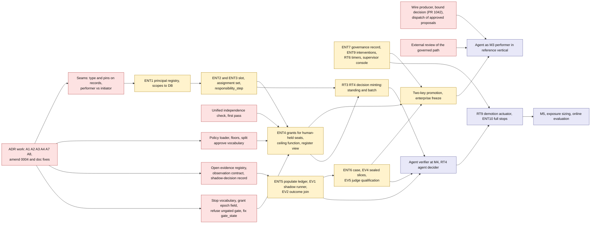

**Sequencing view.**

| Wave | Contents | Exit criterion |
|---|---|---|
| **W0 (Now, inside D3-D5)** | All red boxes: amend ADR 0004 and write A1, A2, A4, A7, A8; wire the spine; seams on records; policy loader; independence consolidation; shadow-decision record; refuse ungated gate; fix `gate_state`; external review of the governed path | An agent-proposed protected action completes end to end in the production path; every decision row can carry type and pins; a refused-by-default reference profile has no drawn gate that passes through; no schema `v2` is needed for anything in W1 |
| **W1 (Next-a)** | Principal registry, slot and assignment set, `responsibility_step`, **grants for human-held seats first**, ceiling function, register view | One workflow digest, one seat moved between two humans and a deterministic service by assignment change only, workflow digest and contract unchanged, every move replayable from records. Human seats first because they exercise assignment, epoch and recheck with no agent risk, and a delegation-of-authority view is what auditors already read [M, E-auto §4.4] |
| **W2 (Next-b)** | Observation ledger populated; shadow runner; outcome join; governance record; intervention tasks and timers; supervisor console; standing and batch minting; sealed slices and judge qualification | An agent runs a reference-vertical seat at M3 with shadow-derived evidence, a case, two-key approval and a probation period; the human lane is drilled |
| **W3 (Later)** | Agent verifier at M4, agent decider under grant, demotion actuator, full stop scopes, M5, exposure sizing, online evaluation | The V35-style scenario passes: one seat driven through M0, M1, M3, M4, an automatic demotion to M3 and a suspension to the human lane, with every transition replayable and in-flight work settled |

**In-flight work on demotion.** The actuator and dispatcher implement the disposition table of 11.7 (not started, agent step running, `waiting_approval` on an agent decision or on a human, `dispatched` or `unknown`, `committed` in the suspect window) with the epoch and lock semantics of 13.12. No separate table is kept here, so the three sections cannot drift apart.

### 17.9 Ranking, justification and the "do not build yet" list

**Ranking.** "Cost of deferral" is what changes if the item is not done in its phase.

| # | Item | Phase | Justification | Cost of deferral |
|---|---|---|---|---|
| 1 | Wire producer, bound decision (PR #1042 open), dispatch; refuse ungated gate | Now | The Beta product is this slice; claims must match code (Appendix A, section A.3.4) | Beta claim false |
| 2 | External review of the governed path | Now | Trust-root defect is the most damaging failure (Appendix A, section A.4, failure 3); D2 had no external review | Trust cannot be earned |
| 3 | Amend ADR 0004 (scalar to profile); write A1, A2, A4, A7, A8 | Now | Cheapest reversal; M24 must not persist the scalar | A migration plus renamed records |
| 4 | Type, pins, performer and basis as optional record fields | Now | Additive while schemas are `v1`; Beta evidence not frozen | Schema `v2` and dual readers |
| 5 | Policy loader and floors; split approve vocabulary | Now | Seam exists; keeps floors honest | Policy edits are code releases |
| 6 | One independence function (string ids first) | Now (a refactor with no Beta-visible change, so not gating the Beta tag and not on the no-regret list of 18.2) | Four copies diverge; one home for later pins | Four edits per change |
| 7 | Open evidence registry; observation and outcome contracts; shadow-decision record | Now | Fixes the circular evidence source; closed CHECK is a migration trap | Evidence for first promotion does not exist |
| 8 | Stop vocabulary, grant epoch field | Now | Epoch must be in the lock set from the start | Re-lock the dispatcher later |
| 9 | Server-computed `gate_state` | Now | Evidence must not be client-supplied | Gate evidence untrustworthy |
| 10 | Principal registry; scopes to DB | Next | Needed once any seat is agent-held or revocation must be recorded | None before then |
| 11 | Slot, assignment set, `responsibility_step`, grants for human seats | Next | The structural core of the vision; human seats first | None before a pilot |
| 12 | Observation ledger populated; shadow runner; outcome join | Next | Evidence source for any promotion | No promotion possible |
| 13 | Governance record with owner split; intervention tasks; M06 timers; supervisor console | Next | M3 is not honest without escalation; owner conflation must be fixed | Self-approved autonomy |
| 14 | Standing and batch decision minting | Next | Reduces approval fatigue [S: 93 percent accepted]; needs the exact-intent path wired first | None |
| 15 | Sealed slices; judge qualification; case (minimal); two-key promotion; enterprise freeze | Next | Gate-gaming and judge trust; freeze is one flag | Weak evidence |
| 16 | Agent verifier M4; agent decider; demotion actuator; full stops | Later | Needs volume, a pilot and a working Evaluator who is not the builder | None |
| 17 | M5; exposure sizing; online evaluation; signatures | Later | Needs a pilot and calibration | None |

**Do not build yet** (with the trigger to revisit):

1. **A level engine, or L0-L5 as an enforcement primitive or customer-facing claim.** Revisit only if a buyer test (Appendix A, section A.5.2, E4) shows the label is needed for regulatory mapping; then derive and expire it.
2. **Per-seat promotion and demotion.** Until counterfactual replay exists use envelope or chain scope.
3. **Full claims-argument graph, per-role signatures, committee-authority UI.** One claim, six evidence links, two sign-offs is enough for Beta (14.12).
4. **Continuous exposure formula, SPRT or e-process monitors, calibrated-confidence routing, honeypots.** Need volume and a pilot.
5. **A separate independent-monitor service.** Use deterministic guards and a deterministic validator seat first; an LLM checker cannot reach I4 by itself.
6. **Six stop scopes.** Build run, responsibility and enterprise freeze; add the rest when a pilot asks.
7. **More than three governance roles as UI-visible occupant records** (Accountable Owner, Autonomy Authority, Supervisor); the others stay a documented convention (Appendix B, section B.2, question 7).
8. **Notify-and-veto approvals, and `auto_approve` ever.**
9. **A new node type other than `responsibility_step`, and a twelfth approval mechanism.** Collapse, do not extend.
10. **A2A federation, Knowledge Hub, regions, catalog "certification" language.** Not pulled by the thesis or by any pilot (Appendix A, section A.5.4).
11. **Multi-agent delegation trust beyond the intersection rule** (child grants are a subset of the parent).
12. **Cross-tenant learning or benchmarks.**
13. **Agent approval of irreversible or export effects**, except T1 pre-authorised standard classes as policy data, with the V2 relaxation shipped disabled.
14. **Horizontal scaling of the execution owner** until M12 shows a pilot needs it.
15. **Reviewer-quality telemetry on named individuals** before a privacy and works-council review; aggregate and announced only.
16. **Aria `auto_all` and `full_autonomy` as shipped.** Fence in the reference profile now, derive from grants later.

**No-dead-end check.** For each *Later* capability, the *Now* seam that keeps it reachable: M4 and M5 need type, pins and performer fields (item 4); evidence-bounded exposure needs `exposure_value` and `exposure_volume` on the proposal (item 4) and `exposure_limit` on the envelope; demotion needs the epoch in the lock set (item 8) and the observation contract (item 7); agent deciders need `approval_basis` and one validator (item 4, rule 2); per-slice trust needs grants per disjoint envelope (ENT4); a different workflow engine needs only that admission and the dispatcher remain the authority boundary (rule 4).

### 17.10 What I could not verify, and open questions

**Not verified.** I ran nothing. I did not check whether a manifest schema bump is needed for a new node type (`src/workflows/manifest_migrate.py`), whether the proposed new fields would alter `intent-v1` or `policy_decision` `input_hash` values (both flagged "to verify"), the state or content of PR #1042 beyond its title and open status, or the lock behaviour of the proposed lock order on PostgreSQL. The sizes are relative estimates [J]. All external claims inherit the limits stated in the evidence reports: EU AI Act, SR 11-7 and SR 26-2, vendor features and the NVIDIA material are `[W]` or `[M]` and unverified by me.

**Open questions for the owner.**
1. Are grants for human-held seats acceptable as the first deliverable of the autonomy work, ahead of any agent-held seat?
2. Is amending ADR 0004 now (scalar to profile) acceptable given the owner authored both the book and the ADR?
3. Which governance roles must be UI-visible occupant records in Beta, and who in a three-person team is an Evaluator independent of the builder?
4. Should V2 (judge-assisted autonomy) stay disabled until judge qualification is enforced?
5. Is the mortgage document request `irreversible_write` or `reversible_write`? The repo says both (`docs/operate/reference-profile.md:1120` versus `docs/architecture/approval-ux-contract.md:103`, per 10.4); the answer moves the Approver ceiling from M4 to M3.
6. Does PR #1042 land before the Beta evidence package freezes, so that the seam fields can ride the same schema release?

## 18. Beta/MVP implications

### 18.0 Facts re-verified on main (anchor for the Beta recommendations)

These facts were re-verified on main on 2026-10-31 and anchor the Beta sections.

| Fact | Where |
|---|---|
| No `principal_type` in backend, UI or SDK | grep over `caliber/src`, `caliber/caliber-ui/src`, `sdk` returns no file [repo] |
| "shadow" appears nowhere in the 291-task manifest | `docs/planning/beta-mvp-execution.json`, `grep -ci shadow` returns 0 [repo] |
| A human approval node passes through unless a flag is on; the reference profile does not refuse that | `caliber/src/caliber/workflows/runtime.py:8062`; `caliber/src/caliber/config.py:631` (default `False`); no rule in `caliber/src/caliber/profile.py` [repo] |
| The decision route still answers `409 approval_bound_not_wired` | `caliber/src/caliber/routes/workflow_runs.py:1866`; fix is PR #1042 [repo, gh] |
| Policy is a module constant; risk 5 is "a person, never a run" | `caliber/src/caliber/policy/decisions.py:184` [repo] |
| One backend reachable by an agent step | `caliber/src/caliber/effects/step_proposal.py:81` [repo] |
| `revoke_grant` has no caller outside its module | `caliber/src/caliber/policy/grants.py:417`; grep of `caliber/src` [repo] |
| ADR 0004: "behaves as L1 everywhere" until M27 | `docs/architecture/adr/0004-autonomy-levels.md:101` [repo] |
| Beta: 80 of 125 tasks closed; all 166 post-Beta tasks open (as of 2026-10-31, the latest verified count in this report) | manifest joined to GitHub: D3 35 closed/15 open, D4 6/11, D5 4/19, D6 to D15 0/166 [gh] |
| No manifest task names the symbols that put the governed path into production | search for `GovernedStepContext`, `governed_agent_steps`, `governed_effects`, `build_plan`, `runtime_approvals_enabled` found none; candidate orphan, see 18.2 NR1 [repo] |

### 18.1 The principle and the window

"No dead ends without overengineering" means three things that are cheap now and expensive later; nothing else belongs on the list.

1. **Additive optional fields on closed control records.** ADR 0003 makes control-record schemas closed (`additionalProperties: false`) with readers-before-writers evolution. Optional additions are free while schemas are `v1`. After a tagged Beta carries them, each missing field costs a `v2` and a dual-reader period, and "old Beta exports remain verifiable by their version" (#876) becomes a standing obligation [E-road §5.4].
2. **A decision on where an assignment lives.** Workload identity is the digest of the sealed workflow version (`policy/principal.py`, `workload_id_for` [E-gov]); grants bind the workload; approvals bind the grant. If a duty's occupant is in the manifest, changing it mints a new workload and new grants, which is the rebuild the vision wants to avoid.
3. **Refusals that stop a control silently doing nothing.** The repo's own docstrings condemn "a control that does nothing" (`approval_policy.py:22-31` [E-roles]); a drawn human gate that runs ungated is that failure.

**The window** closes when the B14.1 evidence schema is registered (#818, D4) and Beta is tagged (#613). #1042 (approval consumption) is open, conflicts with main and is not on main, #743 (approval panel) and #745 (causal links) are open, and #818 is blocked only by #812, #740, #745 [gh]. Group S below should merge before #818.

### 18.2 The no-regret list

Effort uses the size scale of 12.0: S under about three agent-days plus review; M about a week.

**Group A: make the Beta thesis true**

| # | Item | What exactly | Why now | Effort | Overbuild trap |
|---|---|---|---|---|---|
| NR1 | Own the production wiring of the governed path | One task so the worker and promoter build the governed effect and step contexts for supported plans and route an approved agent proposal to dispatch. Today `build_plan` never sets `governed_effects` and nothing builds `GovernedStepContext` (`docs/operate/reference-profile.md`; [E-gov §3]) | Without it "approvable by exact intent end to end" holds only in scenario harnesses. No manifest task names these symbols. **Confirm whether it hides inside #735 or B16 before creating a duplicate** | M | Do not widen `AGENT_STEP_BACKENDS` (`effects/step_proposal.py:81`) |
| NR2 | Refuse a human gate that can pass through | New violation in `reference_profile_violations` (`profile.py:282`): require runtime-approval, queue and checkpoint flags; refuse a `human_approval` node while the decision path is unwired (pass-through at `runtime.py:8062`) | The profile currently lets autonomy become L5 by omission [E-gov §5] | S | None |

**Group S: seams before schemas freeze (land before #818)**

| # | Item | What exactly | Why now | Effort | Overbuild trap |
|---|---|---|---|---|---|
| NR3 | Principal type and credential kind on decision records | Optional `requested_by_type`, `decided_by_type` (`human`, `agent`, `service`) and `credential_kind` (`session`, `pat`, `trusted_header`, `service_token`) on approval request and decision, proposal, policy decision, audit. Server-derived; only `human` and `service` populated. A PAT is a human-owned automation credential: record the kind, do not infer a person read it | `approval-ux-contract.md:33,38,52` already specifies `requested_by_type` from a `principal_type` that does not exist | S | Do not provision agent accounts (M27.1 stays D10) |
| NR4 | Performer separate from initiator, plus pins digest | Optional `performer` (type, ref) and `pins_digest` on proposal and approval request; for an agent step derived from run manifest pins (model route, prompt or skill digest, tool and connector versions, `policy_version`; the BCD of 8.0). Today `requested_by` is the run initiator, so an agent's proposal is attributed to the human who started the run [E-gov §2.3] | Evidence cannot be scoped to a configuration without a digest; shadow and grants need the performer | S | One digest function; no principal-version registry |
| NR5 | Assignment outside the sealed bundle | ADR now. Freeze `required_role` semantics (a scope string, `workflows/manifest.py:866`); add no new role literals; add one nullable `assignment_set_digest` to the run manifest pins | Hard to reverse once more node types and approval fields ship; the field is free now | S | No `responsibility_step`, tables or UI before D8 |
| NR6 | Evidence kinds as an open registry | Package members carry `kind` from a registered, versioned list; unknown kinds fail validation, registration needs no schema bump. Do not extend `CaliberWorkspaceReleaseEvidence` (closed five-value CHECK, `db/models.py:3808` [repo]) | Autonomy evidence needs new kinds (shadow, audit sample, adversarial suite, judge qualification) | S | No case graph at Beta |
| NR7 | Exposure and reversibility basis | Optional `reversibility_basis` (`declared`, `verified`, `none`) and a small typed `exposure` (unit, value) on the proposal. Fix the inconsistency: `reference-profile.md:1120` classes the document request `irreversible_write`, `approval-ux-contract.md:103` shows "Reversible write" | Effect class is the whole risk vocabulary; volume and blast radius are not fields (Appendix A, section A.2(g)) | S | Only if a proposal schema change is already open |

**Group P: policy and observation seams (D4 to D6; do not hold the Beta tag)**

| # | Item | What exactly | Why now | Effort | Overbuild trap |
|---|---|---|---|---|---|
| NR8 | Policy as data behind a loader | `load_policy()` returns `REFERENCE_POLICY_V1` unchanged from a one-record versioned store; manifest `policy_version` equals the loader's; risk 5 stays a non-overridable flag (`policy/decisions.py:184`) | Any ceiling change is a code change today | S | No levels or tier grid yet |
| NR9 | Shadow decision record | A strict non-binding record (run, node, occurrence; performer; pins digest) written beside the human decision at the approval boundary. Beta populates it in one scenario; first real use is an Aria shadow reviewer (E1). `CaliberAssistantReview` already logs agent review decisions (`db/models.py:5081` [E-eval]) | ADR 0004 promotion evidence is circular (at L2 no agent review decisions exist) and the plan has no shadow (0 hits) [E-road §4.2, T3, repo] | S contract, M Aria wiring | No comparison engine or adjudication UI |
| NR10 | Escalation: keep the refusal, define the contract | Keep refusing `escalate` and `auto_reject` (`approval_policy.py:86,240-244`). Define `InterventionTask` as a schema (kind, instance, assignee group, due, resolution) inside #757; accept `escalate` only when a timer and producer exist | `InterventionTask` is consumed by #856 and #908 and defined by no task [E-road] | S | A stub that accepts `escalate` and does nothing is worse than the refusal |
| NR11 | A caller for grant revocation; a principal stop scope | In #776 add scope `principal` (subject id, including service principals and PAT owners) and call `revoke_grant` (`policy/grants.py:417`) | Gives Beta an honest withdrawal sentence at D6 and extends to agent principals | S | No `responsibility` scope until something resolves it |
| NR12 | Replace the scalar before it is persisted | In #790, #798, #868 replace `autonomy_level` default `L1` and `max_autonomy_level` with a nullable `autonomy_profile`, `human_floor` flags, Accountable Owner and deputy | Nothing depends on the scalar yet: "the cheapest reversal available" (Appendix A, section A.2(g)) | S (edit issues) | No profile engine at D10 |
| NR13 | Evidence-integrity small fixes | Server-compute `gate_state` on the direct prompt alias (`routes/prompts.py:2028-2042` [repo]); wire or remove `collaboration_mode`, `required_approvals`, `CaliberRegressionRun.required_for_approval` (G-E20) | Autonomy evidence must be server-computed | S | None |

### 18.3 Proposed amendments to specific issues

All read on GitHub or in the manifest on 2026-10-31. Add to acceptance criteria, or file a follow-up where the issue is closed or its PR nearly merged.

| Issue | State | Proposed amendment |
|---|---|---|
| #735 B06.4 approval consumption (PR #1042) | Open | Do not reopen; follow-up for NR3 with fixtures for session, PAT and service token |
| #743 B06.5 approval panel | Open | Show "requested by (type), performed by (type, pins digest), decided by (type, credential)"; absent fields read "not recorded", never "person" |
| #745 B11.3b causal links | Open | Return `requested_by_type`, `performer`, `pins_digest` as explicit nulls when unknown; never synthesised |
| #768 B04.6 model-selected calls | Open | `model_tool` proposals record performer and pins digest (NR4) |
| #818, #826 B14.1, B14.2 evidence package | Open | Member metadata carries principal type and credential kind; `kind` is a registered open list (NR6); unregistered kind fails; missing principal fields are reported as `missing_links`, never omitted |
| #754 B12.4a executable-form refusal | Open | Add `human_approval_not_enforced` (NR2) with a test of the pass-through branch |
| #764, #877 Beta scope docs | Open | Include the honest autonomy sentence (18.5), the non-claims (3.7), and that Aria `auto_all`, `agent_review`, `full_autonomy` are outside the governed path |
| #757 M06.1 | Open, D6 | Define `InterventionTask` v1 (NR10); `escalate` stays refused until a timer and producer land |
| #776 M06.4 scoped stop | Open, D6 | Add scope `principal`; stop calls `revoke_grant`; scenario: a principal stop blocks new dispatch while reconcile still runs |
| #790 M24.1, #798 M27.2 | Open, D10 | Remove scalar level fields; add nullable `autonomy_profile`, `human_floor`, owner with deputy, tier, review date; #798 becomes presets that expand to target grants; relax `blocked_by [617]` for a lite first slice (23.2 P1) |
| #663 M27.1 | Open, D10 | Type enum reserves `agent`, `service`, `group`; agent principal is a versioned pin set plus sponsor; builds on NR3 and NR4 |
| #849 M27.3a | Open, D10 | Independence classes I0 to I4 by tier; "different model names" is I1 at best |
| #868 M27.4a | Open, D10 | Replace fixed 30 days and 200 decisions with max(business cycle, 14 days) and a tier-derived count after design effect; evidence from shadow and duty-shadow; three keys (Evaluator attests, Authority decides, Owner accepts) |
| #880 M27.5b V35 | Open, D10 | Add the occupant-swap scenario: one workflow digest and one responsibility driven through M0, M1, M3, M4, automatic demotion to M3 and suspension to the human lane, digest unchanged |
| #851 B16.security | Open, D5 | Scope includes approval replay, stale-resource attempts, injection through context and connector inputs, owner-takeover races |

### 18.4 What Beta must not build

Do not build, at Beta: enforcement of L0 to L5 or any level in the UI or API (the scalar is the cheapest reversal and no evidence exists); agent principal provisioning, accounts or groups (M27.1; the seam is the type field); assignment tables, responsibility slots or `responsibility_step` (premature for one use case); grants, envelopes as objects, promotion or demotion engines (no evidence stream yet; shadow comes first); scorecards, SPRT, the exposure formula, an autonomy-case graph or per-role signatures (need volume and a pilot); standing, batch or confidence-gated approvals (wire the exact-intent path first); reviewer-quality telemetry or seeded faults (they monitor individuals and need works-council and privacy review); independence-class enforcement or V2 judge-assisted autonomy (need agent seats and judge versioning); a new Aria dial or extension of the three that exist (M27.3c must unify first); catalog "certification", A2A, regions, Hub or governed memory (no pilot pulls them, 23.3); and any new `required_role` semantics or role literals in manifests (they lock assignment inside the sealed bundle).

### 18.5 What Beta may honestly claim about autonomy

ADR 0004 says the platform "behaves as L1 everywhere, with Aria's own mode as the only exception, and that is what the Beta documents" (`0004-autonomy-levels.md:101`). Close, not exact. Once the governed path is wired, an agent proposing a protected action for human approval is already the ADR's L2 "agent editor" (`0004:61`). And Aria's modes, which a session user can select, can invoke write OpenAPI tools and run workflows without per-effect human approval (`protected-effect-paths.md:28`, EP-034 at `:74`, EP-081 at `:121`).

**The truthful Beta sentence:**

> In the Beta reference profile an agent can at most propose a protected action. A person decides every effect, on its exact intent, and the decision is recorded with the decider's type and credential. No agent reviews, approves, applies or promotes anything on the governed path. Aria's optional `auto_all`, `agent_review` and `full_autonomy` modes sit outside the governed path and are not covered by this guarantee.

It requires NR1, NR2 and the reference profile; without NR2 it is false for a deployment that omits three flags. Owner option worth taking: make the reference profile refuse or disable the Aria autonomy modes, so the Beta claim matches the code and the most permissive path is not what customers see ([E-gov §8]: the risk is that Aria-style dials become "the de facto model").

### 18.6 Claims-versus-code drift to fix

| # | Drift | Where | Fix |
|---|---|---|---|
| 1 | "Vocabulary applies from D2" is not backed; no D2 or D3 code uses levels or principal type | `0004-autonomy-levels.md:3-7`; zero `principal_type` hits [repo] | Supersede by short ADR (18.7) |
| 2 | UX contract computes `requested_by_type` from a nonexistent field; UI (#743, D3) precedes principal type (D10) | `approval-ux-contract.md:33,38,52` | NR3 |
| 3 | ADR 0001 class table says `reversible_write` needs no approval and `read` only a decision; the dispatcher requires an approval for every proposal reaching `dispatch`; registry `read` tools run inline | `docs/architecture/adr/0001*`; [E-gov §2.4] | Correct to what is enforced; state the planned rule separately |
| 4 | ADR names `unsupported_in_reference_profile`; dispatcher raises `UnsupportedEffectPath` | `adr/0001*:60`; `effects/dispatcher.py:127` | Align after #774 |
| 5 | ADR 0002 names `acceptance/` and `evidence/` directories that do not exist and says about 40 paths are "routed through the dispatcher" with no production caller | [E-gov §7] | "Target versus current" column |
| 6 | Human gate passes through unless three flags are on; profile does not refuse | `runtime.py:8062`; `config.py:631`; `profile.py` | NR2 |
| 7 | README and ARCHITECTURE principle 2: "path from human-led processes to fully autonomous agent-driven execution"; the mapped mechanism is "two human decisions in the refinement loop" | `README.md:347`; `ARCHITECTURE.md:44,63` | Reword to bounded delegation with human decision |
| 8 | Reversibility of the document request stated two ways | `reference-profile.md:1120` vs `approval-ux-contract.md:103` | NR7; moves Approver ceiling from M4 to M3 |
| 9 | Two authority statements on who merges: plans "only the owner merges PRs" (`CALIBER_FIVE_PERSON_DELIVERY_PLAN.md:6`, `BETA_MVP_EXECUTION_PLAN.md:125`), repo `CLAUDE.md` authorising agent self-merge after gates | `CALIBER_FIVE_PERSON_DELIVERY_PLAN.md:6`; repo `CLAUDE.md` (Appendix A, section A.2(i)) | One statement; measure escaped-defect rate (E6) |
| 10 | Strategy fork: "own the wedge" versus book-complete breadth a day later | `competitive-analysis.md` section 11 vs EGI plan | Reconcile in the positioning ADR |
| 11 | Controls that enforce nothing: guardrail `escalate` acts as `block`; `ReviewQueue.reviewers` never read for authorization; `collaboration_mode`; `required_for_approval` | [E-roles §1.3, C6, C8; E-eval §10, G-E20] | Wire or remove; list as limits in the scope doc |
| 12 | Audit described as a trail while `caliber_audit_log` is append-only by convention | [E-gov §2.12] | Word as in 3.7 until M05 |

### 18.7 ADRs to write now

| ADR | Decides | Why now |
|---|---|---|
| Positioning and claims policy | 3.3, 3.5, 3.7; no numeric levels in customer-facing claims | Governs every doc; closes the strategy fork |
| Authority model: grants, profile, derived modes | Supersedes ADR 0004's data model (scalar per use case, fixed chair order, circular evidence); keeps its invariants (distinct principals, effect ceiling, tier bound, humans promote and the system demotes, Accountable Owner) | Must precede #790, #798, #868 |
| Assignment is policy data | Where "this seat is held by X" lives; what the manifest pins (NR5) | Hard to reverse once node and approval semantics grow |

## 19. Long-term architecture

### 19.1 The end state, and the rule for adding to it

The end state is small at its core: one installation per customer containing the control plane, with identity, policy engines, agents and systems of record outside it. Everything else below is conditional.

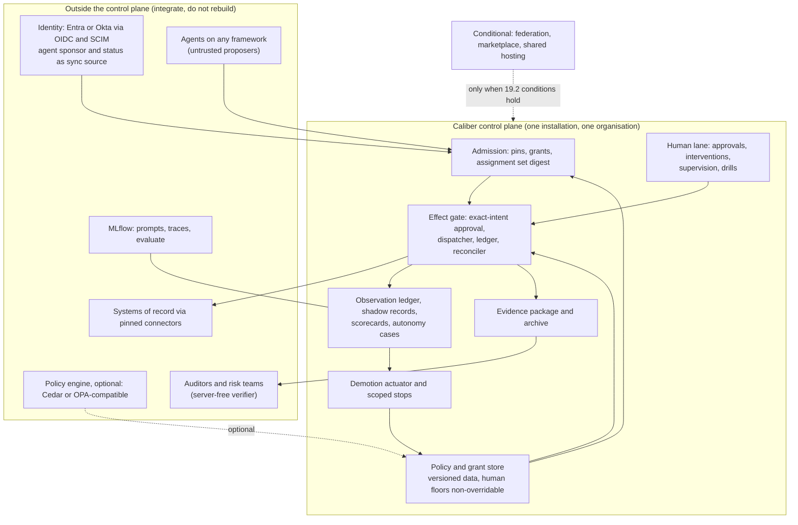

**Rule:** add an element when (a) a named customer or pilot needs it, (b) its precondition evidence exists, and (c) the retrofit costs less than carrying it. Otherwise the contract keeps a place for it (a nullable field, a tenant-aware record, a pluggable pin) and nothing more.

### 19.2 Elements and the conditions that warrant them

| Element | Warranted when | Not warranted when | Retrofit cost if wrong | Plan item |
|---|---|---|---|---|
| **Single-tenant installation per customer** (permanent default) | Always; the privacy and liability position | n/a | n/a | ADR 0001; owner decision 2026-10-26 |
| **Shared multi-tenant hosting** | At least three design partners decline to self-host; isolation (M07 plus external review) passes; a tenant-isolation suite exists; unit economics justify a service | One customer asks; the goal is cross-customer benchmarks | Very high: `tenant_id` defaults to `local` (`db/models.py:2118`); contracts already carry a tenant field, the only mitigation | Excluded (V28-shared-tenancy) |
| **Managed single-tenant stamp** | Pilots stall on the self-host barrier (`competitive-analysis.md` section 11 item 4e) | A stepping stone to shared hosting, unannounced | Low to medium | Owner question 22.5.9 |
| **Horizontal execution scale** | M12 (#558) shows pilot volume exceeds one run per tick | Volume fits | Large: superseding ADR 0002 and re-fencing all owner-only loops | M08, M12 |
| **Policy-engine interface** (Cedar, OPA) | A customer already runs one | No customer asks; a bespoke language invites sprawl | Low if policy stays versioned data with a decision-record contract | NR8 |
| **Identity and registry integration** | First customer with Entra Agent ID or equivalent; deprovisioning fan-out needed | Competing with registries | Low: keep principal ref plus pins, mirror sponsor and status | M17 (D11) |
| **Agent-to-agent inside the enterprise** | A use case needs decomposition to reach a verifiable unit (contract-first rule [E-auto]); grants exist so authority attenuates by intersection; counterfactual replay (B09.5) exists for attribution | Multi-agent used for "autonomy" rather than verifiability | Medium: per-agent grants and attribution do not exist (G-E16) | M13 (D8), M23.4 |
| **Federation across enterprises (A2A)** | A counterpart with its own enforcement point; a governance extension both adopt; remote results treated as untrusted proposals | Used to look interoperable; plan pins v0.3.0, the book says 1.0.1 [E-road] | Medium; authority never crosses the boundary, claims do | M19 (D14); defer |
| **Marketplace of certified responsibilities or capabilities** | A certifier with recognised standing (internal validation counts only internally); liability allocation and insurance; an attested connector registry replacing code-pinned digests (`profile.py:99`); legal evidence sharing | Before any pilot; "certification" without a certifier | High, and reputational | M22 (D15); rename "conformance" |
| **Open evidence plane** (portable format, verifier, process audit, signatures) | Before the first regulated pilot; Waymo's TUV audit of its safety-case process is the precedent [E-av] | Never optional for the narrow thesis | Low now, high once exports are retained | B14, M05, M02 |
| **Online evaluation, judge qualification** | First M4 candidate | As a substitute for structural caps | Medium | Not a package; G-E4, G-E11, G-E12 |
| **Autonomy Authority committee, two-key promotion at tier 3 and above** | A customer with a tier-3 or tier-4 use case | Three-person teams: record achieved independence instead | Low (policy data) | M24, M27 |

### 19.3 Decisions that must stay reversible

| Decision | How to keep it reversible | Trigger to revisit |
|---|---|---|
| Unit of authority is the grant, not level or role | Level is a derived label; presets expand to grants; no persisted scalar | A customer who cannot operate with presets |
| Assignment is data outside the sealed bundle | One nullable pin; ADR; no node-type proliferation | Second use case (D8) |
| Policy is versioned data with its own governed release | Loader behind one function; floors non-overridable | First customer-specific ceiling |
| Evidence kinds are an open registry | Registered strings, not CHECK lists | First new evidence kind |
| Four effect classes | Optional `reversibility_basis`, `exposure`; write the mapping to the book's five classes | Pilot with value or volume limits |
| Connector admission by pinned digest | Pluggable attestation behind the code table | First external connector author |
| MLflow coupling | Evidence of record in Caliber's database; MLflow holds working data | Upstream absorbs the loop (the repo's top-ranked risk) |

**One-way doors accepted by design:** fail-closed defaults (unknown tool is `irreversible_write`), exact-intent binding with single consumption, at-most-once local claim with no blind re-drive and parking on `unknown`, the untrusted-model contract, and human accountability as a recorded fact.

## 20. Evolution path

### 20.1 Stages

Stages are defined by what an outside enterprise has done, not by what Caliber has built. That corrects the plan's internal gates (V01 to V35 on a synthetic mortgage case), which show Caliber works, not that anyone relies on it [E-road §4.2, T10].

```mermaid
flowchart LR
  S0["S0 Caliber Today<br/>alpha 0.1.0a1, D2, part of D3"] -->|"Gate D5 Beta #613:<br/>external reviewer, real-provider evidence, restore smoke"| S1["S1 Beta/MVP<br/>one governed slice"]
  S1 -->|"Gate: pilot partner booked #608,<br/>independent operator"| S2["S2 Enterprise Platform<br/>D6 to D9, lite governance, shadow data"]
  S2 -->|"Gate D9 #617 plus real pilot,<br/>second use case by a non-author"| S3["S3 Progressive Autonomy<br/>grants, human-held seats first,<br/>M4 on one reversible class"]
  S3 -->|"Gate: three responsibilities, two use cases,<br/>a model change survived"| S4["S4 Autonomous Enterprise<br/>exception-supervised bounded classes"]
  K["Kill and retreat points (22.2)"] -.-> S2
  K -.-> S3
```

| Stage | Entry | Capabilities delivered | Observable proof (what an outside enterprise has done) | Exit | Out of scope | Claims allowed |
|---|---|---|---|---|---|---|
| **S0 Today** | Alpha 0.1.0a1 published 2026-10-23; D2 closed; D3 partly | Governed prompt refinement with human Apply; manifests, run-bound grants, typed policy decisions, owner lease, dispatcher, ledger, reconciler components; Aria | None external: 890 commits, no named customer, no external review | D3, D4 closed with seams and wiring (NR1 to NR7) | Everything below | "Governed prompt-refinement control plane (alpha)" |
| **S1 Beta** (D5, #613) | S0 exit; #608 staffing booked | Exact-intent approval, ledger, recovery, evidence package and verifier, installable SDK, UI, CLI, public fault matrix | An independent operator installs from artifacts, runs the reference scenario, kills the owner and verifies evidence offline; an independent reviewer (#851) leaves no open critical or high finding | #613 with real-provider bounded evidence (not simulated), restore smoke (#886), honest scope doc (#764, #877) | Autonomy, grants, regions, Hub, A2A, catalog, shared tenancy | The minimal viable thesis (3.5) |
| **S2 Enterprise Platform** (D6 to D9) | S1 exit; pilot partner and domain owner named | Credential leases and signed releases (M01, M02), protected audit (M05), timers, escalation, scoped stop (M06), isolation (M07), second connector and compensation (M03), budgets (M08), child task (M13), second use case (M15), measured envelope (M12); **plus** lite GovernanceRecord, observation ledger, shadow records, policy as data | The partner's staff approve real effects for weeks; their auditor verifies a package offline; a non-author configures a second use case from docs in under two weeks (E9); their security team accepts the isolation story; a drill suspends a connector and work returns to humans | #617 plus the external pilot proof; shadow agreement data for one responsibility (E1) | Any agent seat above M3; promotion | "Self-hosted control plane with an external pilot in production under human approval" |
| **S3 Progressive Autonomy** (reshaped D10) | S2 exit; owner decides on V2; independent Evaluator named; shadow kappa at least 0.6 on a held-out sample (E1) | Autonomy grants (human-held seats first), assignment sets, principal versions with sponsor, derived modes, two-key promotion with expiry, demotion actuator, supervision plan and capacity metrics, reviewer-quality telemetry after labour review | One responsibility on one reversible class runs at M4 for a full evidence window under the customer's Autonomy Authority; one demotion and one reinstatement exercised; V35 occupant swap holds with the digest unchanged | The responsibility survives a model or prompt change through a declared change class; promotion record names Evaluator, Authority, Owner | Customer-facing level badge; irreversible or export at M4 except pre-authorised tier-1 classes; V2 unless enabled | "Bounded, evidence-gated delegation for named responsibilities", envelope shown |
| **S4 Autonomous Enterprise** | S3 exit across three responsibilities and two use cases (or two enterprises) | M5 for reversible verifiable classes; standard-change catalogs; federation where a counterpart exists; external audit of the evidence process | The enterprise's auditor or insurer accepts the delegation matrix as the control document; a regulator inquiry is answered from the evidence package; several model changes survived with evidence re-earned in the declared window | None: a direction, not a finish line | Removing human floors; self-modification; sub-M3 autonomy where law requires a human | None until observed |

S4 is a hypothesis. The red-team review's subjective probabilities (Appendix A, section A.6.1): about 3 percent that Caliber becomes the NVIDIA-style common platform in 24 months, about 12 percent that an evidence-gated promotion beyond L2-equivalent operates externally in 24 months, and 25 percent (40 percent if a pilot is signed by month 6) for one external production use case with real effects (Appendix A, section A.6.1; low confidence). I did not re-estimate; treat them as priors for E3, E5 and E1 to update.

### 20.2 Alignment with and conflict against D1 to D15

| Milestone | Plan content | Verdict | Recommended change |
|---|---|---|---|
| D2 | Pinned admission, grants, owner lease, context manifest | **Aligned**; closed with exceptions (`docs/reports/egi/D2-acceptance.md`) | None |
| D3 to D5 | Governed action, replay, evidence, Beta | **Aligned in order**: spine before autonomy | Add seams and wiring (18.2); book the reviewer |
| D6 | M01, M02, M05, M06, M09 | **Central to S2**; M06 is the only supervision, escalation, stop machinery | Pull `InterventionTask` and principal scope into M06 |
| D7 | M04, M07 isolation, M09 suites, M10, M11, M14 | **Partly aligned** | Sequence by pilot need; add sealed slices and judge versioning |
| D8 | M03, M08, M13, M15 | **Aligned**; the second use case is the proof the assignment seam needs | M15 triggers assignment sets |
| D9 | Core proof: independent install, restore, pilot, limits | **Aligned and most important**, but an internal check with unbooked externals (#608) | External pilot becomes the exit |
| D10 | M23, M24, M25, M27 | **Conflicts**: M27 stores a scalar, owner approves own promotion, evidence is circular, qualitative work capped at L2, and 4 to 6 person-weeks for nine tasks omits evidence production [E-road §5.3] | Reshape as the grant model (23.4); lite M24 earlier; defer M23 economics |
| D11 | M17 OIDC, SCIM | **Aligned, possibly late**; a D9 pilot can front the app with `trusted_header` behind a proxy | Confirm with the partner; pull forward only if needed |
| D12 to D14 | Regions (M18), Hub (M21), memory (M20), A2A (M19) | **Conflict**: no stage needs them; memory is refused in the reference profile; A2A pins an outdated version | Defer to pull |
| D15 | M22 catalog "certification", M26 traceability, M16 review and release decision | **Mixed**: M16 on path (start external review at S1, not D15); M22 breaks the claims policy; M26 as a gate steers effort to traceability rows [E-road §4.2, T10] | Keep M16 and start earlier; rename M22; demote M26 to a report |

### 20.3 Calendar reality

The plan calendar is "uncommitted; reforecast issue608" (`beta-mvp-execution.json`, `calendar`). Plan dates: Beta 2027-05-21, core proof 2027-12-24, D10 2028-03-24, D15 2029-03-02 (`CALIBER_EGI_DELIVERY_PLAN.md`). Observed: D2 (planned weeks 5 to 12) closed within days and Beta stood at 80 of 125 tasks (2026-10-31) after about six days, but merged PRs per day fell 22, 27, 28, 20, 13, 9 over 2026-10-26 to 31 [E-road], which is what a dependency-bound integration phase looks like. The stage gates are limited by human review, external lead time and evidence wall-clock, not agent coding speed; re-basing is in 23.5.

### 20.4 Evidence takes wall-clock time

This is why S3 cannot be pulled forward by writing code faster. Bounds are one-sided 95 percent Clopper-Pearson limits for zero failures; the last column applies a design effect of 2.8 (clusters of 10 decisions, intra-class correlation 0.2) at 100 decisions per week (13.4) [J].

| Clean decisions | Failure-rate upper bound | Weeks at 25/week | at 100/week | at 500/week | at 100/week, design effect 2.8 |
|---:|---:|---:|---:|---:|---:|
| 100 | 2.95% | 4 | 1 | 0.2 | 2.8 |
| 200 | 1.49% | 8 | 2 | 0.4 | 5.6 |
| 300 | 0.99% | 12 | 3 | 0.6 | 8.4 |
| 1,000 | 0.30% | 40 | 10 | 2 | 28 |
| 3,000 | 0.10% | 120 | 30 | 6 | 84 |

A window also has a floor of max(one business cycle, 14 days). For irreversible or export classes the answer is not to wait for 3,000 clean trials but to cap exposure by envelope and keep per-instance human approval, with evidence supporting reduced friction (batch or sampled review) rather than removal (Appendix A, section A.2(e)).

## 21. Prioritized recommendations: Now, Next, Later

Each row gives **Existing, Gap, Proposed** in one cell, then rationale and evidence, then owner type, effort (the size scale of 12.0) and dependencies, then the risk of not doing it. "Human reviewer" means a named person, because review capacity, not coding speed, is the constraint (20.3). Now means foundational decisions that must be right immediately; Next means production adoption; Later means increasingly autonomous operation.

### 21.1 Now

| ID | Existing, Gap, Proposed | Rationale and evidence | Owner, effort, deps | Risk of not doing |
|---|---|---|---|---|
| NOW-1 | **Existing:** README principle 2 promises "fully autonomous agent-driven execution"; ADR says "L1 everywhere". **Gap:** no claims policy; strategy fork. **Proposed:** positioning and claims ADR, reworded principle 2, Beta scope non-claims (3.3, 3.7, 18.5) | Label inflation, vendor liability, Article 14; only the narrow thesis has code | Product owner plus doc agent; S; none | A deck says "L4"; an incident becomes a brand incident |
| NOW-2 | **Existing:** approval, dispatcher, ledger, reconciler, step proposal (#744 closed). **Gap:** 409 on decision, no producer, human gate passes through, no task owns the producer. **Proposed:** NR1 and NR2 | `workflow_runs.py:1866`; `runtime.py:8062`; `profile.py` | Platform agents plus human reviewer; M; #1042, #768, #750, #759 | Beta claims a control that "silently does nothing" |
| NOW-3 | **Existing:** closed `v1` schemas with string actors. **Gap:** no type, credential kind, performer, pins digest, assignment pin, open kinds. **Proposed:** NR3 to NR7 before #818 | ADR 0003 permits optional additions now | Platform engineering; S to M; before #818 | `v2` of approval and evidence schemas; exports verifiable forever (#876) |
| NOW-4 | **Existing:** ADR 0004 scalar; #790, #798, #868 will persist it. **Gap:** cannot express "human editor, agent reviewer"; circular evidence; owner approves own promotion. **Proposed:** authority-model ADR; amend those issues (18.3) | Cheapest reversal available (Appendix A, section A.2(g)); tensions T1 to T6 [E-road] | Architect plus agent; S; none | Scalar persisted by M24.1, read by Aria (#862) |
| NOW-5 | **Existing:** #608 (staffing, independent reviewer, domain owner, pilot operator, provider budget) open, no booking recorded. **Gap:** gates cannot pass by agent effort. **Proposed:** book externals; name an Evaluator independent of the builders; start external review of the spine now, not at D15 | Pre-mortem 2; plan: "unavailability blocks the gate, it does not pass it" | Program owner; S, long lead | No pilot; S2 unreachable |
| NOW-6 | **Existing:** no shadow concept; `CaliberAssistantReview` logs agent decisions. **Gap:** no evidence on buyers, rubber-stamping, agent-human agreement. **Proposed:** run E1, E2, E3, E4, E7 in 90 days | Cheap and falsifying (22.3) | Product and research plus one engineer; M; NR9 | An autonomy engine for a buyer who does not exist |
| NOW-7 | **Existing:** D2 report: "No human or external review"; one agent review found 3 high and 4 medium defects in one PR (Appendix A, section A.2(i)). **Gap:** escaped-defect rate unmeasured; merge authority stated two ways. **Proposed:** E6 re-review; one statement | The spine is meant to be a trust root and is agent-written and agent-reviewed | Human engineer or external reviewer; M | An approval or ledger defect found by a customer |
| NOW-8 | **Existing:** Aria `auto_all`, `agent_review`, `full_autonomy` can invoke write tools without per-effect approval (EP-034, EP-081). **Gap:** more permissive than the Beta profile. **Proposed:** fence or disable in the reference profile | `protected-effect-paths.md:28,74,121` | Owner decision plus engineer; S to M | Customers see Aria's dials as "autonomy" |
| NOW-9 | **Existing:** 166 post-Beta tasks, all open. **Gap:** breadth no pilot pulls. **Proposed:** make D12 to D15 breadth pull-based (23.3) | Plan's own reforecast rule; pre-mortem 10 | Owner; S | Capacity drift; MLflow absorbs the loop |
| NOW-10 | **Existing:** client-supplied `gate_state`; dead controls. **Gap:** evidence cannot be an authority input. **Proposed:** NR13 | `routes/prompts.py:2028-2042`; G-E20 | Engineer; S | Autonomy evidence rests on client assertions |

### 21.2 Next

| ID | Existing, Gap, Proposed | Rationale and evidence | Owner, effort, deps | Risk of not doing |
|---|---|---|---|---|
| NEXT-1 | **Existing:** `CaliberProject.owner` is an identity; `owner` has about eight meanings [E-roles]. **Gap:** no accountable-owner record, deputy, tier, floors. **Proposed:** GovernanceRecord lite (owner, deputy, T1 to T4, review date, floors; no level) | `map-gap.md` G20: ownership cannot wait for D10; #790 blocked by #617 [E-road §5.2] | Platform engineering; M; #613 | Nobody recorded as accountable per use case |
| NEXT-2 | **Existing:** `REFERENCE_POLICY_V1` constant; the NR8 loader lands earlier, under Now. **Gap:** no per-use-case or per-tier policy; one "approve" vocabulary for platform change and effect proposals. **Proposed:** versioned policy with governed release; ceiling grid by effect class, tier, verifiability, domain flag; floors non-overridable | Raising a ceiling is a code change today [E-gov §5] | Platform engineering; M; NR8, NEXT-1 | Grants cannot be expressed |
| NEXT-3 | **Existing:** expiry with `block` only; no principal stop. **Gap:** no timers, `InterventionTask`, supervision plan. **Proposed:** M06 with NR10, NR11; supervision plan and capacity metrics | ADR 0004 L3 depends on timers that do not exist (14.3) | Platform engineering; L (D6); #757, #776 | M3 and M4 cannot be honestly staffed |
| NEXT-4 | **Existing:** run, approval, effect, review, audit rows with no common key; SLO and incidents platform-global. **Gap:** no observation ledger or outcome join. **Proposed:** `decision_observation`, `outcome_event`, scope keys, scorecard as SQL view | Nothing can be earned without the join (14.13) | Platform engineering; M; NR3, NR4 | No track record or demotion signal |
| NEXT-5 | **Existing:** NR9 record. **Gap:** no comparison or adjudication. **Proposed:** duty-shadow at the approval boundary, agreement classes, blinded adjudicated subset | Fixes circular evidence (11.4) | Platform engineering plus Evaluator; M; NEXT-4 | No honest path from M3 to M4 |
| NEXT-6 | **Existing:** pinned datasets, `GateDecision`, on-demand kappa; refinement scores against the gating dataset. **Gap:** no sealed slice, mutable judges, no qualification, no online evaluation. **Proposed:** dataset roles, judge versioning and qualification gate, trace sampler | Gate gaming; table stakes elsewhere [E-eval §10, G-E4, G-E11, G-E12] | Evaluation engineering; M to L; M09.2a | Gameable evidence |
| NEXT-7 | **Existing:** one use case, one agent backend. **Gap:** nothing proves assignment outside the bundle. **Proposed:** assignment sets and grants for human-held seats at the second use case (M15) | Appendix B, section B.1, items 1 and 13; red-team review: do not add the layer without collapsing vocabularies | Architect plus engineering; L; M15, NR5 | Premature abstraction, or a later rebuild |
| NEXT-8 | **Existing:** none. **Gap:** rubber-stamping makes the record certify nothing (about 93 percent of manual prompts approved in Anthropic's data [E-auto]). **Proposed:** reviewer-quality design (aggregated, purpose-limited, announced seeded faults) reviewed with a works-council-experienced lead first | BetrVG s.87(1) no. 6 applicability to agents is inference [W] | Product plus legal; M (design) | Labour block or a worthless oversight claim |
| NEXT-9 | **Existing:** audit log append-only by convention; M05 in D6. **Gap:** no WORM, no process audit. **Proposed:** protected archive (M05), then external audit of the evidence process | Waymo precedent [E-av]; CISO test (Appendix A, section A.2(f)) | Platform engineering plus external auditor; M to L | CISO will not delegate authority to a mutable audit log |
| NEXT-10 | **Existing:** identity is `Subject` plus `ServicePrincipal`; scopes are env lists. **Gap:** no principal registry, sponsor or recorded scope assignment. **Proposed:** principal registry (type, version, sponsor) and DB-backed scope assignments with audit and expiry (ENT1, ENT12) | Needed once any seat is agent-held or revocation must be recorded (17.9, item 10) | Platform engineering; M; NR3, NR4 | Authority for an agent cannot be recorded or revoked at runtime |
| NEXT-11 | **Existing:** no promotion workflow, case or freeze. **Gap:** no two-key promotion, minimal autonomy case or enterprise freeze. **Proposed:** minimal case (one claim, evidence links, assumptions, sign-offs), two-key promotion for human-held seats first, one enterprise freeze flag (17.9, item 15) | Cheap and valuable; freeze is one flag; uses the evidence from NEXT-4 to NEXT-6 | Platform engineering plus Autonomy Authority; M; NEXT-1, NEXT-4 | Grants without a recorded decision; no fast enterprise-wide stop |

### 21.3 Later

| ID | Existing, Gap, Proposed | Rationale | Owner, effort, deps | Risk of not doing |
|---|---|---|---|---|
| LATER-1 | **Existing:** agent as a human-shaped account (Aria). **Gap:** no versioned agent principal with sponsor. **Proposed:** agent principal versions (M27.1 reshaped), M3 agent seats | Builds on NR3, NR4, shadow | Platform engineering; M; NEXT-5 | Authority borrowed from a human forever |
| LATER-2 | **Existing:** incident events with no demoting subscriber. **Gap:** no actuator. **Proposed:** graded demotion, epoch check in the dispatcher lock set, look-back tasks | ADR 0004 invariant 6; in-flight table (11.7) | Platform engineering; L; NEXT-3, NEXT-4 | Revocation stays manual |
| LATER-3 | **Existing:** exact intent only. **Gap:** M4 needs a grant-cited decision, an agent decider, independence classes I3 and I4, and seeded faults; standing and batch minting land earlier, in Next (17.9, item 14). **Proposed:** all of these, keeping an exact-intent decision record per effect | See 14.5 | Architect plus engineering; L; LATER-1, LATER-2 | M4 collapses into M5 with false assurance |
| LATER-4 | **Existing:** fixed 30 days and 200 decisions. **Gap:** no evidence-bounded exposure. **Proposed:** envelope sized from the upper bound, loss appetite, severity; sequential monitors | Rule of three | Evaluator plus engineering; M; pilot volume | Evidence blocks or overreaches |
| LATER-5 | **Existing:** absolute cap at L2 without a predicate. **Gap:** qualitative work stays at M3. **Proposed:** V2 judge-assisted autonomy for reversible, low-blast work, shipped disabled | Owner decision; real loosening (Appendix B, section B.1) | Owner plus Evaluator; M; NEXT-6 | "Autonomous" stays machine-verifiable only (say so) |
| LATER-6 | **Existing:** A2A planned; connectors pinned in code. **Gap:** no counterpart, no external connector author. **Proposed:** A2A cards advertising an envelope; attested connector registry; partitioned owners by superseding ADR; per-role signatures and managed single-tenant stamp | 19.2 conditions; M12; after B14 and M05 | Platform engineering; L | Over-investing before demand; origin stays unprovable |

## 22. Risks, tradeoffs, assumptions and unresolved questions

### 22.1 Pre-mortem: ten ways this fails by October 2028

Consolidated from the red-team review (Appendix A, section A.4). The review ranks 2 (no pilot) and 4 and 5 (the evidence story becomes theatre) most probable, and 1 (bundled out) most consequential if product-market fit arrives. "My read" is a likelihood judgement.

| # | Failure | Leading indicators | My read | Mitigation here |
|---|---|---|---|---|
| 1 | **Bundled out:** Microsoft and ServiceNow ship trust scores and evaluation-conditioned access; AgentCore adds promotion-style gates | Entra or Agent 365 release notes; RFPs naming Agent 365 as the control plane; ServiceNow-Microsoft integration leaving preview | Plausible (55 percent in 24 months, red team, low confidence) | Evidence integrity and portability; integrate identity; E7 |
| 2 | **No pilot ever happens** | #608 open at month 6; no pilot letter by month 6; calendar "uncommitted" | Highest likelihood | NOW-5, E5; breadth pull-based |
| 3 | **Trust-root defect** in approval, dispatch or audit found by an outsider | Escaped-defect rate of agent-reviewed PRs; first external finding count; #750, #759, #768 still open | Material: follow-ups after closure already (#641, #973, #979) | NOW-7, E6, E10 |
| 4 | **Evidence cannot justify promotion** | Qualifying decisions per month below threshold; windows reset by version changes; judge kappa below floor | High for qualitative work | 20.4, E8, exposure budgets, V2 disabled |
| 5 | **Rubber-stamp collapse** | Approval latency percentiles; overturn and request-changes rates (`request_changes` absent from the route [E-road]) | High | E2 first, NEXT-8, uninfluenceable sample floor |
| 6 | **Complexity collapse** | Time to first governed run for a second use case; config tickets; new object types before old ones collapse | Real: at least eleven approval mechanisms, three role vocabularies | Seams only, presets, E9 |
| 7 | **Architecture ceiling:** one owner process, maintainer-gated connectors | M12 envelope versus pilot volume; connectors per quarter | Moderate | Early throughput measurement (23.2 P6) |
| 8 | **Legal and labour block** | Legal questionnaire outcomes; consultation requests | Unverified; framing risk is real | Delegation vocabulary (E4); NEXT-8 review |
| 9 | **Label inflation incident** | Any customer-facing bare level; undefined disclosure SLA | Preventable | NOW-1; unreported-incident trigger |
| 10 | **Strategic drift and capacity:** 122-week plan for three people, 11 tasks added in five days, MLflow absorbs the loop | Merged versus externally reviewed PRs; tasks added versus closed per week; MLflow release notes; effort on non-thesis packages | Real: agent velocity masks review capacity | NOW-9, 23.3, one governance statement |

### 22.2 Kill criteria

Drop or restructure the autonomy claim if any is true at 12 months (red team, plus the last):

1. No external operator has run a real bounded workflow with real downstream effects on Caliber.
2. Shadow data (E1) show agreement too low or volume too small to support more than reduced review friction.
3. Buyer interviews (E3) rank delegation with evidence outside the top two purchase drivers.
4. A competitor ships evidence-conditioned authority inside an identity or registry product the pilot customer already owns, and the customer prefers it.
5. External review finds a design-level defect in exact-intent approval or the ledger.
6. The escaped-defect rate of agent-reviewed code shows the program cannot be its own proof point.
7. **Added:** no Evaluator independent of the builder can be named for a tier-3 or tier-4 use case; cap those at M3 permanently and say so.

If 1 or 2 triggers, retreat to the narrow thesis (effect gate and evidence recorder) and drop the ladder. If 3 triggers, retreat to the narrow thesis with a compliance-export focus.

### 22.3 Assumptions to test: the 90-day experiments

| # | Experiment | Falsifies | Cost | Kill or pass threshold | Gates |
|---|---|---|---|---|---|
| E5 | **Pilot letter:** one named external operator and domain owner (#608) | A pilot is obtainable | S effort, long lead | No signed letter by day 90: pause breadth | S2 entry, NOW-9 |
| E6 | **Re-review** of 30 random agent-merged PRs from D2 and D3, classified by missed severity | The spine is a safe trust root | M | Any high-severity escape, or more than 1 in 10 with a material miss: stop self-merge on security-critical paths | NOW-7 |
| E2 | **Rubber-stamp baseline:** time to approve, request-changes rate and re-review disagreement in the owner's own use of the approval UI | Human approvals are informative | S | Median under 10 seconds, over 95 percent approvals, under 5 percent re-review disagreement: redesign oversight before autonomy | NEXT-8, sample floors |
| E1 | **Shadow reviewer pilot** on Aria drafts and the synthetic case; agreement and kappa | Agent decisions are informative; circularity fix feasible | M | Kappa under 0.6 on a held-out labelled sample, or volume cannot reach a window | S3 entry, LATER-5 |
| E3 | **Buyer ranking:** 15 interviews (CISO, model risk, platform architects, a works-council-experienced lead) ranking identity and registry, exact approval and ledger, evidence-gated autonomy, compliance export | A buyer wants evidence-gated promotion first | M | Fewer than 3 of 15 would pilot, or autonomy ranks below compliance export and exact approval for 12 of 15 | Positioning, kill 3 |
| E4 | **Vocabulary test:** 10 audit and risk and 5 labour-relations people compare "L3 agent reviewer, human approver" with "delegation grant with envelope and sponsor" | Levels framing is safe | S | Levels framing causes more concern in a majority | 3.2 |
| E7 | **Competitor diff:** one scenario on Entra Agent ID plus Agent 365, and on AgentCore Policy, Evaluations, Optimization | Differentiation claims | M | Fewer than three things only Caliber provides | 3.8 |
| E8 | **Power calculation** per candidate use case (20.4) | Evidence is reachable | S | A bound unreachable within a year caps that class at M3 | S3 scope |
| E9 | **Second-use-case onboarding** by a new engineer from docs | Complexity collapse | M | Over two weeks to first governed run | NEXT-7, D8 |
| E10 | **External red team** of the governed path: injection, approval replay, stale resources, owner takeover | Trust-root defect | M | Any bypass, double dispatch or unauthorised effect | #851 |

Order: E5 and E6 first because they gate everything; E2, E1, E8 are cheap and need no new build; E3, E4, E7 cost people time, not engineering.

### 22.4 Tradeoffs of the major design choices

| Choice | Gain | Cost | My default | Red-team review versus sections 8 to 11 |
|---|---|---|---|---|
| Grant over envelope, not a level | Expressive, reversible, legible to auditors and works councils | More objects to configure and secure; harder sales story | Grant with presets | Agree; differ on whether the Responsibility slot is needed now |
| Seams now, layers later | No overengineering, no `v2` | Later migration if the seam guessed wrong | Seams until D8 | Sections 8 to 11 want slot and assignment set sealed earlier |
| Evidence per seat versus per chain | Seat: targeted demotion. Chain: honest attribution | Seat is false precision without counterfactual replay (B09.5); chain demotes innocent seats | Seat-level evidence only where ground truth exists (shadow, seeded faults); chain outcomes drive demotion; default demote every seat with a catch duty one step | Converge |
| Verifiability classes V1 to V3 over ADR's absolute L2 cap | Qualitative work can reach M4 on reversible effects | A real loosening; relies on judges and sampling that do not exist yet | V2 disabled | Red-team review: say it is out of scope; sections 8 to 11: allow, disabled |
| Reliance on human sampling at M4 and M5 | Cheap oversight at volume | Rubber-stamped audits make M4 an M5 with false assurance; telemetry is a labour issue | Sample floor no actor inside the use case can lower | Both warn |
| Assignment outside the manifest | Occupant swap without rebuild | Weakens "run equals sealed manifest"; auditors may reject "pinned identity plus live authority" as replay | Pin identity, recheck authority at use | Sections 8 to 11 flag it as untested (Appendix B, section B.1, item 6) |
| Automatic demotion | Down faster than up | Attackable by injected failures; availability loss | Rate-limit, human confirmation to extend, human override | Agree |

### 22.5 Unresolved questions for the owner, with my default

1. **Is the Accountable Owner always a natural person?** Default: yes as a floor in the reference profile; configurable to a named office with deputy; never an agent or bare group.
2. **Replace the single use-case level with a profile vector and presets, accepting a harder sales story?** Default: yes (NOW-4).
3. **Should V2 judge-assisted autonomy ship in the first autonomy release?** Default: ship disabled until judge versioning and qualification are enforced.
4. **Which governance roles are UI-visible occupant records at Beta?** Default: decider identity, type and credential per decision (NR3); Accountable Owner with deputy arrives with the lite record (NEXT-1); the rest stay documented convention until D10.
5. **Who is an Evaluator independent of the builder in a three-person program?** Default: no one at tier 3 and above. Use a customer-side or external Evaluator, record the achieved independence level at tiers 1 and 2, cap at M3 until independence exists. The conflict matrix cannot be met by the same three people.
6. **Is a borrower-visible document request reversible?** Default: irreversible (it notifies a borrower and cannot be unsent), so M3 unless the enterprise accepts pre-authorisation of a standard class with a volume cap. The repo says both (`reference-profile.md:1120`, `approval-ux-contract.md:103`).
7. **Who is the pilot partner and domain owner?** Without one S2 cannot be passed.
8. **Should the reference profile fence Aria's autonomy modes?** Default: yes (NOW-8).
9. **Are managed single-tenant stamps inside the 2026-10-26 "no shared-customer hosting" decision?** Default: yes (dedicated installations run by someone else); confirm before building one.
10. **Define the MVP by pilot proof or by book traceability?** EGI plan decision 3 makes Caliber the reference implementation of the owner's book. Default: keep the book as reference, release the MVP on S2 exit, demote M26 to a report.
11. **One merge-authority statement.** Default: agents merge reversible, non-security-critical changes after gates; security-critical paths need a named human until E6 passes.
12. **Is aggregated reviewer-quality telemetry acceptable?** Default: design now, build after a works-council-experienced review.

### 22.6 What this study could not verify

- **Runtime behaviour:** nothing was run; "unwired" findings rest on code reading and the greps above, and the producer-orphan finding on a manifest search that can miss work inside broader tasks. Tests, coverage and CI were not re-run.
- **State lags:** #997 is open although #1052 is on main; PR #1042 is not in my snapshot; 80 of 125 (2026-10-31) may be off by one or two. The book *Building Enterprise General Intelligence* is not in the repository.
- **External products:** the researchers opened only AgentCore docs, the A2A spec, Entra's concepts page and a few articles; Agent 365, ServiceNow, Workday, UiPath, Salesforce, OpenAI Frontier and Google rows are search summaries or memory with conflicting GA dates. I re-fetched none.
- **Law and regulation:** EU AI Act timing, SR 26-2 scope, works-council applicability to agents, California AB 316, the EU Product Liability Directive and Moffatt v Air Canada rest on secondary sources. Nothing here is legal advice. The J3016 text could not be read; NVIDIA figures are vendor-reported; Waymo's gate criteria are unpublished.
- **Numbers:** statistical bounds assume independent decisions; the design effect, tier rates, sampling floors and ceiling grids are placeholders; probabilities are the red team's structured guesses with no base rate; agent throughput is from [E-road] and review capacity, the binding constraint, was not measured.

## 23. Recommended roadmap implications

### 23.1 Mechanics that constrain the changes

`docs/planning/validate-execution-plan.mjs` asserts that every task has a parent epic whose `milestone` equals the task's, that `blocked_by` never points to a later milestone, that exactly 15 milestone controls exist, that every task carries `scope`, `files`, `tests`, `acceptance` and `documentation`, and that gaps G01 to G22 are all covered. Three consequences. First, "pull earlier" means a new epic and task in the earlier milestone, not moving a child. Second, "defer" cannot delete a control; it needs an entry beside `V28-shared-tenancy` in `excluded` (or a new `deferred` list) plus a validator edit. Third, closed issues are amended by follow-up, not reopened. The Beta gate (#613) blocks on epics #539, #540, #542, #594, #595; the MVP gate (#623) blocks on #564 (M16), #603 (M22) and #607 (M26); the D10 control (#618) blocks on #604, #605, #606, #632 [repo].

### 23.2 Pull earlier

| ID | Item | From | To | How in the manifest | Reason |
|---|---|---|---|---|---|
| P1 | GovernanceRecord "lite" (owner, deputy, T1 to T4, review date, human floors; no autonomy level) | #790 (D10, blocked by #617, #767, #781) | D6 | New task blocked by #613; remainder of #790 stays D10 | `map-gap.md` row G20: basic ownership cannot wait until D10 [E-road §5.2] |
| P2 | Authority seams NR3 to NR7 | #663 and #876 (D10) | D4, before #818 | New epic E-A; add its tasks to #818's `blocked_by` | Avoids `v2` of approval and evidence schemas |
| P3 | `InterventionTask` contract | Undefined (consumed by #856, #908) | D6, inside #757 | Amend #757 | No task defines it |
| P4 | Shadow decision contract and Aria shadow reviewer | Absent | Contract D4, population D6 to D7 | New epic E-C | Fixes circular promotion evidence; runs E1 |
| P5 | Principal stop scope and a caller for `revoke_grant` | #776 (D6) | D6, unchanged | Amend #776. If the owner wants "revocable by one scoped action" in the Beta claim, split the stop table and route into D5 | Otherwise word the Beta claim narrowly (3.5) |
| P6 | Throughput measurement on a pilot-shaped workload | M12 #558 (D9) | D6, as an input | New small task | Tests failure 7 (one run per tick) early |
| P7 | Mid-program external review checkpoint | M16 #564 (D15) | D9, plus rolling review of the spine from D5 | New task blocked by #617; M16 remains the final gate | Trust-root risk; the spine is agent-written and agent-reviewed |
| P8 | Observation ledger contract | Absent | D6 | New epic E-C | Join key for every later metric |

### 23.3 Defer, demote, re-scope, drop

| Package | Issue | Recommendation | Reason |
|---|---|---|---|
| M18 regional cells | #599 (D12) | **Defer to pull** | Single-tenant installs are already per region; not on any stage path |
| M21 Knowledge Hub | #602 (D13), #908 | **Defer to pull** | Not on the path; #908 consumes an undefined `InterventionTask` |
| M19 A2A gateway | #600 (D14) | **Defer to pull**; if kept, reconcile the pin (v0.3.0 versus the book's 1.0.1) | Commodity protocol; no counterpart |
| M20 governed memory | #601 (D14) | Defer; do before memory is enabled in any autonomous use (memory stays refused in the reference profile) | Memory is not in the narrow thesis |
| M22 catalog "certification" | #603 (D15) | **Rename to conformance; remove from #623's blockers** | No certifier exists (3.7) |
| M26 book traceability | #607 (D15) | **Demote from gate to report; remove from #623's blockers** | Steers effort to traceability rows [E-road §4.2, T10] |
| M23 routing and model economics | #604 (D10) | Defer model economics; keep ownership transfer (#832) only if a pilot needs it | Not on the path |
| M25 remaining contracts, second channel | #606 (D10) | Keep contract work that the evidence package needs; defer the second channel | Pull-based |
| M27 autonomy levels | #632 and nine children (D10) | **Re-scope** to the grant model (E-F below): replace #798 with presets, #868 with shadow-evidenced two-key promotion, #849 with independence classes, #880 with the occupant-swap scenario | Scalar, circular evidence and owner conflict (18.3) |
| Aria `auto_all` and `full_autonomy` as shipped | n/a | **Fence** (NOW-8) | More permissive than the Beta profile |
| "Book-complete MVP" as the definition | EGI plan decision 3 | **Replace with pilot-complete (S2 exit)**, owner decision 22.5.10 | Success today is internal scenarios, not outside reliance |

### 23.4 New epics and tasks

Numbers do not exist until issues are created; keys are placeholders. All carry the five required manifest fields and the standard validation block (coverage above 95 percent for affected code, `git diff --check`).

| Key | Title | Scope | Acceptance | Depends on | Milestone |
|---|---|---|---|---|---|
| E-A.1 | Principal type and credential kind on control records (NR3) | Optional `requested_by_type`, `decided_by_type`, `credential_kind` on approval request and decision, proposal, policy decision, audit; server-derived | Old rows read unchanged; fixtures for session, PAT and service token; agent type unpopulatable; evidence member metadata carries them | #735 | D4 |
| E-A.2 | Performer and behaviour-pins digest (NR4) | Optional `performer`, `pins_digest` on proposal and approval request from run manifest pins | Digest changes when model route, prompt, tool, connector or policy version changes; initiator and performer both shown | #735, #744 (closed) | D4 |
| E-A.3 | Assignment pin and ADR (NR5) | ADR; nullable `assignment_set_digest` in run manifest pins; lint forbidding new `required_role` literals | ADR merged; manifest digest unchanged when null | none | D4 |
| E-B.1 | Wire the governed path in production (NR1) | Worker and promoter build governed effect and step contexts for supported plans; approved agent proposals reach dispatch | Reference scenario completes end to end in a queued run with human approval; zero effects without it; **first verify no existing task owns this** | #735, #750, #759, #768 | D4 |
| E-B.2 | Reference-profile refusals for ungated human approval and Aria autonomy modes (NR2, NOW-8) | New violation codes; disable or refuse `auto_all`, `agent_review`, `full_autonomy` in profile | Startup refuses; test per code | #754 | D4 |
| E-C.1 | Shadow decision record and Aria shadow reviewer (NR9, E1) | Strict record; Aria reviewer in shadow beside manual human publish decisions | Records for every manual decision; no effect path; agreement and kappa report | E-A.1 | D6 |
| E-C.2 | Observation ledger and outcome join | `decision_observation`, `outcome_event`, scope keys on SLO and incident, scorecard as SQL view | Human decisions populated; outcome attached by instance key | E-A.1, E-A.2, #613 | D6 |
| E-D.1 | GovernanceRecord lite and human floors as data (P1) | Owner, deputy, tier, review date; floors with a non-overridable flag | Owner vacancy suspends nothing yet but is reported; floors enforced by the loader | #613 | D6 |
| E-D.2 | Policy as versioned data (NR8) | Loader, one-record store, governed release | `policy_version` in manifest equals loader; behaviour unchanged | none | D5 |
| E-E.1 | Pilot protocol and independence plan | Success criteria, evidence plan, named Evaluator, E3 E4 E7 E8 results | Written protocol signed by the partner; interview results archived | #608 | D5 |
| E-G.1 | Sealed held-out slices and judge qualification | Dataset roles, judge versioning (M09.2a), kappa floor as gate precondition, server-computed `gate_state` | A judge below the floor cannot gate; refinement never sees sealed rows | #758 | D7 |
| E-F.* | Grant model replacing M27 | Autonomy grant, assignment set, principal versions with sponsor, derived mode, two-key promotion, demotion actuator, V35 occupant swap | Workflow digest unchanged across M0 to M4, automatic demotion and suspension; promotion needs Evaluator, Authority and Owner | M15, E-C, E-D | D8 to D10 |
| E-H.1 | Program governance | One merge-authority statement; escaped-defect metric; doc precedence index | Statement published; metric reported per milestone | none | D5 |

### 23.5 Estimates re-based

The plan's person-weeks assume 2.25 effective weeks of capacity from three people (`docs/CALIBER_EGI_DELIVERY_PLAN.md`, capacity table). They do not model human review, external lead times or evidence windows. Replace the single estimate with a maximum:

**calendar time = max(agent engineering time, human review time, external lead time, evidence window)**

| Stage | Plan | Observed or reasoned | Binding constraint | My re-based view (low confidence, [J]) |
|---|---|---|---|---|
| Beta (D3 to D5, 45 tasks open) | 2027-05-21 | D2 (planned weeks 5 to 12) closed in days; merged PRs per day fell 22, 27, 28, 20, 13, 9 | External reviewer booking, real-provider evidence, human review of the spine | Engineering in weeks; gate in Q1 2027 if externals are booked by mid-December, otherwise unbounded |
| S2 (D6 to D9, 93 tasks) | D9 2027-12-24 | Dependency-bound once integration begins | Pilot calendar (weeks of real operation), shadow window, measured envelope | Earliest Q3 to Q4 2027, contingent on a booked pilot |
| S3 (reshaped D10) | 2028-03-24 | Evidence windows are wall-clock (20.4) | Business cycle, decision volume, Evaluator availability | Roughly H1 2028 at the earliest, about the plan date: engineering compresses, evidence does not |
| D11 to D15 | to 2029-03-02 | n/a | Pull by a pilot | Remove from the committed calendar |

Replace guesses with measurement in the next two weeks: record human review minutes per merged PR, external lead time per booking, and escaped defects per merged PR, then recompute. Designate a short list of security-critical paths (approval, dispatcher, grants, ledger, audit) that always need a named human reviewer. Estimates for M27 and M24 should include evidence production (the largest unknown), which the plan's 4 to 6 person-weeks for M27 does not [E-road §5.3].

### 23.6 Sequencing

```mermaid
gantt
  title Illustrative sequencing (proposal, not a commitment)
  dateFormat YYYY-MM-DD
  axisFormat %b %y
  section Beta close
  Wiring NR1 and refusals NR2        :a1, 2026-11-02, 21d
  Seams E-A before #818            :a2, 2026-11-02, 28d
  Remaining D3 to D5 tasks         :a3, 2026-11-02, 75d
  Beta gate 613                    :milestone, a4, 2027-02-15, 0d
  section Externals and evidence
  Book pilot, reviewer, Evaluator  :b1, 2026-11-02, 56d
  Pilot letter E5 (day 90)         :milestone, b2, 2027-01-29, 0d
  E2 E1 E8 then E3 E4 E7           :b3, 2026-11-09, 80d
  E6 re-review                     :b4, 2026-11-09, 40d
  section S2 Enterprise Platform
  D6 M06 M02 M05 plus lite governance :c1, 2027-02-16, 90d
  D7 isolation, sealed slices      :c2, 2027-04-01, 90d
  D8 second use case               :c3, 2027-06-01, 90d
  Pilot operation (S2 proof)       :c4, 2027-05-17, 135d
  D9 gate 617                      :milestone, c5, 2027-10-15, 0d
  section S3 Progressive Autonomy
  Grant model, human-held seats    :d1, 2027-09-01, 110d
  Evidence window, first M4        :d2, 2027-10-18, 160d
  section Pull-based
  D11 identity if pilot needs      :e1, 2027-06-01, 60d
  D12 to D15 breadth, only if pulled :e2, 2028-04-01, 120d
```

### 23.7 ADRs to write

| ADR (next free number is 0005) | Decides | Covers (17.7) |
|---|---|---|
| 0005 Positioning and claims policy | 3.3, 3.5, 3.7; no numeric level in customer-facing claims | New (strategy), not an architecture topic |
| 0006 Authority model: grants, profile, derived modes | Supersedes ADR 0004's data model; keeps its invariants; principal types; one decision record per effect (`approval_basis`) | A1, A3, A7 |
| 0007 Assignment is policy data outside the sealed bundle | NR5; manifest pins identity, authority is rechecked at use | A2 |
| 0008 Policy as versioned data and human floors | NR8; floors non-overridable; ceiling grid | A4 |
| 0009 Evidence validity | Behaviour configuration digest, change classes C0 to C3, expiry, open evidence kinds, shadow evidence and the observation ledger | A8, A5 |
| 0010 Accountability | Natural-person owner with deputy as default floor; Autonomy Authority; Evaluator independence by tier | A9 |
| 0011 Effect vocabulary extension | Reversibility basis, exposure; classification of borrower-visible effects | New (NR7) |
| Conditional | Execution ownership at scale; managed or shared hosting; federation (19.2 conditions); demotion semantics, stops and in-flight work (A6), written with the demotion actuator in Later | A6 |

## Appendix A. Independent red-team review of the vision

_This appendix is the full text of an adversarial review of the vision, written by a reviewer who did not see the designs in sections 8 to 17. Sections 3, 4, 12.4 and 22 summarise and respond to it; the original text is preserved here so that the challenge is not softened by the synthesis. Section numbers prefixed A refer to this appendix. Evidence tags are those of the reading guide; E-keys name the evidence reports._

Reviewer posture: independent adversarial critic (platform architect, product strategist, enterprise buyer), working without sight of the designs in sections 8 to 17. Sources: the charter (`VISION.md`), the six evidence reports, ADR 0004 and `docs/competitive-analysis.md`; repo claims were then spot-checked at `main` 82f41d1b85d and a few competitor claims tested on the web. Date of review: 2026-10-31.

Evidence conventions. "[repo]" means the reviewer opened the file and cites a repo-relative path:line. "[E-roles]", "[E-gov]", "[E-road]", "[E-eval]", "[E-av]", "[E-auto]" mean reliance on an evidence report that was not independently re-verified. "[S]" means the web page was fetched, "[W]" means a search-result summary only, "[M]" is prior knowledge, and "[J]" is the reviewer's judgement.

### A.0 The review in one page

The thesis is really two theses welded together, and they have opposite evidence profiles.

Thesis A is "Caliber is an unusually rigorous authority-to-effect control spine for agent actions": pinned admission, run-bound grants, exact-intent approval with commit-time recheck, a fenced effect ledger that refuses to blindly re-send, and untrusted-model-output contracts. That thesis is largely real at the design level, well argued, and differentiated. Much of it is, however, not yet wired into the production path (`reference-profile.md:2559`: "nothing in production builds one yet"; the decision route answers `409 approval_bound_not_wired` [E-gov]).

Thesis B is "enterprises progressively move responsibilities from humans to agents on an evidence-earned ladder, with Caliber as the common platform". That thesis has zero lines of code (`grep principal_type` over `caliber/src` returns no file [repo]), a design (ADR 0004) whose central abstraction I think is wrong, an evidence model that is circular as specified, and a market position that Microsoft, ServiceNow, AWS and Workday are moving toward from the identity and registry side, with more distribution and more of the customer's org data.

My six sharpest challenges:

1. **The headline is the unproven half.** Nearly all engineering effort is spent on Thesis A; the vision's value claim rests on Thesis B, which has no code, no pilot and no evidence that any organization wants to climb this ladder. On the plan's own (uncommitted) dates, autonomy levels are enforced at D10 (2028-03-24, `docs/CALIBER_EGI_DELIVERY_PLAN.md` milestone table) and evidence-based promotion needs a further 30-day window, so the first real promotion cannot happen before roughly mid-2028, about 20 months out.
2. **"Level" is the wrong control variable, and "role" is the wrong enforcement unit.** ADR 0004 itself bounds L4 by effect class and risk tier; the real variables are (responsibility x effect class x envelope x evidence) with a named accountable owner. That is a delegation-of-authority matrix, which enterprises, auditors and works councils already understand. Caliber would be adding a fourth vocabulary on top of at least eleven approval mechanisms and three role vocabularies.
3. **Evidence-earned autonomy can bound risk but cannot justify autonomy for the work that matters.** ADR 0004 caps any use case without a deterministic acceptance predicate at L2, which excludes most qualitative enterprise work. Promotion evidence is circular (no agent review decisions exist at L2 to measure). 200 clean decisions bound the failure rate only to about 1.5 percent. Human approvals are weak ground truth.
4. **The NVIDIA analogy is useful as engineering vocabulary and misleading as strategy.** NVIDIA's moat is silicon, CUDA and third-party-recognised safety certification; the platform serves many OEMs under one regulatory regime. Caliber has no silicon, no certifier, no common external standard, deliberately excludes shared tenancy (so no fleet and no cross-customer learning), and competes with the vendors who already own identity and the org graph.
5. **The differentiated core is narrower than the program.** Exact-intent approval, the effect ledger and untrusted-model contracts are differentiated. Agent identity, registries, tracing, eval harnesses, A2A and even online evaluation are table stakes or about to be. The program nonetheless scopes "book-complete" (regions, A2A federation, Knowledge Hub, catalog), which contradicts the repo's own competitive advice ("Own the wedge, don't chase breadth", `docs/competitive-analysis.md` section 11).
6. **The program is itself the cautionary tale.** 204k lines of Python under `caliber/src`, 890 commits (253 since 2026-10-24), 104 markdown files with about 361k words in `docs/`, all written, reviewed and merged by agents; the D2 acceptance report states "No human or external review" and records that one agent review found "3 high and 4 medium defects" in a single PR (`docs/reports/egi/D2-acceptance.md`). The control spine that is supposed to earn customer trust has not itself earned any external trust. Claims-versus-code drift is documented in the evidence reports' audits of the repo.

Verdict (detail in section A.6): as an NVIDIA-style common platform across enterprises, I put the probability at about 3 percent inside 24 months. As a credible, adopted governance and evidence layer for one self-hosted, regulated niche with at least one real production use case, about 25 percent unconditionally, rising to roughly 40 percent if a named external pilot is booked within six months. Evidence-gated promotion beyond L2 operating in production within 24 months: about 12 percent.

### A.1 Steelman: the strongest honest version of the thesis

A fair attack needs a fair target, so here is the best case.

**The problem is real and structurally unsolved.** Agents are crossing from drafting into acting. In every regulated enterprise, authority to act is already allocated by role, amount, counterparty and reversibility, with segregation of duties and named accountable owners. Agents break this system in three ways: they have no standing identity (they borrow a human's or a service account's), their reliability is statistical rather than demonstrable, and their actions are often irreversible the instant they commit. Anthropic's own data shows users approving 93 percent of manual permission prompts [S, E-auto], which means per-action approval is already degenerating into theatre. A platform that makes authority explicit, bounded, evidenced and revocable addresses a gap that nobody has closed.

**The gap in the market is the join, not the parts.** The E-auto comparison matrix finds identity and revocation at Microsoft, tool-call policy at AWS, human tasks at Camunda and UiPath, evals at MLflow and AgentCore, and registries everywhere, but no shipped product in which a grant of authority is a function of scoped, versioned, expiring evidence with automatic demotion. I confirmed one piece of this independently: a web search for 2026 product launches that promote or demote agents through an earned-autonomy score found only analyses and vendor blogs (Monte Carlo, IDC's September 2026 piece, small trust-score vendors), not a major platform feature [W]. The Cloud Security Alliance's Agentic Trust Framework specifies the idea with promotion gates but is a specification, not an implementation [S, E-auto].

**Caliber has built the hard, unglamorous substrate that such a join needs and that the thought-leadership versions skip.** Exact-intent approvals bound to an intent hash, expected resource version, policy digest and expiry, rechecked at commit against the approver's and the run's current authority (`approval_policy.py` recheck, [E-gov §2.6]); a seven-state effect ledger with a rule that an `unknown` outcome parks downstream work instead of being retried (`effects/reconcile.py`); agent step results that contain no field with which a model can claim an effect happened (`contracts/agent_step.py`); fail-closed defaults (unknown tool is `irreversible_write`); DB-trigger immutability on control records; a lease with fencing token. These are the properties that make evidence trustworthy enough to base authority on. It is easier to bolt a promotion policy onto this spine than to retrofit a spine under a promotion policy.

**ADR 0004 contains the right instincts.** Humans promote and the system demotes (asymmetry). The permission model does not change with the level; only the kind of principal in each chair does. Independence between agent reviewers requires a behaviour-pin difference plus a deterministic check. Owner stays human. A tier ceiling bounds the level. Demotion is idempotent per incident set. This is more careful than the published frameworks.

**Progressive, per-responsibility movement matches how trust is actually extended.** Anthropic's autonomy measurements show users shift from approve-each-action to monitor-and-intervene as they gain experience [E-auto]. Waymo and Cruise show that revocation to a defined lower tier (Cruise's safety-driver testing survived the driverless suspension) is the operational heart of safe autonomy [E-av]. A platform that treats lower tiers as live, switchable modes rather than rebuilds is genuinely valuable.

**The business logic could work.** A self-hosted, open, MLflow-integrated control plane serves regulated and sovereign buyers who will not put the authority layer inside a hyperscaler, and the evidence store and its export formats could become the audit artifact that auditors, model-risk teams and, in the EU, Article 14 and 12 compliance functions ask for. If the market consolidates on "agents need an accountable authority-and-evidence layer", being the neutral open one is a position.

That is the best version. Everything below attacks it.

### A.2 Attacking the thesis

#### A.2(a) Is "progressive autonomy of enterprise work" the right framing?

The framing smuggles in three assumptions, each contestable.

**Assumption 1: autonomy is a destination that every responsibility should climb.** The E-av report already flags this: many enterprise responsibilities (approving payments above a threshold, signing filings, accepting a risk) should stay human by policy regardless of agent skill, and the AV world has no equivalent "human must remain" concept [E-av §5.2]. ADR 0004 half-recognises this (owner is human at every level) but its ladder presents L5 as the top rung. A framing in which some duties are permanently human, and "autonomy" is a per-duty policy decision rather than a progress bar, is both more honest and easier to sell to a works council. The "ladder" is a marketing shape; the underlying fact is a set of delegation decisions.

**Assumption 2: the unit of change is the role.** Consider the alternatives the charter asked me to weigh.

- *Human-in-the-loop as permanent design.* Anthropic's public-API sample finds roughly 73 percent of agent tool calls appear to have a human in the loop and 0.8 percent look irreversible [S, E-auto]. The near-term demand is overwhelmingly "agent proposes, human decides", with escalation. A platform whose differentiator is the L3 to L5 range is aimed at the thin tail of current usage. If HITL is the long-run steady state for consequential actions, the product should make HITL excellent (rubber-stamp-resistant, sampled, measured) rather than treat it as the starting rung to be abandoned.
- *Automation of tasks, not roles.* Enterprises automate bounded tasks (reconcile this invoice, request this document), each with a verifiable outcome. DeepMind's delegation paper makes contract-first decomposition its rule: delegate only what can be precisely verified, otherwise decompose further [S, E-auto]. The task is the natural unit of verification; the role is an organizational abstraction one level up. Role-level autonomy requires attributing outcomes of a multi-step chain to the role-holder, which [E-eval §9.3] correctly calls "false precision" without counterfactual replay (B09.5), which does not exist.
- *Agents as tools, not workers.* A tool has a contract, an owner and a certified behaviour; nobody "promotes" a tool. Much of Caliber's existing machinery (connector admission by implementation identity, capability digest pinning, registry-class resolution of tool risk) is already tool-governance. The "agent as worker holding a chair" metaphor is the part that imports HR vocabulary (roles, promotion, supervision) whose legal consequences (employment law, works councils, accountability) the metaphor drags in along with its intuitions.
- *Delegation of authority as the primary primitive.* This is the most important alternative. Financial control already runs on delegation-of-authority matrices: role x action class x limit x conditions, with dual control above limits. Auditors read them. Entra's sponsor concept, ITIL standard changes, the FDA's predetermined change control plans and SAE's own ODD are the same shape [M, E-auto §4.4]. If the primitive is a revocable, expiring, evidence-conditioned delegation grant, then "role", "level" and "assignment" become derived views.
- *Policy-as-code with evidence conditions.* `permit(responsibility, action) when evidence.version == X and incidents == 0 and sample_size >= n` is expressible in Cedar-like engines AWS already ships for tool calls [W, E-auto]. It would implement the grant, and avoids a bespoke level engine.
- *Certification of responsibilities, marketplace of certified capabilities, outcome-based contracts.* I treat these in section A.3; briefly, certification needs a certifier that does not exist, a marketplace needs ecosystem and liability allocation Caliber lacks, and outcome contracts are attractive for the narrow class of work with machine-checkable outcomes.

**Assumption 3: the movement is human to agent along one axis.** In practice enterprises will first put AI beside the human (review the human's draft, flag anomalies, pre-fill), long before they remove the human from execution. ADR 0004 cannot express "human editor, agent reviewer" (E-road §4.2, T1: L1 gives AI assistance only to the editor chair), which is arguably the single most common first deployment pattern. A scalar level imposes a fixed order (editor, then reviewer, then approver) that real adoption will not follow.

**Where the framing is right.** The idea that the unit of governance should be finer than the platform, and that authority should be re-scopable without rebuilding the application, is right and valuable. I would keep that and drop the ladder metaphor as the organising concept.

#### A.2(b) Does the NVIDIA analogy mislead strategically?

[E-av] did good work on the engineering mapping; I will not repeat it. My concern is what the analogy does to *strategy* and *claims*.

**What NVIDIA's platform actually is.** Silicon (Thor), a safety-certified OS (DriveOS/Halos OS, process certified by TUV SUD to ASIL D, product "conformant"), an inspection lab accredited by ANAB as an ISO/IEC 17020 body, and open models layered on top; automotive revenue was about 2.3 billion dollars in FY2026, a low single-digit percentage of the total [E-av, S, W]. The platform's value is a shared technical cost (silicon, certification) paid once for many OEMs under one regulatory regime (UNECE R155/R156/R157, NCAP). The moat is the compute and the toolchain; the safety certification is a second moat because it needs third-party recognition.

**Moat test for Caliber.** Run the three conditions E-av extracted (large shared technical cost, common external standard, vendor staying out of the downstream product) against Caliber.

- *Shared technical cost:* partly yes (runtime, ledger, evaluation, evidence), but it is software that a competent platform team can replicate in part, and the repo's own competitive analysis rates the moat "Moderate. Individual capabilities are copyable" (`docs/competitive-analysis.md` section 9).
- *Common external standard:* no. There is no type approval for enterprise agents. SR 26-2 reportedly excludes agentic AI from model-risk scope [W, E-auto]; NIST's agent initiative is voluntary; the EU AI Act's Article 14 ties oversight to autonomy but is domain-limited and its timeline moved (Annex III to December 2027 per a provisional omnibus agreement) [W, E-auto]. Caliber cannot confer legitimacy the way TUV and UNECE do for NVIDIA; it will be judged by each customer's auditors, one at a time.
- *Staying out of the downstream product:* Caliber ships Aria, a first-party copilot that holds decision chairs (`assistant/service.py`, `AssistantApprovalMode`). That blurs the neutrality the platform argument needs, and its `auto_all`/`full_autonomy` modes are more permissive than Caliber's own Beta refusal profile (`docs/architecture/protected-effect-paths.md` findings, [E-road §3.1]).

**Liability.** NVIDIA's customers (OEMs) are legally the manufacturers and carry type-approval and product liability; liability follows control and is bounded by the ODD (Mercedes accepts responsibility at L3 only within the ODD) [E-av §2.7]. In an enterprise, a customer that promotes its own agent on its own evidence is simultaneously manufacturer, operator and employer. Caliber would be the vendor of the tooling that *produced the evidence the customer relied on*. Expect vendor-liability questions in procurement ("you told us this agent had earned L4"). This is the strongest reason never to put a numeric level in customer-facing claims (see A.2(c)).

**Who certifies.** NVIDIA's Halos lab explicitly "prepares integrations for final certification by third parties but does not itself certify them" [E-av]. Caliber's analogue is to emit evidence others can audit, and never to say "certified". The M22 "connector/framework catalog with certification" (D15) is therefore a conceptual hazard: certification by whom, against what, with what insurance backing?

**Ecosystem and OEM dynamics.** NVIDIA's partners (Mercedes, Volvo/Zenseact, JLR, Uber) each choose how much stack to take; ecosystem gravity comes from CUDA-class lock-in and a data-centre training flywheel. Caliber's equivalent would be a developer ecosystem building on its SDK and connector SPI. But connectors are pinned by digest *in `profile.py`* (`REFERENCE_CONNECTORS`, [repo] `caliber/src/caliber/profile.py:99`), the governed agent path is reachable only by one backend (`AGENT_STEP_BACKENDS = frozenset({"document_request"})`, [repo] `effects/step_proposal.py:81`), and adding a connector is a code change reviewed by the platform maintainers. That is safe, and it is the opposite of an ecosystem.

**No fleet.** The NVIDIA flywheel, and the entire AV reliability argument, runs on fleet data owned by the OEM and on simulators with physics-grounded ground truth. The owner decision (2026-10-26) excluding shared-customer hosting means there is no cross-customer data, no benchmark across deployments, no learning from other enterprises' incidents. Every customer's evidence is n=1. That is defensible for privacy and a fatal blow to the "common platform" network effect.

**Commoditisation risk from the vendors who own the adjacent layers.** Microsoft's Entra Agent ID gives agents first-class identities with blueprints, a sponsor for business accountability separate from technical owners, Conditional Access and ID Protection integration [S: learn.microsoft.com/entra/agent-id/key-concepts, updated 2026-08-13]; Agent 365 reached GA on 1 May 2026 as a registry and system of record with install/publish/block/delete/reassign-owner and registry sync preview for other clouds [W]. ServiceNow's AI Control Tower is reported to monitor agents, revoke permissions via Veza and shut down agents acting outside authorised scope, and integrates with Agent 365 in preview [W; trade-press, single-source on the shutdown claim]. AWS Bedrock AgentCore ships Policy (tool-call interception, Cedar-compatible), Evaluations (online mode samples production traces; GA reported March 2026) and Optimization with traffic splitting [S, E-auto for the product list; W for GA and online mode]. Each of these players has distribution, the identity graph, and the customer's org structure, which is exactly the data an "assignment" and "accountable owner" model needs.

**What the analogy is good for.** The engineering lessons: the independent monitor beside a learned proposer (Halos), the effect ledger as an event data recorder, release governance as SUMS (regulators approve the *process* of updates), the operating design domain as the unit of a claim, a defined minimal-risk condition, scoped and reversible demotion with reinstatement conditions, and reviewer-quality monitoring as a driver-monitoring analogue [E-av §5.1]. Use them. Do not use the analogy to claim a platform position the market structure does not support. My recommendation for report section 4: keep the analogy as "AV safety engineering patterns that transfer" and add an explicit paragraph titled "Where NVIDIA's strategic position cannot be copied".

#### A.2(c) Are autonomy levels a net harm?

For *engineering control*, yes; for *communication*, with discipline, no. The case:

**False precision.** A level compresses scope, limits, reversibility, population, conditions and oversight style into one ordinal. The CSA article that proposed SAE-style levels itself asks whether three levels would do and says a system may deserve different levels by capability or context [S, E-auto]. Zheng et al. show a high-capability agent held at a lower *allowed* level because of reversibility and organizational readiness [E-auto]. "Level" is a status; the real object is a grant with conditions and an expiry.

**ODD mismatch.** J3016 classifies a *feature in an ODD*, not a vehicle [M, E-av §2.1]. ADR 0004 puts one level on a use case (the GovernanceRecord's `autonomy_level`). A use case ("handle mortgage document requests") is a composition of responsibilities with different envelopes. The ADR's L4 split by effect class is an implicit admission that the level is not the control; the effect-class ceiling is.

**Qualitative work has no oracle.** ADR 0004: "a use case that cannot express an acceptance predicate cannot go above L2" (line 107-108 [repo]). That is a defensible safety call that also silently narrows the product. Drafting, summarisation, triage, research and most support work have no deterministic acceptance predicate, so the "autonomous enterprise" claim applies only to machine-verifiable outcomes (document request created, record updated). That boundary appears nowhere as a non-goal [E-road §1.3]. Say it plainly or do not make the claim.

**Goodhart and gate gaming.** The refinement loop optimises candidates against the same dataset the gate scores, and there is no held-out or sealed slice concept in `eval/gate.py` [E-eval §9.3]. Once a level is promised for a metric, the metric becomes a target for the agent author, the prompt optimizer and, under commercial pressure, the customer's business sponsor, who benefits from promotion. ADR 0004 invariant 5 has the *owner* approve promotion, but E-road §4.2, T6 notes that in the book the risk owner and domain owner are separate, and in the code "owner" is a project administrator who needs operator and approver scopes. The party rewarded by autonomy approves it.

**Level inflation and marketing misuse.** SAE says its levels are descriptive, not a quality ranking and not a regulatory classification. Even so, "L2+" and "L2++" are used for competing marketing claims in the market for the Mercedes system [E-av §1.5]. Expect "L4 customer-support agent" in a sales deck within a quarter of shipping, detached from any envelope. The risks: regulators and works councils read "autonomous" as a trigger (EU AI Act Article 14 ties oversight to the level of autonomy [S, E-auto]); a customer incident at "L4" is a brand incident for the vendor; and Cruise shows that the damage is driven by disclosure and evidence failures after the incident, not the incident alone [E-av §2.5].

**J3016 critiques.** The levels are discontinuous (L2 to L3 changes who monitors; L3 to L4 changes who owns fallback), L3 is a human-factors trap (the fallback-ready user is disengaged yet must reappear), and several operators went straight to L4 in narrow ODDs [M, E-av §2.2]. ADR 0004's L3 ("agent editor, agent reviewer, human approver within the SLA") is exactly the regime in which human attention decays; the ADR's own text leans on SLA timers (M06) that do not exist.

**Net recommendation.** Do not ship levels as an enforcement primitive or as a customer-facing claim. Enforce on the grant (effect class x envelope x evidence x accountable owner). Derive a human-readable label *per responsibility and envelope* for dashboards, always displayed with its envelope ("document-request creation, cases under X value, reversible: agent proposes and executes, human samples 10 percent"). Never aggregate to a use-case or enterprise level number. If a label is needed for regulatory mapping, derive it, version it, and let it expire with the evidence.

#### A.2(d) Is role-level autonomy the right unit, or accidental complexity?

The repo supplies strong evidence for "accidental complexity".

**Role vocabularies today.** Four platform scopes (`auth.py:94-97`), four project roles (`resource_access.py:20-24`, closed set verified [repo]), and ADR 0004's four chairs (editor, reviewer, approver, owner), which overlap both vocabularies and mix layers (`approver` is a scope; `ACTION_APPROVE` is {owner, reviewer}). [E-roles] counts at least eleven distinct approval mechanisms, each with its own distinct-actor implementation, and "reviewer" with four meanings and "owner" with eight. `HumanApprovalNode.required_role` is validated against *scope names* (`approval_policy.py:90-92` [repo]); `ReviewQueue.reviewers` is written but never read for authorization [E-roles §1.3, C6]; guardrail `escalate` behaves like `block` [E-roles §1.3, C8]; `timeout_behavior` accepts only `block` (`approval_policy.py:84-86` [repo]). The repo's own commit trail shows awareness ("a control that does nothing" is called out as the defect), yet the platform already carries controls that look like governance and enforce nothing.

**What a role-level model adds.** Responsibility objects, assignment records, per-assignment pins, per-role levels, per-role evidence windows, per-role demotion. [E-roles §6] correctly lists these as prerequisites. Every one is a new object type, a new migration, a new UI surface, and a new place a customer must configure and an auditor must understand.

**What it cannot deliver.** Two limits make per-role autonomy riskier than it looks.

1. *Attribution.* In an editor-agent, reviewer-agent, human-approver chain, an outcome is produced by the chain. Demoting "the reviewer" because the chain failed is only fair with decision-level ground truth or counterfactual replay. ADR 0004 sensibly demotes the *use case's level* on chain-level metrics, which is the defensible abstraction, and contradicts the vision's role-level promise.
2. *Independence does not compose.* The repo's own risk register names "single operator or model reviewer treated as independent approval" (`CALIBER_REFERENCE_ARCHITECTURE_GAP_ANALYSIS.md:519`, via [E-roles]). Two agents with the same model family and the same context are not independent; a pin difference is a weak proxy. ADR 0004's remedy is a deterministic check, which means the *role abstraction alone cannot carry the trust claim*; the deterministic check is doing the work.

**The structural conflict E-gov found is real.** The sealed manifest embeds the responsibility (node type, scope string) and workload identity is derived from the manifest digest (`policy/principal.py::workload_id_for`), so changing who performs a step is a rebuild by construction. Grants are capped by a human subject's current role. Two identities exist in one run (grant subject versus the workflow-owner viewer identity used for knowledge and MCP calls). Risk 5 is "a person, never a run" in a module constant (`policy/decisions.py:184` `REFERENCE_POLICY_V1`, `risk_ceiling=4` [repo]). These are not gaps to fill beside the model; they are decisions that must be reversed to make "responsibility moves without rebuilding the workflow" true. That is the central finding of the gap analysis, and I agree with it.

**My assessment.** The *unit of assignment and accountability* may well be a responsibility (RACI's "Responsible" with exactly one "Accountable"). The *unit of authority and evidence* should be the delegation grant over an envelope, with the role as a label on the grant. Collapsing the three role vocabularies and at least eleven mechanisms into one "decision authority" abstraction would reduce complexity; adding responsibility roles on top without that collapse would increase it. If the program cannot afford the collapse, it should not add the layer.

#### A.2(e) Is evidence-earned autonomy feasible?

Feasible as a *bounding and gating discipline*; not feasible as the *justification* for autonomy on irreversible or high-severity actions. Walk the standard failure modes.

**Eval validity.** Caliber's evaluation is strong at release time (digest-bound evidence, pinned datasets, fail-closed thresholds, simulated-provenance stamping) and absent at runtime: no scorer runs on production traces, nothing computes a per-actor track record, nothing reads a score and changes what an actor may do [E-eval §3-4]. The default evaluator is `fake` with canned 0.94/0.88 scores (`eval/fake.py`; the alpha audit found canned scores persisted as evidence, P0-4 [E-road §6.1]). Judges are mutable, unversioned rows; alignment (Cohen's kappa) is measured on demand and consumed by no gate [E-eval §2.1, 9.2]. So today there is no valid evidence of any agent performance to base authority on.

**Circular evidence source.** E-road §4.2, T3 is the most important design defect in ADR 0004: promotion requires a measured period "at the current level" and a passing trajectory gate over that period's decisions (invariant 5), but at L2 the agent holds no reviewer or approver chair, so no agent review decisions exist to measure. The plan has no shadow or advisory mode (`grep -c shadow` on the 291-task manifest returns 0; I reconfirmed 0 on `docs/planning/beta-mvp-execution.json` and found no "shadow" in the ADRs [repo]). The book itself treats shadow as a release stage. Fixing this is cheap (record non-binding agent decisions beside human ones from Beta onward) but it is not in the plan.

**Sample sizes.** The default of 30 days and 200 decisions (#868) bounds the failure rate to about 1.5 percent at 95 percent confidence (rule of three, [E-road], [E-eval]); to bound a 1-in-1000 severe failure you need about 3,000 clean trials [J, E-auto]. Most enterprise use cases will not see that volume in a quarter. For consequential effect classes the correct response is to cap exposure by envelope (value, volume, reversibility), not to wait for statistical proof. That means *the envelope carries the safety weight and the statistics are a secondary check*, the reverse of how the vision words it.

**Per-decision reliability.** tau-bench-style pass^k collapses with repetition: under independence a 95 percent per-run agent has pass^10 of about 60 percent [E-auto; J, arithmetic]. If "autonomous" means no human sees the output, the tail and the per-decision rate matter, not the mean score on a benchmark.

**Eval awareness and non-stationarity.** Frontier models verbalise evaluation awareness at rates that rose from 2.0 to 20.6 percent in one cited run, and one evaluator reportedly could not interpret results on one model for that reason [W, E-auto]. For benign task agents this is lower stakes than for safety cases, but evidence from a test harness is an upper bound on test behaviour. Separately, evidence is valid only for an exact model route, prompt, tool set and data version; any update silently invalidates it. Caliber's pinned manifests are the right primitive for scoping evidence, but nothing yet expires or re-scopes evidence on change, and "continuous improvement" (the refinement loop) is in direct tension with "evidence must be re-earned on every change".

**Adversarial inputs.** Autonomy expands attack surface (Feng et al.), and injected instructions are not in an eval set by definition. Caliber's context manifest with trust tiers (retrieved text is always data) and the untrusted-model contract are good, uncommon controls [E-eval §6.1]. They are *containment* controls, not evidence of resistance, and the repo is honest that MCP stdio is "containment, not a sandbox" and model calls bypass the egress policy [E-gov §2.12].

**Human-label cost and slice explosion.** Calibrating judges needs human labels; critical-slice semantics (rare, high-severity categories averaged away by a mean) are planned (M09.1b) and not built; per-responsibility x per-envelope x per-version evidence windows multiply the label demand. A customer with 30 responsibilities and quarterly model changes will face hundreds of evidence packages a year. The 95 percent coverage and 99 percent availability thresholds in ATF-like schemes are illustrative; nobody has shown them to be sufficient [E-auto].

**Human review as ground truth.** If humans approve 93 percent of prompts without reading, "human approved" is weak evidence of correctness unless sampled and independently audited [E-auto §5.3]. Caliber's approval record would then *certify* the rubber-stamp. This inverts the Caliber evidence package into a liability artifact for the customer.

**What evidence is sufficient, for which effect class (my proposal).**

| Effect class | What evidence can justify | What cannot |
|---|---|---|
| `read` (internal) | Offline eval plus sampled post-hoc audit plus monitoring | n/a |
| `reversible_write` with compensation tested | Shadow-mode agreement with human decisions, bounded envelope (value, volume), measured reversal rate, tested compensation path | Aggregate accuracy alone |
| `irreversible_write`, `export` | Envelope caps (amount, counterparty, population), exact-intent approval stays; evidence supports *reduced friction* (batch approve, sample review) not removal | Any statistical argument below roughly 3,000 clean trials per slice |
| High-severity or regulated decisions (Annex III) | Policy cap: human decides regardless of evidence | Evidence of any size |

**Who accepts residual risk and liability.** Nothing in the repo models it. The GovernanceRecord (M24) names owners and waivers, but a record is not a delegation chain, and the book's risk-owner and named-risk-authority roles are folded into one `owner` (E-road §3). The legal landscape: courts and legislatures are pushing the other way (Moffatt v Air Canada, California AB 316 blocking an "AI did it" defence, EU Product Liability Directive covering software with transposition due 9 December 2026 [W, E-auto]). The accountable party remains a named human or legal entity. Entra's sponsor concept is the market's answer; Caliber's `owner` does not yet record who accepted what residual risk, on what evidence, for how long. That record, with expiry, is the real product; the level is a by-product.

#### A.2(f) What makes enterprises not adopt

I rank these by how likely they are to stop a deal for Caliber specifically (not for agents generally).

1. **Procurement and the "who are you?" test.** A three-person project with 890 commits in four months, no named external customer, no external security review (#851 open [E-road]) and an alpha release is not procurable by a regulated enterprise. The competitive analysis itself lists "maturity and adoption gap" as the biggest weakness with explicit bus-factor risk (`docs/competitive-analysis.md` section 8). No SOC 2, no ISO 27001, no vendor liability posture is mentioned.
2. **CISO and platform security.** The Beta runs on a "trusted-author" profile with refusals rather than isolation (M07 isolation is D7); MCP stdio is containment not sandbox; model calls bypass egress; audit log is "append-only by convention" with no hash chain [E-gov §2.12]. A CISO will not delegate authority to a platform whose own audit log is mutable.
3. **Incumbent integration.** Enterprises already have Entra/Okta for identity, ServiceNow or Jira for ITSM and approvals, BPM/RPA estates (Camunda, UiPath, Flowable), and a cloud policy engine. Every one of these has an approval concept. Caliber adds an *eleventh-plus* approval mechanism that must be reconciled with them, not replace them. Integration points (SCIM at M17, D11; OIDC at D11) arrive late on the plan.
4. **Auditors and regulators.** They will ask for evidence in a format they know: inventory, logs (Article 12), oversight assignments (Article 26), validation records in ISO 42001 or SR 11-7 shape [M, E-auto]. Caliber's evidence package (B14) is open as of the snapshot. SR 26-2 reportedly excludes agentic AI, so banks fall back on internal frameworks; the auditor's template is the delegation-of-authority matrix and the model-inventory, not the autonomy level.
5. **Works councils and labour.** German BetrVG section 87(1) no. 6 gives co-determination over technical systems capable of monitoring behaviour or performance; logging triggers it; the case law cited is narrow (a browser ChatGPT ruling) and its extension to autonomous agents is inference [W, E-auto]. Two Caliber features are directly implicated: per-human approver telemetry (the reviewer-quality monitoring [E-av] recommends) is performance-monitoring data, and "role reassignment from human to agent" is a change to jobs. A framing of "progressive autonomy of roles" is the worst possible vocabulary for this audience; "delegation of authority for bounded tasks with human sponsor" is far safer. This is a framing risk the charter does not weigh.
6. **Change management and de-skilling.** The human fallback the whole safety argument relies on erodes as people stop doing the work. DeepMind's moral-crumple-zone warning applies: humans left in the loop to absorb liability without real control [E-auto]. A platform that sells "supervision" must also sell measures of whether supervision is real.
7. **Build versus buy and lock-in.** The enterprise can build a thin authority layer from Cedar, Temporal and its IdP in weeks for its first use case. Caliber must beat "good enough in-house" and "bundled by Microsoft". Counter: Caliber is open and self-hosted; but Microsoft's own agent registry now syncs with AWS and Google agent platforms in preview [W], which erodes the cross-vendor neutrality pitch.
8. **Trust in evals and insurance.** No insurer I could find underwrites agent autonomy levels; an "L4" claim has no actuarial meaning [inference, not searched]. Insurers will ask for envelope limits and audited controls, again the delegation matrix.
9. **Accountability when an agent errs.** Covered in A.2(e); the buyer's legal department asks "who signs?" and the product must answer with a named human and a recorded decision, not a level.

#### A.2(g) Decisions that become long-term constraints, and the cost of reversal

| Decision | Evidence | Why it binds | Reversal cost (my estimate) |
|---|---|---|---|
| Closed strict control-record schemas (`additionalProperties:false`) with readers-before-writers versioning | ADR 0003; `approval_decision.v1.json` has `decided_by` string only [E-roles, E-road] | Every missing field (principal type, role-holder, risk tier) costs a `v2` and a dual-reader period once a tagged release carries it; evidence exports must stay verifiable by version | Medium now (alpha/Beta, few records); high after any customer export is retained. **Act before Beta evidence freezes.** |
| Identity model: subject plus digest-derived workload; grants capped by a human's *current* role | `policy/principal.py`, `policy/grants.py` [E-gov] | An agent cannot hold authority of its own; it borrows a human's or a pre-bound service principal's. Agent principals must fit the triple or duplicate it (M27.1 vs M01.1) | High: touches admission, grants, decisions, every approval binding |
| Manifest-digest workload identity | `workload_id_for` [E-gov §5] | Autonomy movement expressed as manifest change mints a new workload and invalidates pins and grants. Fine if assignment lives outside the sealed bundle; fatal if it lives inside | Medium if decided now (assignment as data referenced by the bundle), high later |
| Single execution-owner process, 13 owner-only loops, one run per tick | ADR 0002; `WorkflowRunWorker._tick` [E-gov §2.14] | Autonomous throughput cannot scale horizontally without redesigning claim and fencing | Large; a superseding ADR and re-fencing of all loops. Only acceptable if the measured envelope (M12, D9) fits pilot volume |
| Tenancy fixed at `local`, shared tenancy explicitly excluded | `db/models.py:2118` `tenant_id` default `local` [repo]; ADR 0001 line 29 [repo] | Consistent with per-customer self-hosting; forecloses SaaS, cross-customer benchmarks and any network effect | Very high as a retrofit; by design. Note it also makes "common platform" mean "common codebase". |
| Connector pinning in code (`REFERENCE_CONNECTORS`, `profile.py:99` [repo]) | Three transports pinned by digest | Excellent safety; every new system of record is a code change plus new digests. Ecosystem breadth is gated by maintainers | Medium; needs an attested external registry |
| Four effect classes as the entire risk vocabulary | ADR 0001, ADR 0004; the book has five risk classes (labelled R0 to R4 there) [E-road §5.4] | The ceiling and approval rules key off it; reversibility cost, volume and blast radius are not fields | Low-medium (additive optional fields), if done before schemas freeze |
| `REFERENCE_POLICY_V1` as module constant, risk 5 = "a person, never a run" | `policy/decisions.py:184` [repo] | L4/L5 are inexpressible without editing code and bumping `policy_version` | Medium; make policy versioned data with its own governed release |
| Platform scopes assigned through env-var lists | `config.py` [E-roles §1.1, A2-A4] | Granting an agent's approver scope is a redeploy with no revocation record | Low-moderate; comment says a DB table is the plan |
| Book-complete scope and the book as specification | `docs/CALIBER_EGI_DELIVERY_PLAN.md` decision 3 | Every chapter becomes a contract and a test (M26 traceability); the book's definitions (autonomy as grant scope) already conflict with ADR 0004's (autonomy as chairs) [E-road §4.2, T2] | High politically (owner is author of both), moderate technically |
| ADR 0004's scalar `autonomy_level` on GovernanceRecord | ADR 0004 line 54-56 | Roles cannot be set independently; "human editor, agent reviewer" is inexpressible | Low today (no code), high once M24 persists it and Aria's mode reads it. **This is the cheapest reversal available.** |
| SQL-owned durable execution, no Temporal | `map-gap.md` section 13 [E-road §5.4] | Throughput, ecosystem and operator familiarity; two workflow histories are ambiguous | High |
| MLflow coupling (prompts, traces, assessments, evaluate) | competitive-analysis section 10 | Upstream absorbing the loop is the repo's own top-ranked risk | Medium; evidence-of-record is already stored locally (good) |

The single most reversible thing, and the one with the best return, is the ADR 0004 scalar, because nothing depends on it yet.

#### A.2(h) Differentiation test

I distinguish three bins. "Commodity in 12-24 months" is my forecast and is labelled as inference.

| Capability | Bin | Competitor evidence | Durability |
|---|---|---|---|
| Exact-intent approval bound to intent hash, resource version, policy digest, expiry, single consumption, commit-time recheck of approver and run authority | **Differentiated** (partly unwired) | Cedar/AgentCore Policy authorises tool calls at the gateway (per call, not per-intent with expected resource version); BPMN user tasks and Action Center approve tasks, not exact effects [E-auto, web-search/memory] | Durable 18-30 months; hard engineering but low buyer visibility |
| Fenced effect ledger, no-blind-redrive, park on `unknown` | **Differentiated** | Temporal gives durable execution and retries, not approval/receipt/unknown-outcome semantics [M]; AgentCore Payments/Runtime do not (not found) | Durable; partly overlaps Temporal if Temporal adds agent primitives |
| Untrusted-model contracts (no field for a model to claim an effect; claims bound to platform truth) | **Differentiated by discipline** | Few platforms store this in a closed schema [E-gov] | Copyable conceptually in months; execution quality is the moat |
| Run manifest with resolved pins, context manifest with trust tiers | Differentiated now, **table stakes in ~12 months** | AgentCore Optimization already uses versioned config bundles with traffic splitting [S, E-auto] | Short |
| Evidence-to-authority join with auto-demotion | **White space; unproven demand** | No major platform product found [W]; ATF specifies it; vendor blogs sell "trust scores" [W]. Microsoft/ServiceNow own registry, revocation and risk signals and need only add eval signals | The most valuable and the most contestable: **12-24 months until a bundled "agent trust score" feature appears at Microsoft or ServiceNow** [J] |
| Self-hosted, open, MLflow-integrated lifecycle and evidence store | **Differentiated for a segment** | Hyperscalers are managed-cloud; Langfuse (ClickHouse), Phoenix, MLflow are open [competitive-analysis] | Durable for sovereign/regulated niche; MLflow upstream is the risk |
| Agent identity, registry, sponsor, revocation | **Commodity today** | Entra Agent ID and Agent 365 GA 2026-05-01; Google Agent Identity/Registry; AgentCore Identity/Registry; ServiceNow; Workday Agent System of Record [S, W] | Lost fight; integrate |
| Offline evals, LLM judges, datasets, tracing | **Commodity** | MLflow, Braintrust, LangSmith, Langfuse, Phoenix, AgentCore Evaluations (online GA reported 2026-03) | Commodity now |
| Online evaluation on production traces | **Table stakes, absent in Caliber** | AgentCore online evals sample traces [W]; LangSmith/Langfuse/Phoenix/Braintrust ship it [E-eval, M] | Caliber lags |
| Human approval steps, task queues, escalation | **Table stakes** | Camunda, UiPath Action Center, Temporal signals; Caliber lacks escalation (explicitly rejected at validation, `approval_policy.py:236-244` [repo]) | Behind incumbents |
| Autonomy "level" label | **Commodity concept** | Five public taxonomies [E-auto] | Zero differentiation |
| Aria copilot | Commodity-adjacent | Many copilots | n/a |
| A2A federation (pinned v0.3.0 while the book says pin 1.0.1) | **Commodity protocol** | Google A2A; governance is an extension point | Low value for the thesis |
| Credit for gating promotion/rollback of prompt/workflow/KB | Differentiated-lite | MLflow is closing the gap (optimizer, review queues, CI gate, RBAC) | The competitive doc's own top risk |

Two observations. First, Caliber's *strongest* differentiators (exact-intent approval, effect ledger) are the least visible to the buyers who decide (CISO, risk, procurement look at identity, registry, compliance mapping). Second, the white-space cell is real and also the one most exposed to bundling by vendors that own identity and the org graph. The defensible parts are *evidence integrity* and *open, portable evidence*, not the idea of earning authority.

#### A.2(i) Execution risk of the program, as it bears on credibility

I treat this as a credibility issue: a vision about governed autonomy is credible only if its builder demonstrates the discipline it sells.

**Scale versus team.** The plan is 16 Beta packages plus 27 MVP packages, 35 validation scenarios, 15 milestones, 291 tasks (the corrections doc says 280; 11 tasks were discovered within days [E-road §2.4]), a 122-week midpoint estimate (148 weeks at the upper bound), for three people, with D15 dated 2029-03-02 (`docs/CALIBER_EGI_DELIVERY_PLAN.md`). The plan's own calendar is "uncommitted" pending #608. Over a 24-month horizon (to October 2028), the plan reaches roughly D12-D13.

**Agent-written, agent-reviewed, agent-merged.** The D2 report says plainly: children were merged by the implementing agent, reviews were by "a fresh independent agent", "No human or external review", "no external security review has taken place", and one independent-agent review of a single PR (#975) found "3 high and 4 medium defects" (`docs/reports/egi/D2-acceptance.md`, verified). Defect classes recurred (payload leaks in errors, swallowed refusals, claim-ownership races, SQLite versus PostgreSQL differences, line-pinned inventories, documentation that claimed more than the code enforced). Post-closure follow-ups (#641, #973 knowledge-read bypass found after B07 closed, #979) are consistent with agent reviews missing integration-level defects [E-road §6.1]. Throughput: 80 of 125 Beta tasks closed in six days, 99 commits on 2026-10-28 alone.

This matters for the vision in two ways. First, the control spine intended to be the trust root for customer authority has no external review, and its authors are language models. Second, the program operates informally at "agent editor, agent reviewer, agent merger, human owner after the fact" for reversible code changes, with CI as the deterministic check, and *without* the measured promotion ADR 0004 requires of its customers. One could read it as a valuable live experiment (and E-road suggests recording it as such); I read it as an unmeasured one. Nobody has computed the escaped-defect rate of the agent review process. If the answer is "high" the program undermines its own pitch; if "low" it is a powerful proof point. Today it is neither.

There is a governance-document inconsistency worth noting: the plan docs say "only the owner merges PRs" (`docs/CALIBER_FIVE_PERSON_DELIVERY_PLAN.md:6` [repo]), and the repo's CLAUDE.md authorises agent self-merge once validation gates pass. Two repository documents disagree about who may merge. An auditor reading the repo would find it hard to say what the merge control actually was.

**Claims versus code.** [E-gov §7] and [E-road §6.2] document drift: ADR 0001/0002 say "routed through the dispatcher" for about 40 protected paths but no production caller exists; ADR 0002 names `acceptance/` and `evidence/` directories that do not exist; ADR 0004 says "the vocabulary applies from D2" but no D2/D3 code uses it; `approval-ux-contract.md` specifies `requested_by_type` from a field that does not exist. I reconfirmed three: `grep principal_type` returns no file [repo]; `runtime.py:8062` still returns "approval required (pass-through in MVP)" and `workflow_run_runtime_approvals_enabled` defaults False (`config.py:631` [repo]); `reference-profile.md:2559` says nothing in production builds a governed step context. A workflow author who drew a human approval gate gets one only in a deployment that flipped three off-by-default flags, and the reference profile does not refuse the ungated configuration ([E-gov §2.2]). That is the exact failure class (a control that silently does nothing) the repo's own docstrings condemn. The program is honest about it in its operate docs; the ADR present-tense phrasing and the stale PRD leak the other way.

**Documentation sprawl.** 104 markdown files, about 361k words in `docs/` [repo], three overlapping delivery plans (five-person, EGI, Beta/MVP execution plan), two gap-numbering schemes (G01-G12 and G01-G22), a superseded PRD whose non-goal list (multi-tenancy, SSO, HA) was inverted within a week, and a deleted workspace plan still cited by source docstrings. The cost of any redefinition of roles is raised by dangling references ([E-roles §2.6] item 7).

**External dependencies unbooked.** #608 (named staffing, independent security reviewer, domain owner, independent pilot operator, adapter author, provider budget, calendar) is open with no recorded booking [E-road]. The plan states unavailability "blocks the relevant gate, it does not pass it", which is correct, and means the Beta gate (#613) cannot pass by agent effort.

**Strategy fork inside the repo.** `docs/competitive-analysis.md` (reviewed 2026-10-23) recommends "Own the wedge, don't chase breadth" and names MLflow absorbing the loop as the largest threat; one day later (2026-10-24) the EGI plan adds A2A, memory, Knowledge Hub, regions and a catalog. The two live side by side with no reconciliation [E-road §4.2, T11]. A program that reverses its own strategy in a day without a documented rationale will be read by an outside evaluator as lacking a strategic spine.

**Net.** The *design discipline* is exceptional for the maturity (ADRs, strict schemas, negative-test oracles, inventory-driven refusal, honest operate docs). The *execution layer* is young, mostly unreviewed by anyone outside the agent loop, with essential paths ungoverned (model-selected tool calls, MCP, OpenAPI route through the dispatcher in open tasks #750, #759, #768). Credibility for Thesis A is moderate; for Thesis B it is aspirational.

### A.3 Alternatives to "roles x levels"

#### A.3.1 Four architectures and mental models

**Model A: Delegation Grants over an authority-to-effect substrate ("DoA-as-code").**
Core primitive: a *DelegationGrant* = (responsibility or action class, envelope {effect classes, value/volume/time/counterparty/data limits, input provenance conditions}, required oversight pattern {approve-each | sampled review | exception-only}, accountable human or body, evidence references scoped to exact pins, expiry, revocation triggers). The grant is enforced by the existing dispatcher and approval boundary; a "level" is a derived label. Roles, assignment and promotion become views and workflows over grants. Policy engine: versioned policy data with evidence conditions (Cedar-like). This is "delegation of authority" plus "policy-as-code with evidence conditions" plus a lightweight form of "certification of responsibilities" (the internal validation function approves grants).

**Model B: Independent effect gate and evidence recorder ("Halos for actions").**
Core primitive: Caliber is the independent monitor and event data recorder between *any* agent and *any* system of record. It does not model roles or levels. It guarantees four things for every protected action: exact-intent approval or policy-based pre-authorisation, exactly-once-or-parked execution, verified receipt, and an exportable evidence record. Identity comes from Entra/Okta; policy engine can be Cedar or Caliber's; agents run anywhere (A2A/MCP in). Autonomy is the customer's business; Caliber supplies the means to bound and prove it. This is the NVIDIA "safety layer" analogy applied narrowly, not the whole platform analogy.

**Model C: Certified capability packs ("responsibility marketplace").**
Core primitive: a versioned pack = responsibility definition + envelope + acceptance predicate + scenario/eval suite + connector set + evidence-of-record format, maintained and certified by a party (Caliber, a partner, or the customer's validation team), and instantiated by customers. Attractive because it scales expertise and creates an ecosystem; weak because certification requires a certifier with recognised standing, connectors are gated by maintainers today, there is no shared fleet to build reputation, and liability allocation is unsolved. The E-road catalog package (M22, D15) is a late version of this.

**Model D: Contract-first task delegation (outcome contracts).**
Core primitive: a *task contract* = verifiable output specification + acceptance predicate + resource and time limits + escalation + reporting; delegate to a human or agent; the platform verifies and settles. No roles, no levels. Best fit for the machine-verifiable subset (and the DeepMind paper's rule). Weak where verification is as costly as the work, and it does not by itself answer ongoing supervision.

**Model E (the null): assistive-first, human-in-the-loop as permanent design.** Agents are tools that propose; humans decide; the platform's value is making the human step fast, informed and *measured* (rubber-stamp detection, sampling, friction on uncertainty). Autonomy is a policy exception. It is the lowest-risk, matches present demand (73 percent human-in-the-loop in observed API usage [E-auto]), and is least differentiated.

#### A.3.2 Comparison

Scores are my qualitative judgement (High/Med/Low); "fit with assets" means fit with what Caliber has built, not what it plans.

| Criterion | Vision as specified (roles x levels) | A. Delegation grants | B. Effect gate and evidence recorder | C. Certified packs | D. Contract-first tasks | E. HITL-first |
|---|---|---|---|---|---|---|
| Supports "progressive autonomy" goal | High in rhetoric, Low in code | High | Med (enabling, not prescribing) | Med | Med (verifiable subset) | Low |
| Fit with existing assets (ledger, approvals, manifests, grants) | Med (conflicts: scalar, role=node type, grants capped by human) | **High** (grant is a natural extension of run grant and approval binding) | **High** | Med | Med-High | High |
| Conceptual simplicity for buyers and auditors | Low (4th vocabulary) | **High** (DoA is known) | High | Med | High | High |
| Works-council and legal friendliness | Low ("autonomy of roles") | High | High | Med | High | **High** |
| Evidence demands | Very high (per role, per level) | High but tiered by envelope | Low (records, doesn't judge) | Very high | Med (acceptance predicate) | Low |
| Time to credible demo | Long (D10) | Med (design now, enforce on existing approval boundary) | **Short** (Beta slice is this) | Long | Med | Short |
| Resists hyperscaler bundling | Low | Med | Med (needs integrations; hyperscalers can add a gate) | Med (ecosystem needed) | Low | Low |
| Differentiation durability | Low-Med | Med | Med-High (integrity, portability) | Med (if ecosystem) | Low-Med | Low |
| Reversibility of choice | Low (scalar baked into records) | High | High | Low | High | High |
| Complexity cost | High | Med | **Low** | High | Med | Low |

#### A.3.3 What I would bet on

I would bet on **B as the product and A as the policy model**, with levels demoted to a derived label and roles demoted to a field on the grant.

Reasoning. B is what exists and what is differentiated; its Beta slice is a credible product on its own and addresses a pain that does not depend on anyone adopting the autonomy worldview. A is the smallest abstraction that makes autonomy *expressible and reversible* without a new role engine: it extends the run grant and the exact-intent approval binding that already exist, it speaks the language auditors and works councils already use, and it lets the program ship "L3-like" behaviour (agent proposes and executes inside an envelope, human samples) *without* a level engine. The reversibility is the best of the options (grants are data; policy is versioned). I would explicitly not bet on C before there is a certifier and a pilot, nor on D as the general model (adopt it as an authoring rule: delegate only what you can verify).

I would hold E as the honest default for every responsibility until evidence supports reduced friction, and make E excellent (sampling, reviewer-quality telemetry), because that is where adoption will be for the next 24 months.

#### A.3.4 A minimal viable thesis that Caliber can credibly claim at Beta

Proposed wording (deliberately narrow, matching what D5 can demonstrate):

> Caliber is a self-hosted control plane that sits between an agent and a system of record for one class of protected action. It makes an agent-proposed action approvable by exact intent, executable at most once, recoverable when the outcome is ambiguous, and provable afterwards through an exportable evidence record. Every effect is bounded by an explicit envelope and an accountable human, and any grant can be revoked by one scoped action. Caliber does not certify agents, does not assign autonomy levels, and makes no claim that evidence replaces human judgment for irreversible actions.

What this can claim, with evidence required at D5: exact-intent approval end to end in the production path (not only in scenario harnesses; requires the producer, the decision route and the dispatch wiring, all open today); crash-safe recovery (V14 owner-takeover scenario, reconciler); a public fault matrix (B16); evidence package with a server-free verifier (B14). What it must not claim: "progressive autonomy", "L-anything", "certified", "autonomous enterprise", "platform-wide governed autonomy" (the repo's own non-claim list already excludes the last, `map-gap.md` sections 2 and 16).

What to add cheaply before the schemas freeze, in service of the later thesis (agreeing with E-gov and E-road): `principal_type` and pins on approval request, decision and audit rows; a recorded (non-binding) shadow decision beside each human decision; the envelope fields on the proposal (value, volume, reversibility); refuse deployments that allow a `human_approval` node to pass through. These are contract-level, additive, and avoid committing to levels.

### A.4 Pre-mortem: ten ways the vision fails in 24 months (by October 2028)

Assume it is November 2028 and the vision has failed. Here is why, with leading indicators to watch now.

| # | Failure story | Mechanism | Leading indicators |
|---|---|---|---|
| 1 | **Bundled out.** Microsoft and ServiceNow ship "agent trust scores" and conditional-access-on-evaluation inside Agent 365 and the Control Tower; AgentCore adds promotion-style gates | They own registry, revocation, org graph, and are adding eval signals; Agent 365 already syncs registries across clouds in preview | Entra/Agent 365 release notes adding evaluation-conditioned access; buyer RFPs naming Agent 365 as the control plane; ServiceNow-Microsoft integration moving from preview to GA |
| 2 | **No pilot ever happens.** Value is demonstrated only on the synthetic mortgage companion case | #608 stays unbooked; independent operator, domain owner and provider budget do not materialise; D5/D9 gates cannot pass by agent effort | #608 still open at month 6; no signed pilot letter by month 6; gates slipping with calendar still "uncommitted" |
| 3 | **Trust-root defect.** A security or integrity defect in the control spine (approval bypass, dispatch double-send, audit tampering) is found by an external reviewer or customer | Spine written and reviewed by agents; injection via context or a connector path not yet routed through the dispatcher (#750, #759, #768); mutable audit log | Escaped-defect rate of agent-reviewed PRs (post-closure follow-ups per merged PR); first external review finding count; any bypass of exact-intent approval in the governed path |
| 4 | **Evidence cannot justify promotion.** Use cases never accumulate enough decisions; promotions are either never granted or granted on weak evidence | 200-decision default bounds failure to about 1.5 percent; circular evidence at L2; non-stationarity resets evidence on each model change; judges unversioned and uncalibrated | Median qualifying decisions per month per use case below the threshold; number of evidence windows reset by version changes; judge kappa below an agreed floor |
| 5 | **Rubber-stamp collapse.** Humans approve 95 percent plus of agent proposals in seconds; the approval record certifies nothing; an incident reveals the human was a moral crumple zone | Per-action approval degenerates (93 percent acceptance in Anthropic's data); no reviewer-quality telemetry; approver as liability sink | Approval latency percentiles, override and request-changes rate (and `request_changes` is not in the route today [E-road]), sampled re-review disagreement |
| 6 | **Complexity collapse.** Customers cannot configure it; every use case needs the vendor's engineers | At least eleven approval mechanisms, three-four role vocabularies, level plus tier plus effect class plus envelope plus pins; manifest-embedded responsibility; hand-edited env scopes | Time to first governed run for a *second* use case; support tickets about configuration; number of new object types introduced before the old ones are collapsed |
| 7 | **Architecture ceiling.** Pilot volume or integration breadth exceeds what one execution owner and maintainer-gated connectors allow | One run per tick per deployment; connectors pinned in code; no shared tenancy | Measured envelope (M12) versus pilot volume; connectors added per quarter; customer asks for a connector that requires a maintainer release |
| 8 | **Legal and labour block.** A pilot customer's works council, DPO or auditor halts the deployment | "Role reassignment" framing; approver telemetry as monitoring data; "autonomous" labels trigger oversight obligations (Article 14); no EU-law review of the evidence design | Pilot security/legal questionnaire outcomes; any works-council consultation request; legal review turnaround |
| 9 | **Label inflation incident.** A customer or sales deck claims "L4"; an incident follows; disclosure is slow | Numeric levels shipped as customer-facing; no envelope displayed next to the label; Cruise-pattern evidence and disclosure failures | Any customer-facing artefact using a bare level; incident-disclosure SLA undefined; first public incident |
| 10 | **Strategic drift and capacity.** Three people with a 122-week plan, +11 tasks in five days; MLflow absorbs the loop; funding or attention lapses; the book-complete scope diverts effort from the wedge | Scope growth, breadth-first plan (regions, Hub, A2A, catalog), upstream absorption; agent velocity masks human review capacity | Ratio of merged to externally reviewed PRs; tasks added per week versus closed; MLflow release notes (optimizer, review queues, gates); share of effort spent on non-thesis packages (M18, M19, M21, M26) |

Two failures are most probable in my view: 2 (no pilot) and 5/4 (the evidence story collapses into theatre). Failure 1 is the most consequential if Caliber reaches product-market fit.

### A.5 Kill criteria and assumptions to test first

#### A.5.1 Assumptions the thesis silently depends on

1. A buyer exists who wants evidence-gated promotion *before* they want identity, registry or an approval workflow.
2. There exist enterprise responsibilities with machine-checkable outcomes, sufficient volume, and reversible or bounded effects that are worth automating *and* where the buyer will accept a platform-mediated autonomy claim.
3. Agent reviewers can produce decisions whose agreement with trusted human (or deterministic) outcomes is high enough to be informative.
4. Human approvers, given a good UI, do not rubber-stamp, or the platform can detect and correct it.
5. Evidence can be scoped to pins and re-earned fast enough that continuous improvement and evidence do not collide.
6. The vendors who own identity and the org graph will not bundle the join within the window.
7. The program's agent-driven development process produces a spine robust enough to be a trust root.
8. A three-person team can finish enough of the plan for a pilot within the window.

#### A.5.2 Ninety-day experiments (cheap, falsifying)

| # | Experiment | Method | Falsifies | Kill threshold |
|---|---|---|---|---|
| E1 | **Shadow reviewer pilot** | Record non-binding agent review decisions alongside human decisions on Aria drafts and the synthetic mortgage case; compute agreement and kappa; compute decisions per month | Assumption 3; feasibility of circular-evidence fix | Kappa below 0.6 on a held-out labelled sample, or projected volume cannot reach the demotion/promotion window for any real use case |
| E2 | **Rubber-stamp baseline** | Instrument Caliber's own approval UI usage (time to approve, request-changes rate, sampled re-review disagreement) in the owner's and reviewers' real use | Assumption 4 | Median approve time under 10 seconds with over 95 percent approvals and disagreement under 5 percent on sampled re-review: redesign oversight before building autonomy |
| E3 | **Buyer problem ranking** | 15 interviews (CISO, risk/model-risk, platform architects, one works-council-experienced HR/legal lead) ranking: identity/registry, exact approval and ledger, evidence-gated autonomy, compliance export. Include willingness to pay and the actual blocker to deployment | Assumptions 1, 6 and framing | Fewer than 3 of 15 would pilot; or evidence-gated autonomy ranks below compliance export and exact approval for 12 of 15 |
| E4 | **Vocabulary test** | Show 10 audit/risk and 5 labour-relations people two framings: "L3 agent reviewer, human approver" and "delegation grant with envelope and sponsor"; test comprehension and perceived risk | The levels framing | Levels framing triggers more concern or misinterpretation than the DoA framing in a majority |
| E5 | **Pilot letter** | Secure one named external operator and domain owner with a real, bounded workflow (#608) | Assumption 8 and failure 2 | No signed letter by day 90 means the Beta gate is stalled on a non-technical dependency; pause breadth packages |
| E6 | **Independent re-review of agent-merged PRs** | A human or external engineer re-reviews a random sample of 30 merged PRs from D2/D3, classifying missed defects by severity | Assumption 7 | Any high-severity escaped defect in the control spine, or more than 1 in 10 PRs with a material miss: stop agent self-merge for security-critical paths until external review exists |
| E7 | **Hands-on competitor diff** | Reproduce the same bounded scenario with Entra Agent ID plus Agent 365 and with AgentCore Policy, Evaluations and Optimization; list what only Caliber does | Assumption 6; differentiation claims | Fewer than three capabilities that the competitor setup cannot provide with reasonable effort |
| E8 | **Power calculation per candidate use case** | For each realistic Beta/pilot use case, compute expected qualifying decisions per month versus the number needed for a stated residual-risk bound by effect class | Assumption 5 | Any use case where the bound is unreachable inside a year is capped at E (HITL) in the product for that effect class |
| E9 | **Second-use-case onboarding time** | A new engineer defines a second use case, including envelope, approvals and evidence, from docs only | Failure 6 | More than two weeks to first governed run |
| E10 | **External red team of the governed path** | Prompt injection through context and connector inputs; approval replay and stale-resource attempts; owner-takeover races | Failure 3 | Any approval bypass, double dispatch, or unauthorised effect |

#### A.5.3 Kill criteria for the *vision* (as opposed to the product)

Drop or radically restructure the autonomy claim if any of these is true at the 12-month mark:

- No external operator has run a real bounded workflow on Caliber with real downstream effects (not synthetic).
- The shadow-decision data (E1) shows agent-versus-human agreement too low or volume too small to ever support a promotion beyond reducing review friction.
- Buyer interviews (E3) show that autonomy promotion is not in the top two purchase drivers.
- A competitor ships evidence-conditioned authority inside an identity/registry product Caliber's pilot customer already owns, and the pilot customer prefers it.
- The external review finds a design-level defect in exact-intent approval or the effect ledger (not just an implementation bug).
- The measured escaped-defect rate of agent-reviewed code shows the program cannot be its own proof point.

If the first two trigger, retreat to Model B alone (effect gate and evidence recorder) and drop the ladder. If the third triggers, retreat to B with a compliance-export focus.

#### A.5.4 Things the program should drop, in my opinion

- **L0-L5 as an enforcement primitive and as any customer-facing claim.** Keep, if desired, an *internal derived label*.
- **The word "autonomous enterprise" in positioning.** It invites regulatory and labour readings the product cannot defend.
- **L5 as a named level.** ADR 0004 itself says the owner stays in governance; "governed autonomy" at L5 is the weakest-evidenced, highest-risk rung and has no near-term customer.
- **Per-role promotion and demotion** until counterfactual replay exists (attribution), keeping use-case or envelope-level demotion.
- **Aria `auto_all` and `full_autonomy` as shipped.** They are a more permissive autonomous path than the Beta refusal profile and they become the de facto autonomy model customers see (E-gov §8). Fence or retire until M27 replaces them.
- **Breadth packages not pulled by a pilot:** M18 regions, M19 A2A federation (pinned to a version the book says is outdated), M21 Knowledge Hub, M22 catalog with "certification", M26 traceability as a gate. They are justified by "book-complete", not by the thesis.
- **A hard-wired "owner is always human" invariant.** Keep as a default policy (and a good one), but let the accountable party be a named person *or body*; a platform invariant is more brittle than the legal reality.

### A.6 Verdict

**Question: can Caliber become the common platform on which enterprises progressively move from human-operated workflows to safely governed autonomous operations?**

My calibrated answer is: *not as framed; plausibly as something narrower and more defensible.*

#### A.6.1 Probabilities (subjective, my own, with the reasoning above)

| Claim | Window | My probability | Basis |
|---|---|---|---|
| Caliber becomes the *common platform* across many enterprises in the NVIDIA sense | 24 months | about 3 percent | No shared standard, no certifier, no fleet by design, three people, hyperscaler and ITSM competitors with distribution |
| Caliber is deployed in at least one external production use case with real effects, using exact-intent approval and the effect ledger | 24 months | about 25 percent unconditional; about 40 percent if a pilot is signed by month 6 | Depends on #608, security review, wiring of the producer path |
| An evidence-gated promotion beyond L2-equivalent (agent reviewer or bounded agent approval) operating in a real external use case on Caliber | 24 months | about 12 percent | Plan puts enforcement at 2028-03-24 at best; needs shadow evidence, pilot volume and an owner willing to promote |
| Microsoft, ServiceNow or AWS ships a bundled evidence-conditioned authority feature that overlaps the join | 24 months | about 55 percent | They own registry and revocation; trust-score ideas are already circulating; speculative [J] |
| The vision *as an internal architecture discipline* (explicit envelopes, auditable delegation, revocable authority) proves useful even if the market claim fails | 24 months | about 70 percent | The substrate is real and the discipline is rare |

#### A.6.2 What must be true for the strong claim (conditions)

1. A pilot operator with real downstream effects exists and the Beta gate passes with external review (#608, #851).
2. The production path is actually wired (producer, bound-approval decision route, dispatch of approved agent proposals, `human_approval` cannot pass through), so claims match code.
3. The unit of authority is changed from scalar level and role to a delegation grant over an envelope, before M24/M27 persist the scalar, and the role vocabularies and approval mechanisms are collapsed rather than extended.
4. Shadow decisions and per-slice evidence start accumulating from Beta, scoped to pins with expiry, judged by versioned, calibrated judges, with sealed held-out slices.
5. A policy cap for regulated and high-severity decisions is a first-class concept ("human decides regardless of evidence").
6. Reviewer-quality telemetry exists, designed with privacy and works-council constraints.
7. Integration, not replacement, of Entra/Okta, cloud policy engines and BPM/ITSM; Caliber's evidence store is open and portable.
8. The program demonstrates its own discipline: external review of the control spine, a measured escaped-defect rate for agent review, one governance story for merge authority.
9. The scope is cut to the wedge until the pilot pulls in breadth.

#### A.6.3 Confidence in the review itself

- **High confidence:** that the scalar level and role-as-enforcement-unit conflict with existing structure (multiple converging independent sources: ADR text, E-roles, E-gov, E-road); that the evidence source for L2 to L3 promotion is circular as written; that the autonomy half has no code (I re-verified); that the program's review process has not been externally reviewed (D2 report text).
- **Medium confidence:** that bundling by Microsoft/ServiceNow within 24 months is likely (inference from product direction); that buyers will prefer a delegation-of-authority framing (plausible, untested; E3 and E4 would test it); that the 12-month "kill" thresholds are right.
- **Low confidence:** the probabilities themselves (they are structured guesses to force calibration, not forecasts from base rates; I have no base rate for platform adoption of this kind); the legal analyses (works councils, liability) which rest on secondary sources.

#### A.6.4 What I could not verify

- Runtime behaviour: I ran nothing; "unwired" conclusions rest on reading code, docs and E-gov's greps (I re-verified a handful of them: `principal_type` absence, the pass-through string, the default-false approvals flag, the `REFERENCE_POLICY_V1` constant, `AGENT_STEP_BACKENDS`, `SUPPORTED_TIMEOUT_BEHAVIORS`).
- Whether any pilot customer, external reviewer or operator has been approached (#608 has no recorded bookings; GitHub issue state is outside what I inspected).
- Current vendor feature sets beyond what I fetched. I opened Microsoft's Entra Agent ID concepts page (updated 2026-08-13) and read search summaries for Agent 365 (GA 2026-05-01 per several sources; pricing and registry-sync maturity conflict across sources), ServiceNow AI Control Tower (shutdown and Veza claims rest on one trade-press article), AgentCore Evaluations and Policy (GA dates from third-party write-ups), and the earned-autonomy product landscape (no major launch found; the search is not exhaustive). I did not inspect UiPath, Camunda, Temporal, LangSmith, Braintrust, MLflow, Credo AI, Salesforce Agentforce or Workday primary documentation in this review; my statements about them rest on [E-auto], [E-eval] and memory.
- The book *Building Enterprise General Intelligence*: not in the repo; its content is known only through ADR 0004 and [E-road].
- J3016 text, SAE's statements, NVIDIA commercial terms, EU AI Act timing and works-council applicability to agents: secondary or memory-grade, per [E-av] and [E-auto].
- Quantitative claims (rule of three, pass^k arithmetic) are standard statistics I checked mentally, not simulated; insurer appetite for agent autonomy was not searched.
- The statement that 200 qualifying decisions bounds the failure rate to about 1.5 percent assumes independent identically distributed decisions, which enterprise decisions are not; the true bound is weaker.
- Test results, CI state and coverage were not re-run; the D2 report numbers are quoted from the report.

#### A.6.5 A closing judgement

The most valuable thing in this repository is not a ladder; it is a disciplined answer to "what must be true before a model's proposal becomes an effect in a system of record, and how do we prove it afterwards." That answer is differentiated, and it deserves to be finished, wired and externally reviewed before anything is promised about autonomy. The progressive-autonomy story is a legitimate *roadmap hypothesis*, and ADR 0004 is a decent first sketch of it; but today it is a hypothesis with no pilots, no data, and a central abstraction I would replace. Reframe the thesis from "platform for progressively autonomous enterprises" to "the authority-and-evidence layer that lets an enterprise decide, per bounded responsibility, how much to delegate to agents, and prove and revoke that decision", prove it on one real workflow, and let the market, not the metaphor, tell you whether a ladder exists.

## Appendix B. Where the design of sections 8 to 11 could be wrong, and open questions for the owner

### B.1 Where this design could be wrong

1. **Too many objects.** Responsibility, Assignment, Envelope, Grant, Evidence, Observation and Transition is a lot, and Caliber already has at least eleven approval mechanisms and three role vocabularies [E-roles §4]. ADR 0004's scalar may suffice for years. Test: if the first three customers use only preset profiles, the per-responsibility generality was premature. Mitigation: presets, inherited defaults, only the seams now.
2. **A derived label still invites level-chasing.** A profile vector is harder to sell than "L3"; the badge may return through the sales deck.
3. **Four duties may be the wrong cut.** Verify versus Oversee is fuzzy when one human does both, and the derivation has edge cases (several verifiers, partial automation of one duty). Refusal-and-annotation contains this but does not remove it.
4. **Shadow evidence may mislead.** The human baseline is noisy, the shadow agent never feels its own consequences, blinding is hard when tooling is shared, and cost doubles for high-volume seats. Adjudication and M3's closed-loop stage mitigate; they do not prove validity. Shadow processing is also processing of personal data, which I flagged but did not research [J].
5. **Sampling presupposes real audits.** If sampled reviews are rubber-stamped, M4 is M5 with false assurance, and reviewer-quality telemetry is itself a works-council and privacy issue (BetrVG s.87 [W]).
6. **Moving assignment out of the sealed bundle weakens "run equals sealed manifest"** and adds a mutable control-plane object to secure and sign. Pinning identity and rechecking authority is my mitigation; whether auditors accept "pinned identity plus live authority" as replay is untested.
7. **Evidence expiry may leave grants perpetually suspended.** Model and tool churn is fast and pre-approved change classes may be too coarse. If grants rarely survive a quarter, the ceremony outweighs the benefit.
8. **Independence is only as good as the pin registry.** Model family does not capture shared training data; I4 depends on someone writing a good deterministic check. Independence is made harder to fake, not proven.
9. **The V2 relaxation of ADR 0004's cap is a real loosening.** It leans on qualified judges (not yet enforced anywhere in Caliber, [E-eval §10, G-E11]) and human sampling. An owner or regulator may prefer the absolute cap; the design must be able to ship with V2 disabled.
10. **Human-only accountability may still become a moral crumple zone** if the owner cannot practically review what they accept. Acceptance records give legal cover without real control.
11. **The numbers are illustrative.** The ceiling grid, sampling floors and exposure formula are reasoned defaults, untested on any workload. The rule-of-three arithmetic is sound; loss appetites belong to the customer.
12. **Floors may be too tight or too loose.** An enterprise with a strong deterministic control may want agent approval of irreversible effects; a regulator may reject agent approval of anything. The two-class structure is a hedge, not a resolution.
13. **Premature for one reference use case.** Beta is 64 percent closed by task count with the producers of the governed path unwired [E-gov §3]; generalizing before the single case is proven risks abstraction ahead of evidence, and no customer has validated the "responsibility and envelope" vocabulary against job titles and delegation limits. The DoA-style view may need to be the primary surface.

### B.2 Open questions for the owner

1. Is *the Accountable Owner is always a natural person* acceptable as a platform constant, or should regulated customers be able to name an office with a deputy?
2. Does the product accept replacing the single use-case level with a profile vector and presets, at the cost of a harder sales story?
3. Should V2 (judge-assisted autonomy for qualitative work) ship in the first autonomy release, or stay disabled behind ADR 0004's absolute cap until judge qualification is enforced?
4. Is there appetite to make the assignment set a governed object before the Beta evidence package freezes, accepting a `responsibility_step` node in the IR?
5. Who, in a three-person program, is an Evaluator independent of the builder? The conflict matrix cannot be met by the same three people at T3 and above.
6. Are pre-authorized standard classes acceptable for borrower-visible effects such as the mortgage document request, and is that effect reversible or irreversible?
7. Which governance roles must be UI-visible occupant records in Beta, and which can stay a documented convention?

## Appendix C. Glossary

Terms are grouped by where they are introduced. The right-hand column gives the section that defines or first uses the term. Section 8.0 holds the canonical vocabulary table; this glossary restates it and adds the terms of later sections and of Caliber itself. C.5 lists the places where the report uses a term unevenly.

### C.1 Role and responsibility vocabulary

| Term | Meaning | Section |
| --- | --- | --- |
| Responsibility | A named duty declared in a workflow definition as a sealed **slot**: purpose, input and output contract, decision rights, required evidence kinds, effect-class ceiling, independence constraints, verifiability class, fallback. It names no occupant | 8.0, 8.2 |
| Slot, seat, chair | Slot: the sealed contract of a responsibility. Seat: one filled assignment of it ("who is in the seat"). Chair: ADR 0004's word for seat | 8.0, 8.5 |
| Archetype | One of six platform-defined kinds a responsibility specializes: Builder, Operator, Reviewer, Validator, Approver, Resolver | 8.2, 8.3 |
| Principal types | `human`; `agent` (versioned: the version is its behaviour pins); `service` (deterministic, no discretion); `group` (a roster plus a rule). `ServicePrincipal` in code is an ingress identity and maps to `service` | 8.2 (Layer 4) |
| Assignment and capacity | Responsibility to principal or principals with a capacity: `perform`, `assist`, `shadow`, `verify`, `oversee`, `resolve`, `approve`. The assignment set is versioned, append-only data kept outside the sealed workflow bundle | 8.0, 8.5 |
| Operating Envelope | The bounds inside which a grant holds: data classes, systems, effect classes, value, volume, cumulative exposure, time, conditions, required checks, sampling policy, minimal-risk action | 8.0, 9.6 |
| Autonomy Grant | The authority record for one responsibility: envelope, principal version, duty allocation, supervision requirement, evidence basis, accountable owner, expiry. The unit that is promoted and demoted | 9.3, 11.10 |
| Autonomy Mode (M0 to M5) | The label derived from a grant: M0 Human-only, M1 Shadow, M2 Assisted, M3 Approval-gated, M4 Sampled, M5 Exception-supervised. Replaces "level" for the new labels | 9.4 |
| Autonomy Profile | The vector of modes across a use case's responsibilities. Never a single number | 9.3, 9.6 |
| Profile preset | ADR 0004's L0 to L5, kept as named bundles that expand into per-responsibility target grants; never stored as authority | 9.9 |
| Duties | Perform, Verify (each instance, before effect), Oversee (the aggregate, afterwards), Recover (exceptions and the minimal-risk condition) | 9.1 |
| Governance roles | Nine human-held functions (below) | 8.2 (Layer 2) |
| Accountable Owner | One named natural person answerable for a use case's outcomes at every mode; never an agent or a group | 8.2, 8.7 |
| Autonomy Authority | Decides grants, increases and ceilings within enterprise policy; a person or committee. Also called the "risk owner" | 8.2, 14.1 |
| Evaluator | Produces and attests evidence independently of builder and optimizer | 8.2 |
| Supervisor | Oversees an agent-held seat's aggregate behaviour; may restrict or pause within scope | 8.2 |
| Exception Owner | Owns the exception queue: routing, SLA, staffing, drills. Resolvers handle instances | 8.2 |
| Autonomy Incident Lead | Suspends, contracts or revokes at scope; leads reinstatement review | 8.2, 13.14 |
| Auditor, Policy Author, Agent Sponsor | Independent read-only evidence access; author of ceilings and floors (not of the workflows governed); person accountable for an agent principal's lifecycle | 8.2 |
| Conflict matrix | Which pairs of functions must differ, which may share a person, by tier | 8.9, 14.2.1 |
| Independence classes I0 to I4 | I0 same principal (forbidden); I1 distinct identities; I2 distinct pins; I3 context isolation; I4 a deterministic check the performer's author did not write plus human sampling | 8.6, 14.2.2 |
| Verifiability classes V1 to V3 | V1 output correctness is computable (full oracle); V2 necessary conditions computable plus a qualified judge; V3 human judgement only | 9.7, 13.6.3 |
| Effect classes | `read` < `reversible_write` < `export` < `irreversible_write`; the strictest mapped class wins (`src/effects/inventory.py:35`) | 9.5 |
| Risk tiers T1 to T4 | Use-case risk tier (package M24). T1 lowest consequence and highest autonomy ceiling; T4 highest consequence | 9.5 |
| Hard human floor | Platform floor: no enterprise can change it. Policy floor: a default movable only by two-key approval, never below a stated minimum | 10.6 |
| Pre-authorized standard class | A narrow class of change a human approves once, so instances need no per-instance decision (the ITIL standard-change idea) | 9.5, 10.5 |
| Human lane | The human realization of a seat's step contract, kept operational with measured capacity and drills; the fallback when a grant is suspended | 11.1, 11.7 |

### C.2 Evidence, control and transition vocabulary

| Term | Meaning | Section |
| --- | --- | --- |
| Behaviour configuration digest (BCD) | Digest of everything that determines an agent's behaviour: model route and family, prompt or skill digest, tool-set digest, knowledge-base version, adapter version, policy version. It is the version of an agent principal; evidence is scoped to it | 8.0, 12.2, 13.5.2 |
| Autonomy case | The standing argument for a grant: claims, arguments, evidence items, assumptions with monitors, accepted residual risk, sign-offs. Immutable once approved and versioned | 13.7 |
| Ceiling function | The allowed mode of a grant as the minimum of independent caps (structural, verification, evidence, supervision, budget). It can only lower a mode | 13.6.1 |
| Evidence grade G0 to G4 | Cumulative evidence: offline suites; shadow window; live at M3; audited error bound; G3 plus pass^k and survived changes | 13.6.4 |
| Change class C0 to C3 | C0 no behavioural impact; C1 pre-authorized within a change plan; C2 material; C3 structural. Decide how evidence carries over | 13.5.2 |
| Failure severity FS1 to FS4 | FS1 worst (unauthorized or irreversible wrong effect, unreported incident) to FS4 (within-tolerance anomaly) | 13.10 |
| Grant epoch | A counter on a grant, raised at every effective change. The dispatcher reads it, so no dispatch starts under a superseded epoch | 13.2, 13.12, ENT4 in 17.2 |
| Minimal-risk condition, safe state | The state reached after fallback: hold, roll back, freeze or hand to a named human. If it cannot be reached, the action does not start | 9.4, 13.13 |
| Shadow sidecar | A blind agent run beside a human, with no effect, sealed output and its own budget. *Seat shadow* is M1; *duty shadow* is an agent running a duty it does not hold | 11.3 |
| ShadowComparison | Join of shadow output to the human outcome on the ledger's instance key (run, node, occurrence) | 11.3, 11.10 |
| Observation ledger | Immutable decision observations with later outcome events attached; the join key between decisions and outcomes | 13.7.2, 17.2 |
| Evidence-bounded exposure | An envelope cap sized from the upper bound on the miss rate, the severity of a miss and the loss appetite (p_ub times s times V is at most A) | 9.8, 13.6.5 |
| Two-key promotion | The Evaluator attests, the Autonomy Authority decides, the Accountable Owner accepts; two distinct human keys at T3 and above | 11.5, 14.1 |
| Watch, Suspended, Revoked | Watch: an overlay on M4 or M5 (envelope contracted, sampling raised). Suspended: new work stops and the seat runs in its fallback lane. Revoked: terminal for that grant | 11.2, 13.11 |
| Reviewer-quality telemetry | Time to decide, approve-all runs and seeded-item misses; a breach demotes the human verification regime, not the agent | 9.8 |
| Approval basis | How an exact-intent decision is minted: `exact`, `batch`, `standing`, `grant`, `agent`. A standing or batch basis is M3 with a different basis, not a new mode | 8.0, 14.5 |
| Standing approval | A human-approved template with deterministic predicates from which a derived decision is minted per proposal | 14.5 |
| GovernanceRecord | Per-use-case record (package M24): tier, accountable owner, outer envelope, thresholds, exposure budget | 9.6, 17.2 |
| InterventionTask | A work item for a human: exception, sample audit, look-back or supervision review | 11.10 |
| AutonomyTransition | The hash-chained record of one grant change: kind, trigger, evidence window, three keys, in-flight counts | 11.9 |
| Supervision plan | Named supervisor group, coverage, SLA, capacity and quality metrics; required above M3 | 14.2.3 |
| Platform contract PC1 to PC8 | The eight invariants that make a layer contract rather than replaceable | 12.3 |

### C.3 Caliber platform terms

| Term | Meaning | Section |
| --- | --- | --- |
| Scope, project role, `PROJECT_ACTIONS` | Four platform scopes; four project roles; the closed registry of 32 actions mapped to roles | 6.1, 6.2.1 |
| Effect ledger | Records for each protected effect: seven-state proposal, approval, dispatch, verified receipt | 12.1 (layer 6) |
| Dispatcher, reconciler | The dispatcher is the sole validator of authority at commit and requires an approved decision for every effect (`src/effects/dispatcher.py:758,878`). The reconciler settles `unknown` effects by lookup and never redrives blindly | 12.1, 11.14 |
| Exact-intent approval | A decision bound to the intent hash, evidence hash, policy digest, expected resource version and expiry, consumed once and rechecked at commit | 14.5 |
| Run manifest | The immutable record of what a run was pinned to at admission (ADR 0003) | 12.1 (layer 4) |
| Workload | The pinned workflow version; its id is `wl_` plus the full digest (`src/policy/principal.py:104`) | 8.5 |
| Subject, run grant | Subject: who started a run. Run grant: per-run authority drawn from `PROJECT_ACTIONS`, capped at the subject's current role (`src/policy/grants.py:173`) | 6.2.3, 8.4 |
| Execution owner, lease, fencing token | The single process that runs background loops and dispatches, holding a lease whose fencing token rejects stale writers (ADR 0002) | 12.1 (layer 0) |
| Reference profile | The one supported deployment shape; `CALIBER_PROFILE=reference` refuses unsafe settings at startup (ADR 0001) | 12.1, 18 |
| Aria | Caliber's assistant, with approval modes, plan autonomy dials and a reviewer agent | 6.2.4 |
| Break-glass | Admin-only, session-bound, one-hour production override | 6.2.2 (B6) |
| EGI | The reference-architecture program implementing the book *Building Enterprise General Intelligence*; its plan is in `docs/CALIBER_EGI_DELIVERY_PLAN.md` | 20 |
| D1 to D15 | Plan milestones. D5 is Beta (2027-05-21), D9 the core platform proof (2027-12-24), D10 the autonomy and governance milestone (2028-03-24), D15 the book-complete MVP (2029-03-02) | 20.2 |
| B01 to B16, M01 to M27 | Work packages: B for Beta, M for MVP. Examples: B04 dispatcher, B06 exact-intent approvals, B09 acceptance and replay, M06 timers, overrides and scoped stop, M24 governance inventory, M27 autonomy levels | 20.2 |
| ADR 0001 to 0004 | Reference profile; execution ownership; control-record schemas; autonomy levels. A1 to A9 are the proposed ADRs | 9.9, 17.7 |
| Stages S0 to S4 | Caliber Today, Beta, Enterprise Platform, Progressive Autonomy, Autonomous Enterprise; defined by what an outside enterprise has done | 20.1 |

### C.4 Evidence tags and identifiers

The evidence tags (`[repo]`, `[gh]`, `[E-key]`, `[S]`, `[W]`, `[M]`, `[J]`, `[Appendix A]`) are defined in Appendix D.3.

Similar-looking identifiers have separate namespaces. Modes are M0 to M5 (one digit); packages are M01 to M27 (two digits). Verifiability classes are V1 to V3; validation scenarios are V01 to V35. Risk tiers are T1 to T4. Entities are ENT1 to ENT12 (17.2), distinct from the 90-day experiments E1 to E10 (22.3) and from the evidence keys E-roles, E-gov and the rest. Authorization-role rows in Section 6 use A1 to A11, while proposed ADRs use A1 to A9; the context shows which is meant.

### C.5 Terms the report uses unevenly

These are the points where a reader cross-checking sections will find a term used in more than one way. None changes a conclusion.

1. **Milestones and packages.** The repository calls D1 to D15 milestones and B and M numbers packages (`docs/CALIBER_EGI_DELIVERY_PLAN.md`). The identifier table in 8.0 labels D1 to D15 "deliverables" and M01 to M27 "milestones". The repository's usage is the one used in Sections 6 and 20.
2. **Grant.** *Run grant* is existing code (`CaliberRunGrant`). *Autonomy Grant* is the proposed record. Section 9.2 also calls the recommended model the "Responsibility Grant"; it is the Autonomy Grant.
3. **Risk owner.** Section 8.2 treats the risk owner as the Autonomy Authority. Sections 9.8, 10.6 and 13 write "Risk Owner" as though it were a separate function, and the case sign-off schema in 13.7.2 lists `risk_owner` beside `autonomy_authority`. Read it as the Authority's loss-tolerance and risk-acceptance act, unless the schema is later split.
4. **Incident lead.** Section 8.2 names the Autonomy Incident Lead. Sections 14.3 and 14.4 say "incident commander" for the same function. Section 10.5 uses "Incident Commander" for an IT-service-management work seat, which is unrelated.
5. **Operator.** Four meanings: the Operator archetype (8.2), the scope `caliber.operator` (6.2.1), the PRD persona (`docs/prd.md:65-67`) and the person who reconciles a connector (14.3). The Operator archetype is the one meant unless the text says scope.
6. **Tier.** Risk tiers T1 to T4 (9.5) differ from Aria's capability tiers `read`, `safe`, `mutate`, `gated` (6.2.4) and from visibility tiers (6.2.1).
7. **Approval.** One word covers approving a platform change and approving an effect proposal; the policy table uses one "approve" vocabulary (10.6, last paragraph). The count "eleven approval mechanisms" is a lower bound: Section 6.3.6 finds more routed decision surfaces.
8. **Capacity.** An assignment's capacity (8.0) is a verb such as `verify`. "Human capacity" (14.2.3) is staffed throughput. They are unrelated.
9. **Level and mode.** "Level" survives only for ADR 0004's L0 to L5, the charter's wording and customer-facing labels the report advises against (3.7).

## Appendix D. Evidence base and methodology

### D.1 How the study was done

The charter set one question: can Caliber become the common platform on which enterprises move from human-operated workflows to governed autonomous operation. The work ran in six stages.

1. **Six evidence reports**, written in parallel, each on one subject. Four read the repository (roles; governance and execution; roadmap and specifications; evaluation and learning). Two read external sources (the NVIDIA and automated-driving analogy; agent platforms, autonomy research and regulation).
2. **Two concept designs**, written in parallel from that evidence: roles, modes and the transition model (Sections 8 to 11); evidence-driven autonomy, governance and safety (Sections 13 and 14).
3. **A red-team review** by a reviewer kept apart from both designs. Its full text is Appendix A.
4. **Two synthesis reports**: platform architecture and gap analysis (Sections 12 and 15 to 17); strategy and roadmap (Sections 3, 4 and 18 to 23).
5. **An editing pass** that fixed one vocabulary, one numbering and one tag scheme.
6. **A fact-check** of cited figures and anchors against the repository snapshot. Its corrections to Sections 6 and 7 are in D.5.

### D.2 Evidence files and keys

The evidence files are kept in `docs/autonomous-enterprise-evidence/`. Each is cited by its key.

| Key | File | Subject | Basis | Length |
| --- | --- | --- | --- | --- |
| E-roles | `roles.md` | Every role concept in the repository; assessment against the charter | Repository, read-only | about 7,200 words |
| E-gov | `governance-execution.md` | Runtime, agent-step boundary, effect ledger, policy and grants, ownership, security, audit, scalability | Repository, read-only | about 6,500 |
| E-road | `roadmap-specs.md` | Roadmap, ADRs, packages, planning manifest, issue metadata | Repository and issue metadata | about 7,100 |
| E-eval | `evaluation-learning.md` | Evaluation, refinement loop, release gates, observability, learning | Repository, read-only | about 6,700 |
| E-av | `nvidia-av.md` | NVIDIA platform and automated-driving practice (SAE levels, shadow mode, safety cases, Cruise and Waymo) | Seven pages opened in full; search snippets; memory | about 7,600 |
| E-auto | `agent-autonomy.md` | Agent platforms, autonomy taxonomies, evidence-based promotion, regulation, liability | About a dozen sources opened; many search summaries; memory | about 9,300 |

The concept designs, the red-team review and the syntheses are analysis, not evidence. They cite the six files and the repository and are not keyed.

### D.3 Evidence tags

| Tag | Meaning |
| --- | --- |
| `[repo]` | The author of the passage opened the file at the cited `path:line`, or ran a read-only search. Paths are relative to the repository root; `src/` abbreviates `caliber/src/caliber/` |
| `[gh]` | A GitHub issue or pull request was read |
| `[E-key §n]` | The claim rests on an evidence file the author did not re-open; the section number refers to that file |
| `[S]` | An external source was opened and read, in full or in part |
| `[W]` | A search result or secondary coverage only |
| `[M]` | Prior knowledge, not re-verified in this study |
| `[J]` | Judgement, or a design placeholder such as a threshold or default |
| `[Appendix A]` | A finding of the red-team review |

A tag records how a claim is supported, not whether it is true. External tags are only as strong as the evidence file that supplied them.

### D.4 Repository snapshot, and what was read versus executed

The snapshot is `main` at `82f41d1b85d`, dated 2026-10-31. The alpha release `0.1.0a1` is tagged. The planning manifest holds 291 tasks (125 Beta, 166 later); 80 of the 125 Beta tasks were closed at the snapshot (Section 18.0).

Every repository claim was established by reading source, schemas, tests, ADRs, plans and git history, and by read-only searches and syntax-tree counts. **Nothing was executed.** No server, test suite, migration, build or CI job was run, and no coverage was measured. One evidence author could not import the package locally for lack of a dependency (E-roles §7). External material was gathered by web search and page fetch for E-av and E-auto. Later stages added little: the red-team review ran a web search and read one vendor page, and the designs and syntheses otherwise inherited the tags of E-av and E-auto.

### D.5 Corrections made to the evidence

The fact-check changed the following in Sections 6 and 7.

1. **Scope-gate counts** were recounted from the syntax tree: 239 `require_scopes` calls in `src/routes/`. The operator and admin figures agree with E-roles within a few calls. Approver has two literal route gates and one conjunction, not "three direct" gates.
2. **Apply** has a two-person rule, which E-roles reported as absent. It is off by default and always on in the reference profile (`src/profile.py:153-165`). The repository page that E-roles quoted is stale.
3. **Review-queue submission** also checks the `feedback.submit` project action for a project queue.
4. **Anchors:** the rework assignee column is `db/models.py:368`; `CaliberIdentity` is `auth.py:322`; the audit actor column is `db/models.py:776`.
5. **Dangling references** to the deleted plan number 70 Python files (105 references; 49 files under `src/`), not "throughout".
6. **"Eleven approval mechanisms"** is a lower bound. Further routed decision surfaces exist (Section 6.3.6).

### D.6 What could not be verified

| Item | Source | Consequence |
| --- | --- | --- |
| Runtime behaviour. "Built but not wired" findings rest on call-site reading and searches | All | A path judged unwired may be wired by configuration or on a branch. Treat wiring claims as medium confidence; Section 18.0 lists the facts re-verified on main |
| Test, coverage and CI results; throughput (one run per tick is inferred from structure) | E-road, E-gov | "Tested" and capacity claims are quoted or inferred, not measured |
| Issue and PR state beyond the manifest: #1042, the #997 and #1052 lag, bodies of 280 child issues, the live board, the `Role` field, whether #608 bookings exist | E-road, E-gov, E-roles | The 80-of-125 count may be off by one or two; plan-conflict findings rest on manifest summaries |
| Deployment configuration: whether compose files or workflows enable runtime-approval, queue and checkpoint flags | E-gov | Default-off flags are treated as off |
| UI, SDK and CLI source beyond listings and a search for `principal_type` | E-roles, E-eval | Exposure of roles in the UI and SDK is inferred from absent search hits |
| Trace-read scoping end to end; MCP-gateway identity; closure of the trace-alias bypass (#940); 132 inventory rows sampled; calibration internals skimmed | E-gov, E-eval | Isolation findings in Section 16 hold for the sampled paths only |
| The book *Building Enterprise General Intelligence* is not in the repository; chapters 11 and 18 and child issue #893 were unread | E-roles, E-road | What the book requires (shadow stage, acceptance engine, ownership transfer) is known from plan text and ADR 0004 |
| SAE J3016 text unreadable; NVIDIA commercial terms, final ISO 26262 certificate, partner splits; Tesla shadow mode; Waymo promotion criteria; UN R171, StVG and NHTSA details | E-av | Section 4 rests on vendor-reported figures and public summaries |
| Vendor features: Agent 365 and Entra Agent ID (general-availability dates conflict), ServiceNow, Workday, UiPath, Salesforce, Google; OpenAI Frontier page returned 403; the A2A specification read about 40 percent; the first half of the DeepMind paper | E-auto | Differentiation and bundling-risk judgements (Sections 3.8, 22) are medium to low confidence |
| Law and regulation: EU AI Act timing, Digital Omnibus status, SR 26-2 scope, a FDIC letter-number discrepancy, Moffatt v Air Canada, California AB 316, the Product Liability Directive, works-council applicability to agents | E-auto, E-av | Not legal advice. The regulatory mapping (14.9) is an input for counsel to confirm |
| Quantitative claims: Anthropic 93 versus 97 percent; sources disagree on ATF thresholds; METR figures are secondary; rule-of-three and Clopper-Pearson bounds assume independent decisions; tier rates, sampling floors, ceiling grids and exposure examples are placeholders | E-auto; Sections 9, 13 | Numbers are starting positions to calibrate in a pilot, not derived values |
| `[M]` items: NIST AI RMF, ISO 42001 and 23894, SOX, ITIL, SRE error budgets, FDA change plans, ASIL, MCP features, Temporal, BPMN, Goodhart | E-auto, E-av | Used as analogies for structure, not as authority |
| Effects of proposed changes: whether a new node type needs a manifest schema bump; whether new fields alter `intent-v1` or `input_hash`; PostgreSQL lock behaviour; the producer-orphan search can miss work inside broader tasks | Section 17 | Sizes and risks in Section 17 are relative estimates |
| Probabilities of the red-team review; buyer demand for delegation with evidence; insurer appetite | Appendix A | Priors with no base rate, to be updated by the 90-day experiments (22.3) |

### D.7 Limitations and biases of the method

- **The research is model-written.** Every evidence file, design and review was produced by language models. Errors that models share are correlated, and the red-team reviewer is not independent of the designers in that sense. No human has yet reviewed the report externally.
- **Secondary sources carry the external claims.** Most vendor, regulatory and legal statements come from search summaries or memory. Dates in this field move quickly and the snapshot is a single day.
- **Subjective numbers.** Probabilities, tier rates, sampling floors and ceiling grids are judgement, labelled `[J]`. The statistical bounds assume independent decisions, which enterprise decisions are not.
- **Framing risk.** The study was commissioned with a thesis and a vocabulary. The red-team review and the narrow-thesis recommendation in Section 3 are the mitigations, not a proof that the framing is right.
- **Counting method.** Searches and syntax-tree counts miss dynamic constructs, and a count of call sites is not a count of behaviours. Where a number matters it is recounted and its method stated.
- **A fast-moving subject.** The repository changed daily during the study. Facts about pull requests and task counts age fastest.
- **Conflicts of interest.** The owner authored the book and ADR 0004 that the study critiques, and the plan's gates are checked by the team that builds to them, with no external reviewer booked (#608). The report records both as facts, not as mitigations.
