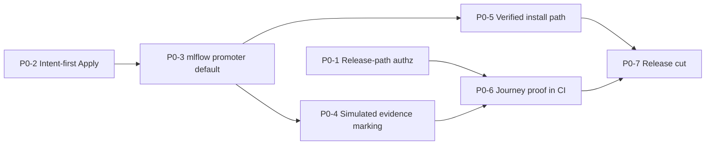

---
audience:
  - developer
  - architect
  - decision-maker
doc_type: strategy
product_area: strategy
stability: draft
summary: Evidence-based gap analysis and execution plan for tagging CALIBER Suite as a Minimal Viable Alpha (MVA) — scope, journeys, P0/P1/P2 gaps with acceptance criteria, and exit criteria.
prerequisites:
  - Read docs/two-week-alpha-plan.md and docs/reports/two-week-alpha-release-notes.md for the narrower journey this plan generalizes
reviewed_on: 2026-10-13
version_applicability: main at dfe48481471 (code reviewed at 68fb0a7bbfe; the only later commit is #453, deploy images)
tags:
  - alpha
  - release-readiness
  - gap-analysis
  - execution-plan
---

# CALIBER Suite — Minimal Viable Alpha gap analysis

**Verdict: not releasable as an alpha today.** The core prompt lifecycle is largely
built and well tested (about 7,900 backend tests, 93% coverage), and it works end to
end when CALIBER runs on PostgreSQL or with a separate MLflow store. But seven
blockers stand between `main` and a credible alpha tag. Two let one project's operator
change another project's live prompt. Two make Apply report success, or present canned
evaluation numbers as real evidence, on the default configuration. One makes the
alpha's only end-to-end proof fail on its own harness. The last two are that no
documented install path works without undocumented steps, and that nothing has been
cut or released.

None of the blockers requires new product capability. Each is a correctness, honesty,
authorization, install, or release-process fix, sized from one line to a few hundred.

The alpha has two tiers ([§2.2](#22-scope-decision)). The **core** tier is the prompt
lifecycle, where every blocker sits. The **extended** tier (skills, tools, workflows and
knowledge bases) is built and passes its tests; what it lacks is proof, prerequisites
and labelling, which [§6](#6-p1--required-for-a-credible-usable-alpha) covers as P1
items P1-20 to P1-24.

## How to use this document

- **Audience.** An engineering agent or maintainer closing alpha gaps one PR at a time.
- **Order of work.** Follow [§7 Execution plan](#7-execution-plan). Each gap has an id
  (`P0-n`, `P1-nn`), testable acceptance criteria, and its dependencies.
- **Done means.** Every box in [§8 Alpha exit criteria](#8-alpha-exit-criteria) is ticked
  with linked evidence (a CI run, a PR, or a recorded command).
- **Evidence conventions.** `[exec]` = reproduced by running the code (tests, a live
  server on a temp SQLite/Postgres, or the Playwright spec). `[read]` = established by
  reading code only. File references are `path:line` at commit `68fb0a7`; lines may
  drift, so search for the named function if a line no longer matches. All `caliber/`
  Python paths are under `caliber/src/caliber/` unless stated.
- **Method.** Nine independent reviews (core journey, security/isolation, governance,
  evaluation/observability, secondary families, frontend/API contract,
  data/recovery, packaging/release, tests/SDK). Each reviewer was required to validate
  by execution where possible. The findings then went through a second critical review
  that merged duplicates, re-verified every P0 against code, and downgraded or removed
  items that were unsupported or beyond a minimal alpha ([§9](#9-second-review-log)).

---

## 1. Executive summary

### 1.1 Alpha blockers (P0)

| Id | Blocker | Why it blocks | Size |
| --- | --- | --- | --- |
| [P0-1](#p0-1) | Apply, prompt promote and prompt rollback have **no project authorization**. Any operator can change another project's live prompt. Any signed-in user can read every project's candidates. | Breaks the project/role model on the alpha's single core mutation. `[exec]` | S–M |
| [P0-2](#p0-2) | **Apply deadlocks itself** when CALIBER and MLflow share one SQLite file. That is the default of `run-dev.sh` and of the alpha E2E harness. The existing docs misattribute this to "worker contention". | The alpha's only E2E proof fails on its default harness. `[exec]` | S |
| [P0-3](#p0-3) | The **default `fake` promoter** makes Apply return "applied" and write `promote` audit rows while nothing changes in MLflow. | A false release success on the documented native path. `[exec]` | S |
| [P0-4](#p0-4) | **Simulated evaluation evidence is presented as real.** Every run reports canned scores of 0.94 vs 0.88 on "120 examples", whatever the dataset. These numbers are persisted into gate, audit and approval records with no provider marker. | The product's purpose is evidence-gated release. `[exec]` | S–M |
| [P0-5](#p0-5) | **No documented install path works as written.** The native paths never migrate the DB, and the bootstrap admin gets only viewer scope. The wheel has no migrate command. The docker path is unverified end to end. | A second person cannot install the alpha. `[exec]` | M |
| [P0-6](#p0-6) | **The alpha journey has no automated proof.** No CI job runs the journey spec, and no spec covers a user-created prompt. | Every P0 above shipped undetected. | S–M |
| [P0-7](#p0-7) | **No release has been cut.** There is no `0.1.0a1` tag, assets, changelog section or written procedure. The stale `caliber-v0.0.1` release is marked "Latest". | The tag is the deliverable. | S |

Sizes: S ≤ ½ day, M ≤ 2 days, for one engineer or agent including tests.

### 1.2 What already works (verified)

- **Prompt registry.** Prompt create, version, promote and rollback work in the MLflow Prompt Registry, with a durable, idempotent release-operation state machine (`prepared → applying → applied | failed | reconcile_required`), a reconciler, and audit. `[exec]`
- **Test sets.** Create, append, revise, supersede, restore and MLflow dataset sync all work and are all audited. `[exec]`
- **Calibration.** Calibration (MetaPrompt, GEPA) runs through a queued worker to `candidate_ready`, with an eval gate, SSE progress and Prometheus counters. `[exec]`
- **Apply and rollback.** With a real promoter on PostgreSQL or a separate MLflow store, Apply is one atomic claim plus promotion plus checkpoint. A double Apply gets 409, and a failed Apply cleanly reverts to `candidate_ready`. `[exec]`
- **Identity.** The identity boundary is solid. Session mode is the default, scrypt hashes passwords, cookies are HttpOnly and Secure, and login is throttled. PATs are hashed and capped by scope, and the secret store is encrypted. No account is created by default. `[exec]`
- **Project isolation.** Prompts, test sets, judges, evaluations, projects, members and verification items are isolated per project. `[exec]`
- **Migrations.** There is a single Alembic head (`0113`), upgrade and partial downgrade work on SQLite and PostgreSQL, the janitor reaps stale jobs after a restart, and failed worker ticks are survived. `[exec]`
- **Build.** The wheel builds with the bundled SPA, installs with no extras, and serves `/caliber/`. The SDK and CLI build, and `caliberctl` works against a server. `[exec]`
- **Test gates.**

  | Suite | Result |
  |---|---|
  | UI unit tests | 2,301 passing; typecheck and eslint clean |
  | SDK | 443 passing, 93% coverage |
  | CLI | 93 passing, 89% coverage |
  | Plugin SDK | 37 passing |
  | Backend core-journey subset | 714 passing |
  | Secondary families | 4,242 passing |

  `[exec]`

---

## 2. Minimal Viable Alpha definition

### 2.1 The alpha promise (one sentence)

A small team can self-host CALIBER from documented steps and, through the UI or the
sync Python SDK, do the following with an audit trail and honest failure reporting:

1. Author a prompt.
2. Build a test set.
3. Calibrate the prompt to get a candidate with evaluation evidence.
4. Review the candidate and explicitly apply it to the live MLflow alias.
5. See what is live and why.
6. Roll it back.
7. Do the equivalent for a skill, a tool and a workflow (the extended tier), and, where
   an object store is configured, build and query a knowledge base.

### 2.2 Scope decision

| Area | Alpha status | Rationale |
| --- | --- | --- |
| Prompts (author, version, promote, rollback) | **IN (core)** | The core journey. |
| Test sets (eval datasets) | **IN** | Evidence input. |
| Evaluations (scorecards) with a real LLM | **IN** | Fails closed without a key (honest). Needs docs ([P1-09](#p1-09)). |
| Calibration of prompts (MetaPrompt, GEPA) | **IN** | Produces the candidate. DSPy is reachable only through the seeded fixture, so it is not a user option. |
| Review → Apply → release operation → rollback (the "job-apply path") | **IN** | The **only** governance story for the alpha. |
| Projects, members, roles; accounts; PATs | **IN** | The team model. Must be enforced ([P0-1](#p0-1)). |
| Audit log, release timeline, recovery console, readiness | **IN** | Traceability and honest recovery. |
| Sync Python SDK | **IN** | "Equivalently via SDK". The sync client has 0 coverage gaps against the API. |
| `caliberctl` | **IN (read/ops verbs only)** | Missing apply and rollback verbs are P2; the SDK covers them. |
| Release-candidate "signoff factory" (Releases page, top) | **LABEL as record-only** | A GO signoff changes nothing `[exec]`. |
| Workspace / Change Requests / environment promotion | **LABEL experimental (API/SDK/CLI)** | No UI. Release evaluation never executes on a live server `[exec]`. |
| Skills (author, render test, calibrate, apply as new version, rollback) | **IN (extended)** | Works offline; shares the prompt job/promoter/release machinery, so P0-1 and P0-4 cover it. Needs proof and docs ([P1-20](#p1-20)). |
| Tools and the subprocess sandbox | **IN (extended, trusted authors)** | Works offline; registration is admin-only. The sandbox is a process boundary, not isolation, and the alpha must say so ([P1-21](#p1-21)). |
| Workflows (design, validate, preview, publish, run, deploy, promote, rollback) | **IN (extended)** | Works live with the fake executor; 1,545 tests. Needs CI proof, runtime-queue docs, node prerequisites and honest calibration ([P1-22](#p1-22)). |
| Knowledge bases and the object-store console | **IN (extended, infrastructure-gated)** | Requires an S3/MinIO bucket, the `knowledge-local` extra and (for ANN) PostgreSQL. Must fail fast without them ([P1-12](#p1-12), [P1-23](#p1-23)). |
| MCP servers, OpenAPI integrations, cookbooks | **LABEL preview** | Work in tests and live checks, but need external servers or are convenience surfaces. |
| Aria assistant and plans | **HIDE unless an engine is configured**, otherwise LABEL | Every reply is `OpenAIError` on the default install `[exec]`. |
| Memory (mem0) | **OUT** (already off; clean 503) | — |
| Flagged trace → verification → refinement | **OUT for alpha (document)** | No poller, no UI flag action, and verify creates no job. |

### 2.3 Supported topologies and provider modes

| Item | Alpha support |
| --- | --- |
| Database | **PostgreSQL** (supported). SQLite only with a **separate** MLflow store; supported for evaluation and demo after [P0-2](#p0-2). |
| MLflow | A separate vanilla `mlflow server` (≥ 3.15) over HTTP. Embedded `mlflow server --app-name caliber` is unsupported (existing docs position). |
| Install paths | (a) Release wheels + native `mlflow server` (no Docker); (b) docker compose stack (`make start`). Exactly one must be verified end to end by script before tagging ([P0-5](#p0-5)). |
| Providers | `promoter`/`artifact_store` = `mlflow` by default. `eval`/`llm` may be `fake` **only when visibly marked simulated** ([P0-4](#p0-4)). Real evaluation requires an OpenAI key. The workflow executor is the fake executor whenever the LLM is fake, and must be marked the same way ([P1-22](#p1-22)). |
| Object store | Required only for knowledge bases and the object-store console: the docker stack's MinIO (fixed in #453) or any S3 endpoint. Not required for the core tier, skills, tools or workflows without knowledge nodes. |
| Extras | Knowledge bases need the `knowledge-local` extra (torch, sentence-transformers) and a one-time embedding-model download, or a pre-cached model. The alpha install page must say so ([P1-23](#p1-23)). |

### 2.4 Explicit non-goals for the alpha

These are listed so that no one spends alpha time on them:

- HA and horizontal scale
- Performance or load targets
- SSO, MFA or OIDC
- Multi-tenant hosting
- Two-person approval enforcement
- PyPI publication
- Container image publication
- Async SDK parity
- Workspace release execution
- Apache AGE graph retrieval and pgvector ANN as required paths (both stay optional flags)
- Workflow agent nodes against a real LLM as a CI gate (fake executor proves the mechanics)
- Trace-to-refinement automation
- A rehearsed disaster recovery
- Upgrade guarantees from `caliber-v0.0.1`

---

## 3. Capability inventory

Status legend:

| Status | Meaning |
| --- | --- |
| ✅ | Working, verified by execution |
| ☑️ | Working by reading or tests |
| ⚠️ | Partial |
| ❌ | Broken |
| ⛔ | Absent |

| Capability | Status | Evidence | Alpha | Gap |
| --- | --- | --- | --- | --- |
| Prompt create / version (MLflow registry) | ✅ | `POST /prompts` 201 `prompts:/<name>/1` | IN | Audit missing ([P1-02](#p1-02)) |
| Prompt alias promote / rollback | ✅ (authz ❌) | Release op `applied`; rollback restores prior version | IN | [P0-1](#p0-1) |
| Prompt test-render | ⚠️ | Renders a hard-coded demo template when the prompt has no live alias (`routes/prompts.py:2198-2210`) | label | P2 |
| Test sets: create, append, revise, supersede, restore, sync | ✅ | All audited | IN | — |
| Test example from trace | ⚠️ | Input stored as a JSON string, observed answer used as gold, tags lost on revise | IN | P2 |
| Evaluations (scorecard) | ✅ fails closed on `fake` LLM; ☑️ real provider | 400 "evaluation requires a real LLM provider" | IN | [P1-09](#p1-09) |
| Prompt calibration → `candidate_ready` | ✅ (evidence ❌ on fake eval) | Job ready in 2–6 s; `n_examples=120` for a 3-row set | IN | [P0-4](#p0-4) |
| Calibration with `eval=mlflow` and fake LLM | ⚠️ | Fails at eval with developer-facing "no predict_fn … register_predict_fn" | IN | [P1-09](#p1-09) |
| Apply (real promoter, Postgres or separate MLflow) | ✅ | 200 in 0.1–3.4 s, new version live, release op + checkpoint + audit | IN | — |
| Apply (shared SQLite) | ❌ | 502 `database is locked` after ~21 s, every attempt (also with all background loops off) | IN | [P0-2](#p0-2) |
| Apply (default fake promoter) | ❌ false success | 200 `prompt://…/v-fake`, MLflow unchanged, rollback 409 | IN | [P0-3](#p0-3) |
| Refinement-job read/apply authorization | ❌ | Non-member read and applied; viewer-role member applied | IN | [P0-1](#p0-1) |
| Release reconcile / resolve / recovery console | ✅ tests, ☑️ UI | `test_release_operations.py`, `test_release_reconciler.py` | IN | — |
| Releases "What's live now" | ⚠️ | Workflows and KBs only; says "Nothing deployed yet" after a prompt Apply | IN | [P1-13](#p1-13) |
| Review step in UI | ⚠️ | Apply or Cancel only; request-changes and quality-review are API-only | IN | P2 |
| Audit log list/export | ✅ | Admin-only, CSV export | IN | [P1-02](#p1-02) |
| Lineage version → job → evidence | ⚠️ | Data exists; no public path from a released version | IN | [P1-14](#p1-14) |
| Traces, feedback, SSE, metrics | ✅ | Traces are visible org-wide (unscoped) | IN | [P1-15](#p1-15) |
| Feedback → verification queue | ⛔ | `MLflowAssessmentClientImpl` has no caller | OUT | [P1-15](#p1-15) (docs) |
| Session auth, throttling, cookies, PATs, secret store | ✅ | 363 auth/isolation tests pass; probes | IN | [P1-01](#p1-01) |
| Bootstrap admin on documented native path | ❌ | Logs in as `caliber.viewer`; `POST /projects` 403 | IN | [P0-5](#p0-5) |
| Schema migration on documented / wheel installs | ⛔ | Server boots unmigrated; login 500; wheel has no `alembic.ini` | IN | [P0-5](#p0-5) |
| Health/readiness on unmigrated DB | ❌ | `/health` ok, `/readiness` `ready:true` | IN | [P1-03](#p1-03) |
| SPA health indicator | ❌ | Always "API or database unreachable" (`/health` has no `{data}` envelope) | IN | [P1-05](#p1-05) |
| Administration → store secret | ❌ | UI sends `POST /secrets`; only `PUT /secrets/{name}` exists → 405 | IN | [P1-06](#p1-06) |
| PAT management UI | ⛔ | API works with a cookie; no UI | IN | [P1-07](#p1-07) |
| Wheel build with SPA | ✅ | `twine check` passes; content assertions pass | IN | — |
| Installed-wheel boot smoke in CI | ✅ | `package` installs the built wheel, migrates, boots, and fetches `/health` and the SPA | IN | [P1-17](#p1-17) |
| Docker dev stack | ✅ | Images fixed by #453. `stack-smoke.yml` builds both images weekly and on `deploy/**` changes and uses the stack end to end | IN | [P0-5](#p0-5), [P1-17](#p1-17) |
| Alpha journey E2E spec in CI | ⛔ | Only `e2e/cookbooks` runs, on push to `main` only | IN | [P0-6](#p0-6) |
| Required status checks on `main` | ⛔ | `required_status_checks` → 404 | IN | [P1-16](#p1-16) |
| Tag / prerelease / changelog | ⛔ | Only `caliber-v0.0.1` (no assets, marked Latest) | IN | [P0-7](#p0-7) |
| Skills: CRUD, render, package, calibrate, rollback-as-new-version | ✅ (tests + live) | 341 tests pass; live create 201, render 200; `routes/skills.py:1346` enqueues the shared refinement job | IN (ext.) | [P1-20](#p1-20) |
| Tools: registry, test runs, deterministic calibration, sandbox | ✅ (tests) / ⚠️ (trust) | 281 tests pass; registration admin-only (`routes/tools.py:421,505`); sandbox is a subprocess, not isolation (`config.py:1138-1151`); 16 seeded demo/memory tools `active` | IN (ext.) | [P1-21](#p1-21) |
| Workflows: author → validate → compile → preview → publish → run → deploy | ✅ (live, fake executor) | 1,545 tests; all steps 200/201 live; approvals `configuration_required` without the run queue (`routes/capabilities.py:111`) | IN (ext.) | [P1-22](#p1-22) |
| Workflow calibration (manifest replay) | ⚠️ | Structural scorer and `min_overall_delta=0.0` by default (`orchestrator/workflow_stages.py:595-599`); unlabelled | IN (ext.) | [P1-22](#p1-22) |
| Knowledge bases: ingest, build, activate, query, rollback | ❌ on default install; ☑️ with an object store (tests) | 343 tests (fakes for pgvector/AGE); live default install: 201, then build `NoCredentialsError` after ~82 s | IN (ext., gated) | [P1-12](#p1-12), [P1-23](#p1-23) |
| MCP servers, OpenAPI integrations, cookbooks | ✅ (tests + live) | 336 / 135 / 47 tests pass; MCP needs reachable servers (loopback blocked) | label | [P1-10](#p1-10) |
| Aria chat / plans | ❌ on default install | Replies are `OpenAIError`; a 0-step plan "completes" | hide/label | [P1-11](#p1-11) |
| Workspace releases | ❌ on live server | Evaluation stays `queued` (no executor) | label | [P1-10](#p1-10) |
| Release-candidate signoff | ⚠️ (no effect) | Self-signoff GO 201; timeline and operations empty | label | [P1-10](#p1-10) |
| Sync SDK | ✅ (mocks) / ⚠️ (vs server) | Core-journey methods never run against a server | IN | [P1-19](#p1-19) |
| SDK/CLI install | ❌ | Docs say `pip install` (PyPI 404); CLI depends on unpinned `caliber-sdk` | IN | [P1-18](#p1-18) |

---

## 4. Critical user journeys

| # | Journey | Status today | Blocking gaps |
| --- | --- | --- | --- |
| CJ-1 | Install and start from docs (native, no Docker) | ❌ Login 500 (no migration). After a manual migration, admin is a viewer `[exec]`. | P0-5 |
| CJ-2 | Install and start from docs (docker compose) | ✅ Built and used end to end by `scripts/verify-compose-stack.sh` (login, project, prompt, registry, SPA). It runs weekly and on `deploy/**` changes, not on every PR. | P0-5, P1-17 |
| CJ-3 | Sign in, create a project, add a member with a role | ⚠️ Works only with `CALIBER_ADMIN_USERS` set. Default config creates no account, with no log line. | P0-5, P1-08 |
| CJ-4 | Author a prompt, version it, promote it | ✅ `[exec]` (no authoring audit) | P1-02 |
| CJ-5 | Build a test set | ✅ `[exec]` | — |
| CJ-6 | Run an evaluation | ⚠️ Needs a real LLM; not documented | P1-09 |
| CJ-7 | Calibrate to get a candidate with evidence | ⚠️ Works, but evidence is canned and unlabelled on defaults `[exec]` | P0-4, P1-09 |
| CJ-8 | Review and Apply | ❌ Self-deadlock on shared SQLite, false success on default promoter, cross-project Apply `[exec]`. ✅ on Postgres or separate MLflow with the mlflow promoter `[exec]`. | P0-1, P0-2, P0-3 |
| CJ-9 | See what is live, why, and who did it | ⚠️ "What's live" omits prompts; no version→evidence link; audit gaps | P1-13, P1-14, P1-02 |
| CJ-10 | Roll back | ✅ with real promoter `[exec]`; ❌ cross-project | P0-1 |
| CJ-11 | Recover from failures (MLflow down, restart mid-job, indeterminate release) | ⚠️ Honest end states, but an MLflow outage hangs requests ~8 minutes and the UI says nothing `[exec]` | P1-04 |
| CJ-12 | The same journey through the sync SDK | ⚠️ Methods exist; untested against a server. The first PAT needs curl. | P1-07, P1-19, P1-18 |
| CJ-13 | Two projects stay isolated | ❌ Jobs, alias promote/rollback and test-run list leak or mutate across projects `[exec]` | P0-1, P1-01 |
| CJ-14 | Alpha journey proven automatically on the tagged commit | ❌ Spec not in CI; fails on its default harness `[exec]` | P0-6, P0-2 |
| CJ-15 | Author a skill, test-render it, calibrate, review, apply as a new version, roll back | ⚠️ Each step works by API `[exec]`/tests; no browser spec, no CI, same evidence and authorization gaps as prompts | P0-1, P0-4, P1-20 |
| CJ-16 | Register a tool, run its tests, baseline a suite, calibrate, use it in a workflow | ⚠️ Works by tests and live API; trust boundary undocumented; no spec | P1-21 |
| CJ-17 | Design a workflow, preview, publish, run, deploy to `dev`, promote through the gated alias, roll back | ✅ Live with the fake executor `[exec]`; specs exist but run only locally; runtime approvals need an undocumented setting | P1-22 |
| CJ-18 | Create a knowledge base from a bucket, build, activate, query, roll back a version | ❌ on the default install `[exec]`; unverified on the docker stack | P1-12, P1-23 |

---

## 5. P0 — alpha blockers

### P0-1

- **Gap:** Project authorization is missing on the release path (Apply, request-changes, job reads, prompt promote/rollback, prompt test-run list)

- **Category:** Authorization / project isolation.
- **Current state:**
  - `routes/jobs.py`:
    - `list_jobs` (191), `get_job` (210) and `get_job_targets` (223) call only `require_user`.
    - `apply_job` (306) and `request_changes` (459) call only `require_scopes([SCOPE_OPERATOR])`.
    - Jobs are loaded with bare `session.get`.
    - `CaliberRefinementJob` has no `project_id`, and `resource_inventory()` classifies it `unscoped`, so the bare-lookup regression net never flags it.
  - `routes/prompts.py`:
    - `set_prompt_alias` (~1928) and `rollback_prompt` (~2095) check only operator scope. They never call `_prompt_target_invisible` or a project-role check, although the read routes in the same module do.
    - The idempotent `operation_id` replay path returns before any authorization.
    - `list_prompt_test_runs` (~2438) is unfiltered.
    - `set_prompt_baseline` (~2693) reads a test run with bare `session.get`.
  - The same pattern applies to `/jobs/{id}/quality-reviews` (`routes/quality_reviews.py`).
- **Expected alpha state:**
  - A non-member gets 404 on every job, alias and rollback route for another project's prompt.
  - A viewer or reviewer member gets 403 on Apply, promote and rollback.
  - Owners, editors and admins are unaffected.
- **Evidence (`[exec]`, three independent reviewers):**
  - A non-member operator applied project A's candidate: the promoter received it and the job became `applied`.
  - A **viewer-role** member applied it too.
  - A non-member rolled back and promoted A's live prompt. MLflow alias calls `('a-prompt','prod',1)` and `('a-prompt','prod',2)` were recorded as legitimate audit rows, while the same user's `GET /prompts/a-prompt` returned 404.
  - A non-member read the candidate text and diagnosis via `GET /jobs/{id}`.
  - A non-member listed A's prompt test runs.
- **Why it matters:** Apply and rollback are the alpha's central mutations. Projects and roles are part of the alpha promise.
- **Recommended fix (smallest viable):**
  1. Add `_visible_job_or_404(session, request, job_id)` to `routes/jobs.py`:
     - load the job, then `get_visible(CaliberAgentConfig, …, job.agent_id, resolve_identity(request))`;
     - return 404 on `None` and on an orphaned agent.
     Use it in `get_job`, `get_job_targets`, `apply_job` (before the claim UPDATE), `request_changes`, and in `routes/quality_reviews.py`.
  2. Filter `list_jobs` by joining visible agent ids, as `routes/releases.py::_visible_ids` does.
  3. In `apply_job` and the prompt promote/rollback handlers, call `require_project_access_if_scoped(session, identity, agent.project_id, "release.apply")`. Rollback uses the same `release.apply` action rather than the owner-only `release.rollback`, so the editor who applied a version can roll it back from the prompt page.
  4. In `set_prompt_alias`, `rollback_prompt`, `set_prompt_baseline` and `bind_prompt`, apply `_prompt_target_invisible` → 404 **before** the idempotent replay branch.
  5. Filter `list_prompt_test_runs` by visible agent ids.
  6. Guard it against regression. The bare-lookup inventory is derived from table columns and `CaliberRefinementJob` has none, so it cannot cover jobs. `tests/test_job_route_gate_ratchet.py` is the equivalent net: any function in the job route modules that reads or lists the job model without calling the gate fails the test.
- **Priority:** P0. This is an unauthorized cross-project production mutation on the core journey.
- **Files:**
  - `routes/jobs.py`, `routes/quality_reviews.py`, `routes/prompts.py`
  - `routes/bare_lookup_inventory.py` / `db/resource_inventory.py`
  - `caliber/tests/test_routes_jobs*.py`, `caliber/tests/test_routes_prompts.py`
- **Dependencies:** None. The helpers (`get_visible`, `require_project_access_if_scoped`, `_prompt_target_invisible`) exist.
- **Status: implemented.** Tests: `tests/test_routes_jobs_isolation.py` (16), the release-path block at the end of `tests/test_routes_prompts.py` (11), and `tests/test_job_route_gate_ratchet.py` (3). The new route tests fail against the old code and pass against the fix.
- **Acceptance criteria:**
  - [x] Non-member operator: `GET /jobs` omits the job.
  - [x] Non-member operator: `GET /jobs/{id}`, `/targets` and `/quality-reviews` return 404.
  - [x] Non-member operator: `POST /jobs/{id}/apply`, `/request-changes` and `/quality-reviews` return 404. The promoter is not called and the job status is unchanged.
  - [x] Viewer- or reviewer-role member: Apply returns 403. Owner or editor: 200.
  - [x] Non-member operator: `POST /prompts/{name}/aliases/prod` and `/rollback` return 404 (including with a replayed `operation_id`). There are zero MLflow alias calls and no release operation or audit row.
  - [x] Viewer member gets 403 on the alias and rollback routes.
  - [x] Non-member `GET /prompts/test-runs` excludes the other project's runs.
  - [x] A regression net covers refinement jobs (`test_job_route_gate_ratchet.py`, see fix step 6).
  - [x] The two-week alpha spec still passes in the browser: it passed on the default SQLite harness with the P0-1 gates and the P0-2 Apply fix together (see [P0-2](#p0-2)).

  Behavior changes to know about: a `caliber.admin` who is not a member of a project can still read its jobs but can no longer apply them or promote or roll back its prompts, because admin is deliberately not an implicit project member (`resource_access.project_role`). The same applies to every other role-gated project action.

### P0-2

- **Gap:** Apply deadlocks itself when CALIBER and MLflow share one SQLite file, and the docs blame worker contention

- **Category:** Correctness / transaction design / dev defaults.
- **Current state:**
  - `apply_job` claims the job with an **uncommitted** `UPDATE … SET status='applying'` and flushes a `CaliberApprovalRequest`. Still inside that open write transaction, it calls `apply_candidate → promote_bundle → MLflowPromoter.promote → mlflow.genai.register_prompt` (`routes/jobs.py:328-372`, commit at 390).
  - MLflow writes through its own engine. On a shared SQLite file it waits for CALIBER's lock until its busy timeout expires.
  - `run-dev.sh:61` and `run-playwright-server.sh:506` default `MLFLOW_BACKEND_STORE_URI` to `CALIBER_DATABASE_URL`, which is the same file.
  - `docs/reports/two-week-alpha-day9-decision.md` and `two-week-alpha-release-notes.md` (lines ~108-120, 140) call this "single-writer contention under Apply … not a defect in the Apply/release code itself". That is incorrect.
- **Expected alpha state:**
  - Apply succeeds on the default local harness.
  - Starting CALIBER with both stores on one SQLite file is refused or loudly warned.
  - The docs state the real cause.
- **Evidence (`[exec]`, three reviewers):**
  - Shared file on a live server: 502 `database is locked` after 20.5–20.7 s, on 4 of 4 attempts.
  - Shared file with **all background loops off**: the same 502 after 21.1 s. This rules out worker contention as the cause.
  - A standalone probe registering a prompt inside an uncommitted CALIBER transaction failed after 20.7 s with the identical error. With the transaction committed first, it succeeded in 0.0 s.
  - MLflow on its own SQLite file: Apply 200 in 3.4 s.
  - The alpha spec fails at Apply on the shared file (4 runs by three reviewers). It passes on separate files with 1 or 4 server workers, and on PostgreSQL.
- **Why it matters:** This is the alpha's only end-to-end proof and the `make dev` path. Any single-file SQLite install with a real promoter can never release.
- **Recommended fix:**
  1. **Code (intent-first Apply):**
     - Commit the `candidate_ready → applying` claim and the approval row before invoking the promoter, mirroring `release_operations.prepare_prompt_alias_release`.
     - On a promoter error, run a compensating transaction back to `candidate_ready`, with an audit row for the failed attempt.
     - Leave jobs whose release operation is `applying` or `reconcile_required` to the reconciler.
     - Committing the claim first opens a new crash window: a process that dies between the commit and the promoter call leaves the job `applying` with no release operation, and nothing sweeps that today (the reconciler scans operations, not jobs). Add a janitor rule that reverts such a job to `candidate_ready` once it has sat unchanged past a stale window, and add `applying` to `_VALID_STATUSES` in `routes/jobs.py` so the state is at least listable.
     - Preserve the 409 for a concurrent second Apply.
  2. **Defaults:** default `MLFLOW_BACKEND_STORE_URI` to a separate SQLite file in `run-dev.sh`, `run-playwright-server.sh`, and the `caliber/Makefile` `tracking-server` target. *Not done, deliberately:* once (1) landed, a shared file works (proved by the real-MLflow test below), and moving the store would orphan the prompts in every existing dev checkout for no remaining benefit.
  3. **Guard:** in `create_app`, when the CALIBER DB URL and the MLflow tracking or backend URI resolve to the same SQLite file, fail startup with an actionable message. A warning is acceptable only if (1) has landed. *Implemented as a warning*, since (1) has landed: refusing would break `make dev`, which works.
  4. **Docs:** correct the Day 9 report, the release notes and the spec header comment (`two-week-alpha-journey.spec.ts:33-40`).
- **Priority:** P0. The single alpha proof fails on its own default, and the root cause is a code defect documented as an environment limit.
- **Files:**
  - `routes/jobs.py`, `apply.py`, `bundle.py`, `server.py`
  - `caliber/scripts/run-dev.sh`, `caliber/scripts/run-playwright-server.sh`, `caliber/Makefile`
  - `docs/reports/two-week-alpha-day9-decision.md`, `docs/reports/two-week-alpha-release-notes.md`
  - `caliber/caliber-ui/e2e/two-week-alpha-journey.spec.ts`
- **Dependencies:** None. Land before or with [P0-3](#p0-3). Otherwise flipping the default promoter to `mlflow` turns a false success into a 100% failure on the SQLite dev path.
- **Status: implemented.** Code: `routes/jobs.py` (claim and approval committed before the promoter, `_revert_unstarted_apply`, `applying` accepted as a status filter), `orchestrator/janitor.py` (stale-`applying` sweep), `server.py` + `db_url.py` (shared-file warning). Tests: `tests/test_apply_shared_sqlite_store.py` (real MLflow on one shared SQLite file, in a subprocess), six new cases in `tests/test_routes_jobs_apply.py`, four in `tests/test_orchestrator_janitor.py`, `tests/test_shared_sqlite_store_warning.py`. The shared-file test fails against the old Apply (502, "database is locked") and passes against the fix.
- **Acceptance criteria:**
  - [x] A pytest using a real `mlflow.genai` on a temp SQLite file **shared** with the CALIBER engine applies a `candidate_ready` job: 200, new version live.
  - [x] A second Apply of the same job returns 409 (asserted in the shared-file test and the existing apply tests).
  - [x] An injected promoter failure leaves the job `candidate_ready` with an `apply_failed` audit row and no orphaned approval, and the job can be applied again.
  - [x] A job left `applying` with no release operation and a stale `updated_at` is reverted to `candidate_ready` by the janitor; a job with a release operation, or a recent one, is never touched.
  - [x] `npx playwright test e2e/two-week-alpha-journey.spec.ts` passes on the harness defaults (SQLite): 1 passed (2.3 s test, 1.6 min including server bootstrap). It failed at Apply on every earlier run on this harness.
  - [x] Startup with both stores on the same SQLite file warns (unit tests, including through `create_app`). The plan asked for a refusal; see fix step 3.
  - [x] No doc attributes the failure to background workers (Day 9 report, release notes and spec header carry dated corrections).

### P0-3

- **Gap:** The default `fake` promoter makes Apply report a release that never happened

- **Category:** Release truthfulness / defaults.
- **Current state:**
  - `promoter_provider` and `artifact_store_provider` default to `"fake"` (`config.py:467-495`). README (`README.md:183-192`) and `docs/operate/local-bring-up.md:56-65` do not set them. Compose does (`deploy/caliber/compose.yaml:177-179`).
  - Prompt create and manual promote always write real MLflow, but Apply goes through `FakePromoter` (`promoter.py:410-434`).
  - Apply returns 200 `status: applied`, `artifact_ref: prompt://<name>/v-fake`, and writes `promote`/`apply_candidate` audit rows and a checkpoint with null versions. The job becomes `applied`, so it can never be re-applied.
  - The UI says "Candidate applied. The promoted prompt version is now live." (`caliber-ui/src/pages/Prompts.tsx:6711`). A later rollback returns 409.
- **Expected alpha state:** Apply either moves the real MLflow alias or refuses. No audit row ever records a promotion that did not happen.
- **Evidence (`[exec]`, two reviewers):**
  - `apply: 200 … "artifact_ref":"prompt://e1-classifier/v-fake"`.
  - The versions afterwards are only v1 and v2, with `@prod` still on v1.
  - `/releases/timeline` shows nothing new.
  - The audit log has `promote` + `apply_candidate`.
  - Rollback returns `409 no recorded prior live version`.
- **Why it matters:** This is a false success on the step the product exists to govern, and it leaves an incorrect audit trail.
- **Recommended fix:**
  1. Default `promoter_provider` and `artifact_store_provider` to `mlflow`. MLflow is already a hard dependency of prompt authoring.
  2. Make `promoter_provider=fake` and `artifact_store_provider=fake` require `CALIBER_ALLOW_SIMULATED_PROVIDERS=true`. Test fixtures, the E2E harness and cookbooks set it. The `fake` LLM and evaluation providers stay the offline default, governed by [P0-4](#p0-4). When the fake promoter is active, `apply_candidate` stamps `simulated: true` into the promotion payload and the audit details, and the UI renders "Simulated apply — nothing was released" instead of "now live".
  3. Update `.env.example` and the README to match.
- **Priority:** P0.
- **Files:**
  - `config.py`, `server.py`, `promoter.py`, `apply.py`, `routes/jobs.py`
  - `caliber-ui/src/pages/Prompts.tsx`
  - `caliber/tests/conftest.py`, `caliber/scripts/run-playwright-server.sh`
  - `.env.example`, `README.md`
- **Dependencies:** [P0-2](#p0-2). Share one opt-in flag with [P0-4](#p0-4).
- **Status: implemented.** Code: `config.py` (defaults `mlflow`, new `allow_simulated_providers`), `server.py` (`_require_simulated_opt_in`), `promoter.py` (`FakePromoter.is_simulated`), `routes/jobs.py` (`simulated` in the response and the `apply_candidate` and `promote` audit rows), `caliber-ui` (`lib/applyMessage.ts`, `Prompts.tsx`), `tests/conftest.py` (the suite opts in, in its one config hook), `.env.example`, config docs and changelog. Tests: `tests/test_simulated_provider_guard.py` (7), two Apply cases in `tests/test_routes_jobs_apply.py`, the shared-store subprocess test now runs on the shipped defaults, and UI unit and flow tests for the message.
- **Acceptance criteria:**
  - [x] Booting with no provider env, `/readiness` `simulated` does not contain `promoter` or `artifact_store`.
  - [x] With no provider env, Apply creates version N+1 and moves `@prod`: the real-MLflow subprocess test runs with no provider variables and asserts a new live version and `simulated: false`.
  - [x] With `fake` + opt-in, the Apply response and the audit details carry `simulated: true`, and the UI text does not say "live" (Vitest, helper and component flow).
  - [x] With `promoter_provider=fake` and no opt-in, startup fails with a message naming the flag (unit test, for the promoter, the artifact store, and both in any case).
  - [x] A default boot (no provider env, no opt-in) still starts (the LLM and evaluation stay simulated and are marked under [P0-4](#p0-4)).
  - [x] Full backend suite and E2E green: 7,947 passed (9 load flakes under 6 parallel workers, all passing on rerun: 75 passed), and the two-week alpha browser journey passes on the default SQLite harness with the new defaults.

### P0-4

- **Gap:** Simulated evaluation evidence is persisted and displayed as if it were real

- **Category:** Evidence trustworthiness.
- **Current state:**
  - `eval_provider` defaults to `fake` (`config.py:477-478`).
  - `FakeEvalProvider` ignores the dataset and the requested scorers. It always returns candidate 0.94 vs baseline 0.88, `n_examples=120`, and fixed dimensions (`eval/fake.py:11,41-51`).
  - The gate passes. The numbers are written to `job.eval_results`, the regression run, the `candidate_ready` audit row and the Apply-time approval snapshot, with no provider or simulated marker.
  - The review dialog shows "Evaluation score … Gate: Passed … N=120" (`Prompts.tsx:7820-7855`).
  - The only signal is a global banner (`components/ProviderBanner.tsx`). The banner is dismissible, and it disappears when `/readiness` returns 503.
  - Nothing prevents a real LLM combined with fake evaluation.
- **Expected alpha state:**
  - Every eval result, candidate and approval derived from a fake provider is machine-marked and visibly badged.
  - Counts reflect the real dataset.
  - A user cannot mistake simulated numbers for evidence at the moment of decision.
- **Evidence:** `[exec]` A 3-example dataset with the requested scorer `Correctness` returned `"candidate":{"overall":0.94,"dimensions":{"factual":0.97,"tool_use":0.93,"tone":0.89,"safety":0.99}}, "n_examples":120, "gate":{"passed":true}`. MetaPrompt and GEPA returned the same numbers. `grep -rn "simulated" eval/ orchestrator/eval_stage.py regression.py` finds nothing.
- **Why it matters:** The product's value is "trustworthy evidence before release". The audit and approval snapshot permanently record fabricated numbers as gate evidence.
- **Recommended fix (keep the offline demo, make it honest):**
  1. `FakeEvalProvider` reports the pinned dataset's real example count and echoes the requested scorer names as dimensions.
  2. `_comparison_to_json` and the regression run add `provider` and `simulated`. The `candidate_ready` audit details and the approval snapshot include them.
  3. The review dialog and job detail show a **non-dismissible** "Simulated evaluation — not evidence" badge when `simulated` is true.
  4. `ProviderBanner` parses the 503 readiness body (it carries the same `data`) and cannot be dismissed while `eval` or `promoter` is simulated.
  5. Startup refuses `llm_provider` ≠ `fake` with `eval_provider=fake` unless the simulated opt-in from [P0-3](#p0-3) is set.

  Optional, not required: block Apply of a simulated candidate unless `allow_simulated=true`.
- **Priority:** P0. This is audit-integrity and decision-integrity on the core journey.
- **Files:**
  - `eval/fake.py`, `eval/provider.py`, `orchestrator/eval_stage.py`, `regression.py`, `routes/jobs.py`, `server.py`
  - `caliber-ui/src/pages/Prompts.tsx`, `components/EvalComparison.tsx`, `components/ProviderBanner.tsx`
- **Dependencies:** Shares the opt-in flag with [P0-3](#p0-3).
- **Status: implemented.** Code: `eval/provider.py` (`describe_provider`), `eval/fake.py` (real example count from the pinned dataset, scorer names echoed, `provider_name`/`is_simulated` markers), `eval/mlflow_runner.py` (`provider_name`), `orchestrator/eval_stage.py` and `regression.py` (`provider`/`simulated` on `eval_results`, the regression run's gate payload, and the `candidate_ready` and `record_regression_replay` audit rows), `server.py` (real LLM plus fake eval needs the opt-in). UI: `ProviderBanner.tsx` (no dismiss control while `eval` or `promoter` is simulated, blockers shown), `caliberApi.getProviderReadiness` (accepts the 503 readiness body), `Prompts.tsx` review dialog and `EvalComparison.tsx` (simulated badge). The approval snapshot copies `eval_results`, so it carries the marker too. Tests: `test_orchestrator_eval.py`, `test_simulated_provider_guard.py`, `test_routes_jobs_apply.py`, and Vitest for the banner, the API client, `EvalComparison` and the review dialog.
- **Acceptance criteria:**
  - [x] Under the fake provider, `eval_results.n_examples` equals the dataset size, and the dimension keys equal the requested scorers (pytest).
  - [x] `eval_results`, the regression run and the `candidate_ready` audit details include `provider` and `simulated` (pytest). The Apply-time approval snapshot keeps the marker (pytest).
  - [x] The review dialog renders the simulated badge, and does not render it for a measured evaluation (Vitest).
  - [x] The banner renders when `/readiness` returns 503 with a non-empty `simulated`, and has no dismiss control while eval or promoter is simulated, even with a stored dismissal (Vitest).
  - [x] Real LLM + fake eval without the opt-in fails startup (unit test).

### P0-5

- **Gap:** No documented install path works as written, and none is verified end to end

- **Category:** Installation / onboarding / packaging.
- **Current state:**
  - `create_app` never migrates; there is no `alembic` or `create_all` in `server.py`.
  - README (`README.md:183-192`), `caliber/README.md`, `docs/operate/local-bring-up.md:56-65` and `docs/start/five-minute-quickstart.md` contain no migration step.
  - The wheel ships no `alembic.ini`. The source `alembic.ini` uses `script_location = src/caliber/db/migrations`. There is no console script.
  - The documented native env block sets the insecure bootstrap but not `CALIBER_ADMIN_USERS`, `CALIBER_OPERATOR_USERS` or `CALIBER_APPROVER_USERS`. The server does not read `.env`, so admin/admin logs in as `caliber.viewer` and `POST /projects` returns 403.
  - The block does not set `CALIBER_{PROMOTER,ARTIFACT_STORE,EVAL}_PROVIDER`.
  - `.env.example:2` claims "All values shown are defaults", which is false for the role variables.
  - With the default config, no account is created and nothing is logged.
  - Root `make setup` uses an unguarded `python3`, which fails on Python ≥ 3.13.
  - The docker path is the one path that migrates and sets roles and providers (`deploy/caliber/entrypoint.sh:35-36`, `compose.yaml:143-145,177-179`). Its images were fixed by #453, but no one has brought the full stack up end to end, and CI never builds the CALIBER image (`ci.yml:947` builds `mlflow` only).
  - The SDK and CLI docs say `pip install caliber-sdk` / `caliber-cli`; every name returns 404 on PyPI.
- **Expected alpha state:** One page, "Alpha install", that a second person can follow verbatim from the release assets (or a source checkout) to a logged-in admin who can create a project and run the journey. Its steps are executed by a script in CI, and the docker alternative is verified once.
- **Evidence (`[exec]`):**
  - Fresh venv + built wheel + README env: `/health` 200 `db: ok` and `/readiness` `ready:true`, but `POST /auth/login` returns **500** and the workers log `no such table: caliber_user_accounts`.
  - After a manual migration (package-resource `script_location=caliber:db/migrations` → `0113`): login 200 with scopes `["caliber.viewer"]`, and `POST /projects` returns 403 "expected all of ['caliber.approver','caliber.operator']".
  - With `CALIBER_ADMIN_USERS=admin`, a project and a prompt are created.
  - A native `mlflow server` from the same venv plus the three provider selectors produces a real registry write.
- **Why it matters:** Install → log in → create project is step one of every journey. It is also the Day 10 "second person installs from the wheel" criterion that the existing plan never closed.
- **Recommended fix:**
  1. Add `caliber/src/caliber/db/migrate.py` and a `[project.scripts] caliber-migrate = "caliber.db.migrate:main"` entry. It builds an Alembic `Config` with `script_location = caliber:db/migrations` and runs `upgrade head`. Keep the source `alembic.ini` working.
  2. Write `docs/start/alpha-install.md` covering:
     - Python 3.11/3.12 venv
     - install the wheels in order (sdk → cli → server)
     - `caliber-migrate`
     - start a native `mlflow server` on its own SQLite file
     - an env block with `CALIBER_DATABASE_URL`, `MLFLOW_TRACKING_URI`, `CALIBER_ADMIN_USERS=admin` (+ operator/approver), the three provider selectors and the bootstrap flags
     - start uvicorn, then check `/readiness`
     - optional real-LLM block
     - the docker alternative

     Link it first from `README.md`, `five-minute-quickstart.md` and `local-bring-up.md`. Fix the same omissions in those pages.
  3. When the bootstrap account is created and all three role lists are empty, log an ERROR naming the variables. When session mode starts with zero accounts and no bootstrap source, log a WARNING.
  4. Add a Python version guard to root `make setup`. Correct `.env.example`'s "defaults" claim.
  5. Add `scripts/verify-alpha-install.sh`, which runs the page's commands in a temp dir and asserts login, project create and prompt create. Run it in CI ([P1-17](#p1-17) may host it).
  6. Bring the docker stack up once (`make start`), run the journey, and record the result in the release PR.
- **Priority:** P0.
- **Files:**
  - `caliber/pyproject.toml`, new `caliber/src/caliber/db/migrate.py`, `server.py`
  - `README.md`, `caliber/README.md`
  - `docs/start/alpha-install.md` (new), `docs/start/five-minute-quickstart.md`, `docs/operate/local-bring-up.md`, `docs/operate/configuration-and-provider-setup.md`
  - `.env.example`, root `Makefile`, `scripts/verify-alpha-install.sh` (new)
- **Dependencies:** #453 (merged). Provider defaults from [P0-3](#p0-3).
- **Status: implemented in code and docs; the CI run and the Docker stack journey are tracked below.** Code: `db/migrate.py` and the `caliber-migrate` console script (`pyproject.toml`), `server.py` (`_warn_if_nobody_can_log_in`, `_error_if_no_role_lists`), root `Makefile` (`PYTHON` override and the 3.10-3.12 guard in `check`). Docs: `docs/start/alpha-install.md` (registered in the docs site), plus the migration and role steps in `README.md`, `caliber/README.md`, `docs/operate/local-bring-up.md`, the quickstart and the configuration page, and a corrected `.env.example` header. Script: `scripts/verify-alpha-install.sh`, run by the `alpha-install` CI job (a required gate in the ledger) and by `scripts/ci-local.sh`. Tests: `test_migrate_command.py`, `test_bootstrap_admin_logging.py`, `test_alpha_install_contract.py`.
- **Acceptance criteria:**
  - [x] From an installed wheel with no repo checkout, `caliber-migrate` brings an empty SQLite DB to the Alembic head (pytest runs it from an unrelated directory; the script runs the installed wheel and asserts the checkout is not on the import path).
  - [x] Following `alpha-install.md` verbatim (scripted), `/auth/session` shows `is_admin: true` for the bootstrap user.
  - [x] In that session, `POST /projects` and `POST /prompts` return 2xx, and `/readiness` `simulated` contains at most `llm`, `eval`. The prompt is also read back from the native MLflow registry.
  - [x] The script runs green in CI: the `Alpha install (wheels, no checkout)` job passed on PR #461 in 2 min 16 s and is a required gate in the ledger.
  - [x] Every onboarding page lists the migration step before uvicorn (asserted by `test_alpha_install_contract.py`).
  - [x] `make setup` on Python 3.13 or newer exits with an actionable message before creating a venv (tested with a stub interpreter).
  - [ ] The docker stack journey result is recorded in the release PR ([P0-7](#p0-7)).

### P0-6

- **Gap:** The alpha journey has no automated proof

- **Category:** CI / release evidence.
- **Current state:**
  - `caliber/caliber-ui/e2e/two-week-alpha-journey.spec.ts` runs only via `test-all.sh:78`. No workflow references it.
  - The only Playwright job runs `playwright.cookbooks.config.ts` (`testDir: ./e2e/cookbooks`), and only on push to `main` (`ci.yml:762-812`).
  - The spec drives a fixture-seeded DSPy job that users cannot create, because DSPy is not an allowed prompt optimizer (`routes/prompts.py:126`).
  - No spec covers create prompt → test set → calibration → Apply → rollback for a user-created prompt.
- **Expected alpha state:** A CI check runs both the seeded spec and a user-path journey spec, offline with fake LLM/eval and the mlflow promoter, on PRs touching `caliber/src/**` or `caliber/caliber-ui/**` and on `main`. It is green on the tag commit.
- **Evidence:**
  - `grep -rn "two-week" .github/` finds nothing.
  - `[exec]` The spec fails at Apply on the default harness ([P0-2](#p0-2)) and passes on PostgreSQL. This regression was never visible in CI.
  - `optimizer_type=DSPyBootstrapFewShot` → 400 `expected one of ['MetaPrompt','GEPA']`.
- **Why it matters:** P0-1 through P0-4 all shipped while CI stayed green.
- **Recommended fix:**
  1. Add `e2e/user-prompt-journey.spec.ts` covering: create a prompt (UI) → promote v1 → create a test set with 3 examples → start a MetaPrompt calibration → wait for `candidate_ready` → assert the simulated badge ([P0-4](#p0-4)) → Apply → assert v2 live → rollback → assert v1 live.
  2. Add a CI job `alpha-journey` (needs `ui`) that installs Chromium and runs both specs through `run-playwright-server.sh` with `CALIBER_PROMOTER_PROVIDER=mlflow`. Use SQLite after [P0-2](#p0-2); a Postgres service container is the fallback.
  3. Add it to the gate ledger.
- **Priority:** P0. Without it the alpha has no automated evidence that its one promise works on the tagged commit.
- **Files:** `.github/workflows/ci.yml`, `caliber/caliber-ui/e2e/`, `caliber/caliber-ui/package.json`, `caliber/scripts/run-playwright-server.sh`.
- **Dependencies:** [P0-2](#p0-2), or Postgres in the job. [P0-4](#p0-4) for the badge assertion.
- **Status: implemented; the first green run on `main` and the tag-commit run are tracked below.** Code: `caliber-ui/e2e/user-prompt-journey.spec.ts` (new), `caliber-ui/playwright.alpha.config.ts` (new, own port and state directory), `npm run test:e2e:alpha`, the `alpha-journey` job in `.github/workflows/ci.yml`, its entry in `REQUIRED_GATES` and the ledger `needs`, and `job_alpha_journey` in `scripts/ci-local.sh`. The user-path spec creates a prompt in the UI (live as v1), saves a 3-example test set, starts a MetaPrompt calibration from the Calibration stage, checks the review dialog (simulated badge and "3 evaluation examples"), applies, asserts v2 is the `prod` version in the registry, rolls back, and asserts v1. One step uses the API: the Test Sets stage generates cases through the Aria assistant, which needs a real LLM (see [P1-09](#p1-09)).
- **Acceptance criteria:**
  - [ ] The `alpha-journey` check runs on qualifying PRs and on `main`, and is green. It runs on every PR (the ledger treats a skipped gate as not run); the PR carries the first run, `main` the second.
  - [x] Temporarily making `/jobs/{id}/apply` return 500 makes it fail: verified locally, both specs failed at the review/apply step; with the original code both pass. (An earlier attempt passed only because the injected line landed inside the handler's docstring, which is why the check was repeated.)
  - [x] It is listed in the gate ledger (`REQUIRED_GATES` and the `gate-ledger` job's `needs`, with `test_ci_gate_ledger_contract.py` keeping the names consistent).
  - [ ] It is green on the tag commit ([P0-7](#p0-7)).

### P0-7

- **Gap:** No release has been cut

- **Category:** Release / versioning.
- **Current state:**
  - The only tag is `caliber-v0.0.1`, at version `0.1.0.dev0`. Its GitHub Release has no assets, is not a prerelease, and is marked **Latest**.
  - No workflow triggers on tags.
  - `caliber/CHANGELOG.md` has only `## [Unreleased]`.
  - Tag naming conflicts across `docs/two-week-alpha-plan.md` (`v0.1.0-alpha.1`), `docs/roadmap.md` (`caliber-v0.1.0`) and the existing `caliber-v*` convention.
  - There is no written release procedure.
  - `caliber-ui/package.json` is `0.1.0` and is outside `test_version_lockstep.py`.
- **Expected alpha state:**
  - A prerelease tag `caliber-v0.1.0a1` exists on a commit whose full CI is green.
  - The server wheel and sdist plus the three SDK/CLI/plugin wheels are attached, with notes linking the scope note and `alpha-install.md`.
  - A dated changelog section exists.
  - A documented manual procedure exists. Automation is P2.
- **Evidence:** `git tag -l` → `caliber-v0.0.1`. `gh release view caliber-v0.0.1` → `assets: []`, `prerelease: false`. `grep -n "tags:" .github/workflows/*` finds nothing.
- **Why it matters:** The tag is the alpha deliverable. Testers need a fixed version to install and to report against.
- **Recommended fix:**
  1. Decide on `caliber-v0.1.0a1`: it matches the PEP 440 version and the existing prefix. Update the plan and roadmap wording.
  2. Write `docs/operate/releasing.md` with these steps:
     - version consistency
     - changelog section
     - green full CI on the commit, including `alpha-journey`
     - build from the tag per the CI `package` steps
     - `twine check`
     - `gh release create caliber-v0.1.0a1 --prerelease dist/*`
     - post-release install verification using `scripts/verify-alpha-install.sh` against the downloaded assets
  3. Add a `## [0.1.0a1] - <date>` changelog section that links the scope note.
  4. Set the UI version to `0.1.0-alpha.1`, or exclude it from lockstep explicitly.
  5. Mark `caliber-v0.0.1` as a prerelease, or remove its "Latest" flag.
  6. Update `docs/reports/two-week-alpha-release-notes.md` to the broadened alpha scope (§2) and the known limitations ([P1-15](#p1-15)).
- **Priority:** P0.
- **Files:** `docs/operate/releasing.md` (new), `caliber/CHANGELOG.md`, `caliber/caliber-ui/package.json`, `docs/two-week-alpha-plan.md`, `docs/roadmap.md`, `docs/reports/two-week-alpha-release-notes.md`, GitHub Releases.
- **Dependencies:** All other P0s.
- **Acceptance criteria:**
  - [ ] The tag `caliber-v0.1.0a1` exists on a commit with green full CI and green `alpha-journey`.
  - [ ] The prerelease has 4 wheels and their sdists.
  - [ ] The verify script passes against the downloaded assets in a clean venv.
  - [ ] `releasing.md` exists and is linked from `CONTRIBUTING.md`.
  - [ ] `caliber-v0.0.1` is no longer "Latest".

---

## 6. P1 — required for a credible, usable alpha

Each item below is in alpha scope but does not by itself prevent tagging. All P1s
should be closed before the tag unless the release PR records an explicit, reasoned
deferral.

### P1-01

- **Gap:** Project-bound PATs are only enforced on routes that call `resolve_identity`

- **Current state:** The binding check runs in `resolve_identity` (`auth.py:350-450`). `require_user`/`require_scopes` don't run it.
- **Expected:** A token bound to project P never acts outside P.
- **Evidence:** `[exec]` A PAT bound to project B applied project A's job with `X-CALIBER-Project: A`, and got 200.
- **Why:** PATs are the SDK/CLI credential. The binding is advertised as a containment control.
- **Fix:**
  - Run `_enforce_pat_project_binding` inside `require_user`, `require_scopes` and `require_all_scopes`.
  - A bound PAT with no header defaults its active project to the binding.
- **Files:** `auth.py`, `caliber/tests/test_personal_access_tokens.py`.
- **Deps:** [P0-1](#p0-1).
- **Status: implemented.** `auth.py`: `_enforce_binding_for_request` runs in `require_user`, `require_scopes` and `require_all_scopes` (after the 401 check, before the scope check), and `resolve_identity` defaults `active_project_id` to the binding when no header names a project. Tests: `tests/test_pat_binding_gates.py` (every gate, header and path, bound and unbound, blank header; fail without the fix) and three route tests in `tests/test_personal_access_tokens.py` (a scope-only route, an unbound token, and a bound token with no header).
- **Acceptance:**
  - [x] Bound PAT + another project's header on any `require_scopes` route → 403 (`GET /eval-datasets` route test, and each gate directly).
  - [x] Bound PAT with no header → identity's project = binding (`resolve_identity` unit test, and a listing scoped to the binding).
  - [x] Unbound tokens and sessions are unchanged (parametrized unit test; the existing PAT and auth suites pass).

### P1-02

- **Gap:** Audit gaps on core authoring and credential actions

- **Current state:** These actions write no audit row:
  - `POST /prompts` and `POST /prompts/{name}/versions` (`routes/prompts.py` ~1411, ~1635)
  - `PATCH /settings/llm`
  - `POST /observability/traces/{id}/feedback`

  Prompt delete calls `audit_record` but never commits it (`routes/prompts.py:1763-1771`).
- **Expected:** Every content-changing action on the journey's artifacts and credentials leaves an audit row with the actor. Prompt content is recorded as a digest; no secret values are stored.
- **Evidence:** `[exec]` An audit dump after creating v1/v2 showed no rows between `add_project_member` and `prepare_prompt_release`. After a delete, no `prompt.delete` row exists.
- **Why:** The journey cannot answer "who authored the version that went live".
- **Fix:**
  - Add `audit_record` to create, create-version, settings and feedback, with `content_digest_of_text(template)` for prompts and key fingerprints only for settings.
  - Add `session.commit()` after the delete audit.
- **Files:** `routes/prompts.py`, `routes/settings.py`, `routes/observability.py`, audit tests.
- **Deps:** None.
- **Status: implemented.** `routes/prompts.py` (`prompt.create` and `prompt.create_version` through `_audit_prompt_authoring`, written in the same transaction as the hidden target; `prompt.delete` now commits), `routes/settings.py` (`settings.update_llm`, with every field validated before anything is applied), `routes/observability.py` (`trace.feedback`). Tests: new blocks at the end of `test_routes_prompts.py`, `test_settings_routes.py` and `test_routes_observability.py`.
- **Acceptance criteria:**
  - [x] Each action produces exactly one audit row with name, version and digest (prompt create and version), and there is no secret material: the template, key values, gateway userinfo and path, and feedback rationale text are asserted absent (route tests). A failed registration, a rejected update and a refused caller write no row.
  - [x] The CSV export includes the new actions: the export has no action allowlist, so any row in the audit table is exported (`routes/audit.py` filters only by the query parameters).

### P1-03

- **Gap:** Health and readiness report healthy on an unmigrated database

- **Current state:** DB checks are `SELECT 1` (`observability/readiness.py:147-152`, `routes/health.py`).
- **Expected:** Readiness is `ready:false` with a required `schema` blocker when `caliber_alembic_version` is missing or behind the packaged head.
- **Evidence:** `[exec]` Empty DB: `/readiness` `ready:true, blockers:[]` while every API route returned 500.
- **Why:** The docs call readiness "the meaningful check".
- **Fix:** Add a `schema` check comparing the DB revision with `ScriptDirectory` from `caliber:db/migrations` (share the logic with `caliber-migrate`).
- **Files:** `observability/readiness.py`, tests.
- **Deps:** [P0-5](#p0-5).
- **Acceptance:**
- **Status: implemented.** `db/migrate.py` (`schema_status`, `SchemaStatus`, `head_revision`, `VERSION_TABLE`, shared with `migrations/env.py` and `caliber-migrate`), `observability/readiness.py` (`_plan_schema`, `_probe_schema_sync`, a required `schema` check), `tests/conftest.py` (test databases built with `create_all` are stamped at head), and `docs/operate/health-and-readiness.md` (a table of what each check means). `/health` is unchanged: it stays a liveness probe. Tests: `tests/test_schema_readiness.py`.
- **Acceptance criteria:**
  - [x] Tests cover a missing table (blocker), an empty version table (blocker), behind head (blocker, with the pending count), a revision this release does not ship (blocker) and at head (ready, with the revision in the detail).
  - [x] The readiness route answers 503 with a `schema` blocker on an unmigrated database while `/health` stays 200, and answers 200 after `caliber-migrate`.

### P1-04

- **Gap:** An unreachable MLflow hangs writes for about 8 minutes, and the UI says nothing

- **Current state:** `server.py:440` sets `MLFLOW_HTTP_REQUEST_TIMEOUT=15` but keeps MLflow's default retries. `ProviderBanner` swallows the 503 that readiness returns.
- **Expected:** MLflow-dependent writes fail within about 30–45 s with a clear 503, and the banner shows readiness blockers.
- **Evidence:** `[exec]` With MLflow stopped: `POST /prompts` → 502 after about 8 min. Apply → 502 after about 8.5 min, and the job correctly returned to `candidate_ready`. After restart, a retry succeeded in 0.1 s.
- **Why:** Honest recovery is part of the alpha promise.
- **Fix:**
  - `setdefault MLFLOW_HTTP_REQUEST_MAX_RETRIES=1` with a small backoff.
  - Map MLflow connection errors to 503 "MLflow tracking server unreachable".
  - The banner renders `blockers` (shared with [P0-4](#p0-4)).
- **Files:** `server.py`, `routes/prompts.py`, `promoter.py`, `components/ProviderBanner.tsx`.
- **Deps:** None.
- **Acceptance:**
- **Status: implemented.** `server.py` (`MLFLOW_HTTP_REQUEST_MAX_RETRIES=1` and `MLFLOW_HTTP_REQUEST_BACKOFF_FACTOR=1` unless the operator set them), new `mlflow_errors.py` (`is_mlflow_unreachable` walks the exception chain; `unreachable_http_exception` is a 503 with fixed text that carries no tracking URI), `routes/prompts.py` (register, read, read version, set alias) and `apply.py` (promotion) map a connection failure to that 503 while every other registry error keeps its 502, and `ProviderBanner.tsx` now renders readiness blockers in plain language even when every provider is real, and never lets a blocked banner be dismissed. Tests: `tests/test_mlflow_unreachable.py` (classifier, retry defaults and a real-MLflow subprocess against a closed port), route tests in `test_routes_prompts.py` and `test_routes_jobs_apply.py`, and Vitest in `provider-workspace-utils.test.tsx`.
- **Acceptance criteria:**
  - [x] With the tracking URI on a closed port, `POST /prompts` returns 503 in under 45 s: the subprocess test runs the real MLflow client with the shipped defaults and answers 503 with the fixed detail in about a second (a connection refusal does not wait on backoff; a server that accepts and never answers is bounded by the 15 s timeout and one retry, about 30 s).
  - [x] The banner shows "MLflow unavailable" for an `mlflow` blocker, including when nothing is simulated (Vitest).

### P1-05

- **Gap:** The SPA health indicator always says "API or database unreachable"

- **Current state:** `getHealth` (`caliber-ui/src/api/caliberApi.ts:979-983`) unwraps `{data}`, but `/health` returns a bare body (`routes/health.py:49-56`). The MSW mock adds an envelope (`src/test/handlers.ts:1148-1150`), which hides the mismatch.
- **Expected:** The indicator is green on a 200 and red on a 503.
- **Evidence:** `[exec]` Playwright against a real server: the indicator stayed "unreachable" throughout while `/health` returned 200.
- **Why:** Every page of every journey shows a false outage.
- **Fix:**
  - Read the raw body in `getHealth`. Do not change the server shape, which load balancers depend on.
  - Fix the mock.
  - Check the SDK `health()` (`caliber_sdk/client.py:248-249`) for the same bug.
- **Files:** `caliberApi.ts`, `components/useHealthStatus.ts`, `src/test/handlers.ts`, SDK client.
- **Deps:** None.
- **Acceptance:**
  - [ ] Unit test: bare `{status:"ok"}` → "ok", and 503 → "down".
  - [ ] The mock matches the server.
  - [ ] SDK `health()` returns the status against a real server (test).

### P1-06

- **Gap:** Administration "Store / rotate secret" returns 405

- **Current state:** `putSecret` sends `POST /secrets` (`caliberApi.ts:1343-1349`). The server registers only `PUT /secrets/{name}` (`routes/secrets.py:192-195`).
- **Expected:** The UI reaches `PUT /secrets/{name}`.
- **Evidence:** `[exec]` `POST /secrets` → 405. This was the only unmatched call among the 375 UI calls checked against the 479 live routes.
- **Why:** It is a broken control on an admin page, and provider and MCP credentials reference `secret://` names.
- **Fix:** Use `PUT /secrets/${encodeURIComponent(name)}` with `{value}` and fix the two MSW handlers.
- **Files:** `caliberApi.ts`, `pages/__tests__/administration.test.tsx`.
- **Deps:** None.
- **Acceptance:**
  - [ ] Against a real server with an encryption key, storing returns version 1, then version 2.
  - [ ] Without a key, the 503 detail is rendered.

### P1-07

- **Gap:** No UI to create, list or revoke personal access tokens

- **Current state:** `GET/POST /auth/tokens`, `DELETE /auth/tokens/{id}` and `/rotate` exist (`routes/auth.py:657-660`). No UI calls them, and `caliberctl` has no login.
- **Expected:** A signed-in user can issue a scoped token (shown once), list it, and revoke or rotate it.
- **Evidence:** `[exec]` `POST /auth/tokens` with a session cookie returns 201, and the token then works on `/me`. No UI path exists.
- **Why:** This is the on-ramp for the SDK/CLI half of the journey.
- **Fix:** Add an "API tokens" section on Administration (or a user page) built on the existing routes, and link it from `docs/sdk/cli.md` and `docs/sdk/guide.md`.
- **Files:** `caliberApi.ts`, `pages/Administration.tsx` (or a new page), types, tests, SDK docs.
- **Deps:** None.
- **Status: implemented.** `caliberApi.ts` (`listAccessTokens`, `createAccessToken`, `revokeAccessToken`, `rotateAccessToken`), `api/types.ts`, new `components/ApiTokensTab.tsx` as **Settings → API tokens** (open to every signed-in user, unlike Administration), and the "first token" pointer in `docs/sdk/cli.md`, `docs/sdk/guide.md` and `docs/start/alpha-install.md`. The secret lives only in component state until dismissed. Tests: `api-tokens-tab.test.tsx`, a Settings tab test, and a real-server CLI test in `test_sdk_against_server.py`.
- **Acceptance criteria:**
  - [x] Create shows the secret once: shown after create, absent from the list, gone from the page after dismissal (Vitest).
  - [x] That token authenticates `caliberctl whoami`: a token issued with `POST /auth/tokens` is the only credential for `caliberctl --token ... whoami` against the real application (pytest).
  - [x] Revoke makes it stop working: after the page's revoke call, `caliberctl whoami` exits with the unauthenticated code. (The server answers an unusable credential on `/me` with an anonymous identity, and the CLI turns that into exit 6; routes that require authentication answer 401, covered by `test_personal_access_tokens.py`.)
  - [x] Over-scoped requests surface the server's refusal: the 403 detail is rendered, and no secret panel appears (Vitest). The UI also offers only the scopes the user holds.

### P1-08

- **Gap:** Login reports every failure as "Invalid username or password"

- **Current state:** `Login.tsx:157-163` maps all errors except 429 to "invalid credentials", including network errors, 5xx and 503.
- **Expected:**
  - 401 shows invalid credentials.
  - 429 shows throttled.
  - 0 or ≥500 shows "Can't reach CALIBER (status N)" with a link to the install doc.
- **Evidence:** `[read]` the cited lines. `[exec]` a default install returns 401 with no account and no log line (the server-side part is fixed in [P0-5](#p0-5)).
- **Why:** The first screen a second-person installer sees.
- **Fix:** Branch on `ApiError.status`.
- **Files:** `pages/Login.tsx`, tests.
- **Deps:** [P0-5](#p0-5).
- **Acceptance:**
  - [ ] Server stopped → "unreachable" message.
  - [ ] A 401 still shows the generic message (no account enumeration).

### P1-09

- **Gap:** Getting from `fake` to a real evaluation is undiscoverable

- **Current state:**
  - The Settings LLM form writes a key into process env and shows "Configured", but `llm_provider` stays `fake`, so evaluations still return 400. Providers are built at startup (`server.py:486-495`).
  - Nothing tells the user to restart with `CALIBER_LLM_PROVIDER=openai`.
  - On the compose stack (eval=mlflow, LLM fake), calibration fails at eval with the developer-facing "no predict_fn … register one via MLflowEvalProvider.register_predict_fn".
  - The quickstart never says evaluation needs an LLM key.
  - The prompt Workspace's Test Sets stage builds cases by asking the Aria assistant, so "Generate Test Cases" fails on the default fake LLM with "LLM did not return a valid JSON array. Try again." (`Prompts.tsx:4994`). A new offline user cannot build a test set on that stage; the API, or the dataset pages, can. The P0-6 journey spec creates its test set by API for this reason. `[exec]`
- **Expected:**
  - Docs give the exact env for real evaluation.
  - Settings shows each subsystem's active provider and a restart notice.
  - The compose-path calibration error names the missing configuration.
  - Generating test cases without a configured LLM says so ("test-case generation needs a real LLM provider") and points to adding cases by hand.
- **Evidence:** `[exec]` `PATCH /settings/llm` → 200 `llm_provider:"fake"`, after which evaluation still returns 400. `[exec]` The compose-style providers produced the `no predict_fn` failure.
- **Why:** The alpha is unusable for its purpose without a working path to real evaluation.
- **Fix:**
  - Add a "Real evaluation" env block to `alpha-install.md` and `.env.example`.
  - The Settings panel renders `/readiness.providers` per subsystem, with restart copy.
  - Map the `no predict_fn` error to "evaluation needs a real LLM provider: set CALIBER_LLM_PROVIDER and an API key".
- **Files:** docs, `routes/settings.py`, `pages/Settings.tsx`, `eval/mlflow_runner.py` / `eval/provider.py`.
- **Deps:** [P0-3](#p0-3), [P0-4](#p0-4), [P0-5](#p0-5).
- **Status: implemented.** Docs: the "Real LLM and evaluation" block in `docs/start/alpha-install.md` and the evaluator note in `.env.example` (both from P0-4 and P0-5). `eval/mlflow_runner.py`: the missing-`predict_fn` error now says "evaluation needs a real LLM provider", names `CALIBER_LLM_PROVIDER`, and points at the alpha-install page. `Settings.tsx`: the Providers tab opens with an **Active providers** card (LLM, evaluation, release promoter and artifact store, each marked Real or Simulated, from `/readiness`), and a notice that providers are chosen at startup, so saving a key does not switch a simulated one to a real one, with the exact variables and "restart". `Prompts.tsx`: when generation returns no JSON array and readiness says the LLM is simulated, the Test Sets stage says generation needs a real LLM and points to adding cases by hand. Tests: Vitest in `settings.test.tsx` and `prompts.test.tsx`, pytest in `test_eval_mlflow_runner.py` and `test_orchestrator_eval.py`.
- **Acceptance criteria:**
  - [x] Settings shows per-subsystem providers and the restart notice when `fake` (Vitest), shows no notice when every provider is real, and still renders while readiness answers 503.
  - [x] Compose-style calibration without an LLM fails with the user-facing message (pytest: the real `MLflowEvalProvider` with no `predict_fn` through `run_eval`; the worker stores that text as the job's error).
  - [x] Generating test cases on a simulated LLM shows the configuration message, not "did not return a valid JSON array" (Vitest), and keeps the old retry message when the LLM is real or readiness cannot be read.

### P1-10

- **Gap:** Scope and maturity are not labelled, and two non-working governance surfaces look real

- **Current state:**
  - **Nav.** 21 nav entries with no maturity badge. The nav opens with Workflows, Cookbooks, Agents and Plans ahead of Prompts (`components/Sidebar.tsx:198-262`).
  - **Docs chips.** Docs render a GA chip for knowledge bases, object store and assistant, whose API tags are beta or internal (`routes/openapi.py:101-125`).
  - **Signoff factory.** The release-candidate signoff factory sits at the top of the Releases page, and a GO signoff changes nothing (`Releases.tsx:428`, `routes/releases.py:419-487`).
  - **Workspace releases.** Workspace releases are fully exposed through API, SDK, CLI (`caliberctl workspace …`, 900 s default wait) and docs, but nothing in `src/` executes release evaluations: `claim_/complete_workspace_release_evaluation` have no runtime caller.
- **Expected:**
  - Preview areas (MCP, OpenAPI integrations, cookbooks, Aria, Workspace, the signoff factory) carry a consistent "Preview" badge in the nav and page header. Extended-tier areas carry no badge once their P1 items close, and the nav leads with the core journey (Prompts, Test Sets, Evaluations, Releases) followed by Skills, Tools, Workflows and Knowledge Bases.
  - Docs chips match the API tiers.
  - The Releases signoff block is removed or bannered "Record-only. Does not deploy or roll back anything".
  - `caliberctl workspace` and the docs say "Experimental — release evaluation has no executor in this build".
- **Evidence:**
  - `[read]` Sidebar and openapi.
  - `[exec]` A self-signoff GO returned 201 while the timeline and operations stayed `[]`.
  - `[exec]` A Workspace evaluation was still `queued` 12 s later with background tasks on.
- **Why:** The alpha scope requires out-of-scope features to be labelled. Users would otherwise judge the alpha by unsupported surfaces and believe signoffs or Workspace releases govern anything.
- **Fix:**
  - Add `tier?: "preview"` on `NavEntry` with a pill (Sidebar plus collapsed rail), a shared `PreviewBanner`, and reorder the groups.
  - Fix the doc front matter (`docs/07-object-store`, `docs/08-knowledge-bases`, `docs/12-assistant`, `docs/use/knowledge-bases.md`).
  - Banner or remove `<ReleaseSignoffFactory>`.
  - Label the CLI help for `release` and `workspace`.
  - Add a maturity matrix to the README.
  - Optional: `evaluate` returns 409 unless `CALIBER_WORKSPACE_RELEASES_ENABLED`.
- **Files:** `components/Sidebar.tsx`, `components/PageHeader.tsx`, `pages/Releases.tsx`, `sdk/caliber-cli/src/caliber_cli/cli.py`, `docs/sdk/cli.md`, `docs/sdk/beta.md`, the doc front matter above, `README.md`.
- **Deps:** §2.2 scope decision.
- **Status: implemented.** UI: `lib/maturity.ts` (the one list of preview destinations), `components/PreviewBadge.tsx` (`PreviewBadge`, `PreviewBanner`), `PageHeader` (`preview` prop, the pill sits beside the heading so its accessible name is unchanged), `Sidebar.tsx` (groups now lead with the core journey: Prompts, Test Sets, Evaluations, Releases; then Skills, Tools, Workflows, Knowledge Bases, Object Store, Judges, Agents; then Operate; then LLM Gateway, MCP Servers, OpenAPI Integrations, Cookbooks and Plans, the last four with a Preview pill, and a dot in the icon rail), labelled pages (Cookbooks, MCP Servers, OpenAPI Integrations, Aria Plans), and `Releases.tsx` (the signoff factory moved below the live board and timeline, with a "Preview, record-only" note). CLI: `caliberctl release --help` and `workspace --help`. Docs: `stability` front matter lowered to `beta` on the MCP, object-store, knowledge-base, observability, gateway and assistant pages and `use/knowledge-bases.md`; a Workspace experimental note in `docs/sdk/beta.md` and the command table in `docs/sdk/cli.md`; a maturity table in the README. The optional "evaluate returns 409 unless enabled" was not done.
- **Acceptance criteria:**
  - [x] A sidebar test asserts the preview set equals the scope decision's list (the nav's pills are exactly `PREVIEW_DESTINATIONS`, core destinations carry none, and the §2.2 "LABEL preview" row names the same areas).
  - [x] The Releases page shows the signoff factory with the banner, after the live board and timeline (Vitest).
  - [x] `caliberctl workspace --help` and `release --help` show the labels (pytest in `sdk/caliber-cli/tests/test_cli.py`).
  - [x] A docs check rejects a GA chip on a page whose API tier is beta or internal (`tests/test_docs_stability_matches_api_tier.py`, 14 pages mapped to OpenAPI tags).

### P1-11

- **Gap:** "Ask Aria" is on every page and always fails on the default install, and empty plans "complete"

- **Current state:**
  - `assistant_engine=auto` resolves to `openai` with no key (`config.py:1043-1051`). Every turn returns 201 with content `An error occurred: OpenAIError`.
  - The TopBar toggle is unconditional (`TopBar.tsx:87-97`).
  - `HeuristicPlanner` turns "Create a test set …" into 0 steps, and the plan approves and executes to `completed` (`assistant/plans.py:53-123`).
- **Expected:**
  - Aria is hidden, or disabled with the reason, unless an engine is configured.
  - Missing-key errors name the variable.
  - 0-step plans are refused.
- **Evidence:** `[exec]` Both behaviours on a live default install.
- **Why:** The most visible control on every page produces a provider-internal error, and a governed product reports `completed` for a no-op.
- **Fix:**
  - `GET /assistant/config` adds `configured` and `reason`. The UI hides or disables the toggle and the Plans nav.
  - Map the missing-key error to a clear message.
  - `execute` returns 409 for `step_count == 0`, and creation flags unmapped goals.
  - Add the synonym "test set" → `eval_dataset`.
- **Files:** `routes/assistant.py`, `assistant/openai_engine.py`, `assistant/anthropic_engine.py`, `assistant/plans.py`, `routes/aria_plans.py`, `components/TopBar.tsx`, `components/Sidebar.tsx`.
- **Deps:** [P1-10](#p1-10).
- **Status: implemented.** `routes/assistant.py` (`_engine_status`; `GET` and `PATCH /assistant/config` now carry `configured` and `reason`, and the reason names the key variable and says to restart), `assistant/service.py` (`assistant_failure_message`: a missing key reads "Aria cannot answer yet: OPENAI_API_KEY is not set..." instead of `An error occurred: OpenAIError`; other failures keep only the class name), `routes/aria_plans.py` (a plan with no steps is flagged with a `warnings` entry on creation and refused with 409 at approve and at execute) and `assistant/plans.py` ("test set", "test-set", "testset" and "eval dataset" now plan `eval_dataset.create`). UI: the TopBar "Ask Aria" toggle is disabled with the reason as a tooltip and an accessible description; the Aria Plans page banner shows the reason, an unmapped goal keeps its text and shows the warning instead of opening an empty plan, and Approve is disabled on a plan with no steps. Tests: `tests/test_aria_honesty.py` (23), `top-bar-aria.test.tsx`, `aria-plans.test.tsx`. The Plans nav entry stays: the planner is deterministic and needs no key, and the page now says what Aria itself needs.
- **Acceptance criteria:**
  - [x] `configured:false` with no key (route test, for OpenAI, auto resolved to OpenAI, Anthropic, and a disabled assistant; configured for a key, a custom key variable, fake and ollama).
  - [x] The toggle is disabled with the reason (Vitest); a server that does not report `configured`, an unreadable config and a configured engine all leave it enabled.
  - [x] A missing-key message names the variable (OpenAI, Anthropic and a generic key complaint, and it never echoes the raw exception).
  - [x] Executing a 0-step plan returns 409, and the plan never reaches `completed` (including a zero-step plan already stored as `approved`).

### P1-12

- **Gap:** Knowledge-base create accepts builds that cannot run without an object store

- **Current state:**
  - KB sources must be S3 (`knowledge/schemas.py:119-131`).
  - On the default install, `POST /knowledge-bases` returned 201 after about 82 s, then the build failed with `NoCredentialsError`.
  - The KB page does not branch on the bucket query error.
- **Expected:**
  - KB create fails fast with 503 "object store not configured or unreachable" and persists nothing.
  - The page shows the Object Store offline banner and disables Create.
- **Evidence:** `[exec]` On a live default install, `/object-store/buckets` → 502.
- **Why:** It is a top-level nav item that fails late and silently on the default install.
- **Fix:**
  - Probe the bucket (`head_bucket`) before persisting a run.
  - Reuse the object-store status query on the KB page.
- **Files:** `knowledge/service.py`, `routes/knowledge_bases.py`, `pages/KnowledgeBases.tsx`.
- **Deps:** [P1-10](#p1-10). Part of the knowledge-base support item [P1-23](#p1-23).
- **Status: implemented.** `knowledge/service.py` (`_ensure_object_store_reachable` runs one `head_bucket` on the source bucket in `create_knowledge_base` and `create_version`, before any row is written; `_object_store_unavailable_message` says whether credentials, the bucket, access or the endpoint is the problem and never includes the endpoint URL or a secret; the existing route mapping turns the `KnowledgeDependencyError` into 503) and `pages/KnowledgeBases.tsx` (an offline banner with the detail, and Create disabled, when the bucket list fails). Tests: a block at the end of `test_routes_knowledge_bases.py` and two Vitest cases in `knowledge-bases.test.tsx`. A stand-in client with no `head_bucket` skips the probe; real boto clients always have it.
- **Acceptance criteria:**
  - [x] A route test with no credentials: 503 with a named reason, and no KB, version or run row is created. Also covered: a missing bucket, a denied bucket, an unreachable endpoint (fast, no endpoint or userinfo in the message), an unclassified failure (class name only), a reachable bucket still creating, and a new version refused when the store goes away.
  - [x] Vitest: the offline banner renders and Create is disabled; no banner when the buckets load.

### P1-13

- **Gap:** Releases "What's live now" never shows prompts

- **Current state:**
  - `/releases/live` returns only workflows and KBs (`routes/releases.py:788-865`; its docstring admits it).
  - The UI says "Nothing deployed yet in your visible projects" right after a prompt Apply (`Releases.tsx:455-457`).
- **Expected:** After Apply, the prompt appears as live.
- **Evidence:** `[read]` the code. The 10 Releases unit tests don't cover prompts.
- **Why:** It is the last screen of the journey, and it contradicts what just happened.
- **Fix:**
  - Derive prompt rows from the newest `applied` `CaliberReleaseOperation` per `(resource_name, target_name)`, already scoped by `_scope_release_operations`.
  - Fallback: copy plus a link to the prompt page.
- **Files:** `routes/releases.py`, `pages/Releases.tsx`.
- **Deps:** None.
- **Status: implemented.** `routes/releases.py` (`_prompt_live_entries`: the newest `applied` release operation per `(prompt, alias)` from the durable ledger, ordered by settle time, a rollback superseding the promote it undid, scoped through `_scope_release_operations`) and `pages/Releases.tsx` (prompt rows show the alias, and an "Open in Prompts" link). A version moved straight in the MLflow UI is not in the ledger, so it is listed only after CALIBER next releases that prompt. Tests: a block at the end of `test_routes_releases.py` and two cases in `releases.test.tsx`.
- **Acceptance criteria:**
  - [x] Route test: an applied prompt operation appears in `/releases/live`, and is hidden from non-members (also: newest per alias, a rollback supersedes, incomplete releases ignored, separate aliases, a project member sees their own project's prompt, workflows still listed).
  - [x] Vitest renders it.

### P1-14

- **Gap:** A released prompt version cannot be traced to its evidence, dataset version or approver

- **Current state:**
  - MLflow versions get only the `caliber.approval_id` and `caliber.artifact_type` tags (`promoter.py:175-178`).
  - Bundle-path release evidence lacks `job_id` (`promoter.py:203-207`).
  - No route exposes approvals.
  - `GET /jobs/{id}` lacks `approval_id` and `applied_by`.
  - `eval_results` lacks the pinned dataset version.
- **Expected:** One public hop from a live version reaches the job, the gate evidence (scores, dataset id and version, provider) and the applier.
- **Evidence:** `[exec]` A job JSON with no approval link. `[read]` the cited lines.
- **Why:** The journey requires being able to answer "why is v3 live".
- **Fix:**
  - On Apply, write `job_id`, `eval_dataset_id`, `eval_dataset_version` and `eval_provider` into the release-operation evidence and the MLflow tags.
  - Add the dataset version and provider to `eval_results`.
  - Return `approval_id`, `applied_by` and `applied_version` on `GET /jobs/{id}`.
  - Make the UI version row's "Approval linked" a link to the run detail.
- **Files:** `promoter.py`, `apply.py`, `orchestrator/eval_stage.py`, `routes/jobs.py`, `schemas.py`, `pages/Prompts.tsx`.
- **Deps:** [P0-3](#p0-3), [P0-4](#p0-4).
- **Status: implemented.** `apply.release_provenance` builds `job_id`, `eval_dataset_id`, `eval_dataset_version`, `eval_provider` and `eval_simulated` from the job; `PromotionRequest.provenance` and `bundle.promote_bundle` carry it; `MLflowPromoter` writes it as `caliber.*` tags on the registered version and into the release operation's evidence; `orchestrator/eval_stage.py` stores `eval_dataset_version` in `eval_results`; `GET /jobs` and `GET /jobs/{id}` return `approval_id`, `applied_by` and `applied_version` for an applied job (two queries per page); `GET /prompts/{name}/versions` returns a `provenance` object from the version's tags; and the version rows show "From job RFN-x · judged on ED-y v3 · simulated evaluation" with the approval id as a tooltip. Tests: `tests/test_release_traceability.py` (9), `versioning.test.ts`, `VersionPanel.test.tsx`. Not done: a deep link from the version row to the run detail, because the Calibration stage has no addressable run route; the row names the job id instead.
- **Acceptance criteria:**
  - [x] A test walks version → job → `eval_results` → dataset version using only public API calls (Apply through the real route and `MLflowPromoter` over a recording MLflow stand-in, then `GET /prompts/{name}/versions`, `GET /jobs/{id}`).
  - [x] The new version carries `caliber.job_id` and `caliber.eval_dataset_version` tags, and the release operation's evidence has the same.

### P1-15

- **Gap:** Alpha documentation overclaims, and backup docs omit the prompt registry

- **Current state:**
  - **Supported journey.** The README "Supported v1 journey" starts from a production trace → flagged assessment → verify. There is no feedback poller (`MLflowAssessmentClientImpl` has no caller), no UI flag action, and verify creates no job (`routes/verification.py:413`). The `post_feedback` docstring still claims polling.
  - **Missing statements.** The docs don't say:
    - traces and MLflow are visible to every signed-in user (`routes/observability.py:227-330`);
    - Apply has no two-person rule;
    - CSRF is off by default.
  - **Backup.** `docs/operate/backup-and-recovery.md` omits the MLflow backend store and artifacts (where prompt versions and aliases live), gives no commands, and links a non-existent DR plan.
  - **Day 9 cause.** The Day 9 SQLite explanation is wrong (fixed in [P0-2](#p0-2)).
- **Expected:**
  - The alpha scope note, README and operate docs describe exactly the §2 journey and topologies.
  - A "Known limitations" section exists.
  - The backup page names every store per topology, with one command each and a "not rehearsed" statement.
- **Evidence:**
  - `[exec]` Feedback → `/verification-queue` stays `[]`.
  - `[read]` the cited files.
- **Why:** Testers must not be told the product does what it does not, and following the backup doc as written loses every prompt version.
- **Fix:**
  - Rewrite the README journey section.
  - Update `docs/reports/two-week-alpha-release-notes.md` (or replace it with an MVA scope note) with known limitations:
    - no trace-to-refinement automation
    - org-wide trace visibility
    - single-operator Apply
    - CSRF off by default (loopback assumption)
    - SQLite only with a separate MLflow store
    - preview areas
  - Fix the `post_feedback` docstring.
  - Rewrite the backup page.
- **Files:** `README.md`, `docs/reports/two-week-alpha-release-notes.md`, `docs/operate/backup-and-recovery.md`, `docs/operate/storage-and-state.md`, `docs/build/auth-and-project-scoping.md`, `routes/observability.py`.
- **Deps:** All P0s (the content must match the fixed behaviour).
- **Status: implemented.** New `docs/start/alpha-scope.md` ("Alpha scope and known limitations", registered in the docs site) states the journey, the supported setups, the maturity table and the limitations: no trace-to-refinement automation, traces visible to every signed-in user, no two-person Apply, CSRF off by default, simulated defaults, SQLite only with a separate MLflow store, the process-boundary tool sandbox, the object store prerequisite, and no HA, rehearsed backup or upgrade guarantee. The README journey section now describes the alpha journey and says plainly that no trace watcher exists; `docs/refinement-loop.md` carries the same note; `docs/reports/two-week-alpha-release-notes.md` is marked superseded; `docs/operate/backup-and-recovery.md` is rewritten to name every store (the MLflow backend store, where prompt versions and aliases live, the MLflow artifact root, the object store, workflow storage and the secret encryption key) with PostgreSQL, SQLite, file and bucket commands, a restore checklist and a "not rehearsed" statement, and no longer links a disaster-recovery plan that does not exist; `docs/operate/storage-and-state.md` and `docs/build/auth-and-project-scoping.md` state the same facts; the `post_feedback` docstring no longer claims polling.
- **Acceptance criteria:**
  - [x] Every journey step in the README maps to an existing UI action. Reviewer checklist: Prompts (New prompt, Author), Test Sets (page and the Workspace Test Sets stage), the prompt's Calibration stage (Start Calibration Run), the review dialog (Review & apply, Apply candidate), Releases (What's live now), the version row's Roll back. The `user-prompt-journey` Playwright spec drives each of them.
  - [x] The limitations list is present (`docs/start/alpha-scope.md`).
  - [x] The backup page names the MLflow backend store and artifacts, with SQLite and PostgreSQL commands.
  - [x] Docs contract tests pass.

### P1-16

- **Gap:** There is no regression barrier before `main`

- **Current state:**
  - PRs run only `test-smoke` (106 tests) and the PG migration parity job.
  - The full suite, the 90% coverage gate, the SDK↔API parity test (`test_sdk_api_coverage.py`), `test_sdk_against_server.py` and the bare-lookup inventory run only after merge.
  - `main` has no required status checks.
- **Expected:**
  - The core-journey backend subset and the SDK contract tests run on PRs.
  - The gate ledger (or an explicit job list) is required on `main`.
- **Evidence:**
  - `[exec]` `required_status_checks` → 404.
  - Two recent merges went red only after merge. One kept `main` red for 22 days (02b26f5 until #452).
- **Why:** The alpha tag must sit on a green commit, and nothing currently blocks a red merge.
- **Fix:**
  - Add a PR job `backend-core`: the core-journey test files plus `test_sdk_against_server.py`, `test_sdk_api_coverage.py` and `test_bare_lookup_inventory.py`, with `-n auto`.
  - Require the gate ledger, `Wheel build` and `alpha-journey` on `main`.
- **Files:** `.github/workflows/ci.yml`, repo settings.
- **Deps:** [P0-6](#p0-6).
- **Status: implemented.** The workflow change merged in #474, and the required contexts were then applied to `main` (see below). `.github/workflows/ci.yml` gains the `backend-core` job ("Backend core journey", 24 test files: release authorization, Apply, readiness, releases, evidence, settings, the SDK and CLI against the real application, the SDK-to-API coverage test and the route-gate inventories) on every PR; it is a required gate in `gate_ledger.py` and in the ledger's `needs`; `scripts/ci-local.sh` mirrors it and `test_ci_local_parity.py` fails if the two test lists differ. The ledger now retries a transient GitHub API 5xx instead of failing a green run. While the job was being built it caught a real defect that had reached `main`: the line-keyed bare-lookup allowlist went stale when an earlier slice added a helper above the call site, and the existing PR checks did not run that test.
- **Acceptance criteria:**
  - [x] A PR that breaks `tests/test_routes_jobs_apply.py` shows a failing required check: the job runs that file and a failure fails "Backend core journey", which the ledger also requires.
  - [x] The protection API lists the contexts. After #474 merged, `PUT /repos/{repo}/branches/main/protection` set `required_status_checks` to these 13 contexts, with `strict: false` so a PR does not need to be rebased onto every merge: Lint & format, Type check, Backend smoke, Backend core journey, Migration parity (PostgreSQL), Docs validation, UI (test + build), Compose merged-config validation, Wheel build (with bundled SPA), Security scan, Alpha install (wheels, no checkout), Alpha journey (browser), Gate execution ledger. Every other protection setting was carried over unchanged (pull request required with zero approvals, no force pushes, no deletions, admins not enforced); `GET .../protection/required_status_checks` reads them back. To undo: `gh api -X DELETE repos/{repo}/branches/main/protection/required_status_checks`.

### P1-17

- **Gap:** The release artifact and the docker stack are never booted by CI

- **Current state:**
  - The `package` job builds and inspects the wheel but never installs or boots it. `test_routes_static.py:315` is skipped in CI.
  - The compose job builds only the MLflow image, and only when `deploy/**` changes.
  - There is no `schedule:` trigger, which is how the MinIO and SQLAlchemy 2.1 breakage sat on `main` until #453.
- **Expected:**
  - CI installs the built wheel in a clean venv, migrates, boots, gets `/health` 200, and serves `/caliber/`. This can run `scripts/verify-alpha-install.sh` from [P0-5](#p0-5).
  - A weekly scheduled run pulls and builds the compose images (CALIBER and MLflow), brings them up and probes them.
- **Evidence:** `ci.yml:911-1068`. #453.
- **Why:** The alpha deliverable is an installable artifact, and upstream drift breaks the docker path without any commit.
- **Fix:**
  - Add an install-and-boot step to `package`.
  - Add `schedule` + `workflow_dispatch` to `ci.yml` (or a new `nightly.yml`) running the compose job unconditionally with `--build caliber`.
- **Files:** `.github/workflows/ci.yml`.
- **Deps:** [P0-5](#p0-5).
- **Status: implemented.** `scripts/verify-wheel-boot.sh` runs in the `package` job (and in `ci-local.sh`'s `package`): it first checks the wheel's file list for the SPA and the Alembic migrations, and fails before installing anything if either is gone; it then installs the wheel alone into a fresh venv, runs `caliber-migrate`, boots the server and fetches `/health` and the SPA shell plus one of its hashed bundles. The new `.github/workflows/stack-smoke.yml` runs `scripts/verify-compose-stack.sh` weekly (Mondays 05:17 UTC), on `workflow_dispatch`, and on pull requests that touch `deploy/**`. The script builds the CALIBER and MLflow images, starts the `app` and `nats` profiles from the example environment as its own compose project (so removing it never touches a developer's volumes, and it refuses to run beside another CALIBER stack), and checks a database-backed MLflow call, `/health`, `/readiness`, the SPA, the admin login, project and prompt creation, and the prompt in the MLflow registry. It is not a required check and `ci-local.sh` does not mirror it, because it builds two images and pulls several gigabytes (3 minutes 40 seconds on the hosted runner, much longer from a cold machine). The first real run found a defect that every other check had missed: `/readiness` was permanently 503 on the shipped MinIO topology, because the object-store probe listed an empty prefix and the S3 backend rejects that as `unsafe path: ''`. Every existing readiness test replaced the probe, so none ran it. The probe now lists a fixed prefix, with tests against the real S3 backend under moto. The same run also surfaced two lower-severity findings, recorded in the P2 backlog (dead worker rows keep readiness red, and the gateway container restarts forever without a provider key).
- **Acceptance:**
  - [x] Removing the SPA or migrations from the wheel fails `package`. Checked on a real built wheel with `zip -d` removing `caliber/ui/*`, then `caliber/db/migrations/*`: the script exits 1 naming the missing files before installing anything. `tests/test_wheel_boot_script.py` covers each omission on synthetic wheels.
  - [ ] A scheduled run is visible in Actions and probes both images. The workflow also runs on pull requests that touch it: on the PR that introduced it, it passed on a hosted runner in 3 minutes 40 seconds (https://github.com/rrahimi-uci/caliber-suite/actions/runs/38503063257/job/115654242949). The first scheduled run is the Monday after the merge; tick this box when it has passed.

### P1-18

- **Gap:** SDK and CLI install instructions point at PyPI, and the CLI depends on an unpinned, unclaimed `caliber-sdk`

- **Current state:**
  - `docs/sdk/guide.md:51`, `docs/sdk/cli.md:27` and `sdk/*/README.md` say `pip install caliber-sdk` / `caliber-cli`. Every name returns 404.
  - `sdk/caliber-cli/pyproject.toml` has `dependencies = ["caliber-sdk"]`.
- **Expected:**
  - The docs install from release assets in order.
  - The CLI pins `caliber-sdk>=0.1.0a1,<0.2`.
- **Evidence:** `[exec]` Installing the CLI alone is unsatisfiable. The PyPI API returns 404 for all four names.
- **Why:**
  - SDK/CLI users fail at step one.
  - An unclaimed name is a dependency-confusion risk once any index is used.
- **Fix:**
  - Update the four docs.
  - Pin the dependency.
  - Owner decision: reserve the PyPI names.
- **Files:** `sdk/caliber-cli/pyproject.toml`, `docs/sdk/guide.md`, `docs/sdk/cli.md`, `sdk/*/README.md`.
- **Deps:** [P0-7](#p0-7).
- **Status: implemented, except reserving the PyPI names, which is an owner decision.** `sdk/caliber-cli/pyproject.toml` now requires `caliber-sdk>=0.1.0a1,<0.2`; `docs/sdk/guide.md` (install and the CI snippet), `docs/sdk/cli.md`, `sdk/caliber-sdk/README.md` and `sdk/caliber-cli/README.md` install with `pip install --find-links ./wheels` and say the packages are not on PyPI yet; `scripts/verify-alpha-install.sh` now also asserts the installed `caliber-cli` metadata carries a bounded `caliber-sdk` requirement and that `caliberctl` and `caliber-migrate` exist. Tests: `sdk/caliber-cli/tests/test_packaging.py` (bounded requirement, the repository's SDK satisfies it, the README installs from wheels).
- **Acceptance criteria:**
  - [x] The documented commands install all three packages in a clean venv: the `Alpha install` job builds the three wheels and installs them with `pip install --find-links`, in a fresh venv, in CI.
  - [x] CLI metadata carries a bounded requirement.

### P1-19

- **Gap:** The SDK's core-journey methods are never run against a real server

- **Current state:** `prompts.create`, `create_calibration_run`, `evaluations.create/wait`, `jobs.apply` and `prompts.rollback` are tested only with `httpx.MockTransport`. `test_sdk_against_server.py` covers only `eval_datasets.create` from this journey.
- **Expected:** One in-process test drives the journey through the sync SDK.
- **Evidence:** `[exec]` A grep over the SDK and server tests.
- **Why:** The alpha claims SDK equivalence, and the parity gate only proves that each route exists.
- **Fix:** Add `test_the_sdk_drives_the_prompt_calibration_journey` in `caliber/tests/test_sdk_against_server.py`. It covers create → dataset → calibration (fake + opt-in, one worker tick) → wait → apply (mlflow on temp SQLite) → rollback, asserting the live version.
- **Files:** `caliber/tests/test_sdk_against_server.py`.
- **Deps:** [P0-2](#p0-2), [P0-3](#p0-3), [P1-16](#p1-16).
- **Status: implemented.** `tests/test_sdk_prompt_journey.py` drives the loop through the sync SDK against the real application with its worker, the real MLflow prompt registry on a temporary SQLite store and the real `MLflowPromoter`: `prompts.create` and `promote` (v1 live), a test set with three examples, `create_calibration_run` (MetaPrompt), `jobs.wait` to `candidate_ready`, `jobs.apply` (v2 live, not simulated, under 30 s) and `prompts.rollback` (v1 live), asserting the registry's `prod` version after each step. It runs in a subprocess for the same MLflow-mapper reason as the shared-store test and is part of the "Backend core journey" gate. While writing it the typed `Job` was found to hide the candidate and evaluation evidence in `extra`; `caliber_sdk.models.Job` now has `candidate`, `eval_results`, `approval_id`, `applied_by` and `applied_version`. The generated SDK reference is regenerated.
- **Acceptance criteria:**
  - [x] The test passes offline (about 15 s).
  - [x] Renaming a calibration-run payload key breaks it: with `eval_dataset_id` changed to `eval_dataset` the run fails with a 400 `CaliberValidationError` (verified once; the original is restored).

### P1-20

- **Gap:** Skills are in the alpha but have no journey proof, no CI spec and no task docs
- **Category:** Extended tier / proof.
- **Current state:**
  - Skill CRUD, render tests, versioning and packaging work offline: 341 tests pass, and a live `POST /skills` and `POST /skills/{id}/test-render` returned 201/200 on the default install.
  - Skill calibration (`routes/skills.py:1346`) enqueues the same `CaliberRefinementJob` as prompts, so [P0-1](#p0-1) (job authorization) and [P0-4](#p0-4) (simulated evidence) apply to skills once fixed. Rollback restores a snapshot as a new version (`artifact_capabilities.py:111`).
  - No Playwright spec covers a skill journey (`caliber/caliber-ui/e2e/` has none), and no CI job would run it. `docs/use/skills.md` is a link page without a step-by-step journey.
  - The SDK journey test in [P1-19](#p1-19) covers prompts only.
- **Expected alpha state:** Author a skill → render test → test set → calibrate (SkillMetaPrompt or GEPA) → review with badged evidence → Apply (new version) → roll back, through the UI and the sync SDK, proven by a spec in CI.
- **Evidence:** `[exec]` Live API steps and the 341-test run. `[read]` `routes/skills.py:1346`, `artifact_capabilities.py:103-116`, the e2e directory listing.
- **Why it matters:** An area marked supported must have the same proof as the core journey, or it is a preview with a different label.
- **Recommended fix:**
  1. Add `e2e/skill-journey.spec.ts` (create → render → calibrate with fake providers and the opt-in → badge → Apply → rollback) to the `alpha-journey` CI job from [P0-6](#p0-6).
  2. Extend the [P1-19](#p1-19) SDK test with the skill equivalents (`skills.create`, `skills.calibrate`, `jobs.apply`, `skills.rollback`).
  3. Add a two-project isolation test for skill calibration jobs and `POST /skills/{id}/rollback`, using the [P0-1](#p0-1) helpers.
  4. Turn `docs/use/skills.md` into the step-by-step journey and link it from `alpha-install.md`.
- **Priority:** P1. Supported-tier proof; no new capability.
- **Files:** `caliber/caliber-ui/e2e/skill-journey.spec.ts` (new), `.github/workflows/ci.yml`, `caliber/tests/test_sdk_against_server.py`, `caliber/tests/test_routes_skills*.py`, `docs/use/skills.md`.
- **Dependencies:** [P0-1](#p0-1), [P0-4](#p0-4), [P0-6](#p0-6).
- **Status: implemented. Writing the proof found that the page could not do the journey.** Driving the loop through the API worked on the first try (author, render, calibrate, `candidate_ready`, apply, roll back, with `simulated: true` on the evidence), but there was no way to do the middle of it in the browser: the Skills page's Runs stage said "Calibration queued" and stopped. A skill candidate could be reviewed and applied only through the API, and the skill workspace had no version history, so the rollback that undoes an Apply lived only on a detail page nothing linked to. This slice adds a **Calibration runs** panel to the Runs stage (`SkillCalibrationJobs.tsx`: the skill's jobs, and for a candidate that is ready the diff, the evidence with a "Simulated evaluation — not evidence" banner and the real example count, and an **Apply to skill** button that is disabled when the gate failed or the candidate is missing) and puts the **Version history** with **Roll back** on the Author stage. Proof: `e2e/skill-journey.spec.ts` drives render preview, calibrate, review, apply and rollback in the browser and is part of the `alpha-journey` check (`playwright.alpha.config.ts`); `tests/test_sdk_skill_journey.py` drives the same loop through the sync SDK against a real server and is in the "Backend core journey" gate; `tests/test_extended_family_isolation.py` (from P1-24) asserts that a non-member gets 404 and a viewer or reviewer gets 403 on a skill candidate's Apply, and 404 on its job; `tests/test_skill_journey_doc.py` fails when `docs/use/skills.md` names a control the page does not render or an SDK call that does not exist; Vitest covers the panel (11 tests) and the workspace's version history and rollback. `docs/use/skills.md` now walks the seven steps, each as a page action and an SDK call, and states the three limits to know: skill evidence is simulated by default and counts zero examples, a rollback is a new version, and applying needs `editor` or `owner`. Not done and not claimed: a skill calibration still has no test set to measure against, so with real providers the evidence is whatever the optimizer's evaluator produces; the wizard itself is not driven by the spec (the skill is created with `POST /skills`, the endpoint the wizard saves to).
- **Acceptance criteria:**
  - [x] The skill spec is green in the `alpha-journey` check. It ran in CI on #479 (the check took 5 minutes 18 seconds with all three specs) and passes locally in about 20 seconds on the harness defaults.
  - [x] A non-member operator gets 404 on skill calibration Apply and on skill rollback (pytest). Apply: 404 for an outsider, 403 for a viewer and a reviewer. Rollback needs the global admin scope first, so an operator gets 403 from the scope gate and a non-member admin is refused too (both in `test_extended_family_isolation.py`).
  - [x] The SDK test drives the skill journey offline.
  - [x] The docs page maps every step to an existing UI action, and a test keeps it that way.

### P1-21

- **Gap:** Tools are in the alpha without a stated trust boundary, a journey proof, or honest built-in tool listing
- **Category:** Extended tier / security statement / proof.
- **Current state:**
  - Registry, test runs, fixture suites and deterministic calibration work: 281 tests pass. Create, update and archive require `caliber.admin` (`routes/tools.py:421,505`).
  - The built-in sandbox is a subprocess with `python -I`, an empty environment and a process-group kill. The config text says it is not a container, VM or seccomp boundary (`config.py:1138-1151`), and readiness warns "registered tool modules are unrestricted" when `CALIBER_REGISTERED_TOOL_MODULE_ALLOWLIST` is empty. A probe confirmed `open`, `import` and dunder access are blocked, but no full escape attempt was made.
  - A fresh install lists 16 seeded demo and memory tools as `active`, including `sandbox_python` (external action) and `memory_*` tools that return error dicts while memory is disabled.
  - No Playwright spec covers tools.
- **Expected alpha state:**
  - Docs state that tool authors are trusted and the sandbox is a process boundary, and the alpha install page sets or explains the module allowlist.
  - Register → test run → baseline → calibrate → use in a workflow is proven by a spec in CI.
  - Seeded tools are marked built-in, and memory tools are marked unavailable while memory is off.
- **Evidence:** `[exec]` 281 tests; live `GET /tools` on a fresh install; the sandbox probe. `[read]` `config.py:1138-1151`, `workflows/memory_tools.py:43-70`.
- **Why it matters:** A supported tool registry that executes code must say who it trusts. Unlabelled demo tools confuse the first Tools page view.
- **Recommended fix:**
  1. Add a "Trust boundary" section to `docs/use/tools.md` and a line in `alpha-install.md` about `CALIBER_REGISTERED_TOOL_MODULE_ALLOWLIST`.
  2. Add `e2e/tool-journey.spec.ts` to the `alpha-journey` job.
  3. Add `availability` and `reason` to tool list rows for memory tools when `memory_enabled` is false, and a built-in badge in `ToolRegistry.tsx`.
- **Priority:** P1.
- **Files:** `docs/use/tools.md`, `docs/start/alpha-install.md`, `caliber/caliber-ui/e2e/tool-journey.spec.ts` (new), `routes/tools.py`, `workflows/demo_tools.py`, `caliber-ui/src/pages/ToolRegistry.tsx`.
- **Dependencies:** [P0-6](#p0-6), [P0-5](#p0-5).
- **Status: implemented.** `GET /tools` and `GET /tools/{id}` now return `builtin`, `availability` and `availability_reason` (also on the SDK's `Tool`). A seeded tool is recognised by name, owner and module together, because an owner is free text on registration and a user-registered tool must not be able to pass itself off as one (`test_routes_tools_availability.py` registers a spoof named `memory_search` owned by `@caliber` and checks it is not built-in). While `CALIBER_MEMORY_ENABLED` is off the four memory tools answer `unavailable` with the reason "set `CALIBER_MEMORY_ENABLED=true` and restart"; with it on they are available. The Tools page shows **Built-in** and **Unavailable** badges, with the reason on the row (`ToolOriginBadges.tsx`). `docs/use/tools.md` gains a journey table and a "Who is trusted to write tools" section: tool authors are trusted, the sandbox is a process boundary and not a container, set `CALIBER_REGISTERED_TOOL_MODULE_ALLOWLIST` for anything beyond a local trial, side effects need approval, and `python_code` nodes are containment, not isolation. The alpha install page adds the allowlist to its troubleshooting table, and `tests/test_tool_docs_contract.py` fails when the doc names a setting, a readiness message or a control that does not exist. `e2e/tool-journey.spec.ts` joins the `alpha-journey` check: it registers a tool through the wizard, runs it, saves fixtures and runs calibration in the Fixtures stage, pins a baseline, makes a workflow reference the tool and finds it under **Where used**, and checks the labels. Two steps use the API because the page's editor for them is a larger form than the journey is about: the fixture cases and the workflow that references the tool. Not done: the sandbox was probed for `open`, `import` and dunder access but never put through a full escape attempt, and this slice does not change that; the docs say so by calling it a process boundary for trusted authors.
- **Acceptance criteria:**
  - [x] The tools docs page states the trust boundary and the allowlist.
  - [ ] The tool spec is green in CI. It passes locally on the harness defaults; this box is ticked when the check is green on the PR.
  - [x] With memory disabled, the tools list marks `memory_*` tools unavailable (route test), and the UI renders the built-in badge (Vitest).

### P1-22

- **Gap:** Workflows are in the alpha but their proof runs only locally, runtime approvals need an undocumented setting, node prerequisites are invisible, and workflow calibration evidence is unlabelled
- **Category:** Extended tier / proof / honesty.
- **Current state:**
  - The live journey works on the default install: create → version → validate → compile → preview → publish → run → promote to `dev`, all 200/201, using the fake executor that is selected whenever the LLM provider is fake (`workflows/promoter.py:286`). 1,545 tests pass.
  - The browser specs `build-workflows.spec.ts`, `workflow-studio.spec.ts` and `knowledge-bases.spec.ts` exist and are wired to `npm run test:e2e:workflow-platform` (`caliber/caliber-ui/package.json:28`), but no CI job runs them.
  - `/capabilities.workflow_runs.approval_readiness.status` is `configuration_required` unless `CALIBER_WORKFLOW_RUN_QUEUE_ENABLED` is set (`routes/capabilities.py:111`, `config.py:569`). `run-dev.sh` sets it; the install docs do not mention it.
  - All 31 node types are listed without a prerequisite or maturity field. `external_app` is fail-closed by its allowlist, knowledge nodes need an object store, `mcp_resource` needs a reachable MCP server, and agent nodes need a real LLM.
  - Workflow calibration (`run_workflow_eval`) defaults to the structural scorer and `min_overall_delta=0.0` (`orchestrator/workflow_stages.py:595-599`). Nothing marks those results as structural or simulated.
  - `python_code` nodes are authorable by operators; preview refuses them and a published run blocks `import`, but this is a containment boundary, not isolation.
- **Expected alpha state:**
  - The workflow journey, including promotion through the gated alias and rollback, runs in CI with the fake executor.
  - `alpha-install.md` documents the run queue and approval settings and what changes when they are off.
  - The palette shows "needs configuration" or "needs a real LLM" on nodes whose prerequisites are unmet.
  - Workflow calibration results carry the same `provider`/`simulated` marker as [P0-4](#p0-4), and the review UI badges them.
  - The same trusted-author statement as [P1-21](#p1-21) covers `python_code`.
- **Evidence:** `[exec]` The live journey and the test counts. `[read]` the cited lines.
- **Why it matters:** Workflows are the first nav group and the largest surface. Shipping them as supported without CI proof or prerequisite labels would reproduce the prompt-path blind spots.
- **Recommended fix:**
  1. Add a CI job (or extend `alpha-journey`) that runs `npm run test:e2e:workflow-platform` minus the knowledge-base spec (which moves to [P1-23](#p1-23)), with `CALIBER_WORKFLOW_RUN_QUEUE_ENABLED=true`, plus a backend test for promote → gated alias → rollback (`test_e2e_workflow_pipeline.py` already covers this; keep it in the PR gate from [P1-16](#p1-16)).
  2. Add `requires` (object store, MCP server, real LLM, allowlist) to catalog entries in `workflows/component_catalog.py` and render it in the palette and inspector.
  3. Stamp `simulated`/`scorer` into workflow calibration results and badge them.
  4. Document the runtime settings and the `python_code` trust statement.
- **Priority:** P1.
- **Files:** `.github/workflows/ci.yml`, `workflows/component_catalog.py`, `caliber-ui/src/components/workflows/*`, `orchestrator/workflow_stages.py`, `docs/use/workflows.md`, `docs/start/alpha-install.md`.
- **Dependencies:** [P0-4](#p0-4) (marker), [P0-6](#p0-6) (job scaffolding), [P1-21](#p1-21) (trust statement).
- **Acceptance criteria:**
  - [ ] `build-workflows.spec.ts` and `workflow-studio.spec.ts` are green in CI on PRs touching the backend or UI.
  - [ ] A catalog test asserts every component declares `requires`, and the palette renders the badge for unmet prerequisites (Vitest).
  - [ ] A workflow calibration run under the fake executor returns results with `simulated: true` (pytest) and the UI badges them.
  - [ ] The install page documents `CALIBER_WORKFLOW_RUN_QUEUE_ENABLED` and the approval behaviour.

### P1-23

- **Gap:** Knowledge bases are in the alpha only with explicit prerequisites, and nothing verifies them end to end on the stack that provides those prerequisites
- **Category:** Extended tier / infrastructure gating / proof.
- **Current state:**
  - Sources must be an S3 bucket (`knowledge/schemas.py:119-131`), the object-store client defaults to `http://localhost:9000`, embeddings need the `knowledge-local` extra and a Hugging Face model download on first use, pgvector ANN is an opt-in flag, and Apache AGE is optional. pgvector and AGE are tested only against fakes; the CI PostgreSQL job runs migration parity only (`ci.yml:436-449`).
  - On the default install, create returned 201 after about 82 s and the build failed with `NoCredentialsError` ([P1-12](#p1-12)). `GET /knowledge-bases/options` reported every embedding model `available: true` without checking that `sentence_transformers` is importable.
  - `knowledge-bases.spec.ts` exists but runs only locally. The docker stack now has a working MinIO (#453), but no one has run the KB journey on it, and CI never starts that stack.
  - Docs mark the KB page GA while the API tier is beta ([P1-10](#p1-10)).
- **Expected alpha state:**
  - `alpha-install.md` lists the KB prerequisites (object store, `knowledge-local` extra, model download or pre-cache, PostgreSQL for ANN) and the docker-stack path that satisfies them.
  - Create → ingest → build → activate → query → version rollback is verified once on the docker stack and recorded, and runs in a CI job with MinIO and PostgreSQL services (fake embeddings are acceptable if marked simulated).
  - Options report embedding availability truthfully, and create fails fast without an object store ([P1-12](#p1-12)).
- **Evidence:** `[exec]` The default-install failure and the options response. `[read]` the cited files and `ci.yml`.
- **Why it matters:** Knowledge storage is the one extended area whose prerequisites are outside the base install. Without a verified path it will be the first thing a tester reports as broken.
- **Recommended fix:**
  1. Document prerequisites in `alpha-install.md` and `docs/use/knowledge-bases.md`.
  2. Add `find_spec("sentence_transformers")` to `local_embedding_block_reason` so options are honest.
  3. Run the journey on the docker stack once; record the commands and result in the release PR.
  4. Add a CI job (the scheduled compose job from [P1-17](#p1-17) is the natural host) that starts MinIO and PostgreSQL services and runs `knowledge-bases.spec.ts`, or a pytest equivalent, with a fake embedding provider marked simulated.
- **Priority:** P1. Required for the knowledge-base support claim; the fail-fast half is [P1-12](#p1-12).
- **Files:** `docs/start/alpha-install.md`, `docs/use/knowledge-bases.md`, `runtime_advisories.py` or `knowledge/service.py`, `.github/workflows/ci.yml`.
- **Dependencies:** #453 (merged), [P0-5](#p0-5), [P1-12](#p1-12), [P1-17](#p1-17).
- **Acceptance criteria:**
  - [ ] With `sentence_transformers` absent, options report `available: false` with a reason naming the extra (unit test).
  - [ ] The KB journey result on the docker stack is recorded in the release PR.
  - [ ] A CI job with MinIO and PostgreSQL services runs the KB spec or its pytest equivalent and is green.
  - [ ] The docs list every prerequisite before the first KB step.

### P1-24

- **Gap:** The extended families' mutating routes have not been probed for project isolation or audit coverage
- **Category:** Authorization / audit / verification debt.
- **Current state:**
  - The two-project, two-user probes that found [P0-1](#p0-1) covered prompts, jobs, test sets, judges, evaluations, projects, members and verification items. They did not cover skill, tool, workflow or knowledge-base routes.
  - What is known by reading: tool registration is global admin-only; workflow calibration resolves visibility with `get_visible` (`routes/workflow_calibration.py:244`); skill calibration goes through the shared jobs table, which [P0-1](#p0-1) fixes; the security review flagged `routes/gate_verdicts.py:74` (an operator can upsert a verdict for any artifact key) and the file-upload routes as unverified leads.
  - Audit coverage for skill, tool and workflow create, publish, promote and rollback was not inventoried.
- **Expected alpha state:** Each extended family has isolation tests on its list, get, mutate, calibrate, apply and rollback routes, modelled on the [P0-1](#p0-1) tests, and an audit row on every content-changing action.
- **Evidence:** The S1 probe scope and its unverified-leads list; `[read]` the cited lines.
- **Why it matters:** Promoting these families to supported extends the project/role promise to them. The prompt path shows that unverified scoping is where the worst defects were.
- **Recommended fix:** Add `caliber/tests/test_extended_family_isolation.py` using the existing `_STRANGER` pattern from `test_routes_prompts.py`, covering skills, tools, workflows (versions, runs, deployments, calibration), knowledge bases and gate verdicts. Fix what it finds with the [P0-1](#p0-1) helpers. Inventory audit actions per family and fill gaps the way [P1-02](#p1-02) does for prompts.
- **Priority:** P1. Verification work with a bounded scope; any confirmed cross-project mutation found by it is treated as P0.
- **Files:** `caliber/tests/test_extended_family_isolation.py` (new), the affected route modules.
- **Dependencies:** [P0-1](#p0-1).
- **Status: implemented, and it found real defects.** `tests/test_extended_family_isolation.py` sweeps every mutating route of the four families (about 60) as an outsider operator, a viewer, a reviewer, an editor and a non-member global admin, and derives each expectation from `PROJECT_ACTIONS`. A coverage test fails when a new mutating route appears in these families without being classified. Run against the code before this change it failed on about 40 routes: a project **viewer** could publish a workflow version, move the production alias, approve a pending production promotion (`200`, alias rotated), publish a workflow as a service and mint a bearer token for it, run a tool, replace its test cases, record a skill baseline, rebind a skill, and queue a calibration; and a **non-member global admin** could roll a skill back in a project it did not belong to (`rollback_skill` was a bare `session.get`). Only the workflow, run and knowledge-base roots had checked a project role. The fix wires the existing actions onto those routes through the same helpers that already did the visibility check (`scoped_child_or_404`, `_visible_workflow`, `_visible_skill_or_404`, `_visible_tool_or_404`, `_get_authorized_workflow`): authoring needs `resource.write.runtime`, test runs, baselines and benchmark reports `resource.write.evidence`, running and calibrating `resource.execute`, publishing, alias moves and service exposure `resource.publish`, and deciding an approval `resource.approve`. The contract is in `docs/build/auth-and-project-scoping.md`. `tests/test_extended_family_audit.py` reads `caliber_audit_log` back after each family's create, publish or promote, and rollback. Not fixed, recorded in the P2 backlog and the auth page: `/gate-verdicts` keys a verdict by a free-form string that names no artifact, so no project can be derived and any operator can overwrite any verdict; nothing reads it for a decision, and the UI has no consumer.
- **Acceptance criteria:**
  - [x] The isolation test file exists and passes, with a non-member asserted to get 404 on every mutating route of each extended family (403 where the global admin scope is demanded first, and 403 from a non-member admin, who sees every project but holds no role in it).
  - [x] Any failure it exposed is fixed in the same PR (see Status).
  - [x] Each family's create, publish/promote and rollback actions write an audit row (route tests). Knowledge-base activate and rollback are asserted by `test_cov90_knowledge_service.py` and `test_routes_releases.py`; the new file adds the create.

---

## 7. Execution plan

### 7.1 Order and PR slicing

Each numbered slice is one focused PR, following `CLAUDE.md` (tests, CI-equivalent
validation, self-review). Slices in the same wave can run in parallel.

| Wave | PR slice | Gaps | Notes |
| --- | --- | --- | --- |
| 1 | Project authorization on the release path | P0-1, P1-01 | Independent. Highest risk. |
| 1 | Intent-first Apply + separate MLflow store defaults + same-file guard + doc correction | P0-2 | Independent. Must precede wave 2. |
| 1 | UI contract fixes: health envelope, secrets PUT, login error branching | P1-05, P1-06, P1-08 | Small. Add the route/MSW contract check here (see P2). |
| 2 | Honest providers: mlflow promoter default, simulated opt-in, simulated evidence marking, banner | P0-3, P0-4 | One opt-in flag for both. |
| 2 | Packaged migrations, readiness schema check, bootstrap logging | P0-5 (code part), P1-03 | |
| 2 | Audit coverage | P1-02 | |
| 3 | Alpha install page + verify script + `make setup` guard + provider/real-eval docs | P0-5 (docs/script), P1-09 (docs), P1-18 | Run the docker stack once and record the result. |
| 3 | User-path journey spec + `alpha-journey` CI job | P0-6 | Needs waves 1–2. |
| 3 | PR gating + required checks | P1-16 | After `alpha-journey` exists. |
| 3 | Wheel boot smoke + scheduled compose smoke | P1-17 | Reuses the verify script. |
| 2 | Extended-family isolation and audit sweep | P1-24 | Uses the P0-1 helpers; confirmed cross-project writes become P0. |
| 4 | Scope labelling, Releases cleanup, Workspace/CLI labels | P1-10, P1-13 | |
| 4 | Skill and tool journeys: specs, docs, trust statement, built-in tool labels | P1-20, P1-21 | After `alpha-journey` exists. |
| 4 | Workflow support: CI specs, runtime settings docs, node prerequisites, calibration marker | P1-22 | |
| 5 | Knowledge-base support: prerequisites docs, docker-stack run, MinIO+Postgres CI job | P1-23 | Hosted by the scheduled compose job from P1-17. |
| 4 | Aria gating + KB fail-fast | P1-11, P1-12 | |
| 4 | MLflow outage behaviour | P1-04 | |
| 4 | Lineage + SDK journey test + PAT UI + Settings provider panel | P1-14, P1-19, P1-07, P1-09 (UI) | |
| 5 | Alpha docs truth + backup page | P1-15 | Written against the final behaviour. |
| 5 | Release cut | P0-7 | Last. |

### 7.2 Dependency graph (P0)

### 7.3 Guardrails for the executing agent

- Do not widen scope. P2 items stay out unless a P0/P1 fix naturally covers them.
- Keep ordinary tests offline. Simulated providers stay available to tests through the opt-in flag, not by default.
- Every P0 PR adds the regression test named in its acceptance criteria. A P0 PR without its test is incomplete.
- Update this document's status column (§8) in the same PR that closes an item.

---

## 8. Alpha exit criteria

CALIBER Suite can be tagged `caliber-v0.1.0a1` only when **every** box below is
ticked with linked evidence.

### Security and correctness

- [x] **P0-1** closed. A non-member gets 404 and a viewer gets 403 on every job, alias, rollback and test-run route, and a regression test guards the job routes.
- [ ] **P1-01** closed. Project-bound PATs cannot act outside their project on any route.
- [x] **P0-2** closed. Apply succeeds with CALIBER and MLflow on the same SQLite file in a test and in the browser journey, and the Day 9 attribution is corrected.
- [x] **P0-3** closed. With no provider env, Apply moves the real MLflow alias. No audit row claims a release that did not occur.
- [ ] **P0-4** closed. Simulated eval results carry `provider` and `simulated` everywhere they are persisted, report true example counts, and show a non-dismissible badge in the review dialog.
- [ ] **P1-02** closed. Prompt create, version, delete, Settings key change and trace feedback are audited.

### Install and operate

- [ ] **P0-5** closed. `docs/start/alpha-install.md` exists and `scripts/verify-alpha-install.sh` passes in CI: migrate → admin login with `is_admin:true` → create project → create prompt.
- [ ] The docker stack (`make start`) was brought up on the release candidate commit and the journey ran. The result is recorded in the release PR.
- [ ] **P1-03** closed. Readiness reports a `schema` blocker on an unmigrated DB.
- [ ] **P1-04** closed. With MLflow down, writes fail in under 45 s with a clear message, and the UI shows the blocker.
- [ ] **P1-09** closed. A user can get from the default install to a real evaluation by following the docs, and Settings shows the provider per subsystem.

### Journey proof

- [ ] **P0-6** closed. The `alpha-journey` CI check runs both the seeded spec and the user-created-prompt spec, and is green on the tag commit.
- [ ] **P1-19** closed. The SDK drives the same journey against an in-process server in CI.
- [ ] The full backend suite, UI unit tests, SDK, CLI and plugin-SDK suites, docs validation, type check, lint, security scan and wheel build are green on the tag commit. Backend coverage is ≥ 90%.
- [ ] **P1-16** closed. Required status checks are enabled on `main`.
- [ ] **P1-17** closed. CI installs and boots the built wheel. A scheduled compose smoke exists and has passed at least once.

### Honest product surface

- [ ] **P1-05, P1-06, P1-07, P1-08** closed. The health light is truthful, storing a secret works, PATs can be issued from the UI, and the login form shows truthful errors.
- [ ] **P1-10** closed. The preview, record-only and experimental labels match §2.2 in the UI, CLI help, docs chips and README.
- [ ] **P1-11, P1-12** closed. Aria is hidden or explained without an engine, 0-step plans cannot complete, and KB create fails fast without an object store.
- [ ] **P1-13, P1-14** closed. Releases shows the live prompt, and a released version links to its job, evidence, dataset version and applier.
- [ ] **P1-15** closed. The README journey, scope note, known limitations and backup page match actual behaviour.

### Extended tier

- [x] **P1-24** closed. Isolation and audit tests exist for skills, tools, workflows and knowledge bases, and every cross-project write they found is fixed. One exception is recorded rather than fixed and needs an owner decision: `/gate-verdicts` keys a verdict by a free-form string that names no artifact, so no project can be derived. Nothing reads it for a decision and the UI has no consumer (P2 backlog).
- [ ] **P1-20** closed. The skill journey spec is green in CI, and the SDK drives it.
- [ ] **P1-21** closed. The tool trust boundary is documented, the tool journey spec is green, and seeded tools are labelled.
- [ ] **P1-22** closed. The workflow specs are green in CI, runtime settings are documented, node prerequisites are visible, and workflow calibration evidence is marked.
- [ ] **P1-23** closed. Knowledge-base prerequisites are documented, the journey ran on the docker stack, and a MinIO+PostgreSQL CI job is green.

### Release cut

- [ ] **P1-18** closed. The SDK/CLI docs install from release assets, and the CLI pins `caliber-sdk`.
- [ ] **P0-7** closed:
  - The tag `caliber-v0.1.0a1` is a GitHub **prerelease** carrying the server wheel and sdist plus the SDK, CLI and plugin-SDK wheels.
  - The `0.1.0a1` changelog section is dated.
  - `docs/operate/releasing.md` was followed.
  - `caliber-v0.0.1` is no longer "Latest".
- [ ] **Post-tag check.** Someone other than the author of the release PR installed from the downloaded assets with only `alpha-install.md`, completed CJ-1 through CJ-10 and CJ-15 through CJ-17 (CJ-18 on the docker stack), and recorded the result on the release.

---

## 9. Second-review log

This section records how the raw findings were filtered. It lets a reader audit the
prioritization.

### 9.1 Re-verified before inclusion (P0 claims checked against code)

- **Jobs routes.** They use only `require_user` / `require_scopes([SCOPE_OPERATOR])` and bare `session.get` (`routes/jobs.py:191-474`). The prompt alias and rollback routes check operator scope only (`routes/prompts.py:~1928`, `~2095`).
- **Apply transaction.** The claim UPDATE and approval `flush()` precede `apply_candidate`, and the commit only comes at line 390 (`routes/jobs.py:328-390`).
- **Shared store.** `run-dev.sh:61` and `run-playwright-server.sh:506` default the MLflow store to the CALIBER URL.
- **Provider defaults.** All four providers default to `"fake"` (`config.py:171,467,477,486`). The fake eval hard-codes `n_examples = 120`, 0.94 and 0.88 (`eval/fake.py`).
- **Migrations.** There is no `alembic` or `create_all` in `server.py`. The README and local-bring-up env blocks have no migration step, no role lists and no provider selectors. Compose has all three.
- **Health.** `/health` returns an un-enveloped body, and `getHealth` unwraps `data`. `putSecret` posts to a route that only accepts PUT.
- **Workspace.** The release-evaluation claim and complete functions have no runtime caller.

### 9.2 Merged duplicates

- **P0-1** combines four sources. Cross-project jobs were reported by four reviewers: the security reviewer as P0 and the core-journey, governance and tests reviewers as P1. Prompt alias and rollback, and the test-run leak, came from the security reviewer.
- **P0-2** combines the core-journey, data/recovery and tests reviewers. The tests reviewer's "SQLite worker contention" was superseded by the root cause, which reproduced with all loops off.
- **P0-3** combines the core-journey and evaluation reviewers.
- **P0-4** combines the evaluation reviewer's P0 with the core-journey reviewer's P1.
- **P0-5** merges no-migration, viewer-admin, no single path, provider env and bootstrap logging. These came from the release, security, data/recovery and frontend reviewers.
- **P0-6** merges the journey spec missing from CI, raised by four reviewers.
- The remaining merges:

  | Item | Reviewer findings merged |
  |---|---|
  | P1-10 | Labelling (frontend, families) and governance surfaces (governance) |
  | P1-15 | Journey overclaim, org-wide traces, single-operator Apply and the backup doc (four sources) |
  | P1-16 | PR gating and required checks (tests, release) |
  | P1-17 | Wheel smoke and scheduled compose (tests, release) |

### 9.3 Priority changes (with reason)

- **Cross-project job access, P1 → P0.** The governance, tests and core-journey reviewers rated it P1 as a "single trusted org". Raised because the alpha promise includes projects with roles, and a **viewer-role member** could Apply.
- **Release-path bugs, P0 for all.** The release reviewer kept P0-5 as P0. The data reviewer rated "no migration step" P1 because the docker path migrates. The compose path is unverified and CI never builds the CALIBER image, so no install path is currently proven: kept P0.
- **Simulated evidence, P1 → P0.** The core-journey reviewer rated it P1. Raised because the simulated numbers are persisted into gate, audit and approval records as evidence.
- **Reject and request-changes in the review dialog, P1 → P2.** The governance reviewer rated it P1. Downgraded: the review modal plus explicit Apply meets the alpha journey, and not applying is a valid outcome. Kept as P2.
- **Aria 0-step plans, folded into P1-11.** If Aria is hidden by default, that part becomes P2.

### 9.4 Scope broadened by owner decision (2026-10-13)

The first draft kept skills, tools, workflows and knowledge bases as preview. The repository owner asked for them in the alpha. They were added as an **extended tier** rather than folded into the core, because their blockers differ: the core tier has correctness and honesty defects; the extended tier has proof, prerequisite and labelling gaps. The additions are P1-20 to P1-24, CJ-15 to CJ-18, the §2.3 object-store and extras rows, and the §8 "Extended tier" block. No P0 was added: none of the extended families has a reproduced correctness defect on its own path, and the shared defects (job authorization, simulated evidence) are already P0-1 and P0-4. Knowledge bases carry the most risk, since their prerequisites live outside the base install; dropping them back to preview removes only P1-23.

### 9.5 Removed or deferred as unsupported or out of minimal scope

- **Removed as stale.** The Day 10 claim that "uvicorn is undeclared" is resolved: the wheel declares `uvicorn>=0.34,<1`.
- **Not alpha requirements** (listed in §2.4): a two-person rule, CSRF on by default, provider-key persistence in the secret store, PyPI publication, release automation, async SDK parity, CLI apply/rollback verbs, Workspace release execution, Apache AGE and pgvector as required paths, and trace-to-refinement automation.
- **Unverified leads**, kept out of the gap list and recorded below:
  - A real-LLM stage longer than the 300 s janitor threshold may be reaped while still running, because heartbeats fire only between stages.
  - The first boot of a fresh wheel took 67–81 s.
  - A bundle-path reconcile that finds the old version live may register a duplicate MLflow version on re-Apply.

  Each should be checked during [P0-6](#p0-6) and [P1-17](#p1-17) work and promoted if reproduced.

---

## 10. P2 — post-alpha backlog

| Item | Current state | Fix | Files |
| --- | --- | --- | --- |
| Reject / request changes / quality review in the review dialog | API and SDK only | Add buttons that call the existing routes; gate them on operator scope | `pages/Prompts.tsx`, `caliberApi.ts` |
| Separation of duties on Apply | `approved_by=actor`; no author check | Record `triggered_by`; enforce `actor != triggered_by` behind a flag | `routes/jobs.py`, model + migration |
| Assistant `prompt_alias` pre-effect failure strands the job in `applying` | Reproduced with a probe | Revert the job on `ReleaseMutationNotStartedError`; reconciler settles stray `applying` | `release_operations.py`, `routes/jobs.py` |
| `test-render` renders a demo template for non-live prompts | `routes/prompts.py:2198-2210` | Render the latest version or return 409 | `routes/prompts.py` |
| Prompt Runs tab is assistant-judged in the browser | `Prompts.tsx:4440-4520` | Label it "assistant-judged smoke test"; move it server-side later | `pages/Prompts.tsx` |
| Calibration jobs never get an MLflow run | Fake `experiment_id` | Resolve or create a per-prompt experiment | `prompt_targets.py`, `orchestrator/worker.py` |
| Trace→example capture shape, gold label and tag loss | Input stored as a JSON string; tags dropped on revise | Map keys, add an editable preview, carry tags forward | `routes/eval_datasets.py`, UI |
| Cancel refinement jobs | Absent | `POST /jobs/{id}/cancel` | `routes/jobs.py`, worker |
| Judge test-run and feedback need only viewer access | `require_user` | Require operator plus the project action | `routes/judges.py`, `routes/observability.py` |
| Calibration and evaluation scorer vocabularies differ; calibration evidence is aggregate-only | — | Keep the MLflow eval run ids; unify the scorer registry later | `eval/*` |
| Catch-all JSON error handler; raw SQL in Apply errors | text/plain 500; SQL in the UI alert | Register an `Exception` handler; sanitize `PromoterError` | `server.py`, `apply.py` |
| `downgrade base` fails at 0026; ORM↔migration index drift | 48 diffs | Guard the drop; extend the parity test with an allow-list | migrations, `tests/test_migrations.py` |
| Prompt delete orphans CALIBER rows | 6 rows remain | Document retention; rollback returns 409 on a missing version | `routes/prompts.py` |
| CSRF off; JSON accepted as `text/plain` | SameSite=Lax mitigates | Require `application/json` for cookie auth; document the CSRF flag | `routes/_deps.py`, `csrf.py` |
| Provider keys are process-memory only | Lost on restart | Persist via the secret store | `routes/settings.py` |
| Dashboard counts and duplicate-name errors leak cross-project metadata | — | Scope the counts; drop foreign ids | `routes/dashboard.py`, `routes/eval_datasets.py` |
| Traces scoped per project | Org-wide (documented in P1-15) | Filter by visible agents' experiments | `routes/observability.py` |
| CLI verbs: job apply, prompt rollback, release reconcile | SDK only | Thin wrappers | `sdk/caliber-cli` |
| Async SDK parity for the journey | Partial | Mirror the sync resources | `sdk/caliber-sdk/aio` |
| `make dev` presents the embedded topology | Contradicts the docs | Update the target text and the deploy README | `Makefile`, `deploy/README.md` |
| Stale packaging text; `log_sink` defaults to `s3` | Boot warning | Fix comments and links; default to `stderr` | `caliber/pyproject.toml`, `config.py` |
| Tag-triggered release workflow, GHCR images, Dependabot for docker/npm/sdk | Absent | Add `release.yml`; extend Dependabot | `.github/` |
| UI: job poll swallows errors; workspace selector state; first-run checklist; eval progress UX; session-expiry notice; dead `target_alias` type | Various | See the individual UI fixes | `caliber-ui/src` |
| Families: readiness checks for the object-store browser and the assistant engine, OpenAPI import-source list | Various | Small honesty fixes (built-in tool badges, KB embedding availability and node prerequisites moved to P1-21/22/23) | families |
| Tests: `MLflowPromoter.rollback` integration test, vitest retry reporting, SDK coverage floors, upgrade test from the alpha DB, opt-in live-provider smoke | — | Add after the tag | `caliber/tests`, `sdk/*` |
| Verification queue `verify` → refinement job; UI "Flag for refinement" on traces | Documented deferral | Wire through the calibration adapter | `routes/verification.py`, `pages/Observability.tsx` |
| Route/MSW contract test (UI calls vs live route table) | Absent; would have caught P1-05 and P1-06 | Add with the wave-1 UI fixes if cheap | `caliber/tests` or `caliber-ui/scripts` |
| `/gate-verdicts` has no project scoping | Found by P1-24. The route keys a verdict by a free-form `version_key` that names no artifact (the prompt promote stores `str(version)`, shared by every prompt), so no project can be derived; any operator can overwrite any verdict. Advisory only: no Apply, promotion or release decision reads it, and the UI has no consumer | Key verdicts by artifact (name plus version) and check visibility, or remove the route | `routes/gate_verdicts.py`, `gate_verdicts.py`, `routes/prompts.py` |
| Dead worker rows keep `/readiness` at 503 forever | Found by P1-17. A worker that exits uncleanly (killed, OOM, host sleep) leaves its heartbeat row, and every stale row is a blocking `workflow_queue` reason even while a live worker is serving. A developer volume held 32 such rows, some 60 days old, so the UI banner stayed red until the rows were deleted by hand. A clean stop deregisters correctly | Decide the policy (for example: report stale rows as a warning while a live worker exists, and prune rows older than a day) | `observability/queue_health.py`, `worker_registry.py` |
| The default stack's `mlflow-gateway` restarts forever without a provider key | Found by P1-17. It exits when no `OPENAI_API_KEY` or `ANTHROPIC_API_KEY` is set; CALIBER does not depend on it | Keep it behind a profile, or idle with a clear status | `deploy/mlflow-gateway/` |
