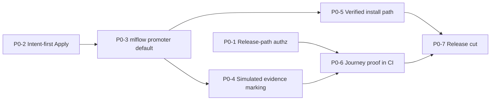

---
audience:
  - developer
  - architect
  - decision-maker
doc_type: strategy
product_area: strategy
stability: draft
summary: Evidence-based gap analysis and execution plan for tagging CALIBER Suite as a Minimal Viable Alpha (MVA) — scope, journeys, P0/P1/P2 gaps with acceptance criteria, and exit criteria.
prerequisites:
  - Read docs/two-week-alpha-plan.md and docs/reports/two-week-alpha-release-notes.md for the narrower journey this plan generalizes
reviewed_on: 2026-10-13
version_applicability: main at dfe48481471 (code reviewed at 68fb0a7bbfe; the only later commit is #453, deploy images)
tags:
  - alpha
  - release-readiness
  - gap-analysis
  - execution-plan
---

# CALIBER Suite — Minimal Viable Alpha gap analysis

**Verdict: not releasable as an alpha today.** The core prompt lifecycle is largely
built and well tested (about 7,900 backend tests, 93% coverage), and it works end to
end when CALIBER runs on PostgreSQL or with a separate MLflow store. But seven
blockers stand between `main` and a credible alpha tag. Two let one project's operator
change another project's live prompt. Two make Apply report success, or present canned
evaluation numbers as real evidence, on the default configuration. One makes the
alpha's only end-to-end proof fail on its own harness. The last two are that no
documented install path works without undocumented steps, and that nothing has been
cut or released.

None of the blockers requires new product capability. Each is a correctness, honesty,
authorization, install, or release-process fix, sized from one line to a few hundred.

## How to use this document

- **Audience.** An engineering agent or maintainer closing alpha gaps one PR at a time.
- **Order of work.** Follow [§7 Execution plan](#7-execution-plan). Each gap has an id
  (`P0-n`, `P1-nn`), testable acceptance criteria, and its dependencies.
- **Done means.** Every box in [§8 Alpha exit criteria](#8-alpha-exit-criteria) is ticked
  with linked evidence (a CI run, a PR, or a recorded command).
- **Evidence conventions.** `[exec]` = reproduced by running the code (tests, a live
  server on a temp SQLite/Postgres, or the Playwright spec). `[read]` = established by
  reading code only. File references are `path:line` at commit `68fb0a7`; lines may
  drift, so search for the named function if a line no longer matches. All `caliber/`
  Python paths are under `caliber/src/caliber/` unless stated.
- **Method.** Nine independent reviews (core journey, security/isolation, governance,
  evaluation/observability, secondary families, frontend/API contract,
  data/recovery, packaging/release, tests/SDK). Each reviewer was required to validate
  by execution where possible. The findings then went through a second critical review
  that merged duplicates, re-verified every P0 against code, and downgraded or removed
  items that were unsupported or beyond a minimal alpha ([§9](#9-second-review-log)).

---

## 1. Executive summary

### 1.1 Alpha blockers (P0)

| Id | Blocker | Why it blocks | Size |
| --- | --- | --- | --- |
| [P0-1](#p0-1) | Apply, prompt promote and prompt rollback have **no project authorization**. Any operator can change another project's live prompt. Any signed-in user can read every project's candidates. | Breaks the project/role model on the alpha's single core mutation. `[exec]` | S–M |
| [P0-2](#p0-2) | **Apply deadlocks itself** when CALIBER and MLflow share one SQLite file. That is the default of `run-dev.sh` and of the alpha E2E harness. The existing docs misattribute this to "worker contention". | The alpha's only E2E proof fails on its default harness. `[exec]` | S |
| [P0-3](#p0-3) | The **default `fake` promoter** makes Apply return "applied" and write `promote` audit rows while nothing changes in MLflow. | A false release success on the documented native path. `[exec]` | S |
| [P0-4](#p0-4) | **Simulated evaluation evidence is presented as real.** Every run reports canned scores of 0.94 vs 0.88 on "120 examples", whatever the dataset. These numbers are persisted into gate, audit and approval records with no provider marker. | The product's purpose is evidence-gated release. `[exec]` | S–M |
| [P0-5](#p0-5) | **No documented install path works as written.** The native paths never migrate the DB, and the bootstrap admin gets only viewer scope. The wheel has no migrate command. The docker path is unverified end to end. | A second person cannot install the alpha. `[exec]` | M |
| [P0-6](#p0-6) | **The alpha journey has no automated proof.** No CI job runs the journey spec, and no spec covers a user-created prompt. | Every P0 above shipped undetected. | S–M |
| [P0-7](#p0-7) | **No release has been cut.** There is no `0.1.0a1` tag, assets, changelog section or written procedure. The stale `caliber-v0.0.1` release is marked "Latest". | The tag is the deliverable. | S |

Sizes: S ≤ ½ day, M ≤ 2 days, for one engineer or agent including tests.

### 1.2 What already works (verified)

- **Prompt registry.** Prompt create, version, promote and rollback work in the MLflow Prompt Registry, with a durable, idempotent release-operation state machine (`prepared → applying → applied | failed | reconcile_required`), a reconciler, and audit. `[exec]`
- **Test sets.** Create, append, revise, supersede, restore and MLflow dataset sync all work and are all audited. `[exec]`
- **Calibration.** Calibration (MetaPrompt, GEPA) runs through a queued worker to `candidate_ready`, with an eval gate, SSE progress and Prometheus counters. `[exec]`
- **Apply and rollback.** With a real promoter on PostgreSQL or a separate MLflow store, Apply is one atomic claim plus promotion plus checkpoint. A double Apply gets 409, and a failed Apply cleanly reverts to `candidate_ready`. `[exec]`
- **Identity.** The identity boundary is solid. Session mode is the default, scrypt hashes passwords, cookies are HttpOnly and Secure, and login is throttled. PATs are hashed and capped by scope, and the secret store is encrypted. No account is created by default. `[exec]`
- **Project isolation.** Prompts, test sets, judges, evaluations, projects, members and verification items are isolated per project. `[exec]`
- **Migrations.** There is a single Alembic head (`0113`), upgrade and partial downgrade work on SQLite and PostgreSQL, the janitor reaps stale jobs after a restart, and failed worker ticks are survived. `[exec]`
- **Build.** The wheel builds with the bundled SPA, installs with no extras, and serves `/caliber/`. The SDK and CLI build, and `caliberctl` works against a server. `[exec]`
- **Test gates.**

  | Suite | Result |
  |---|---|
  | UI unit tests | 2,301 passing; typecheck and eslint clean |
  | SDK | 443 passing, 93% coverage |
  | CLI | 93 passing, 89% coverage |
  | Plugin SDK | 37 passing |
  | Backend core-journey subset | 714 passing |
  | Secondary families | 4,242 passing |

  `[exec]`

---

## 2. Minimal Viable Alpha definition

### 2.1 The alpha promise (one sentence)

A small team can self-host CALIBER from documented steps and, through the UI or the
sync Python SDK, do the following with an audit trail and honest failure reporting:

1. Author a prompt.
2. Build a test set.
3. Calibrate the prompt to get a candidate with evaluation evidence.
4. Review the candidate and explicitly apply it to the live MLflow alias.
5. See what is live and why.
6. Roll it back.

### 2.2 Scope decision

| Area | Alpha status | Rationale |
| --- | --- | --- |
| Prompts (author, version, promote, rollback) | **IN** | The core journey. |
| Test sets (eval datasets) | **IN** | Evidence input. |
| Evaluations (scorecards) with a real LLM | **IN** | Fails closed without a key (honest). Needs docs ([P1-09](#p1-09)). |
| Calibration of prompts (MetaPrompt, GEPA) | **IN** | Produces the candidate. DSPy is reachable only through the seeded fixture, so it is not a user option. |
| Review → Apply → release operation → rollback (the "job-apply path") | **IN** | The **only** governance story for the alpha. |
| Projects, members, roles; accounts; PATs | **IN** | The team model. Must be enforced ([P0-1](#p0-1)). |
| Audit log, release timeline, recovery console, readiness | **IN** | Traceability and honest recovery. |
| Sync Python SDK | **IN** | "Equivalently via SDK". The sync client has 0 coverage gaps against the API. |
| `caliberctl` | **IN (read/ops verbs only)** | Missing apply and rollback verbs are P2; the SDK covers them. |
| Release-candidate "signoff factory" (Releases page, top) | **LABEL as record-only** | A GO signoff changes nothing `[exec]`. |
| Workspace / Change Requests / environment promotion | **LABEL experimental (API/SDK/CLI)** | No UI. Release evaluation never executes on a live server `[exec]`. |
| Skills, tools, MCP, workflows, OpenAPI integrations, object store, cookbooks | **LABEL preview** | Work offline in tests and live checks, but are not on the alpha journey. |
| Knowledge bases | **LABEL preview, fail fast without an object store** | Needs S3/MinIO and the torch extra. |
| Aria assistant and plans | **HIDE unless an engine is configured**, otherwise LABEL | Every reply is `OpenAIError` on the default install `[exec]`. |
| Memory (mem0) | **OUT** (already off; clean 503) | — |
| Flagged trace → verification → refinement | **OUT for alpha (document)** | No poller, no UI flag action, and verify creates no job. |

### 2.3 Supported topologies and provider modes

| Item | Alpha support |
| --- | --- |
| Database | **PostgreSQL** (supported). SQLite only with a **separate** MLflow store; supported for evaluation and demo after [P0-2](#p0-2). |
| MLflow | A separate vanilla `mlflow server` (≥ 3.15) over HTTP. Embedded `mlflow server --app-name caliber` is unsupported (existing docs position). |
| Install paths | (a) Release wheels + native `mlflow server` (no Docker); (b) docker compose stack (`make start`). Exactly one must be verified end to end by script before tagging ([P0-5](#p0-5)). |
| Providers | `promoter`/`artifact_store` = `mlflow` by default. `eval`/`llm` may be `fake` **only when visibly marked simulated** ([P0-4](#p0-4)). Real evaluation requires an OpenAI key. |

### 2.4 Explicit non-goals for the alpha

These are listed so that no one spends alpha time on them:

- HA and horizontal scale
- Performance or load targets
- SSO, MFA or OIDC
- Multi-tenant hosting
- Two-person approval enforcement
- PyPI publication
- Container image publication
- Async SDK parity
- Workspace release execution
- pgvector/AGE production paths
- Trace-to-refinement automation
- A rehearsed disaster recovery
- Upgrade guarantees from `caliber-v0.0.1`

---

## 3. Capability inventory

Status legend:

| Status | Meaning |
| --- | --- |
| ✅ | Working, verified by execution |
| ☑️ | Working by reading or tests |
| ⚠️ | Partial |
| ❌ | Broken |
| ⛔ | Absent |

| Capability | Status | Evidence | Alpha | Gap |
| --- | --- | --- | --- | --- |
| Prompt create / version (MLflow registry) | ✅ | `POST /prompts` 201 `prompts:/<name>/1` | IN | Audit missing ([P1-02](#p1-02)) |
| Prompt alias promote / rollback | ✅ (authz ❌) | Release op `applied`; rollback restores prior version | IN | [P0-1](#p0-1) |
| Prompt test-render | ⚠️ | Renders a hard-coded demo template when the prompt has no live alias (`routes/prompts.py:2198-2210`) | label | P2 |
| Test sets: create, append, revise, supersede, restore, sync | ✅ | All audited | IN | — |
| Test example from trace | ⚠️ | Input stored as a JSON string, observed answer used as gold, tags lost on revise | IN | P2 |
| Evaluations (scorecard) | ✅ fails closed on `fake` LLM; ☑️ real provider | 400 "evaluation requires a real LLM provider" | IN | [P1-09](#p1-09) |
| Prompt calibration → `candidate_ready` | ✅ (evidence ❌ on fake eval) | Job ready in 2–6 s; `n_examples=120` for a 3-row set | IN | [P0-4](#p0-4) |
| Calibration with `eval=mlflow` and fake LLM | ⚠️ | Fails at eval with developer-facing "no predict_fn … register_predict_fn" | IN | [P1-09](#p1-09) |
| Apply (real promoter, Postgres or separate MLflow) | ✅ | 200 in 0.1–3.4 s, new version live, release op + checkpoint + audit | IN | — |
| Apply (shared SQLite) | ❌ | 502 `database is locked` after ~21 s, every attempt (also with all background loops off) | IN | [P0-2](#p0-2) |
| Apply (default fake promoter) | ❌ false success | 200 `prompt://…/v-fake`, MLflow unchanged, rollback 409 | IN | [P0-3](#p0-3) |
| Refinement-job read/apply authorization | ❌ | Non-member read and applied; viewer-role member applied | IN | [P0-1](#p0-1) |
| Release reconcile / resolve / recovery console | ✅ tests, ☑️ UI | `test_release_operations.py`, `test_release_reconciler.py` | IN | — |
| Releases "What's live now" | ⚠️ | Workflows and KBs only; says "Nothing deployed yet" after a prompt Apply | IN | [P1-13](#p1-13) |
| Review step in UI | ⚠️ | Apply or Cancel only; request-changes and quality-review are API-only | IN | P2 |
| Audit log list/export | ✅ | Admin-only, CSV export | IN | [P1-02](#p1-02) |
| Lineage version → job → evidence | ⚠️ | Data exists; no public path from a released version | IN | [P1-14](#p1-14) |
| Traces, feedback, SSE, metrics | ✅ | Traces are visible org-wide (unscoped) | IN | [P1-15](#p1-15) |
| Feedback → verification queue | ⛔ | `MLflowAssessmentClientImpl` has no caller | OUT | [P1-15](#p1-15) (docs) |
| Session auth, throttling, cookies, PATs, secret store | ✅ | 363 auth/isolation tests pass; probes | IN | [P1-01](#p1-01) |
| Bootstrap admin on documented native path | ❌ | Logs in as `caliber.viewer`; `POST /projects` 403 | IN | [P0-5](#p0-5) |
| Schema migration on documented / wheel installs | ⛔ | Server boots unmigrated; login 500; wheel has no `alembic.ini` | IN | [P0-5](#p0-5) |
| Health/readiness on unmigrated DB | ❌ | `/health` ok, `/readiness` `ready:true` | IN | [P1-03](#p1-03) |
| SPA health indicator | ❌ | Always "API or database unreachable" (`/health` has no `{data}` envelope) | IN | [P1-05](#p1-05) |
| Administration → store secret | ❌ | UI sends `POST /secrets`; only `PUT /secrets/{name}` exists → 405 | IN | [P1-06](#p1-06) |
| PAT management UI | ⛔ | API works with a cookie; no UI | IN | [P1-07](#p1-07) |
| Wheel build with SPA | ✅ | `twine check` passes; content assertions pass | IN | — |
| Installed-wheel boot smoke in CI | ⛔ | `package` job never installs or boots the wheel | IN | [P1-17](#p1-17) |
| Docker dev stack | ⚠️ | Images fixed by #453 (merged 2026-10-13). CALIBER image never built in CI | IN | [P0-5](#p0-5), [P1-17](#p1-17) |
| Alpha journey E2E spec in CI | ⛔ | Only `e2e/cookbooks` runs, on push to `main` only | IN | [P0-6](#p0-6) |
| Required status checks on `main` | ⛔ | `required_status_checks` → 404 | IN | [P1-16](#p1-16) |
| Tag / prerelease / changelog | ⛔ | Only `caliber-v0.0.1` (no assets, marked Latest) | IN | [P0-7](#p0-7) |
| Skills, tools, MCP, workflows, OpenAPI integrations, cookbooks | ✅ (tests + live) | 4,242 family tests pass; workflow author→run→deploy live | label | [P1-10](#p1-10) |
| Knowledge bases | ❌ on default install | 201, then build `NoCredentialsError` after ~82 s | label | [P1-12](#p1-12) |
| Aria chat / plans | ❌ on default install | Replies are `OpenAIError`; a 0-step plan "completes" | hide/label | [P1-11](#p1-11) |
| Workspace releases | ❌ on live server | Evaluation stays `queued` (no executor) | label | [P1-10](#p1-10) |
| Release-candidate signoff | ⚠️ (no effect) | Self-signoff GO 201; timeline and operations empty | label | [P1-10](#p1-10) |
| Sync SDK | ✅ (mocks) / ⚠️ (vs server) | Core-journey methods never run against a server | IN | [P1-19](#p1-19) |
| SDK/CLI install | ❌ | Docs say `pip install` (PyPI 404); CLI depends on unpinned `caliber-sdk` | IN | [P1-18](#p1-18) |

---

## 4. Critical user journeys

| # | Journey | Status today | Blocking gaps |
| --- | --- | --- | --- |
| CJ-1 | Install and start from docs (native, no Docker) | ❌ Login 500 (no migration). After a manual migration, admin is a viewer `[exec]`. | P0-5 |
| CJ-2 | Install and start from docs (docker compose) | ⚠️ Images fixed by #453. The full stack and CALIBER image are not verified by anyone or by CI. | P0-5, P1-17 |
| CJ-3 | Sign in, create a project, add a member with a role | ⚠️ Works only with `CALIBER_ADMIN_USERS` set. Default config creates no account, with no log line. | P0-5, P1-08 |
| CJ-4 | Author a prompt, version it, promote it | ✅ `[exec]` (no authoring audit) | P1-02 |
| CJ-5 | Build a test set | ✅ `[exec]` | — |
| CJ-6 | Run an evaluation | ⚠️ Needs a real LLM; not documented | P1-09 |
| CJ-7 | Calibrate to get a candidate with evidence | ⚠️ Works, but evidence is canned and unlabelled on defaults `[exec]` | P0-4, P1-09 |
| CJ-8 | Review and Apply | ❌ Self-deadlock on shared SQLite, false success on default promoter, cross-project Apply `[exec]`. ✅ on Postgres or separate MLflow with the mlflow promoter `[exec]`. | P0-1, P0-2, P0-3 |
| CJ-9 | See what is live, why, and who did it | ⚠️ "What's live" omits prompts; no version→evidence link; audit gaps | P1-13, P1-14, P1-02 |
| CJ-10 | Roll back | ✅ with real promoter `[exec]`; ❌ cross-project | P0-1 |
| CJ-11 | Recover from failures (MLflow down, restart mid-job, indeterminate release) | ⚠️ Honest end states, but an MLflow outage hangs requests ~8 minutes and the UI says nothing `[exec]` | P1-04 |
| CJ-12 | The same journey through the sync SDK | ⚠️ Methods exist; untested against a server. The first PAT needs curl. | P1-07, P1-19, P1-18 |
| CJ-13 | Two projects stay isolated | ❌ Jobs, alias promote/rollback and test-run list leak or mutate across projects `[exec]` | P0-1, P1-01 |
| CJ-14 | Alpha journey proven automatically on the tagged commit | ❌ Spec not in CI; fails on its default harness `[exec]` | P0-6, P0-2 |

---

## 5. P0 — alpha blockers

### P0-1

- **Gap:** Project authorization is missing on the release path (Apply, request-changes, job reads, prompt promote/rollback, prompt test-run list)

- **Category:** Authorization / project isolation.
- **Current state:**
  - `routes/jobs.py`:
    - `list_jobs` (191), `get_job` (210) and `get_job_targets` (223) call only `require_user`.
    - `apply_job` (306) and `request_changes` (459) call only `require_scopes([SCOPE_OPERATOR])`.
    - Jobs are loaded with bare `session.get`.
    - `CaliberRefinementJob` has no `project_id`, and `resource_inventory()` classifies it `unscoped`, so the bare-lookup regression net never flags it.
  - `routes/prompts.py`:
    - `set_prompt_alias` (~1928) and `rollback_prompt` (~2095) check only operator scope. They never call `_prompt_target_invisible` or a project-role check, although the read routes in the same module do.
    - The idempotent `operation_id` replay path returns before any authorization.
    - `list_prompt_test_runs` (~2438) is unfiltered.
    - `set_prompt_baseline` (~2693) reads a test run with bare `session.get`.
  - The same pattern applies to `/jobs/{id}/quality-reviews` (`routes/quality_reviews.py`).
- **Expected alpha state:**
  - A non-member gets 404 on every job, alias and rollback route for another project's prompt.
  - A viewer or reviewer member gets 403 on Apply, promote and rollback.
  - Owners, editors and admins are unaffected.
- **Evidence (`[exec]`, three independent reviewers):**
  - A non-member operator applied project A's candidate: the promoter received it and the job became `applied`.
  - A **viewer-role** member applied it too.
  - A non-member rolled back and promoted A's live prompt. MLflow alias calls `('a-prompt','prod',1)` and `('a-prompt','prod',2)` were recorded as legitimate audit rows, while the same user's `GET /prompts/a-prompt` returned 404.
  - A non-member read the candidate text and diagnosis via `GET /jobs/{id}`.
  - A non-member listed A's prompt test runs.
- **Why it matters:** Apply and rollback are the alpha's central mutations. Projects and roles are part of the alpha promise.
- **Recommended fix (smallest viable):**
  1. Add `_visible_job_or_404(session, request, job_id)` to `routes/jobs.py`:
     - load the job, then `get_visible(CaliberAgentConfig, …, job.agent_id, resolve_identity(request))`;
     - return 404 on `None` and on an orphaned agent.
     Use it in `get_job`, `get_job_targets`, `apply_job` (before the claim UPDATE), `request_changes`, and in `routes/quality_reviews.py`.
  2. Filter `list_jobs` by joining visible agent ids, as `routes/releases.py::_visible_ids` does.
  3. In `apply_job` and the prompt promote/rollback handlers, call `require_project_access_if_scoped(session, identity, agent.project_id, "release.apply")`. Use the existing rollback action for rollback.
  4. In `set_prompt_alias`, `rollback_prompt`, `set_prompt_baseline` and `bind_prompt`, apply `_prompt_target_invisible` → 404 **before** the idempotent replay branch.
  5. Filter `list_prompt_test_runs` by visible agent ids.
  6. Register `CaliberRefinementJob` (via its agent) in the scoping inventory so `test_bare_lookup_inventory.py` guards it.
- **Priority:** P0. This is an unauthorized cross-project production mutation on the core journey.
- **Files:**
  - `routes/jobs.py`, `routes/quality_reviews.py`, `routes/prompts.py`
  - `routes/bare_lookup_inventory.py` / `db/resource_inventory.py`
  - `caliber/tests/test_routes_jobs*.py`, `caliber/tests/test_routes_prompts.py`
- **Dependencies:** None. The helpers (`get_visible`, `require_project_access_if_scoped`, `_prompt_target_invisible`) exist.
- **Acceptance criteria:**
  - [ ] Non-member operator: `GET /jobs` omits the job.
  - [ ] Non-member operator: `GET /jobs/{id}`, `/targets` and `/quality-reviews` return 404.
  - [ ] Non-member operator: `POST /jobs/{id}/apply`, `/request-changes` and `/quality-reviews` return 404. The promoter is not called and the job status is unchanged.
  - [ ] Viewer- or reviewer-role member: Apply returns 403. Owner or editor: 200.
  - [ ] Non-member operator: `POST /prompts/{name}/aliases/prod` and `/rollback` return 404 (including with a replayed `operation_id`). There are zero MLflow alias calls and no release operation or audit row.
  - [ ] Viewer member gets 403 on the alias and rollback routes.
  - [ ] Non-member `GET /prompts/test-runs` excludes the other project's runs.
  - [ ] `test_bare_lookup_inventory.py` covers refinement jobs.
  - [ ] The two-week alpha spec still passes.

### P0-2

- **Gap:** Apply deadlocks itself when CALIBER and MLflow share one SQLite file, and the docs blame worker contention

- **Category:** Correctness / transaction design / dev defaults.
- **Current state:**
  - `apply_job` claims the job with an **uncommitted** `UPDATE … SET status='applying'` and flushes a `CaliberApprovalRequest`. Still inside that open write transaction, it calls `apply_candidate → promote_bundle → MLflowPromoter.promote → mlflow.genai.register_prompt` (`routes/jobs.py:328-372`, commit at 390).
  - MLflow writes through its own engine. On a shared SQLite file it waits for CALIBER's lock until its busy timeout expires.
  - `run-dev.sh:61` and `run-playwright-server.sh:506` default `MLFLOW_BACKEND_STORE_URI` to `CALIBER_DATABASE_URL`, which is the same file.
  - `docs/reports/two-week-alpha-day9-decision.md` and `two-week-alpha-release-notes.md` (lines ~108-120, 140) call this "single-writer contention under Apply … not a defect in the Apply/release code itself". That is incorrect.
- **Expected alpha state:**
  - Apply succeeds on the default local harness.
  - Starting CALIBER with both stores on one SQLite file is refused or loudly warned.
  - The docs state the real cause.
- **Evidence (`[exec]`, three reviewers):**
  - Shared file with **all background loops off**: 502 `database is locked` after 21.1 s, on 4 of 4 attempts.
  - A standalone probe registering a prompt inside an uncommitted CALIBER transaction failed after 20.7 s with the identical error. With the transaction committed first, it succeeded in 0.0 s.
  - MLflow on its own SQLite file: Apply 200 in 3.4 s.
  - The alpha spec fails at Apply on the shared file (3 runs by two reviewers). It passes on separate files with 1 or 4 server workers, and on PostgreSQL.
- **Why it matters:** This is the alpha's only end-to-end proof and the `make dev` path. Any single-file SQLite install with a real promoter can never release.
- **Recommended fix:**
  1. **Code (intent-first Apply):**
     - Commit the `candidate_ready → applying` claim and the approval row before invoking the promoter, mirroring `release_operations.prepare_prompt_alias_release`.
     - On a promoter error, run a compensating transaction back to `candidate_ready`, with an audit row for the failed attempt.
     - Leave jobs whose release operation is `applying` or `reconcile_required` to the reconciler.
     - Preserve the 409 for a concurrent second Apply.
  2. **Defaults:** default `MLFLOW_BACKEND_STORE_URI` to a separate SQLite file in `run-dev.sh`, `run-playwright-server.sh`, and the `caliber/Makefile` `tracking-server` target.
  3. **Guard:** in `create_app`, when the CALIBER DB URL and the MLflow tracking or backend URI resolve to the same SQLite file, fail startup with an actionable message. A warning is acceptable only if (1) has landed.
  4. **Docs:** correct the Day 9 report, the release notes and the spec header comment (`two-week-alpha-journey.spec.ts:33-40`).
- **Priority:** P0. The single alpha proof fails on its own default, and the root cause is a code defect documented as an environment limit.
- **Files:**
  - `routes/jobs.py`, `apply.py`, `bundle.py`, `server.py`
  - `caliber/scripts/run-dev.sh`, `caliber/scripts/run-playwright-server.sh`, `caliber/Makefile`
  - `docs/reports/two-week-alpha-day9-decision.md`, `docs/reports/two-week-alpha-release-notes.md`
  - `caliber/caliber-ui/e2e/two-week-alpha-journey.spec.ts`
- **Dependencies:** None. Land before or with [P0-3](#p0-3). Otherwise flipping the default promoter to `mlflow` turns a false success into a 100% failure on the SQLite dev path.
- **Acceptance criteria:**
  - [ ] A pytest using a real `mlflow.genai` on a temp SQLite file **shared** with the CALIBER engine applies a `candidate_ready` job: 200, new version live.
  - [ ] A concurrent second Apply returns 409.
  - [ ] An injected promoter failure leaves the job `candidate_ready` with an audit row.
  - [ ] `npx playwright test e2e/two-week-alpha-journey.spec.ts` passes on the harness defaults (SQLite).
  - [ ] Startup with both stores on the same SQLite file produces the documented error (unit test).
  - [ ] No doc attributes the failure to background workers.

### P0-3

- **Gap:** The default `fake` promoter makes Apply report a release that never happened

- **Category:** Release truthfulness / defaults.
- **Current state:**
  - `promoter_provider` and `artifact_store_provider` default to `"fake"` (`config.py:467-495`). README (`README.md:183-192`) and `docs/operate/local-bring-up.md:56-65` do not set them. Compose does (`deploy/caliber/compose.yaml:177-179`).
  - Prompt create and manual promote always write real MLflow, but Apply goes through `FakePromoter` (`promoter.py:410-434`).
  - Apply returns 200 `status: applied`, `artifact_ref: prompt://<name>/v-fake`, and writes `promote`/`apply_candidate` audit rows and a checkpoint with null versions. The job becomes `applied`, so it can never be re-applied.
  - The UI says "Candidate applied. The promoted prompt version is now live." (`caliber-ui/src/pages/Prompts.tsx:6711`). A later rollback returns 409.
- **Expected alpha state:** Apply either moves the real MLflow alias or refuses. No audit row ever records a promotion that did not happen.
- **Evidence (`[exec]`, two reviewers):**
  - `apply: 200 … "artifact_ref":"prompt://e1-classifier/v-fake"`.
  - The versions afterwards are only v1 and v2, with `@prod` still on v1.
  - `/releases/timeline` shows nothing new.
  - The audit log has `promote` + `apply_candidate`.
  - Rollback returns `409 no recorded prior live version`.
- **Why it matters:** This is a false success on the step the product exists to govern, and it leaves an incorrect audit trail.
- **Recommended fix:**
  1. Default `promoter_provider` and `artifact_store_provider` to `mlflow`. MLflow is already a hard dependency of prompt authoring.
  2. Make `promoter_provider=fake` and `artifact_store_provider=fake` require `CALIBER_ALLOW_SIMULATED_PROVIDERS=true`. Test fixtures, the E2E harness and cookbooks set it. The `fake` LLM and evaluation providers stay the offline default, governed by [P0-4](#p0-4). When the fake promoter is active, `apply_candidate` stamps `simulated: true` into the promotion payload and the audit details, and the UI renders "Simulated apply — nothing was released" instead of "now live".
  3. Update `.env.example` and the README to match.
- **Priority:** P0.
- **Files:**
  - `config.py`, `server.py`, `promoter.py`, `apply.py`, `routes/jobs.py`
  - `caliber-ui/src/pages/Prompts.tsx`
  - `caliber/tests/conftest.py`, `caliber/scripts/run-playwright-server.sh`
  - `.env.example`, `README.md`
- **Dependencies:** [P0-2](#p0-2). Share one opt-in flag with [P0-4](#p0-4).
- **Acceptance criteria:**
  - [ ] Booting with no provider env, `/readiness` `simulated` does not contain `promoter` or `artifact_store`.
  - [ ] With no provider env, Apply creates version N+1 and moves `@prod`, or fails with an actionable error.
  - [ ] With `fake` + opt-in, the Apply response and the audit details carry `simulated: true`, and the UI text does not say "live" (Vitest).
  - [ ] With `promoter_provider=fake` and no opt-in, startup fails with a message naming the flag (unit test).
  - [ ] A default boot (no provider env, no opt-in) still starts, with the LLM and evaluation simulated and marked per [P0-4](#p0-4).
  - [ ] Full backend suite and E2E green.

### P0-4

- **Gap:** Simulated evaluation evidence is persisted and displayed as if it were real

- **Category:** Evidence trustworthiness.
- **Current state:**
  - `eval_provider` defaults to `fake` (`config.py:477-478`).
  - `FakeEvalProvider` ignores the dataset and the requested scorers. It always returns candidate 0.94 vs baseline 0.88, `n_examples=120`, and fixed dimensions (`eval/fake.py:11,41-51`).
  - The gate passes. The numbers are written to `job.eval_results`, the regression run, the `candidate_ready` audit row and the Apply-time approval snapshot, with no provider or simulated marker.
  - The review dialog shows "Evaluation score … Gate: Passed … N=120" (`Prompts.tsx:7820-7855`).
  - The only signal is a global banner (`components/ProviderBanner.tsx`). The banner is dismissible, and it disappears when `/readiness` returns 503.
  - Nothing prevents a real LLM combined with fake evaluation.
- **Expected alpha state:**
  - Every eval result, candidate and approval derived from a fake provider is machine-marked and visibly badged.
  - Counts reflect the real dataset.
  - A user cannot mistake simulated numbers for evidence at the moment of decision.
- **Evidence:** `[exec]` A 3-example dataset with the requested scorer `Correctness` returned `"candidate":{"overall":0.94,"dimensions":{"factual":0.97,"tool_use":0.93,"tone":0.89,"safety":0.99}}, "n_examples":120, "gate":{"passed":true}`. MetaPrompt and GEPA returned the same numbers. `grep -rn "simulated" eval/ orchestrator/eval_stage.py regression.py` finds nothing.
- **Why it matters:** The product's value is "trustworthy evidence before release". The audit and approval snapshot permanently record fabricated numbers as gate evidence.
- **Recommended fix (keep the offline demo, make it honest):**
  1. `FakeEvalProvider` reports the pinned dataset's real example count and echoes the requested scorer names as dimensions.
  2. `_comparison_to_json` and the regression run add `provider` and `simulated`. The `candidate_ready` audit details and the approval snapshot include them.
  3. The review dialog and job detail show a **non-dismissible** "Simulated evaluation — not evidence" badge when `simulated` is true.
  4. `ProviderBanner` parses the 503 readiness body (it carries the same `data`) and cannot be dismissed while `eval` or `promoter` is simulated.
  5. Startup refuses `llm_provider` ≠ `fake` with `eval_provider=fake` unless the simulated opt-in from [P0-3](#p0-3) is set.

  Optional, not required: block Apply of a simulated candidate unless `allow_simulated=true`.
- **Priority:** P0. This is audit-integrity and decision-integrity on the core journey.
- **Files:**
  - `eval/fake.py`, `eval/provider.py`, `orchestrator/eval_stage.py`, `regression.py`, `routes/jobs.py`, `server.py`
  - `caliber-ui/src/pages/Prompts.tsx`, `components/EvalComparison.tsx`, `components/ProviderBanner.tsx`
- **Dependencies:** Shares the opt-in flag with [P0-3](#p0-3).
- **Acceptance criteria:**
  - [ ] Under the fake provider, `eval_results.n_examples` equals the dataset size, and the dimension keys equal the requested scorers (pytest).
  - [ ] `eval_results`, the regression run and the `candidate_ready` audit details include `provider` and `simulated` (pytest).
  - [ ] The review dialog renders the simulated badge (Vitest).
  - [ ] The banner renders when `/readiness` returns 503 with a non-empty `simulated`, and has no dismiss control while eval or promoter is simulated (Vitest).
  - [ ] Real LLM + fake eval without the opt-in fails startup (unit test).

### P0-5

- **Gap:** No documented install path works as written, and none is verified end to end

- **Category:** Installation / onboarding / packaging.
- **Current state:**
  - `create_app` never migrates; there is no `alembic` or `create_all` in `server.py`.
  - README (`README.md:183-192`), `caliber/README.md`, `docs/operate/local-bring-up.md:56-65` and `docs/start/five-minute-quickstart.md` contain no migration step.
  - The wheel ships no `alembic.ini`. The source `alembic.ini` uses `script_location = src/caliber/db/migrations`. There is no console script.
  - The documented native env block sets the insecure bootstrap but not `CALIBER_ADMIN_USERS`, `CALIBER_OPERATOR_USERS` or `CALIBER_APPROVER_USERS`. The server does not read `.env`, so admin/admin logs in as `caliber.viewer` and `POST /projects` returns 403.
  - The block does not set `CALIBER_{PROMOTER,ARTIFACT_STORE,EVAL}_PROVIDER`.
  - `.env.example:2` claims "All values shown are defaults", which is false for the role variables.
  - With the default config, no account is created and nothing is logged.
  - Root `make setup` uses an unguarded `python3`, which fails on Python ≥ 3.13.
  - The docker path is the one path that migrates and sets roles and providers (`deploy/caliber/entrypoint.sh:35-36`, `compose.yaml:143-145,177-179`). Its images were fixed by #453, but no one has brought the full stack up end to end, and CI never builds the CALIBER image (`ci.yml:947` builds `mlflow` only).
  - The SDK and CLI docs say `pip install caliber-sdk` / `caliber-cli`; every name returns 404 on PyPI.
- **Expected alpha state:** One page, "Alpha install", that a second person can follow verbatim from the release assets (or a source checkout) to a logged-in admin who can create a project and run the journey. Its steps are executed by a script in CI, and the docker alternative is verified once.
- **Evidence (`[exec]`):**
  - Fresh venv + built wheel + README env: `/health` 200 `db: ok` and `/readiness` `ready:true`, but `POST /auth/login` returns **500** and the workers log `no such table: caliber_user_accounts`.
  - After a manual migration (package-resource `script_location=caliber:db/migrations` → `0113`): login 200 with scopes `["caliber.viewer"]`, and `POST /projects` returns 403 "expected all of ['caliber.approver','caliber.operator']".
  - With `CALIBER_ADMIN_USERS=admin`, a project and a prompt are created.
  - A native `mlflow server` from the same venv plus the three provider selectors produces a real registry write.
- **Why it matters:** Install → log in → create project is step one of every journey. It is also the Day 10 "second person installs from the wheel" criterion that the existing plan never closed.
- **Recommended fix:**
  1. Add `caliber/src/caliber/db/migrate.py` and a `[project.scripts] caliber-migrate = "caliber.db.migrate:main"` entry. It builds an Alembic `Config` with `script_location = caliber:db/migrations` and runs `upgrade head`. Keep the source `alembic.ini` working.
  2. Write `docs/start/alpha-install.md` covering:
     - Python 3.11/3.12 venv
     - install the wheels in order (sdk → cli → server)
     - `caliber-migrate`
     - start a native `mlflow server` on its own SQLite file
     - an env block with `CALIBER_DATABASE_URL`, `MLFLOW_TRACKING_URI`, `CALIBER_ADMIN_USERS=admin` (+ operator/approver), the three provider selectors and the bootstrap flags
     - start uvicorn, then check `/readiness`
     - optional real-LLM block
     - the docker alternative

     Link it first from `README.md`, `five-minute-quickstart.md` and `local-bring-up.md`. Fix the same omissions in those pages.
  3. When the bootstrap account is created and all three role lists are empty, log an ERROR naming the variables. When session mode starts with zero accounts and no bootstrap source, log a WARNING.
  4. Add a Python version guard to root `make setup`. Correct `.env.example`'s "defaults" claim.
  5. Add `scripts/verify-alpha-install.sh`, which runs the page's commands in a temp dir and asserts login, project create and prompt create. Run it in CI ([P1-17](#p1-17) may host it).
  6. Bring the docker stack up once (`make start`), run the journey, and record the result in the release PR.
- **Priority:** P0.
- **Files:**
  - `caliber/pyproject.toml`, new `caliber/src/caliber/db/migrate.py`, `server.py`
  - `README.md`, `caliber/README.md`
  - `docs/start/alpha-install.md` (new), `docs/start/five-minute-quickstart.md`, `docs/operate/local-bring-up.md`, `docs/operate/configuration-and-provider-setup.md`
  - `.env.example`, root `Makefile`, `scripts/verify-alpha-install.sh` (new)
- **Dependencies:** #453 (merged). Provider defaults from [P0-3](#p0-3).
- **Acceptance criteria:**
  - [ ] From an installed wheel with no repo checkout, `caliber-migrate` brings an empty SQLite DB to the Alembic head (test).
  - [ ] Following `alpha-install.md` verbatim (scripted), `/auth/session` shows `is_admin: true` for the bootstrap user.
  - [ ] In that session, `POST /projects` and `POST /prompts` return 2xx, and `/readiness` `simulated` contains at most `llm`, `eval`.
  - [ ] The script runs green in CI.
  - [ ] Every onboarding page lists the migration step before uvicorn.
  - [ ] `make setup` on Python ≥ 3.13 exits with an actionable message before creating a venv.
  - [ ] The docker stack journey result is recorded in the release PR.

### P0-6

- **Gap:** The alpha journey has no automated proof

- **Category:** CI / release evidence.
- **Current state:**
  - `caliber/caliber-ui/e2e/two-week-alpha-journey.spec.ts` runs only via `test-all.sh:78`. No workflow references it.
  - The only Playwright job runs `playwright.cookbooks.config.ts` (`testDir: ./e2e/cookbooks`), and only on push to `main` (`ci.yml:762-812`).
  - The spec drives a fixture-seeded DSPy job that users cannot create, because DSPy is not an allowed prompt optimizer (`routes/prompts.py:126`).
  - No spec covers create prompt → test set → calibration → Apply → rollback for a user-created prompt.
- **Expected alpha state:** A CI check runs both the seeded spec and a user-path journey spec, offline with fake LLM/eval and the mlflow promoter, on PRs touching `caliber/src/**` or `caliber/caliber-ui/**` and on `main`. It is green on the tag commit.
- **Evidence:**
  - `grep -rn "two-week" .github/` finds nothing.
  - `[exec]` The spec fails at Apply on the default harness ([P0-2](#p0-2)) and passes on PostgreSQL. This regression was never visible in CI.
  - `optimizer_type=DSPyBootstrapFewShot` → 400 `expected one of ['MetaPrompt','GEPA']`.
- **Why it matters:** P0-1 through P0-4 all shipped while CI stayed green.
- **Recommended fix:**
  1. Add `e2e/user-prompt-journey.spec.ts` covering: create a prompt (UI) → promote v1 → create a test set with 3 examples → start a MetaPrompt calibration → wait for `candidate_ready` → assert the simulated badge ([P0-4](#p0-4)) → Apply → assert v2 live → rollback → assert v1 live.
  2. Add a CI job `alpha-journey` (needs `ui`) that installs Chromium and runs both specs through `run-playwright-server.sh` with `CALIBER_PROMOTER_PROVIDER=mlflow`. Use SQLite after [P0-2](#p0-2); a Postgres service container is the fallback.
  3. Add it to the gate ledger.
- **Priority:** P0. Without it the alpha has no automated evidence that its one promise works on the tagged commit.
- **Files:** `.github/workflows/ci.yml`, `caliber/caliber-ui/e2e/`, `caliber/caliber-ui/package.json`, `caliber/scripts/run-playwright-server.sh`.
- **Dependencies:** [P0-2](#p0-2), or Postgres in the job. [P0-4](#p0-4) for the badge assertion.
- **Acceptance criteria:**
  - [ ] The `alpha-journey` check runs on qualifying PRs and on `main`, and is green.
  - [ ] Temporarily making `/jobs/{id}/apply` return 500 makes it fail (verified once in the PR).
  - [ ] It is listed in the gate ledger.
  - [ ] It is green on the tag commit.

### P0-7

- **Gap:** No release has been cut

- **Category:** Release / versioning.
- **Current state:**
  - The only tag is `caliber-v0.0.1`, at version `0.1.0.dev0`. Its GitHub Release has no assets, is not a prerelease, and is marked **Latest**.
  - No workflow triggers on tags.
  - `caliber/CHANGELOG.md` has only `## [Unreleased]`.
  - Tag naming conflicts across `docs/two-week-alpha-plan.md` (`v0.1.0-alpha.1`), `docs/roadmap.md` (`caliber-v0.1.0`) and the existing `caliber-v*` convention.
  - There is no written release procedure.
  - `caliber-ui/package.json` is `0.1.0` and is outside `test_version_lockstep.py`.
- **Expected alpha state:**
  - A prerelease tag `caliber-v0.1.0a1` exists on a commit whose full CI is green.
  - The server wheel and sdist plus the three SDK/CLI/plugin wheels are attached, with notes linking the scope note and `alpha-install.md`.
  - A dated changelog section exists.
  - A documented manual procedure exists. Automation is P2.
- **Evidence:** `git tag -l` → `caliber-v0.0.1`. `gh release view caliber-v0.0.1` → `assets: []`, `prerelease: false`. `grep -n "tags:" .github/workflows/*` finds nothing.
- **Why it matters:** The tag is the alpha deliverable. Testers need a fixed version to install and to report against.
- **Recommended fix:**
  1. Decide on `caliber-v0.1.0a1`: it matches the PEP 440 version and the existing prefix. Update the plan and roadmap wording.
  2. Write `docs/operate/releasing.md` with these steps:
     - version consistency
     - changelog section
     - green full CI on the commit, including `alpha-journey`
     - build from the tag per the CI `package` steps
     - `twine check`
     - `gh release create caliber-v0.1.0a1 --prerelease dist/*`
     - post-release install verification using `scripts/verify-alpha-install.sh` against the downloaded assets
  3. Add a `## [0.1.0a1] - <date>` changelog section that links the scope note.
  4. Set the UI version to `0.1.0-alpha.1`, or exclude it from lockstep explicitly.
  5. Mark `caliber-v0.0.1` as a prerelease, or remove its "Latest" flag.
  6. Update `docs/reports/two-week-alpha-release-notes.md` to the broadened alpha scope (§2) and the known limitations ([P1-15](#p1-15)).
- **Priority:** P0.
- **Files:** `docs/operate/releasing.md` (new), `caliber/CHANGELOG.md`, `caliber/caliber-ui/package.json`, `docs/two-week-alpha-plan.md`, `docs/roadmap.md`, `docs/reports/two-week-alpha-release-notes.md`, GitHub Releases.
- **Dependencies:** All other P0s.
- **Acceptance criteria:**
  - [ ] The tag `caliber-v0.1.0a1` exists on a commit with green full CI and green `alpha-journey`.
  - [ ] The prerelease has 4 wheels and their sdists.
  - [ ] The verify script passes against the downloaded assets in a clean venv.
  - [ ] `releasing.md` exists and is linked from `CONTRIBUTING.md`.
  - [ ] `caliber-v0.0.1` is no longer "Latest".

---

## 6. P1 — required for a credible, usable alpha

Each item below is in alpha scope but does not by itself prevent tagging. All P1s
should be closed before the tag unless the release PR records an explicit, reasoned
deferral.

### P1-01

- **Gap:** Project-bound PATs are only enforced on routes that call `resolve_identity`

- **Current state:** The binding check runs in `resolve_identity` (`auth.py:350-450`). `require_user`/`require_scopes` don't run it.
- **Expected:** A token bound to project P never acts outside P.
- **Evidence:** `[exec]` A PAT bound to project B applied project A's job with `X-CALIBER-Project: A`, and got 200.
- **Why:** PATs are the SDK/CLI credential. The binding is advertised as a containment control.
- **Fix:**
  - Run `_enforce_pat_project_binding` inside `require_user`, `require_scopes` and `require_all_scopes`.
  - A bound PAT with no header defaults its active project to the binding.
- **Files:** `auth.py`, `caliber/tests/test_personal_access_tokens.py`.
- **Deps:** [P0-1](#p0-1).
- **Acceptance:**
  - [ ] Bound PAT + another project's header on any `require_scopes` route → 403.
  - [ ] Bound PAT with no header → identity's project = binding.
  - [ ] Unbound tokens and sessions are unchanged.

### P1-02

- **Gap:** Audit gaps on core authoring and credential actions

- **Current state:** These actions write no audit row:
  - `POST /prompts` and `POST /prompts/{name}/versions` (`routes/prompts.py` ~1411, ~1635)
  - `PATCH /settings/llm`
  - `POST /observability/traces/{id}/feedback`

  Prompt delete calls `audit_record` but never commits it (`routes/prompts.py:1763-1771`).
- **Expected:** Every content-changing action on the journey's artifacts and credentials leaves an audit row with the actor. Prompt content is recorded as a digest; no secret values are stored.
- **Evidence:** `[exec]` An audit dump after creating v1/v2 showed no rows between `add_project_member` and `prepare_prompt_release`. After a delete, no `prompt.delete` row exists.
- **Why:** The journey cannot answer "who authored the version that went live".
- **Fix:**
  - Add `audit_record` to create, create-version, settings and feedback, with `content_digest_of_text(template)` for prompts and key fingerprints only for settings.
  - Add `session.commit()` after the delete audit.
- **Files:** `routes/prompts.py`, `routes/settings.py`, `routes/observability.py`, audit tests.
- **Deps:** None.
- **Acceptance:**
  - [ ] Each action produces exactly one audit row with name, version and digest. There is no secret material (route tests).
  - [ ] The CSV export includes the new actions.

### P1-03

- **Gap:** Health and readiness report healthy on an unmigrated database

- **Current state:** DB checks are `SELECT 1` (`observability/readiness.py:147-152`, `routes/health.py`).
- **Expected:** Readiness is `ready:false` with a required `schema` blocker when `caliber_alembic_version` is missing or behind the packaged head.
- **Evidence:** `[exec]` Empty DB: `/readiness` `ready:true, blockers:[]` while every API route returned 500.
- **Why:** The docs call readiness "the meaningful check".
- **Fix:** Add a `schema` check comparing the DB revision with `ScriptDirectory` from `caliber:db/migrations` (share the logic with `caliber-migrate`).
- **Files:** `observability/readiness.py`, tests.
- **Deps:** [P0-5](#p0-5).
- **Acceptance:**
  - [ ] Tests cover a missing table (blocker), behind head (blocker) and at head (ready, with the revision in detail).

### P1-04

- **Gap:** An unreachable MLflow hangs writes for about 8 minutes, and the UI says nothing

- **Current state:** `server.py:440` sets `MLFLOW_HTTP_REQUEST_TIMEOUT=15` but keeps MLflow's default retries. `ProviderBanner` swallows the 503 that readiness returns.
- **Expected:** MLflow-dependent writes fail within about 30–45 s with a clear 503, and the banner shows readiness blockers.
- **Evidence:** `[exec]` With MLflow stopped: `POST /prompts` → 502 after about 8 min. Apply → 502 after about 8.5 min, and the job correctly returned to `candidate_ready`. After restart, a retry succeeded in 0.1 s.
- **Why:** Honest recovery is part of the alpha promise.
- **Fix:**
  - `setdefault MLFLOW_HTTP_REQUEST_MAX_RETRIES=1` with a small backoff.
  - Map MLflow connection errors to 503 "MLflow tracking server unreachable".
  - The banner renders `blockers` (shared with [P0-4](#p0-4)).
- **Files:** `server.py`, `routes/prompts.py`, `promoter.py`, `components/ProviderBanner.tsx`.
- **Deps:** None.
- **Acceptance:**
  - [ ] With the tracking URI on a closed port, `POST /prompts` returns 503 in under 45 s (offline pytest).
  - [ ] The banner shows "MLflow unavailable" for an `mlflow` blocker (Vitest).

### P1-05

- **Gap:** The SPA health indicator always says "API or database unreachable"

- **Current state:** `getHealth` (`caliber-ui/src/api/caliberApi.ts:979-983`) unwraps `{data}`, but `/health` returns a bare body (`routes/health.py:49-56`). The MSW mock adds an envelope (`src/test/handlers.ts:1148-1150`), which hides the mismatch.
- **Expected:** The indicator is green on a 200 and red on a 503.
- **Evidence:** `[exec]` Playwright against a real server: the indicator stayed "unreachable" throughout while `/health` returned 200.
- **Why:** Every page of every journey shows a false outage.
- **Fix:**
  - Read the raw body in `getHealth`. Do not change the server shape, which load balancers depend on.
  - Fix the mock.
  - Check the SDK `health()` (`caliber_sdk/client.py:248-249`) for the same bug.
- **Files:** `caliberApi.ts`, `components/useHealthStatus.ts`, `src/test/handlers.ts`, SDK client.
- **Deps:** None.
- **Acceptance:**
  - [ ] Unit test: bare `{status:"ok"}` → "ok", and 503 → "down".
  - [ ] The mock matches the server.
  - [ ] SDK `health()` returns the status against a real server (test).

### P1-06

- **Gap:** Administration "Store / rotate secret" returns 405

- **Current state:** `putSecret` sends `POST /secrets` (`caliberApi.ts:1343-1349`). The server registers only `PUT /secrets/{name}` (`routes/secrets.py:192-195`).
- **Expected:** The UI reaches `PUT /secrets/{name}`.
- **Evidence:** `[exec]` `POST /secrets` → 405. This was the only unmatched call among the 375 UI calls checked against the 479 live routes.
- **Why:** It is a broken control on an admin page, and provider and MCP credentials reference `secret://` names.
- **Fix:** Use `PUT /secrets/${encodeURIComponent(name)}` with `{value}` and fix the two MSW handlers.
- **Files:** `caliberApi.ts`, `pages/__tests__/administration.test.tsx`.
- **Deps:** None.
- **Acceptance:**
  - [ ] Against a real server with an encryption key, storing returns version 1, then version 2.
  - [ ] Without a key, the 503 detail is rendered.

### P1-07

- **Gap:** No UI to create, list or revoke personal access tokens

- **Current state:** `GET/POST /auth/tokens`, `DELETE /auth/tokens/{id}` and `/rotate` exist (`routes/auth.py:657-660`). No UI calls them, and `caliberctl` has no login.
- **Expected:** A signed-in user can issue a scoped token (shown once), list it, and revoke or rotate it.
- **Evidence:** `[exec]` `POST /auth/tokens` with a session cookie returns 201, and the token then works on `/me`. No UI path exists.
- **Why:** This is the on-ramp for the SDK/CLI half of the journey.
- **Fix:** Add an "API tokens" section on Administration (or a user page) built on the existing routes, and link it from `docs/sdk/cli.md` and `docs/sdk/guide.md`.
- **Files:** `caliberApi.ts`, `pages/Administration.tsx` (or a new page), types, tests, SDK docs.
- **Deps:** None.
- **Acceptance:**
  - [ ] Create shows the secret once.
  - [ ] That token authenticates `caliberctl whoami`.
  - [ ] Revoke makes it return 401.
  - [ ] Over-scoped requests surface the server's refusal (Vitest).

### P1-08

- **Gap:** Login reports every failure as "Invalid username or password"

- **Current state:** `Login.tsx:157-163` maps all errors except 429 to "invalid credentials", including network errors, 5xx and 503.
- **Expected:**
  - 401 shows invalid credentials.
  - 429 shows throttled.
  - 0 or ≥500 shows "Can't reach CALIBER (status N)" with a link to the install doc.
- **Evidence:** `[read]` the cited lines. `[exec]` a default install returns 401 with no account and no log line (the server-side part is fixed in [P0-5](#p0-5)).
- **Why:** The first screen a second-person installer sees.
- **Fix:** Branch on `ApiError.status`.
- **Files:** `pages/Login.tsx`, tests.
- **Deps:** [P0-5](#p0-5).
- **Acceptance:**
  - [ ] Server stopped → "unreachable" message.
  - [ ] A 401 still shows the generic message (no account enumeration).

### P1-09

- **Gap:** Getting from `fake` to a real evaluation is undiscoverable

- **Current state:**
  - The Settings LLM form writes a key into process env and shows "Configured", but `llm_provider` stays `fake`, so evaluations still return 400. Providers are built at startup (`server.py:486-495`).
  - Nothing tells the user to restart with `CALIBER_LLM_PROVIDER=openai`.
  - On the compose stack (eval=mlflow, LLM fake), calibration fails at eval with the developer-facing "no predict_fn … register one via MLflowEvalProvider.register_predict_fn".
  - The quickstart never says evaluation needs an LLM key.
- **Expected:**
  - Docs give the exact env for real evaluation.
  - Settings shows each subsystem's active provider and a restart notice.
  - The compose-path calibration error names the missing configuration.
- **Evidence:** `[exec]` `PATCH /settings/llm` → 200 `llm_provider:"fake"`, after which evaluation still returns 400. `[exec]` The compose-style providers produced the `no predict_fn` failure.
- **Why:** The alpha is unusable for its purpose without a working path to real evaluation.
- **Fix:**
  - Add a "Real evaluation" env block to `alpha-install.md` and `.env.example`.
  - The Settings panel renders `/readiness.providers` per subsystem, with restart copy.
  - Map the `no predict_fn` error to "evaluation needs a real LLM provider: set CALIBER_LLM_PROVIDER and an API key".
- **Files:** docs, `routes/settings.py`, `pages/Settings.tsx`, `eval/mlflow_runner.py` / `eval/provider.py`.
- **Deps:** [P0-3](#p0-3), [P0-4](#p0-4), [P0-5](#p0-5).
- **Acceptance:**
  - [ ] Settings shows per-subsystem providers and the restart notice when `fake` (Vitest).
  - [ ] Compose-style calibration without an LLM fails with the user-facing message (pytest).

### P1-10

- **Gap:** Scope and maturity are not labelled, and two non-working governance surfaces look real

- **Current state:**
  - **Nav.** 21 nav entries with no maturity badge. The nav opens with Workflows, Cookbooks, Agents and Plans ahead of Prompts (`components/Sidebar.tsx:198-262`).
  - **Docs chips.** Docs render a GA chip for knowledge bases, object store and assistant, whose API tags are beta or internal (`routes/openapi.py:101-125`).
  - **Signoff factory.** The release-candidate signoff factory sits at the top of the Releases page, and a GO signoff changes nothing (`Releases.tsx:428`, `routes/releases.py:419-487`).
  - **Workspace releases.** Workspace releases are fully exposed through API, SDK, CLI (`caliberctl workspace …`, 900 s default wait) and docs, but nothing in `src/` executes release evaluations: `claim_/complete_workspace_release_evaluation` have no runtime caller.
- **Expected:**
  - Non-MVA areas carry a consistent "Preview" badge in the nav and page header, and the nav leads with the core journey.
  - Docs chips match the API tiers.
  - The Releases signoff block is removed or bannered "Record-only. Does not deploy or roll back anything".
  - `caliberctl workspace` and the docs say "Experimental — release evaluation has no executor in this build".
- **Evidence:**
  - `[read]` Sidebar and openapi.
  - `[exec]` A self-signoff GO returned 201 while the timeline and operations stayed `[]`.
  - `[exec]` A Workspace evaluation was still `queued` 12 s later with background tasks on.
- **Why:** The alpha scope requires out-of-scope features to be labelled. Users would otherwise judge the alpha by unsupported surfaces and believe signoffs or Workspace releases govern anything.
- **Fix:**
  - Add `tier?: "preview"` on `NavEntry` with a pill (Sidebar plus collapsed rail), a shared `PreviewBanner`, and reorder the groups.
  - Fix the doc front matter (`docs/07-object-store`, `docs/08-knowledge-bases`, `docs/12-assistant`, `docs/use/knowledge-bases.md`).
  - Banner or remove `<ReleaseSignoffFactory>`.
  - Label the CLI help for `release` and `workspace`.
  - Add a maturity matrix to the README.
  - Optional: `evaluate` returns 409 unless `CALIBER_WORKSPACE_RELEASES_ENABLED`.
- **Files:** `components/Sidebar.tsx`, `components/PageHeader.tsx`, `pages/Releases.tsx`, `sdk/caliber-cli/src/caliber_cli/cli.py`, `docs/sdk/cli.md`, `docs/sdk/beta.md`, the doc front matter above, `README.md`.
- **Deps:** §2.2 scope decision.
- **Acceptance:**
  - [ ] A sidebar test asserts the preview set equals the §2.2 list.
  - [ ] The Releases page shows no signoff factory, or shows it with the banner (Vitest).
  - [ ] `caliberctl workspace --help` and `release --help` show the labels.
  - [ ] A docs check rejects a GA chip on a page whose API tier is beta or internal.

### P1-11

- **Gap:** "Ask Aria" is on every page and always fails on the default install, and empty plans "complete"

- **Current state:**
  - `assistant_engine=auto` resolves to `openai` with no key (`config.py:1043-1051`). Every turn returns 201 with content `An error occurred: OpenAIError`.
  - The TopBar toggle is unconditional (`TopBar.tsx:87-97`).
  - `HeuristicPlanner` turns "Create a test set …" into 0 steps, and the plan approves and executes to `completed` (`assistant/plans.py:53-123`).
- **Expected:**
  - Aria is hidden, or disabled with the reason, unless an engine is configured.
  - Missing-key errors name the variable.
  - 0-step plans are refused.
- **Evidence:** `[exec]` Both behaviours on a live default install.
- **Why:** The most visible control on every page produces a provider-internal error, and a governed product reports `completed` for a no-op.
- **Fix:**
  - `GET /assistant/config` adds `configured` and `reason`. The UI hides or disables the toggle and the Plans nav.
  - Map the missing-key error to a clear message.
  - `execute` returns 409 for `step_count == 0`, and creation flags unmapped goals.
  - Add the synonym "test set" → `eval_dataset`.
- **Files:** `routes/assistant.py`, `assistant/openai_engine.py`, `assistant/anthropic_engine.py`, `assistant/plans.py`, `routes/aria_plans.py`, `components/TopBar.tsx`, `components/Sidebar.tsx`.
- **Deps:** [P1-10](#p1-10).
- **Acceptance:**
  - [ ] `configured:false` with no key (route test).
  - [ ] The toggle is hidden or disabled (Vitest).
  - [ ] A missing-key message names the variable.
  - [ ] Executing a 0-step plan returns 409, and the plan never reaches `completed`.

### P1-12

- **Gap:** Knowledge-base create accepts builds that cannot run without an object store

- **Current state:**
  - KB sources must be S3 (`knowledge/schemas.py:119-131`).
  - On the default install, `POST /knowledge-bases` returned 201 after about 82 s, then the build failed with `NoCredentialsError`.
  - The KB page does not branch on the bucket query error.
- **Expected:**
  - KB create fails fast with 503 "object store not configured or unreachable" and persists nothing.
  - The page shows the Object Store offline banner and disables Create.
- **Evidence:** `[exec]` On a live default install, `/object-store/buckets` → 502.
- **Why:** It is a top-level nav item that fails late and silently on the default install.
- **Fix:**
  - Probe the bucket (`head_bucket`) before persisting a run.
  - Reuse the object-store status query on the KB page.
- **Files:** `knowledge/service.py`, `routes/knowledge_bases.py`, `pages/KnowledgeBases.tsx`.
- **Deps:** [P1-10](#p1-10).
- **Acceptance:**
  - [ ] A route test with no credentials: 503 with a named reason, and no KB row or run is created.
  - [ ] Vitest: the offline banner renders and Create is disabled.

### P1-13

- **Gap:** Releases "What's live now" never shows prompts

- **Current state:**
  - `/releases/live` returns only workflows and KBs (`routes/releases.py:788-865`; its docstring admits it).
  - The UI says "Nothing deployed yet in your visible projects" right after a prompt Apply (`Releases.tsx:455-457`).
- **Expected:** After Apply, the prompt appears as live.
- **Evidence:** `[read]` the code. The 10 Releases unit tests don't cover prompts.
- **Why:** It is the last screen of the journey, and it contradicts what just happened.
- **Fix:**
  - Derive prompt rows from the newest `applied` `CaliberReleaseOperation` per `(resource_name, target_name)`, already scoped by `_scope_release_operations`.
  - Fallback: copy plus a link to the prompt page.
- **Files:** `routes/releases.py`, `pages/Releases.tsx`.
- **Deps:** None.
- **Acceptance:**
  - [ ] Route test: an applied prompt operation appears in `/releases/live`, and is hidden from non-members.
  - [ ] Vitest renders it.

### P1-14

- **Gap:** A released prompt version cannot be traced to its evidence, dataset version or approver

- **Current state:**
  - MLflow versions get only the `caliber.approval_id` and `caliber.artifact_type` tags (`promoter.py:175-178`).
  - Bundle-path release evidence lacks `job_id` (`promoter.py:203-207`).
  - No route exposes approvals.
  - `GET /jobs/{id}` lacks `approval_id` and `applied_by`.
  - `eval_results` lacks the pinned dataset version.
- **Expected:** One public hop from a live version reaches the job, the gate evidence (scores, dataset id and version, provider) and the applier.
- **Evidence:** `[exec]` A job JSON with no approval link. `[read]` the cited lines.
- **Why:** The journey requires being able to answer "why is v3 live".
- **Fix:**
  - On Apply, write `job_id`, `eval_dataset_id`, `eval_dataset_version` and `eval_provider` into the release-operation evidence and the MLflow tags.
  - Add the dataset version and provider to `eval_results`.
  - Return `approval_id`, `applied_by` and `applied_version` on `GET /jobs/{id}`.
  - Make the UI version row's "Approval linked" a link to the run detail.
- **Files:** `promoter.py`, `apply.py`, `orchestrator/eval_stage.py`, `routes/jobs.py`, `schemas.py`, `pages/Prompts.tsx`.
- **Deps:** [P0-3](#p0-3), [P0-4](#p0-4).
- **Acceptance:**
  - [ ] A test walks version → job → `eval_results` → dataset version using only public API calls.
  - [ ] The new version carries `caliber.job_id` and `caliber.eval_dataset_version` tags.

### P1-15

- **Gap:** Alpha documentation overclaims, and backup docs omit the prompt registry

- **Current state:**
  - **Supported journey.** The README "Supported v1 journey" starts from a production trace → flagged assessment → verify. There is no feedback poller (`MLflowAssessmentClientImpl` has no caller), no UI flag action, and verify creates no job (`routes/verification.py:413`). The `post_feedback` docstring still claims polling.
  - **Missing statements.** The docs don't say:
    - traces and MLflow are visible to every signed-in user (`routes/observability.py:227-330`);
    - Apply has no two-person rule;
    - CSRF is off by default.
  - **Backup.** `docs/operate/backup-and-recovery.md` omits the MLflow backend store and artifacts (where prompt versions and aliases live), gives no commands, and links a non-existent DR plan.
  - **Day 9 cause.** The Day 9 SQLite explanation is wrong (fixed in [P0-2](#p0-2)).
- **Expected:**
  - The alpha scope note, README and operate docs describe exactly the §2 journey and topologies.
  - A "Known limitations" section exists.
  - The backup page names every store per topology, with one command each and a "not rehearsed" statement.
- **Evidence:**
  - `[exec]` Feedback → `/verification-queue` stays `[]`.
  - `[read]` the cited files.
- **Why:** Testers must not be told the product does what it does not, and following the backup doc as written loses every prompt version.
- **Fix:**
  - Rewrite the README journey section.
  - Update `docs/reports/two-week-alpha-release-notes.md` (or replace it with an MVA scope note) with known limitations:
    - no trace-to-refinement automation
    - org-wide trace visibility
    - single-operator Apply
    - CSRF off by default (loopback assumption)
    - SQLite only with a separate MLflow store
    - preview areas
  - Fix the `post_feedback` docstring.
  - Rewrite the backup page.
- **Files:** `README.md`, `docs/reports/two-week-alpha-release-notes.md`, `docs/operate/backup-and-recovery.md`, `docs/operate/storage-and-state.md`, `docs/build/auth-and-project-scoping.md`, `routes/observability.py`.
- **Deps:** All P0s (the content must match the fixed behaviour).
- **Acceptance:**
  - [ ] Every journey step in the README maps to an existing UI action (reviewer checklist in the PR).
  - [ ] The limitations list is present.
  - [ ] The backup page names the MLflow backend store and artifacts, with SQLite and Postgres commands.
  - [ ] Docs contract tests pass.

### P1-16

- **Gap:** There is no regression barrier before `main`

- **Current state:**
  - PRs run only `test-smoke` (106 tests) and the PG migration parity job.
  - The full suite, the 90% coverage gate, the SDK↔API parity test (`test_sdk_api_coverage.py`), `test_sdk_against_server.py` and the bare-lookup inventory run only after merge.
  - `main` has no required status checks.
- **Expected:**
  - The core-journey backend subset and the SDK contract tests run on PRs.
  - The gate ledger (or an explicit job list) is required on `main`.
- **Evidence:**
  - `[exec]` `required_status_checks` → 404.
  - Two recent merges went red only after merge. One kept `main` red for 22 days (02b26f5 until #452).
- **Why:** The alpha tag must sit on a green commit, and nothing currently blocks a red merge.
- **Fix:**
  - Add a PR job `backend-core`: the core-journey test files plus `test_sdk_against_server.py`, `test_sdk_api_coverage.py` and `test_bare_lookup_inventory.py`, with `-n auto`.
  - Require the gate ledger, `Wheel build` and `alpha-journey` on `main`.
- **Files:** `.github/workflows/ci.yml`, repo settings.
- **Deps:** [P0-6](#p0-6).
- **Acceptance:**
  - [ ] A PR that breaks `tests/test_routes_jobs_apply.py` shows a failing required check.
  - [ ] The protection API lists the contexts.

### P1-17

- **Gap:** The release artifact and the docker stack are never booted by CI

- **Current state:**
  - The `package` job builds and inspects the wheel but never installs or boots it. `test_routes_static.py:315` is skipped in CI.
  - The compose job builds only the MLflow image, and only when `deploy/**` changes.
  - There is no `schedule:` trigger, which is how the MinIO and SQLAlchemy 2.1 breakage sat on `main` until #453.
- **Expected:**
  - CI installs the built wheel in a clean venv, migrates, boots, gets `/health` 200, and serves `/caliber/`. This can run `scripts/verify-alpha-install.sh` from [P0-5](#p0-5).
  - A weekly scheduled run pulls and builds the compose images (CALIBER and MLflow), brings them up and probes them.
- **Evidence:** `ci.yml:911-1068`. #453.
- **Why:** The alpha deliverable is an installable artifact, and upstream drift breaks the docker path without any commit.
- **Fix:**
  - Add an install-and-boot step to `package`.
  - Add `schedule` + `workflow_dispatch` to `ci.yml` (or a new `nightly.yml`) running the compose job unconditionally with `--build caliber`.
- **Files:** `.github/workflows/ci.yml`.
- **Deps:** [P0-5](#p0-5).
- **Acceptance:**
  - [ ] Removing the SPA or migrations from the wheel fails `package`.
  - [ ] A scheduled run is visible in Actions and probes both images.

### P1-18

- **Gap:** SDK and CLI install instructions point at PyPI, and the CLI depends on an unpinned, unclaimed `caliber-sdk`

- **Current state:**
  - `docs/sdk/guide.md:51`, `docs/sdk/cli.md:27` and `sdk/*/README.md` say `pip install caliber-sdk` / `caliber-cli`. Every name returns 404.
  - `sdk/caliber-cli/pyproject.toml` has `dependencies = ["caliber-sdk"]`.
- **Expected:**
  - The docs install from release assets in order.
  - The CLI pins `caliber-sdk>=0.1.0a1,<0.2`.
- **Evidence:** `[exec]` Installing the CLI alone is unsatisfiable. The PyPI API returns 404 for all four names.
- **Why:**
  - SDK/CLI users fail at step one.
  - An unclaimed name is a dependency-confusion risk once any index is used.
- **Fix:**
  - Update the four docs.
  - Pin the dependency.
  - Owner decision: reserve the PyPI names.
- **Files:** `sdk/caliber-cli/pyproject.toml`, `docs/sdk/guide.md`, `docs/sdk/cli.md`, `sdk/*/README.md`.
- **Deps:** [P0-7](#p0-7).
- **Acceptance:**
  - [ ] The documented commands install all three packages in a clean venv.
  - [ ] CLI metadata carries a bounded requirement.

### P1-19

- **Gap:** The SDK's core-journey methods are never run against a real server

- **Current state:** `prompts.create`, `create_calibration_run`, `evaluations.create/wait`, `jobs.apply` and `prompts.rollback` are tested only with `httpx.MockTransport`. `test_sdk_against_server.py` covers only `eval_datasets.create` from this journey.
- **Expected:** One in-process test drives the journey through the sync SDK.
- **Evidence:** `[exec]` A grep over the SDK and server tests.
- **Why:** The alpha claims SDK equivalence, and the parity gate only proves that each route exists.
- **Fix:** Add `test_the_sdk_drives_the_prompt_calibration_journey` in `caliber/tests/test_sdk_against_server.py`. It covers create → dataset → calibration (fake + opt-in, one worker tick) → wait → apply (mlflow on temp SQLite) → rollback, asserting the live version.
- **Files:** `caliber/tests/test_sdk_against_server.py`.
- **Deps:** [P0-2](#p0-2), [P0-3](#p0-3), [P1-16](#p1-16).
- **Acceptance:**
  - [ ] The test passes offline.
  - [ ] Renaming a calibration-run payload key breaks it.

---

## 7. Execution plan

### 7.1 Order and PR slicing

Each numbered slice is one focused PR, following `CLAUDE.md` (tests, CI-equivalent
validation, self-review). Slices in the same wave can run in parallel.

| Wave | PR slice | Gaps | Notes |
| --- | --- | --- | --- |
| 1 | Project authorization on the release path | P0-1, P1-01 | Independent. Highest risk. |
| 1 | Intent-first Apply + separate MLflow store defaults + same-file guard + doc correction | P0-2 | Independent. Must precede wave 2. |
| 1 | UI contract fixes: health envelope, secrets PUT, login error branching | P1-05, P1-06, P1-08 | Small. Add the route/MSW contract check here (see P2). |
| 2 | Honest providers: mlflow promoter default, simulated opt-in, simulated evidence marking, banner | P0-3, P0-4 | One opt-in flag for both. |
| 2 | Packaged migrations, readiness schema check, bootstrap logging | P0-5 (code part), P1-03 | |
| 2 | Audit coverage | P1-02 | |
| 3 | Alpha install page + verify script + `make setup` guard + provider/real-eval docs | P0-5 (docs/script), P1-09 (docs), P1-18 | Run the docker stack once and record the result. |
| 3 | User-path journey spec + `alpha-journey` CI job | P0-6 | Needs waves 1–2. |
| 3 | PR gating + required checks | P1-16 | After `alpha-journey` exists. |
| 3 | Wheel boot smoke + scheduled compose smoke | P1-17 | Reuses the verify script. |
| 4 | Scope labelling, Releases cleanup, Workspace/CLI labels | P1-10, P1-13 | |
| 4 | Aria gating + KB fail-fast | P1-11, P1-12 | |
| 4 | MLflow outage behaviour | P1-04 | |
| 4 | Lineage + SDK journey test + PAT UI + Settings provider panel | P1-14, P1-19, P1-07, P1-09 (UI) | |
| 5 | Alpha docs truth + backup page | P1-15 | Written against the final behaviour. |
| 5 | Release cut | P0-7 | Last. |

### 7.2 Dependency graph (P0)

### 7.3 Guardrails for the executing agent

- Do not widen scope. P2 items stay out unless a P0/P1 fix naturally covers them.
- Keep ordinary tests offline. Simulated providers stay available to tests through the opt-in flag, not by default.
- Every P0 PR adds the regression test named in its acceptance criteria. A P0 PR without its test is incomplete.
- Update this document's status column (§8) in the same PR that closes an item.

---

## 8. Alpha exit criteria

CALIBER Suite can be tagged `caliber-v0.1.0a1` only when **every** box below is
ticked with linked evidence.

### Security and correctness

- [ ] **P0-1** closed. A non-member gets 404 and a viewer gets 403 on every job, alias, rollback and test-run route. The bare-lookup inventory covers refinement jobs.
- [ ] **P1-01** closed. Project-bound PATs cannot act outside their project on any route.
- [ ] **P0-2** closed. Apply succeeds with CALIBER and MLflow on the same SQLite file in a test, or the same-file configuration is refused at startup. The Day 9 attribution is corrected.
- [ ] **P0-3** closed. With no provider env, Apply moves the real MLflow alias. No audit row claims a release that did not occur.
- [ ] **P0-4** closed. Simulated eval results carry `provider` and `simulated` everywhere they are persisted, report true example counts, and show a non-dismissible badge in the review dialog.
- [ ] **P1-02** closed. Prompt create, version, delete, Settings key change and trace feedback are audited.

### Install and operate

- [ ] **P0-5** closed. `docs/start/alpha-install.md` exists and `scripts/verify-alpha-install.sh` passes in CI: migrate → admin login with `is_admin:true` → create project → create prompt.
- [ ] The docker stack (`make start`) was brought up on the release candidate commit and the journey ran. The result is recorded in the release PR.
- [ ] **P1-03** closed. Readiness reports a `schema` blocker on an unmigrated DB.
- [ ] **P1-04** closed. With MLflow down, writes fail in under 45 s with a clear message, and the UI shows the blocker.
- [ ] **P1-09** closed. A user can get from the default install to a real evaluation by following the docs, and Settings shows the provider per subsystem.

### Journey proof

- [ ] **P0-6** closed. The `alpha-journey` CI check runs both the seeded spec and the user-created-prompt spec, and is green on the tag commit.
- [ ] **P1-19** closed. The SDK drives the same journey against an in-process server in CI.
- [ ] The full backend suite, UI unit tests, SDK, CLI and plugin-SDK suites, docs validation, type check, lint, security scan and wheel build are green on the tag commit. Backend coverage is ≥ 90%.
- [ ] **P1-16** closed. Required status checks are enabled on `main`.
- [ ] **P1-17** closed. CI installs and boots the built wheel. A scheduled compose smoke exists and has passed at least once.

### Honest product surface

- [ ] **P1-05, P1-06, P1-07, P1-08** closed. The health light is truthful, storing a secret works, PATs can be issued from the UI, and the login form shows truthful errors.
- [ ] **P1-10** closed. The preview, record-only and experimental labels match §2.2 in the UI, CLI help, docs chips and README.
- [ ] **P1-11, P1-12** closed. Aria is hidden or explained without an engine, 0-step plans cannot complete, and KB create fails fast without an object store.
- [ ] **P1-13, P1-14** closed. Releases shows the live prompt, and a released version links to its job, evidence, dataset version and applier.
- [ ] **P1-15** closed. The README journey, scope note, known limitations and backup page match actual behaviour.

### Release cut

- [ ] **P1-18** closed. The SDK/CLI docs install from release assets, and the CLI pins `caliber-sdk`.
- [ ] **P0-7** closed:
  - The tag `caliber-v0.1.0a1` is a GitHub **prerelease** carrying the server wheel and sdist plus the SDK, CLI and plugin-SDK wheels.
  - The `0.1.0a1` changelog section is dated.
  - `docs/operate/releasing.md` was followed.
  - `caliber-v0.0.1` is no longer "Latest".
- [ ] **Post-tag check.** Someone other than the author of the release PR installed from the downloaded assets with only `alpha-install.md`, completed CJ-1 through CJ-10, and recorded the result on the release.

---

## 9. Second-review log

This section records how the raw findings were filtered. It lets a reader audit the
prioritization.

### 9.1 Re-verified before inclusion (P0 claims checked against code)

- **Jobs routes.** They use only `require_user` / `require_scopes([SCOPE_OPERATOR])` and bare `session.get` (`routes/jobs.py:191-474`). The prompt alias and rollback routes check operator scope only (`routes/prompts.py:~1928`, `~2095`).
- **Apply transaction.** The claim UPDATE and approval `flush()` precede `apply_candidate`, and the commit only comes at line 390 (`routes/jobs.py:328-390`).
- **Shared store.** `run-dev.sh:61` and `run-playwright-server.sh:506` default the MLflow store to the CALIBER URL.
- **Provider defaults.** All four providers default to `"fake"` (`config.py:171,467,477,486`). The fake eval hard-codes `n_examples = 120`, 0.94 and 0.88 (`eval/fake.py`).
- **Migrations.** There is no `alembic` or `create_all` in `server.py`. The README and local-bring-up env blocks have no migration step, no role lists and no provider selectors. Compose has all three.
- **Health.** `/health` returns an un-enveloped body, and `getHealth` unwraps `data`. `putSecret` posts to a route that only accepts PUT.
- **Workspace.** The release-evaluation claim and complete functions have no runtime caller.

### 9.2 Merged duplicates

- **P0-1** combines four sources. Cross-project jobs were reported by four reviewers: the security reviewer as P0 and the core-journey, governance and tests reviewers as P1. Prompt alias and rollback, and the test-run leak, came from the security reviewer.
- **P0-2** combines the core-journey, data/recovery and tests reviewers. The tests reviewer's "SQLite worker contention" was superseded by the root cause, which reproduced with all loops off.
- **P0-3** combines the core-journey and evaluation reviewers.
- **P0-4** combines the evaluation reviewer's P0 with the core-journey reviewer's P1.
- **P0-5** merges no-migration, viewer-admin, no single path, provider env and bootstrap logging. These came from the release, security, data/recovery and frontend reviewers.
- **P0-6** merges the journey spec missing from CI, raised by four reviewers.
- The remaining merges:

  | Item | Reviewer findings merged |
  |---|---|
  | P1-10 | Labelling (frontend, families) and governance surfaces (governance) |
  | P1-15 | Journey overclaim, org-wide traces, single-operator Apply and the backup doc (four sources) |
  | P1-16 | PR gating and required checks (tests, release) |
  | P1-17 | Wheel smoke and scheduled compose (tests, release) |

### 9.3 Priority changes (with reason)

- **Cross-project job access, P1 → P0.** The governance, tests and core-journey reviewers rated it P1 as a "single trusted org". Raised because the alpha promise includes projects with roles, and a **viewer-role member** could Apply.
- **Release-path bugs, P0 for all.** The release reviewer kept P0-5 as P0. The data reviewer rated "no migration step" P1 because the docker path migrates. The compose path is unverified and CI never builds the CALIBER image, so no install path is currently proven: kept P0.
- **Simulated evidence, P1 → P0.** The core-journey reviewer rated it P1. Raised because the simulated numbers are persisted into gate, audit and approval records as evidence.
- **Reject and request-changes in the review dialog, P1 → P2.** The governance reviewer rated it P1. Downgraded: the review modal plus explicit Apply meets the alpha journey, and not applying is a valid outcome. Kept as P2.
- **Aria 0-step plans, folded into P1-11.** If Aria is hidden by default, that part becomes P2.

### 9.4 Removed or deferred as unsupported or out of minimal scope

- **Removed as stale.** The Day 10 claim that "uvicorn is undeclared" is resolved: the wheel declares `uvicorn>=0.34,<1`.
- **Not alpha requirements** (listed in §2.4): a two-person rule, CSRF on by default, provider-key persistence in the secret store, PyPI publication, release automation, async SDK parity, CLI apply/rollback verbs, Workspace release execution, pgvector/AGE live coverage, and trace-to-refinement automation.
- **Unverified leads**, kept out of the gap list and recorded below:
  - A real-LLM stage longer than the 300 s janitor threshold may be reaped while still running, because heartbeats fire only between stages.
  - The first boot of a fresh wheel took 67–81 s.
  - A bundle-path reconcile that finds the old version live may register a duplicate MLflow version on re-Apply.

  Each should be checked during [P0-6](#p0-6) and [P1-17](#p1-17) work and promoted if reproduced.

---

## 10. P2 — post-alpha backlog

| Item | Current state | Fix | Files |
| --- | --- | --- | --- |
| Reject / request changes / quality review in the review dialog | API and SDK only | Add buttons that call the existing routes; gate them on operator scope | `pages/Prompts.tsx`, `caliberApi.ts` |
| Separation of duties on Apply | `approved_by=actor`; no author check | Record `triggered_by`; enforce `actor != triggered_by` behind a flag | `routes/jobs.py`, model + migration |
| Assistant `prompt_alias` pre-effect failure strands the job in `applying` | Reproduced with a probe | Revert the job on `ReleaseMutationNotStartedError`; reconciler settles stray `applying` | `release_operations.py`, `routes/jobs.py` |
| `test-render` renders a demo template for non-live prompts | `routes/prompts.py:2198-2210` | Render the latest version or return 409 | `routes/prompts.py` |
| Prompt Runs tab is assistant-judged in the browser | `Prompts.tsx:4440-4520` | Label it "assistant-judged smoke test"; move it server-side later | `pages/Prompts.tsx` |
| Calibration jobs never get an MLflow run | Fake `experiment_id` | Resolve or create a per-prompt experiment | `prompt_targets.py`, `orchestrator/worker.py` |
| Trace→example capture shape, gold label and tag loss | Input stored as a JSON string; tags dropped on revise | Map keys, add an editable preview, carry tags forward | `routes/eval_datasets.py`, UI |
| Cancel refinement jobs | Absent | `POST /jobs/{id}/cancel` | `routes/jobs.py`, worker |
| Judge test-run and feedback need only viewer access | `require_user` | Require operator plus the project action | `routes/judges.py`, `routes/observability.py` |
| Calibration and evaluation scorer vocabularies differ; calibration evidence is aggregate-only | — | Keep the MLflow eval run ids; unify the scorer registry later | `eval/*` |
| Catch-all JSON error handler; raw SQL in Apply errors | text/plain 500; SQL in the UI alert | Register an `Exception` handler; sanitize `PromoterError` | `server.py`, `apply.py` |
| `downgrade base` fails at 0026; ORM↔migration index drift | 48 diffs | Guard the drop; extend the parity test with an allow-list | migrations, `tests/test_migrations.py` |
| Prompt delete orphans CALIBER rows | 6 rows remain | Document retention; rollback returns 409 on a missing version | `routes/prompts.py` |
| CSRF off; JSON accepted as `text/plain` | SameSite=Lax mitigates | Require `application/json` for cookie auth; document the CSRF flag | `routes/_deps.py`, `csrf.py` |
| Provider keys are process-memory only | Lost on restart | Persist via the secret store | `routes/settings.py` |
| Dashboard counts and duplicate-name errors leak cross-project metadata | — | Scope the counts; drop foreign ids | `routes/dashboard.py`, `routes/eval_datasets.py` |
| Traces scoped per project | Org-wide (documented in P1-15) | Filter by visible agents' experiments | `routes/observability.py` |
| CLI verbs: job apply, prompt rollback, release reconcile | SDK only | Thin wrappers | `sdk/caliber-cli` |
| Async SDK parity for the journey | Partial | Mirror the sync resources | `sdk/caliber-sdk/aio` |
| `make dev` presents the embedded topology | Contradicts the docs | Update the target text and the deploy README | `Makefile`, `deploy/README.md` |
| Stale packaging text; `log_sink` defaults to `s3` | Boot warning | Fix comments and links; default to `stderr` | `caliber/pyproject.toml`, `config.py` |
| Tag-triggered release workflow, GHCR images, Dependabot for docker/npm/sdk | Absent | Add `release.yml`; extend Dependabot | `.github/` |
| UI: job poll swallows errors; workspace selector state; first-run checklist; eval progress UX; session-expiry notice; dead `target_alias` type | Various | See the individual UI fixes | `caliber-ui/src` |
| Families: built-in tool badges, readiness for object-store browser and assistant, KB embedding availability, OpenAPI import sources, per-node maturity | Various | Small honesty fixes | families |
| Tests: `MLflowPromoter.rollback` integration test, vitest retry reporting, SDK coverage floors, upgrade test from the alpha DB, opt-in live-provider smoke | — | Add after the tag | `caliber/tests`, `sdk/*` |
| Verification queue `verify` → refinement job; UI "Flag for refinement" on traces | Documented deferral | Wire through the calibration adapter | `routes/verification.py`, `pages/Observability.tsx` |
| Route/MSW contract test (UI calls vs live route table) | Absent; would have caught P1-05 and P1-06 | Add with the wave-1 UI fixes if cheap | `caliber/tests` or `caliber-ui/scripts` |
