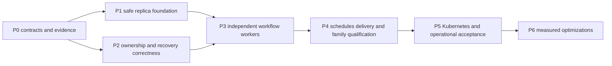

# CALIBER scalability implementation proposal

**Status:** proposed engineering work, not implemented capability or a release commitment.

**Baseline:** `1b4322a2938c459db9af0976472637272ae35e8c`, reviewed 2026-11-05.

**Design:** [scalability architecture and evidence](../architecture/scalability-arch.md).

This document is the requested implementation breakdown. The [live GitHub Project](https://github.com/users/rrahimi-uci/projects/3) and linked issues remain authoritative for scheduling, ownership, dependencies, acceptance decisions and progress. Before execution, map these slices to existing tasks and create only missing, nonduplicate work. Do not update frozen local release schedules or infer a task is complete from a closed issue without checking its integrated runtime path.

## 1. Delivery strategy and dependency gates

Preserve the current modular application and PostgreSQL queue foundation. Correct failover behavior before enabling parallel workers. Separate process roles before autoscaling. Keep unsupported worker families under one control owner until individually qualified. All new file names and configuration contracts below are proposed unless explicitly described as existing.

P1 and P2 can be developed in separate focused PRs after P0, but shared edits to `server.py`, configuration, models, migrations and runtime must be serialized by the integration owner. P3 requires both. P4 work may begin against merged producer contracts; production acceptance remains gated on the whole supported topology. P6 is optional and must not delay the safety foundations.

| Phase | Deliverable / release boundary | Gap IDs |
| --- | --- | --- |
| P0 | Agreed support matrix, regression inventory and target-envelope decision record | G01–G12 evidence and decisions |
| P1 | Consistent API replicas, shared storage/configuration and explicit single-owner roles; no parallel execution claim | G01, G08, G10, G11 foundations |
| P2 | Correct claims, stale-write exclusion and reachable recovery in current execution paths | G02–G06; G10 publication |
| P3 | Bounded independent workflow workers with migrated effect authority and durable commands | G01, G05, G08, G12 |
| P4 | Durable schedule/wake/delivery behavior and explicit qualification of other worker families | G04, G06, G07, G09 |
| P5 | Measured single-region Kubernetes operating envelope and upgrade/recovery evidence | G11, G12 and end-to-end confirmation |
| P6 | Optional performance optimizations justified by measurements | Residual capacity bottlenecks |

These phases are dependency boundaries, not equally sized calendar cycles. P2 and P4 contain multiple independently reviewable slices. Assign dates only after the current Project capacity and P0 decisions are known; do not fit all correctness work into an arbitrary three-week release.

### Common execution and acceptance contract

Every implementation slice must specify an observable outcome, changed interfaces, owned files, prerequisites and non-goals in its GitHub issue. Use the repository PR template and applicable engineering policy. Keep each PR coherent and update public API/SDK/UI consumers when a contract changes. Preserve old supported readers before enabling new writers. Use new Alembic revisions after merged predecessors, never rewrite shipped migrations.

Run applicable CI-equivalent checks from [`.github/workflows/ci.yml`](../../.github/workflows/ci.yml) and [`scripts/ci-local.sh`](../../scripts/ci-local.sh), including real PostgreSQL migration/concurrency tests where required. Run `git diff --check`. Behavioral changes require meaningful tests and measured **greater than 95% affected-code coverage**, with line/branch results and exclusions disclosed. A focused `--no-cov` command is not coverage evidence. Documentation-only slices use docs/link/format checks and explain why behavioral coverage is inapplicable. Use `./test-all.sh` when the change spans components and that is the applicable comprehensive path.

Evidence must identify candidate SHA/image digest, database/version, configuration and enabled families, exact commands, PASS/FAIL/SKIP, scenario results and artifact location. A skipped required PostgreSQL, browser, deployment or fault check is not a pass. Self-review and parallel source inspection are not independent GitHub approval. Observe the current owner-review/merge policy on each PR; this plan grants no additional merge or deployment authority.

## 2. P0 — Establish contracts and reproduce safety gaps

**Outcome:** implementation starts from an explicit supported topology, measurable correctness oracles and an approved performance-test input contract. Architecture sections 2–3 provide the source baseline, not reproduced cluster evidence.

**Dependencies:** none beyond repository/Project discovery. Performance acceptance requires the named owner decision in [#847](https://github.com/rrahimi-uci/caliber-suite/issues/847); missing approval does not prevent deterministic regression work.

**Slices and likely files:**

| Slice | Work and boundaries | Files / existing tracking |
| --- | --- | --- |
| P0.1 | Record every mounted write/long-running API and enabled worker; classify inline/queued/owner-only, effect boundary, storage, claim and recovery. Distinguish production workflow-node HTTP verifier wiring from agent-step governance and adapters tested with injected contexts. Decide which families remain singleton or disabled in the first scalable profile. | `caliber/src/caliber/server.py`, `routes/`, `orchestrator/`, `assistant/executor.py`, `knowledge/`; architecture inventory; live Project issues |
| P0.2 | Add deterministic reproductions at actual worker/route entry points for G02–G06. Keep failures diagnostic until fixing PRs land; do not weaken existing CI or merge red required checks. | Existing `test_workflow_run_worker.py`, `test_effect_reconcile.py`, `test_workspace_imports.py`, `test_aria_async.py`, knowledge/release/refinement tests; proposed dedicated PostgreSQL race fixtures |
| P0.3 | Define target-envelope schema and obtain domain/operations approval before load acceptance. Record work mix, resource ceilings, latency/error/cost targets, RPO/RTO and detection time, with units/window/owner/date. | #847, proposed `docs/operate/operating-envelope.md`; retain existing control evidence ownership |
| P0.4 | Resolve misfire policy, connector residual-risk policy and infrastructure/upgrade ownership; map new regressions to existing issue histories without reopening completed work wholesale. | Architecture section 4.8; #789 capacity, #783 retry authority, #896 regional decision; #996/#997 park/reconcile history, #721 release recovery history |

**Migration/configuration:** no production migration. Fixtures need independent PostgreSQL sessions/processes and barriers; do not depend on a developer's local clock or private provider credentials.

**Tests and QA:** demonstrate old-worker return after takeover; renewal racing recovery; two resume calls crossing claim; effect settlement before park and crash before wake; import lost-lease transaction rollback; release replacement poller discovery; knowledge stale activation; Aria continuation crash; refinement janitor versus long evaluation. Record which failures were reproduced versus only statically identified.

**Acceptance:** every enabled family and write route has a disposition; each G02–G06 case has a failing regression oracle or documented evidence limit and assigned fixing slice. Target fields are versioned and complete before performance testing; unapproved numeric targets remain **HOLD**, never substituted with post hoc thresholds. All human decisions have a named role and affected gate.

**Rollout/rollback:** no runtime rollout. If the baseline changes, rebase the evidence and recheck affected findings. Do not turn this proposal into a second release-status database.

## 3. P1 — Safe replica and deployment foundations

**Outcome:** separate API/control lifecycle and consistent shared state, while keeping execution owner-bound. This phase alone does not qualify multi-pod failover or independent worker throughput; P2 safety fixes remain a gate.

**Dependencies:** P0 route/worker support matrix. Coordinate readers-before-writers changes with P2 migration ownership.

### Implementation slices

| Slice | Expected change and boundary | Likely components/files |
| --- | --- | --- |
| P1.1 Role contract | Add explicit API/control/combined-development modes and role-specific startup/shutdown. API starts no execution-owner loops but retains required notification tasks. Control exposes only health and a private authenticated operational route surface during the bridge, not general user routes. Fail startup on unsafe profile/role combinations. Retain database global owner for control. | `server.py`, `execution_role.py`, `config.py`, `profile.py`, `deploy/caliber/entrypoint.sh`; proposed worker/control entry point |
| P1.2 Request isolation | Classify blocking calls; move whole synchronous units off the event loop with bounded concurrency and per-operation sessions. Preserve responses. Route owner-bound operations to the active control endpoint until P3 commands exist; an owner-sensitive private readiness/discovery mechanism excludes standby from that Service while preserving separate standby health. Keep handler-level fencing on every request. | `routes/assistant.py`, assistant service, `routes/system_effects.py`, other audited route owners; API/SDK contracts only where needed |
| P1.3 Shared configuration and limits | Persist versioned assistant overrides; authorize/audit writes; refresh replicas by committed version. Define shared generic request limits without changing the existing SQL service limiter. Pin settings needed by admitted work. | `routes/assistant.py`, `assistant/`, `rate_limit.py`, `routes/services.py`, `db/models.py`, new migrations; settings UI/client tests |
| P1.4 Storage eligibility | Inventory per-project local references; add a resumable checksum-verified copy/verification tool and safe switch procedure to shared storage. Multi-pod mode refuses unmigrated authoritative local references. Preserve existing content identity and published pins. | `storage/service.py`, `storage/local.py`, `storage/s3.py`, knowledge/storage owners, config/profile validation; proposed migration utility/runbook |
| P1.5 Health and schema rollout | Add dependency-free liveness, role readiness and diagnostic separation. Introduce single migration command/Job mode and explicit schema reader/writer compatibility checks, or retain maintenance-only upgrade until compatible readers exist. Expose SQL pool budgets/timeouts. | `routes/health.py`, `observability/readiness.py`, `db/migrate.py`, `db/session.py`, `config.py`, entry point; deployment docs |

**Data changes:** additive settings version/audit records; shared-limit records if SQL-backed; storage-copy manifest mapping old reference to verified new reference. Do not mutate published artifact identity during copy. Schema compatibility must describe minimum/maximum supported contract versions and writer features, rather than blindly accept unknown future migrations.

**Tests/load/failure:** two API processes must see the same settings revision and enforce the same aggregate limit. Verify revoked auth and project denial across replicas. Hold an assistant/provider call and demonstrate unrelated health/read requests remain responsive within the P0 target. Lose storage during migration and resume without dangling references. Remove SQL and verify liveness stays healthy while readiness refuses unsafe work. Start two control processes and verify one owner; exercise real reconciliation/attestation endpoints before and after owner replacement, including stale routing refusal. Assert API role constructs no execution loops, cross-replica notifications still work, and unsafe development multi-pod configuration refuses startup. Verify supported old/new schema overlap or the explicit maintenance refusal path.

**Acceptance:** zero replica-dependent configuration results after the documented propagation bound; aggregate admitted requests never exceed configured shared limits; every authoritative stored reference is verified shared or explicitly unsupported in multi-pod mode; no schema migration runs from an ordinary replica start; role probes have deterministic success/failure contracts. Required PostgreSQL/profile/route/storage/docs tests pass. P2 is required before declaring owner failover safe.

**Rollout:** migrate shared settings/storage first with old readers supported; deploy one API/control pair with explicit routing; exercise role separation, then stage a second API. Maintain one active control owner. Do not switch execution authority yet.

**Rollback:** revert roles to one combined instance only while its schema reader is supported. Preserve shared settings and copied objects; do not restore stale local overrides or delete new objects. If old code cannot interpret new settings/schema, stop admission and use the maintenance rollback procedure rather than run incompatible pods.

## 4. P2 — Ownership and recovery correctness

**Outcome:** stale workers cannot publish authoritative state; recovery reaches eligible interrupted work through actual pollers; ambiguous effects remain conservative. Complete this work even if the first deployment stays single-owner.

**Dependencies:** P0 regressions and authority specification; P1-compatible schema approach. This phase designs and stores authority metadata but keeps independent workflow dispatch disabled until P3 effect-authority integration.

### Implementation slices

| Slice | Expected change and boundaries | Likely files |
| --- | --- | --- |
| P2.1 Claim contract | Add acquisition epochs/history and database-time expiry to existing work models; shared conditional claim/renew/recover helpers with bounded scans. Preserve domain-specific state machines. Validate heartbeat/TTL constraints. | `db/models.py`, new migrations, `ownership.py`, proposed reusable work-claim module; worker claim sites |
| P2.2 Workflow writes | Capture immutable attempt authority on claim. Fence execution callbacks, checkpoint writes, terminal events, execution budget settlement and publication; stop dispatch on lost renewal. Apply the architecture's operation-to-authority matrix to operator/lifecycle changes. Retain global effect fencing alongside run checks until P3. Replace recovery select-then-unconditional-update with expiry/epoch/status guarded updates; emit events from changed rows. | `orchestrator/workflow_run_worker.py`, `workflows/run_events.py`, runtime/checkpoint owners, budget/effect call sites |
| P2.3 Resume and wake | Atomically compare waiting/checkpoint version for manual/event/timer transitions. Add post-park recheck and idempotent parked-run sweep so settlement/wake crashes cannot strand work. | `routes/workflow_runs.py`, workflow worker, `effects/reconcile.py`, checkpoint/state models |
| P2.4 Artifact and effect boundary | Publish immutable attempt objects and fence SQL pointers; route/refuse runtime output writes. Token-guard compatibility ledger retries/completion or explicitly prohibit that path in the scalable profile. Preserve stable logical effect identity. | `workflows/runtime.py`, `workflows/effect_ledger.py`, `storage/service.py`, `storage/s3.py`, worker artifact writers; governed context/profile |
| P2.5 Other-family failover | Fix import rowcount-before-commit with whole-transaction rollback; release evaluator expired-running selection and periodic attempt renewal; knowledge guarded recovery/activation; refinement stage settlement versus janitor; Aria durable continuation and exclusive step attempt. Retain calibration ambiguity policy. Fence prompt-release reconciliation settlement under controller takeover, or disable it in the failover topology; singleton concurrency is not a safety proof. | `workspace_imports.py`, `workspace_import_worker.py`, `workspace_import_materializer.py`, `workspace_release_service.py`, `orchestrator/workspace_release_evaluator.py`, `knowledge/worker.py`, `knowledge/service.py`, `orchestrator/worker.py`, `eval_stage.py`, `janitor.py`, `assistant/executor.py`, `orchestrator/release_reconciler.py`, `release_operations.py` |

P2.5 is several PRs, not one broad rewrite. Fix each actual producer/consumer path and its regression before extracting more shared abstractions. A family not completed must be disabled in the supported failover topology; retaining one owner does not by itself fix stale-thread recovery bugs.

**Migrations:** add nullable authority/attempt fields and indexes; backfill only safely classifiable non-running records. Drain or explicitly classify active/unknown work before changing writer mode. Add state/version constraints after data validation. Keep old columns during compatibility. Never assign a fresh authority to an ambiguous in-flight effect to make migration convenient.

**Required tests and fault scenarios:**

- PostgreSQL barriers: A claims, pauses; expiry and B takeover; A resumes progress/checkpoint/terminal/publication. Assert **zero** accepted stale writes and unchanged B authority.
- Renewal-after-selection and newer-claim-after-selection: old recovery must change **zero** rows and emit no recovery event.
- Resume/resume, resume/claim, cancel/complete and timer/resume: one valid transition; no cleared newer claim; checkpoint input matches the winning version.
- Parked runs with no live execution lease remain approvable/resumable by authorized actors; stale execution callbacks remain rejected. A recovered run without a selected checkpoint must not silently replay an ambiguous external effect. An explicitly selected missing, corrupt or out-of-lineage checkpoint must fail closed, never fall back to entry-point execution.
- Settle before park; crash after settlement commit before wake; restart normal pollers. Every safely resumable parked run is discovered within the configured sweep interval plus execution budget; repeated sweeps add no duplicate transition.
- Lose import ownership after materialization flush: **zero** committed revision/pin changes. Release evaluator replacement `tick()` must discover expired running work and create a new provenance-preserving attempt; a slow valid evaluation renews beyond its initial lease.
- Knowledge stale worker cannot activate a version; old refinement evaluation cannot overwrite janitor/retry state; Aria completed-wait crash resumes the persisted continuation once under its claim.
- Prompt-release reconciliation pause/takeover/resume cannot commit stale intent or settlement; otherwise the family remains disabled with that limitation documented.
- Artifact upload succeeds/SQL fails and the reverse reachable boundaries: no committed pointer to absent/unverified content, no stale overwrite of published content; orphan collection excludes active/published references.

**Acceptance:** all above negative oracles pass on real PostgreSQL at normal worker/route seams. Existing effect/approval and development compatibility suites remain green. Unknown effects and interrupted calibration do not auto-replay. Record measured affected-code coverage. No family is marked qualified merely because its helper claim test passes.

**Rollout:** keep one active execution owner; migrate readers then writers; enable new guards on a small workload, inspect stale-rejection/recovery metrics, then expand. Drain legacy running records before enforcing non-null new authority. No active-active worker switch in this phase.

**Rollback:** pause admission and new claims; drain or classify active attempts. Revert only to a binary that understands the authority metadata and preserves fencing. Do not drop epochs, attempt history or unknown-effect records. If prior code could accept stale writes, the safe rollback is disabled execution plus a forward fix, not returning to unsafe automatic recovery.

## 5. P3 — Independent workflow workers and bounded admission

**Outcome:** API replicas durably admit work; workflow-worker replicas execute independent runs under per-run authority; the controller retains scheduling/reconciliation. Horizontal capacity comes from independent work, not parallel execution of one run without a design.

**Dependencies:** P1 and P2 gates; supported effect disposition inventory; #783 retry authority and [#789](https://github.com/rrahimi-uci/caliber-suite/issues/789) typed capacity bucket contract. Coordinate with existing effect ownership tasks before adding duplicates.

| Slice | Implementation and boundary | Likely files |
| --- | --- | --- |
| P3.1 Authority integration | Persist and validate operation-specific authority domain/work/epoch/history-generation across dispatch, approval, budgets and reconciliation. Distinguish expired-owner takeover from live-owner stuck-dispatch expiry and unknown-outcome lookup; arbitrate settlement by proposal/attempt version without granting resend authority. No shared global token handed to independent workers. | `ownership.py`, `effects/dispatcher.py`, `effects/records.py`, `effects/reconcile.py`, `effects/governed_context.py`, budget owners, models/migrations |
| P3.2 Worker role | Add non-public worker entry point, bounded claim loop, independent renewal connection capacity, graceful drain and per-family enablement. Retain global controller lease for maintenance. | `server.py` lifecycle extraction, `execution_role.py`, workflow worker, config/profile, entry point |
| P3.3 Durable command admission | Any API replica accepts authorized long-work/operator commands with key/fingerprint and persisted result identity; recheck runtime permissions. Migrate owner-bound effect operations with explicit API/SDK compatibility. | `routes/system_effects.py`, `routes/workflow_runs.py`, selected assistant routes/services; proposed command model/consumer, OpenAPI/SDK/UI consumers |
| P3.4 Backpressure | Enforce shared deployment/project/connector capacities, queue limits and bounded fairness. Unknown effects retain reservations. Add clear overload responses and capacity-aware worker concurrency. | `budget/reservations.py`, `budget/step_reservation.py`, `effects/dispatcher.py`, config, queue/admission services, metrics |

**Data/config changes:** additive versioned authority references on effect/dispatch attempts; operation keys with canonical fingerprint uniqueness; typed capacity buckets and reservations. Introduce an explicit independent-worker feature gate defaulting off. Define installation history-generation management for restore. Do not repurpose run IDs as connector bucket keys or embed secrets in commands.

**Tests/load/failure:** run separate API/controller/worker processes against PostgreSQL with deterministic HTTP/provider fixtures. Submit the same key/body concurrently through different APIs: one durable work identity. Same key/different body: conflict with no second effect. Pause a worker after dispatch claim but before send, transfer ownership, then resume it; assert the documented connector-specific result and stale settlement refusal. For a connector lacking remote idempotency, assert conservative unknown/refusal rather than a fictitious duplicate-free guarantee. Saturate a shared provider from two projects and verify capacity never exceeds its configured bound. Test scale-down drain, ungraceful death, database disconnect and cancellation with in-flight effects.

Preserve the same-token dispatcher/reconciler race covered by `test_effect_in_flight.py`, including stuck-dispatch classification and parked-run continuation while the owner remains live. Any additional production workflow-node backend needs configured verifier wiring and route-to-worker-to-effect tests; adapter-only success does not enable it.

**Acceptance:** every supported workflow mutation validates current authority; no stale completion accepted in the fault matrix. Two independent workers demonstrate concurrent processing of distinct runs with conserved run/attempt counts. Throughput and p95/p99 latency meet the **preapproved** envelope for the stated workload/resources; do not invent a universal linear speedup requirement. Queue/provider/database caps hold across replicas; no starvation beyond the configured fairness bound. Legacy response compatibility or versioned migration is tested through API/SDK/UI consumers.

**Rollout:** deploy readers supporting both authority formats; stop new legacy claims; drain/classify old attempts; enable the new dispatcher and one worker under the new contract; add a second worker only after correctness smoke tests. Increase a bounded pool after envelope tests. Other worker families remain control-owned unless P4 qualifies them.

**Rollback:** disable new admission/claims, drain current authority and preserve effects/reservations. Reduce worker replicas to one without removing fencing. Reverting to the old global-owner writer is allowed only after a tested data conversion and no incompatible active attempts; otherwise roll forward. Never force-release unknown provider capacity simply to make rollback complete.

## 6. P4 — Durable schedules, delivery and additional worker families

**Outcome:** scheduling and continuation survive downtime, event consumers have durable handoff semantics, and each supported background family has an explicit concurrency/recovery qualification. Parallelism for every family is not required for the first supported deployment.

**Dependencies:** P2 claim/transition contract and P3 authority/capacity integration. Product decision on misfires/DST is required for schedule acceptance. P2 parked-run sweep remains in place even when durable wake delivery is added.

| Slice | Implementation and boundary | Likely files |
| --- | --- | --- |
| P4.1 Schedule occurrences | Unique UTC occurrence/revision, occurrence-derived enqueue key and persisted occurrence-to-run association, durable cursor, bounded catch-up/coalescing/skip policy. Commit occurrence/enqueue/cursor atomically; do not retain local-minute identity at admission. Retain single scheduler owner. | `orchestrator/scheduler.py`, `workflows/run_launch.py`, schedule models/new migrations, schedule API/config/tests |
| P4.2 Outbox/inbox wiring | Before activating consumers, add database-time publisher leases and acquisition-fenced settle/release, including same-instance restart. Register named consumers and define delivery-marker semantics; use transactional inbox for SQL transitions, attempt-fenced external delivery. Make wake processing repeatable. | `events/outbox.py`, `events/inbox.py`, `events/webhooks.py`, `server.py`, `effects/reconcile.py`, worker wake consumer, migrations |
| P4.3 Authorized live replay | Event IDs, bounded replay/cursor retention/resnapshot, project authorization at subscription and replay; broker remains notification transport. | `routes/events_stream.py`, `workflows/run_events.py`, event buses, UI/SDK stream consumers, retention configuration |
| P4.4 Family qualification | Apply the P2/P3 protocol to each selected refinement/knowledge/Aria/import/release family. Keep prompt-release reconciliation, janitor and calibration owner-bound unless separately proven safe. Explicitly disable unsupported families. | Worker inventory in architecture section 2; family-specific tests and deployment flags |

**Migrations:** additive schedule occurrence/cursor records with uniqueness; consumer identity/attempt/processed state where existing inbox/outbox tables are insufficient; replay retention/index policy. Initialize a new schedule cursor at an explicitly chosen cutover instant. Do not manufacture historical missed runs or mark old outbox rows delivered to new consumers without a backfill decision.

**Tests/failure scenarios:** two scheduler ticks plus leader takeover for the same instant produce one logical run; outage spanning many ticks obeys the approved policy and maximum backlog; repeated/skipped DST hours and schedule revisions have unambiguous identities. Crash between consumer reservation and SQL commit rolls back safely; after commit/redelivery causes no duplicate transition. Broker outage does not lose accepted work. Webhook timeout remains retryable/unknown according to contract; receiver idempotency is separate from local delivery state. SSE reconnect to another pod replays only authorized events, and an expired cursor returns an explicit resnapshot outcome. Revoked access cannot read replay history.

For repeated-hour policies that execute both occurrences, two distinct eligible UTC instants must produce distinct runs; replay of either occurrence returns its original run. For publisher restart, hold an old consumer handoff, stop/restart the same publisher object, acquire a new claim, then return the old handoff: it must change zero delivery/release rows.

For each family, repeat kill, pause/takeover/resume, long-call renewal, cancellation, poison work and storage-publication tests through the real poller. Calibration must preserve its operator-resolution boundary until safe replay is separately established.

**Acceptance:** one occurrence per schedule/revision/UTC instant; no silently lost eligible continuation; bounded catch-up and event retention; one committed database consumer transition per consumer/event identity under duplicate delivery; zero cross-project unauthorized replay. Every enabled family has documented supported concurrency, recovery limits and passing PostgreSQL/failure evidence. A singleton family is acceptable only after its failover correctness is proven; a disabled family is disclosed as a product-scope limitation.

**Rollout:** wire one durable consumer at a time behind a gate, observe queue age and redelivery, then migrate UI streams. Keep old event readers during the compatibility interval. Enable family-specific worker deployments separately; do not use a single global “distributed” flag to enable all loops.

**Rollback:** stop new consumers/claims while retaining outbox/inbox rows and schedule cursor history. Reduce families to their tested singleton mode. Preserve consumed identities so rollback/restart cannot replay external effects accidentally. A schedule policy rollback requires an explicit new cutover, not deletion of occurrence records. SSE can fall back to authorized snapshot polling without treating missed notifications as lost state.

## 7. P5 — Kubernetes, operational qualification and release evidence

**Outcome:** a reproducible supported single-region topology with approved operating limits, tested upgrades and recovery, and operator runbooks. Installing manifests alone is not this milestone.

**Dependencies:** P1–P4 acceptance for every enabled capability; approved #847 target envelope and operations/security infrastructure choices. Disabled families/features and connector limitations must be visible in the release support matrix.

**Files/components:** proposed `deploy/kubernetes/` Deployments/Services, migration Job, ConfigMaps/secret references, probes, resources, disruption/topology policies, NetworkPolicies and optional HPA; `deploy/caliber/Dockerfile`/entrypoint as needed; `observability/`; `docs/operate/` installation, upgrades, recovery and operating-envelope guides; deterministic multi-process/fault/load harness under repository test conventions; applicable CI jobs. Do not commit cluster credentials or vendor-specific secret values.

**Configuration and migration:** pin image digests, schema contract, role/family flags, pool/concurrency budgets, provider limits, object storage, bus and identity inputs. Run one migration Job with backup/locking and documented rollback. Verify old/new reader overlap or use maintenance rollout. Keep database and object storage lifecycle outside ephemeral application pod lifecycle. Namespace deletion must not erase authoritative evidence by accident.

### Required scenario matrix

| Scenario | Measurement and pass oracle |
| --- | --- |
| Fixed workload at 1, 2 and approved maximum workers | Record offered/admitted/completed rate, p50/p95/p99 latency, queue growth, resources and database/provider saturation. Meet approved envelope on fixed declared infrastructure; account for each accepted run. |
| Burst and sustained overload | Admission rejects/backpressures within configured bounds; memory, SQL connections and provider capacity remain bounded. Recovery returns queue age to the approved target without manual data repair. |
| Controller death and paused former owner | Standby acquires according to lease contract; old controller cannot settle authoritative mutations. Measured recovery/detection time meets approved targets. |
| Worker SIGKILL, pod eviction and node loss | Accepted work remains durable; safe work resumes; stale effects/unknowns follow contract. No accepted stale write and no unexplained lost run. |
| SQL outage, slow renewal and primary failover | Local authority expires safely; no new unauthorized dispatch; probes do not cause database-driven liveness restart storms; recovery meets approved RTO. |
| Broker and object-store outage | No loss of committed work; bounded retries/backpressure; no bad artifact pointers or silent outbox loss. |
| Provider timeout, success-with-lost-reply and late old-worker return | Supported receipt/idempotency fixtures show one logical committed effect; unsupported guarantees are refused/unknown, never reported as exactly once. |
| Rolling upgrade and incompatible schema | Compatible readers/writers coexist only within tested window. Incompatible configuration refuses readiness/startup with actionable diagnostics. |
| Restore from backup/PITR | Verify database/object/event consistency, new history generation and isolation of old workers; reconcile external effects before resuming. Meet approved RPO/RTO, including operator steps. |
| Graceful scale-down and forced termination | Draining stops new claims, finishes or parks safe work within configured grace, and leaves unknown effects accounted for. Correctness also holds when grace is not honored. |
| Authorized streaming and replica churn | Reconnect/replay/resnapshot respects project permissions and bounded retention; secrets/payloads do not leak through telemetry. |

**QA method:** use deterministic local provider/receiver fixtures with independent effect counters, real PostgreSQL and object storage, and process barriers/fault injection. Record fault timing relative to transaction boundaries. Repeated trials and a soak duration come from the preapproved workload/window, not a convenient single run. Live-provider or paid infrastructure trials are separately scoped and budgeted; they do not replace deterministic CI. A kill test is not a substitute for pause-and-resume of a stale process.

**Acceptance:** all zero-tolerance safety oracles above pass; no missing required scenario, skipped environment or unknown enabled-family qualification. Measured performance/cost/recovery results meet the approved envelope without revising targets after the run. Include dashboards/alerts with tested detection, install/upgrade/restore evidence and an independent operator exercise. Publish exact support limits and unresolved connector risks; do not advertise universal HA or exactly-once behavior.

**Rollout:** staging with fixed replicas → bounded operator trial → production canary with limited workload → gradual expansion within measured caps. Enable HPA only after the fixed-replica envelope, drain and overload tests pass. Watch queue age, stale-write rejection, unknown-effect age, scheduler lag, outbox age, SQL pool waits and cost. Rollout pauses automatically or operationally at the approved thresholds.

**Rollback:** freeze admission where necessary, disable HPA, return to the last qualified replica/configuration set, drain or classify active attempts, and use compatible application binaries. Restore only through the history-generation/external-reconciliation runbook; a database restore cannot undo remote effects. Preserve audit/attempt evidence. If safety invariants fail, stop dispatch and roll forward with a fix rather than erase evidence or disable guards.

## 8. P6 — Later scaling optimizations

These are optional and require an observed bottleneck after P5. None substitutes for P2 correctness.

| Optimization | Trigger / likely changes | Tests, rollout and rollback |
| --- | --- | --- |
| Polling/queue tuning | Database polling load or claim contention exceeds approved budget; add notification hints, bounded batch claims, indexes and retention/vacuum tuning in queue/event modules. | Compare query plans and queue latency under identical workload; broker loss falls back to polling. Gate hints; retain SQL authority. |
| Dedicated heavy-worker pools | Knowledge/refinement resource contention affects workflow/API targets; isolate resource classes and concurrency budgets. | Mixed-workload fairness and provider capacity tests; canary a family; revert to its qualified pool without changing work identity. |
| Read/query optimization | Measured API queries dominate primary load; optimize indexes/pagination/caches first, then consider read replicas for explicitly stale-tolerant queries. | No authority, admission or read-after-write decisions use stale replicas. Test lag; route reads back to primary on rollback. |
| Independent control partitions | Measured scheduler/reconciler backlog exceeds a single controller's bounded capacity; partition by stable ownership domain with durable transfer. | No overlap/gap during transfer, epoch fencing and restore tests; route back only after partition drain. Reuse existing ownership-transfer tasks. |
| External durable broker | SQL queue cost remains unacceptable after tuning; use outbox handoff and consumer deduplication, retain authoritative state/claim protocol. | Lost/duplicate/out-of-order delivery tests; dual-read/write migration needs a separate ADR. Rollback preserves consumer identities. |
| Regional cells/sharding | Approved single-region capacity or locality requirement demands it; start with [#896](https://github.com/rrahimi-uci/caliber-suite/issues/896) and existing home-region/history-generation work. | Separate architecture, migration, routing and disaster-recovery acceptance. No active-active cross-region claim in this proposal. |

Each optimization needs a new measured hypothesis, explicit acceptance threshold approved before benchmarking, resource/cost comparison and reversible feature gate. Avoid replacing the current engine, ORM or queue solely for architectural fashion.

## 9. Human decisions and engineering handoff

| Decision | Required input | Blocks | Work that can proceed |
| --- | --- | --- | --- |
| Operating envelope, #847 | Domain/operations-approved numeric workload, latency/error/cost/RPO/RTO/detection targets and measurement window | P3 performance acceptance, P5 qualification | Deterministic safety fixes, harness and target template |
| First supported feature/family matrix | Product/engineering select included, singleton and disabled families; disclose limits | P1/P4 release support claims | Inventory and regression fixes |
| Schedule semantics | Product chooses skip/catch-up/coalesce, DST and lateness/backlog bounds | P4 schedule acceptance | Occurrence schema and policy-neutral fixtures |
| Connector risks | Security/product/connector owner confirms receipt/idempotency scope and residual-risk acceptance | Enabling affected external writes | Refusal paths and deterministic adapter tests |
| Infrastructure and restore ownership | Operations/security select database/object service, workload identity, backup ownership and maintenance constraints | Deployment and P5 restore qualification | Portable manifests and offline validation |
| API compatibility | Product/API owner approves asynchronous command evolution and supported older consumers | Changing existing public response semantics | Additive command contract and client fixtures |

The implementing agent should take one dependency-ready slice, inspect its current producer/consumer paths, update its issue with the precise contract and regression oracle, then implement and validate through a focused PR. Do not implement all phases as one change, silently reduce an enabled family's scope, or treat this document's proposed tests as already present. Completion means integrated evidence for the supported topology, with limitations and unresolved decisions explicit.
