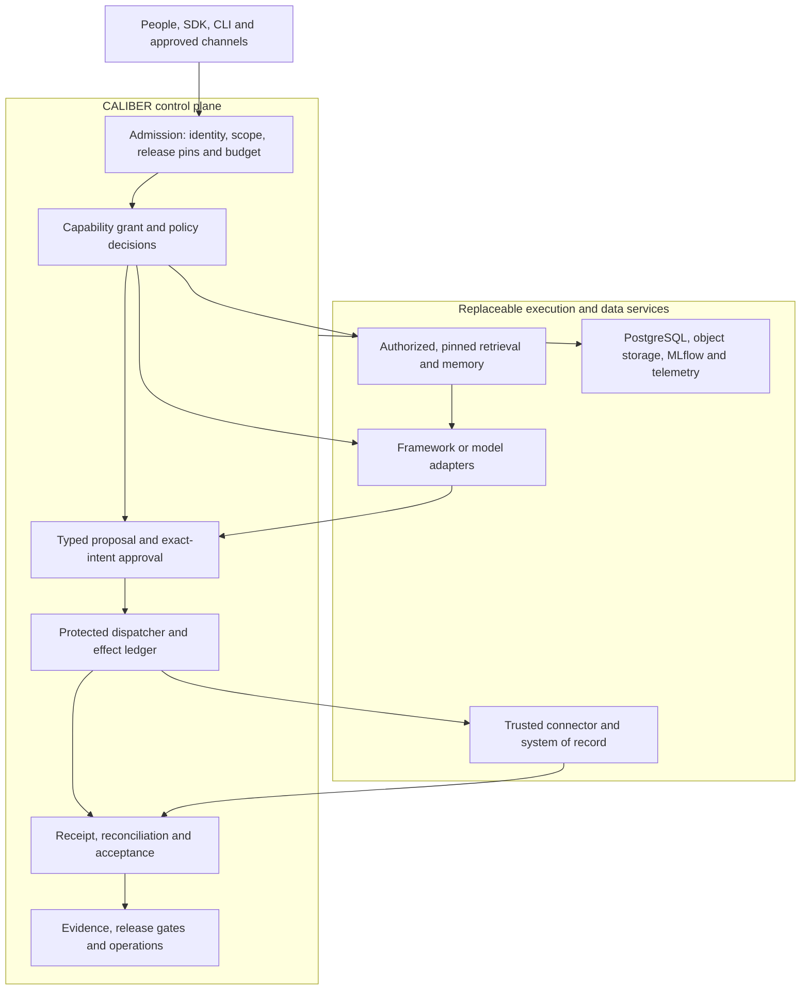
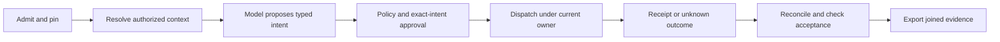

# CALIBER architecture, MVP and enterprise evolution: map and gap analysis

Review date: **26 October 2026**. Latest checked main: [`eafd6fce4933c202f43d5799371545e2b1d70495`](https://github.com/rrahimi-uci/caliber-suite/commit/eafd6fce4933c202f43d5799371545e2b1d70495), including merged report PR #654. Production code and plan files are unchanged from the original implementation baseline, [`4729508db7b948e4cb555d5b365dade2d5c458af`](https://github.com/rrahimi-uci/caliber-suite/commit/4729508db7b948e4cb555d5b365dade2d5c458af), which included PR #653. This is an architectural assessment, not a production certification. The latest source re-review corrects a trace-ownership overstatement; historical validation runs below retain their original baselines.

**Scope update — owner decision, 26 October 2026: this version is single-tenant only.** This report now evaluates release gaps against that boundary. One customer/organization has a dedicated CALIBER deployment, database, storage boundary, credentials and configuration; multiple authorized users and projects remain supported within it. Shared-customer hosting, tenant provisioning/routing and cross-tenant administration are out of scope for this version. This updates the report's scope; the existing EGI delivery-plan file and its broader schedule have not been rewritten.

**Subsequent planning reconciliation:** the [execution plan](docs/planning/BETA_MVP_EXECUTION_PLAN.md) now applies
this report's corrections to GitHub and proposed repository documentation, against main
`5b2fb2a408fad887f1c8704e311b46b09da0f15f`. The review baselines above remain historical; production controls
are not implemented by the planning update. Old milestone dates are uncommitted pending #608.

**Post-merge critic correction:** review of planning PR #935 found contradictory child instructions that the
structural checks did not catch. The [contract correction record](docs/planning/EXECUTION_CONTRACT_CORRECTIONS.md)
tracks the corrected scopes, tests, acceptance and prerequisite edges. Do not read earlier “resolved” planning
statements as certification of every task's pseudocode or of implemented controls.

**Scope interpretation:** retain the current EGI MVP commitments except shared-customer multi-tenancy. Single tenancy does **not** remove OIDC/SCIM, multi-region operation, Knowledge Hub, governed memory, federation, certification or autonomy. D5 is the bounded **Beta**, D9 is **core operating proof**, and the full **single-tenant MVP** still requires the retained D10–D15 capabilities. A smaller product release would require another owner decision; it is not the default used below.

## 1. Executive Summary

**CALIBER has a credible control-plane foundation, but not yet a complete governed-execution control plane.** Its strongest implemented assets are versioned resources, workflow execution/checkpoints, project-aware access, evaluation/refinement workflows, approval controls, trace integration, and a useful Python SDK/CLI. The missing center is an enforced, end-to-end chain from admitted authority and pinned behavior to a verified external outcome. Building more UI resource types does not close that gap.

**Single tenancy materially reduces the enterprise-platform gap.** Shared-tenant isolation, tenant lifecycle administration, cross-tenant scheduling/fairness and per-tenant quotas are no longer release blockers. The remaining execution-safety gap is still significant: project/user access, exact-intent approvals, protected dispatch, uncertain-write recovery, evaluated outcomes and restore evidence remain required. No percentage reduction or revised delivery date is claimed without re-estimating the retained scope.

The latest code materially improves the picture relative to earlier reviews. There are now seven versioned control-record schemas, a protected-effect inventory, explicit reference-profile startup refusals, project-aware trace filtering, and real process-kill recovery experiments. However, schemas are not their production writers, inventory classifications are not dispatch enforcement, and experiments under `tests/` are not production reconciliation. Trace ownership also has a confirmed name/ID alias bypass across projects; filtering is not proof of complete isolation. These distinctions drive this report.

Five decisions matter most:

1. **Finish a narrow vertical assurance path first.** One admitted, release-pinned use case; one trusted connector; exact-intent human approval; ambiguous-effect reconciliation; independently checked outcome; verifiable evidence export. Refuse unsupported execution paths in the supported profile.
2. **Make CALIBER own authority and evidence, not every engine.** Keep domain contracts, policy enforcement points, release eligibility, effect semantics and acceptance in CALIBER. Reuse databases, identity providers, agent frameworks, telemetry, evaluation engines and isolated execution infrastructure.
3. **Fix irreversible architectural choices early without building shared tenancy.** Preserve deployment identity, project/resource ownership, immutable releases, effect identity, versioned contracts and lineage. B01/B02 still require tenant/region/residency on the new governed contracts, initially with configured constants; a database-wide shared-tenant retrofit is not a prerequisite.
4. **Reconcile the single-tenant exception with the existing EGI program.** Keep all other commitments. Split M17's retained enterprise identity work from excluded shared hosting, repair downstream prerequisites and re-estimate. The three-person, 122-week baseline is not a revised release estimate and cannot be shortened by simply deleting M17.
5. **Do not sell aspirations as differentiators.** Portable governed changes and cross-framework evidence could become defensible. Today, cloud platforms and LangSmith have stronger documented operational offerings; CALIBER has not established superiority in scale, isolation, integration breadth or autonomy.

The recommended product promise is: **“Deploy, change and operate a bounded AI use case with explicit authority, independently checked outcomes, recoverable effects and portable evidence.”** It is narrower and more testable than “enterprise-ready autonomous AI platform.”

### Evidence conventions

| Label | Meaning |
| --- | --- |
| Implemented | A production code path exists; assurance is limited to the cited tests/profile. |
| Partial | Useful implementation exists, but a required invariant or integration is missing. |
| Scaffold | Data/API/queue structure exists without the complete executing path. |
| Experiment | Disposable test/prototype evidence; not shipped runtime behavior. |
| Planned | An accepted design or tracked delivery package, not implemented by the document. |
| Unverified | Not established by this review; not a claim that the capability is impossible or absent everywhere. |

Repository links below refer to the stated baseline. Code outranks stale prose for implementation; the controlling plan outranks older roadmaps for commitment. External claims are primary-source documentation observations accessed on the review date, not independent benchmarks. The verification record is in §16.

## 2. Caliber Vision and Design Principles

The vision is coherent if “control plane” denotes **authoritative decisions and lifecycle management**, not merely a dashboard over many integrations. CALIBER should make heterogeneous AI components composable without delegating business authority to a model or framework.

| Principle | Concrete consequence | What it does not mean |
| --- | --- | --- |
| Cloud agnostic | Portable contracts; deployable reference stack; provider bindings outside immutable behavior; tested export/restore. | Every cloud, database and object store supported at launch. |
| Open-source native | Reuse established infrastructure and publish adapter contracts; assess licenses and maintenance per component. | Every commercially available integration is open source, or all OSS is operationally free. |
| Control plane first | Own admission, authority, policy, release eligibility, accepted outcomes and evidence semantics. | Rebuild inference servers, workflow engines, identity servers or telemetry databases. |
| Deny unsupported behavior | A reference profile declares and enforces its supported effects, authors, connectors and runtime paths. | A warning banner is a security boundary. |
| Model proposes; system decides | Structured proposals; server-side checks; external receipt and acceptance predicate. | A model explanation or successful HTTP call proves the business outcome. |
| Version what affects behavior | Pin model eligibility, prompts, tools, policy, knowledge, evaluator and adapter versions. | Hashing a manifest makes every referenced object immutable. |
| Evidence before autonomy | Promote a use case only on representative evidence and enforceable limits. | A global “autonomous” toggle or a second prompt is independent review. |
| Evolution through explicit seams | Introduce interfaces at authority, storage, execution and evidence boundaries; certify adapters. | Abstract every library or make every method a plugin. |

The current [Apache-2.0 license](LICENSE) and existing provider/storage protocols support the vision. They do not prove operational portability. Define portability as a tested migration of one use case and its evidence between two supported installations without changing domain behavior, while explicitly accounting for external credentials, model availability and downstream state.

## 3. Caliber Control-Plane Architecture

### Ownership boundary

| CALIBER must own | Delegate execution/storage to | Boundary and replacement rule |
| --- | --- | --- |
| Use-case owner, risk classification, allowed autonomy | Enterprise IdP authenticates people/workloads | Stable principal IDs and typed claims; map identity to CALIBER authorization, never trust arbitrary headers. |
| Run admission, immutable behavior pins, capability grant | Agent framework or workflow executor | Versioned run/step contracts; no executor may mint authority or directly access protected credentials. |
| Policy enforcement and recorded decisions | Policy evaluator such as OPA, if justified | CALIBER supplies verified input and enforces allow/deny; evaluator output never executes effects. |
| Proposal/approval/effect/acceptance lifecycle | Connector and downstream system of record | Stable logical effect ID, canonical intent, expected version, receipt and reconciliation capabilities. |
| Release eligibility, promotion and rollback assignment | Artifact registry, object store, signing service | Immutable digests and verified publisher; adapter preserves meaning, not just CRUD shape. |
| Evaluation plans and blocking criteria | MLflow or another evaluator; domain validators | Pinned data/judge versions, typed evidence, critical-invariant vetoes, explicit simulated mode. |
| Context authorization and provenance | Retrieval, embeddings, graph and memory engines | Server-derived scope, source/version references, deletion and freshness contracts. |
| Causal evidence model and audit policy | OpenTelemetry collectors/backends, protected archive | Run/decision/effect IDs independent of vendor trace IDs; independently verifiable export. |
| Budget/ownership decisions | SQL transactions, durable queues, workflow infrastructure | One owner for each state transition; durable reservation, fencing and deduplicated delivery. |

### Target logical architecture — not today's deployment



The execution boundary must be physical as well as logical: network policy and credential placement must prevent an agent, plugin or sandbox from bypassing the dispatcher. A diagram cannot enforce this. Keep a modular monolith initially; extracting services is warranted by trust, scaling or deployment boundaries, not by the number of boxes.

### What is differentiated IP?

| Candidate value | Reality today | Defensibility test |
| --- | --- | --- |
| Integrated resource change/evaluation/approval experience | Implemented across meaningful but uneven resource lifecycles. | An outside operator completes a safe change without stitching systems manually. |
| Explicit per-artifact capability declarations | [Artifact capabilities](caliber/src/caliber/artifact_capabilities.py) checks declaration consistency at import, not handler wiring; rollback mechanisms differ by family. | Public conformance tests prove each declared behavior and refuse unsupported operations. |
| Cross-framework authority-to-outcome evidence | Planned/partial; not a complete production chain. | Two independently authored adapters pass the same failure scenarios. |
| Recovery-aware governed effects | Existing narrow ledger plus promising experiments. | Lost receipts, stale approvals and owner replacement cannot duplicate or falsely certify an effect. |
| Evidence-governed autonomy | Accepted ADR; platform-wide enforcement planned. | Promotion/demotion demonstrably changes allowed principal roles and effects. |
| Commodity orchestration, vector search or tracing | Not a credible exclusive advantage. | Reuse rather than attempt to outbuild mature projects. |

Open contracts and OSS do not preclude defensibility: conformance assets, operational evidence, coherent UX and high-quality domain integrations can be difficult to reproduce. No proprietary moat or market advantage is established by this review.

## 4. Current Architecture Assessment

### Current-state evidence map

The current application is a standalone Starlette service with a React SPA, synchronous SQLAlchemy persistence, external MLflow integration, and background loops started in application lifespan. It is not merely an MLflow UI plugin, and it is not yet a separately scalable worker fleet. See [architecture](ARCHITECTURE.md), [server](caliber/src/caliber/server.py) and [models](caliber/src/caliber/db/models.py).

| Area | Current implementation | Material boundary | Evidence |
| --- | --- | --- | --- |
| Resources/releases | Prompts, skills, workflows, tools, knowledge and evaluation resources; release intents, versions and workspace release records. | Resource families do not share identical promotion/rollback guarantees; signed cross-resource releases are future work. | [Capabilities](caliber/src/caliber/artifact_capabilities.py), [workspace releases](caliber/src/caliber/workspace_release_service.py) |
| Execution | Workflow IR, run snapshots, checkpoints, worker processing and retries. | Run snapshots are not universally pinned admission contracts; no whole-process execution-owner fencing yet. | [Launch](caliber/src/caliber/workflows/run_launch.py), [runtime](caliber/src/caliber/workflows/runtime.py), [ADR 0002](docs/architecture/adr/0002-execution-ownership.md) |
| Control contracts | Seven packaged JSON schema kinds and runtime validators. | Validators do not demonstrate all production paths emit/consume those records. | [Registry](caliber/src/caliber/contracts/registry.py), [ADR 0003](docs/architecture/adr/0003-control-record-schemas.md) |
| Effects | Narrow guarded-effect helper and durable effect ledger; 127-row inventory classifies target dispositions. | OpenAPI/MCP and other paths are not all routed through one protected production dispatcher. | [Inventory](caliber/src/caliber/effects/inventory.py), [runtime](caliber/src/caliber/workflows/runtime.py), [OpenAPI executor](caliber/src/caliber/integrations/openapi/executor.py) |
| Recovery | Disposable downstream service and real SIGKILL/lost-receipt experiments. | Test-only dispatcher, limited state machine, no production worker for the new proposal reconciliation contract; existing ledger intervention is narrower. | [D1 findings](docs/reports/egi/D1-prototype-findings.md), [prototype](caliber/tests/egi_scenarios/prototype/dispatch_spike.py) |
| Approval | Role requirements, distinct-identity quorum and default self-approval prohibition in workflow approval policy. | Self-approval is configurable; identity uniqueness does not prove distinct humans. Principal typing, exact intent/version/expiry/single consumption remain incomplete; prompt Apply is separate. | [Policy](caliber/src/caliber/workflows/approval_policy.py), [UX contract](docs/architecture/approval-ux-contract.md) |
| Evaluation | Real MLflow and fake providers, pinned dataset support, scorecards/gates and explicit simulation metadata. | Workspace evaluation claim/complete functions lack a production consumer; scores alone are not task acceptance. | [Provider](caliber/src/caliber/eval/provider.py), [release service](caliber/src/caliber/workspace_release_service.py) |
| Knowledge | Versioned ingestion/builds, retrieval, hybrid ranking, pgvector and optional AGE graph paths. | Not the planned governed extraction/ontology Knowledge Hub; source ACL and revocation lineage need broader lifecycle assurance. | [Knowledge service](caliber/src/caliber/knowledge/service.py), [M21 plan](docs/CALIBER_EGI_DELIVERY_PLAN.md#new-packages-m17m27) |
| Memory | Optional mem0/pgvector integration and workflow session memory. | Free-form memory labels are not owned resources; consent/purpose/TTL/deletion propagation are not the planned MemoryRecord contract. | [Memory service](caliber/src/caliber/memory/service.py), [`_authorize_scope`](caliber/src/caliber/routes/memory.py) |
| Security | Sessions/PATs/trusted-proxy modes, project scopes, egress checks, secret integration and sandbox limits. | Trusted authors remain the local sandbox assumption; enterprise tenancy and workload credential leases are not established. | [Auth](caliber/src/caliber/auth.py), [sandbox](caliber/src/caliber/tool_sandbox/service.py), [reference profile](docs/operate/reference-profile.md) |
| Observability | MLflow traces, audit events, causal fields, real dependency probes and profile reporting. | Experiment name/ID aliases bypass cross-project ownership checks; first-claim provenance is also incomplete. Traces are not immutable business evidence. | [Trace access](caliber/src/caliber/observability/trace_access.py), [readiness](caliber/src/caliber/observability/readiness.py) |
| Delivery/DX | Separate typed sync/async SDK, CLI, plugin SDK, Compose, wheel-bundled UI and installation/browser CI. | New control contracts still need public SDK workflows and independent operational validation. | [SDK](sdk/caliber-sdk/README.md), [CI](.github/workflows/ci.yml), [Compose](deploy/compose.yaml) |

### Important implementation-level findings

**Effect ambiguity is the highest correctness risk.** `_perform_guarded_effect` currently treats a broad `ConnectionError` family as definitive failure, although a connection reset can occur after a downstream commit. The OpenAPI executor derives retry eligibility from whether an idempotency header is configured, not solely whether a usable key was actually supplied. The D1 connector report identifies this retry defect and the missing typed transport/precondition contract. These are relevant existing findings, not fixes made by this report. See [executor](caliber/src/caliber/integrations/openapi/executor.py) and [connector experiment](docs/reports/egi/D1-connector-capability.md).

**A replay key is not yet an intent-equivalence guarantee.** `_find_idempotent` in [run launch](caliber/src/caliber/workflows/run_launch.py) finds an existing workflow/source/key without comparing a canonical input/release digest. Define a conflict response for reuse with different intent. Otherwise the caller can receive an old run for a new request and mistake deduplication for successful execution of the new intent.

**Isolation has improved, but a cross-project trace bypass is confirmed.** Trace access derives visible experiments from authorized resources and hides traces without a visible claim from ordinary users. However, `assert_experiment_claim_allowed` compares raw experiment strings, while `visible_experiments` also resolves names to numeric IDs. The guard rejects conflicting claims using the same string, not every claim on the same underlying experiment. A non-admin operator with workflow-create permission in project A can claim project B's already-bound experiment under its alternative name/ID and then read B's trace. Local API diagnostics reproduced both alias directions: trace read **404**, workflow creation **201**, subsequent trace read **200** with B's synthetic payload. This is a project-boundary failure inside a single-tenant deployment, not evidence of anonymous access or an observed production incident. Ownership proof for previously unbound experiments remains a separate gap. See [claim and visibility logic](caliber/src/caliber/observability/trace_access.py), [workflow creation](caliber/src/caliber/routes/workflows.py) and the diagnostic evidence in §16.

Memory routes protect caller `user_id` and existing governed resource IDs; their own comment explicitly acknowledges that guessed, free-form partitions remain readable. Neither these memory limitations nor the trace alias bypass means “all traces/memories are public.”

**Reference configuration is enforceable but incomplete.** Nine unsafe-setting checks run before database opening/bootstrap; readiness now reports the profile. The operator guide explicitly distinguishes these from absent connector restrictions, code-path refusal, cookie checks, origin work and execution-owner fencing. Existing dependency readiness probes are real; do not repeat the obsolete claim that readiness always returns a configuration-only success. Passing startup checks is not certification of the complete ADR 0001 profile.

In particular, the database startup rule rejects a URL beginning with `sqlite`; it does not itself certify PostgreSQL 16, pgvector or their operating configuration. That requires deployment validation and the PostgreSQL test gate.

**Replaceability is uneven.** `StorageBackend`, `EvalProvider`, `LLMProvider`, `ArtifactStore` and `ToolSandbox` are useful seams. MLflow prompt aliases, trace/experiment identity, pgvector/AGE semantics and mem0 entity-store internals still create coupling. A local/S3 backend does not imply a direct GCS/Azure adapter, nor does SQLAlchemy imply arbitrary database support. Test behavior-preserving substitution, including migration and failures, before claiming interchangeability.

## 5. Current MVP Assessment

### Which plan is current?

| Document/state | Authority in this review |
| --- | --- |
| Owner's single-tenant decision, 26 October | Current-version scope for this report: one organization per dedicated deployment; shared tenancy excluded. |
| [EGI delivery plan](docs/CALIBER_EGI_DELIVERY_PLAN.md), historical 24–25 October baseline | B01–B16 and M01–M27 originally included shared tenancy. The subsequent execution plan reconciles scope/tasks; calendar reforecast remains #608. |
| [Five-person plan](docs/CALIBER_FIVE_PERSON_DELIVERY_PLAN.md) | Superseded staffing/calendar; D1–D8 milestone contracts are explicitly reused. |
| [Reference architecture gap analysis](docs/CALIBER_REFERENCE_ARCHITECTURE_GAP_ANALYSIS.md) | Package definitions/scenarios remain useful; historical implementation statements require rechecking. |
| [PRD](docs/prd.md) and [roadmap](docs/roadmap.md) | Supersession banners are authoritative; old monthly release train and narrower MVP text are historical. |
| [Published alpha](https://github.com/rrahimi-uci/caliber-suite/releases/tag/caliber-v0.1.0a1) | Prerelease published 23 October; older “alpha unpublished” statements are obsolete. Publication is not enterprise readiness. |
| [D1 control issue #609](https://github.com/rrahimi-uci/caliber-suite/issues/609) | Open at review; merged tasks do not imply acceptance of the whole milestone. |

The existing broader plan has three full-time people, 2.25 effective person-weeks/week, 1.8 base implementation capacity and 0.45 uncertainty allowance. Its midpoint is 211 base person-weeks, or 263.75 including 25% allowance; milestone rounding yields **122 weeks**, with an upper-estimate calculation of **148 weeks**. Its assumed start is 2 November 2026. These numbers describe the book-complete program, **not a newly estimated single-tenant release**. Do not simply subtract M17: its enterprise identity work remains committed, and downstream dependencies need re-evaluation.

| Existing program decision point | Recorded commitment, not a new release estimate | Assessment |
| --- | --- | --- |
| D5, week 29, 21 May 2027 | Beta; B packages and failure evidence | Appropriate bounded assurance target, but long time to initial external learning. |
| D9, week 60, 24 December 2027 | Core platform proof; **no release decision** | Consider adding a separately named product-release decision if an independently operated use case is safe and useful. Requires owner approval. |
| D15, week 122, 2 March 2029 | Book-complete MVP, final security review and release decision | A substantial platform program, not a lean market-validation MVP. Dates are estimates, not delivery evidence. |

The plan's strengths are explicit dependencies, scenario-based acceptance, real failure prototypes and honest capacity accounting. Its main product risk is learning too late: tenancy, regions, federation, governed memory and the Knowledge Hub are all included before the named MVP decision. Its execution risk is the platform/security bottleneck on P2 and P3 carrying both experience and verification. The external operator, security reviewer, domain owner and independent adapter author are real dependencies, not spare internal capacity.

Do not subtract the D1 prototype estimate from the entire B04/B05 budget twice. The findings estimate production work at 2.8 person-weeks each against the **3-person-week D3 slices**, not against each package's full prototype-plus-production estimate. Retain reserve until the real dispatcher and connector meet the failure scenarios.

### Effective scope ledger

Here, the current version is **single-tenant only by owner decision**. No further release-scope narrowing is adopted; single tenancy does not automatically authorize deferring identity, regional resilience, concurrency, memory or governance requirements.

| Scope boundary | Treatment for this version |
| --- | --- |
| Customer isolation | One organization per dedicated deployment/database/storage boundary; separate service credentials, backup access and configuration. This is deployment separation, not a claim of physical hardware exclusivity. |
| Users and projects | Multiple users/projects remain; authentication, least privilege, project boundaries and separation of duties are release requirements. |
| Shared tenancy | No customer tenant CRUD/provisioning/router, shared-tenant isolation certification, tenant billing or cross-tenant fairness requirement. |
| Resource management | Deployment/project/run budgets, queue bounds and connector/provider limits remain; per-tenant quota infrastructure is deferred. |
| Beta operating envelope | ADR 0001 uses one region, one active execution owner and trusted authors. These are initial Beta limits, not exclusions of M18 regional cells or M07 isolation from the full MVP. |

| Package group | Full single-tenant MVP treatment | Development/acceptance consequence |
| --- | --- | --- |
| B01–B16; M01–M16 | Retained. B packages deliver Beta; core packages add operational assurance and independent security review. | Preserve the existing scenario and package ownership. D9 is not the final MVP release gate under the controlling plan. |
| M17 shared-customer hosting | Excluded: customer tenant router/provisioning, shared-customer query/key separation and cross-tenant quotas/fairness. | Do not implement a universal tenant retrofit merely to satisfy this removed operating mode. Dedicated-installation credentials, storage and backup boundaries still apply. |
| M17 enterprise identity | Retained: OIDC SSO, SCIM provisioning/deprovisioning, project-role removal, session/PAT revocation. | Split acceptance from shared-tenant V28; retain [issue #598](https://github.com/rrahimi-uci/caliber-suite/issues/598)'s deprovisioning bound of 60 seconds. Customer choices concern IdP/configuration, not whether to silently omit the capability. |
| M18 regions; M19 federation; M20 memory; M21 Knowledge Hub | Retained. One organization can use regional cells, governed memory, extraction and peer tasks. | V29–V32 remain release requirements. Replace broad M17 prerequisites with the retained identity/scope slice described below. |
| M22 catalog; M23 routing; M24 governance; M25 contracts; M26 case/traceability; M27 autonomy | Retained, including the planned bounded catalog and evidence-governed autonomy. | Keep V25–V27 and V33–V35. M26 must record the explicit shared-tenancy exception; do not claim unqualified book completeness. |

**M17 dependency replacement, not deletion:** before M18/M20/M21, establish one server-configured organization identity, project/principal authorization, required contract scope fields, IdP/deprovisioning controls, and deployment-scoped key/storage/export boundaries. M18 adds region/residency enforcement; M20 uses owned memory scope; M21 retains organization-specific ontology extensions. Review M19 peer bindings and M22 rollout cohorts against the same fixed organization identity. Retain the original B/M dependencies unrelated to shared tenancy. Replace D12's current D11 cross-tenant blocker with an explicitly approved retained-identity/isolation gate, rather than treating the whole prerequisite as satisfied.

The report itself did not edit plans/issues. The subsequent **2026-10-26 planning reconciliation** applies this
scope split, V28-identity acceptance and dependency corrections in the
[Beta/MVP execution plan](docs/planning/BETA_MVP_EXECUTION_PLAN.md) and linked GitHub backlog.
That plan supersedes the old issue pseudocode discussed below; these findings remain the audit record, not
claims that production controls were implemented. No other enterprise package is deferred.

## 6. Target MVP Reference Architecture

Use the accepted [ADR 0001](docs/architecture/adr/0001-reference-profile.md) as the **Beta** deployment anchor: one tenant, one region, PostgreSQL 16 with pgvector, external MLflow, S3-compatible storage, at least two projects, and a scripted plus real-provider path. M18 later extends this to regional cells for the same organization. Reconcile the broader architecture document's PostgreSQL version with this profile; do not silently support both by documentation alone.

For this version, bind required tenant identity to the deployment's configured organization; reject contradictory caller claims rather than allow tenant switching or multi-tenant onboarding. Keep project authorization independent of this identity. Database/object/MLflow credentials and backup/export access must not accidentally connect separate customer installations. B01/B02 require tenant, region and residency on new run/event/artifact/binding contracts, with constant defaults initially. Preserving only fields already present would not satisfy the plan. This targeted contract work is distinct from retrofitting all legacy models for shared hosting.

### Minimal complete transaction



This is a logical sequence, not a single distributed transaction. Commit local state/outbox atomically where possible. A timeout after a remote write yields **unknown**, not failed, succeeded or automatically retryable. Reconciliation needs a provider contract: stable key, authoritative lookup and enough ordering/fencing information to distinguish “not yet committed” from “will never commit.” A `404` immediately after an ambiguous call does not by itself establish final failure.

Do not copy the prototype's simplified state/key model into production. ADR 0003 defines `proposed`, `approved`, `dispatched`, `committed`, `failed`, `unknown` and `reconciled`; the experiment omits two of these. A logical effect key must distinguish a legitimate repeated operation in a loop from a retry of the same operation, preserving the existing ledger's occurrence concept. A crashed process may leave `dispatched`, not `unknown`, so recovery must inspect elapsed ownership/attempt state. Old `in_progress` ledger rows need an explicit migration or segregated legacy path; they must not disappear from operator reconciliation views.

| Boundary | Minimum contract and acceptance test |
| --- | --- |
| Admission | Authenticate, derive project/tenant, resolve immutable release, record grant/budget/deadline. Same idempotency key plus different canonical intent returns a conflict. |
| Context | Read only authorized, pinned sources; record source versions, retrieval/transform versions and truncation. Retrieved instructions cannot widen authority. |
| Agent step | Validated typed proposal; declared effect class and target; no raw downstream credential. Invalid output cannot call a tool. |
| Approval | Bind exact argument hash, target/version, policy, expiry and evidence. Distinct authorized principal; recheck mutable authority and preconditions at dispatch. |
| Effect | Persist intent before dispatch; stable provider key; record attempt/outcome; ambiguous writes remain unknown; retry only on connector-proven safety. |
| Ownership | Lease plus monotonically changing fence; reject stale local transitions and newly authorized dispatch. Already in-flight remote writes require downstream idempotency/preconditions/fencing and reconciliation; a SQL lease cannot recall them. |
| Acceptance | Verify a domain predicate against authoritative observation, not model self-report or HTTP status alone. Failure blocks release/autonomy promotion. |
| Evidence | Join manifest, context, proposal, decisions, approval, receipt, acceptance and provider/evaluator provenance; verifier detects missing/tampered records. |
| Operations | Read-only replay; separate explicitly authorized redrive/compensation; stop risky new dispatch while allowing reconciliation. |

Start with one active execution owner and API-only secondaries, not claims of horizontally scalable execution. Use PostgreSQL for correctness, retaining SQLite for declared development tests only. Keep the event bus for delivery/fan-out; it must not become an unacknowledged second source of business truth.

### Implementation contracts that must be settled before coding consumers

These were review findings and proposed acceptance clarifications. The subsequent execution-plan reconciliation
records the resulting task contracts; the table remains their rationale, not a production implementation claim:

| Contract | Required clarification / safe default | Evidence needed before closing the package |
| --- | --- | --- |
| Admission idempotency — B02 | Specify a canonical **client request** digest covering input, requested release/version selector, purpose and scope. Retry the same request against its original admitted pins even if an alias later moves; an explicitly different selector under the same key conflicts. Authorize access before returning a prior run; use a unique key scope and atomic insert/conflict handling. | Two concurrent identical admissions yield one run; changed intent returns 409; alias movement does not turn a legitimate retry into a new execution; no cross-project disclosure. The old #517 input-only brief is replaced by child #687's expanded contract; implementation remains future work. |
| Manifest immutability — B02/B03/B07 | Write final admission pins once; do not backfill policy pins into an admitted manifest or mutate it for later context. Link later policy/context records separately, or complete resolution before persistence. ORM update hooks alone are not a database invariant. | ORM, bulk/Core SQL and runtime-role update attempts are rejected under the declared threat model; consumers verify digests. Migration/operator privileges and legacy runs are explicitly separated. |
| Schema evolution — ADR 0003 | Inspect the seven strict schemas before adding fields/state values. Assign ownership, compatibility/version changes and reader-first rollout; never assume a new writer's fields are accepted by an old validator. | Old supported fixtures remain readable; unsupported versions fail explicitly; producer/consumer and SDK tests run on both upgrade and rollback paths. |
| Outbox/inbox — B13 | Default to **at-least-once durable handoff with deduplicated processing**, not universal exactly-once publication. Use a durable SQL consumer/inbox or an acknowledged durable transport; SSE fan-out is only notification. Record completion after durable handoff, not after `EventBus.publish()` returns. | Crash before publish, after handoff before marker, and after consumer work before acknowledgement; queue-full and absent-subscriber cases; no lost authoritative transition and one applied transition despite duplicate deliveries. |
| Owner fencing — B13/B04 | Check the caller's captured token, matching owner and unexpired lease using database time in the transition transaction. Reading the latest token is not proof the caller owns it. Stop new dispatch on lease loss; a pause after a check still requires a remote enforcement boundary. | Pause old owner, replace it, resume it; stale local writes fail. Send-before-loss and delayed remote commit remain unknown until connector-specific proof; new owner cannot issue a duplicate logical mutation. |
| Connector assurance — B04/B05 | Define actual emitted idempotency key, key scope/retention, payload conflict rules, authoritative lookup consistency, expected-version behavior and redrive horizon. Keep unknown when a missing lookup cannot exclude a late commit; block dependent writes, permit read-only reconciliation. | Commit-then-disconnect, delayed visibility, key expiry, precondition conflict and retry without a usable key. A connector unable to prove safety is refused for that effect; use the cooperative fixture for development only. |
| Approval consumption — B06 | Atomically bind/consume the exact proposal with the local dispatch claim; recheck identity, expiry and current policy. This transaction does not include the remote system. Changed arguments/version require a new approval, including prompt Apply. | Concurrent approvals/dispatch, revoked approver, expired intent, changed target version and crash after consumption preserve one decision and a recoverable attempt. |

Two concrete plan/code mismatches need correction before implementing their affected tasks. [B13 issue #536](https://github.com/rrahimi-uci/caliber-suite/issues/536) promises exactly-once publication but specifies publish-then-mark; [EventBus](caliber/src/caliber/events/bus.py) drops on full subscriber queues, while [DatabaseEventBus](caliber/src/caliber/events/database_bus.py) queues remote persistence asynchronously and can also drop. The existing crash-before-publish test alone cannot prove durable delivery or handle crash-after-publish. [B02 issue #517](https://github.com/rrahimi-uci/caliber-suite/issues/517) proposes an ORM `before_update` hook and says policy pins start as `none` until B03 fills them. Resolve whether this means a later admission builder or an illegal mutation of existing rows, and separate later rule/context attachments from the immutable record. SQLAlchemy documents that mapper update events apply to flush, not ORM-enabled bulk DML; the broader immutability claim requires additional enforcement. See [SQLAlchemy mapper events](https://docs.sqlalchemy.org/en/20/orm/events.html#sqlalchemy.orm.MapperEvents.before_update).

A releasable reference implementation must demonstrate the same scenario through the actual UI/API/SDK against installed artifacts. Passing a prototype that bypasses the production dispatcher is insufficient. Run deterministic fault scenarios offline, then a separately bounded real-provider quality pilot; neither substitutes for the other.

## 7. AI Autonomy Model

The vehicle analogy is useful only for **delegation within a declared operating envelope**. Enterprise AI differs: actions have heterogeneous legal/business consequences, authority belongs to principals, and “better reasoning” does not grant permission. Use the already accepted [ADR 0004](docs/architecture/adr/0004-autonomy-levels.md), rather than create a competing ladder.

The decision-chain roles are **human owner, editor, reviewer and approver**; these do not replace the existing distinct platform-scope and project-role vocabularies. The level determines which roles an agent may hold for a specific use case. It is not a system-wide intelligence rating. The owner remains human at every level. Actual authority is the intersection of use-case level, risk tier, capability grant, project/resource scope, connector capability and current policy.

### Roles, actions and approval

| Level | Human responsibility | Agent responsibility and allowed actions | Approval requirement | Appropriate example |
| --- | --- | --- | --- | --- |
| L0 — Manual | Humans edit, review and approve; owner accountable. | No agent-held decision role; infrastructure may store/validate. | Human review/approval per risk policy. | Initial regulated workflow authoring. |
| L1 — Assisted | Human selects, edits and submits; human review/approval. | Draft suggestions and explanations; no autonomous submission or commit. | Human owns the submitted intent. | Drafting a document-request message. |
| L2 — Agent editor | Human reviewer and approver; owner defines limits. | Agent prepares/submits bounded proposals and evidence; cannot review/approve its own work. | Human review and effect approval. | Assemble a case checklist from approved sources. |
| L3 — Agent review | Human approver makes final protected-action decision. | Distinct agent principals edit and review, with pinned behavior and independent acceptance checks. | Human approval of exact intent. | Review a proposed reversible case update before a person commits it. |
| L4 — Bounded agent approval | Human owner monitors; human approves effects above ceiling. | Agent roles may approve allowed reads/reversible writes within risk/budget bounds. | Irreversible/export effects route to humans; distinct-principal chain still enforced. | Low-risk internal metadata updates with verified rollback. |
| L5 — Governed autonomy | Human owner sets/reviews envelope, responds to incidents and can revoke. | Agent-held roles may approve any effect class explicitly permitted by policy/risk tier. | Agent approval only where allowed; prohibitions and legal human-review requirements still override. | Mature, narrowly specified operations with strong downstream verification. |

### Evidence, safety, observation and memory

| Level | Evaluation requirements | Observability | Governance and safety | Memory/knowledge requirements |
| --- | --- | --- | --- | --- |
| L0 | Deterministic validation and change tests. | Actor/change audit. | Identity, access and change history. | Authorized versioned documents; no inferred memory authority. |
| L1 | Draft usefulness/error sampling; source checks. | Suggestion, source and human-edit provenance with privacy limits. | Untrusted content cannot become instructions or credentials. | Approved context; proposed facts remain distinguishable from verified facts. |
| L2 | Proposal schema, critical policy tests, held-out task cases. | Proposal/context/grant and human-decision linkage. | Human gate; no tool bypass; deadline/budget limits. | Pinned context and scope; memory writes explicit and governed. |
| L3 | Reviewer disagreement/error analysis plus domain acceptance independent of agent prose. | Both agent principal IDs and behavior pins, review result and human decision. | No same-principal chain; review failure escalates; model diversity alone proves nothing. | Review provenance and source freshness; prevent poisoned drafts becoming trusted memory. |
| L4 | Measured promotion period, effect-class slices, drift/false-accept monitoring and recovery tests. | Receipt/acceptance joins, budget and queue alerts, intervention latency. | Enforced risk ceiling, automatic demotion, revocation and scoped stop. | Purpose/consent/TTL, correction and deletion propagation for enabled durable memory. |
| L5 | Representative long-running evidence and adverse scenarios; continuing release gates. | Full accountability chain, periodic owner review and tamper-evident archive. | Fail closed outside envelope; independent controls, incident runbooks and human recovery ownership. | Governed provenance and residency across runs/peers; no unverified memory-to-policy promotion. |

These are target requirements, **not a claim that L0–L5 are presently enforced**. M27 schedules principal typing, level enforcement and promotion/demotion in D10. Existing Aria modes and workflow approvals are not equivalent to platform-wide autonomy levels. Without a verifiable acceptance predicate, cap delegation at L2 as ADR 0004 requires. A task with irreversible real-world consequences may remain human-approved permanently, irrespective of the organization's highest supported level.

Promotion should be a governed release referencing the evidence window, permitted effect classes, failure thresholds and owner. Demotion should block new higher-autonomy effects while preserving ongoing reconciliation. Never “demote” by forgetting in-flight writes or replacing their pinned policy history.

## 8. Open-Source Technology Strategy

Prefer the existing stack where it already provides a sound boundary. The objective is fewer bespoke infrastructure responsibilities, not a larger dependency list.

| Capability | Recommended disposition | CALIBER-specific work that remains | Replacement/procurement gate |
| --- | --- | --- | --- |
| Transactional state | Keep PostgreSQL/SQLAlchemy/Alembic reference stack. | Scope constraints, transitions, fencing, migrations and backup consistency. | Transaction/locking parity, migration and restore tests. |
| Vector retrieval | Keep pgvector reference path; integrate alternative retrieval only for measured need. | Source ACLs, lineage, releases and freshness. | Same retrieval authorization contract and workload benchmark. |
| Evaluation/registry | Keep MLflow initially; use existing `EvalProvider` and artifact seams. | Blocking criteria, lineage and cross-resource release semantics. | Export/reimport IDs and evidence; distinguish unavailable from absent data. |
| Agent execution | Adapt established frameworks; retain only necessary CALIBER IR/lifecycle semantics. | Admission, authority intersection and protected effect routing. | Same failure suite against a second adapter before claiming neutrality. |
| Durable workflow infrastructure | Evaluate Temporal before expanding a bespoke distributed scheduler; no immediate rewrite. | Business effect identity, approval and acceptance still belong to CALIBER. | Prototype current SQL path versus Temporal on the same recovery cases and operating cost. |
| Telemetry | Standardize causal attributes and OTLP; reuse a collector/backend. | Authorization, redaction, business evidence and archive policy. | Switch exporter without changing run identity or evidence verification. |
| Identity | Integrate standard OIDC; Keycloak is a candidate reference IdP, not a new CALIBER identity server. | Principal/resource authorization, deprovisioning, workload grants and later SCIM integration. | Token audience/issuer, revocation and cross-project negative tests. |
| Policy | Keep small typed decision contract; adopt OPA if policy complexity warrants it. | Verified policy input, enforcement, decision pinning and failure behavior. | Deny on evaluator outage where required; versioned policy fixtures. |
| Object storage | Keep local development plus S3-compatible reference backend. | Ownership, integrity, retention and consistent restore manifests. | Verify supported operations and license/support of selected implementation; “S3-compatible” is not full parity. |
| Knowledge extraction | Reuse parsers/retrievers; evaluate existing extractor before M21 rebuild. | Field-level verification, ontology governance and release approval. | Domain corpus, provenance and failure comparison, not feature-count comparison. |
| Memory | Keep mem0 optional behind owned-scope contract; disable unsupported memory in strict profile. | Consent, purpose, tenant ownership, TTL, correction/deletion and poisoned-memory controls. | No direct dependence on undocumented entity-store payloads in public contract. |
| Secrets/sandbox | Integrate deployment secret broker and OS/container isolation. | Short-lived scoped credential lease and executable admission policy. | Revocation, egress, filesystem/process denial and secret-canary tests. |

Primary-source rationale: [OpenTelemetry](https://opentelemetry.io/docs/what-is-opentelemetry/) supplies vendor-neutral telemetry plumbing, not storage or business audit guarantees. [OPA](https://www.openpolicyagent.org/docs) separates decision evaluation from enforcement. [Keycloak](https://www.keycloak.org/securing-apps/overview) supports standards-based identity integration. [Temporal's activity guidance](https://github.com/temporalio/documentation/blob/main/docs/encyclopedia/activities/activity-definition.mdx) explicitly requires idempotent activities: adopting it does not make downstream writes exactly once. [Haystack production guidance](https://docs.haystack.deepset.ai/docs/production-usage) illustrates available retrieval/evaluation/observability composition; it is not an automatic replacement for CALIBER governance. [mem0's source](https://github.com/mem0ai/mem0) and [license](https://github.com/mem0ai/mem0/blob/main/LICENSE) support an OSS integration, not claims about its enterprise controls.

Before adding a dependency, record exact version, license, maintainer health, security response, offline behavior, export format and operating burden. Do not call a source-available component permissively open source. Keep mandatory infrastructure small for a three-person team; do not add Kubernetes, a policy server and a workflow cluster merely to match an enterprise diagram.

## 9. Enterprise Evolution Path

| Dimension | Foundation required now | Later implementation and proof | Expensive mistake to avoid |
| --- | --- | --- | --- |
| Multi-tenancy | Fixed deployment identity, new scoped contracts and project/principal ownership; no tenant switching. | Later release: shared-tenant query/constraint, administration, quota and leakage work. M17 OIDC/SCIM identity remains in this MVP. | Requiring the full tenant retrofit now, or treating project filters/mem0 labels as future tenant security. |
| Horizontal scale | Explicit process roles, transition ownership, fencing and durable queue contracts. | Partition workers and introduce fair scheduling under measured load. | Starting all background loops in every web replica and assuming job leases cover every path. |
| HA/reliability | Unknown-effect state, recovery ownership, coordinated backup manifests and supported failure modes. | Failover, restore drills and stated RPO/RTO under representative data. | Reporting success from an HTTP response or forgetting uncertain effects after restore. |
| Performance | Queue/latency/cost instrumentation, bounded inputs and workload envelope. | Tune indexes/batching/pools and separate hot paths based on profiling. | Broad async/database rewrites without bottleneck measurements. |
| Security/isolation | Trusted-author limit, verified identity, dispatcher-only credentials and denied bypasses. | Isolated workers, credential broker, independent security review before expanded trust. | Advertising subprocess limits as a hostile multi-tenant sandbox. |
| Governance | Named owner, risk/effect classification, explicit exceptions and release gates. | M24/M27 inventory service, expiry, reports and evidence-governed autonomy. | Postponing basic ownership/risk decisions until the full governance UI exists. |
| Cost/resources | Durable deployment/project/run reservations and usage; account for retries/children. | M08 bulkheads and workload fairness remain relevant; M17 cross-tenant fairness/quotas are later-release work. | Treating single tenancy as unlimited capacity, or in-memory counters as spend enforcement. |
| Residency | Region/home-cell fields and data classification; separate global metadata from resident payload. | M18 regional bindings, routing, key/storage controls and region-loss drill. | Replicating sensitive traces/objects globally before defining residency. |
| Extensibility | Capability declarations, contract versions and conformance tests. | Independent adapter certification, revocation and compatibility reports. | Accepting an interface match as proof of effect/recovery semantics. |

A modular monolith with one supported profile is compatible with this evolution. A monolith without explicit authority/data boundaries is not. Tenant columns alone do not guarantee isolation; even a dedicated deployment must protect distinct projects and users. Shared-customer CALIBER hosting is unsupported in this version. Any later shared-tenant offering must first pass read/write/list/export/search/trace/memory/cache isolation tests; this does not prohibit ordinary managed infrastructure underneath a dedicated deployment.

## 10. Competitive Landscape and Comparison

### Comparison method and source boundaries

Compare complete product offerings without conflating an OSS library with its commercial service. “Documented” below means the cited vendor/project describes the capability; it does not mean this review independently tested its reliability, security or performance. “NV” means not verified in the selected sources, not absent. No numeric ranking is defensible without workload, edition, cost and operational benchmarks.

Primary sources:

- **LangGraph / LangSmith:** [framework overview](https://docs.langchain.com/oss/python/langgraph/overview), [persistence](https://docs.langchain.com/oss/python/langgraph/persistence), [self-hosting](https://docs.langchain.com/langsmith/self-hosted) and [deployment data plane](https://docs.langchain.com/langsmith/data-plane). LangGraph is an execution framework; LangSmith is the surrounding commercial platform. Self-hosted LangSmith is an Enterprise offering, not “SaaS only.”
- **Dify:** [project capabilities](https://github.com/langgenius/dify) and [license](https://github.com/langgenius/dify/blob/main/LICENSE). Its customized Apache-derived terms add multi-tenant and branding conditions; do not describe it as unmodified Apache-2.0.
- **AWS Bedrock AgentCore:** [overview](https://docs.aws.amazon.com/bedrock-agentcore/latest/devguide/what-is-bedrock-agentcore.html), [resource policies](https://docs.aws.amazon.com/bedrock-agentcore/latest/devguide/resource-based-policies.html), [runtime security guidance](https://docs.aws.amazon.com/bedrock-agentcore/latest/devguide/runtime-security-best-practices.html). Managed AWS components can support varied frameworks/models; that is not cloud-independent managed infrastructure.
- **Microsoft Foundry Agent Service:** [overview](https://learn.microsoft.com/en-us/azure/foundry/agents/overview), [agent identity](https://learn.microsoft.com/azure/ai-foundry/agents/concepts/agent-identity), [tracing availability](https://learn.microsoft.com/en-us/azure/foundry/observability/concepts/trace-agent-concept), [framework hosting](https://learn.microsoft.com/en-us/agent-framework/hosting/). Self-hosting an agent framework is not self-hosting the entire managed Foundry service; availability varies by feature.
- **Google Agent Platform / Agent Runtime:** [current scaling and service overview](https://docs.cloud.google.com/gemini-enterprise-agent-platform/scale). The former Vertex AI Agent Engine overview redirects here at review time. IAM, sessions, memory and security features have service-specific availability; do not imply universal regional or compliance parity.

### Sixteen architectural dimensions

CALIBER cells describe current implementation unless marked “planned.” External source links in column headings apply to the compact observations in that column; more specific claims use the source list above.

| Dimension | CALIBER | [LangGraph / LangSmith](https://docs.langchain.com/langsmith/self-hosted) | [Dify](https://github.com/langgenius/dify) |
| --- | --- | --- | --- |
| Cloud independence | Self-hostable; reference-profile portability not comprehensively proven. | Portable framework; commercial self-host option. | Self-host option. |
| OSS extensibility | Apache-2.0; provider/plugin seams. | OSS framework; commercial platform distinct. | Source available; license conditions. |
| Agent orchestration | Own runtime, checkpoints, subgraphs; uneven protected effects. | Durable graph execution. | Visual workflows and agent tooling. |
| Control-plane architecture | Resource governance exists; complete execution governance planned. | Deployment control/data planes. | Application/workflow platform. |
| Model/provider independence | Multiple paths and gateway; behavior varies by adapter. | Framework supports model composition. | Multiple model integrations. |
| Knowledge/memory | KB plus optional mem0; governance partial. | Checkpoints and persistent stores. | RAG pipelines. |
| Evaluation/learning | Real/fake evaluators, refinement; release evaluation consumer missing. | Evaluation and prompt tooling. | Full governed learning loop NV. |
| Observability | MLflow and audit; trace filtering has a confirmed ownership-alias bypass; evidence joins partial. | Tracing and evaluation platform. | Observability integrations. |
| Governance | Access/approval controls; uniform effect policy planned. | Platform access controls; domain policy application-owned. | Detailed effect governance NV. |
| Human in loop | Workflow approvals/quorum; exact-intent lifecycle planned. | Interrupt/resume support. | Exact-intent semantics NV. |
| DX/SDKs | Typed sync/async SDK, CLI, UI. | Framework/platform SDKs. | Visual builder and APIs. |
| Multi-tenancy | Deliberately out of scope for this version; project isolation still required. | Enterprise organization/workspace controls; isolation benchmark NV. | Workspaces; licensing constraints. |
| Enterprise scale | No measured supported scale established here. | Managed/self-host operations documented. | Workload limits NV. |
| Deployment flexibility | Wheel/Compose; independent operations proof planned. | Managed, hybrid, self-host. | Cloud and self-host. |
| Vendor lock-in | MLflow/registry and runtime semantics still couple. | Platform/history coupling remains. | Workflow/plugin and license coupling. |
| Ecosystem integration | MCP/OpenAPI/plugins; certification planned. | Broad framework integrations. | Tool/plugin ecosystem. |

| Dimension | [AWS AgentCore](https://docs.aws.amazon.com/bedrock-agentcore/latest/devguide/what-is-bedrock-agentcore.html) | [Microsoft Foundry](https://learn.microsoft.com/en-us/azure/foundry/agents/overview) | [Google Agent Platform](https://docs.cloud.google.com/gemini-enterprise-agent-platform/scale) |
| --- | --- | --- | --- |
| Cloud independence | Managed AWS services. | Managed Azure service. | Managed Google Cloud services. |
| OSS extensibility | Framework integrations; infrastructure managed. | Framework integration; managed platform distinct. | Framework integrations; infrastructure managed. |
| Agent orchestration | Framework-flexible runtime. | Hosted agents/workflows. | Managed runtime and framework integrations. |
| Control-plane architecture | Modular runtime/gateway/identity services. | Integrated managed agent platform. | Managed runtime and adjacent services. |
| Model/provider independence | Multiple models/frameworks. | Supported model catalog. | Framework-dependent; provider parity NV. |
| Knowledge/memory | Managed memory. | Knowledge/tool integrations. | Sessions and Memory Bank. |
| Evaluation/learning | End-to-end governed learning NV. | Evaluation/optimization; feature maturity varies. | Evaluation services. |
| Observability | OpenTelemetry integration. | Application Insights tracing. | Cloud telemetry integration. |
| Governance | IAM and resource policies. | Entra identity/RBAC/network controls. | IAM and service-specific security controls. |
| Human in loop | Application-specific exact-intent contract NV. | Exact-intent contract NV. | Exact-intent contract NV. |
| DX/SDKs | Managed service SDK/tooling. | SDKs and platform tooling. | SDKs/framework integrations. |
| Multi-tenancy | Session isolation; application tenant design still needed. | Identity boundaries; app tenancy still needed. | IAM/session controls; app tenancy still needed. |
| Enterprise scale | Managed scaling documented. | Managed hosting documented. | Managed scaling documented. |
| Deployment flexibility | AWS runtime/services. | Azure managed; framework separately hostable. | Google Cloud managed runtime. |
| Vendor lock-in | AWS resource/IAM coupling. | Azure service/identity coupling. | Google service/IAM coupling. |
| Ecosystem integration | Gateway/MCP and framework adapters. | Tools/MCP and framework integration. | ADK, A2A and other frameworks. |

### Honest position

**Real today:** CALIBER combines self-hosted resource lifecycle work, explicit artifact capabilities, evaluations, approvals and developer tooling in one repository. Its architecture can keep enterprise authority outside a particular agent framework. These are useful properties, not unique market claims.

**Competitors currently stronger in documented offerings:** LangGraph/LangSmith in framework/runtime tooling and commercial tracing/evaluation/deployment; Dify in a broadly integrated visual application/RAG experience; hyperscalers in managed runtime, identity, networking and service operations. Documentation breadth is not a benchmark, but CALIBER lacks equivalent measured evidence to claim it beats them.

**Potential advantage:** a portable, independently verifiable authority-to-outcome contract across frameworks and connectors, with governed release and autonomy semantics. That advantage remains conditional on B02–B14, M14 and M27 actually enforcing it. “They have no governance” would be false; “this exact cross-system contract was not verified in these sources” is the defensible statement.

## 11. Detailed Gap Matrix

Rows are split into two joined tables to keep them readable. **Together the two tables provide all nine requested fields for each gap.** Priority is assessed for the **single-tenant version**, not against shared-tenant feature completeness. Critical blocks safe supported execution; High blocks assurance for enabled behavior; Medium includes bounded foundations for later evolution; Low is discretionary polish. The timing field separates current work from future or conditional features. No artificial Low items are added to dilute material gaps.

### Current state, target, evidence and gap

| ID / area | Current State | Target State | Evidence | Gap |
| --- | --- | --- | --- | --- |
| G01 Scope/roadmap | At audit baseline, owner selected single tenancy while the plan retained the broader 122-week model. | Version-specific acceptance scope and separately estimated schedule. | Owner decision in §5; [execution plan](docs/planning/BETA_MVP_EXECUTION_PLAN.md) | Scope/tasks are now reconciled; staffing, external inputs and schedule reforecast remain #608. |
| G02 Admission/API identity | Run snapshot and replay-key lookup exist. | Immutable resolved manifest, grant, canonical intent and conflict semantics on all ingress. | [run_launch.py](caliber/src/caliber/workflows/run_launch.py), ADR 0003 | Snapshot/key do not establish universal pinned admission or intent equivalence. |
| G03 Protected execution | Guarded helper and effect inventory; multiple invocation paths. | Every allowed effect crosses one enforced dispatcher; others refused. | [runtime](caliber/src/caliber/workflows/runtime.py), [inventory](caliber/src/caliber/effects/inventory.py) | Bypass paths and incomplete policy/effect integration. |
| G04 Recovery/connector | Existing ledger; test-only recovery spike; retry ambiguity. | Durable unknown state, authoritative reconciliation and safe redrive. | [D1 findings](docs/reports/egi/D1-prototype-findings.md), [executor](caliber/src/caliber/integrations/openapi/executor.py) | New proposal reconciliation not in production; legacy intervention exists; unsafe retry assumptions remain. |
| G05 Approvals | Roles/quorum/self-approval checks exist. | Exact intent, expected version, expiry, consumption and authority recheck. | [policy](caliber/src/caliber/workflows/approval_policy.py), [UX contract](docs/architecture/approval-ux-contract.md) | Approval can outlive/lose connection to what will actually execute. |
| G06 Ownership/events | Multiple lifespan loops; per-job durability varies. | Single fenced owner, API-only peers, transactional outbox and deduplicated ingress. | [server](caliber/src/caliber/server.py), [ADR 0002](docs/architecture/adr/0002-execution-ownership.md) | Web replication and message delivery lack one coherent execution ownership contract. |
| G07 Acceptance/replay | Runtime outputs/checkpoints and evaluation results. | Authoritative business acceptance; side-effect-free evidence replay. | [runtime](caliber/src/caliber/workflows/runtime.py), B09 | Successful execution/result text is not uniformly separated from accepted outcome. |
| G08 Release evaluation | Workspace queue/state and claim/complete methods. | Production consumer executes pinned plan; manual/automatic release paths require actual valid evidence. | [release service](caliber/src/caliber/workspace_release_service.py), [eval provider](caliber/src/caliber/eval/provider.py) | Scaffold can be mistaken for completed evaluation integration. |
| G09 Release compatibility | Family-specific versions, intents and rollback. | Signed compatible bundle; promotion by same digest; old runs retain pins. | [capabilities](caliber/src/caliber/artifact_capabilities.py), M02 | Cross-resource atomicity/compatibility and in-flight quarantine not unified. |
| G10 Deployment identity / future tenancy | Project-aware scoping; limited tenant fields; no certified shared tenancy. | Dedicated organization deployment, fixed identity, correct project ownership; preserved extension seams. | [models](caliber/src/caliber/db/models.py), owner decision in §5; future M17 | Full tenant coverage is not a release gap now; ambiguous deployment/project ownership still needs closure. |
| G11 Identity/secrets | Sessions/PATs/proxy identity and secret integrations. | Workload principal, audience-bound expiring credential lease, revocation. | [auth](caliber/src/caliber/auth.py), M01/M17 | User access is not constrained execution authority; OIDC/SCIM enterprise path planned. |
| G12 Profile/isolation | Nine startup refusals; subprocess sandbox; pluggable backend. | Enforced supported-path profile and OS-isolated execution where authors untrusted. | [profile guide](docs/operate/reference-profile.md), [sandbox](caliber/src/caliber/tool_sandbox/service.py) | Host/network authority and unsupported code/connector paths remain. |
| G13 Traces/audit/evidence | Trace filters, audit and readiness exist; API diagnostics confirm cross-project detail access after a name/ID alias claim. | Canonical, exclusive experiment ownership, redacted causal joins, independently protected evidence/archive. | [trace access](caliber/src/caliber/observability/trace_access.py), [workflow route](caliber/src/caliber/routes/workflows.py), §16; B11/B14/M05 | Already-bound experiments can be claimed across projects via aliases; first-claim provenance, complete evidence joins and archive guarantees are also incomplete. |
| G14 Knowledge/context | Versioned KB, graph/vector/hybrid retrieval. | Authorized pinned context; freshness/revocation/deletion lineage; later verified Hub. | [knowledge](caliber/src/caliber/knowledge/service.py), B07/M04/M21 | Retrieval capability exceeds established lifecycle/authority assurance. |
| G15 Memory | mem0 and session memory; partial route authorization. | Owned namespace, consent/purpose/TTL, governed writes and deletion propagation. | [routes](caliber/src/caliber/routes/memory.py), [service](caliber/src/caliber/memory/service.py), M20 | Free-form partitions have no owner; inferred facts can outlive their authority. |
| G16 Budgets/performance | Token budgets and cost telemetry; local/process limits. | Durable deployment/project/run reservations, retry accounting, bulkheads and measured envelope. | [runtime](caliber/src/caliber/workflows/runtime.py), M08/M12; future M17 quotas | Persistent cost/concurrency enforcement still matters; cross-tenant quotas do not block this version. |
| G17 SDK/API/extensions | Typed SDK/CLI and provider/plugin interfaces. | Public proposal/approval/replay/evidence contracts with consistent errors, versions and conformance. | [SDK](sdk/caliber-sdk/README.md), ADR 0003, B15/M14 | New control records not yet a complete supported developer workflow. |
| G18 Deployment/DR | Wheel/Compose, migrations, readiness and CI packaging. | Independently installed/upgraded/restored supported profile with measured RPO/RTO. | [Compose](deploy/compose.yaml), [CI](.github/workflows/ci.yml), M11/M12 | Packaging success is not recovery/HA evidence; SQL/object/MLflow consistency needs proof. |
| G19 Testing/evidence | Extensive unit/browser/CI; EGI harness and prototypes. | Public-path invariant suite with all required gates executed and SHA-bound evidence. | [CI](.github/workflows/ci.yml), [EGI tests](caliber/tests/egi_scenarios), §16 | Coverage and scenario names can conceal unexecuted/incomplete runtime guarantees. |
| G20 Governance/autonomy | ADR L0–L5 accepted; current Aria/approval modes narrower. | Risk-owned use case, typed principals, enforced levels and evidence-driven promotion/demotion. | [ADR 0004](docs/architecture/adr/0004-autonomy-levels.md), M24/M27 | Decision vocabulary precedes implementation; basic ownership cannot wait until D10. |
| G21 Replaceability/OSS | Useful protocols; MLflow/mem0/runtime-specific assumptions. | Capability-tested adapters, export/migration and minimal infrastructure ownership. | [artifact store](caliber/src/caliber/artifact_store.py), [storage](caliber/src/caliber/storage/base.py), §8 | Nominal interface substitutability exceeds proven semantic portability. |
| G22 Regions/federation | Tenant/region fields in new contracts; broader services planned. | Regional cells, residency-aware bindings and locally verified federated adoption. | ADR 0003, M18/M19 | Missing routing/residency/peer-trust enforcement; cannot expose as safe extensions yet. |

### Impact, priority, action, timing and dependencies

“MVP” below means the existing EGI MVP **minus shared-customer tenancy**, with M17 identity retained. D milestones and B/M package IDs preserve dependency and acceptance traceability, not a revised calendar. Beta/core rows are intermediate gates; other enterprise packages remain required by §5.

| ID | MVP Impact | Priority | Recommendation | Timing | Dependencies |
| --- | --- | --- | --- | --- | --- |
| G01 | Conflicting release promises and an inapplicable schedule. | High | Record single-tenant acceptance boundary; separately reconcile the delivery plan and re-estimate retained work. | Scope fixed in this report; planning follow-up before release commitment. | Owner, domain/pilot operator, capacity baseline. |
| G02 | Non-reproducible or wrongly deduplicated runs. | Critical | B02: resolve/pin at admission; validate schema; canonical request digest and database immutability; resolve #517 ambiguities in §6; explicit legacy-run policy. | MVP D2, before supported governed dispatch. | B01/ADR 0003, releases, API/SDK, migrations. |
| G03 | Unauthorized or unrecorded external effects. | Critical | B03/B04: enforce capability intersection and route/refuse every inventory path; negative bypass tests. | MVP D2–D3. | G02, G06, G11, G12, connector contract. |
| G04 | Duplicate business mutation or false failure/success. | Critical | B05/#522: fix actual-key retry condition; typed ambiguity; stable key/precondition; durable reconcile loop; keep unknown without definitive evidence. | MVP D3; second connector M03 D8. | G03, downstream lookup/fencing, ownership. |
| G05 | Human authorizes a different or stale action. | Critical | B06/#523: bind exact intent/version/expiry, enforce single consumption and commit-time checks; cover separate Apply path. | MVP D3; timers/escalation M06 later. | G02–G04, identity, accessible approval UI. |
| G06 | Split-brain effects, lost transitions and duplicate work. | Critical | B13/#536/#537: fenced owner, transactional outbox/inbox and durable acknowledged handoff; resolve exactly-once wording and both crash windows (§6). | MVP D2–D3; scale later. | SQL locking/migrations, workers/bus producers, downstream fencing contract. |
| G07 | Cannot prove task success or safely investigate it. | Critical | B09: domain acceptance service and recorded observations; historical replay never calls live effect paths. | MVP D4. | G02–G06, domain owner, evidence. |
| G08 | Release decisions can lack executed evaluation. | High | B10: connect queue consumer to real pinned evaluation, recover leases and enforce all release paths. | MVP D4. | G02, G06, eval adapters, fixtures. |
| G09 | Drift between evaluated/promoted/running behavior. | High | M02: signed bundle/compatibility gate, same-digest promotion, rollback assignment and in-flight quarantine. | Foundations MVP D2/D4; full core D6 onward. | G02, G08, G13, signing/registry. |
| G10 | Future migration cost; no shared-tenant release blocker. | Medium | Fix deployment identity, add required scope fields to new governed contracts, preserve project ownership and refuse tenant switching; no universal shared-hosting retrofit. Access enforcement remains a hard gate under G11–G15. | Contract foundation now; shared-tenant portion of M17/V28 deferred beyond this version, identity acceptance retained. | B01/B02, deployment configuration, project scoping; no dependency on excluded shared-hosting work. |
| G11 | Agent/tool inherits reusable or excessive authority. | Critical | B03 now; M01 credential lease/rotation/revocation; retain M17 OIDC/SCIM and 60-second deprovisioning gate. Never put raw secrets in model context. | B03 D2, M01 D6; retained M17 identity before dependent enterprise packages, re-estimate its milestone. | IdP/broker, G03/G12, fixed deployment identity and typed principals from M27. |
| G12 | Unsupported execution invalidates the safety promise. | Critical | B12: restrict connector/modules/code paths; test origin/CSRF/egress/secret canaries; M07 OS isolation before untrusted authors. | MVP Beta restrictions; core isolation. | Deployment, sandbox adapter, dispatcher, threat model. |
| G13 | Confirmed project-boundary bypass; possible data leakage and unverifiable incident/release evidence. | High | First normalize experiment identity consistently for claims and reads, reconcile legacy claims, and enforce exclusive ownership atomically across agent/workflow writers. Add negative API tests for both aliases and create/update paths; B11/B14 prove first-claim provenance, join records and redact; M05 protects archives and retention/legal-hold policy. | Alias fix before claiming project trace isolation; MVP Beta joins; core archive. | Alias fix: auth, MLflow identity, claim persistence; broader evidence: G02–G07, storage and audit policy. |
| G14 | Revoked/stale knowledge silently influences action. | High | B07 pinned authorized context; M04 revocation/deletion; M21 reuse-first extraction with field verdicts. | Beta/core foundations; Hub D13 remains in the full MVP. | Source ACLs, versions, retained M17 identity, G10/G13, domain validators. |
| G15 | Cross-user access or persistent poisoned knowledge. | High | Refuse unowned memory in strict profile; server-derived namespace now; implement M20 lifecycle before cross-run memory promise. | MVP immediate restriction; governed memory D14. | G10/G14, consent/retention policy, mem0 adapter. |
| G16 | Retry storms/overspend within one organization. | High | B08 bounded step budget; M08 deployment/project/run reservations and bulkheads; M12 measured limits. Exclude cross-tenant scheduling and quotas from this version. | Current-version workload bounds; tenant quotas/fairness deferred beyond this version. | G06, provider usage, child tasks, workload definition. |
| G17 | Control plane works only through internal paths. | High | B15/M14: typed public happy/failure paths, reason codes and contract compatibility; independent adapter fixture. | MVP Beta APIs; core conformance. | G02–G09, SDK/CLI/plugin compatibility matrix. |
| G18 | Operator cannot recover the promised system. | High | M11/M12: artifact-pinned install, upgrade preflight, coordinated restore and owner-loss drills; record achievable RPO/RTO. | MVP Beta smoke; core D9; regions D12. | G06/G09/G13, independent operator, backing services. |
| G19 | Green reports overstate assurance. | High | B16: map every invariant to executed scenario/artifact/SHA; separate unit, fault, real-provider and independent review evidence. | Every release gate; security review of the actual single-tenant boundary before release, not postponed solely to D15. | All in-scope packages, PostgreSQL CI, artifact retention. |
| G20 | Autonomous approvals without enforceable responsibility. | High | Record owner/risk/effect ceiling now; keep human approval; implement M24/M27 and V35 before raising levels. | MVP foundation now; full levels D10. | G03/G05/G07/G09, principal types, measured evaluation. |
| G21 | Replaceable-in-name architecture becomes lock-in. | Medium | Extend existing seams only where needed; maintain capability matrix and export test; timebox reuse-vs-build ADR. | MVP foundations; second adapter core; ecosystem D15. | G17/G19, license review, external adapter author. |
| G22 | Residency violations or widened remote authority. | High | Add required scope/home-cell fields now; implement local adoption, intersected grants, cancel/budget semantics and region-loss drill. | Beta foundations; M18 D12/M19 D14 remain in the full MVP. | G06/G10/G11/G13/G16, retained M17 identity gate, peer trust, regional infrastructure. |

## 12. Prioritized MVP Recommendations

These are ordered single-tenant outcomes aligned to existing packages, not a parallel backlog or fabricated estimate. Dependencies on G10 mean its deployment/contract foundation, not excluded shared hosting. G11 carries retained enterprise identity. G22 region/federation is required for the full MVP, though unavailable during the initial Beta.

1. **Close D1 honestly.** Reconcile task completion with control issue #609; retain prototype artifacts, accepted ADRs, scope inventory and re-estimate. Resolve the external operator/security/adapter-author dependencies. Publish the acceptance report only when its gate is satisfied.
2. **Build the admission/authority/owner spine (D2).** Integrate B02/B03 with the D2 slices of B07/B13: pinned manifest, scoped context, capability grant, ownership and migration semantics. B07/B13 finish in D3, not D2. Resolve §6's contract findings before coding the affected consumers; test altered replay intent, cross-project access and stale owners.
3. **Complete one protected action (D3).** Implement B04/B05/B06/B08 against the real connector executor. Exercise commit-then-disconnect, timeout, concurrent approval, expired authority and process kill. Unsupported effect paths must fail closed.
4. **Prove accepted outcome and release eligibility (D4).** Complete B09/B10 and start B14: actual evaluation consumer, explicit domain acceptance, initial evidence joins and read-only replay. B14's full export/verifier gate closes in D5. Demonstrate that a high model score cannot override a missing receipt or failed critical invariant.
5. **Ship an independently usable Beta (D5).** Finish SDK/CLI/UI/operator path and B16. Document limitations prominently. Do not label the broad platform enterprise-ready because the reference scenario works.
6. **Harden the product before expanding trust.** In D6–D9, prioritize credential leases, protected audit, isolation, persistent budgets, independent restore and the second use case. Conduct security review before external/shared deployment rather than relying only on the final D15 review.
7. **Complete the retained enterprise scope (D10–D15).** Deliver governance/autonomy/contracts, retained M17 identity, regions, Hub, memory/federation and ecosystem evidence in dependency order. Keep the final M16 review against the actual release boundary; an earlier security review does not replace it.
8. **Carry the tenancy exception and contract corrections into a separate planning update.** Split M17/V28, repair prerequisites and M26 traceability, and re-estimate retained work without inventing a date or percentage saving. This PR updates the report, not the plan or issue assignments.

### Execution readiness and feasible sequencing

**Judgment at the original report baseline:** the Beta is technically plausible through incremental changes to
existing seams; the full single-tenant MVP remains substantial and conditionally feasible. At that baseline it was
**not yet an ambiguity-free executable backlog or a validated schedule**. The subsequent execution plan and
post-merge contract correction address the identified backlog findings; neither certifies an unstaffed calendar,
arbitrary future task edits or runtime behavior. Known-regression checks supplement, not replace, source review.

Use the current three-person mapping: **P1** technical lead/backend (former A/B), **P2** platform/security (C), **P3** full-stack/test (D/E). These are proposed accountable roles, not new issue assignments. Run at most two substantial implementation streams, with the third integrating/testing/reviewing. Preserve the milestone QA week and independent operator/security/domain/adapter contributors; do not count self-review as their capacity.

| Stage / accountable role | Existing work and code seam | Prerequisite / readiness | Observable exit |
| --- | --- | --- | --- |
| D1 closeout — P1, P3 evidence | #609 control; existing prototypes, inventory, profile and contracts | Open control issue is not accepted merely because implementation tasks merged. Confirm #608 external readiness and candidate-level QA. | Control issue records the decision and exact-SHA acceptance evidence; no fabricated D1 completion. |
| D2 admission — P1 | B02 #517; `workflows/run_launch.py`, `routes/workflow_runs.py`, `db/models.py`, contracts | Clarify request digest, immutability, policy/context linkage and legacy behavior first (§6). Allocate the next free migration at implementation. | V06/V10 admission variants on both supported test dialects; PostgreSQL races; immutable pins and explicit conflicts. |
| D2 authority/context — P1, P3 fixtures | B03 #518 and B07; auth/resource access, runtime lineage and context | B02 persisted identity before integration; policy fixtures can precede it. | V02/V10 foundations reject unauthorized reads before payload load; context uses admitted versions. |
| D2–D3 ownership — P2 | B13 #536/#537; `server.py`, worker inventory, run events and event bus | B02 identity before outbox integration; correct durable-handoff and fencing contract first. | V09/V14 owner/duplicate/crash cases; no lost transition or stale-owner update. |
| D3 effect/approval — P1, P2 enforcement, P3 journey | B04 #520, B05 #522, B06 #523/#589 and B08; runtime, ledger, OpenAPI executor, approval routes | Authority/owner prerequisites merged; connector contract supports each allowed effect. | V01 control/effect slice and V02–V10 public-path faults; independent mutation count; unsupported paths refused. |
| D4–D5 evidence/Beta — P1 services, P3 journey, P2 profile | B09/B10/B12/B14–B16; release evaluation service, real worker integration and public SDK/UI | D3 integrated safety; domain owner supplies deterministic acceptance predicate. | V11–V14 plus complete V01–V14 Beta acceptance; installed-artifact journey, evidence verifier, offline replay and separate real-provider pilot. |
| D6–D9 core — P1 backend, P2 deployment, P3 operating proof | M01–M15; existing package seams, no new engine/third connector | Beta gate; reserve outside operator and security access; two streams maximum. | V01–V24 core proof as mapped by the controlling plan; D9 is not a release decision. |
| D10–D15 retained enterprise — P1 contracts, P2 identity/regions, P3 validation | M24 before M27; M23/M25; retained M17; M18; M21; M20 before M19; M22/M26/M16 | Split M17/dependencies and reforecast P2 capacity before commitment; extractor reuse ADR and independent adapter author are real dependencies. | Retained V25–V35 and final all-scope regression/security gate; V28 split explicitly recorded rather than silently skipped. |

Each row is a package sequence, **not** a two-day implementation ticket. Refine it into the plan's ≤2-day children with exact files, test, done-when and merged prerequisites. Preserve one writer per contract: B02 owns pins, B13 first outbox integration, M25 remaining producers, B06 approval separation, M08 budget reservations, M24 governance and M27 level enforcement. Run affected CI-equivalent checks and PostgreSQL gates; apply the stricter repository coverage requirement (>95% for affected behavioral code), not the lower global floor. Evidence reports belong to milestone control issues. Scope/contract findings are not closed by this report's documentation tests.

Measure progress by invariants, not a single architecture-completeness percentage. Useful indicators are: supported effect paths actually enforced; failed negative isolation cases; unknown-effect age; stale-approval refusals; evidence-chain completeness; queue delay; restore result; and independently completed operator journeys. Establish baselines before setting numerical SLOs. Coverage is one signal, not one of these outcomes.

## 13. Architectural Decisions Required Before MVP

The first four ADRs already exist. Do not reopen their settled terminology unnecessarily; resolve their implementation boundaries and record the remaining decisions before consumers proliferate.

| Decision | Recommended direction | Why reversal is expensive | Gate/owner |
| --- | --- | --- | --- |
| Supported product boundary | Decided: single-tenant only for this version. Reconcile the wider EGI plan separately; region/concurrency/autonomy choices remain independent. | APIs, marketing and support commitments depend on it. | Owner decision recorded; release planning follow-up. |
| Canonical identity and scope | Fixed deployment identity; required scope fields on new contracts; project/principal/resource IDs independent of vendors. No universal shared-tenant retrofit. Retain OIDC/SCIM. | Every row, object key, trace, export and migration consumes ownership semantics. | P1/P2, B01/B02 foundation; retained M17 before dependent enterprise packages. |
| Immutable run admission | Resolve dependencies before admission; define legacy and same-key/different-intent behavior. | Historical runs cannot be safely repinned after execution. | Backend/API owner, D2. |
| State authority and ownership | ADR 0002 owner map; one execution owner initially; transactional transition/outbox. | Retrofitting fences after multi-worker deployment changes all side-effect paths. | Platform/backend, D2. |
| Effect assurance contract | Unknown is first-class; capability-specific reconcile/fence/compensate semantics; no blanket exactly-once claim. | Wrong retry semantics cause irreversible external damage. | Backend + connector/domain owner, D3. |
| Approval and autonomy | Reuse ADR 0004; typed principal, exact intent and policy ceiling; human owner always. | Approval records become compliance/business evidence. | Security/product/domain owner, D3 foundations; D10 enforcement. |
| Durable execution reuse | Default to the accepted SQL-owned B13 path. Temporal comparison is optional before later distributed-runtime expansion, not a new Beta prerequisite. Change only through an explicit ADR and re-estimate. | Running two competing workflow histories makes recovery ambiguous. | P1/P2; no runtime replacement during D2–D9 by this report. |
| Data retention and portability | Classify payload/evidence, immutable references and deletion obligations; separate metadata from resident content. | Backups, embeddings and archives preserve mistakes for years. | Security/data owner, Beta foundations. |
| API/adapter compatibility | ADR 0003 strict versions; reader-first changes and capability negotiation; public error vocabulary. | External clients outlive a repository refactor. | SDK/backend owner, before Beta API commitment. |
| Security operating envelope | Trusted-author profile first; untrusted execution only under certified OS isolation. | Customers may rely on a misleading isolation promise. | Platform/security, before exposing authorship. |

Explicitly distinguish `not found`, `forbidden`, `backend unavailable` and `unknown outcome`. For example, the current artifact store can return `None` after an MLflow failure as well as on a missing prompt. That is convenient for cold-start refinement but should not authorize a production release as if the registry had proved absence. Boundary error semantics are as important as interface signatures.

**Decision-register update:** the execution plan settles B02 intent/immutability, B13 at-least-once durable delivery,
captured lease/fence checks and retained M17 identity. Connector-specific authoritative lookup/retention and domain
predicate proof still gate their implementations: unknown remains blocked without final evidence; no mutated pins
or SSE durability claim is allowed. #608 retains domain thresholds, live-provider budget, independent people and
calendar approval. M21 has a reuse-first default plus bounded comparison; M22 still requires independent adapter
evidence. These are explicit execution/acceptance gates, not fabricated evidence that a provider or pilot passed.

## 14. Post-MVP / Enterprise Roadmap

The required heading includes “Post-MVP,” but most enterprise work in the controlling plan is **still pre-MVP**. The table separates retained commitments from the one approved exclusion; it does not move features out of the release by recommendation.

| Horizon for this report | Existing program mapping | Recommended emphasis and exit evidence |
| --- | --- | --- |
| Foundation/Beta | D1–D5, B01–B16 | One governed case, enforced profile, public failure scenarios, installable artifacts and independently checkable evidence. |
| Core platform | D6–D9, M01–M15 | Leased credentials, signed promotion, isolation, protected audit, persistent budgets, second connector/use case, independent restore and measured limits. |
| Shared tenancy — later version, excluded now | Shared-hosting portions of M17/D11 and V28 | Customer provisioning/routing, shared-customer query/key isolation, cross-tenant fairness/quotas and leakage certification. Retain enterprise identity acceptance separately. |
| Enterprise governance/identity/regions — retained MVP | D10–D12, M24/M27/M23/M25, retained M17, M18 | Governance/autonomy, contracts, OIDC/SCIM and regional cells remain required. Replace M17 shared-hosting prerequisites with the scoped identity/isolation gate. |
| Knowledge, federation and ecosystem — retained MVP | D13–D15, M21/M20/M19/M22/M26/M16 | Governed extraction/memory, peer adoption and adapter certification remain required. Final independent review covers the actual single-tenant release; M26 records the tenancy exception. |
| Actual post-book-MVP | Not committed by the current plan | More certified providers/regions, more domain solutions, workload-driven optimizations and improved operations. Reassess demand and evidence before adding scope. |

Shared tenancy is **out of scope for this version by owner decision**. Multi-region, Knowledge Hub, federated tasks and M27 autonomy remain in scope. They must remain unavailable in earlier supported profiles until their gates pass; temporary non-availability is not release-scope removal. The delivery plan needs a targeted tenancy exception and dependency update, not wholesale replacement with the older narrow MVP. Beyond planned M23 gated substitution and M22 catalog, unrestricted automatic substitution, an enlarged marketplace and global active-active execution are possible demand-led follow-ons, not additional requirements here.

Re-estimate this release using retained work, actual throughput, incident/support load and external dependency availability. The 122-week estimate belongs to the broader program; neither the single-tenant decision nor the D1 experiment supplies a new calendar. Dedicated deployments also multiply installation, upgrade, backup and support effort per customer; reduced engineering scope does not eliminate that operational cost.

## 15. Risks and Technical Debt

| Risk | Consequence | Containment / evidence needed |
| --- | --- | --- |
| Scope drift in either direction | Shared tenancy returns, or unrelated committed capabilities are silently deferred. | Apply the §5 scope ledger; reconcile plan, V28 split and release acceptance explicitly. |
| Dedicated-deployment operations | Per-customer configuration drift and repeated upgrade/restore work. | Reproducible deployment artifacts, separate credentials/backups and an independently tested operator runbook. |
| Competing execution truths | SQL, bus, framework checkpoint and external system disagree. | One authoritative writer per state; causal records and reconciliation. |
| False definitive failure | Duplicate remote mutation after a successful-but-unacknowledged call. | Typed ambiguity, stable keys and authoritative downstream proof. |
| Policy/approval time-of-check gap | Revoked identity or changed resource still executes. | Recheck at dispatch; bind policy/intent/version; consume approval atomically with local transition. |
| Profile assurance inflation | Users enable arbitrary code or weak transport under a “reference” label. | Machine-readable capability/refusal matrix and attack-pack tests. |
| Identity/tenancy debt | Later organizational features expose old global data. | Scope inventory across SQL, caches, traces, objects, memory and backups. |
| Experiment identity aliases | An authorized project operator can claim another project's experiment under a different identifier and read its traces. | Canonical ownership across all claim writers, legacy conflict handling and negative API regression tests; single tenancy does not remove this boundary. |
| Memory poisoning/resurrection | Untrusted inference becomes persistent authority or deleted data returns. | Owned partitions, provenance, purpose limits and derived-data tombstones. |
| Evidence integrity versus privacy | Immutable archives retain sensitive payload beyond policy. | Minimize payload, separate protected content from hashes/metadata, define retention/legal-hold handling. |
| Dependency and image drift | Local tests pass while clean install changes behavior. | Supported version matrix, reproducible artifacts, vulnerability handling and independent install checks. |
| Excess custom infrastructure | Small team spends capacity on scheduler/vector/identity plumbing. | Reuse-first ADR and measurable justification for bespoke code. |
| Overgeneralized abstractions | Plugin compatibility hides incompatible semantics. | Small typed contracts and provider capability/refusal tests. |
| Observability/coverage theater | Green dashboards or high coverage mistaken for security/readiness. | SHA-bound executed-gate ledger, public-path faults and independent operator/security evidence. |
| Staffing concentration | P2 platform/security and P3 UI/QA bottlenecks. | Maximum two major streams; booked independent reviewers; reforecast on missing capacity. |

Do not solve technical debt with broad rewrites merely because modules are large. Extract the authority/dispatch/acceptance seams through regression-tested slices; leave unrelated working resource paths alone. Do not expand an ordinary test into a live credential-dependent test to manufacture realism. Use deterministic faults for correctness and separately managed real-provider experiments for quality.

## 16. Final Recommendations

**Proceed with CALIBER as a governance and lifecycle control plane, not as another all-in-one agent framework.** The current implementation is a substantial starting point. Its main architectural deficit is incomplete enforcement and evidence across the execution boundary, not lack of feature categories.

The immediate priority is to demonstrate one case within a declared safety envelope: admit and pin it, authorize its context, constrain the proposal, approve exact intent, dispatch through a fenced owner, preserve uncertainty, reconcile, verify the outcome and export the evidence. Only then broaden the connector and autonomy envelope. Preserve tenant/region identity and migration boundaries now, but add enterprise operating modes only when their negative tests and operational evidence exist.

The strongest potential differentiator is **consistent, portable governance over heterogeneous execution**, demonstrated through independently conformant adapters. The current code does not yet justify claims of enterprise tenancy, hostile-code isolation, platform-wide governed autonomy, production recovery across every effect path or superior scale. Keep those claims conditional and testable.

For this single-tenant version, lack of shared-tenant support is an explicit product boundary, **not a missing release feature**. G10 moves from Critical enterprise implementation work to a Medium, limited foundation task; project/user isolation and G02–G07 execution safety retain their urgency. This is a materially smaller enterprise gap, but not evidence that the remaining runtime gaps are low risk.

**Development-readiness conclusion:** feasible as an incremental, gated program; not ready for unconditional delivery commitment. Before the affected tasks start, resolve the B02/B13 contract defects, connector/domain proof obligations and M17 scope/dependency split. Correct the confirmed G13 ownership-alias bypass before treating project trace isolation as established; this corrective work need not wait for the broader evidence platform. The report distinguishes these blockers from implementation work, names accountable roles and defines observable exits. It does not certify every issue's pseudocode or estimate, and the full retained MVP remains much larger than the Beta.

### Verification and second-pass critique

This report was reviewed a second time in a critical-reviewer pass against the source baseline and external primary documentation. This was an author-performed adversarial review, **not independent human approval**. The following challenges changed or constrained the conclusions:

| Challenge | Correction / retained limitation |
| --- | --- |
| Was the report using stale main? | Initially refreshed from `c5d5b49e03d8` to `4729508db7b9` after PR #653; the latest check uses `eafd6fce4933` after report PR #654, with no intervening production-code or plan changes. |
| Were prior trace/readiness/alpha findings copied? | Recognized real dependency probes and the published alpha. The latest source/API re-review corrected the trace claim: exact-string conflict checks do not prevent cross-project name/ID alias claims. |
| Did passing trace tests establish complete isolation? | No. Existing exact-string and name-resolution tests passed, but two additional local diagnostics reproduced unauthorized cross-project trace access. Their success confirms the flaw, not the control. |
| Were schemas/prototypes described as production? | Labeled schema validation, inventory, disposable recovery and absent production consumers separately. |
| Was existing approval control ignored? | Credited roles, distinct quorum and self-approval checks; isolated exact-intent and Apply-policy gaps. |
| Was memory treated as entirely unprotected? | Credited user/governed-resource checks; identified the explicitly documented free-form ownership limitation. |
| Did the target duplicate mature OSS? | Retained current protocols; delegated commodity infrastructure; proposed a bounded execution-engine decision rather than an immediate rewrite. |
| Did the new tenancy decision propagate consistently? | Report scope was corrected first; the subsequent execution plan now reconciles GitHub packages, V28-identity, dependencies and documentation. Calendar remains uncommitted. |
| Were competitor claims marketing-led? | Separated frameworks from paid platforms, credited self-hosted LangSmith, noted Dify licensing and used NV instead of invented absences. |
| Did the report prove scale/security? | No. No load benchmark, penetration test, independent operator trial or vendor benchmark was run by this review. |
| Did the experiment prove safe retry universally? | No. A missing lookup result is not final failure while a request can still commit; connector-specific proof remains required. |
| Did the report overstate the absence of recovery or confuse deduplication? | Narrowed the gap to the new proposal contract, credited existing ledger intervention, and added occurrence-aware effect identity and legacy migration requirements. |
| Were conceptual roles and current permissions conflated? | Distinguished decision-chain roles from platform scopes/project roles; the autonomy ladder does not redefine either permission vocabulary. |
| Did single tenancy silently turn Beta into MVP? | Removed conditional deferrals of retained enterprise packages, split M17 identity from hosting, and preserved required new scope fields. D5/D9/full-MVP gates are distinct. |
| Did task-level specifications support the report's guarantees? | Found B02 digest/immutability/policy-pin ambiguity and B13 exactly-once/durable-handoff mismatch; recorded corrections and prerequisite decisions, without editing those issues. |
| Could a lease prevent all remote writes? | No. Local state fencing and dispatch authorization are distinct from already in-flight external effects; connector proof and reconciliation remain necessary. |
| Was execution sequencing actually actionable? | Added P1/P2/P3 package order, code seams, prerequisites and exit evidence; corrected B07/B13 completion to D3 and B14 completion to D5. No dates or assignments were invented. |

### Validation record

The original review used an isolated review branch; unrelated changes in the user's original checkout were preserved. This report and its correction change documentation only. They do not implement the identified fixes, alter thresholds, change runtime behavior or edit the delivery-plan/roadmap files. The initial diagnostic results below remain historical results from the original review, not new runtime certification. The latest source re-review is recorded separately below.

Focused command at the initial baseline, from `caliber/` (using the existing development environment's Python and `PYTHONPATH=src`):

```bash
python -m pytest tests/test_profile.py tests/test_contracts_registry.py \
  tests/test_protected_effect_inventory.py tests/test_trace_project_scoping.py \
  tests/test_approval_policy.py tests/test_effect_ledger.py \
  tests/test_workspace_release_foundation.py tests/test_adr_index.py \
  tests/test_approval_ux_contract.py tests/egi_scenarios --no-cov -q
```

Result: **660 passed, 37 skipped, 1 failed** in 182.24 seconds. The failure was the SQLite real-app subprocess not answering health within the harness's 30-second startup timeout. PostgreSQL-dependent cases were skipped because `CALIBER_TEST_POSTGRES_URL` was unset; they were not validated locally. No coverage was measured in this focused run.

After updating to the final baseline, isolated rerun with the **unchanged timeout**:

```bash
python -m pytest \
  'tests/egi_scenarios/test_v00_harness_smoke.py::test_reference_app_environment_starts_a_real_process[sqlite]' \
  tests/test_profile.py tests/test_routes_readiness.py --no-cov -q
```

Result: **64 passed, 1 skipped** in 46.81 seconds. This establishes that the startup failure did not reproduce in isolation; it does not establish its root cause or erase the first result. The skipped case again requires PostgreSQL.

Coverage gates are not fresh measurements: [UI configuration](caliber/caliber-ui/vitest.config.ts) currently enforces 89% lines, 87% statements, 87% functions and 78% branches; [backend configuration](caliber/pyproject.toml) enables branch measurement with a 90% aggregate floor. These do not implement a uniform >95% affected-code policy. Earlier reported coverage figures are not re-certified here. The broader [CI workflow](.github/workflows/ci.yml) includes integration, migration, packaging, UI/browser, security and EGI gates, but execution varies by event/path and cancelled/skipped jobs are not passes. The baseline's earlier CI run `40360400238` was cancelled; this report does not claim a fully green baseline from it.

Documentation regression command at the final baseline:

```bash
python -m pytest tests/test_docs_mermaid_contract.py \
  tests/test_docs_generation_contract.py tests/test_docs_layout_contract.py \
  tests/test_docs_executable_spec_contract.py tests/test_sdk_docs_contract.py --no-cov -q
```

Result: **51 passed** in 51.71 seconds. An explicit report validator additionally checked the 16-section sequence, all 78 local links (including referenced headings), both halves of all 22 gaps, consistent table widths, balanced fences and **both diagrams with the Mermaid 11 parser under jsdom**. It found no failures. External sources were inspected through live browsing, not mechanically certified by the local-link check. `git diff --check` passed.

Single-tenant revision validation: the same documentation regression command was rerun after the scope edits: **51 passed in 98.97 seconds**. The explicit validator again passed all structural/link/diagram checks, plus assertions for the single-tenant boundary, G10's Medium priority, deferred shared tenancy, retained execution safeguards and absence of the superseded MVP-scope wording. `git diff --check` passed. No runtime code or delivery-plan file changed.

**Feasibility re-review:** fetched `origin/main` again; it remains `4729508db7b9`. Re-read the controlling plan, retained milestone contracts and selected live package specifications (#517, #536, #598, #609); inspected their production seams and callers. This is a targeted contract/architecture review, not certification of every task row. The same five-file documentation command passed **51 tests in 66.27 seconds**. Fresh focused regression command:

```bash
python -m pytest tests/test_artifact_capability_contract.py \
  tests/test_approval_policy.py tests/test_contracts_registry.py \
  tests/test_workflow_run_launch.py tests/test_workspace_release_foundation.py \
  tests/test_openapi_tool_runtime.py tests/test_openapi_executor_egress.py --no-cov -q
```

Result: **374 passed in 66.29 seconds**. These tests exercise existing capabilities; they do not prove the new proposed contracts or close the identified gaps. No fresh coverage, PostgreSQL fault scenario or live provider claim is made. The report validator passes 16 sections, 80 local links/anchors, 22 complete gaps, consistent tables/fences and both Mermaid diagrams, with added scope/sequencing/feasibility assertions. `git diff --check` passes. Only `map-gap.md` changes; plan files, issues, runtime, schemas, migrations and generated documentation remain unchanged.

The refreshed baseline's [CI run 40365196133](https://github.com/rrahimi-uci/caliber-suite/actions/runs/40365196133) had successful PostgreSQL EGI scenarios and migration-parity jobs when inspected; full backend and alpha-browser jobs were still running. That is remote evidence for those specific jobs, not a claim that PostgreSQL ran locally or that the entire workflow had passed.

PR CI results are recorded in the PR validation section. Full backend/UI builds, coverage runs, Docker/Compose services, real-model calls and live deployment tests are not rerun locally merely for this root-level report; no executable behavior or generated-document source is changed. The root report is not automatically included in the documentation generator's input list. Its links, required sections and diagrams were checked explicitly rather than assuming the existing docs gate covers it.

### Latest source re-review: trace ownership correction

At `eafd6fce4933`, a fresh focused regression run covered effect ledger, trace project scoping, memory service/tools, sandbox, profile/readiness, release foundation, approval policy, artifact capabilities, contracts, effect inventory and workflow admission:

```bash
PYTHONPATH=src .venv/bin/python -m pytest \
  tests/test_effect_ledger.py tests/test_trace_project_scoping.py \
  tests/test_memory_service.py tests/test_memory_tools.py \
  tests/test_tool_sandbox_service.py tests/test_profile.py \
  tests/test_routes_readiness.py tests/test_workspace_release_foundation.py \
  tests/test_approval_policy.py tests/test_artifact_capability_contract.py \
  tests/test_contracts_registry.py tests/test_protected_effect_inventory.py \
  tests/test_workflow_run_launch.py --no-cov -q
```

Result: **584 passed, 1 skipped** in 74.36 seconds. The skip requires `CALIBER_TEST_POSTGRES_URL`; no coverage was measured. This is existing-behavior evidence, not proof that the newly identified alias case is safe.

Two additional temporary diagnostics reused `world`, `FakeMlflow`, `_grant_operator`, `_as` and `_trace` from [the trace-scoping tests](caliber/tests/test_trace_project_scoping.py). They used isolated test databases, trusted-header test identities and fake MLflow responses, not production data or a live MLflow installation. Reproduction setup and observations:

| Project B's stored experiment claim | Project A's new workflow claim | Fake MLflow mapping | A's trace read before claim | Workflow creation | A's trace read after claim |
| --- | --- | --- | --- | --- | --- |
| Numeric ID `42` | Name `owned-b` | `owned-b` resolves to `42` | 404 | 201 | 200, B's synthetic payload |
| Name `owned-b` | Numeric ID `42` | `owned-b` resolves to `42` | 404 | 201 | 200, B's synthetic payload |

The caller was the non-admin project-A editor with operator scope granted by the existing fixture. Project B's claim was stored on its agent; project A submitted the alternative identifier to workflow creation. Both diagnostics **passed by asserting the unsafe behavior** (2 passed in 14.08 seconds); they were outside the repository and are not shipped regression coverage. The source mismatch independently identifies the cause: raw-string equality in `assert_experiment_claim_allowed` versus name resolution in `visible_experiments`. Other claim writers, update paths, concurrency, experiment renames and multiple tracking backends were not exercised by these two diagnostics and must not be represented as tested findings.

Required fix acceptance: resolve an experiment to the same stable identity for ownership checks and visibility; include tracking-backend scope if multiple backends are supported; handle legacy aliases/conflicts explicitly; enforce ownership atomically across all claim writers. Cross-project name/ID aliases must be refused and traces must remain unreadable, while legitimate same-scope access continues to work. Add create/update, unresolved-name, rename and concurrent-claim tests as applicable. Atomicity and rename handling are design/test requirements, not separately reproduced defects in this review. First-claim provenance remains a distinct requirement after alias handling is fixed.

The latest checked main's [CI run 40375390641](https://github.com/rrahimi-uci/caliber-suite/actions/runs/40375390641) completed successfully, including the PostgreSQL EGI and migration jobs. Path/event-filtered SDK, CLI, plugin SDK, full backend, compatibility, integration and cookbook jobs were skipped, not passed. This supersedes the older pending-run snapshot above without erasing its historical status; green CI did not detect the alias bypass. External competitor documentation was not re-benchmarked in this source-only correction.

Correction validation: the five-file documentation command above initially produced **50 passed, 1 failed** because the local, Git-ignored packaged docs copy lacked the reference-profile pages. The standard strict docs sync refreshed generated copies without any tracked generated-file changes; the unchanged test command then passed **51 tests in 15.96 seconds**. The eight-file CI documentation contract suite also passed **105 tests in 16.15 seconds**. The explicit report validator passed 16 sections, 84 local links/anchors, 22 complete gaps, table/fence checks, both Mermaid diagrams and assertions that the alias finding replaces the obsolete isolation guarantee. `git diff --check` passed. This corrects the report, not the runtime flaw.

**Decision recorded:** this version is single-tenant only; all other current MVP commitments remain. Deliver the
Beta spine first, then retained core/enterprise packages with strong project/user boundaries. Defer shared-customer
hosting, not enterprise identity or required scope fields. The
[execution plan](docs/planning/BETA_MVP_EXECUTION_PLAN.md) applies M17/V28 and dependency/task-contract
corrections. Reforecasting remains #608; old dates are not commitments. Neither report nor plan implements
controls, certifies a release or authorizes an agent merge.
